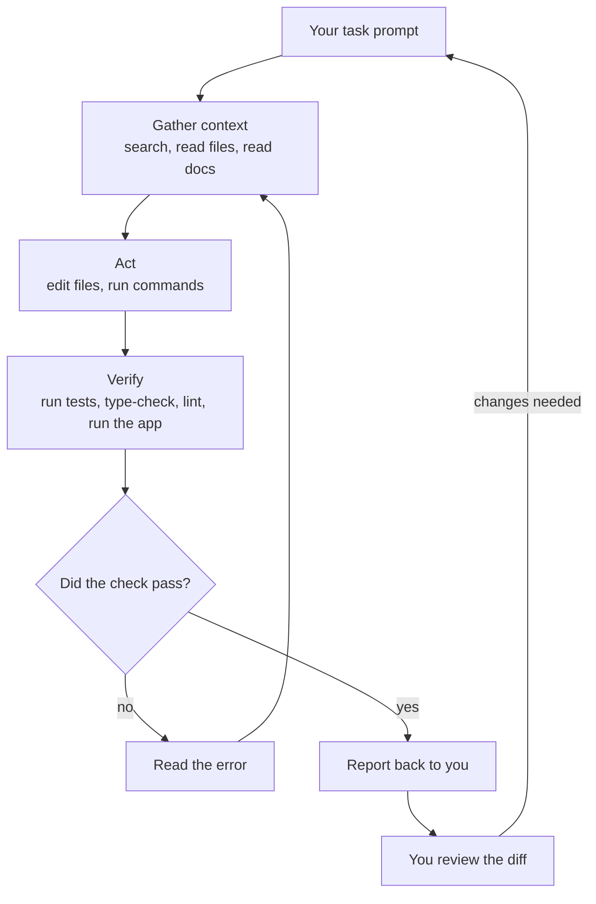

# The Agent Loop and Tools

A model can only produce text. Yet an agent reads your files, runs
`node ace test` and edits your controller. Something between "produce text"
and "change my repository" is doing the work, and understanding it explains
almost every agent behaviour you will see: why it reads five files before
answering, why it sometimes asks permission, and why it is so much better when
it can run your tests.

> **📌 In one line:** the model asks for actions in a structured format, the
> harness runs them and feeds the results back, and this repeats —
> gather context, act, verify — until the task is done; the verify step is
> only as good as the checks you give it.

## Table of Contents

1. [Tool Calling, Plainly](#tool-calling-plainly)
2. [The Loop: Gather Context, Act, Verify](#the-loop-gather-context-act-verify)
3. [The Typical Tools](#the-typical-tools)
4. [Why an Agent That Can Run Tests Wins](#why-an-agent-that-can-run-tests-wins)
5. [What the Agent Cannot See](#what-the-agent-cannot-see)
6. [❌ WEAK vs ✅ STRONG: Giving It a Way to Verify](#-weak-vs--strong-giving-it-a-way-to-verify)
7. [Common Mistakes](#common-mistakes)
8. [Questions to Test Yourself](#questions-to-test-yourself)
9. [Related](#related)

---

## Tool Calling, Plainly

The harness (the program around the model — see
[file 01](01-what-is-an-ai-coding-agent.md#the-definition-model--tools--loop--your-repo))
tells the model, in its instructions: "you may use these tools; to use one,
write a request in this exact format". A **tool** is just a named action with
inputs, such as `read_file(path)` or `run_command(command)`.

When the model decides it needs a file, it does not open it. It writes a
**tool call** — structured text naming the tool and its inputs — and stops.
The harness reads that, actually performs the action, and sends the output
back as a **tool result**. The model then continues, now with the file
contents in its context window.

An illustrative exchange, simplified:

```text
[you]       Why does GET /tasks return 500 when limit=abc?

[model]     tool_call: search(pattern="limit", path="app/")
[harness]   tool_result: app/controllers/tasks_controller.ts:14
                         const limit = Number(request.input('limit', 20))

[model]     tool_call: read_file(path="app/controllers/tasks_controller.ts")
[harness]   tool_result: <file contents>

[model]     Number('abc') is NaN, and NaN is passed to .limit(), which makes
            the SQL query fail. There is no validator on this endpoint...
```

Three things to take from this:

- **The model never touches your machine.** The harness does. So the harness
  is where safety lives: it can ask your permission, refuse, or restrict.
- **Every result goes into the context window.** A big file or a noisy command
  output costs space (see [file 02](02-how-llms-work-just-enough.md#the-context-window)).
- **The model chooses which tools to call.** It can choose badly: skip reading
  a file it needed, or run a command you would not have run.

---

## The Loop: Gather Context, Act, Verify

An agent repeats tool calls until it decides it is done. Watch any agent long
enough and you will see the same three phases.



| Phase | What it looks like | What goes wrong if it is skipped |
|---|---|---|
| **Gather context** | Searching for "status", reading the controller and an existing test | It writes code for an imagined project instead of yours |
| **Act** | Editing three files | — |
| **Verify** | `node ace test`, `npx tsc --noEmit`, `npm run lint` | It reports success it has not checked |

The last box matters most: **you are the final step of the loop.** The agent's
verification only covers what its checks cover.

> **💡 Tip:** if you see an agent jump straight to editing without reading
> anything, interrupt it. Code written before reading is code written for a
> project that does not exist.

---

## The Typical Tools

Most coding agents ship with a similar set. Names differ between products;
Claude Code's names are given because you will see them on screen from Part 2.

| Tool kind | Claude Code name | What it does | Risk level |
|---|---|---|---|
| Read a file | `Read` | Returns file contents | Low — but can read secrets like `.env` |
| Find files | `Glob` | Lists files matching a pattern like `app/**/*.ts` | Low |
| Search contents | `Grep` | Finds lines matching a pattern | Low |
| Edit a file | `Edit`, `Write` | Changes or creates files | Medium — reversible with git |
| Run a command | `Bash` | Runs any shell command | **High** — can do anything you can |
| Web | `WebFetch`, `WebSearch` | Fetches a page or searches | Medium — brings in untrusted text |

Agents can be given extra tools, such as a database client or an issue
tracker, through a standard called MCP (Part 6).

`Bash` deserves special attention. Through it, an agent can run your tests —
and also `rm -rf`, `git push --force`, `node ace migration:run` against
whatever database `DATABASE_URL` points to, or `curl` your secrets to a
server. That is why harnesses ask permission before running commands, and why
Part 2 spends a whole file on permissions.

> **⚠️ Warning:** web tools bring text the agent did not write and you did not
> check into its context window. That text can contain instructions aimed at
> the agent. This is called **prompt injection**; Part 7 covers it.

---

## Why an Agent That Can Run Tests Wins

Compare two runs of the same task.

**Agent without a check.** It edits the controller, reads it back, sees code
that looks right, and says "Done". If it compared dates as strings, nobody
finds out until a user does.

**Agent with a check.** It edits the controller, runs the test file, sees
`expected 2 tasks, got 3`, reads the failure, fixes the comparison, runs again,
sees green. You received code that has passed at least one real check.

A test, a type-checker, a linter or a `curl` with expected output turns the
loop from "write and hope" into "write, check, fix". Without a check, the
model's only feedback is its own opinion of its code — and file 02 explained
why that opinion is not evidence.

What makes a good check:

- **Fast** — the agent will run it many times. One test file, not the whole
  suite, while iterating.
- **Specific** — it fails for the bug you care about.
- **Honest** — it actually tests behaviour. Agents under pressure sometimes
  weaken a test or skip it to make it pass; Part 4 shows how to spot this.

---

## What the Agent Cannot See

The context window holds only what was put there. The agent cannot see:

| It cannot see | Example | What to do |
|---|---|---|
| What is in your head | "Admins must never see other companies' invoices" | Say it in the prompt, or in project memory (Part 3) |
| Team decisions not in the repo | "We stopped using that helper last month" | Write it into the memory file |
| Runtime state | What is in your local database right now | Let it run a query or command, or paste output |
| Production | Real data, real traffic, prod logs | Paste the relevant log lines; never give it prod credentials |
| The UI | How the Next.js page actually looks | Give a screenshot or a browser tool |
| Anything after its cutoff | A library change from last month | Point it at the docs or changelog |
| Files outside the project folder | A shared package in another repo | Add that directory explicitly |

Whatever it cannot see, it will fill in with a plausible guess. **Most "the
agent is stupid" moments are "the agent could not see X" moments.** Ask
yourself what it was missing before you blame the model.

---

## ❌ WEAK vs ✅ STRONG: Giving It a Way to Verify

```text
❌ WEAK
Fix the 500 on GET /tasks when limit is not a number.
```

It may add a `Number.isNaN` check, say "Fixed", and never run anything.

```text
✅ STRONG
GET /tasks returns 500 when limit=abc. It should return 422 with our usual
validation error shape (see how POST /tasks reports errors).
1. First add a failing case to tests/functional/tasks.spec.ts and run it to
   show it fails.
2. Then fix it using a validator, like the other endpoints do.
3. Run `node ace test --files tests/functional/tasks.spec.ts` and show me
   the output.
```

The strong version gives a target behaviour, an example to copy, and a check
the agent must run and show you. You can see the evidence, not just the claim.

---

## Common Mistakes

| Mistake | Why it is wrong | Do this instead |
|---|---|---|
| Not giving the agent a test or command to run | Its only check is its own opinion | Name the exact command that proves the task is done |
| Approving every command without reading it | `Bash` can do anything you can do | Read each command; Part 2 covers what never to approve |
| Blaming the model for missing context | It cannot see what was not given to it | Ask what it was missing; add it to the prompt or memory |
| Accepting edits made before any reading | It is coding against an imagined project | Interrupt and ask it to read the relevant files first |
| Letting it fetch random web pages freely | Untrusted text can carry injected instructions | Point it at specific official docs |

---

## Questions to Test Yourself

1. In your own words: when an agent "reads a file", what does the model do,
   and what does the harness do?
2. Draw the gather → act → verify loop from memory. Where are you in it?
3. An agent fixed a bug and said "Done" without running anything. What was
   missing from your prompt, and how would you add it?
4. Which tool in the table can do the most damage, and give three concrete
   ways it could hurt `saas-api` or your machine.
5. The agent keeps using a helper your team deprecated last month. Which row
   of "What the Agent Cannot See" is this, and what is the lasting fix?
6. Why should the check the agent runs while iterating be one test file rather
   than the whole suite?

---

## Related

- [How LLMs Work — Just Enough](02-how-llms-work-just-enough.md) — why the
  model's own opinion of its code is not evidence.
- [The Tool Landscape](04-the-tool-landscape.md) — which products give agents
  which tools.
- [Permissions and Modes](../02-setup-and-first-session/03-permissions-and-modes.md)
  — controlling what the agent may run.
- [Tests and TDD with an Agent](../04-everyday-workflows/04-tests-and-tdd-with-an-agent.md)
  — tests as the agent's feedback loop.
- [MCP Servers](../06-customising-your-agent/04-mcp-servers.md) — adding tools.
- [Prompt Injection and Agent Security](../07-advanced/03-prompt-injection-and-agent-security.md)
  — when tool results contain instructions.
- [Building Your Own Agent](../07-advanced/05-building-your-own-agent.md) —
  this loop in about sixty lines of code.
- [Testing Pyramid — Part 1](../../backend-fundamentals/13-testing-and-quality/01-testing-pyramid-part-1.md)
  — which kind of test makes the best check.
