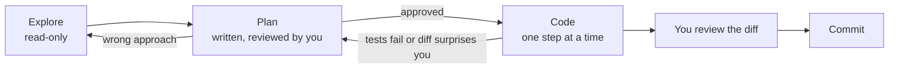

# Explore, Plan, Code, Commit

The ticket says "email customers when an invoice is overdue". The agent
starts typing at once. Ten minutes later you have a `setInterval` in the API
process that would send every email three times on three servers, a new mailer
next to the one you already have, and a migration you did not ask for. Every
line looks reasonable. The approach is wrong, and you find out after reading
400 lines of diff. The fix is an order of work that catches a wrong approach
while it is still one paragraph long.

> **📌 In one line:** explore before you plan, agree a plan before any code,
> build in small checked steps, and review and commit yourself. The cheapest
> place to fix a mistake is the plan.

## Table of Contents

1. [The Workflow at a Glance](#the-workflow-at-a-glance)
2. [Explore: Read Before Writing](#explore-read-before-writing)
3. [Plan: Use Plan Mode](#plan-use-plan-mode)
4. [Make the Agent Ask You Questions](#make-the-agent-ask-you-questions)
5. [Reviewing a Plan Before Any Code](#reviewing-a-plan-before-any-code)
6. [Code: Small Steps, Each Checked](#code-small-steps-each-checked)
7. [Commit: You Review, You Commit](#commit-you-review-you-commit)
8. [Course-Correcting and Interrupting](#course-correcting-and-interrupting)
9. [Common Mistakes](#common-mistakes)
10. [Questions to Test Yourself](#questions-to-test-yourself)
11. [Related](#related)

---

## The Workflow at a Glance

This is **this track's recommended workflow** for any change bigger than a
few lines: not an official standard, but in line with the
[best practices](https://code.claude.com/docs/en/best-practices) page (plan
first, give it a way to verify, course-correct early).



| Step | Agent may edit files? | Your job |
|---|---|---|
| Explore | No | Ask questions, check its answers |
| Plan | No | Read, question and correct the plan |
| Code | Yes, step by step | Watch, interrupt, run checks |
| Commit | No (you commit) | Read the diff, explain every line |

---

## Explore: Read Before Writing

First, the agent learns the relevant part of the codebase, and so do you.
Nothing is edited.

```text
❌ WEAK
implement overdue invoice reminders

✅ STRONG
Don't write any code yet. I need to add overdue-invoice reminder emails.
Find and summarise, with file paths:
- how invoices store status and due dates
- how we send email today (which mailer, sync or queued)
- how BullMQ jobs are defined and scheduled in app/jobs
- any existing scheduled or repeatable job I can copy
```

Summaries can be confidently wrong, so open two or three of the files it
names and check. This is also where *you* learn the code, the point of the
[New Ticket Checklist](../../doc/career-roadmap.md#workflow-change-new-ticket-checklist).

---

## Plan: Use Plan Mode

**Plan mode** is a permission mode where the agent can read and explore but
not edit files. Three ways in:

- press `Shift+Tab` to cycle modes until the prompt shows plan mode;
- type `/plan` (optionally followed by a description of the task);
- start the session with `claude --permission-mode plan`.

[Permissions and Modes](../02-setup-and-first-session/03-permissions-and-modes.md)
explains the other modes. In plan mode, ask for a plan you can review:

```text
Write a step-by-step plan for overdue-invoice reminders. For each step:
files to change, what changes, and how we test it. Include: how the job is
scheduled, how we avoid emailing the same invoice twice, and what happens
if the mail provider is down. Save the plan to docs/plans/invoice-reminders.md
once I approve it.
```

**Save the plan to a file.** A chat plan is lost on `/clear` and blurred by
`/compact`; a file survives both and lets a fresh session resume exactly
([Managing the Context Window](02-managing-the-context-window.md)).

> **💡 Tip:** the `opusplan` model alias uses a stronger model while planning
> and a faster one while executing. Check `/model` and the
> [model docs](https://code.claude.com/docs/en/model-config) for what is
> available on your plan (2026).

---

## Make the Agent Ask You Questions

Agents tend to guess rather than ask. Turn that around on purpose:

```text
Before you write the plan, ask me up to five questions about anything
ambiguous in this ticket. Wait for my answers.
```

Good questions come back: *How many days overdue? Once or repeatedly? Which
timezone? Which template?* Each would otherwise be a silent guess in the code,
and some reveal that **you** had not decided yet.

---

## Reviewing a Plan Before Any Code

The most valuable five minutes of the task. Read it like a colleague's design:

| Check | Example red flag in the reminder plan |
|---|---|
| Does it reuse what exists? | "Create `app/services/email_service.ts`" when a mailer exists |
| Does it fit the architecture? | A timer in the API process instead of a BullMQ repeatable job |
| Are failures handled? | No retry; no record of which reminders were sent |
| Is it idempotent? | Running the job twice sends two emails |
| Is the scope right? | "Also refactor InvoicesController" |
| Is there a test for each step? | "Testing: run the app and check" |
| Is anything dangerous? | Running migrations, touching `.env`, new dependencies |

Then correct it in plain words, and ask for a revised plan:

```text
Changes: use the existing InvoiceMailer. Schedule with a BullMQ repeatable
job in the worker, not in the API. Add a reminder_sent_at column (new
migration) so a job run twice sends nothing new. No controller refactor.
Update the plan file.
```

> **📌 Remember:** you can only review a plan for code you understand. If a
> step makes no sense to you, ask *why* before approving, the same as with a
> senior. Approving a plan you cannot explain breaks the
> [One Rule](../../doc/career-roadmap.md#the-one-rule) one step early.

---

## Code: Small Steps, Each Checked

Leave plan mode (`Shift+Tab`) and implement **one step at a time**:

```text
❌ WEAK
ok implement the plan

✅ STRONG
Implement step 1 of docs/plans/invoice-reminders.md only (the migration and
model change). Then run npx tsc --noEmit and npm test, and stop. Tick the
step in the plan file.
```

After each step: read `git diff`, run the checks, commit if good. Each diff
stays readable, and a bad step costs one step, not the feature
([Building a Feature — Part 2](../04-everyday-workflows/02-building-a-feature-part-2.md)).

---

## Commit: You Review, You Commit

The agent can draft the message; **you** decide the change is ready, by
answering the roadmap's five questions about the diff
([The Review Mindset](../05-reviewing-ai-code/01-the-review-mindset.md)).
Messages and PRs: [Commits, PRs and Code Review](../04-everyday-workflows/06-commits-prs-and-code-review.md).
Never let the agent push.

---

## Course-Correcting and Interrupting

You do not have to wait for the agent to finish a wrong idea.

| Key or command | What it does | Use it when |
|---|---|---|
| `Esc` | Stops the agent mid-turn; work so far is kept | It is heading the wrong way |
| `Esc Esc` or `/rewind` | Restore code and/or conversation to an earlier prompt | A whole attempt was wrong |
| `/clear` | Fresh context | The session is confused; restart from the plan file |

After `Esc`, say what was wrong in one sentence ("no, reuse InvoiceMailer").
At minute one that costs a sentence; at minute ten, a rewind.

> **⚠️ Warning:** rewind restores files the agent *edited*. It does **not**
> undo what a command did: a migration it ran, a package it installed, an
> email it sent. Checkpoints are not a substitute for git
> ([Git as Your Safety Net](../02-setup-and-first-session/04-git-as-your-safety-net.md)).

**When to skip steps.** A typo or a one-line fix you fully understand does not
need a plan. If you can describe the whole diff in one sentence, skip to Code.
If you cannot, plan.

---

## Common Mistakes

| Mistake | Why it is wrong | Do this instead |
|---|---|---|
| Asking for code before exploring | The agent picks an approach before anyone checks it | "Don't write code yet" + explore |
| Approving a plan you skimmed | Wrong approaches are cheapest to fix here | Review with the checklist above |
| "Implement the plan" in one go | One huge diff nobody can review | One step per prompt, check, commit |
| Keeping the plan only in the chat | Lost on `/clear`, blurred by `/compact` | Save it to `docs/plans/` |
| Waiting for a wrong turn to finish | Wastes time and context | `Esc`, one-sentence correction |
| Trusting rewind to undo a migration | Command side effects are not tracked | Git, and no migrations without asking |

---

## Questions to Test Yourself

1. Why is a wrong approach cheaper to fix in the plan than in the code?
2. Name three ways to enter plan mode in Claude Code.
3. The plan says "add a cron with `setInterval` in `start/kernel.ts`". What
   is wrong, and what do you write back?
4. The agent ran `node ace migration:run` and then you rewound. What state is
   your database in?
5. Write a prompt that makes the agent ask you questions before planning.
6. When is it fine to skip straight to coding?

---

## Related

- [Writing Good Task Prompts](01-writing-good-task-prompts.md) — the prompt
  for each step.
- [Managing the Context Window](02-managing-the-context-window.md) — why the
  plan lives in a file.
- [Permissions and Modes](../02-setup-and-first-session/03-permissions-and-modes.md)
  — plan mode among the other modes.
- [Building a Feature — Part 1](../04-everyday-workflows/02-building-a-feature-part-1.md)
  — this workflow on a full ticket.
- [The Review Mindset](../05-reviewing-ai-code/01-the-review-mindset.md) —
  what "you review" really means.
- [Background Jobs](../../caching-and-background-jobs/03-background-jobs/) —
  why reminders belong in a worker.
