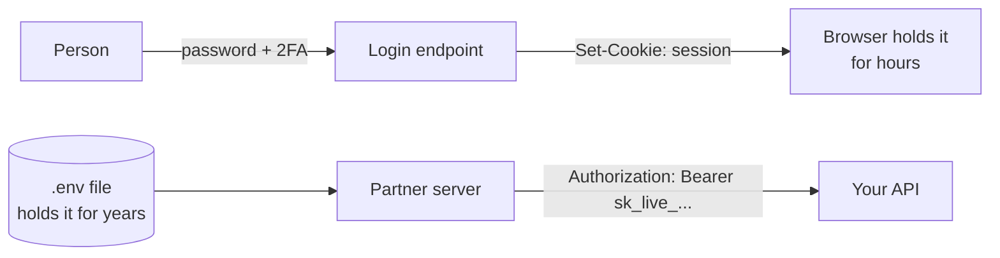
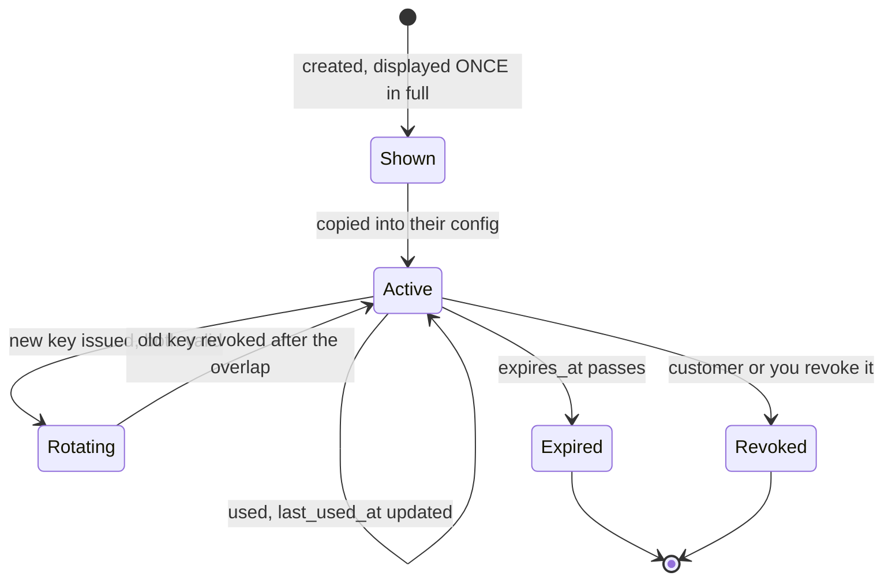
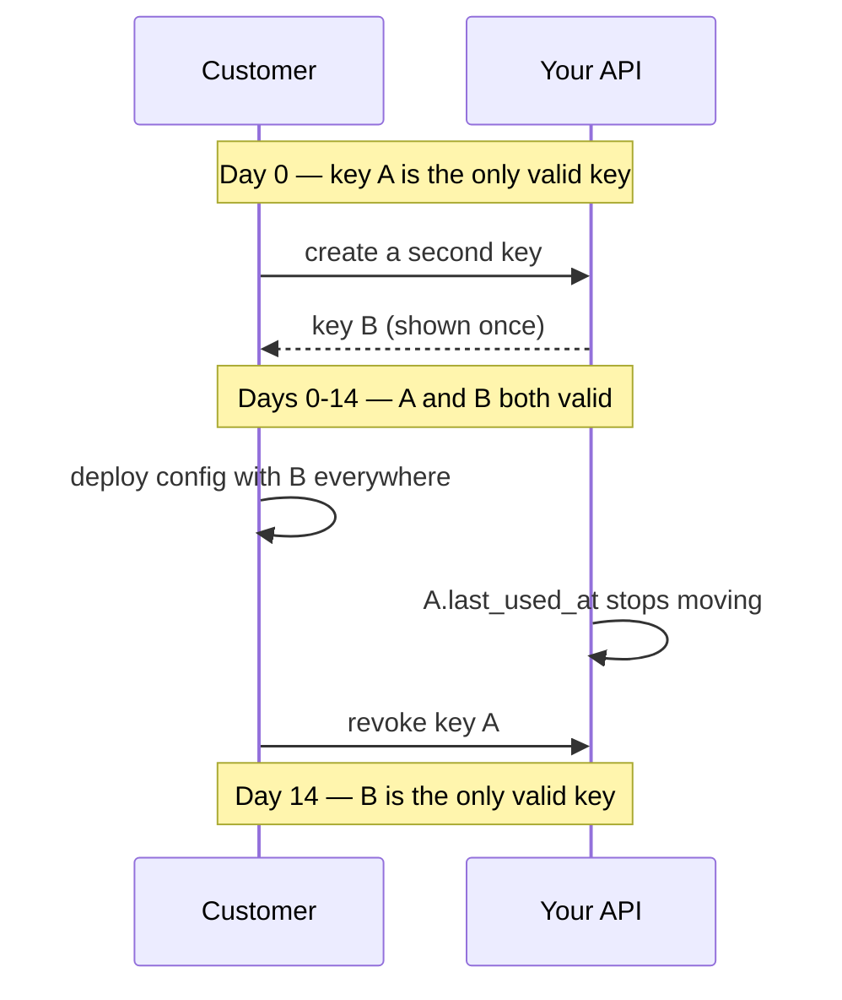

# API Keys and Machine Auth — Part 1

A hotel gives a guest a room key after checking a passport. A delivery van at
the loading bay gets something different: a printed gate pass with a barcode.
Nobody asks the van for a password, texts it a code, or expects it to click
"I agree". The van is not a person. It needs a credential a machine can carry,
present, and have cancelled.

Every earlier file assumed a human at a keyboard. This file is about the other
half of your traffic: the partner's server calling at 3 AM, the webhook you
send, the CI pipeline that deploys, the CLI on a laptop.

Part 1 is the key itself: generating it, storing it hashed, finding it again,
and its lifecycle. Part 2 covers how it travels, how you limit it, and the
stronger options that replace it.

> **➡️ Continued in [Part 2](06-api-keys-and-machine-auth-part-2.md).**

> **📌 In one line:** an API key is a password for a program — so store it
> hashed, give it a visible prefix so you can find it, scope it to one tenant
> and a few permissions, and design for the day it leaks.

## Table of Contents

1. [When the Caller Is a Program](#when-the-caller-is-a-program)
2. [Why the Human Login Flows Do Not Fit](#why-the-human-login-flows-do-not-fit)
3. [What an API Key Actually Is](#what-an-api-key-actually-is)
4. [Generating a Key Safely](#generating-a-key-safely)
5. [Key Format and the Visible Prefix](#key-format-and-the-visible-prefix)
6. [Store Keys Hashed, Like Passwords](#store-keys-hashed-like-passwords)
7. [The Lookup Problem and Its Fix](#the-lookup-problem-and-its-fix)
8. [BROKEN vs FIXED: Plain Text and Loose Comparison](#broken-vs-fixed-plain-text-and-loose-comparison)
9. [The Key Lifecycle](#the-key-lifecycle)
10. [Rotation With an Overlap Window](#rotation-with-an-overlap-window)
11. [Scoping to Permissions and One Tenant](#scoping-to-permissions-and-one-tenant)
12. [Common Mistakes](#common-mistakes)
13. [Questions to Test Yourself](#questions-to-test-yourself)
14. [Related](#related)

---

## When the Caller Is a Program

**Machine-to-machine authentication** (**M2M**) is authentication where no human
is present at the call. Four shapes cover almost all of it:

| Caller | Example | Where the credential lives |
|---|---|---|
| **Server-to-server** | A customer's backend syncs orders every 10 minutes | Their environment config |
| **Outgoing webhook** | You `POST` `invoice.paid` to a customer URL | You sign; they verify |
| **CLI tool** | `acme deploy --env=prod` | A file in the developer's home directory |
| **CI pipeline** | Actions runs your migration on merge | The CI provider's secret store |

The common thread: the credential sits **at rest, in a file, for a long time**.
A human session lasts an afternoon; a machine credential may sit in a `.env`
for two years. That difference drives every decision below.



---

## Why the Human Login Flows Do Not Fit

Ask each mechanism from the earlier files what it assumes.

| Mechanism | Assumes | What breaks for a program |
|---|---|---|
| **Password login** ([file 02](02-passwords-and-hashing.md)) | A memorised secret | Nothing memorises; it lands in a config file and is now the *account* password |
| **Session cookie** ([file 03 part 1](03-cookies-and-sessions-part-1.md)) | A browser cookie jar | A cron job has none, and the session expires while nobody is watching |
| **OAuth2 auth code** ([file 05 part 1](05-oauth2-and-social-login-part-1.md)) | A redirect and a consent click | No browser, nobody to consent |
| **Password reset email** | A mailbox someone reads | Nobody reads `ci-bot@acme.com` |

> **⚠️ Warning:** the worst pattern in this file is creating a normal user
> account for a script — `integration@acme.com` with a password in the CI
> config. It inherits a human's full permissions, cannot be scoped, has no
> owner, and outlives whoever made it. Machines get machine credentials.

One human flow does fit: the **client credentials** grant from
[file 05 part 1](05-oauth2-and-social-login-part-1.md#the-other-grant-types),
which swaps a long-lived secret for a short-lived token. Part 2 puts it in the
decision table beside keys, mTLS, and workload identity.

---

## What an API Key Actually Is

An API key is **a long random string that identifies and authenticates a caller
in one value**. It is a *bearer* credential: whoever bears it, is it. No second
factor, no proof of possession — the string *is* the permission. Two consequences
matter more than any code you will write. **A key in a log
file is a live credential**, not a hint about one. And **you cannot tell a
stolen key from a real one by looking at the request** — the bytes are
identical, only behaviour differs, which is why Part 2's monitoring is not
optional.

Keys stay popular because integration is one line for the customer:

```bash
curl https://api.acme.com/v1/invoices \
  -H "Authorization: Bearer sk_live_<32-random-chars>"
```

That onboarding is the whole business case; the rest of this file makes it
survivable.

---

## Generating a Key Safely

**Rule 1 — use a cryptographically secure generator.** In Node that is
`crypto.randomBytes`, never `Math.random()`, which is a fast arithmetic
sequence: given enough outputs an attacker reconstructs its state and predicts
every future key.

**Rule 2 — use enough bytes.** 32 bytes is 256 bits. Nothing guesses that — not
because guessing is slow, but because there are more possible keys than atoms
in the observable universe. Below 16 bytes you are trusting arithmetic you have
not done.

```ts
import crypto from 'node:crypto'

// 32 bytes → 256 bits → 43 base64url characters.
// base64url is URL- and header-safe: A-Z a-z 0-9 - _ with no padding.
const secret = crypto.randomBytes(32).toString('base64url')
```

| Source | Predictable? | Use for keys |
|---|---|---|
| `Math.random()`, `Date.now()`, a counter | Yes — reconstructible or trivial | **Never** |
| `uuidv4()` | No, but 122 bits and easily mistaken for an id | Acceptable, not ideal |
| `crypto.randomBytes(32)` | No | **Yes** |

> **💡 Tip:** encode with `base64url`, not plain base64, whose `+`, `/`, and `=`
> get mangled by URL encoding, shell quoting, and copy-paste into a config
> file. Hex is safe too, but needs 64 characters for the same 32 bytes.

---

## Key Format and the Visible Prefix

A bare random string tells nobody anything. Real providers ship a **structured**
key, and the convention is worth copying exactly:

```text
sk_live_<32-random-chars>
│  │    └── the secret: 32 random bytes
│  └─────── environment: live | test
└────────── type: sk = secret key, pk = publishable key
```

Four benefits, none cosmetic:

| Benefit | Why it matters |
|---|---|
| **Secret scanners can find it** | GitHub and commercial scanners match known prefixes. A random blob is invisible; `sk_live_` is a fingerprint. Register your pattern with GitHub's scanning partner programme — Part 2 covers what happens when they call you |
| **You can grep your own logs** | One search for `sk_live_` answers "did we ever print a key?" in minutes, not days |
| **The environment is obvious** | Someone pasting into a ticket sees `sk_test_` and relaxes, or `sk_live_` and stops |
| **You reject nonsense cheaply** | An unknown prefix fails in a microsecond, before touching the database |

> **⚠️ Warning:** do not encode the customer id, an environment id, or a
> timestamp inside the *secret* portion. Anything you encode, an attacker can
> read — and partly predictable bytes mean less entropy than you think.

---

## Store Keys Hashed, Like Passwords

The rule that makes everything else necessary:

> **A table of plain-text API keys is a table of live credentials for every one
> of your customers' accounts.** One leaked backup, one SQL injection, one
> over-broad admin screen, and every integration is compromised at once.

So keys get the treatment passwords get in
[file 02](02-passwords-and-hashing.md): store a **hash**, compare hashes, never
keep the value — which means **you can never show the key again**.

The hashing *choice*, though, differs from passwords, and the reason is worth
understanding rather than memorising.

| | User password | API key |
|---|---|---|
| Entropy | Low — a human chose it | Very high — 256 random bits |
| Brute force is the threat? | Yes, that is the whole point | No, not in any timescale |
| Therefore hash with | **bcrypt / argon2** — deliberately slow | **SHA-256** — fast is fine |
| Cost per verification | 50–300 ms, on purpose | Microseconds |

Slow hashing exists to make *guessing* expensive. Nobody guesses a 256-bit
random string, so slowness buys nothing and costs plenty: a machine caller may
make 100 requests a second, each burning 200 ms of CPU.

```ts
// Deterministic on purpose: we must hash an incoming key and find its row.
// No per-key salt — the key IS 256 random bits, so rainbow tables are moot.
const hashSecret = (s: string) =>
  crypto.createHash('sha256').update(s).digest('hex')
```

> **📌 Remember:** slow hash for low-entropy human secrets, fast hash for
> high-entropy machine secrets. If you ever let a customer *choose* their own
> key, that reasoning collapses and you need bcrypt again — so do not.

---

## The Lookup Problem and Its Fix

Hashing creates a real problem that trips up most first implementations.

A password login has a username: look up the row by email, verify one hash. An
API key arrives **alone** — no username, and a hash cannot be reversed, so you
cannot search by value. The naive answer, loading every row and comparing each
hash, is a full table scan on your hottest path.

**The fix: store a short, non-secret lookup value beside the hash.** Either a
**key id** embedded in the key (`sk_live_<id>_<secret>`), or the **first 8
characters** of the secret in an indexed column. The prefix approach is what
most providers use, because it doubles as the dashboard label —
`sk_live_9f2c1b7e…` lets a customer recognise a key you never stored.

```sql
CREATE TABLE api_keys (
  id           BIGSERIAL PRIMARY KEY,
  company_id   BIGINT NOT NULL REFERENCES companies(id) ON DELETE CASCADE,
  created_by   BIGINT REFERENCES users(id),        -- who made it, for audit
  name         VARCHAR(80) NOT NULL,               -- 'Zapier production'
  -- Indexed, NON-SECRET handle. Safe to show and to log.
  key_prefix   VARCHAR(24) NOT NULL,               -- 'sk_live_9f2c1b7e'
  key_hash     CHAR(64)    NOT NULL,               -- one-way hash of the key
  scopes       TEXT[]      NOT NULL DEFAULT '{}',  -- {'invoices.read'}
  expires_at   TIMESTAMPTZ,                        -- NULL = never
  last_used_at TIMESTAMPTZ,                        -- rotation + forensics
  revoked_at   TIMESTAMPTZ,                        -- soft delete keeps audit
  created_at   TIMESTAMPTZ NOT NULL DEFAULT now()
);

CREATE UNIQUE INDEX ON api_keys (key_hash);        -- exact-match verification
CREATE INDEX        ON api_keys (key_prefix);      -- the fast narrowing lookup
CREATE INDEX        ON api_keys (company_id) WHERE revoked_at IS NULL;
```

Verification in full:

```ts
const PREFIX_LEN = 16   // 'sk_live_' + 8 characters of secret

export async function authenticateApiKey(raw: string): Promise<ApiCaller | null> {
  // 1. Cheap shape check: reject garbage before any database work.
  if (!/^sk_(live|test)_[A-Za-z0-9_-]{32,}$/.test(raw)) return null

  // 2. Narrow by the non-secret prefix — one index hit, not a table scan.
  const row = await db.apiKey.findFirst({
    where: { keyPrefix: raw.slice(0, PREFIX_LEN), revokedAt: null },
  })
  if (!row) return null

  // 3. Timing-safe comparison of the full hashes.
  const incoming = Buffer.from(hashSecret(raw), 'hex')
  const stored   = Buffer.from(row.keyHash, 'hex')
  if (incoming.length !== stored.length) return null
  if (!crypto.timingSafeEqual(incoming, stored)) return null

  // 4. Expiry checked after verification, so expired and wrong look the same.
  if (row.expiresAt && row.expiresAt < new Date()) return null

  void touchLastUsed(row.id)     // fire and forget; see the tip below
  return { companyId: row.companyId, keyId: row.id, scopes: row.scopes }
}
```

> **💡 Tip:** write `last_used_at` at most once a minute per key, or push it to
> a queue. Updating it on every request turns a read-only auth check into a row
> write on your busiest table — a classic self-inflicted outage.

---

## BROKEN vs FIXED: Plain Text and Loose Comparison

Two bugs, one code block, both common in real codebases.

```ts
// ❌ BROKEN — twice over.
export async function authenticateApiKey(raw: string) {
  // (1) Stored exactly as the customer typed it. A database dump, a backup
  //     on S3, or one SQL injection hands over every integration you have.
  const row = await db.apiKey.findFirst({ where: { key: raw } })
  if (!row) return null

  // (2) Even where a hash IS used, === compares byte by byte and returns
  //     early on the first difference, leaking how much was correct.
  if (row.key === raw) return { companyId: row.companyId }
  return null
}
```

**Why plain text is fatal:** there is no recovery. You cannot force-reset keys
the way you force a password reset, because every customer's integration breaks
the instant you rotate. You will be choosing between a global outage and live
credentials in the wild.

**Why `===` is a real bug:** comparison stops at the first mismatching byte. An
attacker who measures response times — a few thousand requests average the noise
away — learns the first character, then the second, and walks the key out. That
is a **timing attack**, the same one described for passwords in
[file 02](02-passwords-and-hashing.md). The defence is a comparison whose
duration does not depend on the data.

```ts
// ✅ FIXED — hashed at rest, prefix for lookup, timing-safe comparison.
//    (the full version is authenticateApiKey in the previous section)
const row = await db.apiKey.findFirst({
  where: { keyPrefix: raw.slice(0, PREFIX_LEN), revokedAt: null },
})
if (!row) return null

const incoming = Buffer.from(hashSecret(raw), 'hex')   // never the raw value
const stored   = Buffer.from(row.keyHash, 'hex')
if (incoming.length !== stored.length) return null     // required by the API
if (!crypto.timingSafeEqual(incoming, stored)) return null
```

Hashing alone already blunts the timing attack — the attacker would be walking
the *hash*, which they cannot reverse. Use `timingSafeEqual` anyway: it is one
line, and it keeps the habit correct for the signature checks in Part 2, where
it genuinely is the only defence.

---

## The Key Lifecycle

A key is not a value you create and forget. It is an object with a life, and
every stage is a product decision.



**Creation.** Always inside a tenant, always with an owner: record `created_by`
and a human `name`. A key nobody can attribute is a key nobody dares revoke.

**Display once.** Return the full key exactly once, on the creation response,
with a plain warning — `"Copy this now. You will not be able to see it again."`
Afterwards show only `key_prefix`. This is not an inconvenience to apologise
for; it is the visible proof that you store keys hashed, and experienced
customers read it that way.

**Expiry.** Give every key an `expires_at` — 90 or 365 days — and warn by email
at 30, 7, and 1 day. Expiry is the only mechanism that ever cleans up
credentials nobody remembers.

**Revocation.** Instant and self-service. Set `revoked_at` instead of deleting,
so the audit log can still say which key did what, and never reissue a value
whose hash is already in the table.

---

## Rotation With an Overlap Window

**Rotation** is replacing a key on purpose, on a schedule, before anything goes
wrong. It turns "we have no idea which keys are out there" into a system you
control. The naive version — delete, then create — causes an outage between the
two steps, so every real rotation uses an **overlap window** where both work:



`last_used_at` is what makes this safe: you do not *guess* whether the old key
is still in use, you look. Not moved in seven days means every deployment has
picked up key B and revoking A is a non-event. Still moving means something you
forgot — a staging box, a cron host, a partner sandbox — holds the old value.

Your design job is to make this possible at all: **allow several active keys
per integration** (a schema enforcing one key per customer makes zero-downtime
rotation impossible), **show `last_used_at` in the dashboard**, **send
reminders** before `expires_at`, and **document the four steps** — create,
deploy, verify, revoke — on the key list page itself.

> **📌 Remember:** rotation is a fire drill you run on a calendar so that the
> real fire — Part 2's leaked key — is a rehearsed procedure rather than an
> improvisation at midnight.

---

## Scoping to Permissions and One Tenant

A key that can do everything is a key you can never safely hand out. Two
dimensions, both mandatory.

**Scope to permissions.** Reuse the `resource.action` names your human roles use
([`../06-authorization/02-rbac.md`](../06-authorization/02-rbac.md)). A
read-only reporting integration gets `invoices.read` and nothing else: if it
leaks, the attacker reads invoices rather than issuing refunds.

```ts
export function requireScope(scope: string) {
  return (req: Request, res: Response, next: NextFunction) => {
    const caller = req.apiCaller
    if (!caller) return res.status(401).json({ error: 'Unauthenticated' })
    if (!caller.scopes.includes(scope)) {
      // 403, not 401: we know exactly who this is, and the answer is no.
      logger.warn({ keyId: caller.keyId, scope }, 'api key scope denied')
      return res.status(403).json({ error: 'Insufficient scope', required: scope })
    }
    next()
  }
}
```

A key must never grant itself more: creating a key with scope `X` requires the
*creating user* to hold `X`, or a member who may manage keys becomes an owner in
two steps — the same privilege-escalation rule as custom roles.

**Scope to one tenant.** `api_keys.company_id` is `NOT NULL`, and the caller
carries that `companyId` into exactly the tenant scope a logged-in user would: a
key is a caller identity, not a back door around isolation. Everything in
[`../06-authorization/03-ownership-abac-and-multi-tenancy-part-2.md`](../06-authorization/03-ownership-abac-and-multi-tenancy-part-2.md)
applies unchanged to key-authenticated requests.

> **⚠️ Warning:** the most dangerous credential in any system is the internal
> "service key" that bypasses tenant scoping so a job can read everything. If
> you must have one, make it a separate credential type with its own storage and
> audit trail, and never let it reach a handler that takes a tenant id from the
> caller.

---

## Common Mistakes

| Mistake | Why it is wrong | Do this instead |
|---|---|---|
| Storing keys in plain text | One leak compromises every integration, with no safe recovery | Store a SHA-256 hash; show it once |
| Comparing with `===` | Early exit leaks the key one character at a time through timing | `crypto.timingSafeEqual` on equal-length buffers |
| Using bcrypt for API keys | 200 ms of CPU per request buys nothing against 256 random bits | SHA-256; keep bcrypt for human passwords |
| No prefix or key id | Lookup becomes a full table scan on your hottest path | Indexed `key_prefix` column beside the hash |
| One key per customer, no rotation path | Rotation becomes an outage, so it never happens | Several active keys plus an overlap window |
| Keys that never expire | They outlive the contractor, the project, and the laptop | Default `expires_at` with reminder emails |
| A key with full account permissions | A leak becomes a total compromise | Scope to `resource.action`, least privilege |
| A fake user account for a script | Unscopeable, unattributable, inherits human permissions | A first-class API key with its own table |

---

## Questions to Test Yourself

1. Name four kinds of machine caller and the property they share that a browser
   session does not, and say why a user account called `ci-bot@acme.com` with a
   password in the CI config is worse than an API key.
2. You store keys hashed, so you cannot look one up by value. Explain the
   lookup problem and the standard fix, including what goes in the index.
3. Why is SHA-256 right for an API key when bcrypt is right for a password?
4. An attacker can measure your response times to the millisecond. Describe how
   `===` on a key hands it to them, and what replaces it.
5. What does `sk_live_` buy you that a bare random string does not? Name three
   benefits.
6. A customer must rotate a key with zero downtime. Write the four steps, and
   name the column that tells you the last one is safe.
7. Why must a key be scoped to a tenant *and* to permissions, and why is
   `revoked_at` better than `DELETE FROM api_keys`?

---

## Related

- [Part 2](06-api-keys-and-machine-auth-part-2.md) — transport, per-key limits,
  HMAC signing, mTLS, workload identity, leaked-key response, decision table.
- [Passwords and Hashing](02-passwords-and-hashing.md) — the hashing and
  timing-safe comparison ideas reused here, and why the cost choice differs.
- [OAuth2 — Part 1](05-oauth2-and-social-login-part-1.md) — the client
  credentials grant, the standardised alternative to a raw key; and
  [JWT — Part 2](04-jwt-part-2.md) — short-lived tokens and the revocation
  problem an overlap window works around.
- [`../06-authorization/02-rbac.md`](../06-authorization/02-rbac.md) — the
  `resource.action` names a key's scopes reuse; and
  [`03-ownership-abac-and-multi-tenancy-part-2.md`](../06-authorization/03-ownership-abac-and-multi-tenancy-part-2.md)
  — the tenant isolation a key-authenticated request must obey.
