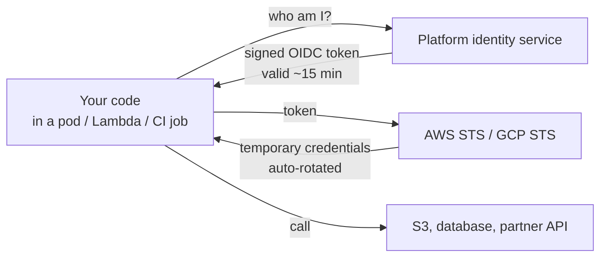

# API Keys and Machine Auth — Part 2

Part 1 built a key you can be proud of: 256 random bits, a visible prefix,
hashed at rest, scoped to one tenant, rotatable without downtime. It is still a
bearer credential, though: whoever holds the string, is the caller. This
part is the consequence of that sentence — how the string travels, how you stop
one key flattening your database, how a **signature** proves more than a shared
secret can, the two designs that remove the secret altogether, and what you do
in the hour after a key lands in a public GitHub repository.

> **⬅️ This continues [Part 1](06-api-keys-and-machine-auth-part-1.md).**

> **📌 In one line:** send the key in a header and never a URL, limit it per
> key, sign webhook bodies with HMAC and a timestamp rather than trusting a
> shared secret, and prefer mTLS or workload identity where you can — the
> safest secret is the one that does not exist.

## Table of Contents

1. [Sending the Key: Headers, Never Query Parameters](#sending-the-key-headers-never-query-parameters)
2. [Rate Limiting and Quotas per Key](#rate-limiting-and-quotas-per-key)
3. [Why a Shared Secret in a Header Is Not Always Enough](#why-a-shared-secret-in-a-header-is-not-always-enough)
4. [HMAC Request Signing](#hmac-request-signing)
5. [Signing and Verifying, With Code](#signing-and-verifying-with-code)
6. [The Timestamp Window and Replay](#the-timestamp-window-and-replay)
7. [Rotating a Signing Secret](#rotating-a-signing-secret)
8. [mTLS: Both Sides Show a Certificate](#mtls-both-sides-show-a-certificate)
9. [Cloud Workload Identity](#cloud-workload-identity)
10. [Detecting a Leaked Key](#detecting-a-leaked-key)
11. [The First Hour After a Leak](#the-first-hour-after-a-leak)
12. [Choosing a Method](#choosing-a-method)
13. [Common Mistakes](#common-mistakes)
14. [Questions to Test Yourself](#questions-to-test-yourself)
15. [Related](#related)

---

## Sending the Key: Headers, Never Query Parameters

Three places a key can travel. Only two are acceptable.

| Transport | Example | Verdict |
|---|---|---|
| **`Authorization: Bearer`** | `Authorization: Bearer sk_live_…` | **Best.** Standard, understood by every proxy and client, and log tooling already redacts it |
| **Custom header** | `X-API-Key: sk_live_…` | Fine, and common for simple APIs. You must configure redaction yourself |
| **Request body** | `{"api_key": "sk_live_…"}` | Avoid. Breaks `GET`, and bodies get logged too |
| **Query parameter** | `?api_key=sk_live_…` | **Never.** See below |

A query parameter is unsafe because everything on the path treats a URL as
public metadata:

1. **Access logs.** Nginx, your load balancer, your CDN, and your framework log
   the full path and query string by default — the key is now in plain text on
   six disks and in whatever aggregator they ship to.
2. **The `Referer` header.** A page that links out hands the full URL, key
   included, to a third-party site.
3. **Browser history, bookmarks, and autocomplete**, syncing to every device.
4. **Shared links.** A URL is what humans paste into tickets and screenshots.
5. **Proxy and CDN caches**, which may store the URL as a cache key, putting a
   customer's secret into infrastructure you share with strangers.

Headers avoid all five: nothing logs request headers by default, and nobody
copies a header into a link. How headers behave through proxies is in
[`../01-http-foundations/05-headers.md`](../01-http-foundations/05-headers.md).

```ts
// ❌ BROKEN — the key lands in every access log between the client and you.
const caller = await authenticateApiKey(String(req.query.api_key))

// ✅ FIXED — read it from Authorization, and only from there.
const [scheme, value] = (req.header('authorization') ?? '').split(' ')
if (scheme?.toLowerCase() !== 'bearer' || !value) {
  res.setHeader('WWW-Authenticate', 'Bearer realm="api"')
  return res.status(401).json({ error: 'Missing API key' })
}
const caller = await authenticateApiKey(value)
if (!caller) return res.status(401).json({ error: 'Invalid API key' })
```

Two rules on your own side. **Require HTTPS** — a bearer token over plain HTTP
is readable by anyone on the path
([`../01-http-foundations/06-https-and-tls.md`](../01-http-foundations/06-https-and-tls.md)).
And **redact in your logger** — add `authorization`, `x-api-key`, and your prefix
pattern to the redaction list, so a debug dump cannot print a live credential
([`../08-logging-and-observability/02-structured-logging.md`](../08-logging-and-observability/02-structured-logging.md)).

---

## Rate Limiting and Quotas per Key

Limiting a machine is not the same problem as limiting a human. A human clicks;
a program loops, and a program with a bug loops as fast as your network allows.

**Limit by key id, not by IP address.** Machine callers sit behind NAT,
serverless platforms, and shared egress ranges, so an IP limit punishes
unrelated customers and misses the real offender.

| Limit | What it protects | Typical shape |
|---|---|---|
| **Requests per minute** | Your database and CPU from a runaway loop | 100/min per key, token bucket |
| **Monthly quota** | Your bill and your pricing model | 100,000 calls per month |
| **Concurrency** | A slow endpoint from 500 calls at once | 10 in flight per key |
| **Per-endpoint limit** | The expensive report endpoint specifically | 5/min on `/v1/reports` |

Always answer with the standard headers, so a well-behaved client slows down
instead of hammering you:

```http
HTTP/1.1 429 Too Many Requests
RateLimit-Limit: 100
RateLimit-Remaining: 0
Retry-After: 37
```

The algorithms and the distributed-counter problem are in
[`../../system-design/foundational/rate-limiting.md`](../../system-design/foundational/rate-limiting.md);
the counter usually lives in
[Redis](../../system-design/foundational/redis.md).

Two details specific to keys. **Cache the authentication result carefully** —
the lookup is not free at 1,000 requests a second, so cache
`prefix → {companyId, scopes}` for 30–60 seconds and **delete the entry on
revocation**, or a revoked key keeps working. And **count denials separately**:
thousands of `401`s or `403`s on one key is a broken integration or somebody
probing with a stolen value — the leak signal below.

---

## Why a Shared Secret in a Header Is Not Always Enough

A bearer key answers one question — *does the caller know the secret?* — and for
two situations that is not enough.

**Webhooks you send.** You `POST` `invoice.paid` to a customer's URL. A shared
secret in a header tells their endpoint only that *someone* knew the secret.
The secret is then sent on every call, so every log and proxy on their side
sees it repeatedly; nothing ties it to *this* body, so a captured delivery can
be re-sent with a changed amount; and they must store it in a comparable form
on a machine you do not control.

**High-value integrations.** A payments or payroll API wants proof that the
exact bytes of this request came from the secret holder, not merely that the
sender once saw a string.

The answer to both is a **signature**: a value computed *from the request
itself* plus the secret, so it cannot be reused for a different request and the
secret never travels.

---

## HMAC Request Signing

**HMAC** (Hash-based Message Authentication Code) takes a message and a secret
and produces a fixed-length tag. Anyone with the secret can recompute the tag;
nobody without it can forge one, and nobody can work backwards to the secret.

The sender builds a **signing string** from the parts of the request that must
not change, HMACs it, and sends the tag in a header. The receiver rebuilds the
same string from what arrived and compares.

```mermaid
sequenceDiagram
    participant S as Sender (you)
    participant R as Receiver (customer endpoint)
    S->>S: t = unix seconds; sig = HMAC_SHA256(secret, t + "." + rawBody)
    S->>R: POST /webhooks  (body + header: t=<t>,v1=<sig>)
    R->>R: is |now - t| <= 300s ?
    R->>R: recompute HMAC over t + "." + rawBody
    R->>R: timingSafeEqual(mine, theirs)
    R->>R: has this event id been processed before?
    R-->>S: 200 OK
```

Three properties a header secret does not have:

| Property | Secret in a header | HMAC signature |
|---|---|---|
| Proves the **body was not modified** | No | Yes — one changed byte changes the tag |
| The secret travels on every request | Yes | **No** — only the tag travels |
| Blocks replay of a captured request | No | Yes, with a timestamp in the signed string |

The third row is the quiet one: the secret exists at the two ends and never on
the wire, so a proxy log on the receiving side cannot leak it.

> **📌 Remember:** the timestamp must be **inside** the signed string. An
> unsigned timestamp header can be edited by the attacker, and the replay
> protection evaporates.

---

## Signing and Verifying, With Code

Sending side. The body is serialised **once** and both signed and sent —
re-serialising can change key order or whitespace and break the signature.

```ts
import crypto from 'node:crypto'

export async function deliverWebhook(url: string, secret: string, event: unknown) {
  const body = JSON.stringify(event)                // serialise ONCE
  const t = Math.floor(Date.now() / 1000)
  const signature = crypto
    .createHmac('sha256', secret)
    .update(`${t}.${body}`)                         // timestamp is INSIDE
    .digest('hex')

  return fetch(url, {
    method: 'POST',
    body,
    headers: {
      'content-type': 'application/json',
      'acme-signature': `t=${t},v1=${signature}`,   // v1 lets you upgrade later
    },
  })
}
```

Receiving side — the code your customers copy, and what you write when you
consume someone else's webhooks:

```ts
const TOLERANCE_SECONDS = 300   // 5 minutes

export function verifyWebhook(rawBody: Buffer, header: string, secret: string) {
  const parts = Object.fromEntries(header.split(',').map((p) => p.split('=')))
  const t = Number(parts.t)
  if (!Number.isFinite(t) || !parts.v1) throw new BadSignatureError()

  // Timestamp window FIRST: a captured request cannot be replayed tomorrow.
  if (Math.abs(Date.now() / 1000 - t) > TOLERANCE_SECONDS) {
    throw new BadSignatureError('timestamp outside tolerance')
  }

  // Recompute over the RAW body — not the parsed object.
  const expected = crypto
    .createHmac('sha256', secret)
    .update(Buffer.concat([Buffer.from(`${t}.`), rawBody]))
    .digest()
  const received = Buffer.from(parts.v1, 'hex')

  // Timing-safe comparison. Lengths must match or the call throws.
  if (expected.length !== received.length) throw new BadSignatureError()
  if (!crypto.timingSafeEqual(expected, received)) throw new BadSignatureError()
}
```

Two details break real implementations. **Use the raw body:** most frameworks
parse JSON before your handler runs, and `JSON.stringify(req.body)` is *not* the
bytes that were signed — key order, unicode escaping, and number formatting all
differ, so configure a raw-body parser for that route. **Compare timing-safely:**
unlike the hashed key in Part 1, an attacker who walks this comparison one byte
at a time recovers a *valid signature* for a body they chose.

---

## The Timestamp Window and Replay

A **replay attack** is capturing a valid request and sending it again. The
signature is still correct because the bytes are unchanged, so the signature
alone does not stop it: `POST /refunds` replayed 200 times is 200 refunds.

The timestamp in the signed string bounds the problem: anything older than the
tolerance is rejected, so a captured request is useless after five minutes. Why
five and not five seconds? Clocks drift, and a receiver whose NTP is 30 seconds
off would reject every legitimate delivery. Five minutes absorbs normal skew
while keeping the window small.

Inside that window you need **idempotency**. Send a unique `event_id` with every
webhook and have the receiver record processed ids, so a duplicate — from a
replay or from your own retry after a timeout — is recognised and ignored.

```ts
if (await processedEvents.has(event.id)) return res.status(200).end()  // no-op
await processedEvents.add(event.id, { ttlDays: 30 })
```

This matters even with no attacker: at-least-once delivery means honest retries
duplicate events. The pattern is in
[`../../system-design/reliability/idempotency.md`](../../system-design/reliability/idempotency.md).

---

## Rotating a Signing Secret

A signing secret rotates like an API key, with one twist: during the overlap the
sender sends **two signatures** and the receiver accepts either.

```text
acme-signature: t=1758240000,v1=<sig with OLD secret>,v1=<sig with NEW secret>
```

The receiver loops over every `v1` value and accepts if any verifies; once the
customer has switched their stored secret, you drop the old signature. This is
why the header is a comma-separated list rather than one value — a decision you
cannot retrofit easily, so use the list format from day one.

---

## mTLS: Both Sides Show a Certificate

Ordinary HTTPS authenticates the **server** to the client: your browser checks
the certificate for `api.acme.com`
([`../01-http-foundations/06-https-and-tls.md`](../01-http-foundations/06-https-and-tls.md)).
**Mutual TLS** adds the other direction — the client presents a certificate too,
and the server refuses the connection unless a CA it trusts issued that one.

The effect: authentication happens **before your application code runs**. An
unauthorised caller never reaches a route handler — they fail the handshake.

| | API key | mTLS |
|---|---|---|
| What is proved | Knowledge of a string | Possession of a private key that never travels |
| Where it is checked | Your application | The TLS layer, before your app |
| Replay of a stolen credential | Trivial | Requires stealing the private key file |
| Setup and revocation cost | Minutes; one database row | A CA, distribution, renewal; CRL or OCSP |
| Good fit | Public developer API, self-service | Banking and payment partners, internal service mesh |

The honest trade-off: mTLS is meaningfully stronger and meaningfully harder.
Certificates expire, and an expired client certificate is a 3 AM outage no log
explains. Use it where a few high-value partners justify the weight, or in a
mesh where the platform rotates for you.

---

## Cloud Workload Identity

Everything so far shares one weakness: a long-lived secret exists in a file and
can be copied. Workload identity removes the secret.

The idea: the platform already knows what your code is. An EC2 instance, a pod,
a Lambda, a GitHub Actions job — each runs somewhere that can vouch for it. So
instead of reading a key from `.env`, the process asks its environment for a
**short-lived token**, and the provider issues one because it can see what asks.



Three forms you will meet:

- **IAM roles** (AWS instance profiles, GCP service accounts, Azure managed
  identities): the SDK fetches temporary credentials from a metadata endpoint —
  no secret in your code, repository, or config.
- **OIDC federation**: GitHub Actions presents a signed token naming the
  repository, branch, and workflow; AWS trusts that issuer and swaps it for
  temporary credentials. This replaces long-lived deploy keys in CI, and the
  token is the same kind of signed JWT as in [file 04](04-jwt-part-1.md).
- **Service mesh identity**: each pod gets a short-lived certificate and mTLS
  between services, with no application code.

| | Long-lived API key | Workload identity |
|---|---|---|
| Secret at rest | Yes, in a file | **None** |
| Lifetime | Months or years | Minutes |
| Rotation and leak impact | Manual; live until revoked | Automatic; expires within minutes |
| Works off a supported platform | Yes | No — the real limitation |

> **📌 Remember:** the advantage is not that the credential is stronger. It is
> that **there is no secret to leak**. A credential that lives 15 minutes and is
> never written to disk cannot be committed to GitHub.

---

## Detecting a Leaked Key

Keys leak in boring ways: committed to a public repository, pasted into a
support ticket, printed by a debug log, shipped inside a mobile app, handed over
in a phishing email. Assume it happens, and build the detection.

**Secret scanning.** Register your prefix pattern with GitHub's secret scanning
partner programme: when a key matching `sk_live_` is pushed to a public
repository, GitHub calls a webhook you provide and you revoke it within seconds.
That one integration catches the most common leak of all — and scan your own
repositories too, with a pre-commit hook.

**Behavioural monitoring.** A stolen key behaves differently from the
integration it came from. Alert on:

| Signal | Why it matters |
|---|---|
| A new IP range or country for a key settled on one for months | The most reliable single indicator |
| A burst of `403`s on scopes the key never used | Somebody exploring what it can reach |
| Volume far above the key's own baseline | Bulk extraction |
| A `sk_live_` prefix matched in your **own** log store, or a dormant key waking up | Your logging is the leak; or someone found an old value |

**Give customers the tools.** Show `last_used_at`, the last IP, and a per-key
activity log: they spot "that key should not be active" faster than you.

---

## The First Hour After a Leak

Treat this as a runbook, not a judgement call at 2 AM. The order matters.

1. **Revoke the key. Now.** Set `revoked_at` and **purge the auth cache entry** —
   a 60-second TTL means 60 more seconds of access. A revoked key is replaced in
   minutes; a live one in the wild is unbounded damage.
2. **Issue a replacement** through a channel you trust, so the pressure to "just
   leave the old one on for now" disappears.
3. **Scope the blast radius.** Query your access logs by `key_id`: which
   endpoints, how many rows, which tenants, from when. This is where you find
   out whether your
   [structured logging](../08-logging-and-observability/02-structured-logging.md)
   was good enough — set it up before you need it.
4. **Decide on disclosure.** If another tenant's data was read you likely have a
   legal notification duty measured in hours — involve whoever owns that
   decision now, not after the investigation.
5. **Remove the key from the source** — knowing that a revert is not a fix. The
   value stays in git history, forks, and caches; the key is dead because you
   revoked it.
6. **Write the follow-up.** Why did that key hold more scopes than it needed?
   Why no expiry? Why did nobody notice? Each answer becomes a change in Part
   1's lifecycle.

> **⚠️ Warning:** the instinct to investigate before revoking is the most
> expensive mistake in this file. Revocation is cheap and reversible — you can
> always issue a new key. Every minute of investigation with the key still live
> is a minute of active exfiltration.

---

## Choosing a Method

| Situation | Method | Why |
|---|---|---|
| Public developer API, self-service | **API key** | One-line onboarding; scoped, hashed, rotatable |
| Webhooks **you send** to customers | **HMAC signature + timestamp** | Proves the body is unmodified and blocks replay; no secret on the wire |
| Your service calling a partner's OAuth2 API | **Client credentials grant** | The long-lived secret stays home; only short tokens travel |
| Code running on AWS / GCP / Azure | **Workload identity (IAM role)** | No secret at rest, automatic rotation |
| CI deploying to your cloud | **OIDC federation** | Replaces a deploy key with a 15-minute token |
| A handful of high-value partners (banking, payroll) | **mTLS**, often plus HMAC | Authentication before your app runs; per-partner certificates |
| A script on a developer's laptop | **Short-lived key or device flow** | Laptops get lost; never a long-lived production key |

The ordering principle, strongest first: **no secret** (workload identity) beats
**a secret that never travels** (mTLS, HMAC) beats **a secret that travels on
every request** (API key). Use the strongest option your customers can actually
operate — an mTLS setup nobody can renew is weaker in practice than a
well-managed API key.

---

## Common Mistakes

| Mistake | Why it is wrong | Do this instead |
|---|---|---|
| Key in a query parameter, or no redaction rule in the logger | Access logs, `Referer`, history, proxy caches — or your own logs become the leak | `Authorization: Bearer`, plus a redaction list |
| Rate limiting by IP for machine callers | NAT and serverless make IPs meaningless | Limit by `key_id` |
| A shared secret in a webhook header, or signing the parsed body | Sent on every call and proves nothing about the bytes; parsed JSON is not the signed bytes | HMAC over the **raw** body |
| Timestamp sent but not inside the signed string | The attacker edits it, and replay protection vanishes | Sign `timestamp + "." + body` |
| No `event_id` deduplication | Honest retries process the payment twice | Record processed ids with a TTL |
| A single signature value in the header | Signing-secret rotation becomes an outage | A comma-separated list from day one |
| Investigating before revoking a leaked key | Every minute is more exfiltration | Revoke first, then investigate |

---

## Questions to Test Yourself

1. List five places a key in a query string ends up, say why a header avoids all
   of them, and why you limit a machine caller by key id rather than by IP.
2. A provider sends you a webhook with a shared secret in a header. Name three
   things an HMAC signature proves that this does not, and say why the timestamp
   must be inside the signed string rather than in a separate header.
3. Your webhook verification fails for one customer whose payload contains an
   emoji. What is the most likely cause?
4. Explain replay, why a correct signature does not prevent it, and which two
   mechanisms together do.
5. You must rotate a signing secret with no downtime. Describe the header format
   that makes this possible.
6. What does mTLS prove that an API key does not, what is its most common
   operational failure, and why is "there is no secret to leak" stronger than
   "the secret is very long"?
7. A key appears in a public GitHub repository. Write your first four actions in
   order, and justify why revocation comes before investigation.

---

## Related

- [Part 1](06-api-keys-and-machine-auth-part-1.md) — generating, hashing,
  storing, scoping, and rotating the key this part sends.
- [OAuth2 — Part 1](05-oauth2-and-social-login-part-1.md) — the client
  credentials grant from the decision table; and
  [JWT — Part 1](04-jwt-part-1.md) — the signed token behind OIDC federation,
  with the same verification discipline.
- [`../01-http-foundations/05-headers.md`](../01-http-foundations/05-headers.md)
  and [`06-https-and-tls.md`](../01-http-foundations/06-https-and-tls.md) — what
  plain TLS proves before mTLS is added.
- [`../../system-design/foundational/rate-limiting.md`](../../system-design/foundational/rate-limiting.md)
  — the algorithms behind per-key limits, and
  [`idempotency.md`](../../system-design/reliability/idempotency.md) for
  deduplicating replayed and retried deliveries.
- [`../08-logging-and-observability/02-structured-logging.md`](../08-logging-and-observability/02-structured-logging.md)
  — redaction, and the `key_id` field that makes an investigation possible; and
  [`../11-api-security/01-owasp-top-10-for-apis.md`](../11-api-security/01-owasp-top-10-for-apis.md)
  — where broken machine auth sits in the attack catalogue.
