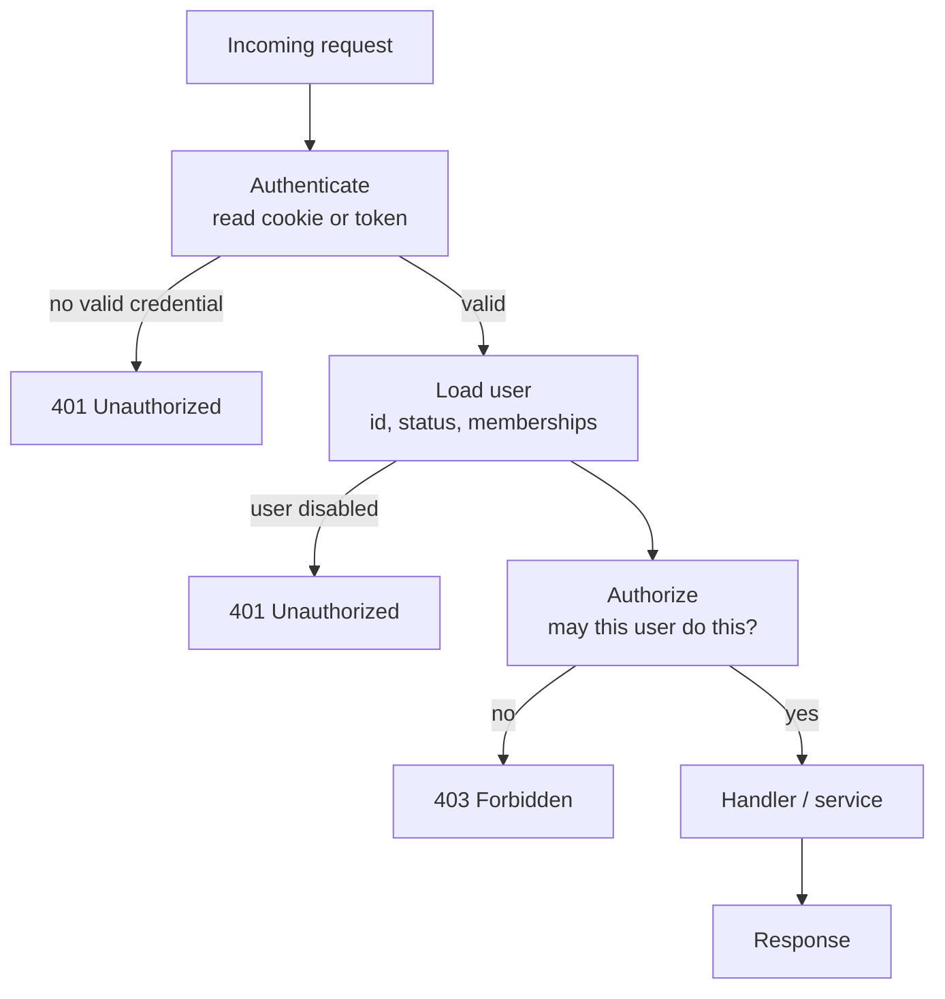
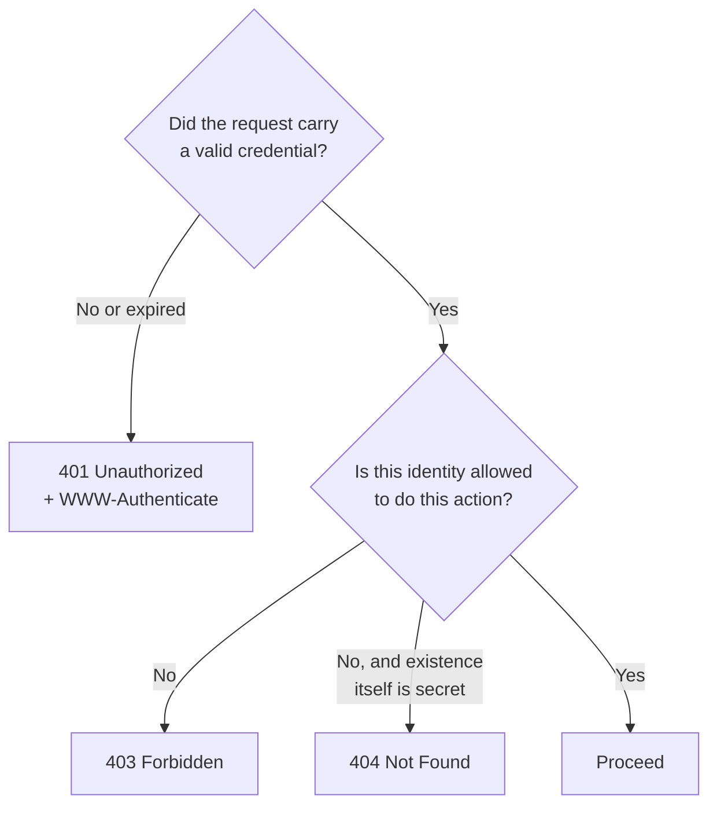
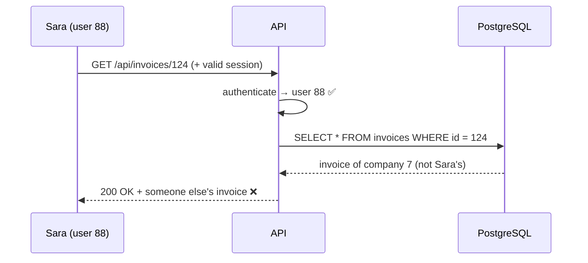

# Authentication vs Authorization

You walk into a hotel. At reception you show your passport. The clerk looks at
your face, looks at the photo, and agrees that you are the person on the
booking. That is **authentication**.

Then the clerk hands you a key card. That card opens room 412 and the gym. It
does not open room 413, and it does not open the manager's office. That is
**authorization**.

Two different questions, asked at two different moments, by two different parts
of the system. Most serious API breaches happen because a team built the first
one well and forgot the second one entirely.

> **📌 In one line:** authentication proves *who you are*; authorization decides
> *what you may do*, and proving who you are tells the server nothing about
> which rows in the database belong to you.

## Table of Contents

1. [The Two Questions in Plain Words](#the-two-questions-in-plain-words)
2. [Why They Are Separate Steps](#why-they-are-separate-steps)
3. [401 vs 403: Which One and When](#401-vs-403-which-one-and-when)
4. [Broken Object Level Authorization (BOLA / IDOR)](#broken-object-level-authorization-bola--idor)
5. [Authentication Alone Proves Nothing About Ownership](#authentication-alone-proves-nothing-about-ownership)
6. [Where Authorization Checks Belong](#where-authorization-checks-belong)
7. [Fail Closed by Default](#fail-closed-by-default)
8. [The Three Questions Every Check Answers](#the-three-questions-every-check-answers)
9. [Advanced: Authorize in the Query, Not After the Fetch](#advanced-authorize-in-the-query-not-after-the-fetch)
10. [Common Mistakes](#common-mistakes)
11. [Questions to Test Yourself](#questions-to-test-yourself)
12. [Related](#related)

---

## The Two Questions in Plain Words

**Authentication** (often written **authn**) answers: *who is calling?*

The caller presents something only they should have — a password, a session
cookie, a signed token, an API key. The server checks it and ends up with an
identity: "this request is from user 88, Sara".

Part 5 — [Authentication](../05-authentication/) covers how that check works.

**Authorization** (often written **authz**) answers: *may this caller do this
specific thing to this specific record?* The server already knows the caller is
user 88. Now it must decide whether user 88 may delete project 17.

| | Authentication | Authorization |
|---|---|---|
| Question | Who are you? | What may you do? |
| Runs | Once per request, early | Many times per request, later |
| Input | Cookie, token, API key | Identity + action + resource |
| Output | An identity, or nobody | Allow or deny |
| Failure status | `401 Unauthorized` | `403 Forbidden` |
| Hotel analogy | Passport at reception | What the key card opens |

> **💡 Tip:** the HTTP status names are historically confusing. `401` is really
> "unauthenticated" and `403` is really "unauthorized". Learn the meanings, not
> the words.

---

## Why They Are Separate Steps

They change for different reasons, so they live in different code.
Authentication changes when you add Google login. Authorization changes when the
product adds a "viewer" role. If both live in one function, every product change
forces you to edit security-critical login code.

So a normal request pipeline runs them as separate middleware, in order:



Three properties of this pipeline matter.

1. **Order is fixed.** You cannot authorize an unknown caller. Authentication
   must finish first.
2. **Authentication is generic.** It does not know what the route does.
3. **Authorization is specific.** It needs the route, the action, and usually
   the record being touched — which means part of it can only run *inside* the
   handler, after you know which record that is.

That last point surprises people. Middleware can check "is this user an admin?"
before the handler runs. It cannot easily check "does invoice 124 belong to this
user's company?", because the record is not loaded yet. Record-level checks
belong in the service layer. File 03 shows how to structure that.

---

## 401 vs 403: Which One and When

Use this decision:



- **401** means "I do not know who you are." Logging in might fix it. Retrying
  with the same credential will not.
- **403** means "I know exactly who you are, and the answer is still no."
  Logging in again changes nothing.
- **404** is a deliberate lie you tell when even confirming that a record exists
  leaks information. Returning `403` for `/invoices/124` tells an attacker that
  invoice 124 exists. Returning `404` tells them nothing. For records inside
  another customer's account, prefer `404`.

Full status code reference: [`../01-http-foundations/04-status-codes.md`](../01-http-foundations/04-status-codes.md).

> **⚠️ Warning:** never return `200` with an empty body for a denied request.
> Clients cannot tell "you may not see this" from "there is nothing here", and
> your own logs become useless for spotting attacks.

---

## Broken Object Level Authorization (BOLA / IDOR)

This is the most common and most damaging API vulnerability in the world. If
you remember one thing from this entire part, remember this section.

### The attack, from zero

Sara logs in. She opens her invoice page. The browser calls:

```http
GET /api/invoices/123
Cookie: session=abc123...
```

She gets her invoice back. Now she opens the browser devtools, copies that
request, and changes one character:

```http
GET /api/invoices/124
Cookie: session=abc123...
```

Invoice 124 belongs to a different company. If the server returns it, you have
**Broken Object Level Authorization** — also called **IDOR**, Insecure Direct
Object Reference. Same bug, two names.



Nothing is "hacked" here. Sara is a real, logged-in, paying customer. She
changed a number in a URL. The server did exactly what it was told.

### Why it is so common

Because the broken code looks completely normal:

```ts
// ❌ BROKEN — authenticated, but never checks who owns invoice 124.
router.get('/api/invoices/:id', requireAuth, async (req, res) => {
  const invoice = await db.invoice.findUnique({
    where: { id: Number(req.params.id) },
  })
  if (!invoice) return res.status(404).json({ error: 'Not found' })
  return res.json(invoice)   // returns ANY invoice to ANY logged-in user
})
```

`requireAuth` is there. A reviewer skims it, sees a security middleware, and
approves the pull request. But `requireAuth` only proved that *somebody* is
logged in. It said nothing about invoice 124.

### The fix

Make ownership part of the lookup, not a separate thought:

```ts
// ✅ FIXED — the caller's company is part of the WHERE clause.
router.get('/api/invoices/:id', requireAuth, async (req, res) => {
  const invoice = await db.invoice.findFirst({
    where: {
      id: Number(req.params.id),
      companyId: req.user.companyId,   // from the session, not from the client
    },
  })
  // 404, not 403: do not confirm that another company's invoice exists.
  if (!invoice) return res.status(404).json({ error: 'Not found' })
  return res.json(invoice)
})
```

One extra line in the `where`. That is the whole difference between a normal
endpoint and a data breach.

### Why guessable IDs are not the real bug

A common wrong fix is "use UUIDs so nobody can guess the next ID".

UUIDs help a little, because an attacker cannot simply count upwards. They do
not fix anything, because IDs leak constantly — in shared links, in exported
CSV files, in a webhook payload, in a screenshot, in an old email. A UUID that
someone has is just as usable as the number 124.

> **📌 Remember:** random IDs are a speed bump. An ownership check in the query
> is the actual lock. Use both; rely on the second.

---

## Authentication Alone Proves Nothing About Ownership

Say this out loud once: **a valid session says the caller is a real user. It
says nothing about which rows are theirs.**

Every request that touches a *specific record* needs its own check. That
includes the ones people forget:

| Route | Forgotten because | Still needs a check |
|---|---|---|
| `GET /tasks/:id` | "reading is harmless" | Yes — reading is the leak |
| `PATCH /tasks/:id` | usually remembered | Yes |
| `DELETE /tasks/:id` | usually remembered | Yes |
| `GET /projects` (list) | "it is just a list" | Yes — filter by tenant |
| `POST /projects/:id/tasks` | the child looks safe | Yes — check the parent |
| `GET /invoices/:id/pdf` | a "different" endpoint | Yes — same record |

Nested routes are the classic miss. `POST /projects/9/tasks` creates a *new*
task, so it feels like creating your own data. But it attaches that task to
project 9, which may belong to another company. The check belongs on the
**parent**.

```ts
// ❌ BROKEN — creates a task inside any project id the client sends.
async function createTask(user: AuthUser, projectId: number, title: string) {
  return db.task.create({ data: { projectId, title, createdBy: user.id } })
}

// ✅ FIXED — prove the parent belongs to the caller first.
async function createTask(user: AuthUser, projectId: number, title: string) {
  const project = await db.project.findFirst({
    where: { id: projectId, companyId: user.companyId },
  })
  if (!project) throw new NotFoundError('Project not found')
  return db.task.create({ data: { projectId, title, createdBy: user.id } })
}
```

---

## Where Authorization Checks Belong

### Not in the frontend

Hiding a button is a **user experience** decision. It is not security.

Your React app may render the Delete button only for admins. That code runs on
the user's own machine. They can edit it, disable it, or skip the browser
completely:

```bash
# Anyone with the session cookie can call the API directly.
# The React button never existed as far as the server is concerned.
curl -X DELETE https://api.acme.com/api/projects/17 \
  -H "Cookie: session=abc123..."
```

If the server has no check, that request succeeds. The button was never a lock;
it was a sign saying "please do not enter".

> **⚠️ Warning:** "the UI does not show that option" is not an answer in a
> security review. The only question is what the server does when the request
> arrives anyway.

### Not only in the controller

Controllers handle HTTP. They are not the only way code runs. A background job,
a CSV import, a webhook handler, or a CLI command can all reach the same
service function without passing through any route.

Put the real decision where the action actually happens — in the service or
policy layer — and let the controller call it. Part 9 covers the layering:
[`../09-application-architecture/03-repository-layer-part-1.md`](../09-application-architecture/03-repository-layer-part-1.md).

```ts
// Service layer: every caller — HTTP, job, CLI — goes through this one door.
// The controller only calls projectService.delete(req.user, id) and returns 204.
async function deleteProject(user: AuthUser, projectId: number) {
  const project = await projectRepo.findForUser(user, projectId)
  if (!project) throw new NotFoundError('Project not found')
  if (!can(user, 'project.delete')) throw new ForbiddenError()
  await projectRepo.delete(project.id)
}
```

---

## Fail Closed by Default

**Fail closed** means: when the system is unsure, it denies.

The opposite, **fail open**, means it allows. A door that unlocks during a power
cut fails open. A door that stays locked fails closed.

Two rules follow from this.

**1. Deny unless explicitly allowed.** A permission check that cannot find a
rule must return `false`, never `true`.

```ts
// ❌ BROKEN — an unknown permission name silently allows everything.
function can(user: AuthUser, permission: string): boolean {
  const rule = rules[permission]
  if (!rule) return true          // typo in the name = open door
  return rule(user)
}

// ✅ FIXED — unknown rule means no.
function can(user: AuthUser, permission: string): boolean {
  const rule = rules[permission]
  if (!rule) {
    logger.error({ permission }, 'unknown permission checked')
    return false
  }
  return rule(user)
}
```

**2. Protect by default at the router level.** Make authentication the default
for a route group, and mark public routes explicitly. Then forgetting to add a
guard produces a locked route, not an open one.

An over-protected route is a bug report: "I cannot see my invoices." Somebody
tells you within an hour. An under-protected route is silent. Nobody reports
it. You find out when an attacker does.

> **📌 Remember:** a noisy failure is cheap. A quiet failure is a breach.

---

## The Three Questions Every Check Answers

Every authorization decision, no matter how it is implemented, answers three
things:

```text
┌──────────────┐    ┌──────────────┐    ┌──────────────────┐
│   WHO        │    │   WHAT       │    │   WHICH          │
│  is asking   │ +  │   action     │ +  │   resource       │
│  (subject)   │    │  (verb)      │    │   (object)       │
└──────────────┘    └──────────────┘    └──────────────────┘
   user 88            task.update           task 4109
        │                   │                     │
        └───────────────────┴─────────────────────┘
                            ▼
                      allow / deny
```

Write your checks so all three are visible at the call site:

```ts
if (!(await policy.authorize(user, 'task.update', task))) {
  throw new ForbiddenError()
}
```

If a check is missing the third part, it is a **role check**, not a **record
check** — and role checks alone are exactly how BOLA happens. File 02 covers
roles and permissions; file 03 covers record-level rules.

---

## Advanced: Authorize in the Query, Not After the Fetch

There are two places to enforce ownership. They are not equal.

**Pattern A — fetch, then check:**

```ts
// ❌ BROKEN for lists — filters in memory after loading everything.
async function listProjects(user: AuthUser) {
  const all = await db.project.findMany()              // every row, every tenant
  return all.filter((p) => p.companyId === user.companyId)
}
```

**Pattern B — filter in the query:**

```ts
// ✅ FIXED — the database never returns another tenant's rows.
async function listProjects(user: AuthUser) {
  return db.project.findMany({
    where: { companyId: user.companyId },              // scope is part of the query
    orderBy: { createdAt: 'desc' },
    take: 50,
  })
}
```

Pattern B wins on two separate grounds.

**Safer.** In pattern A, the sensitive rows are already in your process memory.
Any mistake after the fetch leaks them: a forgotten `.filter` on a new code
path, a debug log that prints `all`, an error report that attaches the
variable, a `count` computed before filtering. In pattern B those rows never
existed in the application at all.

**Faster.** Pattern A loads every row in the table over the network, then throws
most of them away. With an index on `company_id`, pattern B reads only the rows
it needs. It also composes correctly with `LIMIT` and `OFFSET` — in pattern A,
`take: 50` would take the first 50 rows *globally* and then filter, so a user
could legitimately get zero results while having hundreds of projects. See
[`pagination-performance.md`](../../databases/query-optimization/pagination-performance.md).

| | Fetch then check | Filter in query |
|---|---|---|
| Rows crossing the wire | All | Only the caller's |
| Leak if a later line is wrong | Yes | No rows to leak |
| Works with LIMIT / OFFSET | No — breaks pagination | Yes |
| Index usage | Full scan | Index on `company_id` |

Detail routes get the same treatment. Instead of `findUnique({ id })` followed
by an `if`, use `findFirst({ id, companyId })`. The check and the lookup become
one atomic statement that you cannot forget half of.

This is the foundation of multi-tenancy, which file 03 builds out properly:
a mandatory scope in the repository layer, so a raw query without a tenant
filter cannot even be written.

---

## Common Mistakes

| Mistake | Why it is wrong | Do this instead |
|---|---|---|
| Checking ownership on detail routes but not on list routes | The list endpoint returns every tenant's rows at once — a bigger leak than one record | Put the tenant filter in the query for lists too |
| Checking `GET` but forgetting `PATCH` and `DELETE` | Write endpoints are copied from the read endpoint after the check was added, or added later by someone else | Check every verb on every resource; test each one |
| Trusting `req.body.userId` or `req.body.companyId` | The client controls the body; anyone can send another user's id | Always read identity from `req.user`, set by the auth middleware |
| Trusting an `X-Tenant-Id` header | Same problem — the client sets headers | Derive the tenant from the authenticated user's membership |
| Relying on the frontend hiding a button | `curl` does not run your React code | Enforce on the server; the UI only mirrors the server's rules |
| Using UUIDs as the security control | IDs leak through links, exports, logs, and screenshots | Keep UUIDs, but authorize every access |
| Forgetting nested and child routes | `POST /projects/:id/tasks` writes into someone else's project | Authorize the parent before touching the child |
| A permission helper that returns `true` for unknown names | A typo opens the endpoint silently | Fail closed and log the unknown name |

---

## Questions to Test Yourself

1. A request arrives with a valid session cookie for user 88 and asks for
   `/api/invoices/124`, which belongs to another company. Which status code do
   you return, and why is `403` a worse answer than `404` here?
2. Why is switching from integer IDs to UUIDs not a fix for BOLA? Describe two
   realistic ways an attacker obtains a UUID they were never given.
3. Your React app only renders the Delete button for admins. Write the one
   command that proves this is not authorization.
4. What is the difference between a role check and a record check, and which
   one does `requireAuth` plus `requireAdmin` give you?
5. `GET /api/projects` returns 50 rows. Explain what goes wrong if you apply
   `take: 50` before the tenant filter instead of inside the same query.
6. Why can most authorization not live entirely in middleware? Give a concrete
   endpoint where middleware is not enough.
7. What does "fail closed" mean, and why is an accidentally over-protected route
   a much cheaper bug than an accidentally unprotected one?
8. A teammate adds `POST /projects/:projectId/tasks` and says "no check needed,
   the user is only creating their own task". What do you tell them?

---

## Related

- [Part 5 — Authentication](../05-authentication/) — how the server learns who
  the caller is, which is the input to every check on this page.
- [`../01-http-foundations/04-status-codes.md`](../01-http-foundations/04-status-codes.md)
  — the full `401` / `403` / `404` reference.
- [`02-rbac.md`](02-rbac.md) — roles and permissions: answering the "what
  action" question at scale.
- [`03-ownership-abac-and-multi-tenancy.md`](03-ownership-abac-and-multi-tenancy.md)
  — answering the "which resource" question, and keeping tenants apart.
- [`../09-application-architecture/03-repository-layer-part-1.md`](../09-application-architecture/03-repository-layer-part-1.md)
  — where a mandatory tenant scope is enforced so it cannot be skipped.
- [Part 11 — API Security](../11-api-security/) — BOLA in the wider catalogue of
  attacks against real APIs.
