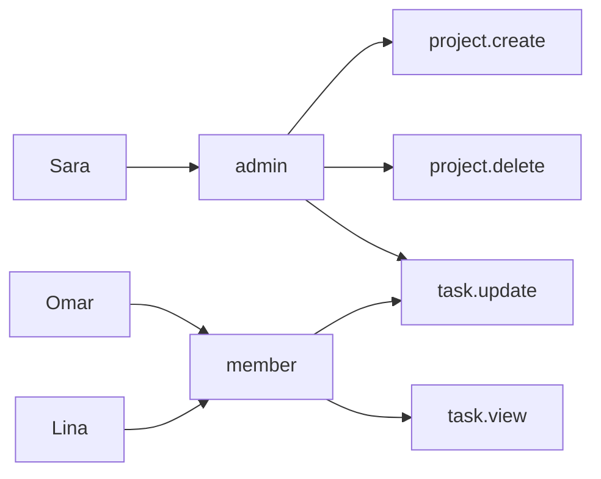
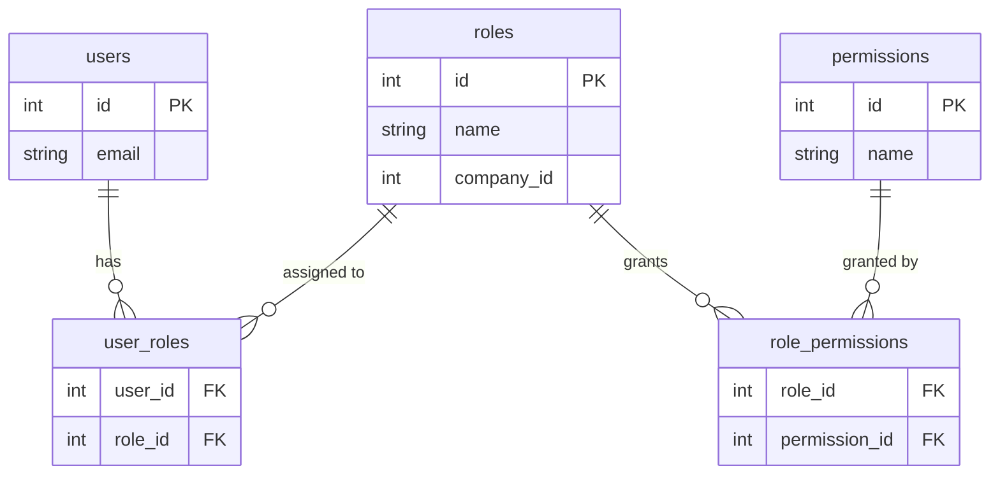

# Role-Based Access Control (RBAC)

In a hospital, nobody carries a list of the 400 doors they may open. They carry
a badge that says **nurse**, **surgeon**, or **cleaner**. The building knows
which doors each job title opens. Hire a new nurse and you print a badge — you
do not rewire 400 doors.

That is Role-Based Access Control. Users get **roles**. Roles carry
**permissions**. Your code checks permissions.

> **📌 In one line:** give users roles, give roles permissions, and check
> permissions in code — so adding a new role becomes a database row instead of
> a code change and a deployment.

## Table of Contents

1. [RBAC in Plain Words](#rbac-in-plain-words)
2. [The Problem RBAC Solves](#the-problem-rbac-solves)
3. [The Simplest Version and Where It Breaks](#the-simplest-version-and-where-it-breaks)
4. [Check Permissions, Not Roles](#check-permissions-not-roles)
5. [The Database Schema](#the-database-schema)
6. [Implementing the Check](#implementing-the-check)
7. [Loading Permissions Efficiently](#loading-permissions-efficiently)
8. [Role Hierarchy and Inheritance](#role-hierarchy-and-inheritance)
9. [Scoped Roles: the Real SaaS Case](#scoped-roles-the-real-saas-case)
10. [Seeding and Managing Roles](#seeding-and-managing-roles)
11. [Advanced Topics](#advanced-topics)
12. [Common Mistakes](#common-mistakes)
13. [Questions to Test Yourself](#questions-to-test-yourself)
14. [Related](#related)

---

## RBAC in Plain Words

Three words, and one arrow between each pair:

- **User** — a person or a machine that calls your API.
- **Role** — a named job: `owner`, `admin`, `member`, `viewer`, `billing`.
- **Permission** — one concrete thing that may be done: `project.delete`,
  `invoice.view`, `task.update`.



Read it from the left: Sara is an admin, admins may delete projects, therefore
Sara may delete projects. Your code never mentions Sara, and never mentions
"admin" either — it asks one question: *does this user have `project.delete`?*
You can change the arrows without changing the code.

---

## The Problem RBAC Solves

Without roles, permissions get attached to people directly. That works for five
users and collapses at fifty.

| Without roles | With roles |
|---|---|
| Grant 12 permissions to each new hire, by hand | Assign one role |
| A policy change means editing every affected user | Edit one role's permission list |
| Nobody can answer "who can delete invoices?" | `SELECT` the role's users |
| An audit means reading 200 rows | An audit means reading 6 roles |

> **💡 Tip:** the point of RBAC is not security theory. It is that permission
> changes become **data changes**, which a support person can make safely,
> instead of **code changes**, which need a developer and a deploy.

---

## The Simplest Version and Where It Breaks

Almost every project starts here:

```sql
ALTER TABLE users ADD COLUMN role VARCHAR(20) NOT NULL DEFAULT 'member';
-- then in code:  if (user.role === 'admin') { allow() }
```

This is fine on day one. Ship it. But know how it dies, because it always dies
the same way.

**Break 1 — a user needs two roles.** Omar is a `member` who also handles
invoices. One column holds one value, so teams invent `member_billing`, then
`member_billing_hr`. The combinations double every time.

**Break 2 — a permission fits no role.** "Let Lina export the task list, and
nothing else." You add `if (user.role === 'admin' || user.email ===
'lina@acme.com')`. That line will still be there in three years.

**Break 3 — a customer wants their own roles.** An enterprise buyer asks for a
"Contractor" role that sees tasks but not invoices. With a hard-coded column
that is a migration and a release. With a proper schema it is one `INSERT`.

**Break 4 — one user, two companies.** Sara is an admin of Acme and a viewer of
Globex. A single column on `users` cannot hold both. This one is the most
common in SaaS and gets its own section below.

---

## Check Permissions, Not Roles

This is the single most valuable habit in this file.

```ts
// ❌ BROKEN — the role name is hard-coded into business logic.
async function deleteProject(user: AuthUser, projectId: number) {
  if (user.role !== 'admin' && user.role !== 'owner') {
    throw new ForbiddenError()
  }
  await projectRepo.delete(projectId)
}
```

Now the product asks for a `manager` role that may also delete projects. You
must find every `=== 'admin'` in the codebase, edit the right ones, review,
test, and deploy. Miss one and the new role is broken. Miss one the other way
and you open a hole.

```ts
// ✅ FIXED — the code names the capability, not the job title.
async function deleteProject(user: AuthUser, projectId: number) {
  if (!user.can('project.delete')) throw new ForbiddenError()
  await projectRepo.delete(projectId)
}
```

Adding `manager` is now one row in `role_permissions`. No code, no deploy, no
regression risk.

> **📌 Remember:** roles are for *humans* to assign. Permissions are for *code*
> to check. If a role name appears inside an `if` in your business logic, that
> is a future migration waiting to happen.

---

## The Database Schema

Five tables. Two are join tables — tables whose only job is to connect two
others.



```sql
CREATE TABLE permissions (
  id   SERIAL PRIMARY KEY,
  name VARCHAR(64) UNIQUE NOT NULL          -- 'project.delete'
);

CREATE TABLE roles (
  id         SERIAL PRIMARY KEY,
  name       VARCHAR(32) NOT NULL,
  -- NULL company_id = a system role shared by every customer.
  company_id INT REFERENCES companies(id) ON DELETE CASCADE,
  is_system  BOOLEAN NOT NULL DEFAULT FALSE,
  UNIQUE (company_id, name)
);
```

The join tables carry no data of their own, only the pairing:

```sql
CREATE TABLE role_permissions (
  role_id       INT NOT NULL REFERENCES roles(id) ON DELETE CASCADE,
  permission_id INT NOT NULL REFERENCES permissions(id) ON DELETE CASCADE,
  PRIMARY KEY (role_id, permission_id)
);

CREATE TABLE user_roles (
  user_id INT NOT NULL REFERENCES users(id) ON DELETE CASCADE,
  role_id INT NOT NULL REFERENCES roles(id) ON DELETE CASCADE,
  PRIMARY KEY (user_id, role_id)
);
CREATE INDEX ON user_roles (user_id);   -- the lookup you do on every request
```

The composite primary keys make a duplicate assignment impossible, so "grant
this role" can run twice without creating two rows.

---

## Implementing the Check

### An HTTP middleware

```ts
// Reusable guard: authorize('project.delete') on any route.
export function authorize(permission: string) {
  return async (req: Request, res: Response, next: NextFunction) => {
    if (!req.user) return res.status(401).json({ error: 'Unauthenticated' })

    const permissions = await permissionsFor(req.user.id, req.tenantId)
    if (!permissions.has(permission)) {
      // Log the denial: repeated denials are an early attack signal.
      logger.warn({ userId: req.user.id, permission }, 'authorization denied')
      return res.status(403).json({ error: 'Forbidden' })
    }
    next()
  }
}
```

Use it as `router.delete('/api/projects/:id', requireAuth,
authorize('project.delete'), handler)`. In AdonisJS this is a named middleware registered in the middleware file — the
exact API is framework-specific, so check your version's docs.

### A service-layer check

Middleware only runs for HTTP requests. A nightly job, a queue worker, or a CLI
command never touches the router. So the same check must be callable from plain
code:

```ts
export async function can(user: AuthUser, permission: string): Promise<boolean> {
  const permissions = await permissionsFor(user.id, user.activeCompanyId)
  return permissions.has(permission)
}
```

The middleware becomes a thin wrapper over `can()`, and a service that throws
`ForbiddenError` when `can()` is false covers every non-HTTP caller.

> **⚠️ Warning:** a permission alone is not a record check. `project.delete`
> says Sara may delete *projects*, not that she may delete *project 17*. You
> still need the ownership check from
> [`01-authn-vs-authz.md`](01-authn-vs-authz.md#broken-object-level-authorization-bola--idor).

---

## Loading Permissions Efficiently

Done naively, `permissionsFor()` runs three queries per request: `user_roles`,
then `role_permissions`, then `permissions`. On a page that makes eight API
calls, that is 24 extra round trips. See
[`../../databases/query-optimization/n-plus-one-queries.md`](../../databases/query-optimization/n-plus-one-queries.md).

**Step 1 — one query with joins:**

```sql
SELECT DISTINCT p.name
FROM user_roles ur
JOIN role_permissions rp ON rp.role_id = ur.role_id
JOIN permissions p       ON p.id = rp.permission_id
WHERE ur.user_id = $1;
```

**Step 2 — cache the result:**

```ts
const TTL_SECONDS = 300   // short enough that a revoke lands soon

async function permissionsFor(userId: number, companyId: number) {
  const key = `perms:${userId}:${companyId}`          // tenant is part of the key
  const cached = await redis.get(key)
  if (cached) return new Set<string>(JSON.parse(cached))

  const rows = await db.$queryRaw<{ name: string }[]>(PERMISSION_SQL, userId)
  const names = rows.map((r) => r.name)
  await redis.setex(key, TTL_SECONDS, JSON.stringify(names))
  return new Set(names)
}
```

### The staleness trade-off

Caching creates a real security window. If you revoke Omar's `invoice.delete`
permission, the old answer stays in the cache until it expires. For up to five
minutes, Omar can still delete invoices.

```text
t=0  admin revokes invoice.delete in PostgreSQL
t=0  Omar's check hits Redis  → stale "allowed"  ❌
t=5m Redis key expires
t=5m Omar's check reloads     → "denied"         ✅
```

Three ways to handle it, strongest first:

| Approach | Revocation delay | Cost |
|---|---|---|
| No cache | Instant | 1 query per check |
| Cache + delete key on every role change | Near-instant | Must remember every write path |
| Short TTL only | Up to the TTL | Simplest, but a real window |

Delete the cache key whenever you change a user's roles or a role's
permissions — and note that changing a *role* must invalidate every *user* who
holds it. Keep the TTL as a safety net for the invalidation you forget.
Permissions inside a JWT have the same problem permanently: you cannot unsign a
token. See [`../05-authentication/04-jwt-part-1.md`](../05-authentication/04-jwt-part-1.md)
and [`../../system-design/foundational/caching-strategies.md`](../../system-design/foundational/caching-strategies.md).

> **⚠️ Warning:** never cache permissions without a company or tenant in the
> cache key. Sara's permissions in Acme are not her permissions in Globex, and
> a shared key hands her the wrong set.

---

## Role Hierarchy and Inheritance

Roles often nest naturally: `owner` ⊇ `admin` ⊇ `member` ⊇ `viewer`, where each
one can do everything the next can, plus more.

The simple implementation is a rank number — `{ viewer: 1, member: 2, admin: 3,
owner: 4 }` — and a check of `RANK[role] >= RANK[required]`.

Better: expand inheritance when you **seed** permissions. Give `admin` every
permission `member` has, plus its own. The runtime check stays a flat set
lookup, and the hierarchy exists only in the seed script.

**The complexity it adds:** the moment a role is *not* a strict superset, the
line breaks. A `billing` role may see invoices an `admin` cannot, so `billing`
fits nowhere on the line. Real systems end up with a small hierarchy plus
several standalone roles. Flat permission sets handle that; a rank number does
not.

---

## Scoped Roles: the Real SaaS Case

Sara is an **admin of Acme** and a **viewer of Globex**. Ask the question a
single column has to answer: `users.role = ?`. There is no correct value. The
role is not a property of the user. It is a property of the **relationship**
between a user and a company.

So move it onto that relationship:

```sql
CREATE TABLE company_members (
  id         SERIAL PRIMARY KEY,
  company_id INT NOT NULL REFERENCES companies(id) ON DELETE CASCADE,
  user_id    INT NOT NULL REFERENCES users(id) ON DELETE CASCADE,
  role_id    INT NOT NULL REFERENCES roles(id),
  invited_by INT REFERENCES users(id),
  joined_at  TIMESTAMPTZ,
  UNIQUE (company_id, user_id)
);
CREATE INDEX ON company_members (user_id);
```

```text
Sara ──▶ membership(Acme)   ──▶ admin  ──▶ project.delete, project.view
     └─▶ membership(Globex) ──▶ viewer ──▶ project.view
```

Every permission check now needs two inputs, not one:

```ts
// ❌ BROKEN — a global role ignores which company the request is about.
if (user.role === 'admin') allow()

// ✅ FIXED — the role is looked up per company.
const membership = await memberRepo.find(user.id, req.tenantId)
if (!membership) throw new NotFoundError()          // not a member at all
if (!(await can(user, 'project.delete', req.tenantId))) throw new ForbiddenError()
```

`req.tenantId` must come from the authenticated session or from a verified
membership — never straight from a header the client sends. File 03 covers that
in detail, along with switching the active company.

---

## Seeding and Managing Roles

**System roles** ship with the product. Create them in a migration or a seeder
so every environment is identical:

```ts
// database/seeders/roles.ts — idempotent: safe to run on every deploy.
const SYSTEM_ROLES = {
  owner:  ['*'],
  admin:  ['project.*', 'task.*', 'invoice.view', 'member.invite'],
  member: ['project.view', 'task.create', 'task.update', 'task.view'],
  viewer: ['project.view', 'task.view'],
}
```

Use `INSERT ... ON CONFLICT DO NOTHING` so the seeder can run repeatedly.

**Custom roles** belong to one customer: `roles.company_id` is set and
`is_system` is false. Four rules save real pain later:

- Only accept permission names that exist in the `permissions` table. Never
  accept free text from a form.
- Never let a customer edit or delete a system role. Let them copy it.
- Never let a customer grant a permission they do not hold themselves —
  otherwise a `member` who may create roles becomes an `owner` in two steps.
  That is **privilege escalation**.
- Block deleting a role while users hold it, or reassign those users to a
  default. Never leave a user with no role.

---

## Advanced Topics

### Permission naming conventions

Use `resource.action`, lower case, singular resource: `project.view`,
`project.delete`, `invoice.send`, `invoice.void`, `member.invite`,
`company.settings.update`. The names sort into readable groups, you can build a
checkbox UI by splitting on the dot, and wildcards become possible.

### Wildcard permissions

A granted name of `project.*` matches any required name starting with
`project.`, and `*` matches everything. Wildcards keep seed data short, but they
are blunt: `project.*` silently includes any permission you add next year.
Expand wildcards into concrete rows at seed time when you need an exact audit
trail.

### The super admin backdoor

Every product eventually needs staff who can open a customer's account to help
them. That is a permanent backdoor, so treat it as one. Make it a separate flag
(`users.is_staff`), never a role inside a customer's company. Require a reason
and write an audit record **before** access is granted — see
[`../08-logging-and-observability/02-structured-logging.md`](../08-logging-and-observability/02-structured-logging.md).
Time-box it to an hour. Show the customer who opened their data. A backdoor
nobody can see is a backdoor nobody can audit.

### Pluggable policies

When "can this user do X" depends on more than a permission name, wrap each
rule in its own small object and pick it at runtime. That is the **Strategy
pattern** —
[`../../software-engineering/design-patterns/strategy-pattern.md`](../../software-engineering/design-patterns/strategy-pattern.md)
— and it lets you add rules without editing `can()`. File 03 builds this out as
resource policies.

### Testing authorization rules

Authorization is a table of expectations, so test it as a table:

```ts
const CASES = [
  { role: 'viewer', permission: 'task.update',    expected: false },
  { role: 'member', permission: 'project.delete', expected: false },
  { role: 'admin',  permission: 'project.delete', expected: true  },
]

for (const c of CASES) {
  it(`${c.role} ${c.expected ? 'can' : 'cannot'} ${c.permission}`, async () => {
    const user = await makeUserWithRole(c.role)
    expect(await can(user, c.permission)).toBe(c.expected)
  })
}
```

Test the **denials**, not only the grants. A bug that allows too much passes
every happy-path test ever written. More in
[`../13-testing-and-quality/02-unit-testing-part-1.md`](../13-testing-and-quality/02-unit-testing-part-1.md).

---

## Common Mistakes

| Mistake | Why it is wrong | Do this instead |
|---|---|---|
| `if (user.role === 'admin')` in business logic | A new role means editing every such line, and missing one | Check a permission: `can(user, 'project.delete')` |
| A single `role` column on `users` | Cannot express two roles, or different roles per company | Join table for roles, membership table for scope |
| Treating a permission as an ownership check | `project.delete` does not mean *this* project | Combine with a record-level check |
| Caching permissions with no invalidation | A revoked permission keeps working | Delete the cache key on every role change, plus a short TTL |
| Cache key without the tenant | Sara gets her Acme rights while acting in Globex | Include the company id in the key |
| Letting users grant permissions they do not have | Privilege escalation in two steps | Validate that the granter holds every permission granted |

---

## Questions to Test Yourself

1. Why is `can(user, 'project.delete')` better than `user.role === 'admin'`?
   Describe exactly what work each one requires when the product adds a
   `manager` role.
2. A single `role` column on `users` breaks in four distinct ways. Name them.
3. Draw the path from a user row to a permission name. Which two tables are join
   tables, and what does their composite primary key prevent?
4. You cache permissions in Redis for five minutes. An admin revokes a
   permission. What exactly can the affected user still do, for how long, and
   what are the two ways to shorten that window?
5. Why must the tenant or company id be part of the permission cache key?
6. Sara is an admin of Acme and a viewer of Globex. Which table holds her role,
   and why can it not be a column on `users`?
7. A `member` is allowed to create custom roles. What is the escalation attack,
   and what single rule stops it?

---

## Related

- [`01-authn-vs-authz.md`](01-authn-vs-authz.md) — why a permission check is
  never enough on its own without a record-level ownership check.
- [`03-ownership-abac-and-multi-tenancy.md`](03-ownership-abac-and-multi-tenancy-part-1.md)
  — the rules RBAC cannot express, and how tenants stay separated.
- [`../../system-design/foundational/caching-strategies.md`](../../system-design/foundational/caching-strategies.md)
  — invalidation strategies for the permission cache above.
- [`../../databases/query-optimization/n-plus-one-queries.md`](../../databases/query-optimization/n-plus-one-queries.md)
  — the query pattern that makes a naive permission lookup slow.
- [`../../software-engineering/design-patterns/strategy-pattern.md`](../../software-engineering/design-patterns/strategy-pattern.md)
  — pluggable rules when a permission name is not enough.
- [`../13-testing-and-quality/02-unit-testing-part-1.md`](../13-testing-and-quality/02-unit-testing-part-1.md)
  — testing denial cases, not only grants.
