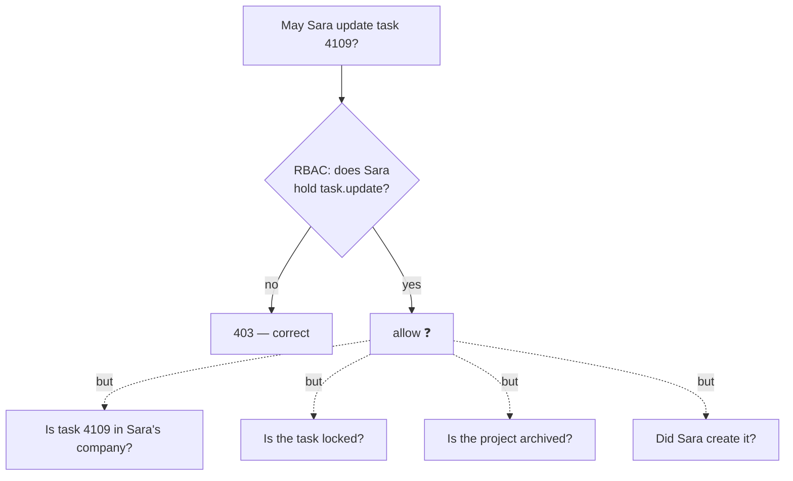

# Ownership, ABAC, and Multi-Tenancy — Part 1

File 01 said every authorization decision answers three questions: **who**,
**what action**, **which resource**. File 02 answered the first two with roles
and permissions. This file answers the third.

Start with a rule a real product manager would write:

> A user may edit a task **only if** they are a member of the project's company,
> **and** the task is not locked, **and** the project is still active, **and**
> they either created the task or hold `task.update.any`.

Read that back and notice what it is made of. Not a role — a sentence with four
conditions, about the user, about the task, about the project, and about a
permission. RBAC cannot express it, because RBAC's only input is who you are.

Part 1 is about writing rules like that one: attribute-based access control, and
the policy objects that keep those rules in one testable place. Part 2 is
multi-tenancy — keeping one customer's rows away from another's, with three
layers of defence so a single forgotten `WHERE` cannot leak a database.

> **➡️ Continued in [Part 2](03-ownership-abac-and-multi-tenancy-part-2.md).**

> **📌 In one line:** roles say what a *kind of user* may do; policies say what
> *this user* may do to *this record*, and every real application needs both.

## Table of Contents

1. [Where RBAC Stops](#where-rbac-stops)
2. [ABAC in Plain Words](#abac-in-plain-words)
3. [ABAC vs RBAC](#abac-vs-rbac)
4. [The Policy Pattern](#the-policy-pattern)
5. [A Real TaskPolicy](#a-real-taskpolicy)
6. [Calling a Policy From the Controller and the Service](#calling-a-policy-from-the-controller-and-the-service)
7. [Keeping Policies Pure and Testable](#keeping-policies-pure-and-testable)
8. [Telling the Caller Why](#telling-the-caller-why)
9. [Advanced: Lists, Fields, and Policy Engines](#advanced-lists-fields-and-policy-engines)
10. [Common Mistakes](#common-mistakes)
11. [Questions to Test Yourself](#questions-to-test-yourself)
12. [Related](#related)

---

## Where RBAC Stops

RBAC answers one question well: *does this kind of user do this kind of thing?*
It has one input — the user — so it can only ever give one answer for everybody
holding the same role.

Watch it fail on three ordinary requirements.

**"A member may edit their own task, but not someone else's."** Both users are
members. Both hold `task.update`. RBAC returns the same answer for both, and the
answer is wrong for one of them. The missing input is the *record*.

**"Nobody may edit a task in an archived project."** No role should override
this — not even the owner. It is a fact about the project, not about the user.

**"Contractors may not see salary fields, and only during business hours."**
Now the deciding facts are a field name and the clock.



Every dotted line is a question RBAC has no place to ask. The moment your
requirement contains the word "own", "their", "unless", "while", or "still",
you have left RBAC behind.

> **⚠️ Warning:** the usual response is an `if` in the controller —
> `if (task.createdBy !== user.id) throw ...`. One is fine. Twenty of them,
> spread over fifteen controllers with slightly different conditions, is how
> authorization bugs are born. The rest of this file is about having one place
> for that logic.

---

## ABAC in Plain Words

**Attribute-Based Access Control (ABAC)** decides access by evaluating a rule
over **attributes** — plain facts about four things:

| Category | Attributes | Examples |
|---|---|---|
| **Subject** | facts about the caller | `user.id`, `user.companyId`, `user.role`, `user.permissions` |
| **Resource** | facts about the record | `task.createdBy`, `task.isLocked`, `task.companyId` |
| **Action** | what is being attempted | `view`, `update`, `delete` |
| **Context** | facts about the moment | time of day, request IP, whether the subscription is active |

An ABAC rule is a sentence over those facts, and it maps to code almost word for
word:

```text
ALLOW  update  ON task
WHERE  user.companyId == task.companyId
  AND  task.isLocked == false
  AND  project.status == 'active'
  AND  (task.createdBy == user.id OR user.can('task.update.any'))
```

The important shift is that the **record is now an input**. RBAC asks "who are
you?"; ABAC asks "who are you, holding what, against which record, right now?"

> **💡 Tip:** ABAC does not replace RBAC — it consumes it. `user.can('…')` in
> that rule is an RBAC check, used as one attribute among several. Keep your
> roles and permissions; add rules on top.

---

## ABAC vs RBAC

| | RBAC | ABAC |
|---|---|---|
| Decides from | The user's roles | Attributes of user, resource, action, context |
| Answers | "May admins delete projects?" | "May Sara delete project 17 today?" |
| Where rules live | Database rows (`role_permissions`) | Code, or a policy language |
| Changing a rule | An `UPDATE`, no deploy | A code change and a deploy |
| Explaining a decision | Easy: list the role's permissions | Harder: which of six conditions failed? |
| Number of rules | One per permission | One per resource, per action |
| Fails by | Not being expressive enough | Becoming an unreadable pile of conditions |
| Best at | Coarse capability: *can this kind of user* | Fine ownership: *this user, this record* |

**The practical advice, stated plainly: most applications need RBAC plus a
handful of ownership rules — not a policy engine.**

A full ABAC system with a rule language, an external decision point, and
attribute fetchers is a real technology and a real cost. Teams adopt it because
it sounds rigorous, then discover that nobody can say why a request was denied,
that the rules live somewhere the tests do not reach, and that a network call now
sits on every authorization check.

You almost certainly want:

1. **RBAC** for capability — `task.update`, from file 02.
2. **A tenant scope** applied automatically to every query — Part 2.
3. **A small policy class per resource** holding the four or five ownership and
   state rules that actually exist in your product.

Reach for a policy engine when rules are genuinely written by people who are not
your engineers, or when compliance demands the rules be auditable outside the
codebase. Until then, it is a TypeScript class.

---

## The Policy Pattern

A **policy** is one small object that owns every authorization rule for one
resource. One file per resource, one method per action, a predictable signature:

```text
TaskPolicy
  ├── view(user, task)    → boolean
  ├── update(user, task)  → boolean
  ├── delete(user, task)  → boolean
  └── create(user, project) → boolean   // no record yet: check the parent
```

Four properties make this worth doing:

- **Discoverable.** "What are the rules for tasks?" is answered by opening one
  file, not by grepping for `createdBy` across the repository.
- **Reviewable.** A security reviewer reads `policies/` and sees the whole
  surface.
- **Testable.** Plain functions over plain objects: no HTTP, no database.
- **Callable from anywhere.** Controllers, services, background jobs, and CLI
  commands all use the same object, so no code path is an accidental exception.

`create` is worth a second look: there is no record yet, so the policy takes the
**parent**. That is the nested-route bug from
[`01-authn-vs-authz.md`](01-authn-vs-authz.md#authentication-alone-proves-nothing-about-ownership)
turned into a method signature you cannot forget to fill in.

---

## A Real TaskPolicy

```ts
// app/policies/task-policy.ts
// Pure decisions. No req, no res, no database, no throwing.

export interface AuthUser {
  id: number
  companyId: number
  permissions: Set<string>          // loaded once by the RBAC layer
}

export interface TaskRecord {
  id: number
  companyId: number
  createdBy: number
  assignedTo: number | null
  isLocked: boolean
  project: { id: number; status: 'active' | 'archived'; companyId: number }
}

export class TaskPolicy {
  /** Same company, always. Every other rule assumes this one passed. */
  private sameCompany(user: AuthUser, task: TaskRecord): boolean {
    return user.companyId === task.companyId
  }

  view(user: AuthUser, task: TaskRecord): boolean {
    if (!this.sameCompany(user, task)) return false
    if (user.permissions.has('task.view.any')) return true
    // Otherwise you must be involved with it.
    return task.createdBy === user.id || task.assignedTo === user.id
  }

  update(user: AuthUser, task: TaskRecord): boolean {
    if (!this.sameCompany(user, task)) return false
    // State rules beat permissions: nobody edits a locked task or one in
    // an archived project, not even an owner.
    if (task.isLocked) return false
    if (task.project.status !== 'active') return false

    if (user.permissions.has('task.update.any')) return true
    return task.createdBy === user.id && user.permissions.has('task.update.own')
  }

  delete(user: AuthUser, task: TaskRecord): boolean {
    if (!this.sameCompany(user, task)) return false
    if (task.project.status !== 'active') return false
    // Deletion is deliberately narrower than update: no "own" shortcut.
    return user.permissions.has('task.delete.any')
  }

  /** No task exists yet, so the parent project is the resource. */
  create(user: AuthUser, project: TaskRecord['project']): boolean {
    if (user.companyId !== project.companyId) return false
    if (project.status !== 'active') return false
    return user.permissions.has('task.create')
  }
}

export const taskPolicy = new TaskPolicy()
```

Three decisions in there are worth copying.

**State rules come before permission rules.** `isLocked` is checked before any
`permissions.has(...)`, so no role can override a business state. Get this order
wrong and "owners can do anything" quietly defeats your locking feature.

**`sameCompany` is first in every method.** Part 2 makes this structural rather
than a habit, but the policy states it anyway — defence in depth.

**`.own` and `.any` are separate permissions.** This is the standard way to make
ownership expressible in RBAC vocabulary, and it keeps the policy readable:
`task.update.own` for members, `task.update.any` for managers.

---

## Calling a Policy From the Controller and the Service

Both layers call the same policy. They differ only in what they do with `false`.

```ts
// app/controllers/task-controller.ts — HTTP concerns only.
router.patch('/api/tasks/:id', requireAuth, async (req, res) => {
  const task = await taskRepo.findForUser(req.user, Number(req.params.id))
  if (!task) return res.status(404).json({ error: 'Not found' })

  // Authorize BEFORE validating the body: never let an unauthorized caller
  // learn which fields exist from your validation errors.
  if (!taskPolicy.update(req.user, task)) {
    return res.status(403).json({ error: 'Forbidden' })
  }

  const input = updateTaskSchema.parse(req.body)
  const updated = await taskService.update(req.user, task.id, input)
  return res.json(toTaskDto(updated))
})
```

```ts
// app/services/task-service.ts — the same rule, for every non-HTTP caller.
export async function update(user: AuthUser, taskId: number, input: UpdateTaskInput) {
  const task = await taskRepo.findForUser(user, taskId)
  if (!task) throw new NotFoundError('Task not found')

  // Re-checked here on purpose. A background job, a CSV import, or a CLI
  // command never passes through the controller above.
  if (!taskPolicy.update(user, task)) throw new ForbiddenError()

  return taskRepo.update(task.id, input)
}
```

"Why check twice?" is the obvious question, and the answer is that these are not
duplicates. The controller checks so it can return a correct status code before
doing more work. The service checks because it is the real door, and the
controller is only one of the corridors leading to it —
[`../09-application-architecture/02-service-layer-part-1.md`](../09-application-architecture/02-service-layer-part-1.md)
makes that argument in full. The policy itself exists exactly once, so the two
calls can never disagree.

> **⚠️ Warning:** authorize before validation, and never after the write. A
> policy check that runs after `taskRepo.update` inside a transaction you forget
> to roll back is not a check at all.

---

## Keeping Policies Pure and Testable

A **pure** function takes inputs and returns a value: no I/O, no clock, no
globals, no exceptions as control flow. Policies should be pure, because a rule
you cannot call in a loop is a rule you will not test.

```ts
// ❌ BROKEN — loads data, reads the clock, throws, and knows about HTTP.
class TaskPolicy {
  async update(req: Request, taskId: number) {
    const task = await db.task.findUnique({ where: { id: taskId } })   // I/O
    const project = await db.project.findUnique({ where: { id: task.projectId } })
    if (new Date().getHours() < 9) throw new ForbiddenError('outside hours')
    return req.user.id === task.createdBy
  }
}
```

Every one of those choices costs you something. The I/O means a test needs a
database and an N+1 query appears whenever you authorize a list. The clock means
the test suite passes in the morning and fails at night. The `throw` means the
caller cannot ask "may they?" without a `try`. And `req` means a background job
cannot call it at all.

```ts
// ✅ FIXED — everything it needs is an argument.
interface PolicyContext { now: Date }

class TaskPolicy {
  update(user: AuthUser, task: TaskRecord, ctx: PolicyContext): boolean {
    if (task.project.status !== 'active') return false
    if (ctx.now.getHours() < 9) return false
    return task.createdBy === user.id || user.permissions.has('task.update.any')
  }
}
```

The caller loads the task (with its project already joined) and passes the
clock. Injecting the clock is the standard trick for testable time-dependent
code — see
[`../09-application-architecture/02-service-layer-part-2.md`](../09-application-architecture/02-service-layer-part-2.md).

Then the tests are a table, and you write the **denials** as carefully as the
grants:

```ts
const CASES = [
  { name: 'creator updates own task',      task: own(),                 expect: true  },
  { name: 'other member updates it',       task: own({ createdBy: 99 }), expect: false },
  { name: 'manager updates any task',      user: manager, task: own(),  expect: true  },
  { name: 'manager cannot update locked',  user: manager, task: own({ isLocked: true }), expect: false },
  { name: 'nobody updates in archived',    user: manager, task: own({ project: archived }), expect: false },
  { name: 'other company is invisible',    task: own({ companyId: 2 }),  expect: false },
]

for (const c of CASES) {
  it(c.name, () => {
    expect(taskPolicy.update(c.user ?? member, c.task, ctx)).toBe(c.expect)
  })
}
```

A bug that allows too much passes every happy-path test ever written. The row
that catches real incidents is the one where a privileged user is still denied.

---

## Telling the Caller Why

A boolean is easy to test and useless to debug. "403 Forbidden" tells a
frustrated user nothing and tells your support team less.

Return a reason alongside the decision, then decide separately how much of it to
show:

```ts
type Decision =
  | { allowed: true }
  | { allowed: false; reason: 'not_in_company' | 'task_locked' | 'project_archived'
                            | 'not_owner' | 'missing_permission' }
```

- **Log the reason always**, with the user id and the record id
  ([`../08-logging-and-observability/02-structured-logging.md`](../08-logging-and-observability/02-structured-logging.md)).
  A week of denial reasons tells you which rule confuses people.
- **Show the safe ones.** "This task is locked" and "This project is archived"
  are facts about the record the user can already see, and they turn a support
  ticket into a self-service fix.
- **Never show the unsafe ones.** `not_in_company` must surface as a plain `404`
  — anything else confirms that someone else's task exists, which is the leak
  file 01 warned about.

---

## Advanced: Lists, Fields, and Policy Engines

**Lists.** A policy answers one record at a time, so filtering a list through it
in memory is the anti-pattern from
[`01-authn-vs-authz.md`](01-authn-vs-authz.md#advanced-authorize-in-the-query-not-after-the-fetch):
it loads rows you may not see and breaks pagination. For lists, express the same
rule as a query filter and keep the policy for the detail routes. Yes, the rule
now exists twice — in SQL and in the policy. Put both in the same file, name
them `updateFilter()` and `update()`, and test that they agree.

**Field-level rules.** "A member may edit a task's title but not its budget" is
authorization about *fields*. Do not push it into the policy as fifteen methods;
handle it where output and input shapes are already decided, in the DTO layer —
[`../09-application-architecture/04-dtos-and-serialization-part-1.md`](../09-application-architecture/04-dtos-and-serialization-part-1.md).

**Policy engines.** Open Policy Agent, Cedar, and friends move rules into a
dedicated language, evaluated by a separate component. Real benefits: rules are
auditable outside the codebase, changeable without a deploy, and shared across
services in several languages. Real costs: another service on the request path,
a second language to debug, and attribute fetching that nobody profiles until it
is slow. Adopt one when non-engineers genuinely author rules — not because a
conference talk said ABAC.

**Relationship-based access control (ReBAC)** is the other direction: Google
Zanzibar-style systems that answer "is there a path from this user to this
document?" through a graph of relationships. That is the right model for deeply
nested sharing — folders inside folders inside teams. For a task inside a
project inside a company, a policy class is enough.

---

## Common Mistakes

| Mistake | Why it is wrong | Do this instead |
|---|---|---|
| Ownership checks scattered through controllers | Fifteen slightly different versions of the same rule | One policy per resource, called everywhere |
| Checking permissions before business state | "Owners can do anything" silently defeats locking | State rules first, then permissions |
| Policies that query the database | Untestable, and an N+1 on every list | Take loaded records as arguments |
| Policies that read the clock or `req` | Tests fail at 9 PM; jobs cannot call them | Pass a context object with `now` |
| Policies that throw instead of returning | The caller cannot ask "may they?" without a `try` | Return a boolean or a decision; the caller throws |
| Only a controller check, none in the service | A job or CLI command bypasses it entirely | Check in the service; the controller is convenience |
| Filtering a list through the policy in memory | Loads rows they may not see and breaks pagination | A matching query filter beside the policy |
| Returning `403` for another tenant's record | Confirms the record exists | `404`, and log the real reason |
| Testing only the allow cases | A rule that allows too much passes every happy test | Write the denial rows first |
| Reaching for a policy engine on day one | A network hop and a second language for four rules | RBAC plus a small policy class |

---

## Questions to Test Yourself

1. Write a requirement your RBAC implementation cannot express, and say exactly
   which input it is missing.
2. Name the four attribute categories in ABAC and give one example of each from
   a task-editing rule.
3. Why does `TaskPolicy.create` take a project rather than a task, and which
   classic bug does that signature prevent?
4. Why must `isLocked` be checked before `permissions.has('task.update.any')`?
   Describe the bug caused by the other order.
5. Your policy calls the database to load the project. Name three separate
   problems that causes.
6. The controller checks the policy and the service checks it again. Justify the
   duplication in one sentence.
7. Why is a denial reason of `not_in_company` unsafe to return to the client,
   while `task_locked` is safe?
8. A list endpoint must apply the same rule as `TaskPolicy.view`. Why can you
   not simply run the policy over the fetched rows?
9. When is a policy engine such as OPA the right answer, and what does it cost?

---

## Related

- [`01-authn-vs-authz.md`](01-authn-vs-authz.md) — the three questions every
  check answers, and why record-level checks belong in the query.
- [`02-rbac.md`](02-rbac.md) — the roles and permissions a policy consumes as
  one attribute among several.
- [Part 2](03-ownership-abac-and-multi-tenancy-part-2.md) — multi-tenancy: the
  `sameCompany` check made structural, with three layers of defence.
- [`../09-application-architecture/02-service-layer-part-1.md`](../09-application-architecture/02-service-layer-part-1.md)
  — why the service layer is the real door, and
  [part 2](../09-application-architecture/02-service-layer-part-2.md) for
  injecting the clock.
- [`../09-application-architecture/04-dtos-and-serialization-part-1.md`](../09-application-architecture/04-dtos-and-serialization-part-1.md)
  — field-level visibility, which does not belong in a policy.
- [`../../software-engineering/design-patterns/strategy-pattern.md`](../../software-engineering/design-patterns/strategy-pattern.md)
  — the pattern a policy object is an instance of.
- [`../08-logging-and-observability/02-structured-logging.md`](../08-logging-and-observability/02-structured-logging.md)
  — logging denial reasons so you can see which rule confuses people.
