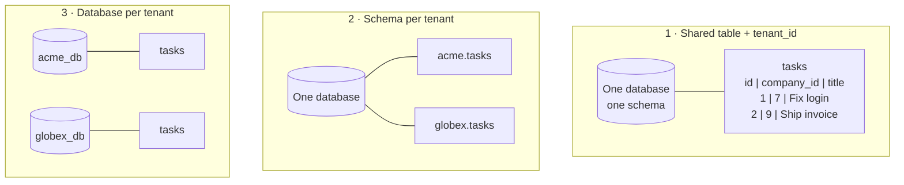

# Ownership, ABAC, and Multi-Tenancy — Part 2

Part 1 opened every policy method with the same line:

```ts
if (user.companyId !== task.companyId) return false
```

That line is the most important one in the file, and relying on a developer to
remember it is the weakest possible way to enforce it. One forgotten `WHERE`
clause, on a Friday afternoon, and one customer reads another's data.

This part makes that impossible rather than merely intended: what multi-tenancy
is, the three ways to separate customers, and three layers of defence so a
mistake in any one is caught by the next.

> **⬅️ This continues [Part 1](03-ownership-abac-and-multi-tenancy-part-1.md).**

> **📌 In one line:** put the tenant scope somewhere a developer cannot forget
> it — in the repository, in the query builder, and in the database itself —
> because "everyone remembers to filter by `company_id`" is not a security
> control.

## Table of Contents

1. [Multi-Tenancy From Zero](#multi-tenancy-from-zero)
2. [The Three Isolation Models](#the-three-isolation-models)
3. [Comparing the Models](#comparing-the-models)
4. [The Cross-Tenant Leak](#the-cross-tenant-leak)
5. [Defence in Depth: Three Layers](#defence-in-depth-three-layers)
6. [Layer 1: a Mandatory Scope in the Repository](#layer-1-a-mandatory-scope-in-the-repository)
7. [Layer 2: a Base Query Builder](#layer-2-a-base-query-builder)
8. [Layer 3: PostgreSQL Row-Level Security](#layer-3-postgresql-row-level-security)
9. [Where the Tenant Comes From](#where-the-tenant-comes-from)
10. [Users in Several Tenants](#users-in-several-tenants)
11. [Testing for Tenant Leaks](#testing-for-tenant-leaks)
12. [Advanced: Audit, Quotas, and Encryption](#advanced-audit-quotas-and-encryption)
13. [Common Mistakes](#common-mistakes)
14. [Questions to Test Yourself](#questions-to-test-yourself)
15. [Related](#related)

---

## Multi-Tenancy From Zero

**Multi-tenancy** is one running application serving many separate customer
organisations. Each organisation is a **tenant**. Acme and Globex both log in at
`app.yourproduct.com`, both see "their" projects, and neither has any idea the
other exists.

Almost every B2B SaaS works this way, because the alternative — one deployment
per customer — means a hundred databases to migrate, a hundred servers to patch,
and a release that takes a week. The bargain you accept is severe: **the data of
competitors sits in the same tables, separated only by a column**.

Vocabulary, so the rest of the file reads cleanly:

| Term | Meaning |
|---|---|
| **Tenant** | One customer organisation. Your column is `company_id`, `org_id`, or `tenant_id` |
| **Tenant scope** | The filter restricting a query to one tenant's rows |
| **Cross-tenant leak** | Any path by which tenant A sees tenant B's data |
| **Noisy neighbour** | One tenant's load degrading another tenant's performance |

---

## The Three Isolation Models



**Shared table.** Every tenant-owned table carries a `company_id` column, and
every query filters on it. One schema, one connection pool, one migration.

**Schema per tenant.** PostgreSQL schemas are namespaces inside one database:
each tenant gets `acme.tasks`, `globex.tasks`, and a connection sets
`search_path` per request. Isolation is stronger — an unfiltered query returns
only the current tenant's rows — but every migration runs once per schema, and a
thousand tenants means thousands of tables in the catalogue, slowing the planner
and the backup tooling.

**Database per tenant.** Complete separation: separate connections, backups, and
restores. Wanted by enterprise buyers and required by some data-residency rules.
It is also by far the most expensive, and "restore one tenant to yesterday" —
its great selling point — is genuinely hard in the other two models.

---

## Comparing the Models

| | Shared table | Schema per tenant | Database per tenant |
|---|---|---|---|
| **Isolation strength** | Weakest — one `WHERE` away | Medium — one `search_path` away | Strongest — separate connections |
| **Cost per tenant** | Nearly zero | Low | High: connections, backups, instances |
| **Operational complexity** | Lowest | Migrations run N times | Migrations and deploys run N times |
| **Noisy neighbours** | Real — shared tables, shared cache | Real — shared server | Isolated if separate instances |
| **Onboarding / per-tenant restore** | One `INSERT`; restore is hard | `CREATE SCHEMA`; medium | Provision a database; trivial |
| **Cross-tenant reporting** | Trivial — one `GROUP BY` | Hard — union across schemas | Very hard |
| **Scales to** | Hundreds of thousands | Hundreds, maybe low thousands | Tens or low hundreds |
| **Migration pain** | One migration, one run | One migration, N runs, partial failures | N runs across N databases |

**The recommendation for a small SaaS: the shared-table model, with strict
discipline.** It is the cheapest to run, the simplest to migrate, and the only
one that scales to many small customers. *Discipline* carries the weight, and
the rest of this file says what it means concretely.

A pragmatic middle path: shared tables for everyone, plus a dedicated database
for the two enterprise customers who pay for it. Keep the code identical and
vary only the connection, or you will maintain two products.

> **💡 Tip:** the column-level foundations — naming, indexing `company_id`
> first, and the composite foreign keys that make cross-tenant references
> impossible — are in
> [`../../databases/data-modeling/06-schema-design-patterns-part-1.md`](../../databases/data-modeling/06-schema-design-patterns-part-1.md#multi-tenancy-columns).
> That file is the strongest single technique in this repository for tenant
> safety, and section 9 below explains why.

---

## The Cross-Tenant Leak

This is the nightmare. Not a clever exploit — a missing line.

```ts
// ❌ BROKEN — no tenant filter anywhere in this query.
router.get('/api/tasks', requireAuth, async (req, res) => {
  const tasks = await db.task.findMany({
    where: { status: req.query.status as string },
    take: 50,
  })
  return res.json(tasks)
})
```

`requireAuth` is present, so a reviewer sees a security middleware and approves.
But the query asks for tasks with a status — from every company in the system.
Acme's project manager opens her dashboard and reads Globex's roadmap.

What follows is not a bug report. **Every affected customer must be told** —
under GDPR within 72 hours, with similar rules almost everywhere. **You cannot
easily say who saw what**: without per-request logging of user, tenant, and rows
returned, the honest answer to "was our data exposed?" is "we do not know", the
worst sentence in an incident review. **Enterprise deals stop**, because this is
the one incident that ends procurement outright. And **a customer finds it, not
you**, because nothing errors and nothing is slow.

The single-record version is the same bug in disguise:

```ts
// ❌ BROKEN — findUnique by id alone returns any tenant's row.
const task = await db.task.findUnique({ where: { id } })

// ✅ FIXED — the tenant is part of the lookup, so there is nothing to forget.
const task = await db.task.findFirst({ where: { id, companyId: req.user.companyId } })
if (!task) return res.status(404).json({ error: 'Not found' })
```

> **⚠️ Warning:** the fix above is correct and insufficient, because it depends
> on every developer writing it every time, forever, including the one debugging
> at 2 AM six months from now. The next three sections remove the dependency.

---

## Defence in Depth: Three Layers

**Defence in depth** means assuming each control will eventually fail and
placing another behind it. For tenant isolation, three layers, weakest first:

```text
  Layer 0  A policy check in code            ← Part 1. Easy to forget.
     │
  Layer 1  Mandatory scope in the repository ← raw queries cannot skip it
     │
  Layer 2  Query builder scoped by default   ← the scope is opt-out, not opt-in
     │
  Layer 3  PostgreSQL Row-Level Security     ← the database refuses, whatever the app does
```

Each layer catches a different class of mistake: layer 1 a forgotten filter in
ordinary code, layer 2 a query written by someone who has never read this file,
layer 3 everything else — a raw SQL script, a reporting tool, an admin console.

---

## Layer 1: a Mandatory Scope in the Repository

The repository layer is where data access lives
([`../09-application-architecture/03-repository-layer-part-1.md`](../09-application-architecture/03-repository-layer-part-1.md)).
Make the tenant a **required argument** of every method, so a query without one
does not compile.

```ts
// app/repositories/task-repository.ts
// Every method takes the caller. There is no entry point without a tenant.

export class TaskRepository {
  constructor(private readonly db: PrismaClient) {}

  private scope(user: AuthUser) {
    return { companyId: user.companyId }        // the one place it is written
  }

  findForUser(user: AuthUser, id: number) {
    return this.db.task.findFirst({ where: { id, ...this.scope(user) } })
  }

  list(user: AuthUser, f: TaskFilter) {
    return this.db.task.findMany({
      where: { ...this.scope(user), status: f.status },
      take: f.limit ?? 50,
    })
  }

  async update(user: AuthUser, id: number, data: UpdateTaskInput) {
    // updateMany, not update: the tenant belongs in WHERE, and a count of 0
    // means "not yours" without a second round trip.
    const r = await this.db.task.updateMany({ where: { id, ...this.scope(user) }, data })
    if (r.count === 0) throw new NotFoundError('Task not found')
  }
}
```

Three rules make this hold. **No method without a user** — not even "an
unscoped version for internal jobs"; jobs get a system identity with an explicit
tenant. **Controllers and services never touch `db` directly**, enforced by a
lint rule banning imports of the client outside `repositories/`, which catches
more real bugs than any code review. And **writes carry the scope too**:
`update` or `delete` by id alone is the same leak with worse consequences.

---

## Layer 2: a Base Query Builder

Layer 1 works until somebody adds a repository method and forgets `scope`, so
make the scope the **default** and skipping it an explicit, greppable act. Most
ORMs support this — Prisma client extensions, Sequelize `defaultScope`, Django
managers, Rails `default_scope`, Laravel global scopes — and the shape is the
same everywhere: a request-scoped client that injects the filter into every
query.

```ts
// The tenant comes from AsyncLocalStorage, set once by the auth middleware.
export const tenantScoped = Prisma.defineExtension((client) =>
  client.$extends({
    query: {
      $allModels: {
        async $allOperations({ model, args, query }) {
          const companyId = tenantContext.getStore()?.companyId
          if (companyId == null) throw new Error(`No tenant in context: ${model}`)
          if (TENANT_OWNED.has(model)) {
            args.where = { ...args.where, companyId }   // injected, not requested
          }
          return query(args)
        },
      },
    },
  }),
)
```

Two details decide whether this helps or hurts. **Fail loudly when the context
is missing**: a query with no tenant is a bug, and a silent fallback to "no
filter" is the leak you were preventing. And **keep an explicit list of
tenant-owned models** — `countries`, `plans`, and `feature_flags` are shared,
and injecting `companyId` into them returns zero rows and a baffling report.

> **⚠️ Warning:** an automatic scope makes leaks rarer and debugging stranger.
> Document it loudly, name the escape hatch something unmissable like
> `unsafeAcrossAllTenants()`, and grep for that name in code review.

---

## Layer 3: PostgreSQL Row-Level Security

**Row-Level Security (RLS)** moves the filter into the database: you attach a
policy to a table, and PostgreSQL adds it to every query on that table, whoever
sends it — the ORM, `psql`, or a BI tool.

```sql
-- 1. Turn RLS on for the table.
ALTER TABLE tasks ENABLE ROW LEVEL SECURITY;

-- 2. A policy: rows are visible only when they match the current setting.
CREATE POLICY tenant_isolation ON tasks
  USING      (company_id = current_setting('app.company_id')::bigint)
  WITH CHECK (company_id = current_setting('app.company_id')::bigint);
```

`USING` filters what a query may **read** (and update or delete); `WITH CHECK`
constrains what it may **write**, so an `INSERT` cannot place a row in another
tenant. You need both, or a user can create rows they will never see again.

The application sets the variable once per request, on the same connection:

```ts
// Inside the transaction, so it cannot bleed across pooled connections.
await db.$transaction(async (tx) => {
  await tx.$executeRaw`SELECT set_config('app.company_id', ${String(companyId)}, true)`
  return handler(tx)          // every query in here is filtered by Postgres
})
```

The trade-offs are real, and this is where teams are surprised:

| Benefit | Cost |
|---|---|
| Enforced for every client, including `psql` and BI tools | A misconfigured connection returns **zero rows**, which looks like a bug, not a security event |
| Survives ORM mistakes and raw SQL | The third argument `true` makes the setting transaction-local; with a pooler, forgetting it leaks the tenant to the next request |
| Auditors love a database-level control | The table owner and any `BYPASSRLS` role ignore policies — your migration user usually does |
| One policy covers every future query | Policies join into every plan; a missing index on `company_id` gets expensive fast |

Use RLS as a **backstop**, not your only control: keep layers 1 and 2, which
produce clear errors in development, and let RLS catch what they miss.

---

## Where the Tenant Comes From

The scope is only as trustworthy as the tenant id feeding it, and there is
exactly one safe source: the **authenticated user's verified membership**.

```ts
// ❌ BROKEN — three variants of the same catastrophe.
const companyId = Number(req.headers['x-company-id'])   // client sets headers
const companyId = Number(req.query.company_id)          // client sets the URL
const companyId = Number(req.body.companyId)            // client sets the body
```

Anyone can send any header. Changing `X-Company-Id: 7` to `9` turns a customer
into an attacker with no tooling beyond devtools — and because your repository
dutifully scopes to company 9, every layer works perfectly while handing over
another tenant's data.

```ts
// ✅ FIXED — derived from the session, verified against a membership row.
export async function resolveTenant(req: Request) {
  const user = req.user                                  // set by requireAuth
  const requested = Number(req.headers['x-company-id'] ?? user.activeCompanyId)

  // The header may REQUEST a tenant; the membership table GRANTS it.
  const membership = await memberRepo.find(user.id, requested)
  if (!membership) throw new NotFoundError()             // 404, never 403
  return { companyId: membership.companyId, role: membership.roleId }
}
```

The distinction worth memorising: a client-supplied value may *select* among
tenants the user already belongs to, never *establish* membership. The database
row is the authority.

Two related traps. A JWT claim such as `{"company_id": 7}` is safe only because
you signed it — if the id came from the client at login with no membership
check, the signature merely certifies the attacker's choice
([`../05-authentication/04-jwt-part-1.md`](../05-authentication/04-jwt-part-1.md)).
And an API key carries its tenant in the key row, never in a parameter.

---

## Users in Several Tenants

Sara is an admin at Acme and a viewer at Globex. From file 02, the role lives on
the **membership**, not the user — and so does the tenant scope. There is no
single "Sara's company".

```sql
CREATE TABLE company_members (
  company_id INT NOT NULL REFERENCES companies(id) ON DELETE CASCADE,
  user_id    INT NOT NULL REFERENCES users(id) ON DELETE CASCADE,
  role_id    INT NOT NULL REFERENCES roles(id),
  invited_by INT REFERENCES users(id),
  PRIMARY KEY (company_id, user_id)
);
```

**Switching the active tenant** is a deliberate server-side act, not a
client-side toggle: verify the membership, write the new `activeCompanyId` into
the session, and **invalidate cached permissions**, whose keys include the
company id for exactly this reason. Everything the user had open belongs to the
old tenant, so treat a switch like a soft login — reload, do not merge.

**Invitations** are where memberships get created, so four rules: an invitation
is a row scoped to one company with a single-use random token and a short expiry
(the generation rules from the API key file); the inviter must hold
`member.invite` **in that company**, never globally; the invitee may not receive
a role the inviter does not hold, or invitation becomes privilege escalation;
and accepting creates a `company_members` row without touching the user's other
memberships, because an existing user joining a second company is normal.

---

## Testing for Tenant Leaks

Tenant isolation is the one property worth testing mechanically for **every**
resource, because the failure is silent and catastrophic.

```ts
// tests/security/tenant-isolation.spec.ts
const RESOURCES = [
  { name: 'tasks',    seed: seedTask,    path: (id: number) => `/api/tasks/${id}` },
  { name: 'projects', seed: seedProject, path: (id: number) => `/api/projects/${id}` },
  { name: 'invoices', seed: seedInvoice, path: (id: number) => `/api/invoices/${id}` },
]

for (const r of RESOURCES) {
  it(`${r.name}: tenant B's record is invisible to tenant A`, async () => {
    const record = await r.seed(await seedCompany())          // belongs to B
    // An OWNER of A: the most privileged caller who still must fail.
    const agent = await loginAs(await seedUser({ company: 'A', role: 'owner' }))

    await agent.get(r.path(record.id)).expect(404)
    await agent.patch(r.path(record.id)).send({ title: 'x' }).expect(404)
    await agent.delete(r.path(record.id)).expect(404)

    const list = await agent.get(`/api/${r.name}`).expect(200)
    expect(list.body.map((x: any) => x.id)).not.toContain(record.id)
  })
}
```

Four points make it worth the length. Log in as an **owner** of tenant A, so the
test proves the tenant boundary rather than a role check. Assert **404**, not
403, so a leak of existence fails too. Cover **every verb**, since write
endpoints get added later by someone else. And include the list endpoint, which
leaks every row at once.

Then make it structural: iterating a `RESOURCES` array fails the day someone
adds a resource and forgets to register it — precisely the day you need it to.

---

## Advanced: Audit, Quotas, and Encryption

**Audit logging.** Record who accessed what, when, and from where: user id,
tenant id, action, resource type and id, IP, request id. After an incident it is
the only way to answer "whose data was seen" — the question that decides your
notification duty — and enterprise contracts increasingly require
customer-visible access logs. Write to append-only storage the application
cannot update, and remember an audit log is itself tenant data: scope it.
See [`../08-logging-and-observability/02-structured-logging.md`](../08-logging-and-observability/02-structured-logging.md).

**Per-tenant rate limits and quotas.** In a shared database, one tenant's bulk
import is every other tenant's slow afternoon. Limit by tenant as well as by
user or key, meter what your pricing meters, and enforce the ceiling in the
service layer, not only on the invoice.
See [`../../system-design/foundational/rate-limiting.md`](../../system-design/foundational/rate-limiting.md).

**Per-tenant encryption keys.** Regulated buyers sometimes require data
encrypted with a key only they can revoke — "crypto-shredding", where destroying
the key destroys the data. It is envelope encryption: a per-tenant data key,
itself encrypted by a master key in a KMS. The cost is real: encrypted columns
cannot be indexed or searched normally, rotation means re-encrypting, and a lost
key means unrecoverable data. Encrypt the sensitive columns only, and only when
a contract requires it.

**Composite foreign keys — the strongest technique here.** A plain `project_id`
foreign key lets a bug attach tenant A's task to tenant B's project: the
reference is valid, so the database accepts it. Put the tenant in the key and
the database rejects the cross-tenant reference outright — enforcement no code
path can bypass. It is worked through in
[`../../databases/data-modeling/06-schema-design-patterns-part-1.md`](../../databases/data-modeling/06-schema-design-patterns-part-1.md#multi-tenancy-columns),
which also explains why `company_id` must lead every composite index.

---

## Common Mistakes

| Mistake | Why it is wrong | Do this instead |
|---|---|---|
| Taking the tenant from a header, query, or body | The client sets those; anyone can be any tenant | Derive it from the authenticated membership row |
| `findUnique({ id })` on a tenant-owned table | Returns any tenant's record | `findFirst({ id, companyId })`, then `404` |
| Scoping reads but not `update` and `delete` | The same leak, with data loss attached | `updateMany` / `deleteMany` with the scope in `where` |
| Relying on developers to remember the filter | It works until the one time it does not | Mandatory repository scope, plus RLS behind it |
| An automatic scope that silently skips on a missing tenant | Returns every tenant's rows at the worst moment | Throw when the tenant context is absent |
| RLS without `WITH CHECK` | Rows can be inserted into another tenant | Always write both clauses |
| A cache key without the tenant | One tenant is served another's cached data | Tenant id in every cache key |
| Testing isolation for one resource only | The next resource is the one that leaks | A loop over every resource, asserting `404` |
| Returning `403` for another tenant's record | Confirms that the record exists | `404`, with the real reason in the log |
| A plain foreign key to a tenant-owned parent | Cross-tenant references are accepted by the database | Composite key including the tenant column |

---

## Questions to Test Yourself

1. Define multi-tenancy and the bargain you accept in the shared-table model.
2. Compare the three isolation models on isolation strength, cost, and migration
   pain, then justify the recommendation for a small SaaS.
3. A list endpoint forgets `WHERE company_id = ?`. Describe the consequences
   beyond "wrong data", and say why a correct `findFirst({ id, companyId })` on
   the detail route is still not enough.
4. Name the three defence layers and the distinct class of mistake each one
   catches.
5. Explain RLS to someone who knows SQL but has never used it, including what
   `USING` and `WITH CHECK` do, why you need both, and two ways an RLS
   deployment fails in practice.
6. Your endpoint reads `X-Company-Id`. Explain the attack in two sentences, and
   say when a client-supplied tenant id *is* acceptable.
7. Sara belongs to Acme and Globex. Where does her role live, what must happen
   when she switches, and which cache is now wrong?
8. Write the tenant-isolation test in words: which user logs in, which record is
    requested, which status is asserted, and why not `403`.

---

## Related

- [Part 1](03-ownership-abac-and-multi-tenancy-part-1.md) — ABAC and the policy
  objects whose `sameCompany` check this part makes structural.
- [`01-authn-vs-authz.md`](01-authn-vs-authz.md) — BOLA, and why the ownership
  check belongs inside the query.
- [`02-rbac.md`](02-rbac.md) — scoped roles on the membership table, and why the
  permission cache key must include the tenant.
- [`../09-application-architecture/03-repository-layer-part-1.md`](../09-application-architecture/03-repository-layer-part-1.md)
  — the layer that makes the tenant scope mandatory, continued in
  [part 2](../09-application-architecture/03-repository-layer-part-2.md).
- [`../../databases/data-modeling/06-schema-design-patterns-part-1.md`](../../databases/data-modeling/06-schema-design-patterns-part-1.md#multi-tenancy-columns)
  — tenant columns, composite foreign keys, and tenant-first composite indexes.
- [`../../databases/indexing/01-how-indexes-work-part-1.md`](../../databases/indexing/01-how-indexes-work-part-1.md)
  — why `company_id` must lead the index every scoped query uses; and
  [`../05-authentication/06-api-keys-and-machine-auth-part-1.md`](../05-authentication/06-api-keys-and-machine-auth-part-1.md)
  — machine callers, scoped to a tenant by their key row.
- [`../11-api-security/01-owasp-top-10-for-apis.md`](../11-api-security/01-owasp-top-10-for-apis.md)
  — cross-tenant access in the wider attack catalogue.
