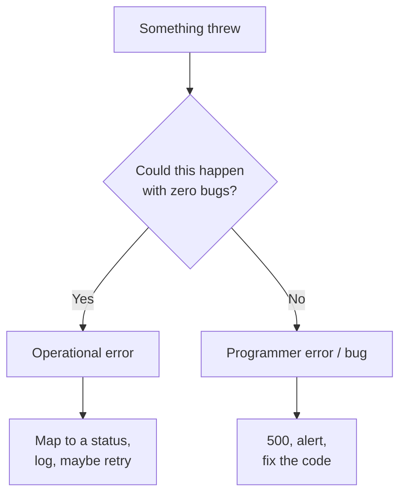
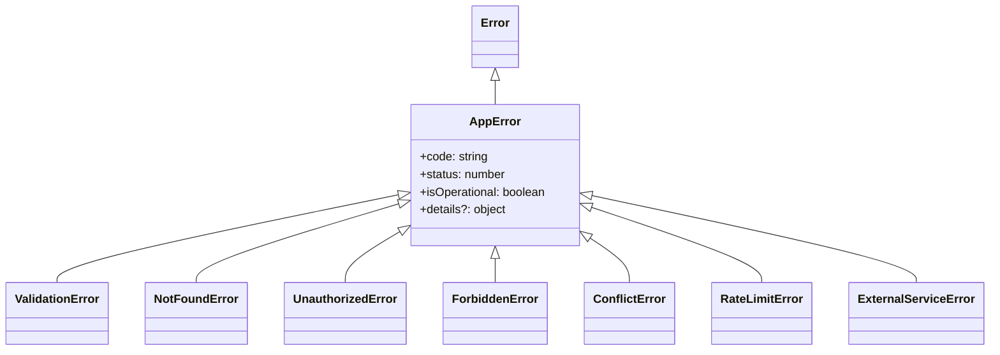
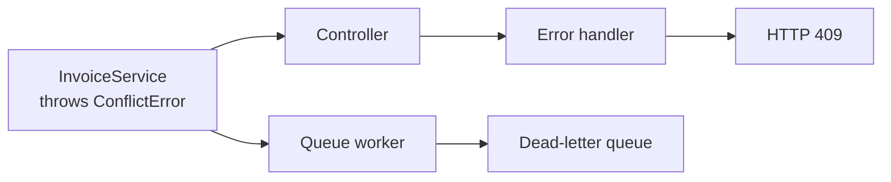

# Error Taxonomy

A hospital emergency room does not treat every patient the same way. The first
step is **triage**: a nurse sorts people into categories. A broken arm, a heart
attack, and a paper cut get different responses, and the sorting happens
*before* any treatment starts.

Your backend needs that step too. "A record was not found" and "my code called
a function that does not exist" are both errors in JavaScript, but they need
opposite treatment. One is a normal Tuesday. The other means your code is wrong
and you should be told loudly.

> **📌 In one line:** classify an error first, because the category — not the
> message — decides the status code, the log level, whether you retry, and
> whether someone gets woken up.

## Table of Contents

1. [Why Classify Before You Handle](#why-classify-before-you-handle)
2. [The Two Families](#the-two-families)
3. [The Rule That Follows](#the-rule-that-follows)
4. [A Classification Table](#a-classification-table)
5. [Designing an Error Hierarchy](#designing-an-error-hierarchy)
6. [The Concrete Error Classes](#the-concrete-error-classes)
7. [Domain Errors, Not HTTP Errors](#domain-errors-not-http-errors)
8. [Errors as Values vs Exceptions](#errors-as-values-vs-exceptions)
9. [Wrapping Third-Party Errors](#wrapping-third-party-errors)
10. [Retryable vs Non-Retryable](#retryable-vs-non-retryable)
11. [Common Mistakes](#common-mistakes)
12. [Questions to Test Yourself](#questions-to-test-yourself)
13. [Related](#related)

---

## Why Classify Before You Handle

Imagine one `catch` block for your whole application: log the message, return
`500`. It "handles errors". It is also useless.

A missing `email` field is the caller's mistake and should be a `400`. A
missing task row should be a `404`. A Stripe timeout should be retried once and
then reported as `502`. A `TypeError` in your own code should be a `500`, and
it should page you.

Those four failures need four status codes, three log levels, two retry
answers, and one alert. A single `catch` cannot produce that, because it threw
away the only thing that mattered: **what kind of error this was**.

```text
┌──────────┐   ┌────────────┐   ┌──────────────┐   ┌─────────┐   ┌──────────┐
│  error   │──▶│  classify  │──▶│ decide       │──▶│  log at │──▶│ respond  │
│  thrown  │   │ (category) │   │ status/retry │   │  level  │   │          │
└──────────┘   └────────────┘   └──────────────┘   └─────────┘   └──────────┘
```

## The Two Families

Almost every error in a Node backend belongs to one of two families. This split
comes from the Node.js community and it is the most useful idea in this file.

**Operational errors** are failures you knew could happen when you wrote the
code. The program is working correctly. The *world* did not cooperate. Test:
*could this happen even if my code had zero bugs?* If yes, it is operational.

- The request body has `title: ""` and title is required.
- The client asked for task `9999` and no such task exists.
- The user is logged in but is not a member of that company.
- The JWT (JSON Web Token) has expired.
- Postgres is restarting and refuses the connection.
- Stripe took longer than 5 seconds to answer.
- The client sent its 101st request this minute and your limit is 100.

These are not bugs. They are the reason error handling exists. You expect them,
you name them, and you decide in advance what each one does.

**Programmer errors** are mistakes in your own source code. The program is
doing something it was never supposed to be able to do. Test: *would a correct
program ever reach this line in this state?* If no, it is a bug.

- `TypeError: invoice.customer is undefined` — you forgot the customer can be
  null for draft invoices.
- You call `sendInvoice(companyId, userId)`, but the signature is
  `(userId, companyId)`.
- A `switch` over task status has no `case` for `archived` and no `default`.
- An invariant broke: a function that must never get an empty array got one.
- `process.env.STRIPE_KEY` is `undefined` because nobody set it.

A programmer error cannot be "handled" in any useful sense. The code that would
handle it is written by the same person who wrote the bug. You cannot recover
from a state you did not anticipate.



> **💡 Tip:** the same symptom can be either family. `ECONNREFUSED` from
> Postgres during a failover is operational. The same `ECONNREFUSED` because
> you typed the wrong port in config is a bug. Category follows the cause.

## The Rule That Follows

| | Operational error | Programmer error |
|---|---|---|
| Do you expect it? | Yes | No |
| Handle it deliberately? | Yes — named class, mapped status | No — you cannot |
| Response to client | 4xx, sometimes 502/503 | 500, generic message |
| Log level | `warn` or `info` | `error` |
| Alert a human? | Only if the rate is abnormal | Yes |
| In development | Clear, specific message | **Crash loudly** |
| In production | Handle and continue | Last-resort handler, then restart |

The last two rows are the important half. In development a bug must be
impossible to ignore. In production a bug is caught by one final safety net —
enough to return a `500` and write a full log line — and then the process
restarts instead of continuing in an unknown state.

Now look at the most common mistake in backend error handling:

```ts
try {
  await doTheWholeThing();
} catch (error) {
  logger.warn('something went wrong');   // no error object, no rethrow
}
```

Three bad things just happened. A real bug produced a log line that says
nothing, so nobody will investigate it. The function continued as if it had
succeeded, so whatever runs next works on half-finished state. And the error
never reached the central handler, so no alert fired. A bug that crashes gets
fixed on Monday. A bug that is swallowed makes strange data for six months.

> **⚠️ Warning:** a `catch` block that does not either genuinely recover or
> rethrow something is almost always a bug in itself.

## A Classification Table

This uses the SaaS domain from the rest of the track: users, companies,
projects, tasks, invoices, notifications.

| Error | Example | Whose fault | HTTP | Retry? | Alert? |
|---|---|---|---|---|---|
| Missing required field | `POST /tasks` with no `title` | Client | 400 | No | No |
| Wrong type or format | `dueDate: "next friday"` | Client | 422 | No | No |
| Malformed JSON body | Truncated request body | Client | 400 | No | No |
| No credentials | No `Authorization` header | Client | 401 | No | No |
| Expired token | JWT `exp` in the past | Client | 401 | No (refresh) | No |
| Not a member | Opens another company's project | Client | 403 | No | If spiking |
| Record not found | `GET /invoices/9999` | Client | 404 | No | No |
| Duplicate unique value | Second signup, same email | Client | 409 | No | No |
| Version conflict | Two edits to one task row | Client | 409 | Yes (client) | No |
| Payload too large | 60 MB upload | Client | 413 | No | No |
| Rate limit exceeded | 101st request this minute | Client | 429 | After delay | If sustained |
| DB connection refused | Postgres failover | Infrastructure | 503 | Yes | Yes |
| DB query timeout | Missing index, slow scan | You | 504 | Maybe once | Yes |
| Deadlock detected | Two transactions, opposite order | You | 409 | Yes | If frequent |
| Third-party timeout | Stripe over 5s | Third party | 502 | Yes | If sustained |
| Third-party 400 | You sent a bad Stripe payload | You | 500 | **No** | Yes |
| Out of disk or memory | Uploads fill the volume | Infrastructure | 503 | No | Yes |
| `TypeError` in your code | `undefined is not a function` | You | 500 | No | Yes |
| Broken invariant | Negative invoice total | You | 500 | No | Yes |

Read the "Whose fault" column first. It is the fastest way to pick the status
family: client fault → `4xx`, your fault or infrastructure fault → `5xx`. A
third-party `400` is your fault, because you built the request.

> **📌 Remember:** `4xx` says "the caller should change something". `5xx` says
> "the caller did nothing wrong". Getting this backwards makes clients retry
> requests that can never succeed.

## Designing an Error Hierarchy

One base class carries the four pieces of information the central handler needs.

```ts
// src/errors/app-error.ts
export type ErrorDetails = Record<string, unknown>;

export interface AppErrorOptions {
  code: string;             // stable, machine-readable, part of your API
  status: number;           // the HTTP status used at the edge
  isOperational?: boolean;  // false = bug; decides log level and alerting
  details?: ErrorDetails;   // structured extras, e.g. which fields failed
  cause?: unknown;          // the original error, kept for logs
}

export class AppError extends Error {
  readonly code: string;
  readonly status: number;
  readonly isOperational: boolean;
  readonly details?: ErrorDetails;

  constructor(message: string, opts: AppErrorOptions) {
    super(message, { cause: opts.cause });
    this.name = new.target.name;          // "NotFoundError", not "Error"
    this.code = opts.code;
    this.status = opts.status;
    this.isOperational = opts.isOperational ?? true;
    this.details = opts.details;
    Error.captureStackTrace?.(this, new.target);  // hide constructor frame
  }
}
```

Four details that matter. `new.target.name` gives you the subclass name, so
logs read well with no extra work. `cause` is passed to the native `Error`
option, so the original error survives — see
[Error.cause chaining](../../typescript-fundamentals/error-handling/advanced.md).
`isOperational` defaults to `true`, because anything you construct on purpose
is expected; a bug never goes through this class at all. And `code` is a
**public contract**: `USER_NOT_FOUND` must mean the same thing next year even
if you rename the table.



## The Concrete Error Classes

Each subclass fixes the status and a default code, so callers supply only what
changes.

```ts
// src/errors/index.ts
import { AppError, type ErrorDetails } from './app-error';

export class ValidationError extends AppError {
  constructor(message = 'Validation failed', details?: ErrorDetails) {
    super(message, { code: 'VALIDATION_FAILED', status: 422, details });
  }
}
export class NotFoundError extends AppError {
  constructor(resource: string, id?: string | number) {
    super(`${resource} not found`, {
      code: `${resource.toUpperCase()}_NOT_FOUND`,
      status: 404,
      details: id === undefined ? undefined : { id },
    });
  }
}
```

`401` means "I do not know who you are". `403` means "I know who you are and
the answer is no". Different failures, so different classes.

```ts
export class UnauthorizedError extends AppError {
  constructor(message = 'Authentication required', code = 'UNAUTHENTICATED') {
    super(message, { code, status: 401 });
  }
}
export class ForbiddenError extends AppError {
  constructor(message = 'You do not have access to this resource') {
    super(message, { code: 'FORBIDDEN', status: 403 });
  }
}
export class ConflictError extends AppError {
  constructor(message: string, code = 'CONFLICT', details?: ErrorDetails) {
    super(message, { code, status: 409, details });
  }
}
```

`RateLimitError` carries `retryAfterSeconds` so the handler can set the
`Retry-After` header without guessing. `ExternalServiceError` carries the
service name and whether a retry could help.

```ts
export class RateLimitError extends AppError {
  constructor(public readonly retryAfterSeconds: number) {
    super('Too many requests', {
      code: 'RATE_LIMIT_EXCEEDED',
      status: 429,
      details: { retry_after_seconds: retryAfterSeconds },
    });
  }
}
export class ExternalServiceError extends AppError {
  constructor(
    public readonly service: string,      // 'stripe', 'sendgrid', 's3'
    message: string,
    opts: { retryable: boolean; cause?: unknown },
  ) {
    super(message, {
      code: 'EXTERNAL_SERVICE_ERROR',
      status: 502,
      details: { service, retryable: opts.retryable },
      cause: opts.cause,
    });
  }
}
```

## Domain Errors, Not HTTP Errors

Your service layer should not know that HTTP exists. It should not know what
`409` means, because the same service may be called by a background job, a CLI
command, or a queue worker. None of those have status codes.

```ts
// ❌ BROKEN — the service layer knows about HTTP
class InvoiceService {
  async markPaid(invoiceId: string) {
    const invoice = await this.repo.find(invoiceId);
    // A queue worker calling this has no idea what "409" means.
    if (invoice.status === 'paid') throw new HttpError(409, 'already paid');
  }
}

// ✅ FIXED — the service throws a domain error; only the edge knows HTTP
class InvoiceService {
  async markPaid(invoiceId: string) {
    const invoice = await this.repo.find(invoiceId);
    if (!invoice) throw new NotFoundError('Invoice', invoiceId);
    if (invoice.status === 'paid') {
      throw new ConflictError('Invoice is already paid', 'INVOICE_ALREADY_PAID');
    }
    return this.repo.update(invoiceId, { status: 'paid', paidAt: new Date() });
  }
}
```

The `409` still exists. It lives on the `ConflictError` class, which belongs to
the HTTP-aware error module, not to the service. The service names the
*situation*; the edge translates it into a protocol.



One thrown error becomes an HTTP status in one caller and a queue decision in
another. That works only because the service stayed protocol free. Layer
boundaries are covered in
[../09-application-architecture/02-service-layer-part-1.md](../09-application-architecture/02-service-layer-part-1.md).

## Errors as Values vs Exceptions

There is a second style: instead of throwing, return a value that describes
success or failure.

```ts
type Result<T, E> = { ok: true; value: T } | { ok: false; error: E };

async function findTask(id: string): Promise<Result<Task, 'NOT_FOUND'>> {
  const task = await db.tasks.findById(id);
  return task ? { ok: true, value: task } : { ok: false, error: 'NOT_FOUND' };
}
```

| | Exceptions (`throw`) | `Result` values |
|---|---|---|
| Visible in the type signature | No | Yes |
| Easy to forget to handle | Yes | No — the compiler forces the check |
| Travels up deep call stacks | Automatically | Every layer must pass it up |
| Fits the Node ecosystem | Yes | Needs adapters everywhere |
| Stack trace for free | Yes | No |

`Result` is genuinely better for **expected, local, recoverable outcomes**:
parsing user input, an optional cache lookup, a "does this coupon exist" check
where both answers are normal. Exceptions stay better for failures that must
travel up five layers to the edge, where no layer in between can do anything
useful — threading a `Result` through repository, service, and controller means
writing `if (!r.ok) return r;` everywhere, which is noise.

Most Node codebases use exceptions, and that is a reasonable default. The
ecosystem throws: `JSON.parse` throws, `fs` rejects, the Postgres driver
rejects, Express is built around `next(err)`. You can still mix the two: use
`Result` inside one module where it reads better, and throw at its public edge.

## Wrapping Third-Party Errors

A Stripe error has fields like `type`, `raw`, and `statusCode`. A Postgres
error has `code: '23505'` and `constraint`. If those shapes reach your service
layer, your domain is coupled to a vendor. Swap the payment provider and you
rewrite business logic. The fix: every integration gets one thin adapter that
converts foreign errors into your own before they escape.

```ts
// src/integrations/payments/stripe-client.ts
export async function chargeInvoice(invoice: Invoice): Promise<Charge> {
  try {
    return await stripe.charges.create({
      amount: invoice.totalCents,
      currency: invoice.currency,
      customer: invoice.stripeCustomerId,
    });
  } catch (error) {
    throw toPaymentError(error);   // nothing raw ever leaves this file
  }
}

function toPaymentError(error: unknown): AppError {
  const e = error as { type?: string };
  if (e.type === 'StripeConnectionError' || e.type === 'StripeAPIError') {
    return new ExternalServiceError('stripe', 'Payment provider unavailable', {
      retryable: true,
      cause: error,           // full original kept for the logs
    });
  }
  // A declined card is a business outcome, not an outage.
  if (e.type === 'StripeCardError') {
    return new ConflictError('Card was declined', 'CARD_DECLINED');
  }
  // StripeInvalidRequestError means WE built a bad request. That is a bug.
  return new AppError('Payment request was rejected', {
    code: 'PAYMENT_REQUEST_INVALID',
    status: 500,
    isOperational: false,     // marks it a bug, so it alerts
    cause: error,
  });
}
```

Do the same at the database boundary, where `23505` is a unique violation:

```ts
catch (error) {
  if ((error as { code?: string }).code === '23505') {
    throw new ConflictError('Email already registered', 'EMAIL_TAKEN');
  }
  throw error;   // unknown DB errors stay unknown — never guess
}
```

Because `cause` is preserved, your logs still hold the original Stripe or
Postgres error in full, while your domain only sees your own classes. The
chaining mechanics are in
[../../typescript-fundamentals/error-handling/advanced.md](../../typescript-fundamentals/error-handling/advanced.md).

## Retryable vs Non-Retryable

Retrying is safe only when two things are true: the failure might not happen
again, and repeating the operation does no damage.

| Failure | Retryable? | Why |
|---|---|---|
| Connection reset, DNS failure | Yes | Transient network condition |
| 502 / 503 / 504 from a dependency | Yes | Their side, probably temporary |
| Request timeout | With care | May have succeeded — needs idempotency |
| 429 rate limited | After `Retry-After` | You were told to wait |
| Deadlock (`40P01`) | Yes | The other transaction has finished |
| 400 / 422 bad payload | No | The same payload fails forever |
| 401 / 403 | No | Credentials will not fix themselves |
| 404, unique violation | No | The state will not change by itself |
| `TypeError` in your code | No | A bug retried is still a bug |

That is why `ExternalServiceError` carries an explicit `retryable` flag: the
adapter is the only place that knows enough to set it.

> **⚠️ Warning:** retrying a timed-out `POST /charges` can charge a customer
> twice, because the first request may have succeeded before the timeout. Every
> retried write needs an idempotency key. See
> [idempotency](../../system-design/reliability/idempotency.md). Backoff,
> jitter, and breakers are in
> [circuit-breakers-and-retries](../../system-design/reliability/circuit-breakers-and-retries.md).

### BROKEN vs FIXED: the swallowed database error

```ts
// ❌ BROKEN — a database failure becomes "this company has no projects"
async function listProjects(companyId: string): Promise<Project[]> {
  try {
    return await db.projects.where({ companyId });
  } catch (error) {
    console.log('could not load projects');
    return [];      // the caller cannot tell this from a real empty list
  }
}
```

Postgres fails over for 30 seconds. Every user sees an empty dashboard saying
"Create your first project". The response is `200 OK`, so no alert fires and no
monitor turns red. Worse, a cleanup job that deletes companies with no projects
now deletes live customer data.

```ts
// ✅ FIXED — classify, wrap, rethrow; an empty array now only means empty
async function listProjects(companyId: string): Promise<Project[]> {
  try {
    return await db.projects.where({ companyId });
  } catch (error) {
    if (isConnectionError(error)) {
      throw new AppError('Database unavailable', {
        code: 'DB_UNAVAILABLE', status: 503, cause: error,
      });
    }
    throw error;    // unknown = let the central handler treat it as a bug
  }
}
```

The rule behind the fix: **a failure must never be able to imitate a valid
result.** An empty array is a valid result. A `503` is not.

---

## Common Mistakes

| Mistake | Why it is wrong | Do this instead |
|---|---|---|
| One generic `Error` everywhere | The handler cannot tell a 404 from a bug | Subclass `AppError` with `code` and `status` |
| `catch` that logs and continues | Bugs become silent corrupt data | Recover properly or rethrow |
| Throwing HTTP errors from services | Services become unusable from jobs and CLI | Throw domain errors; map at the edge |
| Letting raw Stripe/Postgres errors escape | Your domain is coupled to a vendor | Wrap in an adapter, keep `cause` |
| Marking every error `isOperational: true` | Real bugs stop alerting | Only errors you constructed on purpose |
| Building `code` from a message string | Messages change, clients break | One fixed constant per error class |
| Retrying anything that failed | Double charges, duplicate rows | Retry transient failures only, with idempotency |
| Returning `200` with `{ error: ... }` | Monitoring and clients see success | Use the status code; it is not decoration |

## Questions to Test Yourself

1. Your code throws `ECONNREFUSED` connecting to Postgres. Give one version of
   this that is operational and one that is a bug, and say what separates them.
2. Why should a programmer error crash the process in production instead of
   being caught and ignored? What restarts the process afterwards?
3. Stripe returns `400` because your request was missing `currency`. Whose
   fault is it, what status does the client get, and should you retry? Explain
   all three answers.
4. Why is `throw new HttpError(409)` wrong inside `InvoiceService`, even though
   the client really will receive a 409?
5. Name one case in your own work where `Result<T, E>` would be clearly better
   than throwing, and one where it would be clearly worse.
6. A teammate writes `catch (e) { return []; }` around a database read. Describe
   two different production incidents this could cause.
7. Why does `ExternalServiceError` carry a `retryable` flag instead of letting
   the central handler decide retryability from the status code?
8. What breaks for API consumers if you rename the error code `EMAIL_TAKEN` to
   `DUPLICATE_EMAIL` in a patch release?

## Related

- [Centralized Error Handling](02-centralized-error-handling-part-1.md) — the one
  place where every error here becomes a response.
- [Client-Facing Error Responses](03-client-facing-error-responses-part-1.md) — how
  `code`, `status`, and `details` reach the client safely.
- [Error Response Design](../02-rest-api-design/05-error-response-design.md) —
  the design rationale for the body shape these classes produce.
- [Service Layer](../09-application-architecture/02-service-layer-part-1.md) — why a
  service throws domain errors and knows nothing about HTTP.
- [typescript-fundamentals/error-handling](../../typescript-fundamentals/error-handling/error-handling.md)
  and [advanced](../../typescript-fundamentals/error-handling/advanced.md) —
  `try`/`catch`, custom `Error` subclasses, `Error.cause`, retries, breakers.
- [circuit-breakers-and-retries](../../system-design/reliability/circuit-breakers-and-retries.md)
  — what to do once you know an error is retryable.
