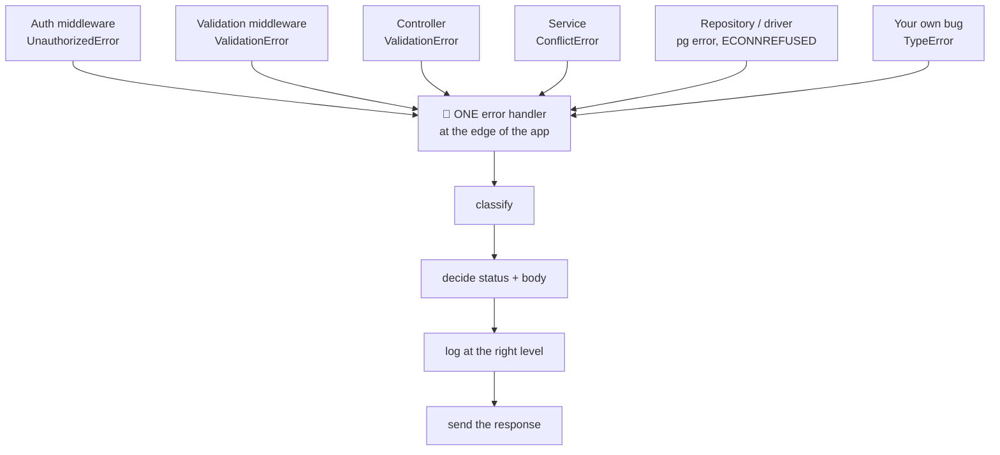
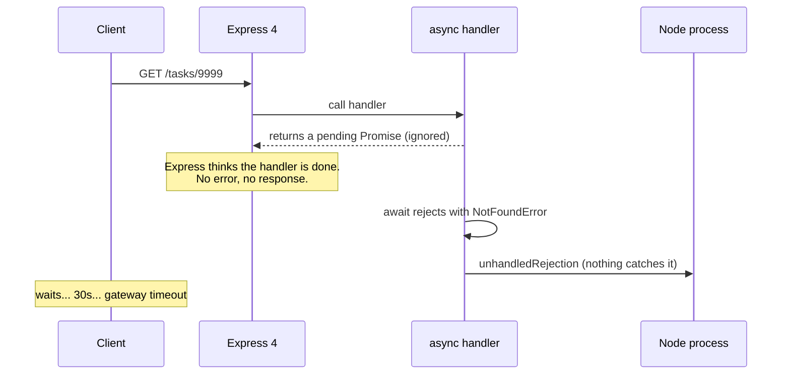

# Centralized Error Handling — Part 1

A large building routes every smoke detector to **one** alarm panel, and the
panel decides what happens. Your application needs that shape. Errors are
*detected* everywhere — middleware, controllers, services, repositories — but
they should be *decided* in exactly one place. This part builds that place,
then fixes the three ways errors sneak past it.

> **📌 In one line:** every error should travel, untouched, to one handler
> at the edge that classifies it, logs it at the right level, and turns it
> into a consistent response.

## Table of Contents

1. [The Repetitive Version](#the-repetitive-version)
2. [The Funnel](#the-funnel)
3. [Building the Handler, Step by Step](#building-the-handler-step-by-step)
4. [The Complete Handler](#the-complete-handler)
5. [Framework Mechanics](#framework-mechanics)
6. [BROKEN vs FIXED: the Async Route That Never Arrives](#broken-vs-fixed-the-async-route-that-never-arrives)
7. [Errors After the Response Was Sent](#errors-after-the-response-was-sent)
8. [Last-Resort Process Handlers](#last-resort-process-handlers)
9. [Common Mistakes](#common-mistakes)
10. [Questions to Test Yourself](#questions-to-test-yourself)
11. [Related](#related)

---

## The Repetitive Version

Here is a controller written the way most codebases start. Every line was
written by someone reasonable, one bug report at a time.

```ts
// ❌ BROKEN — three handlers, three different ideas of what an error is
export class TaskController {
  async show(req: Request, res: Response) {
    try {
      const task = await taskService.find(req.params.id);
      if (!task) return res.status(404).json({ error: 'not found' });
      res.json(task);
    } catch (error) {
      console.error(error);
      res.status(500).json({ error: 'Internal server error' });
    }
  }

  async store(req: Request, res: Response) {
    try {
      res.status(201).json(await taskService.create(req.body));
    } catch (error) {
      // Added after a support ticket about duplicate titles.
      if ((error as any).code === '23505') {
        return res.status(409).json({ message: 'Duplicate' });
      }
      res.status(500).send('Something went wrong');   // different shape!
    }
  }

  async destroy(req: Request, res: Response) {
    // Someone forgot the try/catch. Nobody noticed for four months.
    await taskService.remove(req.params.id);
    res.status(204).end();
  }
}
```

Each problem below is a real production failure:

| Problem above | What it costs you |
|---|---|
| `{ error: ... }` vs `{ message: ... }` vs plain text | The client needs three parsers |
| `console.error` in one place, nothing in the others | Two of three failures leave no trace |
| No `request_id` anywhere | A support ticket cannot reach a log line |
| Postgres code `23505` in a controller | The HTTP layer knows database internals |
| `destroy` has no `try`/`catch` | Unhandled rejection; the client waits for its timeout |
| Adding a new error type | You edit every controller, and miss some |

That last row is the real cost. The code is not so much wrong as
**unmaintainable**: the rules live in forty places, so they drift.

> **📌 Remember:** the problem is not `try`/`catch`. It is *duplicated
> decisions*. A decision living in forty files has forty versions.

## The Funnel

Every layer may `throw` and is *forbidden* from formatting a response. All of
it lands in one handler.



Notice what is *not* in the diagram: any arrow from a layer straight to a
response. A repository never calls `res.status()`. There is exactly one exit.

Three rules make the funnel work:

1. **Throw, do not return an error shape.** A thrown error travels up by
   itself; a returned one must be checked at every level, and will not be.
2. **Only catch when you will genuinely do something** — add context, wrap a
   vendor error into your own, or recover — and then rethrow.
3. **Only the handler formats a response.**

The error classes used here (`AppError`, `ConflictError`,
`ExternalServiceError`, and the `code` / `status` / `isOperational` fields)
come from [01-error-taxonomy.md](01-error-taxonomy.md).

## Building the Handler, Step by Step

The five boxes at the bottom of the funnel diagram, one at a time.

**Step 1 — catch anything**, because not every thrown value is an `Error`;
somebody wrote `throw 'nope'`. **Step 2 — classify**: there are exactly two
outcomes, an error you designed or one you did not.

```ts
function toError(thrown: unknown): Error {
  if (thrown instanceof Error) return thrown;
  // Keep the original value visible instead of printing "[object Object]".
  return new Error(`Non-Error thrown: ${JSON.stringify(thrown)}`);
}

function classify(error: Error) {
  if (error instanceof AppError) {
    return { status: error.status, code: error.code, isBug: !error.isOperational };
  }
  return { status: 500, code: 'INTERNAL_ERROR', isBug: true };  // unanticipated
}
```

This is why the class hierarchy exists. Without it, step 2 becomes a pile of
`if (error.message.includes('not found'))`, which breaks the day someone
improves a message.

**Step 3 — decide the body.** One rule that never bends: a `5xx` body says
nothing specific, a `4xx` body says exactly what to fix. That is the whole
subject of [03-client-facing-error-responses-part-1.md](03-client-facing-error-responses-part-1.md).

**Step 4 — log at the right level.** Derive the level from the status so
nobody has to remember:

| Condition | Level | Why |
|---|---|---|
| `status >= 500` or `isBug` | `error` | A human must look at this |
| `status === 429` | `warn` | Expected, but a spike means something |
| any other `4xx` | `info` | The client's mistake, not yours |

A `404` logged at `error` is how alert channels die (see
[Alert Fatigue](../08-logging-and-observability/01-logging-basics.md#alert-fatigue-the-most-common-mistake)).
**Step 5 — respond once**, and only if nothing was sent already.

## The Complete Handler

```ts
// src/http/middleware/error-handler.ts
import type { ErrorRequestHandler } from 'express';
import { AppError, RateLimitError } from '../../errors';
import { logger } from '../../lib/logger';

const isProd = process.env.NODE_ENV === 'production';

export const errorHandler: ErrorRequestHandler = (err, req, res, next) => {
  const error = toError(err);
  const { status, code, isBug } = classify(error);

  // req.log is a child logger already carrying request_id and user_id.
  const log = req.log ?? logger;
  const level = status >= 500 ? 'error' : status === 429 ? 'warn' : 'info';

  log[level]({
    event: 'http.request.failed',
    err: error,                    // serialised with stack + cause chain
    error_code: code, status, is_bug: isBug,
    route: req.route?.path ?? 'unmatched', method: req.method,
  }, error.message);

  if (res.headersSent) return next(error);   // see the next section

  const body = {
    error: {
      code,
      // 5xx must never echo the internal message.
      message: status >= 500 ? 'An unexpected error occurred' : error.message,
      request_id: req.id,
    } as Record<string, unknown>,
  };

  if (error instanceof AppError && error.details) body.error.details = error.details;
  if (!isProd && status >= 500) body.error.stack = error.stack;
  if (error instanceof RateLimitError) {
    res.setHeader('Retry-After', String(error.retryAfterSeconds));
  }

  res.status(status).json(body);
};
```

Four choices there are deliberate:

- **Every `5xx` message is replaced**, not sanitised. A bug's `error.message`
  is often a Postgres string containing your table names.
- **`details` is copied only from an `AppError`** — you built those fields on
  purpose, so they are safe. Nothing else is trusted.
- **`request_id` is always present.** It is the only thing a user can give you.
- **`err: error` is passed as an object**, so the serialiser expands the stack
  and the `cause` chain — see
  [02-structured-logging.md](../08-logging-and-observability/02-structured-logging.md).

> **💡 Tip:** this is one of the few files worth reading end to end during
> onboarding. If a new engineer understands it in five minutes, your error
> handling is healthy.

## Framework Mechanics

Every framework has one hook. The details differ; the idea does not.

**Express** identifies an error handler **by arity**: four parameters
`(err, req, res, next)` means error middleware, three means normal
middleware. Two mechanical rules follow, and both bite.

```ts
// ❌ BROKEN — three parameters, so Express treats this as NORMAL middleware.
// It never runs for an error, and it fails silently.
app.use((err, req, res) => { /* ... */ });

// ❌ BROKEN — `next` is unused, so a linter autofix deletes it, changing the
// arity and quietly disabling the whole handler.
app.use((err, req, res, next) => { res.status(500).json({}) });

// ✅ FIXED — keep the fourth parameter and tell the linter why.
// eslint-disable-next-line @typescript-eslint/no-unused-vars
app.use((err, req, res, next) => { /* ... */ });
```

The second rule is **registration order**: Express runs middleware in the
order added, so a handler registered *before* your routes never sees their
errors.

```ts
app.use('/api/v1', apiRoutes);
app.use(notFoundHandler);   // no route matched -> throw NotFoundError
app.use(errorHandler);      // LAST. Four arguments. Never move this.
```

**AdonisJS** gets there with a class instead of arity: a generated exception
handler (`app/exceptions/handler.ts`) that the framework wires in for you, so
ordering cannot be got wrong. You override `handle` to format the response and
`report` to log it — steps 5 and 4 above, split into two methods.

> **⚠️ Warning:** framework APIs move between major versions — class names,
> the config key that registers the handler, and whether async errors are
> auto-forwarded all change. Treat these snippets as the *shape* and confirm
> specifics in your version's documentation.

| | Express 4 | Express 5 | AdonisJS 6 | Fastify |
|---|---|---|---|---|
| How the handler is found | 4-arg middleware, last | same | exception handler class | `setErrorHandler()` |
| Async rejections forwarded | **No** | Yes | Yes | Yes |
| Order can be wrong | Yes | Yes | No | No |

That "No" is the next section, and it is the most common error-handling bug
in Node backends.

## BROKEN vs FIXED: the Async Route That Never Arrives

```ts
// ❌ BROKEN — on Express 4 this error never reaches errorHandler
app.get('/api/v1/tasks/:id', async (req, res) => {
  const task = await taskService.find(req.params.id);   // rejects
  res.json(task);
});
```

Because the function is `async`, it returns a **Promise immediately** —
before `find` has finished. Express 4 ignores the return value: no `await`,
no `.catch()`, so as far as it is concerned the handler completed cleanly.
Milliseconds later the promise rejects with nobody holding it, and `res` was
never touched.



The symptoms are distinctive: **the client hangs until its own timeout**, the
connection stays open, your error handler logs nothing, and monitoring records
no status code because no response was sent. On a busy endpoint those held-open
connections exhaust the socket pool and the *whole app* stops answering.

```ts
// ✅ FIXED (1) — a wrapper that attaches .catch(next) to any async handler
export function wrapAsync(
  handler: (...a: Parameters<RequestHandler>) => Promise<unknown>,
): RequestHandler {
  return (req, res, next) => {
    // Promise.resolve() also covers a handler that throws synchronously.
    Promise.resolve(handler(req, res, next)).catch(next);
  };
}

app.get('/api/v1/tasks/:id', wrapAsync(async (req, res) => {
  const task = await taskService.find(req.params.id);   // rejects
  res.json(task);                                       // -> next(error)
}));
```

`next(error)` is the mechanism the funnel runs on: passing *any* argument to
`next` makes Express skip the remaining normal middleware and jump to the
first four-argument error handler.

```ts
// ✅ FIXED (2) — framework-native: Express 5 awaits the returned promise and
// forwards the rejection to the error handler for you. No wrapper needed.
app.get('/api/v1/tasks/:id', async (req, res) => res.json(
  await taskService.find(req.params.id),
));
```

AdonisJS, NestJS and Fastify behave like fix 2. On Express 4, `wrapAsync` (or
the `express-async-errors` package) is not optional.

> **💡 Tip:** wrap at the *router* level, not per route, so nobody can
> forget — a helper mapping `router.get(path, ...handlers.map(wrapAsync))`
> removes the whole category.

## Errors After the Response Was Sent

An HTTP response is sent once. Headers go out first, and once they are on the
wire they cannot change. Node exposes this as `res.headersSent`.

```ts
// ❌ BROKEN — response started, then a stream error, then a second response
app.get('/api/v1/invoices/:id/pdf', wrapAsync(async (req, res) => {
  res.setHeader('Content-Type', 'application/pdf');
  const stream = await pdfService.render(req.params.id);
  stream.pipe(res);                              // headers leave with chunk 1
  stream.on('error', (err) => { throw err; });   // ...too late to set a status
}));
```

Common shapes: a stream that fails halfway, an `await` after `res.json()`, a
post-response hook that throws, or two code paths that both respond. If the
handler then calls `res.status()` you get `ERR_HTTP_HEADERS_SENT` — a *second*
error that replaces the real one in your logs.

```ts
// ✅ FIXED — already in the handler above; it must be the first check
if (res.headersSent) {
  req.log.error({ err: error, event: 'http.error.after_response' },
                'error after headers were sent');
  return next(error);      // let Express destroy the socket
}
```

Calling `next(error)` with headers sent hands the problem to Express's default
handler, whose only remaining move is to **close the connection**. That is
correct: the client sees a truncated response and knows something went wrong,
rather than a valid-looking half-written PDF.

Two habits prevent most of these. **Return after responding**, so the
function cannot continue. And **do the fallible work before you write
anything**: render to a buffer first, then set headers. You trade a little
memory for the ability to fail cleanly.

## Last-Resort Process Handlers

The funnel catches everything *inside a request*. Some things are not: a
fire-and-forget `sendEmail(...)` with no `.catch()`, a throw inside a
`setTimeout`, a throw in a driver callback outside any promise chain. Those
reach the process instead.

```ts
// src/lib/process-handlers.ts — registered once, at startup
process.on('unhandledRejection', (reason) => {
  logger.error({ err: reason, event: 'process.unhandled_rejection' },
               'unhandled promise rejection');
  throw reason;              // treat it like an uncaught exception
});

process.on('uncaughtException', (error) => {
  logger.fatal({ err: error, event: 'process.uncaught_exception' },
               'uncaught exception, shutting down');
  server.close();                              // stop accepting connections
  logger.flush?.();                            // let buffered lines escape
  setTimeout(() => process.exit(1), 1000).unref();
});
```

**Why exit?** After an uncaught exception you do not know what state the
process is in. A `TypeError` thrown halfway through a function left its work
half-done: a lock not released, a transaction not closed, a pool connection
never returned. Every later request runs on top of that. The failure mode is
not a crash — it is **quietly wrong data**, found weeks later.

| | Keep running | Exit and restart |
|---|---|---|
| In-flight requests | May be served incorrectly | Fail fast with a 5xx |
| Process state | Unknown, possibly corrupt | Known-good after restart |
| Leaks (pool, locks) | Accumulate | Cleared |
| Visibility | Looks fine; the bug hides | Restart count spikes, alert fires |
| Users affected | Everyone, silently | A handful, loudly |

Exiting is not giving up; it is the only move that restores a known state —
and it works only because **something restarts you**.


In Kubernetes the container restart policy does this, and the **readiness
probe** keeps traffic away until the new process is genuinely ready — the
difference between a two-second blip and a burst of `502`s (see
[health-checks](../../cloud-devops/deployment-strategies/health-checks.md)).
Elsewhere, `systemd` with `Restart=always`, or PM2, does the job.

> **⚠️ Warning:** run more than one instance. A single instance that exits is
> a total outage for the length of the restart; two or more behind a
> [load balancer](../../system-design/foundational/load-balancing.md) makes
> one crash invisible to users.

> **📌 Remember:** these handlers exist to **log and die**, not to recover. If
> you are writing recovery logic inside `uncaughtException`, the real fix
> belongs in the code that threw.

---

## Common Mistakes

| Mistake | Why it is wrong | Do this instead |
|---|---|---|
| `try`/`catch` in every controller | Forty copies of one decision; they drift and one is always missing | One handler at the edge; controllers only throw |
| Error handler registered before the routes | Middleware runs in order, so it never sees route errors | Register it last, after the 404 handler |
| Dropping the unused `next` parameter | Express finds error handlers by arity; three parameters disables it silently | Keep four parameters, disable the lint rule |
| Bare `async` handler on Express 4 | The rejection is ignored; the client hangs until timeout | `wrapAsync`, or a framework that awaits |
| Responding without checking `res.headersSent` | `ERR_HTTP_HEADERS_SENT` replaces the real error in your logs | Check first, log, then `next(error)` |
| `uncaughtException` that logs and continues | The process serves from unknown state and corrupts data | Log, close the server, flush, `exit(1)` |
| `process.exit()` immediately in that handler | Buffered log lines are lost, so you never learn what crashed | Flush with a short timer, then exit |
| One instance behind the load balancer | Every restart is a full outage | Run at least two replicas |
## Questions to Test Yourself

1. A colleague says "we already handle errors, there is a try/catch in every
   controller". Give three concrete reasons that is not centralized error
   handling.
2. Why does an Express error middleware need exactly four parameters, and
   what happens when a linter removes the unused one?
3. Trace, step by step, what happens to the client and to the process when an
   `async` route handler rejects on Express 4 with no wrapper.
4. `wrapAsync` uses `Promise.resolve(handler(...)).catch(next)`. Why
   `Promise.resolve` rather than `handler(...).catch(next)`?
5. Your logs show `ERR_HTTP_HEADERS_SENT` instead of the real error. What
   happened, and which single check prevents it?
6. Explain why continuing to serve after an `uncaughtException` can be *worse*
   than an outage. Give a concrete example of the damage.
7. What must be true about your deployment for "exit on uncaught exception" to
   be a safe policy rather than a self-inflicted outage?
8. Which level should a `404` be logged at, and what goes wrong in a team that
   logs it at `error`?
## Related

> **➡️ Continued in [Part 2](02-centralized-error-handling-part-2.md)** —
> graceful degradation, timeouts as error handling, errors inside database
> transactions, background jobs and webhooks, and testing the error path.

- [01-error-taxonomy.md](01-error-taxonomy.md) — the `AppError` hierarchy and
  the `code` / `status` / `isOperational` fields the handler switches on.
- [03-client-facing-error-responses-part-1.md](03-client-facing-error-responses-part-1.md)
  — what the body this handler sends is allowed to contain.
- [Error Response Design](../02-rest-api-design/05-error-response-design.md)
  — the design rationale for that body shape, and
  [03-middleware.md](../03-request-lifecycle/03-middleware.md) for why the
  handler is registered last.
- [typescript-fundamentals/error-handling/advanced.md](../../typescript-fundamentals/error-handling/advanced.md)
  — `Error.cause`, retries, circuit breakers, and the language-level side of
  the process handlers above.
- [health-checks](../../cloud-devops/deployment-strategies/health-checks.md)
  — what restarts the process, and how traffic is kept away until it is ready.
