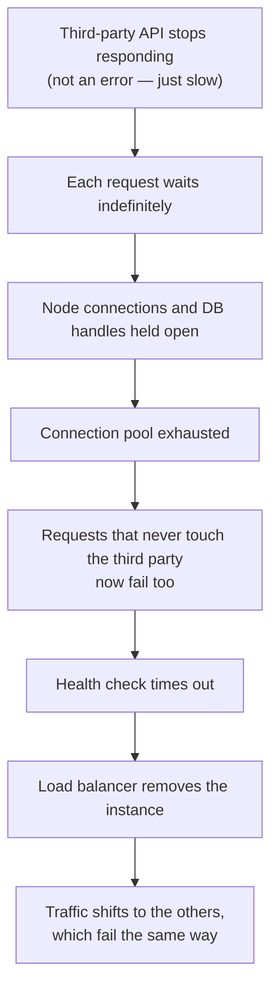
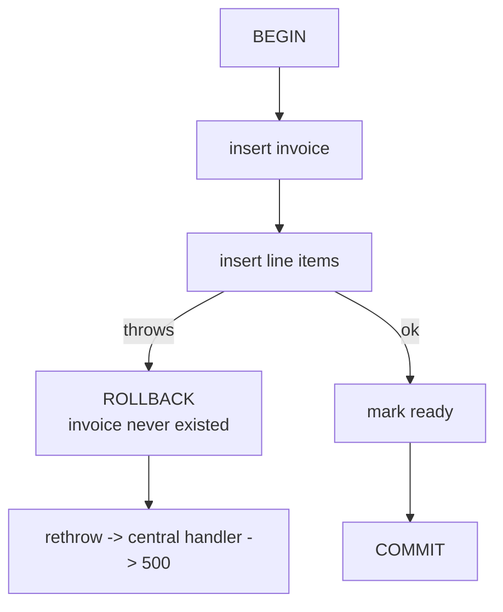

# Centralized Error Handling — Part 2

> **⬅️ This continues [Part 1](02-centralized-error-handling-part-1.md)**,
> which built the one handler every error funnels into, fixed the async-route
> trap and `res.headersSent`, and added the last-resort process handlers.

Part 1 answered *where* an error is handled. This part answers the harder
question: **should this failure fail the request at all?** Sometimes the right
answer is to carry on without the thing that broke, or to stop a call that has
not failed yet. And in a transaction, catching an error in the wrong place can
commit half a change and call it a success.

> **📌 In one line:** decide per dependency whether a failure is fatal or
> survivable, give every outbound call a deadline, never swallow an error
> inside a transaction, and test the failure path as carefully as the happy
> one.

## Table of Contents

1. [Graceful Degradation](#graceful-degradation)
2. [Timeouts Are Error Handling](#timeouts-are-error-handling)
3. [Errors Inside Database Transactions](#errors-inside-database-transactions)
4. [Background Jobs](#background-jobs)
5. [Webhooks](#webhooks)
6. [Testing the Error Path](#testing-the-error-path)
7. [Common Mistakes](#common-mistakes)
8. [Questions to Test Yourself](#questions-to-test-yourself)
9. [Related](#related)

---

## Graceful Degradation

A restaurant whose card machine breaks can still serve dinner and take cash.
One whose kitchen catches fire cannot. Both are failures; only one closes the
restaurant. Every dependency your request touches sits in one of those two
buckets, and you decide which **before** the incident, not during it.

| | Critical dependency | Non-critical dependency |
|---|---|---|
| Examples | Primary database, auth service, payment provider on a checkout | Analytics, email, cache, search suggestions, avatars |
| If it fails | The answer would be wrong or absent | The answer is still correct, just poorer |
| Correct behaviour | Fail the request with a `5xx` | Log, continue, return success |
| Who finds out | The user, immediately | You, from a metric or a log |

Here is a `POST /api/v1/projects` that touches four things: the database
(critical), the cache (not), analytics (not), and a welcome email (not).

```ts
// ❌ BROKEN — a failed analytics call makes project creation fail
async function createProject(input: CreateProjectInput, actor: User) {
  const project = await projectRepo.insert(input);
  await cache.del(`projects:${actor.companyId}`);
  await analytics.track('project.created', { userId: actor.id });
  await mailer.sendProjectCreated(actor.email, project);
  return project;
}
```

The project **is already saved**. Then Segment has a bad five minutes,
`analytics.track` rejects, the error funnels up, and the handler returns
`500`. The user sees "could not create project", clicks again, and now there
are two projects. One vendor's outage became your data problem.

```ts
// ✅ FIXED — critical work awaited; the rest is best-effort and never throws
async function createProject(input: CreateProjectInput, actor: User) {
  const project = await projectRepo.insert(input);      // critical: may throw

  await bestEffort('cache.invalidate', () =>
    cache.del(`projects:${actor.companyId}`));
  await bestEffort('analytics.track', () =>
    analytics.track('project.created', { userId: actor.id }));
  await bestEffort('email.project_created', () =>
    mailer.sendProjectCreated(actor.email, project));

  return project;
}

/** Runs side work that must never fail the request. */
async function bestEffort(name: string, fn: () => Promise<unknown>) {
  try {
    await fn();
  } catch (error) {
    // warn, not error: we recovered. It still needs to be countable.
    logger.warn({ err: error, event: 'degraded', dependency: name },
                `${name} failed, continuing`);
    degradedCounter.inc({ dependency: name });
  }
}
```

Three things make this safe rather than sloppy:

- **`bestEffort` is explicit.** A reader can see which calls are optional.
  A bare `try { } catch { }` around the same code says nothing.
- **It logs and counts.** Degradation you cannot see is just a silent bug.
  A `degraded` counter turns "email is broken" into a graph and an alert —
  see [04-metrics-and-health-checks-part-1.md](../08-logging-and-observability/04-metrics-and-health-checks-part-1.md).
- **The email is not lost.** For anything that must eventually happen, the
  best-effort call should *enqueue a job*, not do the work. Enqueuing is
  cheap and retryable; sending SMTP inline is neither.

Compare with the critical case: a read that cannot reach the database must
**not** return an empty list, because an empty list is a valid answer. Let it
throw. A useful middle ground is a **stale cache fallback** — if the read
fails and you hold a slightly old copy, serve that with a warning header
rather than a `503`. That is a product decision: right for a dashboard, wrong
for an account balance.

> **⚠️ Warning:** degradation must be bounded. If the cache is down and every
> request waits 5 seconds for it to time out before continuing, you have not
> degraded gracefully, you have slowed everything to a crawl. Pair degradation
> with a short timeout and a circuit breaker:
> [circuit-breakers-and-retries](../../system-design/reliability/circuit-breakers-and-retries.md).

## Timeouts Are Error Handling

A call that never returns is worse than one that fails. A failure is an error
you can handle; a hang holds a connection, a worker slot and a database handle
for as long as it lasts.

```ts
// ❌ BROKEN — no deadline. If the provider stalls, so do you.
const res = await fetch('https://api.taxservice.example/v1/rates');
```

`fetch` and most HTTP clients have **no default timeout**, and TCP keeps the
socket open for minutes. Here is the chain that takes down a healthy service:



Nothing in that chain is your bug. The only defence is a deadline.

```ts
// ✅ FIXED — AbortController turns "slow forever" into a catchable error
export async function fetchWithTimeout(
  url: string,
  init: RequestInit = {},
  timeoutMs = 3_000,
): Promise<Response> {
  const controller = new AbortController();
  const timer = setTimeout(() => controller.abort(), timeoutMs);
  try {
    return await fetch(url, { ...init, signal: controller.signal });
  } catch (error) {
    if ((error as Error).name === 'AbortError') {
      throw new ExternalServiceError('taxservice', `Timed out after ${timeoutMs}ms`, {
        retryable: true, cause: error,
      });
    }
    throw error;
  } finally {
    clearTimeout(timer);       // always: otherwise the timer leaks
  }
}
```

Three details that are easy to get wrong:

- **`clearTimeout` belongs in `finally`.** Without it, a fast response still
  leaves a pending timer, and under load you accumulate thousands.
- **Translate `AbortError` into your own error type.** `AbortError` alone does
  not say which service or whether retrying is sensible.
- **`AbortSignal.timeout(3000)`** is the modern one-liner for the simple case;
  the manual version above is what you need when you also abort for other
  reasons, such as the client disconnecting.

Every layer needs its own deadline, and they must be ordered:

| Layer | Typical timeout | Note |
|---|---|---|
| Outbound HTTP call | 2–5 s | Shortest; you may retry inside the request budget |
| Database query | 5–10 s (`statement_timeout`) | Stops one bad query blocking a pool slot |
| Whole request | 15–30 s | Server-side; the request budget |
| Load balancer / gateway | 30–60 s | Longest; must exceed the app's own |

The ordering rule: **inner timeouts must be shorter than outer ones.** If your
HTTP call waits 30 s but the gateway gives up at 10 s, the client sees a
gateway `504` and your careful `ExternalServiceError` handling never runs. The
promise mechanics behind `AbortController`, `Promise.race` and cancellation
are in
[async-await-promise/advanced.md](../../typescript-fundamentals/async-await-promise/advanced.md).

> **💡 Tip:** set the timeout budget from the outside in. If the user-facing
> budget is 3 seconds, an internal call cannot have a 10-second timeout,
> however reasonable that number looks on its own.

## Errors Inside Database Transactions

A transaction is all-or-nothing: `COMMIT` keeps every change, `ROLLBACK`
discards every change. Error handling inside one is therefore not about
recovering — it is about making sure the right one of those two runs.

The pattern that gets it right every time:

```ts
// ✅ The transaction wrapper. Throw = rollback. Return = commit.
export async function withTransaction<T>(fn: (tx: Tx) => Promise<T>): Promise<T> {
  const tx = await pool.connect();
  try {
    await tx.query('BEGIN');
    const result = await fn(tx);
    await tx.query('COMMIT');
    return result;
  } catch (error) {
    await tx.query('ROLLBACK').catch(() => {});  // rollback may itself fail
    throw error;                                 // rethrow: the funnel decides
  } finally {
    tx.release();                                // always return the connection
  }
}
```

Two easily missed details. `ROLLBACK` has its own `.catch()`, because if the
connection died the rollback fails too and that secondary error would replace
the real one. And `tx.release()` is in `finally`, so a connection is never
leaked; leaks exhaust the pool and take the app down minutes later.

Now the trap. A `catch` **inside** the callback breaks atomicity silently:

```ts
// ❌ BROKEN — the catch swallows the failure, so COMMIT still runs
await withTransaction(async (tx) => {
  const invoice = await invoiceRepo.insert(tx, invoiceData);

  try {
    await lineItemRepo.insertMany(tx, invoice.id, items);
  } catch (error) {
    logger.warn('could not insert line items');   // "handled"
  }

  await invoiceRepo.markReady(tx, invoice.id);
});
```

The callback returns normally, so the wrapper commits. You now have an invoice
marked ready with **no line items** — a `200 OK` and a total of zero sent to a
customer. Nothing logs an error and no alert fires. That is worse than a
crash, because the damage is permanent and invisible.

```ts
// ✅ FIXED — let it propagate; the wrapper rolls back and the funnel responds
await withTransaction(async (tx) => {
  const invoice = await invoiceRepo.insert(tx, invoiceData);
  await lineItemRepo.insertMany(tx, invoice.id, items);   // throws -> ROLLBACK
  await invoiceRepo.markReady(tx, invoice.id);
});
```



Three more rules for transactions:

- **A caught error still poisons the transaction.** In PostgreSQL, once a
  statement fails the transaction is in an aborted state; every later
  statement returns `current transaction is aborted`. Catching does not undo
  that. If you genuinely need partial recovery, use a `SAVEPOINT` — see
  [Savepoints and Partial Rollback](../../databases/transactions-and-concurrency/01-transactions-and-acid-part-2.md).
- **Never do external I/O inside a transaction.** Charging a card inside a
  transaction that later rolls back leaves the customer charged for an invoice
  that does not exist, and holds a database connection open for the length of
  a network call. Do it after `COMMIT`, or from a job.
- **A deadlock is a retry, not a `500`.** Postgres error `40P01` and
  serialization failures mean "try the whole transaction again" — the retry
  loop belongs around `withTransaction`, not inside it. See
  [05-deadlocks-part-2.md](../../databases/transactions-and-concurrency/05-deadlocks-part-2.md).

> **📌 Remember:** inside a transaction, a `catch` that does not rethrow is a
> `COMMIT` you did not intend to write.

## Background Jobs

In a job there is no user waiting and no status code to return. The rules
change accordingly.

| | HTTP request | Background job |
|---|---|---|
| Who sees a failure | The user, now | Nobody, unless you log or alert |
| Retry decided by | The client | Your queue, automatically |
| Cost of a retry | Another request | Possible duplicate side effects |
| Final destination | An error response | A dead-letter queue |

```ts
// A job handler: the queue is the error handler.
export async function sendInvoiceEmailJob(job: Job<{ invoiceId: string }>) {
  const log = logger.child({
    job: job.name, job_id: job.id, attempt: job.attemptsMade + 1,
    request_id: job.data.requestId,   // inherited from the enqueuing request
  });

  try {
    await mailer.sendInvoice(job.data.invoiceId);
    log.info({ event: 'invoice.email.sent' });
  } catch (error) {
    const isLast = job.attemptsMade + 1 >= (job.opts.attempts ?? 1);
    log[isLast ? 'error' : 'warn'](
      { err: error, event: 'invoice.email.failed', will_retry: !isLast },
      'invoice email failed',
    );
    throw error;   // rethrow: the queue decides retry vs dead-letter
  }
}
```

Four things worth copying:

- **Rethrow.** Swallowing marks the job successful and it never retries.
- **Escalate the level on the last attempt.** Attempt 1 failing is normal
  noise; attempt 5 failing means a human must act.
- **Carry `request_id` in the payload** so the job's logs join the request
  that created it — [03-correlation-ids-and-tracing-part-1.md](../08-logging-and-observability/03-correlation-ids-and-tracing.md).
- **Distinguish retryable from not.** A `NotFoundError` (the invoice was
  deleted) will fail identically forever; fail it permanently rather than
  burning five attempts.

The **dead-letter queue** is where jobs land after the last attempt. It is
only useful if someone looks: alert on its depth, and make replaying a job a
one-command operation. A dead-letter queue nobody monitors is a folder of
silently lost work.

> **⚠️ Warning:** automatic retries make **idempotency** mandatory. A job that
> charges a card and is retried after a timeout can charge twice. Key every
> external side effect on a stable id — see
> [idempotency](../../system-design/reliability/idempotency.md).

## Webhooks

An inbound webhook inverts the usual rules: the *sender* retries, and they
judge you only by your status code.

```ts
// ✅ Acknowledge fast, process later. 2xx means "received", not "done".
app.post('/webhooks/stripe', wrapAsync(async (req, res) => {
  let event: StripeEvent;
  try {
    event = stripe.webhooks.constructEvent(req.rawBody, req.header('stripe-signature')!,
                                           process.env.STRIPE_WEBHOOK_SECRET!);
  } catch (error) {
    // Bad signature = never valid. 400 tells Stripe to stop retrying.
    req.log.warn({ err: error, event: 'webhook.signature_invalid' });
    return res.status(400).json({ error: { code: 'INVALID_SIGNATURE' } });
  }

  await webhookQueue.add('stripe-event', event, { jobId: event.id });  // dedupe
  res.status(202).json({ received: true });
}));
```

The status code is a message to the sender, so choose it deliberately:

| Situation | Status | Why |
|---|---|---|
| Accepted and queued | `202` | Fast; the provider stops retrying |
| Signature invalid | `400` | Never valid; do not retry |
| Duplicate delivery | `200` | Already processed, nothing to do |
| Your database is down | `500` / `503` | Ask them to retry |
| Processing failed later | still `2xx` | You already accepted it; retry internally |

Returning `500` because *your* processing logic threw is a common mistake: the
provider retries the whole delivery, you process it twice, and after a few
failures many providers disable the endpoint entirely. Accept quickly, queue,
and own the retries yourself. Because providers deliver **at least once**,
dedupe on the provider's event id — `jobId: event.id` above does exactly that.

## Testing the Error Path

Untested error paths cause production incidents for a simple reason: the
error path is written once, never exercised in development, and runs for the
first time during an outage — the worst moment to discover a typo. The handler
is small and pure, so testing it is cheap:

```ts
// tests/http/error-handler.test.ts
it('maps a domain error to its status and code, and hides 5xx details', async () => {
  const res = await request(app).get('/api/v1/tasks/does-not-exist');
  expect(res.status).toBe(404);
  expect(res.body.error).toMatchObject({ code: 'TASK_NOT_FOUND' });
  expect(res.body.error.request_id).toEqual(expect.any(String));
});

it('never leaks an internal message on a 500', async () => {
  jest.spyOn(taskService, 'find').mockRejectedValue(
    new Error('relation "tasks_v2" does not exist'),
  );
  const res = await request(app).get('/api/v1/tasks/1');
  expect(res.status).toBe(500);
  expect(res.body.error.message).toBe('An unexpected error occurred');
  expect(JSON.stringify(res.body)).not.toContain('tasks_v2');   // the real test
});
```

The second test is the valuable one: it asserts a **negative**, and absent-ness
is exactly the guarantee that quietly regresses when someone "improves" the
handler. A checklist worth having in every service:

| Test | What it catches |
|---|---|
| Each error class → expected status and `code` | Mapping drift when a class is added |
| A `500` body contains no stack, SQL or table name | Leaks introduced by a refactor |
| An async route rejection reaches the handler | A missing `wrapAsync` |
| A dependency times out | A missing or too-long timeout |
| A transaction rolls back on a mid-way failure | A swallowed error committing partial work |
| A non-critical dependency fails | Degradation that is not actually graceful |
| The same `request_id` is in the body and the logs | A broken correlation chain |

Simulating failures is the hard part; three practical techniques:

- **Reject at the boundary.** Mock the repository or HTTP client to reject
  with a realistic error — a real `pg` error object, not `new Error('db')`.
- **Use a real database for transaction tests.** Rollback behaviour cannot be
  verified against a mock; insert, force a throw, then assert the row is gone.
- **Force timeouts with a stub server** that sleeps longer than the timeout,
  so you test the real `AbortController` path rather than a fake one.

> **💡 Tip:** when you fix a production incident, the regression test belongs
> on the error path that failed, not only on the bug. That is how the error
> path gets coverage: one incident at a time.

---

## Common Mistakes

| Mistake | Why it is wrong | Do this instead |
|---|---|---|
| Awaiting analytics or email as if critical | A vendor's bad five minutes fails your writes | `bestEffort`, and enqueue anything that must happen |
| Degrading silently | An outage becomes invisible instead of loud | Log at `warn` and increment a counter |
| Degrading without a timeout | Every request waits for the dead dependency | Short timeout plus a circuit breaker |
| `fetch` with no timeout | One stalled provider exhausts your pool | `AbortController`, deadline per call |
| Inner timeout longer than the gateway's | The gateway answers first; your handling never runs | Budget from the outside in |
| `catch` inside a transaction callback | The wrapper commits partial work as success | Let it throw, or use a `SAVEPOINT` |
| External I/O inside a transaction | Charges survive a rollback; connections held open | Do it after `COMMIT` or in a job |
| Swallowing an error in a job handler | The job is marked done and never retried | Rethrow and let the queue decide |
| Returning `500` when webhook processing fails | The provider retries, duplicates, then disables you | `2xx` on receipt; retry internally |
| Only testing the happy path | The error path first runs during an outage | Assert statuses, codes, and absent internals |

## Questions to Test Yourself

1. Classify these as critical or non-critical for `POST /invoices`, and
   justify each: primary database, Redis cache, Stripe, Segment, the PDF
   renderer.
2. Why is `bestEffort(name, fn)` better than wrapping the same call in a bare
   `try { } catch { }`, given both continue on failure?
3. A third-party API becomes slow but never errors. Walk through how that
   takes down endpoints that do not use it at all.
4. Why must `clearTimeout` be in a `finally` block, and what accumulates if it
   is not?
5. Your gateway times out at 10 s and your outbound HTTP timeout is 30 s.
   Which one wins, and which error handling never runs?
6. Explain precisely how a `try`/`catch` inside a transaction callback can
   produce a successful `200` with half the data written.
7. A job fails on attempt 1 of 5. What level should it log at, and what
   changes on attempt 5?
8. Stripe sends a webhook and your database is down. What status do you
   return? Your database is fine but your processing code has a bug — now
   what status, and why is it different?
9. Write, in one sentence each, the two assertions that prove a `500` response
   does not leak internals.

## Related

- [Part 1](02-centralized-error-handling-part-1.md) — the funnel, the handler
  itself, framework mechanics, the async trap, and process-level handlers.
- [01-error-taxonomy.md](01-error-taxonomy.md) — operational vs programmer
  errors, and the `retryable` flag the job and webhook logic depends on.
- [03-client-facing-error-responses-part-1.md](03-client-facing-error-responses-part-1.md)
  — what the response produced by all of this is allowed to say.
- [Transactions and ACID — Part 2](../../databases/transactions-and-concurrency/01-transactions-and-acid-part-2.md)
  — savepoints, transaction scope, and why external side effects must stay
  outside; [05-deadlocks-part-2.md](../../databases/transactions-and-concurrency/05-deadlocks-part-2.md)
  for retrying a rolled-back transaction correctly.
- [async-await-promise/advanced.md](../../typescript-fundamentals/async-await-promise/advanced.md)
  — `AbortController`, `Promise.race`, and cancellation mechanics.
- [circuit-breakers-and-retries](../../system-design/reliability/circuit-breakers-and-retries.md)
  and [idempotency](../../system-design/reliability/idempotency.md) — what to
  do once a failure is known to be retryable.
- [03-correlation-ids-and-tracing-part-1.md](../08-logging-and-observability/03-correlation-ids-and-tracing.md)
  — carrying `request_id` into a background job.
