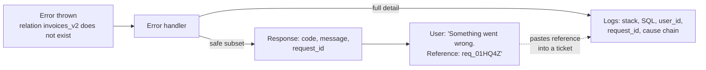
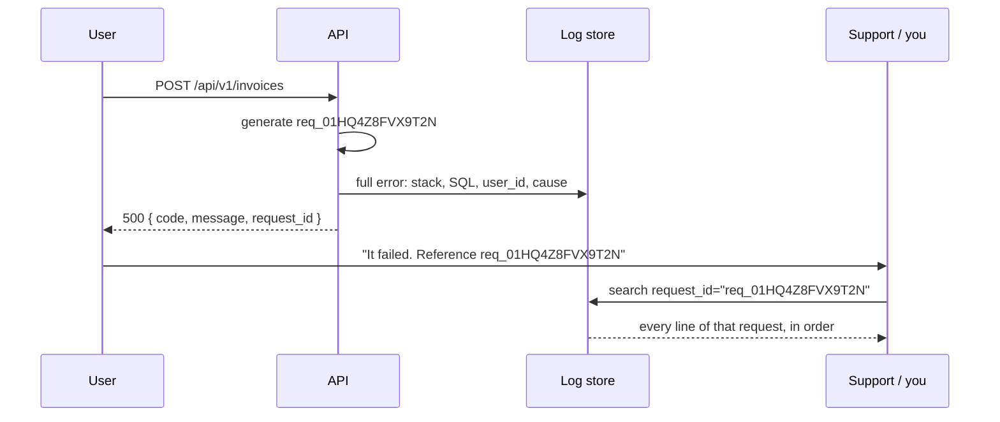

# Client-Facing Error Responses — Part 1

A pharmacist who hands you the wrong medicine has three people to talk to.
To **you** they say something short and actionable: "this is not your
prescription, please wait". To the **doctor** they give the exact drug name
and dose that did not match. In the **incident log** they write the batch
number, the shelf, the time and who was on shift. Same event, three levels of
detail, and mixing them up is either useless or dangerous.

An HTTP error response has exactly the same problem. This part is about who
is listening, what the body may contain, and — most importantly — what must
never be in it.

Part 2 takes the same response and makes it *good*: mapping every error class
to it, field-level validation, messages that help, `Retry-After`, and bulk
endpoints where only some items failed.

> **📌 In one line:** one error is read by three different audiences, so put
> a stable `code` and a safe `message` in the body, put everything sensitive
> in the logs, and join the two with a `request_id`.

## Table of Contents

1. [One Error, Three Audiences](#one-error-three-audiences)
2. [What the Body Should Contain](#what-the-body-should-contain)
3. [What Must Never Leak](#what-must-never-leak)
4. [BROKEN vs FIXED: a Real Response Dump](#broken-vs-fixed-a-real-response-dump)
5. [Different Behaviour by Environment](#different-behaviour-by-environment)
6. [The request_id Is the Bridge](#the-request_id-is-the-bridge)
7. [Common Mistakes](#common-mistakes)
8. [Questions to Test Yourself](#questions-to-test-yourself)
9. [Related](#related)

---

## One Error, Three Audiences

A single `500` from `POST /api/v1/invoices` is read by three people with
completely different needs.

| | The end user | The client developer | You, at 3 AM |
|---|---|---|---|
| Where they see it | A red box in the UI | A response in devtools or a test | A log line or a trace |
| What they need | What happened, and what to do now | Which case this is, so they can branch on it | The exact cause: stack, query, input |
| Technical level | None | High, but no knowledge of your internals | Full access to your internals |
| Reads it | Once, while annoyed | While writing code, repeatedly | Under pressure, months later |
| Served by | `message` | `code` and `details` | The **log line**, found via `request_id` |
| Harmed by | Jargon, blame, dead ends | Unstable strings they must parse | Missing context |

The last row of the middle column is the one teams get wrong. A client
developer who cannot branch on a `code` will branch on your `message`
instead — `if (res.body.message === 'Email already registered')` — and then
your next copy edit breaks their app. Giving them a stable `code` is not
politeness; it is how you keep the freedom to reword messages.

And the last column is the key idea of this whole file: **the third audience
is not served by the response body at all.** Everything they need goes to
your logs. The response carries only a pointer.



## What the Body Should Contain

One shape, used by every endpoint, for every failure. Consistency matters
more than the exact field names — but pick them once and never vary.

```json
{
  "error": {
    "code": "VALIDATION_FAILED",
    "message": "Some fields could not be accepted.",
    "details": [
      { "field": "email",      "code": "INVALID_FORMAT", "message": "Must be a valid email address." },
      { "field": "due_date",   "code": "IN_THE_PAST",    "message": "Must be today or later." }
    ],
    "request_id": "req_01HQ4Z8FVX9T2N"
  }
}
```

| Field | Required | Purpose | Rules |
|---|---|---|---|
| `code` | always | Machine-readable identity of the failure | `SCREAMING_SNAKE_CASE`, stable forever, documented |
| `message` | always | One sentence a human can act on | Safe for a screenshot; never contains internals |
| `details` | when useful | Per-field or per-item specifics | Array of objects, same shape every time |
| `request_id` | always | The join key into your logs | Also sent as a response header |

Four rules about this shape:

- **Nest under `error`.** A top-level `{ "code": ..., "message": ... }` is
  ambiguous when a successful response also has a `message`. `error` being
  present *is* the signal.
- **`code` is an API contract.** Treat renaming one as a breaking change, the
  same as removing a field. See
  [api-versioning](../02-rest-api-design/04-api-versioning.md).
- **The HTTP status still does the primary work.** The body explains; it does
  not replace the status line. Never return `200` with an error body — proxies,
  monitoring and client libraries all read the status, not your JSON.
- **`details` is an array, always.** A client that writes
  `for (const d of error.details ?? [])` should never have to handle an object
  in one endpoint and an array in another.

The rationale for this shape — and the RFC 9457 `application/problem+json`
alternative — belongs to
[Error Response Design](../02-rest-api-design/05-error-response-design.md).
The rest of this file is about *producing* it correctly.

> **💡 Tip:** if you are starting fresh and have no legacy clients, consider
> RFC 9457 (`type`, `title`, `status`, `detail`, `instance`) instead of a
> home-grown shape. The discipline in this file applies identically; only the
> key names change.

## What Must Never Leak

An error response is an attacker's cheapest source of intelligence. They do
not need a vulnerability — they just need you to be helpful. Six categories,
with what each one gives away.

**1. Stack traces.** A stack trace names your framework, directory layout,
file names, line numbers and often the npm packages you depend on. That is
enough to look up known vulnerabilities in exactly the versions you run.

```json
"stack": "Error: ... at /srv/app/node_modules/express/lib/router/index.js:47"
```

**2. SQL fragments and table names.** A leaked query tells an attacker your
schema and, worse, confirms which inputs reach the database — the first step
in probing for injection.

```json
"message": "insert into \"users\" (\"email\") values ($1) - duplicate key value violates unique constraint \"users_email_unique\""
```

**3. Internal hostnames, IPs and file paths.** `postgres-primary.internal:5432`
or `/srv/app/config/secrets.ts` maps your private network from the outside.

**4. Dependency and version information.** `pg@8.11.3`, `Express 4.18.2`, or
an `X-Powered-By` header turns "find a vulnerability" into "look one up".

**5. Other users' data.** The subtle one. A `409` that says
*"Email admin@acme.com already registered"* confirms an address you were
never asked about. So does an error that echoes a record belonging to a
different tenant.

**6. Whether an account exists.** The classic: login says "no user with that
email" for unknown addresses and "wrong password" for known ones. An attacker
now has a free email-enumeration oracle, and can check a leaked address list
against your user base before trying a single password.

```ts
// ❌ BROKEN — two different errors tell an attacker which emails are real
const user = await userRepo.findByEmail(email);
if (!user) throw new UnauthorizedError('No account with that email');
if (!await verify(password, user.hash)) {
  throw new UnauthorizedError('Incorrect password');
}

// ✅ FIXED — identical error, identical status, and constant-ish timing
const user = await userRepo.findByEmail(email);
const ok = user ? await verify(password, user.hash) : await verify(password, DUMMY_HASH);
if (!user || !ok) {
  // Same message, same code, same status for both branches.
  throw new UnauthorizedError('Email or password is incorrect', 'INVALID_CREDENTIALS');
}
```

The dummy hash matters: without it the "no such user" path returns in 2 ms
and the "wrong password" path in 90 ms, and the timing difference leaks the
same information the message used to. The same reasoning applies to password
reset ("if an account exists, we sent an email"), signup, and any endpoint
that reveals whether a resource exists.

> **⚠️ Warning:** the `404` vs `403` decision is this same problem. Returning
> `403 Forbidden` for a project the user cannot see confirms the project
> exists. For resources whose existence is sensitive, return `404` for both
> "missing" and "not yours". See
> [01-authn-vs-authz.md](../06-authorization/01-authn-vs-authz.md).

## BROKEN vs FIXED: a Real Response Dump

An unmodified `500` from a default Express setup with `NODE_ENV` unset:

```json
// ❌ BROKEN — a genuine production response, nothing exaggerated
{
  "error": "error: insert into \"invoices\" (\"company_id\", \"total_cents\") values ($1, $2) returning \"id\" - null value in column \"currency\" of relation \"invoices\" violates not-null constraint",
  "code": "23502",
  "table": "invoices",
  "column": "currency",
  "host": "pg-primary-02.internal.acme.systems",
  "stack": "error: null value in column ...\n    at Parser.parseErrorMessage (/srv/app/node_modules/pg-protocol/dist/parser.js:287:98)\n    at /srv/app/src/modules/billing/invoice.repository.ts:64:22\n    at InvoiceService.create (/srv/app/src/modules/billing/invoice.service.ts:118:5)"
}
```

Count what you just published to anyone who can send a malformed request:

| Leaked | Line in the dump | What it enables |
|---|---|---|
| Table and column names | `"invoices"`, `"currency"` | Schema mapping for injection attempts |
| The exact SQL | the `insert into ...` text | Confirms which inputs reach the database |
| Database engine | `23502` is a Postgres code | Narrows the attack surface to Postgres |
| Internal hostname | `pg-primary-02.internal...` | Names a target inside your network |
| Filesystem layout | `/srv/app/src/modules/...` | Directory structure and module names |
| Dependency | `pg-protocol` | A package and version to look up |
| Your architecture | `repository` → `service` | How to reason about other endpoints |

```json
// ✅ FIXED — everything above still exists, in your logs, behind request_id
{
  "error": {
    "code": "INTERNAL_ERROR",
    "message": "An unexpected error occurred. Please try again.",
    "request_id": "req_01HQ4Z8FVX9T2N"
  }
}
```

Nothing is lost. The engineer who needs the first version gets it from one
search:

```text
level=error request_id=req_01HQ4Z8FVX9T2N event=http.request.failed
  status=500 route=/api/v1/invoices method=POST user_id=usr_8812
  err.type=DatabaseError err.code=23502 err.table=invoices
  err.column=currency err.stack="at InvoiceService.create (...)"
```

> **📌 Remember:** you are not choosing between *detailed* and *safe*. You are
> choosing **where** the detail goes. Sanitising a response deletes nothing,
> as long as the log line exists.

## Different Behaviour by Environment

In development you want the stack in the response, because you are the client.
In production you want none of it. One flag, decided at startup:

```ts
// src/config/errors.ts — decided once, not per-call
const env = process.env.NODE_ENV ?? 'development';

export const errorConfig = {
  // The safe default is the STRICT one: anything unrecognised is production.
  exposeInternals: env === 'development' || env === 'test',
};
```

```ts
// In the handler (see 02-centralized-error-handling-part-1.md)
if (errorConfig.exposeInternals && status >= 500) {
  body.error.stack = error.stack;
  body.error.cause = serialiseCause(error);   // the whole Error.cause chain
  body.error.internal_message = error.message;
}
```

| | Development | Staging | Production |
|---|---|---|---|
| `5xx` message | The real one | **Generic** | Generic |
| Stack trace in body | Yes | **No** | No |
| SQL / driver details | Yes | **No** | No |
| `request_id` | Yes | Yes | Yes |
| Log detail | Everything | Everything | Everything |

Read the middle column carefully, because it is the trap.

**Staging is the dangerous environment.** It is usually configured by copying
development settings — `NODE_ENV=development` is left in place, or a
`DEBUG=true` flag is never removed — and it is usually reachable from the
internet, often on a guessable hostname like `staging.acme.com`. It frequently
shares a database with production or holds a recent copy of real customer
data. So the environment with the weakest error hygiene is public, and full
of real data.

Three rules that prevent this:

- **Default to strict.** Write the check as "verbose *only* if development",
  never "sanitised only if production". An unset or misspelled `NODE_ENV`
  must produce the safe behaviour, not the leaky one.
- **Treat staging as production** for every security setting: error verbosity,
  CORS, rate limits, and authentication. It differs in *data* and *scale*,
  not in posture.
- **Test the boundary.** The assertion from
  [02-centralized-error-handling-part-2.md](02-centralized-error-handling-part-2.md#testing-the-error-path)
  — `expect(JSON.stringify(res.body)).not.toContain('tasks_v2')` — run in CI
  with `NODE_ENV=production`, catches a regression before it ships.

> **⚠️ Warning:** `NODE_ENV` is one string away from an incident. A typo like
> `NODE_ENV=prodution` fails *open* with the ternary written the wrong way
> round. Fail closed, and log the resolved configuration at startup so the
> mistake is visible in the boot logs.

## The request_id Is the Bridge

The whole design rests on one field. The user sees a harmless reference; you
see everything.



Generate it at the very edge, before anything can fail:

```ts
// src/http/middleware/request-id.ts — registered FIRST, before all routes
import { randomUUID } from 'node:crypto';

export function requestId(req: Request, res: Response, next: NextFunction) {
  req.id = randomUUID();
  // Return it on EVERY response, not only failures: support tickets about
  // "it was slow" or "it saved the wrong thing" need it too.
  res.setHeader('X-Request-Id', req.id);
  // A child logger so every later line carries the id automatically.
  req.log = logger.child({ request_id: req.id });
  next();
}
```

Three properties a good request id has:

| Property | Why | How |
|---|---|---|
| Unique | Two requests must never share one | UUID v4, or ULID |
| Unguessable | It appears in support tickets and URLs | Random, not a counter |
| Readable aloud | Users dictate it over the phone | Prefix it, keep it short-ish |

`req_01HQ4Z8FVX9T2N` (a prefixed ULID) is friendlier than a bare UUID and
sorts by time, which is handy in a log store.

Return it **both** ways. The header serves clients and proxies that never
parse the body — including successful responses and `204`s. The body field
serves the human who screenshots the error.

```ts
res.setHeader('X-Request-Id', req.id);       // always, every response
// ...and in the error body:
body.error.request_id = req.id;
```

Then make it useful in the product. A support page that says
*"Something went wrong. Reference: req_01HQ4Z8FVX9T2N"* with a copy button
turns a useless ticket ("the site is broken") into a two-minute
investigation. Some teams render it in the UI footer on every error screen
for exactly this reason.

The full mechanics — accepting an inbound id from a trusted proxy,
`AsyncLocalStorage` so you never pass it as an argument, and propagating it
into queue jobs and other services — are
[03-correlation-ids-and-tracing-part-1.md](../08-logging-and-observability/03-correlation-ids-and-tracing.md).

---

## Common Mistakes

| Mistake | Why it is wrong | Do this instead |
|---|---|---|
| Returning `error.message` for a `5xx` | It is usually a driver or SQL string full of internals | Replace every `5xx` message with one fixed sentence |
| No `code`, only a `message` | Clients parse English and break on your next copy edit | Stable `SCREAMING_SNAKE_CASE` codes, documented |
| Changing a `code` in a patch release | It is an API contract; clients branch on it | Treat a rename as a breaking change |
| `200 OK` with `{ "error": ... }` | Monitoring, proxies and client libraries all read the status | Use the real status code |
| Different body shape per endpoint | Every client writes a special case for each route | One shape, produced in one handler |
| "No user with that email" | A free email-enumeration oracle | One message and one status for every credential failure |
| Only comparing hashes when the user exists | Response timing leaks the same thing | Verify against a dummy hash on the missing branch |
| `403` for a resource the user may not know exists | Confirms its existence | `404` for both "missing" and "not yours" |
| Verbose errors in staging | Public hostname, production-like data, developer settings | Treat staging as production for every security flag |
| `request_id` only on errors | Tickets about slowness or wrong data have no handle | Set the header on every response |

## Questions to Test Yourself

1. Name the three audiences for one error and the single field (or place)
   that serves each.
2. Why is a stable `code` more useful to a client developer than a clear
   `message`, even though the message is easier to read?
3. Go through the BROKEN dump and list six distinct things it tells an
   attacker. For each, say what they could do next.
4. "Sanitising error responses makes debugging harder." Rebut this in two
   sentences.
5. Your login endpoint returns `401` with different messages for unknown
   email and wrong password. Describe the attack this enables, and give the
   fix — including the part that is not about the message.
6. Why is staging more dangerous than production for error leakage, and what
   are two concrete things you would change today?
7. `NODE_ENV` is misspelled in a deployment. Write the config line so this
   fails safe, and explain why the obvious ternary fails open.
8. Why should `X-Request-Id` be set on successful responses too?

## Related

> **➡️ Continued in [Part 2](03-client-facing-error-responses-part-2.md)** —
> mapping the error hierarchy to statuses and bodies, validation errors with
> field paths, rewriting unhelpful messages, `Retry-After` and `503`, partial
> failures in bulk endpoints, and keeping codes stable as a public contract.

- [01-error-taxonomy.md](01-error-taxonomy.md) — the error classes whose
  `code` and `status` fill this body.
- [02-centralized-error-handling-part-1.md](02-centralized-error-handling-part-1.md)
  — the one handler that builds every response described here.
- [Error Response Design](../02-rest-api-design/05-error-response-design.md)
  — why this shape, and the RFC 9457 alternative.
- [03-correlation-ids-and-tracing-part-1.md](../08-logging-and-observability/03-correlation-ids-and-tracing.md)
  — generating, propagating and searching the `request_id`.
- [01-logging-basics.md](../08-logging-and-observability/01-logging-basics.md)
  — what the log line on the other side of the bridge must contain, and what
  it must never contain either.
- [01-authn-vs-authz.md](../06-authorization/01-authn-vs-authz.md) — the
  `403` vs `404` decision for resources whose existence is sensitive.
