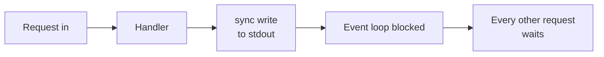
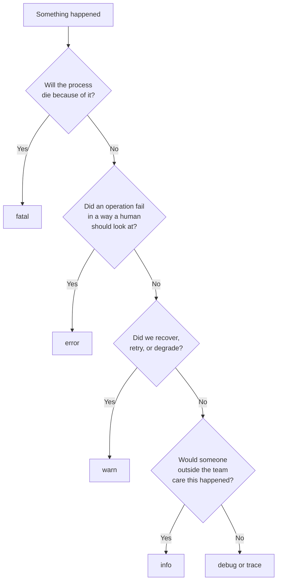

# Logging Basics

A customer writes: *"It failed yesterday, around 3 PM."* No screenshot. No
error message. No steps to reproduce.

Think of a security guard in a building. If the guard writes nothing down, you
have no idea who entered last night. If the guard writes down every footstep —
40,000 lines of "someone moved" — you also have no idea who entered last
night. A log is only useful when it records the right things, at the right
detail, in a form you can search. This file turns `console.log('here')` into a
real logging system.

> **📌 In one line:** A log is a permanent, searchable, structured record of
> what your server decided and why — written at a level that says how much it
> matters, and never containing a secret.

## Table of Contents

1. [The Problem: 3 PM Yesterday](#the-problem-3-pm-yesterday)
2. [Why console.log Is Not Logging](#why-consolelog-is-not-logging)
3. [Log Levels](#log-levels)
4. [Alert Fatigue: The Most Common Mistake](#alert-fatigue-the-most-common-mistake)
5. [What to Log for Each Request](#what-to-log-for-each-request)
6. [What Must Never Be Logged](#what-must-never-be-logged)
7. [Where Logs Should Go](#where-logs-should-go)
8. [Rotation, Retention, and Cost](#rotation-retention-and-cost)
9. [Choosing a Library: pino vs winston](#choosing-a-library-pino-vs-winston)
10. [Performance](#performance)
11. [Advanced: Tests, Startup, and Audit Logs](#advanced-tests-startup-and-audit-logs)
12. [Common Mistakes](#common-mistakes)
13. [Questions to Test Yourself](#questions-to-test-yourself)
14. [Related](#related)

---

## The Problem: 3 PM Yesterday

An invoice was not sent to a customer of company `acme-ltd`. You try to answer
four questions: did the request reach the server, which user made it, what did
the code decide, and how long did it take?

Without logs you cannot answer any of them. You will guess, add a
`console.log`, deploy, and wait for it to happen again. That is not debugging.
That is hoping. With *bad* logs you can answer none of them either:

```text
here
here 2
{ id: 41 }
undefined
Error
```

That has no time, no level, no user, no request. Forty thousand lines of it
are worth exactly as much as zero lines.

> **📌 Remember:** a log line's value is measured at 3 AM by someone who did
> not write it, under pressure, six months later.

## Why console.log Is Not Logging

`console.log` prints a string to standard output. That is all it does. Five
things are missing.

| Missing | Why it matters |
|---|---|
| **Levels** | You cannot say "show me only errors". Everything is equal, so everything gets ignored. |
| **Timestamps** | "It failed at 3 PM" cannot be matched to any line. |
| **Context** | No user id, no company, no request id. You see an event but not who it happened to. |
| **Structure** | The output is a sentence. A machine cannot filter it. (This is file 2's whole topic.) |
| **Async writes** | `console.log` can block the thread. |

That last point needs a short explanation. Node.js runs your JavaScript on one
thread, the event loop, and while that thread is busy no other request is
served. `process.stdout.write` is **synchronous** when stdout is a file or a
terminal. Under load, a server writing thousands of lines per second spends
real milliseconds of every second waiting for the disk — and requests that log
nothing at all wait behind it. If that is not yet solid, read
[event-loop](../../typescript-fundamentals/event-loop/event-loop.md) first.



A real logging library avoids this by writing asynchronously, in batches, and
by doing as little work as possible per line.

## Log Levels

A **level** is one word attached to every line that says how much this event
matters. It lets you turn the volume up or down without changing code.

There are six common levels. From loudest to quietest:

| Level | Meaning | Example line | Dev | Prod |
|---|---|---|---|---|
| `fatal` | The process cannot continue. It is about to exit. | `fatal: cannot connect to Postgres at boot, exiting` | on | on |
| `error` | One operation failed and a human may need to act. | `error: invoice.send failed, provider returned 502` | on | on |
| `warn` | Something is wrong but we recovered or degraded. | `warn: cache miss rate 80%, falling back to database` | on | on |
| `info` | A significant business event happened, as designed. | `info: invoice.sent invoice_id=9124 company=acme-ltd` | on | on |
| `debug` | Detail useful while developing a feature. | `debug: applying tax rule VAT-UK to 3 line items` | on | off |
| `trace` | Very fine detail, usually loops and raw payloads. | `trace: SQL select * from tasks where project_id = $1` | on | off |

The rule for reading the table: **production runs at `info`**, so `info`,
`warn`, `error` and `fatal` are written and `debug` and `trace` are silently
dropped. Development runs at `debug`. Every library exposes this as one
setting:

> **💡 Tip:** make `LOG_LEVEL` an environment variable, not a constant. When
> you are debugging a live incident you want to raise it to `debug` for ten
> minutes without shipping a new build.

### A decision tree for picking a level



## Alert Fatigue: The Most Common Mistake

Two mistakes happen constantly, in opposite directions.

**Mistake one: everything is `info`.** Every loop iteration, every SQL query,
every "entered function" line. Production produces 4 GB of logs per day,
searching is slow, and the one line that matters is buried.

**Mistake two: handled situations logged as `error`.** A user typed a bad
email address, validation rejected it, and the API returned `422`. That is
your code working correctly — it is not an error.

```ts
// ❌ BROKEN — a normal, expected, handled outcome logged as error
if (!user) {
  logger.error('user not found', { email })   // happens 500 times a day
  return res.status(404).json({ error: 'Not found' })
}

// ✅ FIXED — expected outcomes are info or debug; only surprises are error
if (!user) {
  logger.info({ event: 'user.lookup.miss', email_domain: domainOf(email) })
  return res.status(404).json({ error: 'Not found' })
}
```

The damage is not disk space. The damage is **alert fatigue**: when the error
channel fills with harmless noise, humans stop reading it. After two weeks of
500 fake errors a day, the one real `error` at 3 AM is scrolled past.

> **⚠️ Warning:** `error` level is a promise. It says "a human should look at
> this". If a line at `error` level does not need a human, it is the wrong
> level, and it is training your team to ignore the channel.

A simple test for `warn` versus `error`: *did the user get what they asked
for?* Retry succeeded after one failure → `warn`. Retry exhausted → `error`.

## What to Log for Each Request

For a typical HTTP API, log **one line per request**, when the response
finishes — not one at the start and one at the end. This is called an
**access log**.

| Field | Example | Why you need it |
|---|---|---|
| `timestamp` | `2026-03-11T15:02:41.118Z` | Match "3 PM yesterday" to a line. Always store UTC. |
| `level` | `info` | Filtering. |
| `request_id` | `01HQ4Z8F...` | Join this line to every other line of the same request. See file 3. |
| `method` | `POST` | Which operation. |
| `route` | `/api/v1/projects/:id/tasks` | The **pattern**, not the resolved path. Lets you group. |
| `status` | `201` | Outcome. |
| `duration_ms` | `142` | The single most useful number you will ever log. |
| `user_id` | `usr_8812` | Who. Never the email or the name. |
| `company_id` | `acme-ltd` | Which tenant — essential in a multi-company SaaS. |
| `ip` | `203.0.113.9` | Abuse and rate-limit investigations. |
| `user_agent` | `okhttp/4.12` | Which client. Often reveals a broken mobile version. |

Then, separately, log **business events** at `info`: `invoice.sent`,
`user.login.failed`, `project.archived`. Those are the lines you will later
count and alert on. File 2 covers naming them.

> **💡 Tip:** `route` must be the pattern `/projects/:id`, never
> `/projects/42`. This matters even more for
> [metrics](04-metrics-and-health-checks-part-1.md) and their label cardinality.

## What Must Never Be Logged

A log is stored for months, copied to a search system, and read by people who
are not the user. Treat every line as if it will end up in a spreadsheet on
someone's laptop.

**Never write any of these to a log:**

- Passwords, in any form, including "just to check what they typed".
- Tokens: JWTs, API keys, refresh tokens, OAuth codes, password reset tokens.
- `Authorization` and `Cookie` headers, and session ids (a valid session id is
  equivalent to a password).
- Full credit-card numbers, CVV, bank account numbers.
- Personal data covered by privacy rules: full names, home addresses, phone
  numbers, dates of birth, health or location data — unless you decided
  deliberately, with a retention period, that you need it.
- **Whole request bodies and whole header objects**, because they contain all
  of the above without you noticing.

That last one is how it usually happens:

```ts
// ❌ BROKEN — one innocent-looking line leaks passwords and tokens forever
app.use((req, res, next) => {
  logger.info('incoming request', { headers: req.headers, body: req.body })
  next()
})
// POST /auth/login logs { body: { email, password: 'hunter2' },
//                         headers: { authorization: 'Bearer eyJhbGci...' } }
```

The fix is to allow-list what you log, and to redact by field name.

```ts
// ✅ FIXED — redact by key name, and never log the body wholesale
const SECRET_KEYS = new Set(['password', 'password_confirmation', 'token',
  'access_token', 'refresh_token', 'authorization', 'cookie', 'card_number'])

export function redact(value: unknown, depth = 0): unknown {
  if (depth > 4 || value === null || typeof value !== 'object') return value
  const out: Record<string, unknown> = {}
  for (const [k, v] of Object.entries(value as Record<string, unknown>)) {
    // Match on key name, so new secret fields are caught by naming convention.
    out[k] = SECRET_KEYS.has(k.toLowerCase()) ? '[REDACTED]' : redact(v, depth + 1)
  }
  return out
}
```

Hand-written redaction is the backup, not the main defence. Good libraries do
it for you, faster, at write time:

```ts
// pino redacts by path, before the object is ever serialised
const logger = pino({
  redact: {
    paths: ['req.headers.authorization', 'req.headers.cookie',
            '*.password', '*.token', '*.card_number'],
    censor: '[REDACTED]',
  },
})
```

> **⚠️ Warning:** redaction is not a delete button. If a secret was written to
> a log yesterday, it is in your log store, your backups, and possibly a
> third-party vendor. The correct response is to **rotate that credential**,
> not only to fix the code.

For partial values, log a shape instead of the value: `card_last4: '4242'`,
`email_domain: 'acme.com'`. You keep the debugging value and drop the secret.

## Where Logs Should Go

The old habit is `logs/app.log` on the server's disk. In a containerised world
that is wrong: write to **stdout** (standard output) and stop there. This is
one of the **twelve-factor app** rules — a well-known list of practices for
cloud services. The idea: *an application never manages its own log files.* It
writes a stream of events to stdout and lets the platform decide what happens
next.

```text
┌──────────────┐   stdout    ┌──────────────┐   ship   ┌──────────────┐
│  Node app    │ ──────────▶ │  Container   │ ───────▶ │  Log store   │
│  (no files)  │             │  runtime     │          │  (search UI) │
└──────────────┘             └──────────────┘          └──────────────┘
```

Why this is better:

- **Containers are temporary.** A file inside a container disappears when the
  container is replaced, so every deploy would delete your logs. See
  [docker overview](../../cloud-devops/docker/overview.md).
- **There are many instances.** With six replicas behind a load balancer, six
  separate files on six machines are unsearchable.
- **The platform already solves rotation**, compression and shipping.
- **It keeps the app simple.** No file permissions, no disk-full incidents.

Some teams send `error` and `fatal` to stderr instead. Most collectors treat
both streams the same, so prefer one stream with a `level` field.

## Rotation, Retention, and Cost

Logs are not free. Three numbers decide your bill: **volume** (bytes per day),
**retention** (days kept), and **indexing** (whether every field is searchable,
which is expensive, or the data is only stored, which is cheap).

A single busy API can easily produce 20–100 GB per month. Log storage is the
most common surprise line in a cloud bill, and the cause is almost always
`debug` left on in production, or one chatty line inside a loop.

| Log kind | Typical retention | Why |
|---|---|---|
| `debug` / `trace` | 1–3 days, or off | Only useful while investigating. |
| Access + app logs | 14–30 days | Covers most tickets and incident reviews. |
| Security / audit | 1–7 years | Compliance requires it; see below. |

**Rotation** means closing the current log file and starting a new one, so no
single file grows forever. If you follow the stdout rule above, rotation is
not your problem — the platform does it.

> **💡 Tip:** put log bytes-per-day on a dashboard and alert when it doubles.
> A sudden jump is usually a bug — a retry loop, a new chatty line.

## Choosing a Library: pino vs winston

Two libraries dominate Node. Both are fine. They optimise for different things.

| | `pino` | `winston` |
|---|---|---|
| Default output | JSON (one object per line) | Configurable; string by default |
| Speed | Very fast — the design goal | Slower; more work per line |
| Transports | Run in a **worker thread**, off the event loop | Run in-process |
| Configuration | Small API, opinionated | Large API, many formats and transports |
| Redaction | Built in, path based, fast | Via custom formats |
| Best when | You want structured logs and low overhead | You need many outputs and custom formatting |

For a new TypeScript backend, start with `pino`. It pushes you toward
structured JSON, which is what file 2 is about. A complete setup:

```ts
// app/logger.ts
import pino from 'pino'

const isProd = process.env.NODE_ENV === 'production'

export const logger = pino({
  level: process.env.LOG_LEVEL ?? (isProd ? 'info' : 'debug'),
  base: { service: 'billing-api', env: process.env.NODE_ENV }, // on every line
  timestamp: pino.stdTimeFunctions.isoTime,
  redact: { paths: ['*.password', '*.token', 'req.headers.authorization'] },
  transport: isProd ? undefined : { target: 'pino-pretty' }, // colours locally
})
```

**AdonisJS** ships its own logger built on pino and exposes it on the request
context — use that rather than creating a second logger (the exact options are
framework-specific, check your version's docs). The Express equivalent of the
request log below is the `pino-http` middleware.

```ts
// One line per finished request, framework-agnostic.
app.use((req, res, next) => {
  const startedAt = process.hrtime.bigint()
  res.on('finish', () => {
    logger.info({
      event: 'http.request', method: req.method, status: res.statusCode,
      route: req.route?.path ?? 'unmatched', // the pattern, not /projects/42
      duration_ms: Math.round(Number(process.hrtime.bigint() - startedAt) / 1e6),
    })
  })
  next()
})
```

## Performance

Three rules keep logging cheap.

**1. Let the library write asynchronously.** `pino` batches writes and can
move the transport to a worker thread. Never write your own sync file logger.

**2. Never build a string for a level that is disabled.** Arguments are
evaluated *before* the function runs, so a disabled `debug` call still pays
for whatever you passed to it.

```ts
// ❌ BROKEN — JSON.stringify runs on every request even when debug is off
logger.debug(`task payload: ${JSON.stringify(task)} for ${user.email}`)

// ✅ FIXED — pass the object; the library skips serialising when level is off
logger.debug({ event: 'task.payload', task_id: task.id }, 'task payload')

// ✅ ALSO FIXED — guard an genuinely expensive computation
if (logger.isLevelEnabled('debug')) {
  logger.debug({ plan: explainQueryPlan(sql) }, 'query plan')
}
```

**3. Sample high-volume events.** If an endpoint runs 10,000 times a minute
and its log line is identical every time, keep 1% — but keep every failure:

```ts
if (status >= 400 || Math.random() < 0.01) {
  logger.info({ event: 'health.poll', status, sampled: true })
}
```

Mark sampled lines with a flag, so nobody later counts them and reports 100
times fewer requests than really happened.

## Advanced: Tests, Startup, and Audit Logs

### Logging in tests

Test output should show test results, not application logs. Set
`LOG_LEVEL=silent` in the test bootstrap, before the app is imported. The
exception is when you are *testing the logging itself* — asserting that a
password never appears in output. Then inject a fake logger that collects
lines into an array and assert on it. That is a genuinely valuable test for
the redaction helper above.

### Startup and shutdown

These are the lines you will be most grateful for during a deploy.


```ts
logger.info({ event: 'app.starting', version: process.env.GIT_SHA })
await db.connect()
logger.info({ event: 'app.db_connected', pool_size: db.poolSize })
server.listen(port, () => logger.info({ event: 'app.listening', port }))

// Flush the buffer before exiting, or the last and most interesting lines die.
process.on('SIGTERM', () => logger.info({ event: 'app.shutdown_started' }))
```

> **⚠️ Warning:** an asynchronous logger holds lines in a buffer. Calling
> `process.exit()` immediately throws that buffer away. On `fatal`, flush the
> logger first, then exit. This is why crash logs so often "disappear".

### Application logs versus audit logs

| | Application log | Audit log |
|---|---|---|
| Question it answers | What did the system do? | **Who did what, to what, when?** |
| Audience | Engineers | Compliance, security, the customer |
| Example | `db query took 412ms` | `usr_8812 deleted project prj_44 at 15:02 UTC` |
| Where stored | Log store, searchable | A database table, append-only |
| Retention | Weeks | Years; often legally required |
| Sampling or deletion | Allowed | **Never** |

Because an audit log must survive retention rules and must never be sampled,
write it to a real table (`audit_events`) inside the same database transaction
as the change it records. Logging it only to stdout is a common and expensive
mistake.

---

## Common Mistakes

| Mistake | Why it is wrong | Do this instead |
|---|---|---|
| `console.log` in production code | No level, no timestamp, no structure, can block the event loop | One configured logger, imported everywhere |
| Logging handled outcomes at `error` | Fills the alert channel with noise until humans stop reading it | `info` for expected outcomes, `error` only when a human must act |
| Logging the whole `req.body` or `req.headers` | Leaks passwords, tokens and personal data into permanent storage | Allow-list fields, and configure library redaction |
| Writing to `logs/app.log` in a container | Logs vanish on redeploy and are scattered across replicas | Write to stdout; let the platform collect |
| Leaving `debug` on in production | Huge volume, large bill, slow search | `LOG_LEVEL=info`, raised temporarily during incidents |
| Logging the resolved path `/projects/42` | Every request looks unique, so grouping and counting are impossible | Log the route pattern `/projects/:id` |
| `process.exit()` right after a `fatal` line | The buffered line never reaches stdout | Flush the logger, then exit |
| Treating an audit trail as a normal log | It gets sampled or deleted by retention, and compliance fails | Store audit events in a table, append-only |

## Questions to Test Yourself

1. A retry to the payment provider fails once and succeeds on the second
   attempt. Which level do you log at, and why not the two neighbouring
   levels?
2. Your team says "we never look at the error channel any more". Describe the
   chain of decisions that caused this and the concrete fix.
3. Why does logging the full `req.body` on a login route create a problem that
   deploying a fix does **not** solve?
4. Explain, in terms of the event loop, why a synchronous log write can
   increase the p99 latency of requests that log nothing at all.
5. Your app runs in six containers behind a load balancer. Give two separate
   reasons why writing to a local file is worse than writing to stdout.
6. A `debug` call that builds a string with `JSON.stringify` runs in
   production with `LOG_LEVEL=info`. Is it free? Explain what still happens.
7. A regulator asks who deleted a customer's project eight months ago. Why
   might your log store be unable to answer, and where should that record have
   been written instead?

## Related

- [Structured Logging](02-structured-logging.md) — the next step: log objects,
  not sentences, so a machine can filter and count them.
- [Correlation IDs and Tracing](03-correlation-ids-and-tracing.md) — the field
  that ties a request's lines together.
- [Metrics and Health Checks](04-metrics-and-health-checks-part-1.md) — when counting
  events beats logging them.
- [event-loop](../../typescript-fundamentals/event-loop/event-loop.md) — why a
  blocking write hurts every concurrent request.
- [docker overview](../../cloud-devops/docker/overview.md) — why containers
  make stdout the only sensible destination for logs.
- [Client-Facing Error Responses](../07-error-handling/03-client-facing-error-responses-part-1.md)
  — the `request_id` the client gets must match a line in these logs.
