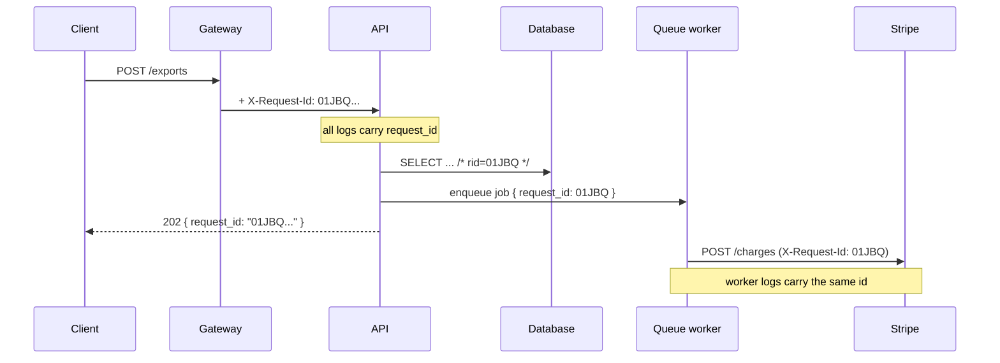
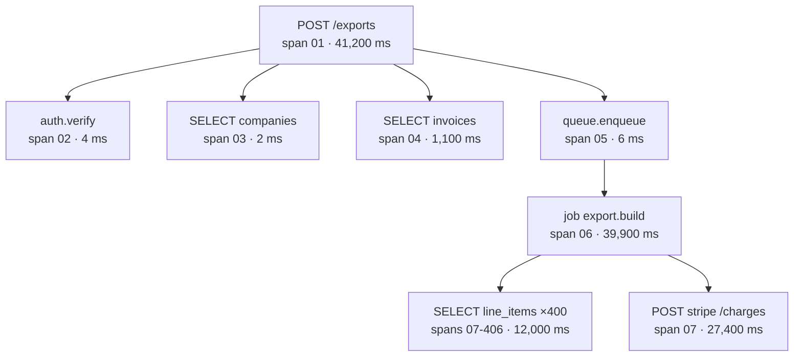

# Correlation IDs and Tracing

A customer clicks "Export invoices" and sees a spinner for forty seconds. You
open the logs.

The API logged the request. The database logged a slow query — but which one of
the 4,000 that minute? The queue worker logged a job. The payment provider
logged a call. Four sets of logs, four different machines, four different clocks,
and **nothing that says these four lines belong to the same click**.

File 2 made every log line structured. This file gives those lines the one field
that makes them joinable, and then goes one step further into tracing.

> **📌 In one line:** give every request an id at the edge, carry it into every
> log line, every outbound call and every background job, and you can
> reconstruct any user action from one search.

## Table of Contents

1. [Four Sets of Logs, No Way to Join Them](#four-sets-of-logs-no-way-to-join-them)
2. [The Request Id](#the-request-id)
3. [Trusting an Inbound `X-Request-Id`](#trusting-an-inbound-x-request-id)
4. [Implementation: Middleware, AsyncLocalStorage, Child Logger](#implementation-middleware-asynclocalstorage-child-logger)
5. [Propagating Outward](#propagating-outward)
6. [Giving the Id to the User](#giving-the-id-to-the-user)
7. [Distributed Tracing: Traces, Spans, Parents](#distributed-tracing-traces-spans-parents)
8. [`traceparent` and Context Propagation](#traceparent-and-context-propagation)
9. [OpenTelemetry in Node](#opentelemetry-in-node)
10. [Reading a Trace to Find a Problem](#reading-a-trace-to-find-a-problem)
11. [Sampling: You Cannot Trace Everything](#sampling-you-cannot-trace-everything)
12. [Advanced: Three Pillars, One Id](#advanced-three-pillars-one-id)
13. [Common Mistakes](#common-mistakes)
14. [Questions to Test Yourself](#questions-to-test-yourself)
15. [Related](#related)

---

## Four Sets of Logs, No Way to Join Them

Here is what you actually have, from four systems:

```json
{"level":"info","time":"...T10:14:03.102Z","msg":"POST /exports","user_id":"u_88"}
{"level":"warn","time":"...T10:14:19.884Z","msg":"slow query","duration_ms":16700}
{"level":"info","time":"...T10:14:21.001Z","msg":"job export.build started","job_id":"j_412"}
{"level":"error","time":"...T10:14:44.310Z","msg":"stripe timeout","attempt":2}
```

Are these the same user action? You can guess from the timestamps — and at three
requests a minute that guess is usually right. At three hundred a second it is
worthless, and the clocks on four machines disagree by a few hundred
milliseconds anyway.

You need a **join key**: one value that appears in all four lines and belongs to
exactly one user action.

---

## The Request Id

A **correlation id** (or request id) is a unique value generated once, when a
request enters your system, and attached to everything that request causes.



Three rules, and they are the whole idea:

1. **Generate once, at the edge.** The first component that sees the request
   creates the id if there is not one already.
2. **Attach it to everything** — every log line, every outbound HTTP call, every
   queue job, every SQL statement comment.
3. **Return it to the client**, so a human can quote it back to you.

Use a UUIDv4 or a ULID. A ULID sorts by time, which is a small convenience when
you are scanning a list. Do not use an incrementing integer: it leaks your
traffic volume and collides across instances.

---

## Trusting an Inbound `X-Request-Id`

If a load balancer or gateway already generated an id, reuse it — otherwise its
access logs and yours cannot be joined. But an inbound header from the public
internet is **user input**.

```ts
// ❌ BROKEN — the client chooses its own id
const requestId = req.headers['x-request-id'] ?? randomUUID()
```

A client can send `x-request-id: 01JBQ-the-ceo-password-reset` and poison a
search, or reuse one id for ten thousand requests so a support search returns an
unusable pile. A 64 KB header value also ends up in every log line.

```ts
// ✅ FIXED — trust it only from a trusted hop, and validate the shape
const INCOMING = /^[A-Za-z0-9_-]{8,64}$/
const fromProxy = req.headers['x-request-id']

const requestId =
  TRUST_PROXY && typeof fromProxy === 'string' && INCOMING.test(fromProxy)
    ? fromProxy
    : randomUUID()
```

| Situation | Do |
|---|---|
| Behind your own gateway, header is set there | Accept it, after validating the shape |
| Directly exposed to the internet | Always generate your own |
| A trusted internal service calls you | Accept it — that is how the trace joins up |
| The header is missing, empty or malformed | Generate your own, silently |

> **⚠️ Warning:** "trusted proxy" means a hop that *overwrites* the header, not
> one that passes it through. If your gateway appends rather than replaces, you
> are still reading client input.

---

## Implementation: Middleware, AsyncLocalStorage, Child Logger

The naive version threads the id through every function signature. That is why
it never gets done. `AsyncLocalStorage` stores a value for the duration of an
async call chain, so any code can read it without being handed it.

```ts
// app/context.ts
import { AsyncLocalStorage } from 'node:async_hooks'

export type RequestStore = { requestId: string; logger: Logger; userId?: string }
export const store = new AsyncLocalStorage<RequestStore>()

export const currentRequestId = () => store.getStore()?.requestId
export const log = () => store.getStore()?.logger ?? baseLogger
```

```ts
// app/middleware/request_id.ts
export async function requestIdMiddleware(ctx: HttpContext, next: NextFn) {
  const requestId = validateInbound(ctx.request.header('x-request-id')) ?? randomUUID()

  // echo it back immediately, so even a 500 carries it
  ctx.response.header('X-Request-Id', requestId)

  const logger = baseLogger.child({
    request_id: requestId,
    method: ctx.request.method(),
    route: ctx.route?.pattern,          // the PATTERN, not the resolved path
  })

  return store.run({ requestId, logger }, async () => {
    const startedAt = process.hrtime.bigint()
    try {
      await next()
    } finally {
      logger.info({
        event: 'http.request.completed',
        status: ctx.response.getStatus(),
        duration_ms: Number(process.hrtime.bigint() - startedAt) / 1e6,
      })
    }
  })
}
```

Now any code, at any depth, logs with the id attached and no extra parameter:

```ts
// deep inside a service — no requestId argument anywhere
export class ExportService {
  async build(companyId: string) {
    log().info({ event: 'export.build.start', company_id: companyId })
  }
}
```

The child logger is the piece that makes this pleasant: bind the id once and
every line inherits it. Child loggers are covered in
[02-structured-logging.md](02-structured-logging.md), and the per-request
context object is in
[04-controllers-and-request-context.md](../03-request-lifecycle/04-controllers-and-request-context.md).

> **💡 Tip:** register this middleware **first**, before body parsing and auth.
> A request rejected by auth still deserves an id — those are the ones people
> ask about.

---

## Propagating Outward

The id is useless if it stops at your process boundary.

**Into HTTP calls to other services:**

```ts
const http = axios.create({ baseURL: cfg.billingUrl })
http.interceptors.request.use((c) => {
  const id = currentRequestId()
  if (id) c.headers['X-Request-Id'] = id
  return c
})
```

**Into queue jobs** — and this one matters most:

```ts
await queue.add('export.build', {
  companyId,
  _meta: { request_id: currentRequestId() },   // travels with the payload
})

// In the worker, re-enter the store with the inherited id
worker.process(async (job) => {
  const requestId = job.data._meta?.request_id ?? randomUUID()
  const logger = baseLogger.child({ request_id: requestId, job_id: job.id })
  return store.run({ requestId, logger }, () => handle(job))
})
```

**A background job must inherit the id of the request that enqueued it.** The
job is not a new user action — it is the second half of one. If the worker
generates a fresh id, the two halves of "the export the customer is waiting for"
live under different search terms, and the forty-second spinner becomes
unexplainable.

**Into database statements**, as a comment your database logs verbatim:

```sql
SELECT * FROM invoices WHERE company_id = $1 /* rid=01JBQ7,app=api */
```

Postgres's `pg_stat_statements` and the slow-query log both keep the comment, so
a slow query found in the database can be traced back to the exact request that
issued it. Most ORMs support this via a query hook.

| Boundary | Carrier |
|---|---|
| HTTP to another service | `X-Request-Id` header (or `traceparent`) |
| Queue job | A field in the job payload |
| Database | A SQL comment |
| Scheduled job with no request | Generate an id per run |
| Response to the client | `X-Request-Id` header and the error body |

---

## Giving the Id to the User

Put it in the error body and the response header:

```json
{
  "error": { "code": "EXPORT_FAILED", "message": "We could not build your export." },
  "request_id": "01JBQ7K3P9Z2XQW4"
}
```

The support conversation becomes: *"Sorry about that — can you paste the
reference from the error message?"* One search, one request, every log line,
across four systems. The full error-body design is in
[03-client-facing-error-responses-part-1.md](../07-error-handling/03-client-facing-error-responses-part-1.md).

Return the id on **successful** responses too. "It was slow at about 3 PM" is
unsearchable; a browser network tab full of request ids is not.

---

## Distributed Tracing: Traces, Spans, Parents

A request id answers *"which lines belong together?"*. It does not answer
*"where did the time go?"*. For that you need structure, not just a shared
label.

- A **span** is one timed operation: an HTTP handler, a query, an API call. It
  has a name, a start time, a duration, and attributes.
- A **trace** is all the spans for one user action, arranged as a **tree**.
- Every span carries a **trace id** (same for the whole tree) and a **span id**
  (unique to itself), plus its **parent span id**. Parent links are what turn a
  flat list into a tree.

Trace id = "which user action". Span id = "which step of it". Parent id = "which
step caused this one".



The tree makes two facts obvious that no log search would: 400 nearly identical
queries, and one external call holding everything open for 27 seconds. A request
id would have shown you 400 log lines and left you to count them.

---

## `traceparent` and Context Propagation

For a trace to span two services, the child must know the parent's trace id and
span id. W3C Trace Context standardises that as one header:

```http
traceparent: 00-4bf92f3577b34da6a3ce929d0e0e4736-00f067aa0ba902b7-01
             ^  ^                                ^                ^
             |  trace id (16 bytes)              parent span id   flags
             version                                              (01 = sampled)
```

The receiving service reads it, starts its spans with that trace id, and sets
their parent to `00f067aa0ba902b7`. Both services' spans land in the same tree.

Two things worth knowing. The `01` flag says the caller **decided to sample**
this trace; a downstream service should honour that rather than decide again, or
you get traces with holes. And there is a companion header, `tracestate`, for
vendor-specific data — you rarely touch either by hand, because the
instrumentation libraries read and write them for you.

**Correlation id and trace id are not competitors.** The trace id *is* a
correlation id with a standard format and structure attached. If you already log
`request_id`, log `trace_id` beside it and you have both.

---

## OpenTelemetry in Node

**OpenTelemetry (OTel)** is a vendor-neutral standard for generating traces,
metrics and logs: one API, one SDK, and exporters for every backend.

Why vendor-neutrality matters practically: instrumentation lives in *your* code
and is expensive to write. With OTel you instrument once and change backends
(Jaeger, Tempo, Datadog, Honeycomb) by changing an exporter, not by re-editing
every service.

**Auto-instrumentation** is the part that makes it worth doing on a Tuesday
afternoon. It patches the libraries you already use — `http`, `pg`, `mysql2`,
`ioredis`, Express, Fastify — so you get spans for every incoming request, query
and outbound call **without changing application code**.

```ts
// tracing.ts — loaded with `node --require ./tracing.js app.js`, before anything else
import { NodeSDK } from '@opentelemetry/sdk-node'
import { getNodeAutoInstrumentations } from '@opentelemetry/auto-instrumentations-node'
import { OTLPTraceExporter } from '@opentelemetry/exporter-trace-otlp-http'

const sdk = new NodeSDK({
  serviceName: 'invoices-api',
  traceExporter: new OTLPTraceExporter({ url: process.env.OTEL_ENDPOINT }),
  instrumentations: [getNodeAutoInstrumentations()],
})
sdk.start()
process.on('SIGTERM', () => sdk.shutdown())
```

Add manual spans only where the automatic ones cannot see — your own business
steps:

```ts
await tracer.startActiveSpan('export.build_pdf', async (span) => {
  span.setAttribute('invoice_count', invoices.length)
  try {
    return await buildPdf(invoices)
  } finally {
    span.end()
  }
})
```

> **📌 Remember:** auto-instrumentation must be loaded *before* the libraries it
> patches. Requiring it halfway down `app.ts` produces empty traces and an
> afternoon of confusion.

---

## Reading a Trace to Find a Problem

A trace viewer shows a **waterfall**: time left to right, one bar per span,
nested under its parent.

```
POST /exports  ████████████████████████████████████████████  41.2 s
  auth.verify  ▏                                              4 ms
  SELECT companies ▏                                          2 ms
  SELECT invoices  ██▏                                        1.1 s
  job export.build  ██████████████████████████████████████    39.9 s
    SELECT line_items ▎▎▎▎▎▎▎▎▎▎▎▎▎▎▎▎▎▎ (×400)               12.0 s
    POST stripe /charges  ████████████████████████            27.4 s
```

Two patterns show up instantly:

**The N+1.** A staircase of hundreds of near-identical short spans, each a few
milliseconds, adding up to seconds. In a log search this is invisible — every
individual query looks fast. The fix is at the data-access layer:
[n-plus-one-queries.md](../../databases/query-optimization/n-plus-one-queries.md).

**The slow external call.** One wide bar with nothing nested under it. Your code
is not slow; you are waiting. The fix is a timeout, a circuit breaker, or doing
the call outside the user's request entirely.

Read a waterfall in this order: total duration, then the widest bar, then
whether it has children (your problem) or not (someone else's), then look for
repetition.

---

## Sampling: You Cannot Trace Everything

At 10,000 requests per second, full tracing produces more data than the traffic
itself. **Sampling** keeps a fraction.

| Strategy | How it decides | Good | Bad |
|---|---|---|---|
| **Head-based** | At the first span, before the outcome is known | Cheap, simple, decided once and propagated | You discard the errors you did not know were coming |
| **Tail-based** | After the trace completes, seeing the whole thing | Keeps every error and every slow request | Needs a collector buffering all spans; more infrastructure |

A practical policy that costs little:

- Sample ~1% of normal successful traffic.
- **Always sample errors** — a trace you cannot see is worthless precisely when
  something went wrong.
- Always sample anything slower than your p99 target.
- Sample 100% of low-traffic but critical paths (checkout, signup).
- Honour the upstream `traceparent` flag so a trace is never half-recorded.

> **⚠️ Warning:** head-based sampling decides before it knows the outcome, so
> "always sample errors" needs either tail-based sampling or a rule that marks
> the trace as sampled the moment an error is recorded.

---

## Advanced: Three Pillars, One Id

Observability is usually split into three kinds of data:

| Pillar | Answers | Cost | Granularity |
|---|---|---|---|
| **Logs** | What happened in this one request? | High per event | One event |
| **Metrics** | How is the system doing overall? | Very cheap, aggregated | Aggregate over time |
| **Traces** | Where did the time go, across services? | Medium, usually sampled | One request |

They are only useful together, and the correlation id is the seam. The incident
workflow is always the same shape: a **metric** shows error rate rising at
10:14; you open a **trace** from that window and see Stripe taking 27 seconds;
you search the **logs** for that `trace_id` and read the exact error the
provider returned.

**Exemplars** make the first hop automatic. An exemplar is a trace id attached
to a single data point inside a metric — so a p99 latency spike on a graph is
clickable, and the click opens a real trace from that spike instead of leaving
you to search by timestamp.

To make all of this work, do one small thing: **log `trace_id` and `span_id` as
fields on every log line.** With OTel this is one line of logger configuration,
and it is what turns three separate tools into one investigation.

---

## Common Mistakes

| Mistake | Why it is wrong | Do this instead |
|---|---|---|
| No request id at all | Four systems' logs cannot be joined | Generate one at the edge |
| Trusting a client's `X-Request-Id` | Forged or repeated ids poison searches | Accept only from a trusted hop, and validate |
| Passing the id as a function argument everywhere | Never gets done; misses library code | `AsyncLocalStorage` plus a child logger |
| Registering the middleware after auth | 401s and 403s have no id — the ones people ask about | Register it first |
| A worker generating a fresh id | Splits one user action into two | Inherit the id from the job payload |
| Id in logs only | Support cannot quote a reference | Return it in the header and error body |
| Using the resolved path as a label or span name | `/projects/9a1f` explodes cardinality | Use the route pattern `/projects/:id` |
| Loading OTel after the app's imports | The libraries are already loaded; traces come out empty | `--require` it first |
| Sampling errors away | The trace is missing exactly when you need it | Always sample errors |
| Logging `trace_id` but not `request_id`, or the reverse | Half your tools cannot join | Log both |

---

## Questions to Test Yourself

1. You have four systems' logs and no correlation id. Explain precisely why
   matching by timestamp fails at scale.
2. Why must an inbound `X-Request-Id` be validated? Give a concrete attack.
3. What problem does `AsyncLocalStorage` solve that a function parameter does
   not?
4. A queue worker generates a new request id for each job. Describe the support
   conversation this breaks.
5. Explain trace id, span id and parent span id to someone who has only used
   request ids.
6. Read `00-4bf9...4736-00f067aa0ba902b7-01` out loud and say what the receiving
   service does with each part.
7. Your trace shows 400 spans of 30 ms each under one parent. Name the problem
   and where the fix belongs.
8. Why can head-based sampling not guarantee that every error is traced, and
   what do you do about it?
9. A metrics dashboard shows a p99 spike at 10:14. Walk from that graph to the
   exact log line, naming the field that links each hop.

---

## Related

- [02-structured-logging.md](02-structured-logging.md) — the child loggers and
  field schema this file binds the id to.
- [04-metrics-and-health-checks.md](04-metrics-and-health-checks-part-1.md) — the
  metrics side, and why route patterns matter for labels.
- [04-controllers-and-request-context.md](../03-request-lifecycle/04-controllers-and-request-context.md)
  — the per-request context object the store mirrors.
- [03-client-facing-error-responses-part-1.md](../07-error-handling/03-client-facing-error-responses-part-1.md)
  — the error body that carries `request_id` to the user.
- [n-plus-one-queries.md](../../databases/query-optimization/n-plus-one-queries.md)
  — the staircase pattern a waterfall makes obvious.
- [message-queues](../../system-design/foundational/message-queues) — the job
  payloads that must carry the id.
