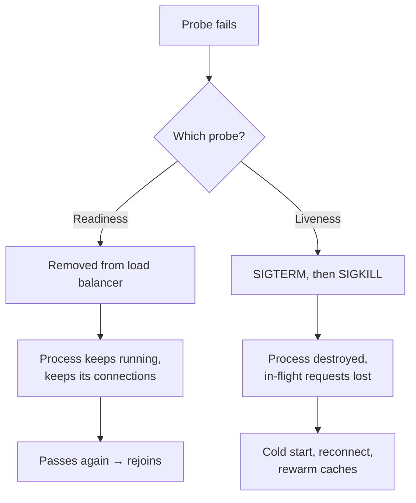

# Metrics and Health Checks — Part 2: Health Checks and Alerting

Part 1 produced the numbers. Now two things have to happen with them.

Your platform needs a yes/no answer, several times a minute, to two questions
it cannot work out for itself: *should this process receive traffic?* and
*should this process be killed?* Those are two different questions, with two
very different consequences for getting them wrong.

And someone needs to be woken up when the numbers say users are suffering —
but only then, and only when there is something they can do.

> **⬅️ This continues [Part 1](04-metrics-and-health-checks-part-1.md).**

> **📌 In one line:** a failing readiness check removes one instance from the
> load balancer, a failing liveness check destroys it — so liveness must never
> depend on anything outside the process, and readiness must never depend on
> another service's readiness.

## Table of Contents

1. [Liveness, Readiness, Startup](#liveness-readiness-startup)
2. [Writing a Readiness Check That Does Not Cascade](#writing-a-readiness-check-that-does-not-cascade)
3. [What a Health Endpoint Should Return](#what-a-health-endpoint-should-return)
4. [Alerting on Symptoms, Not Causes](#alerting-on-symptoms-not-causes)
5. [SLI, SLO and Error Budget](#sli-slo-and-error-budget)
6. [Dashboards Worth Having](#dashboards-worth-having)
7. [Advanced: Profiling in Production](#advanced-profiling-in-production)
8. [Common Mistakes](#common-mistakes)
9. [Questions to Test Yourself](#questions-to-test-yourself)
10. [Related](#related)

---

## Liveness, Readiness, Startup

Your orchestrator (Kubernetes, ECS, a load balancer) polls HTTP endpoints to
decide what to do with your process. Three probes ask three different
questions, and **the consequence of failing each one is completely different**.

| Probe | Question it asks | Consequence of failure | Path |
|---|---|---|---|
| **Liveness** | Is this process wedged beyond recovery? | The container is **killed and restarted** | `/healthz/live` |
| **Readiness** | Can it serve traffic *right now*? | It is **removed from the load balancer**; the process keeps running | `/healthz/ready` |
| **Startup** | Has it finished booting? | Keep waiting. Liveness is suppressed until this passes | `/healthz/startup` |

That difference is the whole section. Readiness is reversible and cheap: the
instance stops receiving requests, recovers, and rejoins a few seconds later.
Liveness is destructive: it throws away the process, its in-memory state, its
warm connections and any in-flight requests.



So the rule is:

> **⚠️ Warning:** **liveness must never check an external dependency.** If
> liveness queries the database and the database goes down, every replica fails
> liveness at the same moment and the orchestrator kills your entire fleet —
> repeatedly. Restarting does not fix someone else's database, so you get a
> crash loop on top of an outage, and no warm instance is left to recover when
> the database comes back.

Liveness should answer one question only: *is this event loop still turning?*

```ts
// Liveness: no I/O, no dependencies, no async work. It proves the process
// can still accept a connection and run a handler.
app.get('/healthz/live', (_req, res) => res.status(200).send('ok'))
```

Startup probes exist for slow boots — loading a large config, warming a cache,
verifying the schema version. Without one, a process that takes 90 seconds to
start gets killed by liveness at 30 seconds, forever. With one, liveness does
not begin until startup succeeds, which lets you keep a *tight* liveness
timeout without punishing boot time.

The deployment-side mechanics — probe intervals, failure thresholds, grace
periods, and how the load balancer drains in-flight connections — are covered
in [health-checks](../../cloud-devops/deployment-strategies/health-checks.md)
and [load-balancing](../../system-design/foundational/load-balancing.md). This
file is about what the endpoints should actually *check*.

## Writing a Readiness Check That Does Not Cascade

Here is the version that takes down a company.

```ts
// ❌ BROKEN — a readiness check that calls other services' health checks
app.get('/healthz/ready', async (_req, res) => {
  const [billing, search, mailer] = await Promise.all([
    fetch('http://billing/healthz/ready'),
    fetch('http://search/healthz/ready'),
    fetch('http://mailer/healthz/ready'),
  ])
  const ok = [billing, search, mailer].every((r) => r.ok)
  res.status(ok ? 200 : 503).json({ ok })
})
```

Two things are wrong, and the second is fatal.

**It fails on things it does not need.** Serving `GET /projects` requires the
database. It does not require the mailer. Marking the whole service unready
because email is broken removes a healthy instance from the load balancer, to
nobody's benefit.

**It cascades.** The mailer goes down. Every service that checks the mailer
goes unready. Every service that checks *those* goes unready. Within one probe
interval the load balancer has drained your entire estate, and a partial outage
has become a total one. Then the mailer recovers, everything reconnects at
once, and the thundering herd takes out the database. One broken dependency
became four broken services. A readiness check must describe **this process**,
never the health of the graph around it.

```ts
// ✅ FIXED — check only what this process cannot serve ANY request without,
// with hard timeouts, a brief cache, and no calls to other services.
const CACHE_MS = 5_000
let cached: { at: number; status: number; body: HealthBody } | null = null

function withTimeout<T>(p: Promise<T>, ms: number, label: string): Promise<T> {
  return Promise.race([
    p,
    new Promise<never>((_, rej) =>
      setTimeout(() => rej(new Error(`${label} timed out after ${ms}ms`)), ms)),
  ])
}

async function probe(label: string, fn: () => Promise<unknown>) {
  const t0 = Date.now()
  try {
    await withTimeout(fn(), 800, label)          // fast: never block the probe
    return { status: 'ok' as const, latency_ms: Date.now() - t0 }
  } catch (err) {
    return { status: 'fail' as const, error: (err as Error).message }
  }
}

app.get('/healthz/ready', async (_req, res) => {
  if (cached && Date.now() - cached.at < CACHE_MS) {
    return res.status(cached.status).json(cached.body)  // shed repeated probes
  }
  const [postgres, redis] = await Promise.all([
    probe('postgres', () => db.raw('select 1')),   // cheapest possible query
    probe('redis', () => redis.ping()),
  ])
  const healthy = postgres.status === 'ok' && redis.status === 'ok'
  const body: HealthBody = {
    status: healthy ? 'ok' : 'fail',
    version: process.env.GIT_SHA ?? 'unknown',
    uptime_s: Math.round(process.uptime()),
    checks: { postgres, redis },
  }
  cached = { at: Date.now(), status: healthy ? 200 : 503, body }
  res.status(cached.status).json(body)
})
```

Four properties of that code are the point:

- **Cheap queries.** `select 1`, not `count(*)` and not a real business query.
  You are testing that a usable connection exists, not that the data is
  correct.
- **Hard timeouts.** Without one, a hanging database makes the probe hang, the
  orchestrator times out, and you learn nothing about *which* check failed.
- **A short cache.** Six replicas × three probes × every 5 seconds is real
  traffic, and it is traffic that hits the database hardest exactly when the
  database is already struggling. A few seconds of caching makes health checks
  nearly free; keep it short, or you will report "ready" well after you
  stopped being ready.
- **No fan-out.** Nothing in there calls another service.

For dependencies you can degrade around — a search cluster, a recommendation
service, an analytics sink — do not fail readiness. Open a circuit breaker,
serve a reduced response, and alert. Removing yourself from the load balancer
is only correct when you genuinely cannot serve *anything*.

> **💡 Tip:** readiness has a second job people forget: during shutdown, fail
> it *first*, then keep serving for a few seconds. The load balancer stops
> sending new requests while in-flight ones finish, and no user sees a
> connection reset. See
> [rolling-updates](../../cloud-devops/deployment-strategies/rolling-updates.md).

## What a Health Endpoint Should Return

Status code first, because that is all the orchestrator reads:

- **200** — ready.
- **503** — not ready. This is the correct code for "a dependency is down": it
  is explicitly retryable, and clients understand it.
- Never **500**, which should mean the health check itself threw. And never
  200 with `{"status":"fail"}` in the body — no load balancer parses your JSON.

The body is for humans and dashboards:

```json
{
  "status": "fail",
  "version": "a1b2c3d",
  "uptime_s": 86412,
  "checks": {
    "postgres": { "status": "ok",   "latency_ms": 3 },
    "redis":    { "status": "fail", "error": "redis timed out after 800ms" }
  }
}
```

Component-level detail turns "the service is unhealthy" into "Redis is
unhealthy" without anyone opening a terminal. Include the deployed version —
during a bad rollout, knowing *which* build is failing is half the
investigation. `uptime_s` tells you at a glance whether the process has been
restarting in a loop.

> **⚠️ Warning:** health endpoints are often reachable from further away than
> you think. Never put connection strings, internal hostnames, credentials or
> raw stack traces in that body. `"error": "connection refused"` is enough;
> `"error": "connect ECONNREFUSED postgres-primary.internal:5432"` is a free
> map of your infrastructure for anyone who finds the URL.

## Alerting on Symptoms, Not Causes

Two rules cover most of alerting practice.

**Alert on symptoms users feel.** "CPU is at 85%" is a cause, and it may be
completely fine — a machine doing useful work is *supposed* to be busy. Nobody
is harmed by a number on a graph. "The p99 latency of checkout has been above
3 seconds for 10 minutes" is a symptom: someone is suffering right now.

Symptom alerts also survive re-architecture, where cause alerts do not. Swap
your queue technology and every "queue depth > 500" alert becomes meaningless,
while "orders are not being processed" still works. Causes belong on
dashboards, where they help you diagnose the symptom. They do not belong in a
pager.

**Every alert must be actionable.** Before creating one, answer: *what will the
person woken at 3 AM actually do?* If the honest answer is "look at it and see
that it recovered", the alert is noise and should be deleted. An alert that
fires weekly and is always ignored is worse than no alert, because it trains
the team to dismiss the channel — the same alert fatigue that
[Logging Basics](01-logging-basics.md) warns about, now with a phone attached.

Three practical consequences:

- Alert on **ratios** (`5xx / total`), not absolute counts, so a traffic drop
  does not silence you and a traffic spike does not page you.
- Require a **duration** (`for: 10m`), so one bad scrape or one deploy blip
  does not fire.
- **Route by severity.** Page for user-facing symptoms. Open a ticket for
  everything else. If everything pages, nothing does.

## SLI, SLO and Error Budget

Three terms, in plain words, with one worked example running through all three.

- **SLI** (Service Level *Indicator*) — a number that measures what users
  experience. Not "CPU". Something like: *the proportion of checkout requests
  that return a success status in under one second.*
- **SLO** (Service Level *Objective*) — your target for that number over a
  window. *99.5% of checkouts succeed in under one second, measured over 28
  days.*
- **Error budget** — everything the SLO permits you to fail:
  `100% − 99.5% = 0.5%`. Over 28 days at 10,000,000 checkouts, that is
  **50,000 failed or slow checkouts** you are allowed to spend.

The budget reframes reliability as something you *spend* rather than something
you maximise. Burn it slowly and you can ship fast — the budget is permission,
not just a limit. Burn 80% of a month's budget in one afternoon and the team
stops feature work until it is back under control. It converts an argument
about feelings ("it feels unstable lately") into an argument about a number.

**Burn-rate alerting** uses the budget directly instead of a fixed threshold.
Burn rate is how fast you are consuming budget relative to spending it evenly:
rate 1 finishes the month exactly on target; rate 14.4 exhausts a 28-day budget
in under two days. Page on a *fast* burn measured over a short window (14.4×
for one hour, confirmed by a five-minute window so a brief blip cannot fire
it), and open a ticket on a *slow* burn (3× for six hours). The short
confirmation window stops flapping; the long window stops a quiet steady leak
from going unnoticed for weeks. One rule then covers both a sudden total outage
and a persistent 2% error rate, with no per-endpoint thresholds to maintain.

## Dashboards Worth Having

Most dashboards have forty panels and get scrolled past during an incident.
These are the ones people actually look at, in roughly this order.

| Panel | Shows | Why it earns its place at 3 AM |
|---|---|---|
| **Request rate by status class** | 2xx / 4xx / 5xx per second, stacked | Answers "is it broken, or did traffic vanish?" in one glance |
| **Latency percentiles by route** | p50, p95, p99 on one axis | p50 flat with p99 rising means a tail problem, not a general slowdown |
| **Error ratio** | 5xx as a % of requests | Absolute error counts mislead whenever traffic changes |
| **Saturation** | Pool in-use/max, queue depth, event-loop lag, memory vs limit | The actual root cause of most latency spikes |
| **Dependency latency and errors** | Per upstream: database, payments, search | Rules out "it is not our code" in ten seconds |
| **Deploy markers** | Vertical lines for releases and migrations | Correlating a spike with a release resolves a large share of incidents instantly |
| **Business rate** | Signups, checkouts, invoices per minute | Catches the outages none of the panels above can see |

Keep it to one screen with no scrolling, use the same time range on every
panel, and put the business rate at the top — it is the one panel a
non-engineer can also read.

## Advanced: Profiling in Production

Metrics tell you CPU is at 95%; they never tell you *which function*. That gap
is what a profiler fills, and it is the right tool to reach for once the
saturation panel has pointed at a resource.

- **CPU:** run with `--cpu-prof`, or attach a `node:inspector` session to
  capture a profile on demand from a running process. A flame graph names the
  hot function directly, and it is usually one you did not suspect — a regex,
  a JSON serialisation, a synchronous crypto call.
- **Memory:** a heap snapshot compared against a second snapshot taken minutes
  later shows what is *growing*, which is the only reliable way to find a leak.
  A single snapshot tells you what is big, which is rarely the same thing.
  Snapshots pause the process and can be gigabytes, so take them on one
  instance you have first removed from the load balancer — by failing its
  readiness check, which is exactly what readiness is for.
- **Continuous profilers** sample at low overhead all the time, so the profile
  from last night's incident already exists instead of needing to be
  reproduced. This is the single biggest quality-of-life upgrade for
  intermittent performance problems.

Two cautions. Profiling has overhead — modest for CPU sampling, severe for heap
snapshots — so never run it fleet-wide by reflex. And a profile taken while the
system is healthy is nearly useless for diagnosing an incident; what you want
is a profile from the bad window, which is the argument for continuous
profiling over on-demand.

---

## Common Mistakes

| Mistake | Why it is wrong | Do this instead |
|---|---|---|
| Liveness probe checks the database | A database outage kills every replica at once, into a crash loop | Liveness checks only the process; dependencies go in readiness |
| Readiness calls other services' health checks | One outage cascades and drains the whole estate | Check only your own hard dependencies |
| A readiness check with no timeout | A hanging dependency hangs the probe; you learn nothing | Race every check against a hard deadline |
| Readiness runs a real business query | Slow, and it hammers the database hardest when it is already struggling | `select 1`, cached for a few seconds |
| No startup probe on a slow-booting app | Liveness kills the process before it finishes booting, forever | Add a startup probe and keep liveness tight |
| Failing readiness on an optional dependency | A healthy instance leaves the pool for no benefit | Circuit-break and degrade; alert instead |
| Health body returns 200 with `status: fail` | No load balancer reads your JSON | 503 for not ready |
| Internal hostnames and stack traces in the health body | Free reconnaissance for anyone who reaches the URL | Short, non-specific error text |
| Alerting on CPU, memory or queue depth | Causes, not symptoms; often harmless, and always noisy | Alert on user-visible latency and error ratio |
| Alerts with no duration window | One bad scrape pages someone | `for: 10m`, with a short confirmation window |
| An alert nobody acts on | Trains the team to ignore the channel | Delete it, or give it a runbook |
| An SLO with no error budget attached | It becomes a slogan instead of a decision-making tool | Convert it to a request count and track burn rate |

## Questions to Test Yourself

1. State the difference in consequence between a failing liveness check and a
   failing readiness check, and explain why that difference decides what each
   one is allowed to test.
2. Someone proposes making the liveness probe run `select 1`. Walk through what
   happens to a six-replica fleet when the database goes down for two minutes.
3. Your readiness check calls the billing service's readiness check, which
   calls the mailer's. The mailer restarts. Describe the next 30 seconds, and
   then describe what happens when the mailer comes back.
4. Give two reasons a readiness check should cache its result for a few
   seconds, and one reason the cache must be short.
5. Your service depends on a search cluster for one endpoint out of forty. The
   cluster is down. Should readiness fail? Justify it.
6. An app takes 90 seconds to boot and keeps getting killed 30 seconds in.
   Which probe fixes this, and why is raising the liveness timeout worse?
7. Why is 503 the right status for an unready service, and what specifically
   goes wrong with returning 200 and `{"status": "fail"}`?
8. Why is "CPU above 85% for 5 minutes" a bad page but a good dashboard panel?
9. Define SLI, SLO and error budget using one checkout example, then compute
   the budget in failed requests for a 99.5% SLO over 10 million requests.
10. Why does burn-rate alerting use two windows of different lengths? What does
    each one prevent?
11. You need a heap snapshot from a production instance under load. Describe
    how to take it without any user noticing.

## Related

- [Part 1](04-metrics-and-health-checks-part-1.md) — metric types, golden
  signals, percentiles, instrumentation and label cardinality.
- [Logging Basics](01-logging-basics.md) — alert fatigue, the same failure mode
  as a noisy pager.
- [Correlation IDs and Tracing](03-correlation-ids-and-tracing.md) — getting
  from an alert on a graph to the exact failing request.
- [health-checks](../../cloud-devops/deployment-strategies/health-checks.md) —
  probe intervals, thresholds, and connection draining on the deployment side.
- [load-balancing](../../system-design/foundational/load-balancing.md) — what
  the load balancer does with a failing readiness check.
- [rolling-updates](../../cloud-devops/deployment-strategies/rolling-updates.md)
  — why readiness must fail before shutdown begins.
- [05-monitoring-and-troubleshooting-part-1.md](../../databases/operations/05-monitoring-and-troubleshooting-part-1.md)
  — the database-side runbook, deliberately not repeated here.
- [02-centralized-error-handling-part-1.md](../07-error-handling/02-centralized-error-handling-part-1.md)
  — the handler that turns failures into the 5xx rate you alert on.
