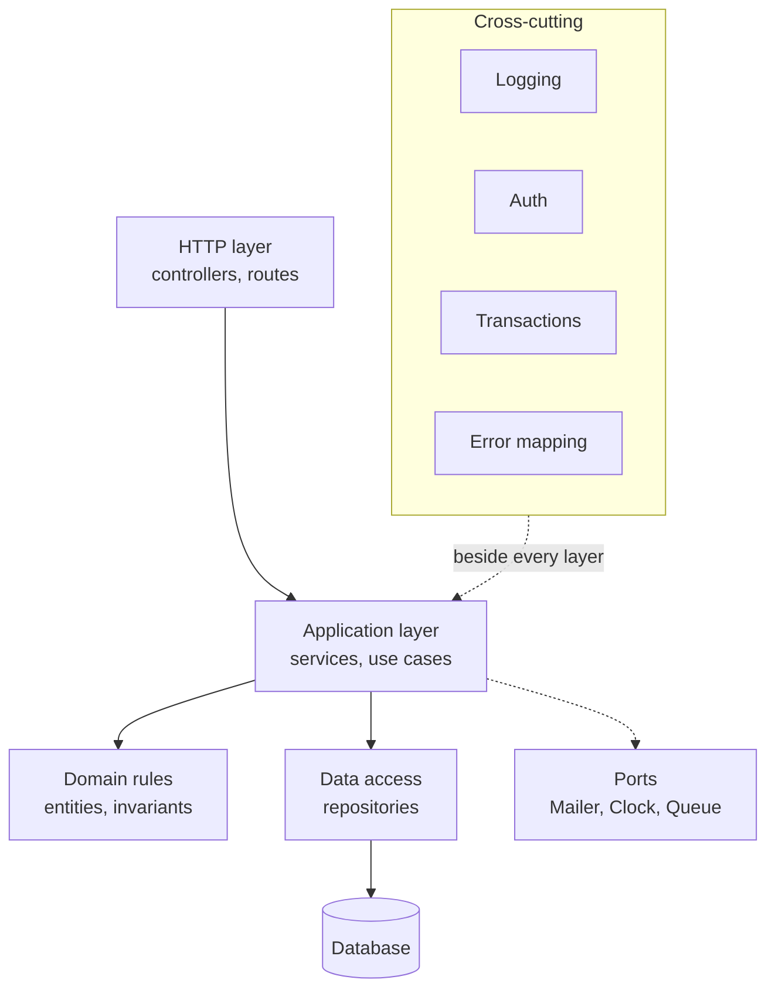
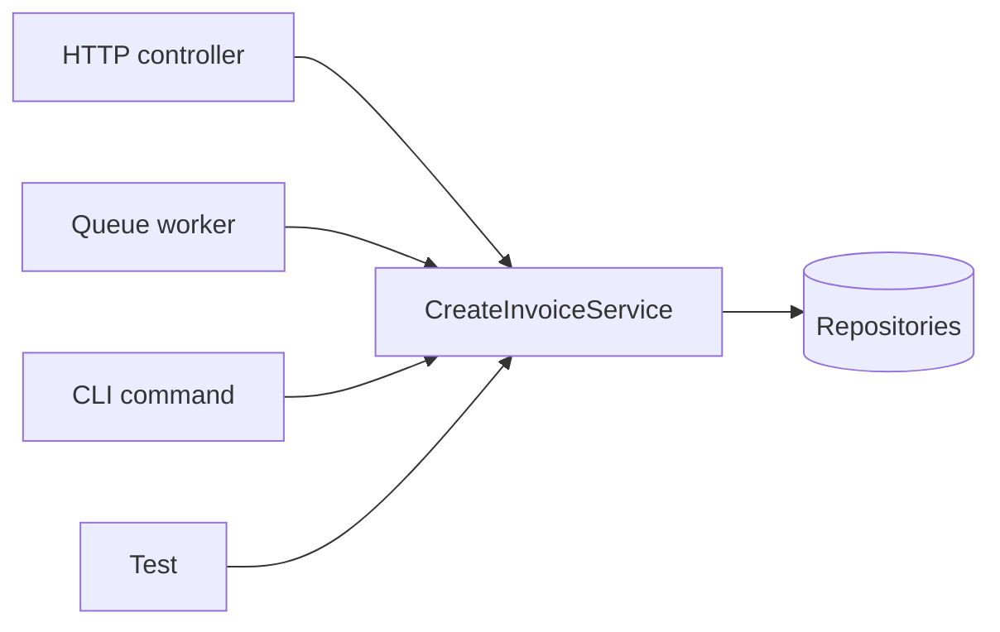

# Layered Architecture

Think about a restaurant. The waiter takes your order and brings your food.
The waiter does not cook. The cook does not go to the farm. Each person has one
job, and they hand work to the next person in a fixed direction.

A backend works best the same way. The controller takes the order. The service
cooks. The repository fetches ingredients. When every part has one job, you can
replace the cook without retraining the waiter.

This file shows a controller that does all four jobs at once, then takes it
apart.

> **📌 In one line:** A layer is a group of code with one responsibility, and
> the whole value of layers comes from one rule — dependencies point in one
> direction only.

## Table of Contents

1. [The Controller That Does Everything](#the-controller-that-does-everything)
2. [Four Questions About That Code](#four-questions-about-that-code)
3. [What a Layer Actually Is](#what-a-layer-actually-is)
4. [The Layers, Drawn](#the-layers-drawn)
5. [Layer Responsibility Table](#layer-responsibility-table)
6. [The Dependency Rule](#the-dependency-rule)
7. [One Service, Four Callers](#one-service-four-callers)
8. [Refactoring the 120-Line Controller](#refactoring-the-120-line-controller)
9. [How Far to Go Before It Is Over-Engineering](#how-far-to-go-before-it-is-over-engineering)
10. [Layer-First vs Feature-First Folders](#layer-first-vs-feature-first-folders)
11. [Where Validation, Authorization and Transactions Sit](#where-validation-authorization-and-transactions-sit)
12. [Common Mistakes](#common-mistakes)
13. [Questions to Test Yourself](#questions-to-test-yourself)
14. [Related](#related)

---

## The Controller That Does Everything

Here is a real endpoint: create an invoice for a project and email it to the
customer. In the codebase it is one function of about 120 lines. I show it in
four pieces so you can read it.

**Piece 1 — hand-written validation.**

```ts
export default class InvoicesController {
  public async store({ request, response, auth }: HttpContext) {
    const body = request.body()

    if (!body.projectId || typeof body.projectId !== 'string') {
      return response.status(422).json({ error: 'projectId is required' })
    }
    if (!Array.isArray(body.lines) || body.lines.length === 0) {
      return response.status(422).json({ error: 'lines must not be empty' })
    }
    for (const line of body.lines) {
      if (typeof line.amountCents !== 'number' || line.amountCents <= 0) {
        return response.status(422).json({ error: 'line amount must be positive' })
      }
    }
```

**Piece 2 — two database queries and an ownership check.**

```ts
    const user = auth.user!
    const project = await Project.query()
      .where('id', body.projectId).preload('company').first()

    if (!project) return response.status(404).json({ error: 'Project not found' })
    if (project.companyId !== user.companyId) {
      return response.status(403).json({ error: 'Not your project' })
    }
```

**Piece 3 — business rules written inline, plus a third query.**

```ts
    // An archived project must not accept new invoices.
    if (project.status === 'archived') {
      return response.status(409).json({ error: 'Project is archived' })
    }

    // The company's plan limits how many open invoices it may have.
    const open = await Invoice.query()
      .where('company_id', user.companyId)
      .whereIn('status', ['draft', 'sent'])
      .count('* as total')

    const limit = project.company.plan === 'free' ? 5 : 500
    if (Number(open[0].$extras.total) >= limit) {
      return response.status(409).json({ error: 'Open invoice limit reached' })
    }
```

**Piece 4 — two writes, an email, then a hand-built response.**

```ts
    const total = body.lines.reduce((s: number, l: Line) => s + l.amountCents, 0)

    const invoice = await Invoice.create({
      companyId: user.companyId,
      projectId: project.id,
      totalCents: total,
      status: 'sent',
      number: `INV-${Date.now()}`,              // id generation, inline
      dueAt: DateTime.now().plus({ days: 30 }), // clock read, inline
    })
    await invoice.related('lines').createMany(body.lines)

    await mail.send((m) => m.to(project.company.billingEmail)
      .subject(`Invoice ${invoice.number}`)
      .htmlView('emails/invoice', { invoice }))

    return response.status(201).json({
      id: invoice.id,
      number: invoice.number,
      total_cents: invoice.totalCents,
      due_at: invoice.dueAt.toISO(),
      lines: body.lines,
    })
  }
}
```

Nothing here is *wrong*. It works. It shipped. That is exactly why this code is
everywhere.

---

## Four Questions About That Code

Try to answer these honestly before reading on.

**1. How would you test the "free plan allows only 5 open invoices" rule?**
You cannot call the rule. It exists only inside an HTTP handler. You must boot
the framework, log a user in, seed a company and five invoices, send a request,
and read a status code. When that test fails you do not know whether the rule
broke or the routing broke.

**2. A nightly job must auto-invoice every project. How do you reuse this?**
You cannot. There is no `request`, no `response` and no `auth` in a cron job.
Your options are to fake an HTTP request inside the job, or copy the 120 lines.
Real teams choose both. Six months later the rule changes and only one copy
gets fixed.

**3. The team moves from the ORM to raw SQL. What changes?** Every controller.
Query syntax is spread across hundreds of handlers. There is no single place
where "how we read invoices" lives.

**4. Is the email skipped if the invoice write fails?** Read piece 4 again.
The two writes have no transaction around them. If `createMany` fails, a broken
invoice already exists — and the customer may already have the email.

> **💡 Tip:** "How would I call this from a background job?" finds more design
> problems in a code review than any style rule.

---

## What a Layer Actually Is

A layer is not a folder. A folder is how you store it. A layer is a promise:

> *Code in this layer is allowed to know about these things, and is not allowed
> to know about those things.*

That is the whole definition. A controller is "the code allowed to know about
HTTP". A service is "the code allowed to know business rules, and not allowed
to know HTTP". The folder name is only a reminder of the promise.

When people say a codebase "has no architecture", they usually mean the
promises are not written down and nobody keeps them.

---

## The Layers, Drawn



Cross-cutting concerns sit beside the stack, not inside it, because they touch
several layers at once. Logging happens in all of them. Authentication happens
at the edge but its *result* travels inward. A transaction starts in the
service and ends in the repository.

The concentric-circle version of this idea, with entities at the centre, is in
[clean-architecture.md](../../software-engineering/architecture/clean-architecture.md).
The controller/model split comes from
[mvc.md](../../software-engineering/architecture/mvc.md). This file is what
those look like in a Node API you actually ship.

---

## Layer Responsibility Table

| Layer | Single responsibility | May know about | Must never know about | Example file |
|---|---|---|---|---|
| HTTP | Turn a request into a call, and a result into a response | Request, Response, status codes, headers, cookies | Business rules, SQL, the ORM | `app/invoices/invoices_controller.ts` |
| Application (service) | Run one business operation start to finish | Domain objects, repository interfaces, ports (mailer, clock, queue) | `Request`, `Response`, status codes, route names | `app/invoices/create_invoice_service.ts` |
| Domain | Hold rules that are always true about a thing | Its own data and other domain objects | HTTP, the ORM, the framework | `app/invoices/invoice.ts` |
| Data access | Read and write one kind of record | Tables, SQL, the ORM, indexes | Business rules, HTTP | `app/invoices/invoice_repository.ts` |
| Cross-cutting | One concern that applies everywhere | Whatever it wraps | The specifics of any one feature | `app/middleware/request_logger.ts` |

> **📌 Remember:** The "must never know about" column is the useful one. You can
> check it in a code review by reading only the `import` lines at the top of a
> file.

---

## The Dependency Rule

One sentence: **dependencies point inward.** Outer layers import inner layers.
Inner layers never import outer layers.

```ts
// ❌ BROKEN — a service that imports from the HTTP layer
import type { HttpContext } from '@adonisjs/core/http'

export class SendInvoiceService {
  async run(ctx: HttpContext) {
    const invoice = await Invoice.find(ctx.request.param('id'))
    if (!invoice) return ctx.response.status(404).json({ error: 'Not found' })
  }
}
```

```ts
// ✅ FIXED — plain input, plain output, a domain error for failure
export class SendInvoiceService {
  async run(input: { invoiceId: string; actorId: string }): Promise<Invoice> {
    const invoice = await this.invoices.findById(input.invoiceId)
    if (!invoice) throw new InvoiceNotFoundError(input.invoiceId)
    return invoice
  }
}
```

The three concrete bans in a TypeScript backend:

1. A service must not import `Request`, `Response`, `HttpContext`, or any HTTP
   status code.
2. A domain object must not import the ORM. `Invoice` the business concept and
   `InvoiceModel` the database row are allowed to be two different things.
3. A repository must not decide business rules. It answers "what is stored",
   not "what is allowed".

**Why, practically:** the moment a service takes `req`, only something with a
`req` can call it. That is one caller. The next section shows what you get
instead.

---

## One Service, Four Callers

One service class, four entry points, zero changes to the service.

```ts
// app/invoices/create_invoice_service.ts — knows nothing about HTTP
export type CreateInvoiceInput = {
  actorId: string
  projectId: string
  lines: Array<{ description: string; amountCents: number }>
}

export class CreateInvoiceService {
  constructor(
    private invoices: InvoiceRepository,
    private projects: ProjectRepository,
    private clock: Clock,
  ) {}

  async run(input: CreateInvoiceInput): Promise<Invoice> { /* ... */ }
}
```

```ts
// 1. HTTP controller
const invoice = await this.createInvoice.run({ actorId: auth.user!.id, ...data })
return response.status(201).json(toInvoiceResponse(invoice))

// 2. Queue worker (the nightly auto-invoice job)
await createInvoice.run({ actorId: job.systemUserId, projectId: job.projectId, lines })

// 3. CLI command, for support staff
const invoice = await createInvoice.run({ actorId, projectId, lines })
this.logger.info(`Created ${invoice.number}`)
```

```ts
// 4. A test — no server, no database
test('free plan blocks a sixth open invoice', async () => {
  const invoices = new InMemoryInvoiceRepository(fiveOpenInvoices)
  const service = new CreateInvoiceService(invoices, projects, fixedClock)

  await assert.rejects(
    () => service.run({ actorId: 'u1', projectId: 'p1', lines: [line(1000)] }),
    OpenInvoiceLimitReachedError,
  )
})
```



Four arrows into one box. That picture is the reason the dependency rule
exists. It is not about being clean. It is about not writing the rule four
times.

---

## Refactoring the 120-Line Controller

Five steps, in order. Each step is safe on its own, so you can stop between
them.

### Step 1 — move validation out

Input shape is not business logic. It belongs at the edge, before the handler
runs. Twelve lines of manual `if` checks become a schema.

```ts
// app/invoices/create_invoice_validator.ts
export const createInvoiceValidator = vine.compile(
  vine.object({
    projectId: vine.string().uuid(),
    lines: vine.array(vine.object({
      description: vine.string().trim().minLength(1),
      amountCents: vine.number().positive(),
    })).minLength(1),
  })
)
```

See [why-validation-matters](../04-validation-and-input/01-why-validation-matters.md)
for what this check really protects.

### Step 2 — move data access into a repository

Every `Invoice.query()` and `Project.query()` call moves behind a method with a
business-shaped name.

```ts
// app/invoices/invoice_repository.ts
export class LucidInvoiceRepository implements InvoiceRepository {
  async countOpenForCompany(companyId: string): Promise<number> {
    const rows = await InvoiceModel.query()
      .where('company_id', companyId)
      .whereIn('status', ['draft', 'sent'])
      .count('* as total')
    return Number(rows[0].$extras.total)
  }
}
```

The controller no longer contains the words `whereIn` or `count`. Details in
[03-repository-layer.md](03-repository-layer-part-1.md).

### Step 3 — move the business rules into a service

The archived check, the plan limit, the total, and the write move into one
method with a business name.

```ts
async run(input: CreateInvoiceInput): Promise<Invoice> {
  const project = await this.projects.findByIdForCompany(input.projectId, this.actor.companyId)
  if (!project) throw new ProjectNotFoundError(input.projectId)
  if (project.status === 'archived') throw new ProjectArchivedError(project.id)

  const open = await this.invoices.countOpenForCompany(project.companyId)
  if (open >= planLimit(project.plan)) throw new OpenInvoiceLimitReachedError()

  return this.invoices.createWithLines(buildInvoice(input, project, this.clock.now()))
}
```

Notice what left: no status codes, no `response`, no `Date.now()`. Every
failure is a domain error. Mapping those errors to 404 / 403 / 409 is the HTTP
layer's job — see [error taxonomy](../07-error-handling/01-error-taxonomy.md).

### Step 4 — move the email out of the write path

An email is a side effect on the outside world. It must not sit inside a
database transaction, because a rollback cannot un-send an email. The service
records the intent; something after the commit sends it. Full argument and the
outbox idea: [02-service-layer.md](02-service-layer-part-1.md).

### Step 5 — move response shaping into a serializer

The hand-written object becomes one function, reused by the list endpoint, the
webhook payload, and the PDF generator.

```ts
// app/invoices/invoice_dto.ts
export function toInvoiceResponse(invoice: Invoice) {
  return {
    id: invoice.id,
    number: invoice.number,
    total_cents: invoice.totalCents,
    status: invoice.status,
    due_at: invoice.dueAt.toUTC().toISO(),
    lines: invoice.lines.map(toInvoiceLineResponse),
  }
}
```

Why this matters more than it looks:
[04-dtos-and-serialization.md](04-dtos-and-serialization-part-1.md).

### The result

```ts
// ✅ FIXED — the whole controller, after five steps
export default class InvoicesController {
  constructor(private createInvoice: CreateInvoiceService) {}

  public async store({ request, response, auth }: HttpContext) {
    const data = await request.validateUsing(createInvoiceValidator)
    const invoice = await this.createInvoice.run({ actorId: auth.user!.id, ...data })
    return response.status(201).json(toInvoiceResponse(invoice))
  }
}
```

| File | Lines, roughly | Testable without HTTP? |
|---|---|---|
| `invoices_controller.ts` | 8 | no, and it does not need to be |
| `create_invoice_validator.ts` | 12 | yes |
| `create_invoice_service.ts` | 40 | yes |
| `invoice_repository.ts` | 35 | yes, against a test database |
| `invoice_dto.ts` | 15 | yes, it is a pure function |

The total line count went **up**. That is normal, and it is not a failure. You
traded fewer lines for fewer reasons to open each file.

---

## How Far to Go Before It Is Over-Engineering

A three-endpoint internal tool over one table does **not** need a controller, a
service, a repository interface, two implementations, an entity, and a mapper.
That is six files to save a row.

**Rule of thumb:** add a layer when it removes a *duplication* or a
*dependency*, not when it looks tidy.

| Signal you see | Add this | Why |
|---|---|---|
| The same rule appears in two handlers | A service | One place for the rule |
| A second caller appears (job, CLI, webhook) | A service | The rule must outlive HTTP |
| The same query appears in three places | A repository method | One place for the query |
| A test needs a real database to check one `if` | A repository interface | A fake makes it fast |
| You cannot say what a file is for in one sentence | Split it | It has two responsibilities |
| None of the above | Nothing | Keep the controller |

> **⚠️ Warning:** The opposite mistake is real too. "We will add the service
> layer later" usually means never, because by then the logic sits in forty
> handlers and nobody has three free weeks.

**Consistency beats correctness here.** A codebase where every feature uses the
same slightly imperfect structure is far easier to work in than one where five
features each use a different perfect structure. If your team has a shape,
follow it, and change it in one deliberate pull request.

---

## Layer-First vs Feature-First Folders

Layers are a rule about imports. Folders are a separate choice.

**Layer-first** — group by what a file *is*:

```text
app/
├── controllers/    invoices_controller.ts, projects_controller.ts, ...
├── services/       create_invoice_service.ts, archive_project_service.ts
├── repositories/   invoice_repository.ts, project_repository.ts
└── models/
```

**Feature-first** — group by what a file is *about*:

```text
app/
├── invoices/
│   ├── invoices_controller.ts
│   ├── create_invoice_service.ts
│   ├── invoice_repository.ts
│   ├── invoice_dto.ts
│   └── invoice_validator.ts
├── projects/
└── shared/         clock.ts, errors.ts
```

| | Layer-first | Feature-first |
|---|---|---|
| Finding all controllers | easy | harder |
| Changing one feature | 4 folders open | 1 folder open |
| Deleting a feature | hunt in every folder | delete one folder |
| "Where is invoicing?" | "everywhere" | "that folder" |
| Works well at | small apps, tutorials | anything that keeps growing |
| Risk | folders with 60 files | shared code duplicated |

**Recommendation: start layer-first only while the app is tiny, and move to
feature-first once you pass about five features.** Three reasons:

1. You change code by feature, not by layer. A pull request about invoicing
   should touch one folder.
2. A folder is a visible boundary. If `projects/` imports
   `invoices/invoice_repository.ts`, you can see it and decide if it is allowed.
3. It is the easiest path to extracting a service later, if you ever need one —
   the folder is already the seam. See
   [monolith-vs-microservices](../../system-design/foundational/monolith-vs-microservices.md).

The layer rule does not change between the two trees. Feature-first is not "no
layers": inside `invoices/`, the controller still must not contain SQL.

---

## Where Validation, Authorization and Transactions Sit

These three confuse people because each appears in more than one layer.

| Concern | HTTP layer | Service layer | Repository layer |
|---|---|---|---|
| Validation | Shape and type: is `amountCents` a positive number? | Business validity: is this amount allowed on this plan? | Nothing — it trusts its caller |
| Authorization | Is anyone logged in at all? | May *this* user act on *this* record? | Always scope the query by tenant |
| Transactions | Never starts one | Owns the boundary: starts and commits | Joins an existing one if given a handle |
| Errors | Maps domain errors to status codes | Throws domain errors | Throws storage errors |

- **Validation splits by question.** "Is this a number?" is input validation
  ([04-validation-and-input](../04-validation-and-input/01-why-validation-matters.md)).
  "Is this allowed?" is a business rule in the service.
- **Authorization splits by depth.** Middleware answers "is anyone logged in".
  The service answers "may this person do this to this row". The repository
  enforces the tenant boundary so nobody can forget it:
  [authn-vs-authz](../06-authorization/01-authn-vs-authz.md).
- **Transactions belong to the service**, because only the service knows which
  writes form one business operation:
  [transactions](../10-database-integration/03-transactions-part-1.md).

---

## Common Mistakes

| Mistake | Why it is wrong | Do this instead |
|---|---|---|
| Service takes `req` or returns `res` | Jobs and tests are locked out | Take plain input, return plain data, throw domain errors |
| Service returns `{ status: 404, body }` | HTTP leaked in through the back door | Throw `InvoiceNotFoundError`; map it in the HTTP layer |
| Repository method named `findAll(filters)` | It leaks schema knowledge to every caller | Name methods after intent: `findOpenForCompany` |
| Controller opens a transaction | The controller now knows which writes belong together | Start it in the service |
| A "service" that only forwards one line per method | Ceremony with no rule inside it | Call the repository directly until a rule appears |
| Every layer added on day one | Six files per feature before the first rule exists | Add a layer when it removes a duplication |
| Domain entity extends the ORM base class | The rule cannot be tested without a database | Keep the entity plain; map it at the repository edge |
| Two features, two different structures | Every reader must learn both | Pick one shape and apply it everywhere |

---

## Questions to Test Yourself

1. Why is "a service must not import `Response`" a practical rule rather than a
   style preference? Name two things it makes possible.
2. The nightly auto-invoice job needs the same plan-limit rule as the HTTP
   endpoint. Where must that rule live, and how would you prove it lives there?
3. After the refactor the total line count went up. Explain to a teammate why
   that is still an improvement.
4. A developer puts `where('company_id', ...)` in a controller. Which layer
   promise broke, and how would you spot it without reading the whole file?
5. You are building a three-endpoint admin tool over one table. Which layers
   would you skip, and what single signal would make you add a service?
6. When would you choose layer-first folders, and what breaks first as the
   codebase grows?
7. Validation appears in two layers. Give one example of each and state the
   question each one answers.
8. Why does the transaction boundary belong to the service rather than the
   repository or the controller?

---

## Related

- [clean-architecture.md](../../software-engineering/architecture/clean-architecture.md) — the general layer model and dependency rule this file applies to a Node API.
- [mvc.md](../../software-engineering/architecture/mvc.md) — where "controller" and "model" come from, and why a model must not know about views.
- [solid-principles.md](../../software-engineering/principles/solid-principles.md) — one responsibility per layer, and dependency inversion behind an interface.
- [02-service-layer.md](02-service-layer-part-1.md) — what actually goes inside a service.
- [03-repository-layer.md](03-repository-layer-part-1.md) — the data access layer in detail.
- [04-dtos-and-serialization.md](04-dtos-and-serialization-part-1.md) — step 5 of the refactor, in full.
- [05-dependency-injection-in-practice.md](05-dependency-injection-in-practice.md) — how the controller gets its service without importing a singleton.
- [01-anatomy-of-a-backend-app.md](../03-request-lifecycle/01-anatomy-of-a-backend-app.md) — the request path these layers sit inside.
- [01-why-validation-matters.md](../04-validation-and-input/01-why-validation-matters.md) — the edge check removed in step 1.
- [01-authn-vs-authz.md](../06-authorization/01-authn-vs-authz.md) — which layer decides "may this user do this".
- [03-transactions.md](../10-database-integration/03-transactions-part-1.md) — owning the transaction boundary.
