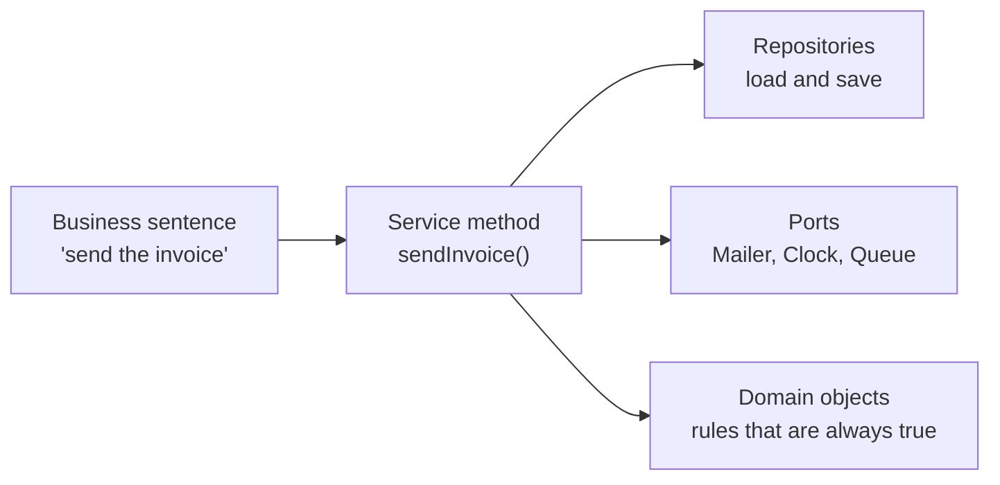
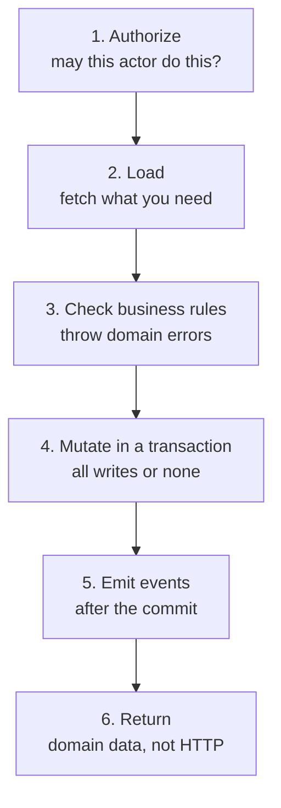

# The Service Layer — Part 1

A bank teller does not know whether you walked in, phoned, or used the app.
The teller knows one thing: how to move money from one account to another,
correctly, every time. The door you came through is somebody else's problem.

A service is that teller. It is the code that knows how to do one business
operation properly. It does not know whether the request arrived as HTTP JSON,
a queue message, or a line typed into a terminal.

Part 1 is about what a service *is*: how to name it, what its signature must
look like, what a real method does step by step, and which rules belong inside
it. Part 2 is about services in a running system — calling each other, side
effects, transactions, retries, and testing.

> **📌 In one line:** a service is one business operation, named the way the
> business names it, taking plain data in and giving plain data out.

## Table of Contents

1. [A Service Is a Business Verb](#a-service-is-a-business-verb)
2. [Naming: What the Business Calls It](#naming-what-the-business-calls-it)
3. [The Signature Rule](#the-signature-rule)
4. [What the Fix Makes Possible](#what-the-fix-makes-possible)
5. [Anatomy of `sendInvoice`, Line by Line](#anatomy-of-sendinvoice-line-by-line)
6. [Where Business Rules Belong: the CLI Test](#where-business-rules-belong-the-cli-test)
7. [Orchestration vs Domain Logic](#orchestration-vs-domain-logic)
8. [The Anemic Domain Model Argument, Honestly](#the-anemic-domain-model-argument-honestly)
9. [Common Mistakes](#common-mistakes)
10. [Questions to Test Yourself](#questions-to-test-yourself)
11. [Related](#related)

---

## A Service Is a Business Verb

Ask a non-programmer at your company what the software does. They will say
things like:

- "It registers a new user."
- "It sends the invoice to the customer."
- "It archives a finished project."

Notice that each of those is a **verb plus a thing**. None of them mentions a
URL, a status code, or a table. Those sentences are your service methods. If a
sentence your finance manager says out loud has no matching method in your
codebase, that operation is spread across a controller, a model hook, and two
helper files — which is why nobody can tell you what it does.

A service is where that sentence becomes one callable unit.



[01-layered-architecture.md](01-layered-architecture.md) drew the layers. This
file lives entirely inside the second box.

---

## Naming: What the Business Calls It

The name of a service method is the single cheapest documentation you will
ever write. Name it after the business operation, never after the transport.

| ❌ Named after HTTP | ✅ Named after the business | Why the second is better |
|---|---|---|
| `postInvoice` | `sendInvoice` | The operation also runs from a cron job |
| `handleUserCreate` | `registerUser` | "Handle" says nothing about what happens |
| `putProjectStatus` | `archiveProject` | Two different PUTs can mean two operations |
| `processRequest` | `refundPayment` | A reader has to open the file to learn anything |
| `updateUser` | `changeEmailAddress` | An email change sends a confirmation; a name change does not |

The last row is the important one. `updateUser` is a *database* verb. It hides
the fact that changing an email address needs a verification step and changing
a display name does not. One vague method becomes a tangle of `if (input.email)`
branches. Two honestly named methods stay short forever.

> **💡 Tip:** if you cannot name the method without using the words "handle",
> "process", "manage", or "do", you have not decided what it does yet.

---

## The Signature Rule

**A service must never take `req` or `res`, and must never return them.**

This is the one rule in this file worth memorising. Here is the version that
looks harmless:

```ts
// ❌ BROKEN — the service takes the request object
import type { HttpContext } from '@adonisjs/core/http'

export class InvoiceService {
  async sendInvoice(ctx: HttpContext) {
    const id = ctx.request.param('id')
    const actor = ctx.auth.user!

    const invoice = await Invoice.find(id)
    if (!invoice) {
      return ctx.response.status(404).json({ error: 'Invoice not found' })
    }
    if (invoice.companyId !== actor.companyId) {
      return ctx.response.status(403).json({ error: 'Forbidden' })
    }

    await mail.send(/* ... */)
    invoice.status = 'sent'
    await invoice.save()

    return ctx.response.json({ ok: true })
  }
}
```

It works. It even *feels* tidy, because the controller is now one line. But
the HTTP layer did not disappear — it moved one file deeper and took the
business logic hostage.

```ts
// ✅ FIXED — plain input, domain output, domain errors
export type SendInvoiceInput = {
  invoiceId: string
  actorId: string
}

export class InvoiceService {
  constructor(
    private invoices: InvoiceRepository,
    private actors: UserRepository,
    private mailer: Mailer,
    private clock: Clock,
  ) {}

  async sendInvoice(input: SendInvoiceInput): Promise<Invoice> {
    const actor = await this.actors.findByIdOrFail(input.actorId)
    const invoice = await this.invoices.findByIdForCompany(
      input.invoiceId,
      actor.companyId,
    )
    if (!invoice) throw new InvoiceNotFoundError(input.invoiceId)

    // ... rules, write, event — shown in full below

    return invoice
  }
}
```

The controller shrinks to translation work, which is exactly its job:

```ts
public async send({ params, auth, response }: HttpContext) {
  const invoice = await this.invoiceService.sendInvoice({
    invoiceId: params.id,
    actorId: auth.user!.id,
  })
  return response.json(toInvoiceResponse(invoice))
}
```

> **⚠️ Warning:** a service returning `{ status: 404, body: {...} }` has broken
> the same rule with extra steps. HTTP has leaked in whether or not you
> imported the type.

---

## What the Fix Makes Possible

The rule sounds like taste. It is not. Here is the concrete list of things the
broken version cannot do and the fixed version can.

| Capability | BROKEN (takes `ctx`) | FIXED (takes plain input) |
|---|---|---|
| Call it from a nightly cron job | Build a fake `HttpContext` | `sendInvoice({ invoiceId, actorId })` |
| Call it from a queue worker | Same fake, plus fake `auth` | Same one line |
| Call it from a CLI support command | Not realistically | Same one line |
| Unit test one business rule | Boot framework, seed DB, send request | Construct the class, call the method |
| Call it from another service | Circular HTTP-ish nonsense | Normal method call |
| Return two results (invoice *and* a warning) | Response already sent | Return a result object |
| Reuse it in a GraphQL or gRPC endpoint | Rewrite | Nothing changes |
| Read the file and know what it does | Hunt through `ctx.*` | Read the input type |

That last row is underrated. `SendInvoiceInput` is a two-field type. Reading
it tells you everything the operation needs. `HttpContext` tells you nothing,
because it contains the entire world.

---

## Anatomy of `sendInvoice`, Line by Line

Real service methods follow the same six-beat shape almost every time. Learn
the shape and you will stop wondering what order to write things in.



Here is the whole method. Each numbered comment is explained below it.

```ts
async sendInvoice(input: SendInvoiceInput): Promise<Invoice> {
  // (1) authorize
  const actor = await this.actors.findByIdOrFail(input.actorId)
  if (!actor.can('invoice:send')) {
    throw new ForbiddenActionError('invoice:send', actor.id)
  }

  // (2) load
  const invoice = await this.invoices.findByIdForCompany(
    input.invoiceId, actor.companyId,
  )
  if (!invoice) throw new InvoiceNotFoundError(input.invoiceId)
  const customer = await this.customers.findByIdOrFail(invoice.customerId)

  // (3) check business rules
  if (invoice.status !== 'draft') {
    throw new InvoiceAlreadySentError(invoice.id, invoice.status)
  }
  if (invoice.totalCents <= 0) {
    throw new EmptyInvoiceError(invoice.id)
  }
  if (!customer.billingEmail) {
    throw new CustomerHasNoBillingEmailError(customer.id)
  }

  // (4) mutate, inside one transaction
  const sent = await this.uow.run(async (tx) => {
    const updated = await this.invoices.markAsSent(invoice.id, {
      sentAt: this.clock.now(),
      dueAt: this.clock.now().plus({ days: customer.paymentTermDays }),
    }, tx)

    await this.audit.record({
      action: 'invoice.sent', actorId: actor.id, subjectId: invoice.id,
    }, tx)

    // (5a) record the intent to email, in the same transaction
    await this.outbox.enqueue({
      type: 'invoice.sent',
      payload: { invoiceId: invoice.id, to: customer.billingEmail },
    }, tx)

    return updated
  })

  // (5b) nothing external happened inside the transaction — see Part 2
  // (6) return domain data
  return sent
}
```

**(1) Authorize first.** Do it before you load anything expensive, and do it
inside the service — not only in middleware. Middleware answers "is anyone
logged in". Only the service knows that *this* actor may send *this* company's
invoice. See
[01-authn-vs-authz.md](../06-authorization/01-authn-vs-authz.md).

**(2) Load everything you need, up front.** Loading in the middle of rule
checks is how N+1 queries appear. Notice `findByIdForCompany` — the tenant
filter is part of the repository method, not something the service remembers
to add. That idea gets a whole section in
[03-repository-layer-part-1.md](03-repository-layer-part-1.md).

**(3) Check rules, throw domain errors.** No status codes. `InvoiceAlreadySentError`
is a fact about invoices. Whether it becomes a 409 or a red box in a CLI is
decided elsewhere:
[01-error-taxonomy.md](../07-error-handling/01-error-taxonomy.md).

**(4) One transaction, all the writes.** The status change, the audit row and
the outbox row either all happen or none do. There is no half-sent invoice.

**(5) Emit events, but do not *do* external things here.** The outbox row is a
database write, so it is safe inside the transaction. Actually sending the
email is not. That distinction is the single most valuable idea in Part 2.

**(6) Return domain data.** The updated `Invoice`, not a JSON envelope, not a
status code, not `{ success: true }`.

> **📌 Remember:** authorize → load → check → mutate → emit → return. When a
> service method stops matching this shape, it is usually doing two operations
> and wants to be two methods.

---

## Where Business Rules Belong: the CLI Test

New developers get stuck on one question: does this `if` belong in the
controller, the service, or the model? Here is a test that answers it in five
seconds.

> **Ask: would this rule still be true if the request came from a CLI command
> instead of HTTP?**

If **yes**, it is a business rule. It belongs in the service (or deeper, in the
domain object). If **no**, it is a transport concern and belongs in the
controller or middleware.

| Rule | Still true from a CLI? | Belongs in |
|---|---|---|
| A draft invoice cannot be sent twice | Yes | Service |
| A free plan allows only 5 open invoices | Yes | Service |
| An archived project accepts no new invoices | Yes | Service |
| `amountCents` must be a positive number | Yes, but check it at the edge too | Validator, then trusted by the service |
| The caller must send `Content-Type: application/json` | No | HTTP layer |
| Respond 409 rather than 422 for a conflict | No | HTTP layer |
| The `Idempotency-Key` header must be present | No — but *being idempotent* is | Header check at HTTP, behaviour in the service |
| Rate limit: 100 requests per minute per IP | No | Middleware |
| Only the invoice's own company may see it | Yes | Service and repository |

The two split rows are the interesting ones. "Is this a number?" is an input
check at the edge; "is this amount allowed on this plan?" is a business rule.
Same field, two different questions, two different layers. See
[01-why-validation-matters.md](../04-validation-and-input/01-why-validation-matters.md).

---

## Orchestration vs Domain Logic

There are two kinds of logic and they belong in two different places.

**Domain logic** is a rule that is always true about a thing, using only that
thing's own data. *An invoice's total is the sum of its lines. An invoice with
no lines is not sendable. A discount cannot exceed the subtotal.*

**Orchestration** is the sequence of steps that makes one operation happen.
*Load the invoice, check the actor, write the status, queue the email.*

Services orchestrate. Domain objects hold invariants.

```ts
// Domain object — no database, no framework, no async
export class Invoice {
  constructor(
    readonly id: string,
    readonly lines: InvoiceLine[],
    private status: InvoiceStatus,
  ) {}

  get totalCents(): number {
    return this.lines.reduce((sum, l) => sum + l.amountCents, 0)
  }

  get isSendable(): boolean {
    return this.status === 'draft' && this.lines.length > 0 && this.totalCents > 0
  }

  markSent(at: DateTime): void {
    if (!this.isSendable) throw new InvoiceNotSendableError(this.id)
    this.status = 'sent'
    this.sentAt = at
  }
}
```

The service then reads much shorter, because the rule moved to where it
belongs:

```ts
// Service — orchestration only
const invoice = await this.invoices.findByIdForCompany(id, actor.companyId)
invoice.markSent(this.clock.now())          // the rule lives in the object
await this.invoices.save(invoice, tx)
```

| Question | Domain object | Service |
|---|---|---|
| Needs the database? | Never | Yes |
| Needs `await`? | Almost never | Yes |
| Knows about other aggregates? | No | Yes |
| Can be tested with `new` and nothing else? | Yes | Needs fakes |
| Holds "always true" rules | Yes | No |
| Holds "the order things happen" | No | Yes |

> **💡 Tip:** the fastest way to find domain logic hiding in a service is to
> look for an `if` that touches only one object's own fields. That `if` wants
> to be a method on the object.

---

## The Anemic Domain Model Argument, Honestly

You will eventually read that putting all the logic in services and leaving
your model classes as bags of fields is an **anti-pattern** called the *anemic
domain model*. The argument is real, and so is the counter-argument. Here is
both sides without the sermon.

**The case against anemic models.** If `Invoice` is only public fields and
every rule lives in `InvoiceService`, then nothing stops other code from
setting `invoice.status = 'sent'` directly and skipping every check. The object
cannot protect itself. Rules about invoices end up scattered across five
services, and adding a sixth service means re-reading all of them.

**The case for a pragmatic middle.** Rich domain models cost something real:
a mapping layer between the database row and the domain object, a team that all
understands the pattern, and discipline about what "always true" means. In a
CRUD-heavy app where most entities genuinely have no invariants, forcing a rich
model produces empty ceremony — a `Setting` class with a `changeValue` method
that just assigns.

| Situation | Reasonable choice |
|---|---|
| Entity has real invariants (money, state machine, quotas) | Rich domain object; service orchestrates |
| Entity is a config row with no rules | Plain type; service does the work |
| Team is new to the pattern, deadline is real | Start with services; extract objects when a rule repeats |
| Same rule already copied into three services | Extract it into the domain object today |
| ORM model is also the domain object | Acceptable, but keep framework calls out of rule methods |

**Practical stance for a Node backend:** put rules that depend only on one
object's own data on that object. Put everything that needs the database,
another aggregate, or a port in the service. Do not build a mapping layer on
day one to satisfy a pattern — build it the day the mixing hurts.

---

## Common Mistakes

| Mistake | Why it is wrong | Do this instead |
|---|---|---|
| `sendInvoice(ctx: HttpContext)` | Locks the operation to HTTP forever | Take a plain input type |
| Service returns `{ status, body }` | HTTP leaked without an import | Return domain data, throw domain errors |
| Method named `handleInvoice` | Says nothing; grows branches | Name the business verb: `sendInvoice` |
| One `updateUser` for every field | Hides that email changes need verification | Split into named operations |
| Rules checked in the controller | The cron job skips them | Move to the service, keep shape checks at the edge |
| Loading rows one at a time inside rule checks | N+1 queries | Load everything up front |
| Authorization only in middleware | Middleware cannot know row ownership | Authorize in the service too |
| `invoice.status = 'sent'` assigned from anywhere | Bypasses every rule | `invoice.markSent(now)` with the check inside |
| A service class with 30 unrelated methods | Nobody can see the operations | Group by aggregate, or split per use case |
| Domain object importing the ORM | Rules need a database to test | Keep it plain; map at the repository edge |

---

## Questions to Test Yourself

1. Name three things a service taking plain input can do that a service taking
   `HttpContext` cannot. Do not say "it is cleaner".
2. `postInvoice` and `sendInvoice` describe the same code. Give two concrete
   problems the first name will cause in six months.
3. Walk the six beats of a service method in order, and say what goes wrong if
   you swap beats 1 and 2.
4. A teammate adds `if (!request.header('x-api-key'))` inside a service. Apply
   the CLI test out loud and say where the check belongs.
5. `invoice.totalCents <= 0` is checked in the service. Argue for moving it
   onto the `Invoice` object, then argue against. Which do you choose and why?
6. Explain the anemic domain model criticism in two sentences, then give one
   situation where an anemic model is the right call.
7. Why is "load everything up front" a service-layer rule rather than a
   performance tip?
8. Your `registerUser` service also sends a welcome email. Before reading
   Part 2, guess why that email must not be sent inside the transaction.

---

> **➡️ Continued in [Part 2](02-service-layer-part-2.md)** — services calling
> services, transactions and side effects, the outbox, idempotency, injecting a
> clock, and use-case-per-class vs grouped service classes.

## Related

- [Part 2](02-service-layer-part-2.md) — the same service under real-world
  pressure: retries, transactions, events, and tests.
- [01-layered-architecture.md](01-layered-architecture.md) — where the service
  layer sits and the dependency rule it obeys.
- [clean-architecture.md](../../software-engineering/architecture/clean-architecture.md)
  — the theory of use cases at the centre of the application.
- [mvc.md](../../software-engineering/architecture/mvc.md) — why "fat model,
  thin controller" is the same instinct one layer over.
- [solid-principles.md](../../software-engineering/principles/solid-principles.md)
  — single responsibility, applied to one business operation per method.
- [03-repository-layer-part-1.md](03-repository-layer-part-1.md) — the
  `findByIdForCompany` method the service called.
- [01-error-taxonomy.md](../07-error-handling/01-error-taxonomy.md) — what a
  domain error looks like and how the HTTP layer maps it.
- [01-authn-vs-authz.md](../06-authorization/01-authn-vs-authz.md) — why
  authorization appears in both middleware and the service.
- [01-why-validation-matters.md](../04-validation-and-input/01-why-validation-matters.md)
  — the shape checks the service is allowed to trust.
- [04-controllers-and-request-context.md](../03-request-lifecycle/04-controllers-and-request-context.md)
  — the thin controller that calls the service.
