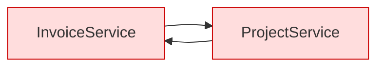

# The Service Layer — Part 2

Part 1 built one clean service method. This part is what happens when that
method meets a real system: another service needs it, a transaction wraps it,
an email must go out, the client retries twice, and someone asks for a test
that runs in four milliseconds.

Every problem here has one root — a service does not only compute, it
**changes the world**, and the world does not roll back.

> **⬅️ This continues [Part 1](02-service-layer-part-1.md).**

> **📌 In one line:** database writes belong inside the transaction, everything
> external belongs after the commit, and anything retryable must be safe to run
> twice.

## Table of Contents

1. [Services Calling Services](#services-calling-services)
2. [Danger 1: Circular Dependencies](#danger-1-circular-dependencies)
3. [Danger 2: Hidden Transaction Boundaries](#danger-2-hidden-transaction-boundaries)
4. [Side Effects Must Not Live Inside a Transaction](#side-effects-must-not-live-inside-a-transaction)
5. [The Outbox, Briefly](#the-outbox-briefly)
6. [Idempotency at the Service Level](#idempotency-at-the-service-level)
7. [Keeping Services Testable](#keeping-services-testable)
8. [The Test That Becomes Possible](#the-test-that-becomes-possible)
9. [Return Values and Errors](#return-values-and-errors)
10. [Advanced: Use-Case-per-Class vs Grouped Services](#advanced-use-case-per-class-vs-grouped-services)
11. [Advanced: Where CQRS Changes This](#advanced-where-cqrs-changes-this)
12. [Common Mistakes](#common-mistakes)
13. [Questions to Test Yourself](#questions-to-test-yourself)
14. [Related](#related)

---

## Services Calling Services

It is fine for one service to call another. `closeProject` sending a final
invoice should call the invoice service, not copy its rules.

```ts
export class ProjectService {
  // `invoices` is another service, constructor-injected like any dependency
  constructor(private projects: ProjectRepository, private invoices: InvoiceService) {}

  async closeProject(input: { projectId: string; actorId: string }) {
    const project = await this.projects.findByIdOrFail(input.projectId)
    if (project.hasUnbilledWork) {
      await this.invoices.sendFinalInvoice({ projectId: project.id, ...input })
    }
    return this.projects.archive(project.id)
  }
}
```

| It is fine when | It is a smell when |
|---|---|
| The callee is a real business operation | You only want to reuse one query — call the repository |
| The call graph runs one way | Two services call each other |
| The dependency is constructor-injected | It is imported as a module singleton |
| One file still explains the operation | The chain is four deep and nothing reads whole |

---

## Danger 1: Circular Dependencies

`InvoiceService` needs `ProjectService`; `ProjectService` needs
`InvoiceService`. In TypeScript this rarely fails loudly. It fails as
`undefined is not a constructor` at 3 a.m., because one module finished loading
before the other filled in its exports — the mechanics are in
[modules.md](../../typescript-fundamentals/modules/modules.md).



Three ways out, cheapest first:

1. **Push the shared part down.** Usually both want the same *query* or the
   same *rule*, not the whole other service. Move it into a repository or a
   plain domain function both depend on. This fixes most cycles.
2. **Add a coordinator above both.** `CloseProjectAndBillService` depends on
   the two; neither depends on the other.
3. **Invert one direction with an event.** `ProjectService` publishes
   `project.closed`; a handler calls `InvoiceService`. Powerful, but harder to
   follow in a stack trace — use it when the coupling is genuinely optional.

> **⚠️ Warning:** lazy-resolving one side from a DI container to "fix" the
> cycle only hides it. The design problem remains, and now it appears at
> runtime instead of at build time.

---

## Danger 2: Hidden Transaction Boundaries

Service A opens a transaction and calls Service B. Service B opens *its own*
transaction, because it does not know it is being called from inside one.

```ts
// ❌ BROKEN — each service silently owns a transaction
return db.transaction(async (tx) => {
  await this.projects.archive(input.projectId, tx)
  await this.invoices.sendFinalInvoice(input)   // opens a second transaction
})
```

Two independent transactions. If `archive` rolls back after the invoice
committed, you have an invoice for a project that was never closed — and the
two can deadlock on the same rows
([05-deadlocks-part-1.md](../../databases/transactions-and-concurrency/05-deadlocks-part-1.md)).

The fix is boring and reliable: **make the transaction handle an explicit,
optional parameter that flows down the call chain.**

```ts
// ✅ FIXED — whoever starts the transaction owns it; the rest join it
export class UnitOfWork {
  async run<T>(fn: (tx: Tx) => Promise<T>, existing?: Tx): Promise<T> {
    return existing ? fn(existing) : this.db.transaction(fn)
  }
}

async sendFinalInvoice(input: SendFinalInvoiceInput, tx?: Tx): Promise<Invoice> {
  return this.uow.run(async (t) => {
    return this.invoices.createFinalFor(input.projectId, t)
  }, tx)     // tx given → join it; tx absent → start one
}
```

| Approach | On a nested call | Verdict |
|---|---|---|
| Each service opens its own | Two transactions, partial commits | Broken |
| Ambient / implicit context | Works until a worker or test forgets to set it | Fragile |
| Explicit optional `tx` parameter | Caller decides; the signature tells the truth | Recommended |
| Opened in the controller | Wrong layer: it now knows what belongs together | Avoid |

---

## Side Effects Must Not Live Inside a Transaction

The rule, and it is absolute:

> **A database transaction can roll back. An email cannot.**

```ts
// ❌ BROKEN — external side effect inside the transaction
await db.transaction(async (tx) => {
  await this.invoices.markAsSent(invoice.id, tx)
  await this.mailer.send(customer.billingEmail, invoiceEmail(invoice))  // sent!
  await this.audit.record({ action: 'invoice.sent' }, tx)               // fails
})
// rollback: the invoice is still 'draft' — but the customer already has it
```

Three things go wrong, and only the first is obvious:

1. **Rollback cannot un-send.** The customer holds an invoice your database
   says was never sent. Support gets that call, not you.
2. **The transaction is held open across a network call.** SMTP takes 400ms,
   so your row locks are held for 400ms. Under load the connection pool empties
   and the whole API stalls —
   [01-connection-pooling-part-1.md](../../databases/operations/01-connection-pooling-part-1.md).
3. **A slow mail server fails your write.** The operation now depends on a
   system unrelated to it.

```ts
// ✅ FIXED — commit first, then act on the outside world
const sent = await this.uow.run(async (tx) => {
  const updated = await this.invoices.markAsSent(invoice.id, tx)
  await this.audit.record({ action: 'invoice.sent' }, tx)
  return updated
})
await this.mailer.send(customer.billingEmail, invoiceEmail(sent))   // after COMMIT
return sent
```

The FIXED version has its own hole: if the process crashes between `COMMIT`
and `send`, the email never goes out and nothing remembers it should have. You
have swapped "email without a record" for "record without an email" — the
better failure, and one you can close completely.

---

## The Outbox, Briefly

The **transactional outbox** closes that gap. Instead of sending after the
commit, write a row *describing* the side effect inside the same transaction,
and let a separate worker do the sending.

```ts
await this.uow.run(async (tx) => {
  await this.invoices.markAsSent(invoice.id, tx)
  await this.outbox.enqueue(
    { type: 'invoice.sent', payload: { invoiceId: invoice.id } },
    tx,                                   // just an INSERT — safe in the tx
  )
})
```

A worker then polls `outbox`, sends, and marks each row processed.

| Property | Send after commit | Outbox |
|---|---|---|
| Email sent on rollback | Never | Never |
| Email lost if the process crashes | Possible | No — the row survives |
| Extra moving parts | None | A table and a worker |
| Delivery guarantee | At-most-once | At-least-once, so handlers must be idempotent |

**Start with "commit, then send".** Add the outbox when a lost side effect
costs money: payments, provisioning, anything a customer paid for. Full
pattern: [event-driven-architecture.md](../../system-design/scale-patterns/event-driven-architecture.md).

---

## Idempotency at the Service Level

The request timed out, the mobile app retries, and your service runs
`sendInvoice` a second time. Two emails? Two charges?

Idempotency is usually taught as an HTTP header, but the header only
*identifies* the retry — **the safety is implemented in the service.**

| Level | How it works | Use for |
|---|---|---|
| **Natural** | A state transition that can only happen once (`draft → sent`) | Most operations; free, no storage |
| **Deduplication key** | Store the client's key with the result; a repeat returns it | Creates, payments — anything with no prior row |
| **None** | Hope the client does not retry | Reads only |

Natural idempotency is one honest early return —
`if (invoice.status === 'sent') return invoice` — and it covers more
operations than people expect. When there is no prior row to check, use a key:

```ts
async chargeInvoice(input: ChargeInput): Promise<Charge> {
  const existing = await this.charges.findByRequestKey(input.requestKey)
  if (existing) return existing              // the retry gets the same answer

  return this.uow.run(async (tx) => {
    const charge = await this.charges.create({
      ...input, requestKey: input.requestKey,  // UNIQUE index on this column
    }, tx)
    await this.outbox.enqueue({ type: 'charge.requested', /* ... */ }, tx)
    return charge
  })
}
```

> **💡 Tip:** the unique index is what makes it *correct*. Two simultaneous
> retries both pass the `findByRequestKey` check; the database rejects the
> second insert, and you catch the unique-violation and return the winner's
> row. Key lifetime and replay semantics:
> [idempotency.md](../../system-design/reliability/idempotency.md).

---

## Keeping Services Testable

Three habits, each with a matching thing to stop doing.

**1. Inject through the constructor; never import a singleton.**

```ts
// ❌ BROKEN — hard-wired to real infrastructure, no seam at all
import db from '#services/db'
import mail from '@adonisjs/mail/services/main'

export class InvoiceService {
  async sendInvoice(input: SendInvoiceInput) {
    const invoice = await db.from('invoices').where('id', input.invoiceId).first()
    await mail.send(/* ... */)     // testing one `if` now needs PostgreSQL + SMTP
  }
}
```

```ts
// ✅ FIXED — every outside thing arrives through the constructor
export class InvoiceService {
  constructor(
    private invoices: InvoiceRepository,
    private mailer: Mailer,
    private clock: Clock,
  ) {}
}
```

**2. Never read the clock, randomness or the environment inside a service.**
`new Date()`, `Math.random()`, `crypto.randomUUID()` and `process.env.X` all
reach out of the function for something that changes, so a test cannot control
them. Inject them instead:

```ts
// ❌ BROKEN                                  // ✅ FIXED
DateTime.now().plus({ days: 30 })             this.clock.now().plus({ days: 30 })
`INV-${Date.now()}`                           this.ids.nextInvoiceNumber()
Math.random().toString(36)                    this.random.token(32)
```

```ts
export interface Clock { now(): DateTime }                          // the port
export class SystemClock implements Clock { now() { return DateTime.utc() } }
export class FixedClock implements Clock {                          // the test double
  constructor(private at: DateTime) {}
  now() { return this.at }
}
```

**3. Depend on interfaces, not concrete classes.** `InvoiceRepository` as an
interface lets a test pass an in-memory array while production passes the Lucid
implementation — neither knows the other exists.

---

## The Test That Becomes Possible

No server, no database, no mail account — and it asserts things a status-code
test never could.

```ts
test('sending an invoice sets the due date 30 days out and sends one email',
  async () => {
    const clock = new FixedClock(DateTime.fromISO('2026-03-01T00:00:00Z'))
    const mailer = new FakeMailer()
    const invoices = new InMemoryInvoiceRepository([draftInvoice({ id: 'inv_1' })])
    const service = new InvoiceService(invoices, customers, mailer, clock, uow)

    const sent = await service.sendInvoice({ invoiceId: 'inv_1', actorId: 'u_1' })

    assert.equal(sent.status, 'sent')
    assert.equal(sent.dueAt.toISODate(), '2026-03-31')   // exact, because fixed clock
    assert.lengthOf(mailer.sent, 1)                      // no SMTP involved
    assert.equal(mailer.sent[0].to, 'billing@acme.test')
  })
```

Read the assertions again. `dueAt` is an exact date because the clock is fixed;
`mailer.sent` is countable because the mailer is a fake. Neither is possible
with `new Date()` and a global mail singleton. More:
[02-unit-testing-part-1.md](../13-testing-and-quality/02-unit-testing-part-1.md).

---

## Return Values and Errors

**Return domain results** — the `Invoice` itself, or a small named result type
such as `{ invoice, emailQueued, warnings }` when the operation genuinely
produces more than one fact.

Do not return `{ success: true, data, error: null }` from a service. That
envelope is an HTTP response shape, and building it here means the CLI and the
worker must unwrap it for no reason. Shape it in the serializer:
[04-dtos-and-serialization-part-1.md](04-dtos-and-serialization-part-1.md).

**Throw domain errors**, never `throw new HttpException(409)`:

```ts
export class InvoiceAlreadySentError extends DomainError {
  constructor(readonly invoiceId: string, readonly status: string) {
    super(`Invoice ${invoiceId} is already ${status}`)
  }
}
```

| The service throws | HTTP maps it to | The CLI maps it to |
|---|---|---|
| `InvoiceNotFoundError` | 404 | "No such invoice", exit 1 |
| `ForbiddenActionError` | 403 | "You cannot do that", exit 1 |
| `InvoiceAlreadySentError` | 409 | "Already sent", exit 0 |
| `EmptyInvoiceError` | 422 | "Add a line first", exit 1 |

One error class, two presentations, zero changes to the service. Full
taxonomy: [01-error-taxonomy.md](../07-error-handling/01-error-taxonomy.md).

---

## Advanced: Use-Case-per-Class vs Grouped Services

```ts
// Grouped service — one class per aggregate
export class InvoiceService {
  async createInvoice(input: CreateInvoiceInput) {}
  async sendInvoice(input: SendInvoiceInput) {}
  async voidInvoice(input: VoidInvoiceInput) {}
}

// Use-case-per-class (command handler) — one class, one operation
export class SendInvoiceHandler {
  constructor(private invoices: InvoiceRepository, private mailer: Mailer) {}
  async handle(command: SendInvoice): Promise<Invoice> { /* ... */ }
}
```

| | Grouped service | Use case per class |
|---|---|---|
| Files per feature | 1 | 1 per operation |
| Constructor dependencies | Union of all methods' needs | Exactly this operation's |
| Merge conflicts | Frequent — one shared file | Rare |
| Finding an operation | Scroll the class | The filename is the operation |
| Boilerplate | Low | A class and a command type each |
| Pairs with CQRS / mediator | Awkward | Naturally |
| Good for | Small and medium, CRUD-heavy | Large domains, many operations |

**Practical rule:** start grouped. Split into use cases when the constructor
passes four or five dependencies, or the file passes a few hundred lines — both
mean the methods no longer need the same things.

---

## Advanced: Where CQRS Changes This

Everything above assumes one service both reads and writes. CQRS (Command
Query Responsibility Segregation) says stop doing that.

- **Commands** change state. They are your services: authorize, check, write,
  emit. They return little — often just an id.
- **Queries** read state. They need no domain objects, rules or repositories:
  select the columns the screen shows, return a flat DTO.

```ts
await this.sendInvoice.handle({ invoiceId, actorId })   // command: a service

return db.from('invoice_list_view')                     // query: no service at all
  .where('company_id', companyId)
  .select('id', 'number', 'customer_name', 'total_cents', 'status')
  .paginate(page.number, page.size)
```

| Concern | Without CQRS | With CQRS |
|---|---|---|
| Read path | Service → repository → domain → DTO | Query function → flat DTO |
| Domain objects on reads | Built, then mostly discarded | Not built at all |
| Reads on a replica | Awkward to route | Natural |

You do not need event sourcing for most of this. "Writes go through services,
reads may be plain queries" is the cheap version and it removes a lot of
pointless mapping. Trade-offs, including eventual consistency between the two
sides: [cqrs.md](../../system-design/scale-patterns/cqrs.md).

---

## Common Mistakes

| Mistake | Why it is wrong | Do this instead |
|---|---|---|
| Emailing inside a transaction | A rollback cannot un-send it | Commit, then send; or use an outbox |
| Any HTTP call inside a transaction | Locks held for the round trip | Move it after the commit |
| Each service opening its own transaction | Partial commits and deadlocks | Pass an optional `tx` down |
| Two services importing each other | Circular init, `undefined` at runtime | Push the shared part down, or add a coordinator |
| `new Date()` inside a service | Tests cannot assert an exact date | Inject a `Clock` |
| Assuming the client calls exactly once | Retries duplicate charges | Natural idempotency or a request key |
| `throw new HttpException(409)` | The CLI cannot handle an HTTP exception | Throw a domain error; map it at the edge |

---

## Questions to Test Yourself

1. Why is an explicit optional `tx` parameter better than an implicit ambient
   transaction context?
2. Describe exactly what a customer experiences when an email is sent inside a
   transaction that later rolls back.
3. "Commit, then send" still has a failure mode. Name it, and say why it is
   still better than the broken version.
4. Explain the outbox in three sentences, then name the new problem it creates.
5. `chargeInvoice` uses a request key but no unique index. Describe a
   concrete double-charge scenario.
6. A service calls `new Date()`. Write the test assertion this makes
   impossible.
7. Two services import each other. Give three fixes and pick one for a team
   of four.
8. Name two signals that `InvoiceService` should become command handlers.
9. Under CQRS, why may the read path skip the repository and the domain
   object?

---

## Related

- [Part 1](02-service-layer-part-1.md) — what a service is, the signature rule,
  and the six-beat anatomy of a service method.
- [01-layered-architecture.md](01-layered-architecture.md) — the layer this
  file lives in and the dependency rule it obeys.
- [03-repository-layer-part-2.md](03-repository-layer-part-2.md) — the unit of
  work, and how the `tx` handle reaches the database.
- [05-dependency-injection-in-practice-part-1.md](05-dependency-injection-in-practice.md)
  — how the constructor gets its dependencies at startup.
- [modules.md](../../typescript-fundamentals/modules/modules.md) — why circular
  imports produce `undefined` instead of a clear error.
- [idempotency.md](../../system-design/reliability/idempotency.md) — request
  keys, key lifetime and replay semantics.
- [event-driven-architecture.md](../../system-design/scale-patterns/event-driven-architecture.md)
  — the outbox pattern and at-least-once delivery in full.
- [cqrs.md](../../system-design/scale-patterns/cqrs.md) — splitting read and
  write models, and what that costs.
- [01-transactions-and-acid-part-1.md](../../databases/transactions-and-concurrency/01-transactions-and-acid-part-1.md)
  — what a transaction guarantees, and why an open one holds connections.
- [02-unit-testing-part-1.md](../13-testing-and-quality/02-unit-testing-part-1.md) — writing
  the tests this file made possible.
