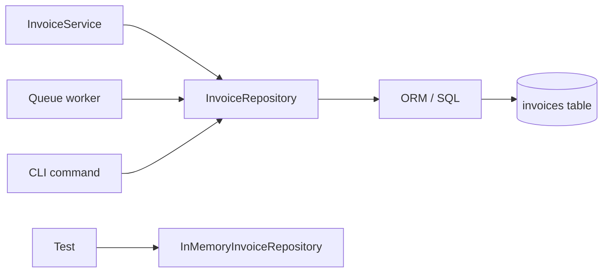
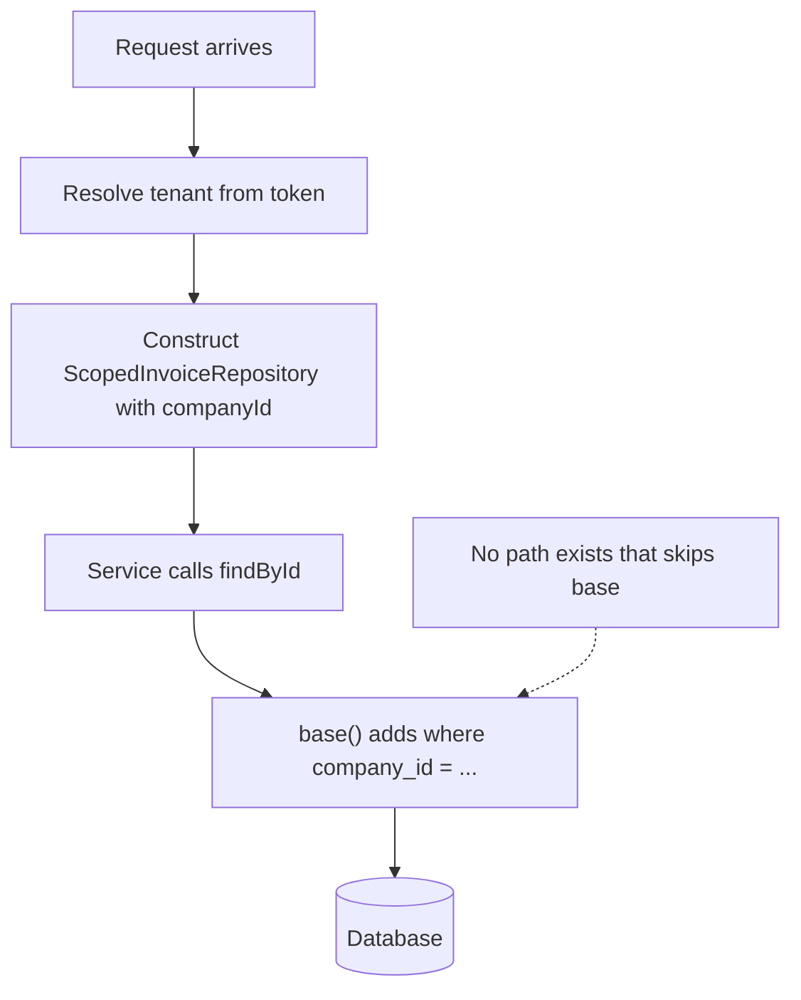

# The Repository Layer — Part 1

A warehouse has a counter. You do not walk into the racks yourself. You hand
over a slip that says what you want — "all the unshipped orders for Acme" —
and someone who knows the shelf numbers brings it back.

A repository is that counter. It is the one place that knows *how* records are
stored, so nothing else in the application has to.

Part 1 is the case for the layer: what it exposes, what it hides, how to swap
it in a test, when it is genuinely not worth it, and the one argument that
convinces even the sceptics — tenant scoping you cannot forget.

Part 2 is the craft: query options, N+1, transactions, mapping, raw SQL,
caching, and replicas.

> **📌 In one line:** a repository turns "how do I query this?" into "what do I
> want?", in one file per kind of record.

## Table of Contents

1. [The Idea in Plain Words](#the-idea-in-plain-words)
2. [What a Repository Exposes](#what-a-repository-exposes)
3. [BROKEN: the Service That Built a Query](#broken-the-service-that-built-a-query)
4. [Repository Interfaces and Two Implementations](#repository-interfaces-and-two-implementations)
5. [The Honest Counter-Argument](#the-honest-counter-argument)
6. [Mandatory Scoping as a Security Feature](#mandatory-scoping-as-a-security-feature)
7. [Common Mistakes](#common-mistakes)
8. [Questions to Test Yourself](#questions-to-test-yourself)
9. [Related](#related)

---

## The Idea in Plain Words

A repository is one object per kind of record. It has methods that read and
write that record. Nobody outside it writes SQL or touches the ORM for that
table.



The value is in that last row. The test does not use a database, because
nothing above the repository line knows a database exists.

The pattern itself — its history, its shape in other languages, and when it is
overkill — is in
[repository-pattern.md](../../software-engineering/design-patterns/repository-pattern.md).
This file assumes you have read that and asks a narrower question: **what does
it look like in a Node/TypeScript API you have to maintain?**

---

## What a Repository Exposes

The single most common mistake is building a generic query wrapper and calling
it a repository. A generic wrapper moves the code but keeps the coupling.

```ts
// ❌ BROKEN — a "repository" that is really a thin ORM alias
export class InvoiceRepository {
  find(id: string) { return InvoiceModel.find(id) }
  query() { return InvoiceModel.query() }            // the leak
  where(field: string, value: unknown) { /* ... */ }
  all(filters: Record<string, unknown>) { /* ... */ }
}
```

Every caller of `query()` now knows your column names, your join structure and
your ORM's API. You have added a file and gained nothing.

```ts
// ✅ FIXED — methods named after what the business wants
export interface InvoiceRepository {
  findByIdForCompany(id: string, companyId: string): Promise<Invoice | null>
  findOverdueForCompany(companyId: string, asOf: DateTime): Promise<Invoice[]>
  countOpenForCompany(companyId: string): Promise<number>
  markAsPaid(id: string, paidAt: DateTime, tx?: Tx): Promise<Invoice>
  save(invoice: Invoice, tx?: Tx): Promise<Invoice>
}
```

| Generic method | Intention-revealing method | What the second buys you |
|---|---|---|
| `query()` | `findOverdueForCompany()` | "Overdue" is defined once, not in nine callers |
| `all({ status: 'sent' })` | `findSentForCompany()` | Callers stop knowing the column is `status` |
| `update(id, { status: 'paid', paidAt })` | `markAsPaid(id, at)` | Impossible to set `paid` and forget `paidAt` |
| `find(id)` | `findByIdForCompany(id, companyId)` | Cross-tenant reads become impossible |
| `raw(sql)` | `monthlyRevenueReport(companyId, month)` | The SQL is reviewable in one place |

> **💡 Tip:** a good test for a method name — can a product manager guess what
> it returns? `findOverdueForCompany` passes. `all(filters)` does not.

The third row is worth pausing on. `markAsPaid` cannot produce a row that is
`paid` with a null `paidAt`, because the method controls both fields. A
generic `update` can, and eventually will.

---

## BROKEN: the Service That Built a Query

Here is the realistic version of the leak. The repository exists, but the
service reaches past it because the method it wanted was not there.

```ts
// ❌ BROKEN — business logic and query construction tangled together
export class DunningService {
  async findInvoicesToChase(companyId: string) {
    return InvoiceModel.query()
      .where('company_id', companyId)
      .whereIn('status', ['sent', 'partially_paid'])
      .where('due_at', '<', DateTime.now().minus({ days: 7 }).toSQL())
      .whereNull('dispute_opened_at')
      .whereHas('customer', (q) => q.where('dunning_enabled', true))
      .preload('customer')
      .orderBy('due_at', 'asc')
      .limit(200)
  }
}
```

Count what has gone wrong:

1. **The service knows six column names.** A migration renaming `due_at`
   breaks a business class.
2. **`DateTime.now()` is inside the service**, so the test cannot fix the date.
3. **The rule "chased after 7 days, unless disputed" is expressed as a query**,
   so you can only test it against a real database.
4. **The same query is about to be copy-pasted** into the nightly job and the
   admin export, with one of the three copies missing `whereNull`.
5. **`.preload('customer')` is an ORM concept** sitting in the application
   layer — the dependency rule from
   [01-layered-architecture.md](01-layered-architecture.md) is broken.

```ts
// ✅ FIXED — the query moves behind one named method
export class LucidInvoiceRepository implements InvoiceRepository {
  async findChaseable(
    companyId: string,
    olderThan: DateTime,
    opts: { limit?: number; withCustomer?: boolean } = {},
  ): Promise<Invoice[]> {
    const q = InvoiceModel.query()
      .where('company_id', companyId)
      .whereIn('status', ['sent', 'partially_paid'])
      .where('due_at', '<', olderThan.toSQL())
      .whereNull('dispute_opened_at')
      .whereHas('customer', (c) => c.where('dunning_enabled', true))
      .orderBy('due_at', 'asc')
      .limit(opts.limit ?? 200)

    if (opts.withCustomer) q.preload('customer')
    return (await q).map(toInvoice)
  }
}
```

```ts
// ✅ FIXED — the service now reads like the business rule it is
export class DunningService {
  async findInvoicesToChase(companyId: string): Promise<Invoice[]> {
    const cutoff = this.clock.now().minus({ days: GRACE_DAYS })
    return this.invoices.findChaseable(companyId, cutoff, { withCustomer: true })
  }
}
```

Three lines. The grace period is a named constant you can read. The date comes
from an injected clock, so the test controls it. The word "sent" appears once
in the codebase.

---

## Repository Interfaces and Two Implementations

The interface is what makes the layer worth having. Define the contract once,
then provide a real implementation and a fake one.

```ts
// app/invoices/invoice_repository.ts — the contract, no ORM import
export interface InvoiceRepository {
  findByIdForCompany(id: string, companyId: string): Promise<Invoice | null>
  findChaseable(companyId: string, olderThan: DateTime, opts?: ChaseOpts): Promise<Invoice[]>
  countOpenForCompany(companyId: string): Promise<number>
  save(invoice: Invoice, tx?: Tx): Promise<Invoice>
}
```

```ts
// Real implementation — the only file in the app that mentions Lucid
export class LucidInvoiceRepository implements InvoiceRepository {
  async findByIdForCompany(id: string, companyId: string) {
    const row = await InvoiceModel.query()
      .where('id', id).where('company_id', companyId).first()
    return row ? toInvoice(row) : null
  }

  async countOpenForCompany(companyId: string) {
    const rows = await InvoiceModel.query()
      .where('company_id', companyId)
      .whereIn('status', ['draft', 'sent'])
      .count('* as total')
    return Number(rows[0].$extras.total)
  }
}
```

```ts
// In-memory implementation — no database, ~20 lines, used by every unit test
export class InMemoryInvoiceRepository implements InvoiceRepository {
  constructor(private rows: Invoice[] = []) {}

  async findByIdForCompany(id: string, companyId: string) {
    return this.rows.find((i) => i.id === id && i.companyId === companyId) ?? null
  }

  async countOpenForCompany(companyId: string) {
    return this.rows.filter(
      (i) => i.companyId === companyId && ['draft', 'sent'].includes(i.status),
    ).length
  }

  async save(invoice: Invoice) {
    const i = this.rows.findIndex((r) => r.id === invoice.id)
    i >= 0 ? (this.rows[i] = invoice) : this.rows.push(invoice)
    return invoice
  }
}
```

Structural typing does the work here: any object with the right method shapes
satisfies the interface, no inheritance required. That is why the fake is
short. See
[interfaces.md](../../typescript-fundamentals/interfaces/interfaces.md).

> **⚠️ Warning:** an in-memory fake that drifts from the real one is worse than
> no fake, because tests pass against behaviour that does not exist. Keep the
> fake trivially simple, and cover each real implementation with a small set of
> integration tests against a real database.

---

## The Honest Counter-Argument

Plenty of experienced engineers will tell you a repository over a good ORM is a
pointless extra layer. They are sometimes right, and pretending otherwise
produces cargo-culted folders full of one-line methods.

**The case against:** a modern ORM *is already* a repository. `InvoiceModel`
gives you `find`, `query`, relations and scopes. Wrapping it means writing a
method every time you need a new query, hand-maintaining an interface, and
losing the ORM's ergonomics — lazy relations, partial selects, query scopes —
behind your own smaller API. You will also be tempted to add `findAll(filters)`
to stop the friction, at which point you have an ORM with extra steps.

**The case for:** the ORM's API is not a *contract*. It is a library surface
that changes when you upgrade, that cannot be faked cheaply, and that lets any
caller build any query, including one that forgets the tenant filter.

| Your situation | Repository earns its place | It is ceremony |
|---|---|---|
| Multi-tenant data | Yes — forced scoping is worth the whole layer | — |
| Single-tenant internal tool | — | Yes, use the ORM |
| Many unit tests of business rules | Yes — the fake makes them fast | — |
| Mostly integration tests anyway | — | Yes |
| The same complex query in 3+ places | Yes — one definition | — |
| Each query used exactly once | — | Yes |
| Domain objects separate from ORM models | Yes — the repository is the mapper | — |
| ORM model *is* the domain model | Mostly ceremony | Often yes |
| Plan to swap the database one day | Rarely a real reason | Usually yes |
| Raw SQL appearing in feature code | Yes — contain it | — |
| Prototype, 3 endpoints, 1 table | — | Yes |

**A middle path that works well:** put a repository in front of the two or
three aggregates that carry real rules and real tenancy, and let the boring
lookup tables use the ORM directly. Consistency matters, but consistency
*within a bounded area* is enough. A `Country` list does not need an interface
and a fake.

> **📌 Remember:** "we might swap PostgreSQL for MongoDB" is the weakest
> argument for a repository, and it is the one most often given. Almost nobody
> swaps. Testing and forced scoping are the arguments that hold up.

---

## Mandatory Scoping as a Security Feature

This is the strongest practical reason for the layer, and it has nothing to do
with purity.

In a multi-tenant application, every query against tenant data must filter by
tenant. Every single one. One missed `where('company_id', ...)` is a data
breach, and it looks exactly like normal code in review.

```ts
// ❌ BROKEN — one forgotten filter, in the one place nobody looks
const invoice = await InvoiceModel.find(params.id)          // any tenant's row
return response.json(invoice)
```

That is a real vulnerability class — OWASP calls it Broken Object Level
Authorization, and it is the most common serious API bug there is. The fix is
not "remember the filter". Humans forget. The fix is **making the unscoped
query unreachable.**

```ts
// ✅ FIXED — the repository is constructed with the tenant, and cannot escape it
export class ScopedInvoiceRepository implements InvoiceRepository {
  constructor(
    private readonly companyId: string,     // set once, per request
    private readonly db: Database,
  ) {}

  private base() {
    return InvoiceModel.query().where('company_id', this.companyId)
  }

  async findById(id: string) {
    const row = await this.base().where('id', id).first()
    return row ? toInvoice(row) : null
  }

  async findOverdue(asOf: DateTime) {
    return (await this.base().where('due_at', '<', asOf.toSQL())).map(toInvoice)
  }
}
```

Every method goes through `base()`. There is no public method that returns an
unscoped query, so there is no way for a new developer — or a rushed version of
you — to write the unscoped one.



Three practical notes:

- **The repository must be request-scoped**, not a singleton, because the
  tenant differs per request. That lifetime question is exactly the one in
  [05-dependency-injection-in-practice-part-2.md](05-dependency-injection-in-practice.md).
- **Admin and support tooling needs an escape hatch.** Make it a *separate
  class* — `CrossTenantInvoiceRepository` — that is obvious in a diff and easy
  to grep for, not an optional `skipScope: true` flag.
- **Belt and braces:** PostgreSQL row-level security enforces the same rule at
  the database, so a raw query in a migration script cannot bypass it either.

The authorization model behind all of this — ownership, tenancy, and
attribute-based rules — is in
[03-ownership-abac-and-multi-tenancy.md](../06-authorization/03-ownership-abac-and-multi-tenancy-part-1.md).

---

## Common Mistakes

| Mistake | Why it is wrong | Do this instead |
|---|---|---|
| A repository that exposes `query()` | Every caller is coupled to the ORM again | Name methods after intent |
| `findAll(filters: Record<string, unknown>)` | Callers still know the column names | A typed options object (Part 2) |
| Business rules inside repository methods | Rules become untestable without a database | Repository answers "what is stored" only |
| `DateTime.now()` inside the query | The test cannot fix the date | Pass the cutoff in as a parameter |
| No interface, only a concrete class | No fake, so no fast unit test | Define the interface; two implementations |
| An in-memory fake that drifts | Green tests for behaviour that does not exist | Keep it simple; integration-test the real one |
| Optional `skipTenantScope` flag | It will be passed `true` in a hurry | A separate, greppable cross-tenant class |
| A scoped repository registered as a singleton | Request A serves request B's tenant | Register it request-scoped |
| A repository per table, mechanically | Six files for six lookup tables | One per aggregate that has rules |
| Adding the layer "because clean architecture" | Ceremony nobody can justify | Add it for tests, scoping, or duplication |

---

## Questions to Test Yourself

1. Why is `markAsPaid(id, at)` safer than `update(id, { status: 'paid' })`?
   Give the exact bad row the second one allows.
2. A service contains `.whereIn('status', ['sent', 'partially_paid'])`. Name
   three distinct problems this causes.
3. Write the smallest in-memory implementation of a two-method repository
   interface, from memory.
4. Give the strongest argument *against* adding a repository to your current
   project, and then say what would change your mind.
5. Why is "we might change database" a weak reason, and what are the two
   strong ones?
6. Explain to a new teammate why the tenant filter belongs in the repository
   rather than in every service method.
7. Your admin dashboard must read across all tenants. Design the escape hatch
   so it cannot be used by accident.
8. Why must a tenant-scoped repository be request-scoped rather than a
   singleton? Describe the bug if you get it wrong.

---

> **➡️ Continued in [Part 2](03-repository-layer-part-2.md)** — typed query
> options, N+1 at the boundary, transactions and unit of work, mapping rows to
> domain objects, raw SQL, caching, and read replicas.

## Related

- [Part 2](03-repository-layer-part-2.md) — the day-to-day craft of writing
  repository methods.
- [repository-pattern.md](../../software-engineering/design-patterns/repository-pattern.md)
  — the pattern definition, in language-neutral terms.
- [01-layered-architecture.md](01-layered-architecture.md) — where the data
  access layer sits and the dependency rule it obeys.
- [02-service-layer-part-1.md](02-service-layer-part-1.md) — the caller that
  these methods exist to serve.
- [interfaces.md](../../typescript-fundamentals/interfaces/interfaces.md) —
  structural typing, which is why a 20-line fake satisfies the contract.
- [03-ownership-abac-and-multi-tenancy.md](../06-authorization/03-ownership-abac-and-multi-tenancy-part-1.md)
  — the authorization model behind mandatory scoping.
- [01-owasp-top-10-for-apis.md](../11-api-security/01-owasp-top-10-for-apis.md)
  — Broken Object Level Authorization, the bug forced scoping prevents.
- [01-orm-vs-query-builder.md](../10-database-integration/01-orm-vs-query-builder.md)
  — what sits directly underneath this layer.
- [05-dependency-injection-in-practice-part-2.md](05-dependency-injection-in-practice.md)
  — request-scoped lifetimes, which tenant scoping depends on.
