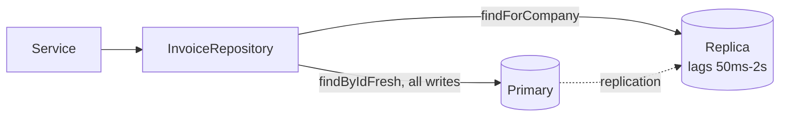

# The Repository Layer — Part 2

Part 1 argued for the layer. This part is the craft: the six problems that
show up once you actually have repositories and start filling them in.

Every one of them is about the same tension. A repository hides the database —
but the database has real behaviour (joins, transactions, caches, replicas)
that the application sometimes has to influence. The skill is exposing that
behaviour as *intent*, not as ORM objects.

> **⬅️ This continues [Part 1](03-repository-layer-part-1.md).**

> **📌 In one line:** let callers say *what* they need — which page, which
> relations, which transaction — without letting them say *how* to fetch it.

## Table of Contents

1. [Query Composition: a Typed Options Object](#query-composition-a-typed-options-object)
2. [Avoiding N+1 at the Boundary](#avoiding-n1-at-the-boundary)
3. [Transactions Crossing Repositories](#transactions-crossing-repositories)
4. [Unit of Work, Briefly](#unit-of-work-briefly)
5. [Mapping Rows to Domain Objects](#mapping-rows-to-domain-objects)
6. [Where Raw SQL Belongs](#where-raw-sql-belongs)
7. [Advanced: Caching Inside vs Outside](#advanced-caching-inside-vs-outside)
8. [Advanced: Read-Replica Routing](#advanced-read-replica-routing)
9. [Common Mistakes](#common-mistakes)
10. [Questions to Test Yourself](#questions-to-test-yourself)
11. [Related](#related)

---

## Query Composition: a Typed Options Object

Lists need filtering, sorting and pagination. The temptation is to accept a
string and build SQL from it. Do not.

```ts
// ❌ BROKEN — string building, and an injection hole in the sort
async list(companyId: string, filter: string, sort: string) {
  return db.rawQuery(
    `SELECT * FROM invoices WHERE company_id = '${companyId}' AND ${filter}
     ORDER BY ${sort}`
  )
}
```

Two problems, one fatal. `filter` is concatenated straight into SQL
([02-injection-attacks.md](../11-api-security/02-injection-attacks-part-1.md)), and
even a parameterised version cannot parameterise a column name in `ORDER BY` —
so the sort field must come from a fixed allow-list, always.

```ts
// ✅ FIXED — a closed, typed vocabulary of what may be asked for
export type InvoiceSortField = 'due_at' | 'issued_at' | 'total_cents'

export type InvoiceQuery = {
  status?: InvoiceStatus[]
  customerId?: string
  issuedBetween?: { from: DateTime; to: DateTime }
  search?: string
  sort?: { field: InvoiceSortField; direction: 'asc' | 'desc' }
  page: { cursor?: string; limit: number }
}

async findForCompany(companyId: string, q: InvoiceQuery): Promise<Page<Invoice>> {
  const builder = InvoiceModel.query().where('company_id', companyId)

  if (q.status?.length) builder.whereIn('status', q.status)
  if (q.customerId) builder.where('customer_id', q.customerId)
  if (q.issuedBetween) {
    builder.whereBetween('issued_at', [q.issuedBetween.from.toSQL(), q.issuedBetween.to.toSQL()])
  }
  if (q.search) builder.whereILike('number', `%${q.search}%`)   // bound, not concatenated

  const { field, direction } = q.sort ?? { field: 'issued_at', direction: 'desc' }
  builder.orderBy(field, direction).orderBy('id', direction)    // stable tiebreak

  return paginateByCursor(builder, q.page)
}
```

Why the union type is the whole trick: `InvoiceSortField` is a closed set, so
an attacker cannot sort by `password_hash`, and TypeScript rejects a typo at
compile time. The controller's job is to parse the incoming query string into
this object and reject anything else — it never passes raw user input through.

| Decision | Recommendation |
|---|---|
| Sort field | Closed union type, never a free string |
| Sort direction | `'asc' \| 'desc'`, never interpolated |
| Page size | Clamp in the repository too, not only in the controller |
| Deep pages | Cursor (keyset), not `OFFSET 50000` |
| Default sort | Always set one, plus a unique tiebreak column |

Cursor pagination and why `OFFSET` degrades:
[03-pagination-filtering-sorting.md](../02-rest-api-design/03-pagination-filtering-sorting.md)
and
[pagination-performance.md](../../databases/query-optimization/pagination-performance.md).

---

## Avoiding N+1 at the Boundary

The N+1 problem is when one query for a list is followed by one extra query
per row. Fifty invoices, fifty-one queries.

```ts
// ❌ BROKEN — the loop is in the service, so the queries are invisible here
const invoices = await this.invoices.findForCompany(companyId, q)
for (const invoice of invoices) {
  invoice.customer = await this.customers.findById(invoice.customerId)  // N queries
}
```

The repository boundary is the right place to fix this, because it is the only
layer allowed to know how to join. Three tools, in order of preference:

**1. An explicit eager-loading option.** The caller states intent; the
repository decides the mechanism.

```ts
export type InvoiceIncludes = { customer?: boolean; lines?: boolean }

async findForCompany(companyId: string, q: InvoiceQuery, include: InvoiceIncludes = {}) {
  const builder = InvoiceModel.query().where('company_id', companyId)
  if (include.customer) builder.preload('customer')
  if (include.lines) builder.preload('lines')
  // ...
}
```

**2. A batch `findByIds`.** When the relation is fetched separately, fetch it
once for the whole set.

```ts
const invoices = await this.invoices.findForCompany(companyId, q)
const customers = await this.customers.findByIds(unique(invoices.map(i => i.customerId)))
const byId = new Map(customers.map(c => [c.id, c]))    // 2 queries, not 51
```

**3. A data loader.** A small object that collects every `load(id)` call made
during one tick, then issues a single `findByIds`. It keeps call sites simple
while staying batched — the usual answer in GraphQL, and useful anywhere a
resolver-shaped call graph makes explicit batching awkward.

```ts
const customerLoader = new DataLoader((ids: string[]) => customers.findByIds(ids))
// 50 independent .load() calls → one findByIds
```

| Approach | Caller writes | Queries | Best for |
|---|---|---|---|
| Eager-load option | `{ customer: true }` | 1–2 | Known, fixed shapes |
| `findByIds` batch | Two lines and a Map | 2 | Joins you deliberately avoid in SQL |
| Data loader | `.load(id)` anywhere | 2 | Dynamic or nested shapes, GraphQL |

> **⚠️ Warning:** eager-loading *everything* by default trades N+1 for a
> different bug — a list endpoint that fetches four relations nobody rendered.
> Make loading explicit and let each caller ask.

Diagnosis and the SQL detail:
[n-plus-one-queries.md](../../databases/query-optimization/n-plus-one-queries.md).

---

## Transactions Crossing Repositories

One business operation usually writes through more than one repository: the
invoice, the audit row, the outbox row. They must commit together.

The repository does not own the boundary — the service does
([02-service-layer-part-2.md](02-service-layer-part-2.md)). The repository's
job is only to **accept** a transaction handle and use it if given one.

```ts
// ✅ Every write method takes an optional transaction handle
export interface InvoiceRepository {
  save(invoice: Invoice, tx?: Tx): Promise<Invoice>
  markAsPaid(id: string, paidAt: DateTime, tx?: Tx): Promise<Invoice>
}

export class LucidInvoiceRepository implements InvoiceRepository {
  async markAsPaid(id: string, paidAt: DateTime, tx?: Tx) {
    const row = await InvoiceModel.query({ client: tx })      // join it if present
      .where('id', id).firstOrFail()
    row.merge({ status: 'paid', paidAt }).useTransaction(tx)
    await row.save()
    return toInvoice(row)
  }
}
```

```ts
// The service owns the boundary and hands the same handle to everyone
await this.uow.run(async (tx) => {
  await this.invoices.markAsPaid(invoice.id, now, tx)
  await this.payments.record({ invoiceId: invoice.id, amountCents }, tx)
  await this.audit.record({ action: 'invoice.paid' }, tx)
})
```

> **📌 Remember:** a repository that opens its own transaction cannot be
> composed with any other repository. Accept a handle; never create one.

What the transaction actually guarantees, and what isolation level you get:
[01-transactions-and-acid-part-1.md](../../databases/transactions-and-concurrency/01-transactions-and-acid-part-1.md)
and
[02-isolation-levels-and-anomalies-part-1.md](../../databases/transactions-and-concurrency/02-isolation-levels-and-anomalies-part-1.md).

---

## Unit of Work, Briefly

**Unit of Work** is the name for the object that owns the transaction and hands
the handle around, so services never touch `db.transaction` directly.

```ts
export class UnitOfWork {
  constructor(private db: Database) {}
  async run<T>(fn: (tx: Tx) => Promise<T>, existing?: Tx): Promise<T> {
    return existing ? fn(existing) : this.db.transaction(fn)
  }
}
```

That ten-line version — "run this work in a transaction, joining one if I am
already inside it" — covers most Node applications. The fuller classical
pattern also *tracks changed objects* and flushes them at commit, which is
what Hibernate and Entity Framework do. Active-record ORMs like Lucid and
TypeORM save eagerly, so that half is usually not worth rebuilding by hand.

| You need | Use |
|---|---|
| Several repositories committing together | The small `UnitOfWork.run` above |
| A nested service that may already be in a transaction | Same, with `existing` |
| Change tracking and a single flush | Your ORM's identity map, if it has one |
| Retry on serialization failure | A wrapper around `run` that retries all of `fn` |

The last row matters under `SERIALIZABLE` or with optimistic locking: the
retry must re-run the *whole* closure, because the reads inside it are stale
too. See
[06-optimistic-vs-pessimistic-locking-part-1.md](../../databases/transactions-and-concurrency/06-optimistic-vs-pessimistic-locking-part-1.md).

---

## Mapping Rows to Domain Objects

Should `findById` return an ORM model, or a plain `Invoice` object you mapped
by hand? Here is the pragmatic answer rather than the ideological one.

```ts
// The mapper, when you want one — one function, one direction each way
export function toInvoice(row: InvoiceModel): Invoice {
  return new Invoice({
    id: row.id,
    companyId: row.companyId,
    status: row.status,
    totalCents: row.totalCents,
    dueAt: row.dueAt,
    lines: row.lines?.map(toInvoiceLine) ?? [],
  })
}
```

| | Return the ORM model | Map to a domain object |
|---|---|---|
| Lines of code | Zero extra | A mapper per entity, both directions |
| Lazy loading surprises | Possible anywhere in the app | Impossible — data is already loaded |
| Domain rules testable without a DB | Only if the model stays plain | Yes |
| Accidental `invoice.save()` in a controller | Possible | Impossible |
| Schema rename ripples | Everywhere the field is read | One mapper |
| Good for | CRUD apps, small teams, tight deadlines | Real invariants, long-lived domains |

**Recommendation:** do not map on day one. Map when one of these becomes true:

- Your domain object needs methods and invariants that the ORM model's
  lifecycle hooks keep fighting.
- Lazy loading has caused a production surprise (a serializer triggering
  queries, a relation accessed after the connection closed).
- The database shape and the domain shape have genuinely diverged — one
  concept spread over three tables, or a column that means two things.

Until then, an ORM model with no business logic in it is a perfectly good
domain object, and the mapper is a tax. The counter-view, and what a "real"
entity looks like, is in
[clean-architecture.md](../../software-engineering/architecture/clean-architecture.md).

---

## Where Raw SQL Belongs

Raw SQL is not a failure. Reports, window functions, recursive CTEs and bulk
upserts are all clearer and faster in SQL than in any ORM. The rule is about
*location* and *binding*, not avoidance.

**Location:** inside a repository method, never in a service or controller. It
is then reviewable, greppable and testable in one place.

```ts
// ❌ BROKEN — concatenation, in a service
const rows = await db.rawQuery(
  `SELECT * FROM invoices WHERE company_id = '${companyId}'
   AND number LIKE '%${search}%'`
)
```

```ts
// ✅ FIXED — bound parameters, inside the repository, named after the report
async monthlyRevenue(companyId: string, year: number): Promise<RevenueRow[]> {
  const { rows } = await this.db.rawQuery(
    `SELECT date_trunc('month', paid_at) AS month,
            SUM(total_cents)::bigint     AS revenue_cents
       FROM invoices
      WHERE company_id = :companyId
        AND status = 'paid'
        AND paid_at >= make_date(:year, 1, 1)
        AND paid_at <  make_date(:year + 1, 1, 1)
      GROUP BY 1 ORDER BY 1`,
    { companyId, year },
  )
  return rows.map(toRevenueRow)
}
```

Four rules that keep raw SQL safe:

1. **Every value is a bound parameter.** No template literals with user data.
2. **Identifiers — table, column, sort direction — come from an allow-list**,
   because they cannot be bound.
3. **The tenant filter is present in every raw query too.** Row-level security
   is a good second net here.
4. **Map the result explicitly.** `SELECT *` in a raw query is how a new column
   leaks into an API response
   ([04-dtos-and-serialization-part-1.md](04-dtos-and-serialization-part-1.md)).

Full treatment of injection, including second-order cases:
[02-injection-attacks.md](../11-api-security/02-injection-attacks-part-1.md).

---

## Advanced: Caching Inside vs Outside

You can put the cache inside the repository method, or around the repository
at the service level. The choice decides who is responsible for invalidation.

```ts
// Inside the repository — callers get caching for free and cannot forget it
async findById(id: string): Promise<Invoice | null> {
  const key = `invoice:${this.companyId}:${id}`
  const hit = await this.cache.get<Invoice>(key)
  if (hit) return hit

  const row = await this.base().where('id', id).first()
  const invoice = row ? toInvoice(row) : null
  if (invoice) await this.cache.set(key, invoice, { ttl: '5m' })
  return invoice
}

async save(invoice: Invoice, tx?: Tx) {
  const saved = await this.persist(invoice, tx)
  await this.cache.delete(`invoice:${this.companyId}:${invoice.id}`)
  return saved
}
```

| | Cache inside the repository | Cache outside (service or HTTP) |
|---|---|---|
| Callers must remember | Nothing | To use the cached path |
| Invalidation on write | Automatic — writes go through here | Manual and easy to miss |
| Can cache a composed result | No — only per method | Yes, a whole response |
| Hides real query cost | Yes, dangerously | No |
| Testing | The fake skips the cache entirely | Explicit in the test |

**The invalidation trap.** Caching a read is easy; knowing when it is stale is
not. Three failure modes to plan for before you add a single `cache.get`:

- **A write that does not go through the repository.** A migration, a bulk
  `UPDATE`, an admin tool, or a second service writing the same table. The
  cache never hears about it and serves stale data until the TTL expires.
- **A write that invalidates the wrong keys.** `save()` clears
  `invoice:{id}`, but the list query cached under `invoices:company:{id}:open`
  is now wrong too. Key-by-entity caches and query caches need different
  invalidation, and the second is much harder.
- **Caching inside a transaction.** If you populate the cache mid-transaction
  and the transaction rolls back, the cache holds a value that was never
  committed. Read through the cache freely; only *write* to it after commit.

**Default advice:** keep the cache out of the repository until a measured hot
path justifies it, then put it inside with a short TTL and accept staleness
rather than building elaborate invalidation. Strategies, TTLs and stampede
protection: [caching-strategies.md](../../system-design/foundational/caching-strategies.md).

---

## Advanced: Read-Replica Routing

Replicas absorb read traffic, but they lag — a read right after a write can
return the old row. The repository is a good place to make that choice
explicit, because it is the only layer that knows which connection to use.



```ts
export class LucidInvoiceRepository implements InvoiceRepository {
  constructor(private primary: Database, private replica: Database) {}

  // reports and lists tolerate a second of lag
  async findForCompany(companyId: string, q: InvoiceQuery) {
    return this.run(this.replica, companyId, q)
  }

  // read-your-writes: this one must see the row we just committed
  async findByIdFresh(id: string): Promise<Invoice | null> {
    const row = await InvoiceModel.query({ client: this.primary })
      .where('id', id).first()
    return row ? toInvoice(row) : null
  }
}
```

| Read | Route to | Why |
|---|---|---|
| List, search, report, export | Replica | Seconds of staleness are invisible |
| Reload right after a write | Primary | Read-your-writes must hold |
| Inside a transaction | Primary, always | A replica cannot see uncommitted rows |
| A rule check before a write | Primary | Deciding on stale data corrupts state |

Two naming habits that prevent accidents: put the freshness in the method name
(`findByIdFresh`), and route *by method*, not by a boolean the caller passes.
A `{ fresh: true }` flag gets forgotten exactly where it matters.

Lag, monitoring and the failure modes:
[04-read-replicas-and-replication-lag.md](../../databases/operations/04-read-replicas-and-replication-lag.md).

---

## Common Mistakes

| Mistake | Why it is wrong | Do this instead |
|---|---|---|
| Interpolating a sort field into SQL | Injection, and it cannot be bound | Closed union type, allow-list |
| Accepting `filters` as a free-form object | The vocabulary is unbounded | A typed query options object |
| `OFFSET` for deep pages | Gets slower the further you go | Cursor / keyset pagination |
| A `for` loop with `await` over a list | N+1 queries | Eager-load option or `findByIds` |
| Eager-loading everything by default | Fetches relations nobody rendered | Explicit includes per caller |
| A repository opening its own transaction | Cannot be composed with another repository | Accept an optional `tx` |
| Retrying only the failed statement | Its reads are stale too | Retry the whole unit-of-work closure |
| Mapping every entity from day one | A mapper tax before any benefit | Map when lazy loading or divergence bites |
| Raw SQL in a service or controller | Unreviewable, and usually unbound | Raw SQL inside a named repository method |
| `SELECT *` in a raw query | A new column leaks into the API | Select and map explicit columns |
| Caching inside a transaction | A rollback leaves an uncommitted value cached | Cache after commit |
| A `{ fresh: true }` replica flag | Forgotten exactly where it matters | Route by method name |

---

## Questions to Test Yourself

1. Why can a sort column not be a bound parameter, and what must you do
   instead?
2. Your list endpoint runs 51 queries. Give three fixes and rank them for a
   REST API with fixed response shapes.
3. Why does the *service* own the transaction while the *repository* only
   accepts a handle?
4. A serialization failure retry re-runs one `UPDATE` and still produces a
   wrong total. Explain why.
5. Argue both sides of mapping ORM rows to domain objects, then give the
   specific event that would make you start.
6. Where does raw SQL belong, and what are the two things you can never bind?
7. Name the three invalidation failures of repository-level caching, and say
   which is hardest to detect.
8. Which reads must go to the primary, and why is "inside a transaction" on
   that list?

---

## Related

- [Part 1](03-repository-layer-part-1.md) — what a repository is for,
  interfaces and fakes, and mandatory tenant scoping.
- [02-service-layer-part-2.md](02-service-layer-part-2.md) — the service that
  owns the transaction boundary these methods join.
- [n-plus-one-queries.md](../../databases/query-optimization/n-plus-one-queries.md)
  — diagnosing and fixing N+1 at the SQL level.
- [03-pagination-filtering-sorting.md](../02-rest-api-design/03-pagination-filtering-sorting.md)
  — the API contract the query options object serves.
- [06-optimistic-vs-pessimistic-locking-part-1.md](../../databases/transactions-and-concurrency/06-optimistic-vs-pessimistic-locking-part-1.md)
  — why a retry must re-run the whole closure.
- [02-injection-attacks.md](../11-api-security/02-injection-attacks-part-1.md) —
  binding values and allow-listing identifiers.
- [caching-strategies.md](../../system-design/foundational/caching-strategies.md)
  — TTLs, stampedes and invalidation strategies.
- [04-read-replicas-and-replication-lag.md](../../databases/operations/04-read-replicas-and-replication-lag.md)
  — how far behind a replica really is.
