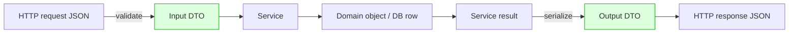

# DTOs and Serialization — Part 1

You would not hand a customer the whole filing cabinet because they asked for
one invoice. You take out the invoice, check nothing private is stapled to the
back, and hand over that.

`res.json(user)` hands over the filing cabinet.

Part 1 is the problem and the core fix: what leaks, why your database row must
never be your API response, and the three ways to build a deliberate output
shape. Part 2 is the conventions and the hard cases — money, ids, dates,
versioning, per-role visibility, and `PATCH` with `null`.

> **📌 In one line:** decide field by field what leaves your API, and make the
> default "nothing" rather than "everything".

## Table of Contents

1. [The Leak](#the-leak)
2. [What a DTO Is](#what-a-dto-is)
3. [Why the Response Must Not Be Your Row](#why-the-response-must-not-be-your-row)
4. [Three Ways to Serialize](#three-ways-to-serialize)
5. [Comparing the Three](#comparing-the-three)
6. [Allow-List Beats Deny-List](#allow-list-beats-deny-list)
7. [Input DTOs and Mass Assignment](#input-dtos-and-mass-assignment)
8. [Common Mistakes](#common-mistakes)
9. [Questions to Test Yourself](#questions-to-test-yourself)
10. [Related](#related)

---

## The Leak

Here is the single most common serious bug in REST APIs. It is one line.

```ts
// ❌ BROKEN — this is a data breach with a 200 status code
public async show({ params, response }: HttpContext) {
  const user = await User.find(params.id)
  return response.json(user)
}
```

What the client actually receives:

```json
{
  "id": 4021,
  "email": "dana@acme.test",
  "full_name": "Dana Okafor",
  "password_hash": "$2b$12$Kx9...",
  "password_reset_token": "a3f9c1e0-...",
  "password_reset_expires_at": "2026-09-20T10:14:00Z",
  "two_factor_secret": "JBSWY3DPEHPK3PXP",
  "stripe_customer_id": "cus_QX82nf",
  "internal_risk_score": 78,
  "is_shadow_banned": true,
  "company_id": 17,
  "deleted_at": null
}
```

Walk through the damage:

| Leaked field | What an attacker or customer does with it |
|---|---|
| `password_hash` | Takes it offline and cracks it at leisure |
| `password_reset_token` | Resets the account's password **right now** |
| `two_factor_secret` | Generates valid 2FA codes forever |
| `stripe_customer_id` | Probes your billing provider with a real id |
| `internal_risk_score` | Learns your fraud model; a customer sees a number about them |
| `is_shadow_banned` | Learns the moderation action you did not want them to know |

Nobody wrote a line of code to send any of that. It arrived because the
default was "send whatever the model has". Then someone ran a migration adding
`internal_risk_score`, and it silently joined the response.

> **⚠️ Warning:** an ORM's `hidden` / `serialize: false` list helps, but it is
> a deny-list. The next migration is not on it. That distinction gets its own
> section below.

---

## What a DTO Is

**DTO** stands for *Data Transfer Object*. Strip the jargon and it means:

> A type that describes exactly the data crossing a boundary, written on
> purpose, and separate from how the data is stored.

Two boundaries, two kinds:

- **Output DTO** — the shape you send out. Also called a resource,
  presenter, view model, or serializer output.
- **Input DTO** — the shape you accept in. The validated result of parsing the
  request body.



The two green boxes are the only things the outside world ever sees. Everything
between them is free to change.

---

## Why the Response Must Not Be Your Row

Returning the database row couples your public API to your schema. Every
schema decision silently becomes an API decision.

| Change you make | With `res.json(row)` | With a DTO |
|---|---|---|
| Add a column `internal_risk_score` | Appears in the API instantly | Nothing changes |
| Rename `name` → `full_name` | Every client breaks, no warning | Mapper keeps sending `name` |
| Split `address` into five columns | The response shape changes | Mapper rebuilds `address` |
| Add a soft-delete `deleted_at` | Clients see internal bookkeeping | Not exposed |
| Change `total` from float to integer cents | Silent numeric change in clients | Mapper controls the output type |
| Denormalise a column for performance | A performance fix becomes a breaking change | Invisible to clients |
| Add a join table for tags | Relation object leaks in some responses | Explicit `tags: string[]` |

Read the right-hand column again. The point is not tidiness — **it is that
your database and your API get to evolve independently.** Without a DTO, every
migration is a potential breaking change, so migrations get avoided, so the
schema rots.

There is a second, quieter benefit: the DTO file is your API documentation. A
new developer reads one 20-line function and knows exactly what the endpoint
returns. No amount of reading the model tells them that.

---

## Three Ways to Serialize

All three are allow-lists. Pick one and use it everywhere.

### 1. Hand-written mapper functions

A plain function per resource. No library, no magic.

```ts
// app/invoices/invoice_dto.ts
export type InvoiceResponse = {
  id: string
  number: string
  status: InvoiceStatus
  total_cents: number
  currency: string
  due_at: string
  customer: { id: string; name: string }
}

export function toInvoiceResponse(invoice: Invoice): InvoiceResponse {
  return {
    id: invoice.id,
    number: invoice.number,
    status: invoice.status,
    total_cents: invoice.totalCents,
    currency: invoice.currency,
    due_at: invoice.dueAt.toUTC().toISO()!,
    customer: { id: invoice.customer.id, name: invoice.customer.displayName },
  }
}

export const toInvoiceListResponse = (xs: Invoice[]) => xs.map(toInvoiceResponse)
```

The return type is declared, so TypeScript fails the build if you forget a
field or add one the type does not allow. That is most of the value.

### 2. A serializer / resource class

Useful when responses need context — the current user, an `include` list, a
role — that a pure function would have to take as extra arguments everywhere.

```ts
export class InvoiceResource {
  constructor(private invoice: Invoice, private ctx: ResourceContext) {}

  toJSON(): InvoiceResponse {
    return {
      id: this.invoice.id,
      number: this.invoice.number,
      total_cents: this.invoice.totalCents,
      due_at: this.invoice.dueAt.toUTC().toISO()!,
      ...(this.ctx.actor.isAdmin && { margin_cents: this.invoice.marginCents }),
      ...(this.ctx.includes('lines') && {
        lines: this.invoice.lines.map((l) => new InvoiceLineResource(l, this.ctx)),
      }),
    }
  }

  static collection(xs: Invoice[], ctx: ResourceContext) {
    return xs.map((x) => new InvoiceResource(x, ctx).toJSON())
  }
}
```

### 3. Schema-based output parsing

Define the output shape as a schema and *parse* the object through it. Unknown
keys are stripped by construction — you cannot forget, because the schema is
the filter.

```ts
import { z } from 'zod'

export const invoiceResponseSchema = z.object({
  id: z.string(),
  number: z.string(),
  status: z.enum(['draft', 'sent', 'paid', 'void']),
  total_cents: z.number().int(),
  due_at: z.string().datetime(),
}).strip()                       // anything not listed is removed

export type InvoiceResponse = z.infer<typeof invoiceResponseSchema>

export function toInvoiceResponse(invoice: Invoice): InvoiceResponse {
  return invoiceResponseSchema.parse({
    id: invoice.id,
    number: invoice.number,
    status: invoice.status,
    total_cents: invoice.totalCents,
    due_at: invoice.dueAt.toUTC().toISO(),
    password_hash: invoice.secretThing,   // stripped — never reaches the client
  })
}
```

The strong version of this: parse the response in a test, or in a response
middleware in non-production, so a leak fails CI rather than reaching a user.
The same schema also generates your OpenAPI document — see Part 2.

---

## Comparing the Three

| | Hand-written mapper | Resource class | Schema-based (Zod) |
|---|---|---|---|
| Extra dependency | None | None | One library |
| Compile-time safety | Yes, via the return type | Yes | Yes, via `z.infer` |
| Runtime stripping | No — relies on you | No | **Yes, guaranteed** |
| Context (role, includes) | Extra parameters | Built in | Extra parameters |
| Conditional fields | `if` / spread | Natural | Awkward, needs unions |
| Generates OpenAPI | No | No | Yes |
| Validates outgoing data | No | No | Yes (catches `undefined` bugs) |
| Reads well for a newcomer | Best | Good | Good |
| Performance | Fastest | Fast | Slower — parsing on every response |
| Best for | Most APIs | Rich, role-aware responses | Contract-first, generated clients |

**Recommendation:** start with hand-written mappers — they are the easiest to
read and the hardest to get subtly wrong. Move to schema-based output when you
publish the API to third parties or generate client types from it. Reach for
resource classes when conditional fields start crowding your mappers with
`if` statements.

Whatever you pick, **be consistent**. Three styles in one codebase means three
places a reviewer has to check for leaks.

---

## Allow-List Beats Deny-List

A deny-list says "send everything except these". An allow-list says "send only
these". They differ on exactly one thing, and it is the thing that matters.

```ts
// ❌ BROKEN — deny-list: correct today, wrong after the next migration
class User extends BaseModel {
  static hidden = ['password_hash', 'password_reset_token', 'two_factor_secret']
}
```

```sql
-- three weeks later, a perfectly reasonable migration
ALTER TABLE users ADD COLUMN internal_risk_score integer DEFAULT 0;
```

Nobody touched the controller. Nobody touched the model's `hidden` array.
`internal_risk_score` is now in every user response, and no test failed.

```ts
// ✅ FIXED — allow-list: a new column is invisible until someone adds it here
export function toUserResponse(user: User) {
  return {
    id: user.id,
    email: user.email,
    full_name: user.fullName,
    created_at: user.createdAt.toUTC().toISO(),
  }
}
```

| | Deny-list (`hidden`) | Allow-list (DTO) |
|---|---|---|
| New column appears in API | Yes, silently | No |
| Failure mode | Leak — invisible until reported | Missing field — loud and instant |
| Who must remember | Every future migration author | Whoever wants a field exposed |
| Review question | "Did they update `hidden`?" | "Is this field meant to be public?" |
| Safe default | "Expose" | "Hide" |

> **📌 Remember:** the two failure modes are not equal. A forgotten allow-list
> entry means a client reports a missing field on the first day. A forgotten
> deny-list entry means a researcher reports a leak eighteen months later.

---

## Input DTOs and Mass Assignment

The same argument runs in reverse on the way in. The classic bug:

```ts
// ❌ BROKEN — mass assignment: the client chooses which columns to write
const user = await User.create(request.body())
// body: { "email": "x@y.z", "role": "admin", "company_id": 3, "credits": 99999 }
```

The fix is an **input DTO**: a validated object containing only the fields this
operation may set.

```ts
// ✅ FIXED — validation produces a closed, typed input DTO
export const updateProfileValidator = vine.compile(
  vine.object({
    fullName: vine.string().trim().minLength(1).maxLength(120),
    timezone: vine.string().in(SUPPORTED_TIMEZONES),
  })
)

const data = await request.validateUsing(updateProfileValidator)   // only 2 fields
await this.profiles.update({ actorId: auth.user!.id, ...data })
```

Three properties do the work: the validator is an allow-list, unknown keys are
dropped rather than passed through, and the result is a *type* the service can
rely on — so `role` cannot appear even by accident.

Two notes specific to DTOs, since the validation mechanics are covered fully in
[01-why-validation-matters.md](../04-validation-and-input/01-why-validation-matters.md)
and
[02-schema-validation.md](../04-validation-and-input/02-schema-validation.md):

- **Input and output DTOs are different types.** Resist `type Invoice = ...`
  used for both. You accept `customer_id` and return a nested `customer`
  object; you accept a password and never return one.
- **One input DTO per operation, not per resource.** `CreateInvoiceInput` and
  `UpdateInvoiceInput` differ: the second has no `projectId`, because you
  cannot move an invoice between projects. A shared `InvoiceInput` with
  everything optional loses that rule.

---

## Common Mistakes

| Mistake | Why it is wrong | Do this instead |
|---|---|---|
| `response.json(model)` | Sends every current and future column | Map through an explicit DTO |
| Relying on the ORM's `hidden` list | Deny-list; the next migration is not on it | Allow-list in a mapper |
| A DTO with no declared return type | TypeScript cannot catch a missing field | Declare `InvoiceResponse` |
| One type for input and output | They genuinely differ | Two types, two names |
| `User.create(request.body())` | Mass assignment: the client picks columns | Validate into an input DTO |
| Spreading the model then deleting keys | Still a deny-list, just uglier | Build the object explicitly |
| A shared `InvoiceInput` with all fields optional | Loses per-operation rules | One input DTO per operation |
| Three serialization styles in one codebase | Three places to audit for leaks | Pick one, apply everywhere |
| Nested models serialized by default | Relations drag their own columns along | Map nested resources explicitly |

---

## Questions to Test Yourself

1. A migration adds `internal_notes` to `projects`. Trace what happens with a
   deny-list and with an allow-list.
2. Why is a missing field a better failure than a leaked field? Frame it in
   terms of who finds out and when.
3. Name three schema changes that a DTO turns from breaking into invisible.
4. When would you choose a resource class over a plain mapper function?
5. What does `.strip()` on an output schema guarantee that a hand-written
   mapper does not?
6. Write the mass-assignment attack against `User.create(request.body())`,
   including the exact JSON body.
7. Why should `CreateInvoiceInput` and `UpdateInvoiceInput` be separate types?
   Give a rule that only exists in one of them.
8. Your team has mappers in one module and `hidden` arrays in another. What do
   you do first, and why?

---

> **➡️ Continued in [Part 2](04-dtos-and-serialization-part-2.md)** — naming
> and money and date conventions, embedding vs linking, versioning response
> shapes, keeping client types in sync, serialization performance, per-role
> visibility, and `PATCH` with explicit `null`.

## Related

- [Part 2](04-dtos-and-serialization-part-2.md) — the conventions and the hard
  cases.
- [01-layered-architecture.md](01-layered-architecture.md) — step 5 of the
  refactor, where the serializer first appeared.
- [02-service-layer-part-2.md](02-service-layer-part-2.md) — why the service
  returns domain data and the DTO shapes it.
- [01-why-validation-matters.md](../04-validation-and-input/01-why-validation-matters.md)
  — the input side, in full.
- [02-schema-validation.md](../04-validation-and-input/02-schema-validation.md)
  — the schema libraries this file reuses on the output side.
- [01-owasp-top-10-for-apis.md](../11-api-security/01-owasp-top-10-for-apis.md)
  — Excessive Data Exposure and Mass Assignment, the two bugs here.
- [01-rest-principles.md](../02-rest-api-design/01-rest-principles.md) — what
  a "resource representation" means in REST.
