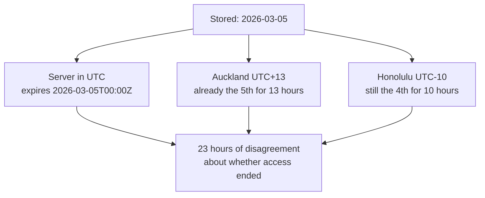
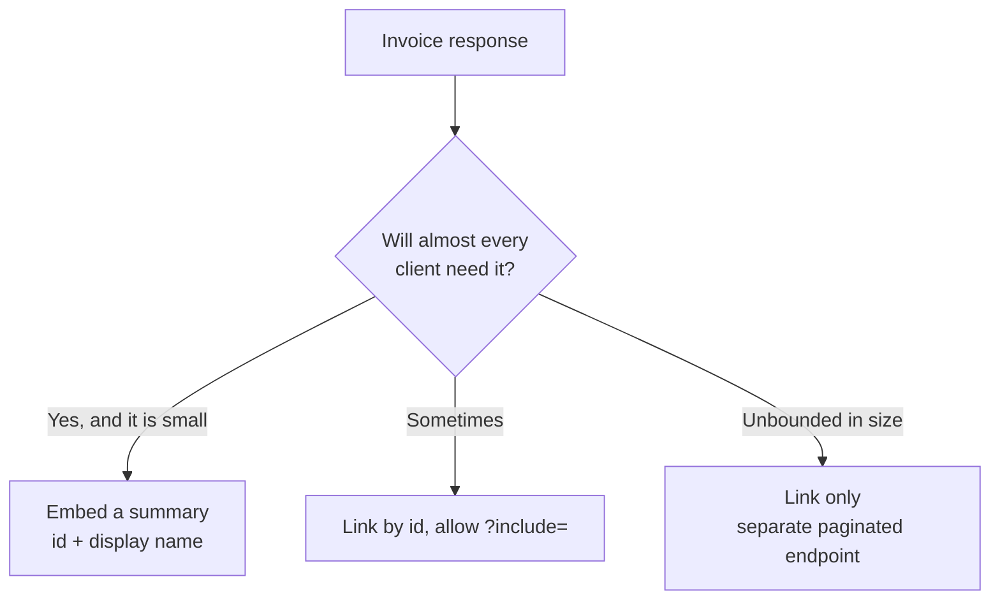

# DTOs and Serialization — Part 2

Part 1 decided *which* fields leave your API. This part decides what they look
like when they arrive.

That sounds cosmetic. It is not. A date with no timezone, a price stored as a
float, and an id that JavaScript quietly rounds are three of the most expensive
bug classes in backend work — and all three are decided in the serializer.

> **⬅️ This continues [Part 1](04-dtos-and-serialization-part-1.md).**

> **📌 In one line:** pick one convention for names, dates, money and ids, then
> let a schema enforce it — every client trusts what you send on day one and
> never checks again.

## Table of Contents

1. [Naming: Pick One Case](#naming-pick-one-case)
2. [Dates: ISO 8601, in UTC](#dates-iso-8601-in-utc)
3. [Money: Never a Float](#money-never-a-float)
4. [Ids: Send Them as Strings](#ids-send-them-as-strings)
5. [Null vs Omitted](#null-vs-omitted)
6. [Nested Resources: Embed or Link](#nested-resources-embed-or-link)
7. [Versioning a Response Shape](#versioning-a-response-shape)
8. [One Source of Truth for Client Types](#one-source-of-truth-for-client-types)
9. [Performance: What Serialization Costs](#performance-what-serialization-costs)
10. [Advanced: Computed Fields](#advanced-computed-fields)
11. [Advanced: Per-Role Field Visibility](#advanced-per-role-field-visibility)
12. [Advanced: PATCH and Explicit `null`](#advanced-patch-and-explicit-null)
13. [Common Mistakes](#common-mistakes)
14. [Questions to Test Yourself](#questions-to-test-yourself)
15. [Related](#related)

---

## Naming: Pick One Case

Two reasonable conventions exist for JSON keys: `snake_case` (`total_cents`,
matches SQL columns) and `camelCase` (`totalCents`, matches JavaScript
variables). **Neither is better.** Pick one and apply it to every response.

The real cost is mixing. A payload with `invoiceNumber` next to `total_cents`
forces every client to remember the convention *per field*, and the resulting
bug is always silent:

```ts
// ❌ BROKEN — reads a key that does not exist; no error, just undefined
const due = invoice.due_at            // the API sends `dueAt`
if (due < Date.now()) markOverdue()   // undefined < number → false, forever
```

Nothing throws. Overdue invoices stop being flagged, and someone finds out at
the end of the quarter.

**Convert at the edge, once.** Use `totalCents` internally; the mapper is the
only place that knows the wire format. Do *not* use a generic `camelize()`
response middleware — it rewrites keys inside free-form JSON columns and
third-party payloads you are passing through.

---

## Dates: ISO 8601, in UTC

Send `"created_at": "2026-04-01T09:12:03.000Z"`. Not `1775034723` (seconds or
milliseconds? half the clients are off by 1000×), not `"2026-04-01 09:12:03"`
(no zone, so the reader assumes local), never `"01/04/2026"` (1 April or 4
January, depending on the reader's country).

A date with no time and no zone is not a point in time — it is a different
instant for every reader. Take a subscription expiring `2026-03-05`:



Twenty-three hours is not a rounding error. It is a double charge, or a customer
locked out a day early.

**The rule:** anything that is a *moment* is ISO 8601 with an explicit `Z`,
computed in UTC. **The exception:** some things genuinely are calendar days — a
date of birth, a billing period. Send those as `"2026-03-05"` and name the field
so nobody mistakes it for a timestamp: `birth_date`, not `birth_at`.

```ts
const toIso = (d: DateTime) => d.toUTC().toISO()!        // 2026-04-01T09:12:03.000Z
const toDay = (d: DateTime) => d.toFormat('yyyy-MM-dd')  // 2026-03-05
```

Store UTC, transmit UTC, and let the *client* render in the user's zone.

---

## Money: Never a Float

```js
0.1 + 0.2          // 0.30000000000000004
0.1 + 0.2 === 0.3  // false
```

This is not a JavaScript bug — it is binary floating point in every language.
`0.1` cannot be written exactly in base 2, just as `1/3` cannot be written
exactly in base 10. Add ten cents ten times and you get `0.9999999999999999`:
`toFixed(2)` prints a reassuring `"1.00"`, while `=== 1` is `false` and the
nightly reconciliation job flags a mismatch on every order.
[equality-and-coercion.md](../../typescript-fundamentals/equality-and-coercion/equality-and-coercion.md)
explains why `===` is doing exactly what it promised.

Two correct wire formats: **integer minor units** (`"total_cents": 149900`) for
most SaaS billing, or a **decimal string** (`"total": "1499.00"`) for crypto and
anything needing more than two decimals.

```ts
// ❌ BROKEN
return { total: invoice.totalCents / 100 }   // 1499.0000000000002 is possible

// ✅ FIXED
return { total_cents: invoice.totalCents, currency: 'EUR' }
```

**Always send the currency** — `149900` is €1,499.00 or ¥149,900, and yen has
*zero* minor units, so "divide by 100" is wrong for it. **Never divide on the
server to make it pretty**, and **name the field for its unit**: `total_cents`
cannot be misread; `total` can, and will be.

---

## Ids: Send Them as Strings

JavaScript numbers are IEEE 754 doubles, exact for integers only up to
2^53 − 1 = `9007199254740991`. A `bigint` column goes to 9223372036854775807.

```js
// The server sent: { "id": 9007199254740993 }
const order = JSON.parse('{"id": 9007199254740993}')
order.id    // 9007199254740992  ← one less than what was sent
// GET /orders/9007199254740992  →  404 Not Found
```

`JSON.parse` silently rounded to the nearest representable double — no
exception, no warning. The record exists; the client can never fetch it again.
Worse, two different ids can round to the *same* double, so a cache keyed by id
starts serving the wrong record.

```ts
// ✅ FIXED — stringify ids at the boundary
return { id: String(order.id), customer_id: String(order.customerId) }
```

Send *every* id as a string, including small `int4` ones — it costs nothing and
lets you move to `bigint` or UUID later without a breaking change.

---

## Null vs Omitted

`null` and "key not present" are two different messages. Decide what each means
and be consistent.

| Situation | Send | Why |
|---|---|---|
| The field has no value | `"phone": null` | Client renders "not provided" confidently |
| Not requested (sparse fieldset) | Omit the key | Absence means "unknown", not "empty" |
| The caller may not see it | Omit the key | `null` is a lie, and admits the field exists |
| A list is empty | `"tags": []` | **Never** `null` for a collection |

That last row deserves its own sentence: **an empty collection is `[]`.** Every
client writes `data.tags.map(...)`, so every client breaks otherwise.

```ts
// ❌ BROKEN — `undefined` vanishes during JSON.stringify; the key disappears
return { phone: user.phone ?? undefined, tags: user.tags }

// ✅ FIXED — the client can tell "no phone" from "not told"
return { phone: user.phone ?? null, tags: user.tags?.map((t) => t.name) ?? [] }
```

---

## Nested Resources: Embed or Link



**Embed** when the data is small, bounded and needed by nearly every caller — a
customer's `id` and `name` saves every client a second request. **Link** when it
is large or rarely needed: 400 invoice lines belong at `/invoices/{id}/lines`
with pagination. An embedded `customer` is a *summary*, not the full resource —
embedding the whole thing drags its address, its billing settings and whatever
Part 1 warned about.

Sparse fieldsets (`?fields=id,total_cents`) and includes
(`?include=lines,customer`) are the controlled alternative to embedding
everything by default:

```ts
const ALLOWED_INCLUDES = ['lines', 'customer', 'project'] as const
const bad = asked.filter((i) => !ALLOWED_INCLUDES.includes(i as never))
if (bad.length) throw new UnknownIncludeError(bad)   // 400, not silence
```

**Allow-list both parameters**: an `?include=` that accepts any relation name is
a query generator handed to the internet, and a `?fields=` that accepts any
column re-opens the Part 1 leak. **Reject unknown values loudly** — ignoring
`?include=linez` ships a client feature that appears to work and returns
nothing. **Watch for N+1**: `?include=customer` on a list must batch-load
([n-plus-one-queries.md](../../databases/query-optimization/n-plus-one-queries.md)).

---

## Versioning a Response Shape

You need to rename `name` to `full_name`. Do you cut a whole `/v2`? Usually not
— that means two routers and two sets of controllers, and it is covered in
[04-api-versioning.md](../02-rest-api-design/04-api-versioning.md). Most shape
changes live entirely in the serializer.

| Change | Breaking? | Ship it without a new API version |
|---|---|---|
| Add a field | No | Add it to the mapper |
| Rename a field | Yes | Send **both** keys for a deprecation window, then drop the old |
| Remove a field | Yes | Announce, log every read, remove after the window |

```ts
// Transitional mapper — both keys, one source
return { id: String(user.id), name: user.fullName, full_name: user.fullName }
//                            ^ deprecated, removed 2026-09-01

// When two shapes are genuinely needed, version the MAPPER, not the app:
const mappers = { '2026-01-01': toUserResponseV1, '2026-06-01': toUserResponseV2 }
return response.json(pickMapper(mappers, request.header('X-Api-Version'))(user))
```

One controller, one service, one repository — only the last step differs, and
the service layer never learns that versions exist. A deprecation window only
works if you log who still reads the old field, or you are guessing on removal
day.

---

## One Source of Truth for Client Types

Part 1 left a thread loose: the output schema also generates your OpenAPI
document. The problem that solves is drift — your server sends `total_cents`,
the client's hand-written interface says `total`, and nothing fails until a user
sees `NaN`.

```ts
import { extendZodWithOpenApi } from '@asteasolutions/zod-to-openapi'
extendZodWithOpenApi(z)

export const invoiceResponseSchema = z.object({
  id: z.string().openapi({ example: 'inv_8812' }),
  total_cents: z.number().int().openapi({ description: 'Minor units of `currency`' }),
  due_at: z.string().datetime(),
}).strip().openapi('Invoice')

export type InvoiceResponse = z.infer<typeof invoiceResponseSchema>
```

That one definition feeds four things: the mapper's return type, so the build
fails if a field is missing; an OpenAPI document served at `/openapi.json`;
client types generated with `openapi-typescript`, so the *frontend's* build
breaks the moment you rename a field; and `.strip()` at runtime, so an unlisted
field cannot reach a client. Typing a `toResponse<T>` helper or a mapper
registry keyed by resource is a textbook constrained generic —
[generics.md](../../typescript-fundamentals/generics/generics.md).

---

## Performance: What Serialization Costs

`JSON.stringify` is synchronous. On Node's single main thread a large payload
blocks *every* other request for its whole duration: ~1 ms for 100 objects,
100–300 ms for 10,000 with relations, seconds for 100,000 — at which point the
process looks hung and health checks fail. Zod parsing on the way out roughly
doubles it.

**1. Do not return 10,000 records.** This is the real fix and the one people
skip. A client asking for every invoice is a paginated endpoint that was never
built.

```ts
// ❌ BROKEN — one slow endpoint that gets slower every month
return response.json((await Invoice.query().where('company_id', id)).map(toInvoiceResponse))

// ✅ FIXED — a bounded page with a ceiling the client cannot raise
const limit = Math.min(Number(request.input('limit', 50)), 200)
const page = await this.invoices.paginateForCompany(id, { limit, cursor })
return response.json({ data: page.rows.map(toInvoiceResponse), next_cursor: page.next })
```

**2. Stream genuinely large exports** — a real NDJSON export, so memory stays
flat.

```ts
response.header('Content-Type', 'application/x-ndjson')
response.stream(Readable.from(this.invoices.cursorForCompany(id))
  .map((row) => JSON.stringify(toInvoiceResponse(row)) + '\n'))
```

**3. Only then micro-optimise** — `fast-json-stringify` is a real 2–5× win and
still the last thing to try: a 10,000-record response that serializes twice as
fast is still a 10,000-record response. And note that a "download everything"
endpoint is also a data-exfiltration endpoint, so the pagination ceiling is a
security control too.

---

## Advanced: Computed Fields

A response may contain fields that exist in no table:

```ts
export function toInvoiceResponse(invoice: Invoice, now: DateTime): InvoiceResponse {
  return {
    id: String(invoice.id),
    total_cents: invoice.totalCents,
    is_overdue: invoice.status === 'sent' && invoice.dueAt < now,       // computed
    amount_outstanding_cents: invoice.totalCents - invoice.paidCents,   // computed
  }
}
```

**Compute from data already loaded** — a computed field that runs a query is an
N+1, because the mapper runs once per row. **Pass the clock in; never call
`DateTime.now()` inside the mapper**, or a snapshot test changes at midnight
(file 05 makes this concrete). **Do not compute what the client can**: a
formatted `"€1,499.00"` belongs on the client, which knows the user's locale.

---

## Advanced: Per-Role Field Visibility

An admin sees `margin_cents`; a member does not. This has exactly one correct
implementation point.

```ts
// ❌ BROKEN — sent to everyone; the frontend hides it
return response.json({ ...toInvoiceResponse(invoice), margin_cents: invoice.marginCents })
// Frontend: {user.isAdmin && <Margin value={invoice.margin_cents} />}
```

The data reached the browser. It is in the network tab, the client-side store,
any error-reporting tool capturing state, and whatever your CDN cached — hiding
it in the UI hides it from honest users only.

```ts
// ✅ FIXED — the field never leaves the server unless it is allowed to
export function toInvoiceResponse(invoice: Invoice, viewer: Viewer): InvoiceResponse {
  const base = { id: String(invoice.id), status: invoice.status,
                 total_cents: invoice.totalCents, currency: invoice.currency }
  if (!viewer.can('invoice:read_financials')) return base
  return { ...base, margin_cents: invoice.marginCents, internal_notes: invoice.internalNotes }
}
```

| Where the check lives | What an attacker gets | Verdict |
|---|---|---|
| Frontend `if` | The full field, in the JSON | Not a control at all |
| Mapper, taking a viewer | Nothing — it was never serialized | Correct |

Make `viewer` a **required** parameter: if `toInvoiceResponse(invoice)` still
compiles, someone will call it that way and get the admin shape by default.
Default to the narrow shape, so the permission check only ever *adds* fields.
And vary any cache key by role, or your own CDN serves an admin's cached
response to a member. Where `viewer.can()` comes from:
[02-rbac.md](../06-authorization/02-rbac.md).

---

## Advanced: PATCH and Explicit `null`

The hard case most APIs get wrong — "null vs omitted" applied to input. A
`PATCH` body carries three distinct intentions:

| Body | Means |
|---|---|
| `{ "phone": "+3161234567" }` | Set phone to this value |
| `{ "phone": null }` | **Clear** the phone number |
| `{ }` | Leave phone exactly as it is |

`JSON.parse` gives `null` for the second and `undefined` for the third — and
naive handlers collapse them:

```ts
// ❌ BROKEN — cannot clear a field, and quietly wipes others
user.phone = body.phone        // absent → undefined → column set to NULL
user.timezone = body.timezone  // absent → wipes the timezone too
await user.save()
```

Two bugs in three lines. Sending `{ "full_name": "Dana" }` erases the phone and
the timezone, and `null` cannot clear the phone because it behaves exactly like
an absent key.

```ts
// ✅ FIXED — the validator distinguishes absent from explicit null
export const updateProfileValidator = vine.compile(
  vine.object({
    fullName: vine.string().trim().minLength(1).optional(),
    phone: vine.string().trim().regex(E164).nullable().optional(),
    timezone: vine.string().in(SUPPORTED_TIMEZONES).optional(),
  })
)
// `.optional()` → key may be absent (undefined = leave alone)
// `.nullable()` → key may be null   (null = clear it)
```

```ts
export type UpdateProfileInput = {
  actorId: string
  fullName?: string
  phone?: string | null      // `| null` is the "clear it" signal
  timezone?: string
}

async updateProfile(input: UpdateProfileInput): Promise<User> {
  const patch: Partial<UserRow> = {}
  if ('fullName' in input) patch.full_name = input.fullName!
  if ('phone' in input) patch.phone = input.phone          // may be null → clears
  if ('timezone' in input) patch.timezone = input.timezone!

  if (Object.keys(patch).length === 0) throw new EmptyPatchError()
  return this.users.update(input.actorId, patch)
}
```

The load-bearing detail is `'phone' in input`, not `input.phone !== undefined`.
The `in` operator asks "was this key present?" — exactly the question; comparing
against `undefined` throws away the distinction you worked to preserve.

| Request body | `'phone' in input` | SQL | Result |
|---|---|---|---|
| `{"phone": "+31612..."}` | true | `SET phone = '+31612...'` | Set |
| `{"phone": null}` | true | `SET phone = NULL` | Cleared |
| `{"full_name": "Dana"}` | false | `SET full_name = 'Dana'` | Phone untouched |

> **💡 Tip:** if three states feel like too much, the honest alternative is
> `PUT` with the full resource, where an absent field genuinely means "clear
> it". What you must not do is call it `PATCH` and behave like `PUT`.

`PATCH` is still not a route into mass assignment — the validator remains an
allow-list. Part 1's rule does not relax because the verb changed.

---

## Common Mistakes

| Mistake | Why it is wrong | Do this instead |
|---|---|---|
| Mixing `snake_case` and `camelCase` | Clients read a missing key, get `undefined`, silently | Pick one, convert once in the mapper |
| `"created_at": 1775034723` | Seconds or milliseconds? Clients guess | ISO 8601 with `Z` |
| `total: 14.99` as a float | `0.1 + 0.2 !== 0.3`; errors accumulate | `total_cents: 1499` plus `currency` |
| `"id": 9007199254740993` as a number | `JSON.parse` rounds it; the record becomes unfetchable | Send every id as a string |
| Hiding admin fields in the UI | The data is already in the network tab | Filter in the mapper, with a required viewer |
| `user.phone = body.phone` in PATCH | Absent keys wipe columns; `null` cannot clear | Build a patch with `'key' in input` |

---

## Questions to Test Yourself

1. Your API sends `dueAt` but a client reads `due_at`. Describe exactly what the
   client sees and why nothing throws.
2. A subscription expires on `2026-03-05`. Give the widest window of real time
   during which two users disagree about whether it has ended.
3. Explain to a non-programmer why storing a price of `14.99` as a float is a
   bad idea, using `0.1 + 0.2`.
4. When should a key be `null`, and when absent? Give a case where `null` would
   itself leak information.
5. A teammate sends `margin_cents` to everyone and hides it in React. List three
   places that data now exists.
6. Write the three `PATCH` bodies meaning "set phone", "clear phone" and "leave
   phone alone", and the operator that tells the last two apart.

---

## Related

- [Part 1](04-dtos-and-serialization-part-1.md) — the leak, what a DTO is, and
  allow-list over deny-list.
- [04-api-versioning.md](../02-rest-api-design/04-api-versioning.md) — when a
  response change really does need a new API version.
- [equality-and-coercion.md](../../typescript-fundamentals/equality-and-coercion/equality-and-coercion.md)
  — why `0.1 + 0.2 !== 0.3` and what `===` really compares.
- [generics.md](../../typescript-fundamentals/generics/generics.md) — typing a
  mapper registry so one schema drives every response.
- [02-rbac.md](../06-authorization/02-rbac.md) — where `viewer.can()` comes from.
- [05-dependency-injection-in-practice.md](05-dependency-injection-in-practice.md)
  — injecting the clock that computed fields need.
