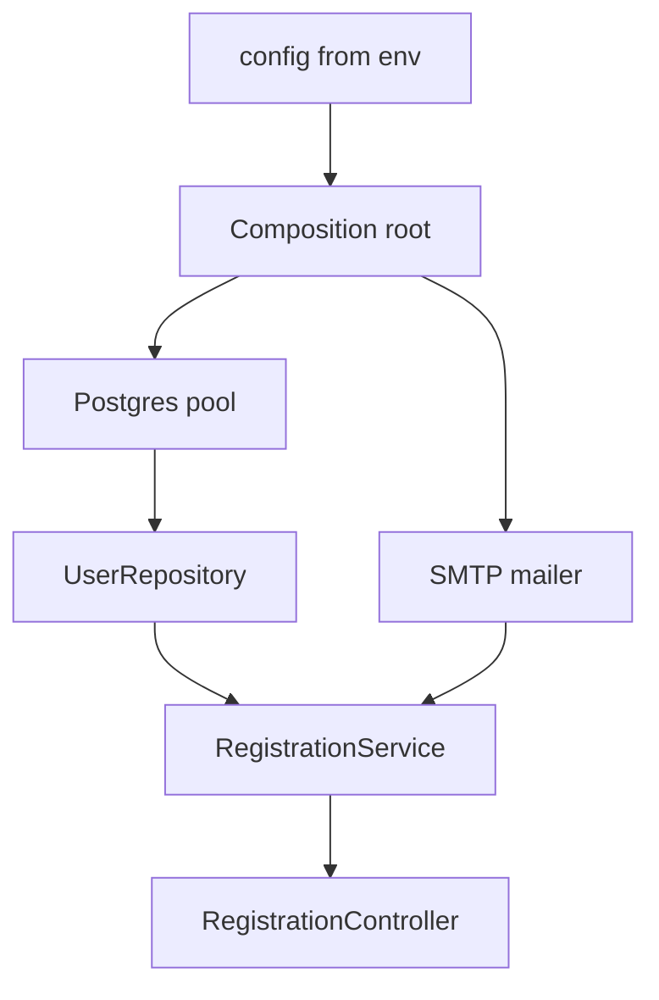

# Dependency Injection in Practice

Files 1 to 4 produced controllers, services, repositories and DTOs — separate
pieces with clear jobs. Nothing so far has said how they find each other at
runtime.

There are exactly two answers: a class can **import** what it needs, or a class
can be **given** what it needs. The principle is in
[dependency-injection.md](../../software-engineering/principles/dependency-injection.md).
This file is the Node and TypeScript version — real wiring, real tests, and an
honest account of when it is not worth it.

> **📌 In one line:** construct your dependencies once, at startup, in one file,
> and pass them in through constructors — a container is an optimisation, not a
> requirement.

## Table of Contents

1. [The Pain: A Service That Imports Everything](#the-pain-a-service-that-imports-everything)
2. [The Three Injection Styles](#the-three-injection-styles)
3. [The Composition Root, With No Framework](#the-composition-root-with-no-framework)
4. [When a Container Earns Its Place](#when-a-container-earns-its-place)
5. [Interfaces Cannot Be Runtime Tokens](#interfaces-cannot-be-runtime-tokens)
6. [Lifetimes: Singleton, Scoped, Transient](#lifetimes-singleton-scoped-transient)
7. [The Test That Becomes Possible](#the-test-that-becomes-possible)
8. [Fakes, Stubs and Mocks](#fakes-stubs-and-mocks)
9. [Injecting the Clock, the Random Source, the Id](#injecting-the-clock-the-random-source-the-id)
10. [Configuration Is a Dependency Too](#configuration-is-a-dependency-too)
11. [Circular Dependencies and How to Break Them](#circular-dependencies-and-how-to-break-them)
12. [The Honest Trade-Offs](#the-honest-trade-offs)
13. [Common Mistakes](#common-mistakes)
14. [Questions to Test Yourself](#questions-to-test-yourself)
15. [Related](#related)

---

## The Pain: A Service That Imports Everything

Here is an ordinary service. Nothing about it looks wrong.

```ts
// ❌ BROKEN — every dependency is welded in at import time
import db from '#services/db'
import mailer from '#services/mailer'
import logger from '#services/logger'

export class RegistrationService {
  async register(input: RegisterInput) {
    const existing = await db.from('users').where('email', input.email).first()
    if (existing) throw new EmailTakenError(input.email)

    const user = await db.table('users')
      .insert({ email: input.email, password_hash: await hash(input.password) })
      .returning('*')

    await mailer.send({ to: user.email, template: 'welcome' })
    return user
  }
}
```

It works in production. Now try to do anything else with it.

| What you want to do | Why you cannot |
|---|---|
| Unit test the "email taken" rule | `db` connects on import; you need a live database |
| Test that a welcome email is sent | `mailer` really opens SMTP and sends it |

**You cannot run two configurations side by side**, because a module-level
singleton is created once per process and every importer gets the same one. And
a rule as simple as "reject a duplicate email" needs a running Postgres and SMTP
server to check — so it does not get checked.

---

## The Three Injection Styles

### Constructor injection — the default

```ts
export class RegistrationService {
  constructor(
    private users: UserRepository,
    private mailer: Mailer,
    private logger: Logger,
  ) {}
}
```

**Method injection** passes it as an argument when it varies per call —
`exportInvoices(input, formatter)`. **Property injection** assigns it after
construction (`public mailer!: Mailer`) and is a last resort.

| Style | Use when | Cost |
|---|---|---|
| **Constructor** | The dependency is needed for the object's whole life | None worth mentioning |
| **Method** | It varies per call, or only one method needs it | The caller supplies it every time |
| **Property** | Breaking a cycle, or a framework insists | The object is briefly invalid |

**Default to constructor injection.** The object is never half-built, whereas
property injection allows a window where `this.mailer` is `undefined` — and that
window will eventually be used. The constructor is also documentation: it says
exactly what the class touches, and nine parameters say it does too much.
Finally, TypeScript enforces it, because `private mailer: Mailer` with no `!`
cannot be forgotten.

---

## The Composition Root, With No Framework

A **composition root** is the single place where concrete objects are created
and connected: one file, run once at startup, and the *only* file allowed to
know which implementation is which.



Everything points inward; the service knows nothing about what it was given.

```ts
// app/container.ts — the whole "DI framework", written by hand
export function buildApp(cfg = config) {
  const pool = new Pool({ connectionString: cfg.databaseUrl, max: cfg.dbPoolSize })
  const logger = createLogger({ level: cfg.logLevel })
  const mailer = cfg.mail.driver === 'smtp'
    ? new SmtpMailer(cfg.mail, logger) : new ConsoleMailer(logger)
  const clock: Clock = { now: () => DateTime.utc() }
  const users = new PgUserRepository(pool)
  const registration = new RegistrationService(users, mailer, logger, clock)

  return {
    controllers: { registration: new RegistrationController(registration) },
    shutdown: () => pool.end(),
  }
}
```

`buildApp` takes a config object, so a test calls `buildApp(testConfig)` and
gets a **second, independent application** with a different database and a
console mailer — the problem the broken version could not solve, fixed by a
function parameter.

> **📌 Remember: plain manual wiring is enough for most applications.** It is
> ordinary TypeScript, "jump to definition" works, the compiler checks every
> connection, and when something is wired wrongly the stack trace points at the
> line that did it. No container debugs better than this.

The cost is small: when a service gains a dependency you edit this file.

---

## When a Container Earns Its Place

A container reads a registry of "this token means that implementation" and
constructs objects for you, resolving dependencies recursively.

| Signal | Manual wiring | Container |
|---|---|---|
| Graphs 5+ levels deep | Tedious, order-sensitive | Resolved automatically |
| Request-scoped services everywhere | Threaded by hand | Built-in scopes |

If you use AdonisJS the container is already there, and its request scope is
worth having:

```ts
// providers/app_provider.ts — register a token, resolve its dependencies
this.app.container.singleton(Mailer, async (resolver) => {
  const logger = await resolver.make(Logger)
  return config.mail.driver === 'smtp'
    ? new SmtpMailer(config.mail, logger) : new ConsoleMailer(logger)
})
```

Outside a framework, **InversifyJS** (heavier) and **tsyringe** (lighter) are
the usual choices. Both need `experimentalDecorators`, and both make you
register a **token** per dependency — which leads straight to the gotcha that
catches everybody.

---

## Interfaces Cannot Be Runtime Tokens

A container needs something to look up at runtime. A TypeScript `interface` is
not something.

```ts
// ❌ BROKEN — interfaces vanish at compile time
export interface Mailer { send(msg: Message): Promise<void> }

container.bind<Mailer>(Mailer).to(SmtpMailer)
//                     ^^^^^^ TypeScript error: 'Mailer' only refers to a type
```

TypeScript types are erased during compilation: the emitted JavaScript contains
no `Mailer` at all, so there is nothing for the container to key on
([interfaces.md](../../typescript-fundamentals/interfaces/interfaces.md)). Three
fixes, best last:

```ts
// ✅ FIXED (1) — a symbol token beside the interface
export const MAILER = Symbol.for('Mailer')
container.bind<Mailer>(MAILER).to(SmtpMailer)

// ✅ FIXED (2) — an abstract class is a real runtime value AND a type
export abstract class Mailer { abstract send(msg: Message): Promise<void> }
container.bind(Mailer).to(SmtpMailer)   // works: classes survive compilation

// ✅ FIXED (3) — no container at all
const mailer: Mailer = new SmtpMailer(cfg.mail, logger)
```

Option 3 is the point: **manual wiring never has this problem**, because the
interface is used only for type checking. The token problem is a cost the
container introduces.

---

## Lifetimes: Singleton, Scoped, Transient

A lifetime answers how many instances exist, and for how long.

| Lifetime | Instances | Concrete example | Why |
|---|---|---|---|
| **Singleton** | One per process | Connection pool, config, metrics registry | Expensive to build; safe to share |
| **Scoped** | One per request | The logger bound to a request id, the current user, a per-request transaction | Carries request state |
| **Transient** | One per resolution | A CSV builder, a token generator | Holds mutable working state |

### The classic bug: request-scoped inside a singleton

```ts
// ❌ BROKEN — a singleton captures ONE request's logger, forever
container.singleton(InvoiceService, async (r) => {
  const requestLogger = await r.make(RequestLogger)   // scoped!
  return new InvoiceService(await r.make(InvoiceRepo), requestLogger)
})
```

`InvoiceService` is built once, on the first request that needs it, capturing
*that* request's logger — bound to *that* request's id and user — for the life
of the process. Every subsequent request logs under the first request's id.

Worse than a wrong log line: if the scoped object holds the current user, the
singleton does every request's work in the first user's context — a data leak
with no error message.

```ts
// ✅ FIXED — the singleton takes the request-scoped thing per call
async send(input: SendInvoiceInput, ctx: RequestContext) {
  ctx.logger.info({ event: 'invoice.send.start', invoice_id: input.invoiceId })
}
```

**The rule: a longer-lived object may never hold a reference to a shorter-lived
one.** Pass it per call, or make the holder scoped too. Request-scoped state is
in [04-controllers-and-request-context.md](../03-request-lifecycle/04-controllers-and-request-context.md).

---

## The Test That Becomes Possible

The payoff. The same `RegistrationService`, no database, no SMTP server.

```ts
class InMemoryUserRepository implements UserRepository {   // same interface
  public rows: UserRow[] = []
  async findByEmail(e: string) { return this.rows.find((u) => u.email === e) ?? null }
  async create(data: NewUser) {
    const row = { id: String(this.rows.length + 1), ...data }
    this.rows.push(row)
    return row
  }
}

class FakeMailer implements Mailer {          // records instead of sending
  public sent: Message[] = []
  async send(msg: Message) { this.sent.push(msg) }
}

test('registering sends exactly one welcome email', async () => {
  const users = new InMemoryUserRepository()
  const mailer = new FakeMailer()
  const clock: Clock = { now: () => DateTime.fromISO('2026-03-05T12:00:00Z') }

  const service = new RegistrationService(users, mailer, silentLogger, clock)
  await service.register({ email: 'dana@acme.test', password: 'hunter2hunter2' })

  assert.equal(mailer.sent.length, 1)
  assert.equal(mailer.sent[0].to, 'dana@acme.test')
  assert.equal(users.rows[0].created_at, '2026-03-05T12:00:00.000Z')
})
```

No database, no SMTP server, no network, no `beforeEach` truncating tables. It
runs in single-digit milliseconds, so it runs on every save — and the email is
asserted "sent" without anything reaching a real address. The broken version at
the top of this file needs a live Postgres, a live mail server and a way to read
the mailbox back to check the same rule.

---

## Fakes, Stubs and Mocks

These three get used interchangeably. The difference decides how brittle your
test is.

| Kind | What it is | Example | Assert on |
|---|---|---|---|
| **Stub** | Returns canned answers | `findByEmail()` always returns `null` | The result under test |
| **Fake** | A real, working, simplified implementation | `InMemoryUserRepository` | Its observable state (`users.rows`) |
| **Mock** | Records calls and asserts they happened | `expect(mailer.send).toHaveBeenCalledWith(...)` | The interaction itself |

**Prefer fakes.** A fake behaves like the real thing, so a test survives a
refactor of *how* the service works; a mock asserts on the exact calls, so
renaming a method breaks tests that were not testing that. Use a mock only when the interaction *is* the
requirement — "charged exactly once" is genuinely about the call.

> **💡 Tip:** if a test needs five mocks, the service is probably doing five
> things. The awkward test is telling you about the design.

---

## Injecting the Clock, the Random Source, the Id

Not every dependency looks like one. These three make tests non-deterministic
and are the ones people forget.

```ts
// ❌ BROKEN — untestable without freezing global time
async start(userId: string) {
  return this.trials.create({
    user_id: userId, started_at: new Date(), token: crypto.randomUUID(),
    expires_at: new Date(Date.now() + 14 * 24 * 3600 * 1000),
  })
}
```

To test "a trial expires after 14 days" you must wait two weeks or monkey-patch
global `Date`, which leaks into every other test in the process.

```ts
// ✅ FIXED — the clock and the id source are ordinary dependencies
export type Clock = { now(): DateTime }
export type IdGenerator = { next(): string }

export class TrialService {
  constructor(
    private trials: TrialRepository,
    private clock: Clock,
    private ids: IdGenerator,
  ) {}
  async start(userId: string) {
    const now = this.clock.now()
    return this.trials.create({
      user_id: userId, started_at: now,
      expires_at: now.plus({ days: 14 }), token: this.ids.next(),
    })
  }
}
```

```ts
test('a trial expires 14 days after it starts', async () => {
  const clock = { now: () => DateTime.fromISO('2026-03-05T00:00:00Z') }
  const service = new TrialService(new InMemoryTrialRepository(), clock, fixedIds)
  const trial = await service.start('u_1')
  assert.equal(trial.expires_at.toISO(), '2026-03-19T00:00:00.000Z')
})
```

The test is exact, instant, and unaffected by the machine's timezone or the day
it runs. The same argument applies to `Math.random()` and to id generation.

---

## Configuration Is a Dependency Too

```ts
// ❌ BROKEN — process.env read deep inside a service
async build() {
  const limit = Number(process.env.REPORT_MAX_ROWS ?? 1000)  // typo = NaN, at runtime
  if (process.env.FEATURE_FAST_REPORTS === 'true') { /* ... */ }
}
```

Three problems: a misspelled variable fails at 3 AM rather than at boot, tests
must mutate the global `process.env`, and nothing lists what the application
needs to run.

```ts
// ✅ FIXED — validate once at startup, inject the typed result
export const configSchema = z.object({
  databaseUrl: z.string().url(),
  reportMaxRows: z.coerce.number().int().positive().default(1000),
})
export type Config = z.infer<typeof configSchema>

// One place reads process.env; the process refuses to boot if it is wrong
export const config = configSchema.parse(readEnv())
```

Inject the **slice** a class needs, not the whole object — a service holding all
of `Config` can read the SMTP password, and its constructor stops telling you
what it touches.

---

## Circular Dependencies and How to Break Them

`UserService` needs `NotificationService` to send a welcome message, and
`NotificationService` needs `UserService` to look up preferences.


With manual wiring you cannot even construct them. With a container you get a
runtime error, or — worse — `undefined` in a property, because the ES module
machinery returned a half-initialised module
([advanced.md](../../typescript-fundamentals/modules/advanced.md)). Four ways
out, best first:

1. **Extract the shared piece.** Both need `UserPreferenceReader`; pull it out,
   inject it into both, and the cycle is gone. Nearly always the right answer —
   the cycle was telling you the piece existed.
2. **Invert with an event.** `UserService` emits `user.registered` and
   `NotificationService` subscribes; neither knows the other exists.
3. **Pass the data, not the service** — an email address and a locale, not a
   whole `UserService`.
4. **Lazy resolution** — a `() => NotificationService` factory resolved on first
   use. It works and hides the design problem: a last resort.

> **⚠️ Warning:** a cycle between two *services* is a design smell, not a wiring
> problem. A lazy factory fixes the symptom and keeps the tangle.

---

## The Honest Trade-Offs

DI is not free, and the costs are usually understated.

**Indirection:** you read `this.mailer.send(...)` and cannot tell which class
runs without opening the composition root. **"Jump to definition" gets weaker** —
with a direct import your editor takes you to the code, with an interface only
to the interface. And **over-injection** is real: injecting a pure `slugify`
costs a constructor parameter and a wiring line for nothing.

| Dependency | Inject it? | Why |
|---|---|---|
| Database, HTTP client, mailer, queue | **Yes** | I/O; must be faked in tests |
| Clock, random, id generator | **Yes** | Non-deterministic; makes tests exact |
| Config, logger | **Yes** | Two configs side by side; silencing logs in tests |

**Practical stance:** inject anything that does I/O, anything non-deterministic,
and your config; import everything else. Wire by hand in one composition root
until that file is genuinely painful, and only then reach for a container.

---

## Common Mistakes

| Mistake | Why it is wrong | Do this instead |
|---|---|---|
| `import db from '#services/db'` in a service | Cannot be tested or run twice with different config | Inject a repository |
| `container.bind<Mailer>(Mailer)` on an interface | Interfaces are erased at compile time | A symbol token or an abstract class |
| A request-scoped object inside a singleton | The first request's id and user are reused forever | Pass it per call |
| `new Date()` inside a service | Tests must freeze global time | Inject a `Clock` |

---

## Questions to Test Yourself

1. Name two things a service that imports `db` cannot do, besides "be tested".
2. `container.bind<Mailer>(Mailer).to(SmtpMailer)` fails to compile. Explain
   why, and give two fixes.
3. A singleton `InvoiceService` resolves a request-scoped logger in its factory.
   Describe what request #500 logs, and the worse version of this bug.
4. Write the test for "a trial expires after 14 days" that runs in one
   millisecond. What had to be injected?
5. Two services depend on each other. Give the fix you would try first, and say
   why a lazy factory is not it.
6. Your composition root is 400 lines. Argue for and against a container.

---

## Related

- [dependency-injection.md](../../software-engineering/principles/dependency-injection.md)
  — the principle, and how it differs from Dependency Inversion.
- [04-controllers-and-request-context.md](../03-request-lifecycle/04-controllers-and-request-context.md)
  — where request-scoped state comes from.
- [interfaces.md](../../typescript-fundamentals/interfaces/interfaces.md) — why
  an interface is not a runtime value.
- [advanced.md](../../typescript-fundamentals/modules/advanced.md) — circular
  imports and half-initialised modules.
