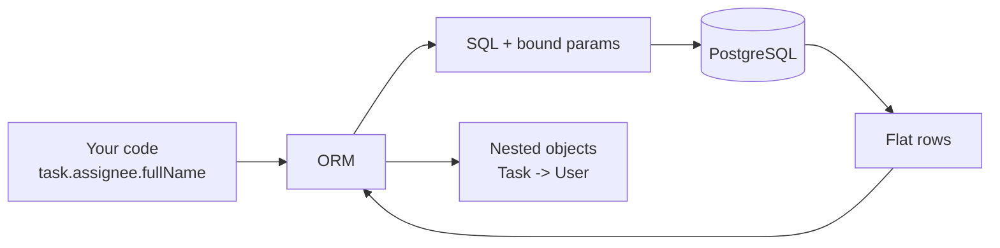
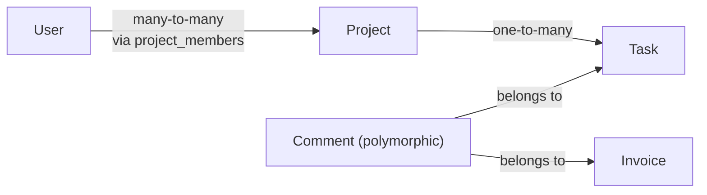

# ORM vs Query Builder vs Raw SQL

Imagine you are in a foreign country and you need to talk to a shopkeeper. You
have three options. You can learn the language yourself. You can use a phrase
book that builds sentences for you. Or you can bring a translator who speaks
for you and hands the answer back in your own language.

Raw SQL is learning the language. A query builder is the phrase book. An ORM
(Object-Relational Mapper) is the translator. All three work. The translator is
fastest until the day it says something wrong — and you cannot tell, because
you never saw the original sentence.

> **📌 In one line:** An ORM saves you time by hiding SQL, and costs you time
> the day you stop knowing what SQL it sends — so learn to read its query log
> from day one.

## Table of Contents

1. [Three Ways to Talk to a Database](#three-ways-to-talk-to-a-database)
2. [What an ORM Actually Does](#what-an-orm-actually-does)
3. [The Impedance Mismatch](#the-impedance-mismatch)
4. [Comparison Table](#comparison-table)
5. [The Convenience That Costs You Queries](#the-convenience-that-costs-you-queries)
6. [Seeing the SQL Your ORM Generates](#seeing-the-sql-your-orm-generates)
7. [When to Drop to Raw SQL](#when-to-drop-to-raw-sql)
8. [Models, Entities and Domain Objects](#models-entities-and-domain-objects)
9. [Active Record vs Data Mapper](#active-record-vs-data-mapper)
10. [Relations and Loading Strategies](#relations-and-loading-strategies)
11. [Type Safety from the Schema](#type-safety-from-the-schema)
12. [Advanced Concerns](#advanced-concerns)
13. [Common Mistakes](#common-mistakes)
14. [Questions to Test Yourself](#questions-to-test-yourself)
15. [Related](#related)

---

## Three Ways to Talk to a Database

Here is one task written three ways: *find all open tasks for a project,
newest first, with the name of the person they are assigned to.*

**1. Raw SQL through a driver.** You write the SQL. The driver sends the string
and gives back plain rows.

```ts
// node-postgres. $1 is a bound parameter — never string concatenation.
const { rows } = await pool.query(
  `SELECT t.id, t.title, u.full_name AS assignee_name
     FROM tasks t
     JOIN users u ON u.id = t.assignee_id
    WHERE t.project_id = $1 AND t.status = 'open'
    ORDER BY t.created_at DESC`,
  [projectId],
)
// rows: { id, title, assignee_name }[] — flat, exactly as selected
```

**2. A query builder.** You still think in SQL, but you write it as chained
method calls. The builder handles quoting, parameter binding and dialect
differences, and lets you add clauses conditionally without gluing strings.

```ts
// Knex / AdonisJS Lucid style. Same SQL, built from parts.
const rows = await db
  .from('tasks as t')
  .join('users as u', 'u.id', 't.assignee_id')
  .select('t.id', 't.title', 'u.full_name as assignee_name')
  .where('t.project_id', projectId)
  .andWhere('t.status', 'open')
  .orderBy('t.created_at', 'desc')
```

**3. A full ORM with models and relations.** You describe your tables as
classes once, then query in terms of objects.

```ts
const tasks = await Task.query()
  .where('projectId', projectId)
  .where('status', 'open')
  .preload('assignee')          // one extra query, fetched in a batch
  .orderBy('createdAt', 'desc')

tasks[0].assignee.fullName      // a real nested object, not a flat column
```

Notice what changed. Options 1 and 2 gave a flat row with `assignee_name`
glued on. Option 3 gave a `Task` object that *has* a `User` object inside it.
That nesting is the point of an ORM — and the source of its problems.

---

## What an ORM Actually Does

An ORM does four jobs. Naming them separately matters, because people blame
"the ORM" for things only one of them causes.

| Job | What it means |
|---|---|
| Mapping | Turn a row into an object and back. `full_name` becomes `fullName`, `created_at` becomes a `DateTime`. |
| Query generation | Turn method calls into a SQL string with bound parameters. |
| Change tracking | Know this object came from row 42, and which fields changed so `save()` writes only those. |
| Relation resolution | Know a `Task` has an `assignee`, and fetch it when asked. |

Jobs 1 and 2 are almost always a win. Job 4 is where N+1 queries come from.
Job 3 is where "why did my update not save?" comes from.



---

## The Impedance Mismatch

"Object-relational impedance mismatch" is a heavy phrase for a simple idea:
**tables and objects are shaped differently.**

A table is flat and set-based. A row is a fixed list of scalar columns. The
database is very good at questions about *sets*: "all tasks where X", "count
them", "join them to users".

An object is nested and graph-like — and the graph has loops.

```text
  Relational world                 Object world

  projects                         Project
  ┌────┬──────────┐                  └── tasks: Task[]
  │ id │ name     │                        └── assignee: User
  └────┴──────────┘                              └── company: Company
  tasks                                                └── projects: Project[]
  ┌────┬────────────┬─────────────┐                          (a cycle)
  │ id │ project_id │ assignee_id │
  └────┴────────────┴─────────────┘
```

The mismatch shows up as questions the ORM must guess an answer to:

- When you load a `Task`, how far down the graph should it go? Load everything
  and one query becomes twenty. Load nothing and every access is a new query.
- Two queries return row 42. Is that one object or two? (Identity.)
- A join row that carries its own data, like `project_members.role`, has no
  natural object at all.

No ORM solves these perfectly. Each one picks defaults. **Most ORM surprises
are you meeting a default you did not know about.**

---

## Comparison Table

| | Raw SQL | Query builder | Full ORM |
|---|---|---|---|
| Control over the exact SQL | Total | High | Low to medium |
| Safety from SQL injection | Only if you bind parameters | Automatic | Automatic |
| Learning curve | SQL only | SQL + the builder API | SQL + model, relation and loading rules |
| Refactoring (rename a column) | Find/replace across strings | Find/replace across strings | Change the model, types catch the rest |
| Complex queries (windows, CTEs) | Native | Usually needs an escape hatch | Usually needs an escape hatch |
| Performance predictability | You see every query | You see every query | You must check the log |
| Boilerplate for simple CRUD | High | Medium | Very low |
| Lock-in | None — SQL is portable knowledge | Medium | High — models and hooks are ORM-specific |
| Best at | Reports, analytics, bulk work | Dynamic filters, list endpoints | CRUD over a known object graph |

> **💡 Tip:** These are not exclusive. A healthy codebase uses the ORM for most
> CRUD, the query builder for list endpoints with dynamic filters, and raw SQL
> for the few reporting queries that pay the bills.

---

## The Convenience That Costs You Queries

Three defaults cause almost all ORM performance complaints.

**1. Lazy loading.** Touching a relation that was not loaded silently runs a
query. In a loop, that is N+1.

**2. `SELECT *` by default.** Most ORMs select every column, including the
200 KB `description` text you did not ask for. See
[select-star-anti-pattern](../../databases/query-patterns/select-star-anti-pattern.md).

**3. Queries you cannot see.** A relation touched inside a serializer, a
template, or an accessor runs SQL in a place that does not look like data
access at all.

Here is innocent-looking code that runs 201 queries:

```ts
// ❌ BROKEN — 1 query for tasks, then 2 lazy queries per task = 201 total
const tasks = await Task.query().where('projectId', projectId).limit(100)

for (const task of tasks) {
  // each access hits the database because the relation was never loaded
  const assignee = await task.related('assignee').query().first()
  const project = await task.related('project').query().first()
  report.push(`${task.title} — ${assignee.fullName} — ${project.name}`)
}
```

The fix is to say up front what you need. `preload` (Lucid), `include`
(Prisma) and `relations` (TypeORM) all do the same thing: fetch the related
rows in one extra batched query instead of one query per row.

```ts
// ✅ FIXED — 3 queries total, whatever the task count: tasks, users, projects
const tasks = await Task.query()
  .where('projectId', projectId)
  .preload('assignee')
  .preload('project')
  .limit(100)

for (const task of tasks) {
  report.push(`${task.title} — ${task.assignee.fullName} — ${task.project.name}`)
}
```

The query count went from `1 + 2N` to `3`. With 100 tasks at 2 ms per query
that is roughly 400 ms down to 6 ms — and the slow version gets worse as the
project grows, while the fast one does not.

> **⚠️ Warning:** This bug is invisible in development. With 5 seeded tasks it
> is 11 fast queries. With 5,000 rows in production it is a timeout. Full
> treatment, including when N+1 is acceptable:
> [n-plus-one-queries](../../databases/query-optimization/n-plus-one-queries.md).

---

## Seeing the SQL Your ORM Generates

**This is the single most valuable habit in this file.** Everything above is
theory until you can watch the queries scroll past.

Turn on query logging in development and leave it on. Every ORM has a hook.

```ts
// Generic pattern: subscribe to the driver's query event and log it.
db.on('query', (q) => {
  logger.debug({ sql: q.sql, bindings: q.bindings, ms: q.duration }, 'db query')
})
```

In AdonisJS this is a config flag plus a query event listener. Prisma takes
`log: ['query']`. TypeORM takes `logging: true`. The flag name changes; the
idea does not. (Framework-specific — check your version's docs.)

Then count queries per request in development and put the number in a header:

```ts
let count = 0
db.on('query', () => count++)

app.use(async (ctx, next) => {
  count = 0
  await next()
  ctx.response.header('X-Query-Count', String(count)) // dev only
})
```

Open dev tools, load a page, read `X-Query-Count`. A detail page should be a
handful. A list page should be a small constant, **not a number that grows
with the page size**.

> **📌 Remember:** If you cannot say how many queries your endpoint runs, you
> do not know what your endpoint does. Make the query log part of how you
> develop, not something you switch on during an incident.

In production, log only slow queries above a threshold — that ties into
[metrics and health checks](../08-logging-and-observability/04-metrics-and-health-checks-part-1.md).

---

## When to Drop to Raw SQL

Use raw SQL when the ORM fights you instead of helping.

| Case | Why the ORM struggles |
|---|---|
| Reporting and analytics | Group-by, multiple aggregates, date bucketing — no objects here, only numbers |
| Window functions | `ROW_NUMBER()`, `LAG()`, running totals rarely fit a model API |
| Recursive CTEs | Tree structures like a task hierarchy or an org chart |
| Bulk operations | `INSERT ... ON CONFLICT` over 50,000 rows, or `UPDATE ... FROM` |
| Database-specific features | `JSONB` operators, full-text search, generated columns |

Monthly paid-invoice totals per company is a reporting question, and raw SQL
says it better than any model API:

```ts
const { rows } = await db.rawQuery(
  `SELECT i.company_id,
          date_trunc('month', i.issued_at) AS month,
          SUM(i.total_cents) AS total_cents
     FROM invoices i
    WHERE i.issued_at >= :since AND i.status = 'paid'
    GROUP BY i.company_id, month`,
  { since: startOfYear },
)
```

**Do it safely.** One rule: the SQL string is a constant you wrote, and every
value from outside goes in as a bound parameter.

```ts
// ❌ BROKEN — a status of "paid' OR '1'='1" now reads every invoice
await db.rawQuery(`SELECT * FROM invoices WHERE status = '${status}'`)

// ✅ FIXED — the value travels separately from the SQL text, so it can never
// become SQL syntax, whatever characters it contains
await db.rawQuery('SELECT * FROM invoices WHERE status = ?', [status])
```

One thing binding cannot do: you cannot bind a table name, a column name, or a
sort direction. Those are syntax, not values. If a sort column comes from the
user, check it against an allow-list of known column names first. Details in
[injection attacks](../11-api-security/02-injection-attacks-part-1.md).

---

## Models, Entities and Domain Objects

Three words people use interchangeably, and should not.

- A **model** is the ORM's representation of a table. It knows columns,
  relations, and how to save itself.
- An **entity** is a thing in your business with an identity that persists over
  time. An invoice is the same invoice tomorrow, even if every field changed.
- A **domain object** is a plain class holding business rules, with no
  knowledge of any database.

In a small app they are one class, and that is fine. In a larger app the
distinction earns its keep: a plain domain object holding the invoice total
calculation can be tested with no database, no fixtures and no connection.

---

## Active Record vs Data Mapper

This is the biggest design split between ORMs, and it decides how testable
your code is. **Active Record:** the object saves itself — `invoice.save()`.
**Data Mapper:** something else saves it — `repository.save(invoice)`.

| | Active Record | Data Mapper |
|---|---|---|
| Example tools | AdonisJS Lucid, Laravel Eloquent, Rails | TypeORM (entity manager), Prisma (client) |
| Where persistence lives | On the model | In a repository / client |
| Simple save | `invoice.status = 'paid'; await invoice.save()` | `await prisma.invoice.update({ where: { id }, data: {...} })` |
| Boilerplate | Very low | Higher |
| Business logic placement | Tends to pile onto the model | Naturally separate |
| Testing without a database | Hard — the model *is* the database | Easier — swap the mapper |

**The testing consequence is the point.** With active record, a method like
`invoice.markPaid()` calls `this.save()` internally, so a unit test needs a
database or a mock so deep it tests nothing. With data mapper, the domain
object changes its own fields and someone else persists it, so the rule can be
tested in memory.

That does not make active record wrong. It is faster to write and fine for
CRUD. It means: **when logic gets genuinely complex, pull it out of the model
into a plain function or class**, and let the model stay a thin data holder.

---

## Relations and Loading Strategies

Three relation shapes cover almost everything.



**One-to-many.** A project has many tasks. The foreign key `project_id` lives
on the *many* side, on `tasks`.

**Many-to-many.** A user belongs to many projects and back again. This needs a
third table, `project_members(user_id, project_id, role)`. Note that the join
table carries data of its own — the member's role. ORMs call this "pivot" or
"through" data, and you usually must ask for it explicitly.

**Polymorphic.** A comment can belong to a task *or* an invoice, so the row
stores `commentable_type = 'task'` and `commentable_id = 42`. Convenient, but
understand the cost: **you cannot put a foreign key on it**, so the database
can no longer stop a comment pointing at a deleted task. With only two or three
target types, prefer two nullable foreign keys plus a `CHECK` constraint.

Declaring relations (Lucid-style decorators; other ORMs use a schema file —
check your version's docs):

```ts
class Project extends BaseModel {
  @hasMany(() => Task)
  declare tasks: HasMany<typeof Task>
}
```

**Eager vs lazy.** Lazy means "fetch it when someone touches it". Eager means
"fetch it now, with the parents". Always be explicit:

```ts
// Nested preloading, with a constraint on the nested relation.
const projects = await Project.query()
  .where('companyId', companyId)
  .preload('tasks', (taskQuery) => {
    taskQuery.where('status', 'open').preload('assignee')
  })
// 3 queries total: projects, their open tasks, the assignees of those tasks
```

> **💡 Tip:** Some ORMs can disable lazy loading entirely, so an unloaded
> relation throws instead of silently querying. Turn that on. A loud error in
> development beats a silent N+1 in production.

---

## Type Safety from the Schema

Modern tools read your schema and generate TypeScript types from it. That turns
a whole class of runtime bugs into compile errors.

```ts
// Generated from the schema — you did not write this by hand
type Invoice = {
  id: string
  companyId: string
  totalCents: number
  status: 'draft' | 'sent' | 'paid' | 'void'
  issuedAt: Date | null
}
```

Rename `total_cents` to `amount_cents` in a migration, regenerate, and every
line still using `totalCents` fails to compile. Without generated types that
rename ships and fails at runtime as `undefined`.

Those generated types also flow through generic helpers, so one typed
repository can serve every table — see
[generics](../../typescript-fundamentals/generics/generics.md).

> **📌 Remember:** Generated types are only true if you regenerate them. Make
> generation part of the migration command, not a step someone remembers.

---

## Advanced Concerns

**Keep the ORM at the boundary.** If `Task.query()` appears in controllers,
services, jobs and views, the ORM is not a tool you use — it is the shape of
your application. Put it behind a repository instead:

```ts
// The only file that knows Lucid exists for tasks
class TaskRepository {
  async openTasksForProject(projectId: string): Promise<Task[]> {
    return Task.query()
      .where('projectId', projectId)
      .where('status', 'open')
      .preload('assignee')                // preload lives in exactly one place
  }
}
```

Two wins: nobody can accidentally call the un-preloaded version, and when this
query must become raw SQL for speed, one file changes and no caller notices.
See [the repository layer](../09-application-architecture/03-repository-layer-part-1.md).

**Soft deletes** set `deleted_at = now()` instead of running `DELETE`. They
keep history, and create three traps. *Unique indexes stop working* — a deleted
`amy@company.com` blocks re-registration, so use a partial index:

```sql
CREATE UNIQUE INDEX users_email_live_uniq
    ON users (email) WHERE deleted_at IS NULL;
```

*Forgotten filters* — one report missing `WHERE deleted_at IS NULL` puts
deleted invoices back into revenue, so make the filter a global scope and make
including deleted rows the explicit choice. *Foreign keys mean nothing* — the
database does not know the row is deleted, so `ON DELETE CASCADE` never fires
and child rows stay live.

> **⚠️ Warning:** Soft delete is not a compliance answer. If a user asks for
> erasure, `deleted_at` erases nothing.

**Optimistic locking.** Two users open the same invoice, both edit, both save,
and the second silently overwrites the first. A `version` column detects it:

```ts
const affected = await db
  .from('invoices')
  .where('id', invoice.id)
  .where('version', invoice.version)     // the guard
  .update({ notes: newNotes, version: invoice.version + 1 })

if (affected === 0) {
  throw new ConflictError('This invoice was changed by someone else. Reload.')
}
```

It is *optimistic* because it assumes conflicts are rare and only detects them.
The pessimistic alternative locks the row up front — see
[transactions](03-transactions-part-1.md).

---

## Common Mistakes

| Mistake | Why it is wrong | Do this instead |
|---|---|---|
| Never looking at the generated SQL | You cannot fix what you cannot see; N+1 stays invisible | Enable query logging and add a per-request query counter |
| Touching relations inside a loop | Each access is a query — 1 becomes N+1 | Preload every relation the code path needs, before the loop |
| Building raw SQL with template literals | SQL injection, even when the value "looks safe" | Bind every value; allow-list column names |
| Calling the ORM from controllers | Queries get duplicated and the ORM becomes unreplaceable | Call it only from a repository |
| Complex business rules on an active-record model | You now need a database to test a calculation | Move the rule into a plain class or function |
| Soft delete without a partial unique index | Deleted users cannot re-register | `CREATE UNIQUE INDEX ... WHERE deleted_at IS NULL` |
| Read, edit, save with no version check | The second writer silently overwrites the first | Optimistic locking with a `version` column |

## Questions to Test Yourself

1. Why does an ORM produce N+1 queries when a hand-written query builder
   usually does not? What is the ORM doing that the builder is not?
2. You add `.preload('assignee')` to a query over 100 tasks. How many queries
   run in total, and why is it not 101?
3. What exactly can you *not* pass as a bound parameter in raw SQL, and how do
   you keep that case safe?
4. A teammate says "we use an ORM so we are safe from SQL injection". Give one
   concrete way that is still false.
5. Explain the testing difference between active record and data mapper using
   a method called `invoice.markPaid()`.
6. You add soft deletes to `users`. Name two things that silently break the
   same week, and the fix for each.
7. When would you choose raw SQL over the ORM, and what do you lose by doing
   it?
8. Two users edit the same invoice at the same time. Describe what happens
   with no version column, and what changes when you add one.

## Related

- [Migrations](02-migrations-part-1.md) — changing the schema the ORM maps to.
- [Transactions](03-transactions-part-1.md) — grouping several writes into one
  all-or-nothing unit.
- [N+1 queries](../../databases/query-optimization/n-plus-one-queries.md) — the
  full treatment of the problem this file only introduces.
- [SELECT * anti-pattern](../../databases/query-patterns/select-star-anti-pattern.md)
  — why the ORM's default column list costs you.
- [Reading query plans](../../databases/query-planner/reading-query-plans.md) —
  what to do once you can see the SQL.
- [Repository layer](../09-application-architecture/03-repository-layer-part-1.md) —
  where ORM calls belong.
- [Injection attacks](../11-api-security/02-injection-attacks-part-1.md) — the
  attacker's side of raw SQL.
- [Generics](../../typescript-fundamentals/generics/generics.md) — typing a
  reusable repository cleanly.
