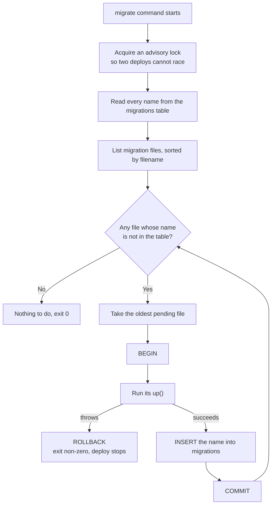
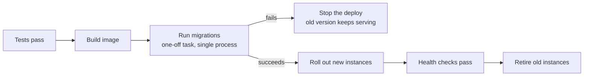

# Migrations — Part 1: Writing and Running Them

Your application code has a version. `git log` says exactly which lines changed,
when, and why, and every laptop that runs `git pull` ends up in the same state.

Your database schema has none of that by default. It is a living thing on a
server somewhere, and the only record of how it got its shape is whatever people
happened to type into `psql` over the last two years.

A migration fixes that. It puts the schema under the same version control as the
code, so "the database" stops being a place and becomes a **sequence of changes
anyone can replay**.

Part 1 is what a migration is, how the runner works, how to write one, and how
to run it in a deploy pipeline. Part 2 is the hard part: changing a schema while
the application is serving traffic.

> **📌 In one line:** a migration is a small, ordered, reviewed schema change
> that lives in the repository beside the code that needs it, and runs exactly
> once per environment.

## Table of Contents

1. [The Problem: Everyone's Database Is Different](#the-problem-everyones-database-is-different)
2. [What a Migration Actually Is](#what-a-migration-actually-is)
3. [How a Migration Runner Works](#how-a-migration-runner-works)
4. [Writing a Migration: Up and Down](#writing-a-migration-up-and-down)
5. [Why `down` Saves You Less Often Than You Think](#why-down-saves-you-less-often-than-you-think)
6. [Schema Migrations vs Data Migrations](#schema-migrations-vs-data-migrations)
7. [Team Practices That Prevent Most Pain](#team-practices-that-prevent-most-pain)
8. [Running Migrations in CI/CD](#running-migrations-in-cicd)
9. [Common Mistakes](#common-mistakes)
10. [Questions to Test Yourself](#questions-to-test-yourself)
11. [Related](#related)

---

## The Problem: Everyone's Database Is Different

Here is how it goes wrong, the same way at every company. You add a
`tasks.due_date` column: open `psql`, type `ALTER TABLE tasks ADD COLUMN
due_date date;`, the feature works, push the code.

- Your teammate pulls. Their app crashes: `column "due_date" does not exist`.
  You paste the `ALTER` into chat. They run it. It works.
- CI has no such column either. The build goes red, and someone adds the `ALTER`
  to a setup script.
- Staging gets it on Tuesday, typed by hand. Production gets it on Thursday at
  6 PM, by someone reading that chat message. They type `due_dat`.

Nothing here is exotic. There are now **four different schemas** with the same
name, and no way to tell them apart except by looking. Multiply that by fifty
changes a year and nobody can answer "what does production actually look like?"
without dumping it.

| Manual SQL | Migrations |
|---|---|
| Lives in chat, a wiki, someone's memory | Lives in the repo, next to the code |
| Applied in whatever order people typed it | Applied in one fixed order, everywhere |
| Nobody reviews it | Reviewed in the pull request like any code |
| "Did staging get this?" — nobody knows | `SELECT * FROM migrations` answers it |
| A typo reaches production silently; new laptop takes half a day | A typo fails in CI first; new laptop takes one command |

> **📌 The real goal** is not automation. It is that the schema change and the
> code depending on it travel together — same commit, same review, same order,
> every environment.

---

## What a Migration Actually Is

A migration is a file. That is genuinely all it is:

```text
database/migrations/
  1742031200_create_companies.ts
  1742031310_create_users.ts
  1742205600_add_due_date_to_tasks.ts
  1742292000_add_index_on_tasks_project_id.ts
```

Four properties make it a migration rather than just a script:

1. **Versioned** — the timestamp prefix makes the order unambiguous even when
   two developers write migrations on the same day.
2. **Ordered** — migration 4 may assume 1–3 already ran, and never assumes
   anything about 5.
3. **Recorded** — once applied, the runner remembers it, so re-running the
   command does nothing.
4. **In the repository** — reviewed, diffed and released with the code that
   needs it.

Why a **timestamp** and not `001`, `002`, `003`? Because two developers working
in parallel will both create `007_...` and only find out when they merge.
Timestamps collide only within the same second, and even then sort
deterministically.

---

## How a Migration Runner Works

Every tool — Knex, AdonisJS Lucid, Prisma Migrate, TypeORM, Flyway, Rails —
implements the same idea. There is a table in your database whose only job is
remembering what has already run.

```sql
SELECT * FROM migrations ORDER BY id;
```

| id | name | batch | migration_time |
|---|---|---|---|
| 1 | 1742031200_create_companies | 1 | 2025-03-15 09:31:04 |
| 2 | 1742031310_create_users | 1 | 2025-03-15 09:31:04 |
| 3 | 1742205600_add_due_date_to_tasks | 2 | 2025-03-17 08:15:09 |

The `batch` column groups everything applied by one `migrate` command, which is
what lets `rollback` undo "the last deploy's migrations" rather than one file.
The algorithm is a set difference: *files on disk* minus *names in the table* =
*work to do*.



Two details in that diagram matter more than they look.

**The advisory lock.** If a deploy starts five containers and each tries to
migrate, they all see the same pending files. The lock means one wins and the
rest wait, then find nothing to do — see
[Running Migrations in CI/CD](#running-migrations-in-cicd) for why this is not
enough on its own.

**The insert is inside the same transaction as the change.** PostgreSQL has
*transactional DDL*, so `CREATE TABLE` and the bookkeeping `INSERT` commit
together or not at all; a migration cannot half-apply and still be recorded as
done. MySQL cannot do this — each DDL statement commits implicitly, which is why
a failed migration there leaves you fixing the schema by hand.

> **💡 Tip:** the `migrations` table is a normal table. When a migration fails
> confusingly, look at it — the row that is or is not there says exactly where
> the runner thinks it stopped.

---

## Writing a Migration: Up and Down

A migration file exports two functions. `up` makes the change; `down` undoes
it. Here they are for the four changes you will write most often, using the
AdonisJS Lucid schema builder (Knex is near-identical).

**Creating a table.**

```ts
import { BaseSchema } from '@adonisjs/lucid/schema'

export default class extends BaseSchema {
  protected tableName = 'invoices'

  async up() {
    this.schema.createTable(this.tableName, (table) => {
      table.uuid('id').primary().defaultTo(this.raw('gen_random_uuid()'))
      table.uuid('company_id').notNullable()
        .references('id').inTable('companies').onDelete('CASCADE')
      table.string('number', 32).notNullable()
      table.integer('total_cents').notNullable()
      table.string('status', 16).notNullable().defaultTo('draft')
      table.timestamp('created_at', { useTz: true }).notNullable()
        .defaultTo(this.now())

      // An invoice number is unique per company, not globally.
      table.unique(['company_id', 'number'])
    })
  }

  async down() {
    this.schema.dropTable(this.tableName)
  }
}
```

**Adding a column.** Note that it is nullable — Part 2 explains why a `NOT NULL`
column added in one step is one of the most dangerous statements in this file.

```ts
export default class extends BaseSchema {
  protected tableName = 'tasks'

  async up() {
    this.schema.alterTable(this.tableName, (t) => t.date('due_date').nullable())
  }

  async down() {
    this.schema.alterTable(this.tableName, (t) => t.dropColumn('due_date'))
  }
}
```

**Adding an index.** This one must drop out of the schema builder, because the
important word is `CONCURRENTLY` and it cannot run inside a transaction.

```ts
export default class extends BaseSchema {
  // Tell the runner not to wrap this migration in a transaction.
  protected disableTransactions = true

  async up() {
    this.schema.raw(`
      CREATE INDEX CONCURRENTLY IF NOT EXISTS tasks_project_id_status_idx
        ON tasks (project_id, status)
    `)
  }

  async down() {
    this.schema.raw('DROP INDEX CONCURRENTLY IF EXISTS tasks_project_id_status_idx')
  }
}
```

**Adding a foreign key to an existing table**, in the two-step form that does
not block writes for the length of a full table scan:

```ts
export default class extends BaseSchema {
  async up() {
    // Step 1: enforce the rule for new writes without checking old rows.
    this.schema.raw(`
      ALTER TABLE tasks
        ADD CONSTRAINT tasks_assignee_id_fkey
        FOREIGN KEY (assignee_id) REFERENCES users (id) NOT VALID
    `)
    // Step 2: check the existing rows without an exclusive lock.
    this.schema.raw('ALTER TABLE tasks VALIDATE CONSTRAINT tasks_assignee_id_fkey')
  }

  async down() {
    this.schema.raw('ALTER TABLE tasks DROP CONSTRAINT IF EXISTS tasks_assignee_id_fkey')
  }
}
```

Four habits worth copying from those examples: use `IF EXISTS` / `IF NOT EXISTS`
in `down`, because a rollback often runs after a partial failure; keep one
logical change per file, so one failure does not drag the other change with it;
write explicit column types rather than letting the ORM guess (see
[05-postgres-data-types-part-1.md](../../databases/data-modeling/05-postgres-data-types-part-1.md));
and put constraints in the migration, not only in the model, because the schema
is the only rule every writer must obey.

---

## Why `down` Saves You Less Often Than You Think

Every tutorial teaches `up` and `down` as a matched pair, and then in four
years of production you will run `down` approximately never. Here is why.

**Rollback destroys data.** The `down` for "add a column" is "drop the column".
If the release ran for twenty minutes and users filled that column, rolling back
deletes what they typed. The migration reversed cleanly; the *business* did not.

**Rollback does not fit the deploy model.** You roll back the *application* by
redeploying the previous image, which takes a minute. Rolling back the schema
is a separate command somebody must decide to run, under pressure, on a system
that is currently on fire. And if your schema is forward-compatible — the whole
point of Part 2 — reverting the application is already a complete fix.

**Some migrations cannot be reversed at all.** `DROP COLUMN`, a type change
that loses precision, a backfill that overwrote the source — `down` can restore
the *shape* but never the *contents*.

> **⚠️ Warning:** a `down` that runs without error is not the same as a `down`
> that is safe. Dropping a column succeeds every time, and takes the data with
> it every time.

**What to do instead: roll forward.** The mistake was made in a migration, so
fix it with a *new* migration.

```text
  Broken:   migration 42 added the wrong default
  Instinct: roll back 42, edit it, re-run
  Reality:  staging, CI and your laptop already ran the old 42 —
            editing the file means none of them ever get the fix
  Correct:  migration 43 sets the right default; everyone converges,
            in one direction, from wherever they happened to be
```

This is the same reasoning as `git revert` versus rewriting a pushed commit:
once other people have it, you move forward.

So what is `down` actually for? **Local development.** You write a migration,
run it, dislike the column name, `rollback`, edit, re-run. That loop is worth
the five lines. Write `down`, expect to use it on your laptop, and do not build
a production recovery plan on it.

---

## Schema Migrations vs Data Migrations

These look alike — both are files in the migrations folder — but they fail
differently, and mixing them causes real incidents.

| | Schema migration | Data migration |
|---|---|---|
| Changes | Table and column definitions | Row contents |
| Typical runtime | Milliseconds (see Part 2 for exceptions) | Seconds to hours |
| Locks | DDL locks, brief if done right | Row locks on everything it touches |
| Safe to re-run? | Yes, the runner prevents it | Often, if written to be idempotent |
| Failure mode | Deploy stops, nothing changed | Half the rows updated, deploy timed out |
| Should block the deploy? | Yes | No |

The trap is one file doing both:

```ts
// ❌ Risky — one file, two very different jobs.
async up() {
  this.schema.alterTable('invoices', (table) => {
    table.string('currency', 3).nullable()
  })

  // 8 million rows. This transaction now holds locks for 40 minutes.
  this.schema.raw(`UPDATE invoices SET currency = 'USD' WHERE currency IS NULL`)
}
```

The `ALTER` takes half a millisecond. The `UPDATE` takes forty minutes, holds a
row lock on every invoice in the system, and sits in the same transaction — so
if the deploy pipeline times out and kills it, **both** roll back and you start
again. Meanwhile nobody can update an invoice. Split them into four steps: an instant migration adding the nullable column, a
deploy whose new code writes `currency` on every new invoice, a background job
that backfills old rows in batches, and a final migration adding `NOT NULL`.
The batching technique is in
[Part 2](02-migrations-part-2.md#backfilling-data-in-batches). The rule to carry
from here: **a migration that blocks the deploy must be fast; anything slow runs
beside the deploy, not inside it.**

---

## Team Practices That Prevent Most Pain

**Never edit a migration that has been merged.** The closest thing to an
absolute rule here. Once it is on `main`, some environment has run it and
recorded the name, so it will never run there again. Editing the file changes
only what *new* environments get, silently producing two different schemas with
identical migration histories. Write a new migration instead.

**One logical change per migration.** Not one statement — one *change*. A column
plus its index is one change. A column on `tasks` and a column on `invoices` are
two, and belong in two files, because one may need to be re-run without the other.

**Review migrations like code, with different questions.** A migration diff is
short, which makes reviewers skim it. Ask these instead:

- How many rows are in this table **in production**, not on your laptop?
- What lock does this statement take, and what does that lock block?
- Does the currently deployed application still work after this runs?
- Is there an unbounded `UPDATE` or `DELETE` hiding in here?
- If this fails halfway, what state is the database in?

**Test against production-sized data.** A migration on your 40-row `tasks`
table runs instantly and teaches you nothing. Restore an anonymised dump with
production row counts into a scratch database and time it there. A migration
that takes 90 seconds on that copy will take longer in production, under load,
with other transactions already holding locks.

> **📌 Remember:** the review question that catches almost everything — *"if
> this migration runs right now, and the old code is still serving traffic, does
> anything break?"* Part 2 is the long answer.

---

## Running Migrations in CI/CD

Migrations run as a **separate pipeline step, before the new application starts**.
Not on application boot.



**The race that boot-time migrations create.** Suppose you call the migrate
command in your app's startup code and the deploy starts six containers at
once:

```text
  t+0.0s  containers 1..6 all start, all read the migrations table,
          all see the same 3 pending files
  t+0.4s  container 1 runs CREATE INDEX
  t+0.5s  container 2 runs the same CREATE INDEX  →  already exists, crash
  t+0.6s  containers 3..6 block on the lock container 1 holds
  t+30s   their startup probes time out; the orchestrator kills and
          restarts them, and the cycle repeats
```

A good runner's advisory lock prevents *corruption* here — but not five
containers sitting idle waiting for a lock while their startup probes fail,
which is a crash loop during a deploy. A long migration makes it worse: the
whole fleet waits, so the whole fleet is unhealthy at once.

There are three more reasons to keep it out of boot:

| Problem with migrating on boot | What the separate step gives you |
|---|---|
| Every instance needs schema-change privileges | Only the migration task does |
| A failed migration becomes a crash loop | A failed step stops the deploy cleanly, old code still serving |
| No clear log of what ran when | One task, one log, one exit code |
| Rollback of the app re-triggers migrate | Migration and deploy are separately controlled |

The step itself is ordinary — `node ace migration:run --force` as a one-off
task, with its own environment. Two details are worth copying.

Use a **separate database role** for migrations, so the application's runtime
user cannot alter tables — a real defence against SQL injection escalating into
`DROP TABLE`. And set `lock_timeout = '5s'` on that role, so a migration that
cannot get its lock fails fast instead of queueing behind a long query and
blocking every query behind *it* — that queue is explained in
[04-locks-part-1.md](../../databases/transactions-and-concurrency/04-locks-part-1.md).

Because the migration runs *before* the new code, the schema is briefly ahead of
the application. That is only safe if the migration is backward compatible with
the version currently running — which is exactly what Part 2 is about.

---

## Common Mistakes

| Mistake | Why it is wrong | Do this instead |
|---|---|---|
| Editing a merged migration | Environments that already ran it never get the fix | Write a new migration |
| Sequential numbers (`001`, `002`) | Two branches produce the same number | Timestamp prefixes |
| Running migrations on app boot | Crash loop and lock pile-up across instances | A separate deploy step |
| Schema change and a big backfill in one file | A 40-minute transaction holding locks | Split: alter, deploy, backfill, constrain |
| Relying on `down` as the production recovery plan | It deletes data written since the deploy | Roll forward with a new migration |
| Testing only against a 40-row dev database | Hides every locking and duration problem | Time it against a production-sized copy |
| `CREATE INDEX` inside a transaction | Blocks all writes for the build | `CONCURRENTLY`, with `disableTransactions` |
| Migration user is the app user | Injection can reach DDL | A separate role with DDL rights, and `lock_timeout` set on it |
| Reviewing the diff without asking about row counts | The dangerous part is invisible in the diff | Ask the five review questions |

---

## Questions to Test Yourself

1. Your teammate's app crashes with `column "due_date" does not exist` after a
   `git pull`. Name two things the migration workflow guarantees that would have
   prevented this.
2. Why timestamp prefixes rather than `001`, `002`, `003`? Give the concrete
   failure the sequential version produces.
3. Describe what the `migrations` table contains and how the runner uses it to
   decide what to do. What is the `batch` column for?
4. PostgreSQL commits the schema change and the bookkeeping `INSERT` together.
   Name the failure mode this prevents, and say what happens on MySQL instead.
5. Give three reasons `down` is less useful in production than tutorials
   suggest. Then say what `down` *is* genuinely good for.
6. A migration adds a column and backfills 8 million rows in the same file.
   List everything wrong with this, in order of severity.
7. A migration was merged yesterday with a typo in a default. Walk through the
   correct fix, and say exactly what breaks if you edit the file instead.
8. Six containers boot at once and all call the migrate command. Describe the
   timeline. Does an advisory lock make this safe?
9. Why should migrations run under a different database role from the
   application, and what should `lock_timeout` be set to on it?
10. The migration step runs before the new code deploys. What does that imply
    about every migration you write? (Part 2 answers this.)

---

> **➡️ Continued in [Part 2](02-migrations-part-2.md)** — zero-downtime
> migrations, expand/contract, renaming a column across three deploys, the
> dangerous PostgreSQL operations, and backfilling in batches.

## Related

- [Part 2](02-migrations-part-2.md) — changing a schema while the application
  is serving traffic.
- [01-orm-vs-query-builder.md](01-orm-vs-query-builder.md) — the models whose
  shape these migrations define.
- [04-locks-part-1.md](../../databases/transactions-and-concurrency/04-locks-part-1.md)
  — which lock each DDL statement takes, and the queue it creates.
- [02-constraints-and-data-integrity-part-1.md](../../databases/data-modeling/02-constraints-and-data-integrity-part-1.md)
  — the constraints your migrations should be adding.
- [ci-cd/overview.md](../../cloud-devops/ci-cd/overview.md) — where the
  migration step sits in a pipeline.
- [05-seeding-and-test-data-part-1.md](05-seeding-and-test-data-part-1.md) —
  getting data into the schema these migrations created.
