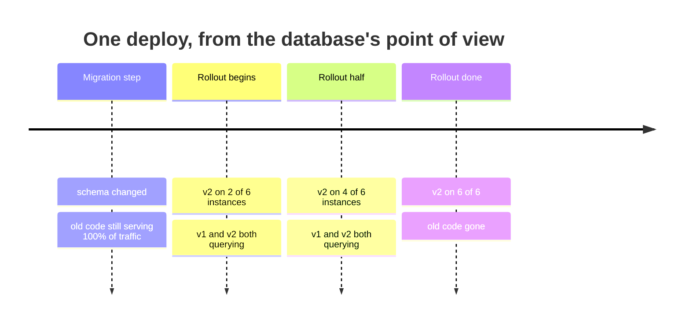
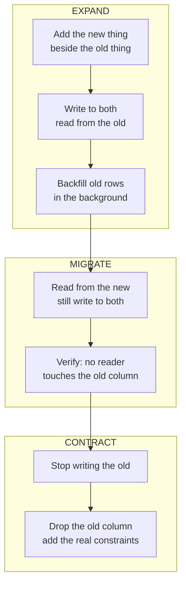

# Migrations — Part 2: Changing a Live Database

Part 1 assumed the easy case: nobody is using the application while the
migration runs. That case does not exist. Your schema changes while customers
are mid-request, and — the detail everyone misses the first time — **while two
different versions of your code are running at once**.

This part is about writing migrations that survive that.

> **⬅️ This continues [Part 1](02-migrations-part-1.md).**

> **📌 In one line:** never change a thing — expand beside it, move everyone
> over, then contract; and never let a migration hold a lock on a big table.

## Table of Contents

1. [Two Versions of Your Code Are Running](#two-versions-of-your-code-are-running)
2. [BROKEN vs FIXED: Renaming a Column in One Deploy](#broken-vs-fixed-renaming-a-column-in-one-deploy)
3. [Expand and Contract (Parallel Change)](#expand-and-contract-parallel-change)
4. [Worked Example: A Rename Across Three Deploys](#worked-example-a-rename-across-three-deploys)
5. [Dangerous Operations on a Large Table](#dangerous-operations-on-a-large-table)
6. [The Lock Queue: Why a Fast Migration Still Takes the Site Down](#the-lock-queue-why-a-fast-migration-still-takes-the-site-down)
7. [Backfilling Data in Batches](#backfilling-data-in-batches)
8. [Constraints as the Last Line of Defence](#constraints-as-the-last-line-of-defence)
9. [Common Mistakes](#common-mistakes)
10. [Questions to Test Yourself](#questions-to-test-yourself)
11. [Related](#related)

---

## Two Versions of Your Code Are Running

A rolling update does not swap your application in one instant. It replaces
instances a few at a time, so that the site stays up while the new version goes
out — see
[rolling-updates.md](../../cloud-devops/deployment-strategies/rolling-updates.md).



That middle band lasts anywhere from thirty seconds to fifteen minutes, and
during it the database receives queries from both versions. Add a rollback — you
redeploy v1 because v2 had a bug — and the old code comes *back* after the
schema already changed. So a migration must satisfy a rule that sounds obvious
and is constantly broken:

> **📌 The compatibility rule:** every schema change must work with the code
> that is already deployed, **and** with the code that is about to be deployed.
> If it only works with one of them, you have chosen an outage.

There are also in-flight queries. A migration that takes an `ACCESS EXCLUSIVE`
lock does not politely wait for a gap — it queues, and everything behind it
queues too. That is [section 6](#the-lock-queue-why-a-fast-migration-still-takes-the-site-down).

---

## BROKEN vs FIXED: Renaming a Column in One Deploy

The column `tasks.name` should have been called `title`. It is a one-word
change, so it looks like a one-line migration.

```ts
// ❌ BROKEN — a perfectly correct migration that causes an outage.
export default class extends BaseSchema {
  async up() {
    this.schema.alterTable('tasks', (table) => {
      table.renameColumn('name', 'title')
    })
  }

  async down() {
    this.schema.alterTable('tasks', (table) => {
      table.renameColumn('title', 'name')
    })
  }
}
```

The SQL is right. The migration runs in two milliseconds. Here is the timeline
anyway:

```text
  t+0s    migration step runs       →  column is now "title"
  t+0s    v1 is still 100% of traffic. Every v1 query says:
            SELECT id, name FROM tasks ...
          ERROR: column "name" does not exist
  t+0s    every task page, every API list endpoint, every worker: 500
  t+90s   rollout finishes, v2 takes over, errors stop
```

Ninety seconds of total failure on one of your main tables — and if the rollout
stalls or you have to roll back to v1, it does not stop at all. The fix is not
a better migration. It is **three deploys instead of one**.

```ts
// ✅ FIXED — deploy 1 of 3. Add the new column; change nothing else.
export default class extends BaseSchema {
  async up() {
    this.schema.alterTable('tasks', (table) => {
      table.string('title').nullable()      // nullable on purpose
    })
  }

  async down() {
    this.schema.alterTable('tasks', (table) => {
      table.dropColumn('title')
    })
  }
}
```

Deploy 1 is invisible to every running instance: v1 does not know `title`
exists, and nothing it does breaks. That is the property to aim for.

---

## Expand and Contract (Parallel Change)

The pattern has three phases, and each phase is its own deploy.



Two ideas do all the work.

**Additive changes are safe; destructive changes are not.** Adding a nullable
column, adding a table, adding an index — old code ignores them. Dropping,
renaming, or tightening a column is destructive, and old code notices
immediately.

**Writes move before reads.** For a while the application writes both the old
and the new column, so whichever one a reader picks, it finds correct data. That
double-write window is what makes the switch safe in both directions: you can
roll back at any point and the old column is still current.

> **⚠️ Warning:** do not compress the phases into one deploy "because the
> backfill is quick". The point of the phases is not duration — it is that a
> rollback at any moment leaves a working system.

---

## Worked Example: A Rename Across Three Deploys

`tasks.name` → `tasks.title`, done properly. Three deploys, days apart if you
like.

**Deploy 1 — expand.** Migration adds the nullable column (the FIXED code
above). The application now writes both and still reads the old one:

```ts
// v2 service code
async createTask(input: CreateTaskInput) {
  return this.tasks.insert({
    projectId: input.projectId,
    name: input.title,      // old column: still written
    title: input.title,     // new column: written too
  })
}

async renameTask(id: string, newTitle: string) {
  return this.tasks.update(id, { name: newTitle, title: newTitle })
}

// Reads still use the old column — v1 instances depend on it.
toDto(row: TaskRow) {
  return { id: row.id, title: row.name }
}
```

Then the backfill, as a separate job, not a migration:

```sql
-- Repeated in batches until it affects 0 rows. See the next section.
UPDATE tasks SET title = name
 WHERE title IS NULL AND id IN (
   SELECT id FROM tasks WHERE title IS NULL ORDER BY id LIMIT 1000
 );
```

At the end of deploy 1, every row has both values and both are correct.

**Deploy 2 — migrate the readers.** Still writing both columns; now reading the
new one.

```ts
toDto(row: TaskRow) {
  return { id: row.id, title: row.title }   // the only line that changed
}
```

If this deploy is rolled back, deploy 1's code reads `name` — which is still
kept up to date. Nothing breaks. Before moving on, prove no reader is left:
grep the codebase, then ask the database itself.

```sql
SELECT query, calls FROM pg_stat_statements
 WHERE query ILIKE '%tasks%name%' ORDER BY calls DESC;
```

Do not forget the readers outside your API code: background jobs, the analytics
export, a saved dashboard query, a partner integration.

**Deploy 3 — contract.** The service stops writing `name` at all, and a
migration shipped *with or after* that code — never before it — removes the
column:

```ts
async up() {
  this.schema.alterTable('tasks', (t) => t.dropColumn('name'))
  this.schema.raw('ALTER TABLE tasks ALTER COLUMN title SET NOT NULL')
}
```

Only now, when every writer fills `title`, can it become `NOT NULL`.

| Deploy | Schema | Writes | Reads | Safe to roll back? |
|---|---|---|---|---|
| Before | `name` | `name` | `name` | — |
| 1 (expand) | `name`, `title` nullable | both | `name` | Yes — `title` unused |
| 2 (migrate) | `name`, `title` | both | `title` | Yes — `name` still current |
| 3 (contract) | `title NOT NULL` | `title` | `title` | No — this is the commit point |

That last row is the honest part: contract is the one irreversible step, which
is exactly why it happens last, alone, and only after you have verified nothing
reads the old column.

The same three phases handle splitting `full_name` into `first_name` and
`last_name`, changing a column's type, moving a column to another table, and
changing a unique key: add beside, dual-write, backfill, switch reads, stop
writing, drop.

---

## Dangerous Operations on a Large Table

"Large" starts around a million rows, or any table your product cannot live
without for thirty seconds. Every row below is a statement that runs instantly
on your laptop.

| Operation | What actually happens | Safe alternative |
|---|---|---|
| `ADD COLUMN ... NOT NULL DEFAULT <constant>` | PostgreSQL 11+ stores the default in the catalog — instant. On PG 10 and below it rewrote the whole table | Confirm your PG version; on old versions use the four-step route below |
| `ADD COLUMN ... DEFAULT now()` / `gen_random_uuid()` | A **volatile** default must be computed per row, so the table is rewritten under `ACCESS EXCLUSIVE` | Add nullable, backfill in batches, then `SET DEFAULT` for new rows |
| `ALTER COLUMN ... SET NOT NULL` | Full table scan under `ACCESS EXCLUSIVE` to prove no NULLs | Add `CHECK (col IS NOT NULL) NOT VALID`, `VALIDATE` it, then `SET NOT NULL` (PG 12+ reuses the proof and skips the scan) |
| `CREATE INDEX` | Takes `SHARE`: reads continue, **every write to the table blocks** until the index is built | `CREATE INDEX CONCURRENTLY`, outside a transaction |
| `ALTER COLUMN ... TYPE ...` | Rewrites every row and every index under `ACCESS EXCLUSIVE`. `varchar(50)` → `varchar(100)` is a rare free case | Expand/contract: new column, backfill, switch, drop |
| `ADD CONSTRAINT ... FOREIGN KEY` | Scans the whole child table to verify, holding a lock on both tables | `... NOT VALID`, then `VALIDATE CONSTRAINT` in a second statement |
| `ADD CONSTRAINT ... CHECK` | Full scan under `ACCESS EXCLUSIVE` | Same two-step: `NOT VALID`, then `VALIDATE` |
| `DROP COLUMN` | Instant in the catalog — but old code still selects it | Expand/contract; drop only in the contract phase |
| Any `ALTER TABLE` behind a long query | Waits for an `ACCESS EXCLUSIVE` lock and blocks everything behind it | `lock_timeout`, then retry. See the next section |

The pattern across the whole table: **a statement is dangerous when it must
touch every row, and a statement is dangerous when it must hold `ACCESS
EXCLUSIVE` while doing so.** `NOT VALID` and `CONCURRENTLY` exist to break that
combination — they let the expensive part run under a weaker lock.

For which lock each statement takes and what that lock blocks, read
[04-locks-part-1.md](../../databases/transactions-and-concurrency/04-locks-part-1.md).
For what `CREATE INDEX CONCURRENTLY` costs — it is slower, it can leave an
`INVALID` index behind if it fails, and it needs a retry plan — read
[04-index-maintenance-and-bloat.md](../../databases/indexing/04-index-maintenance-and-bloat.md).

---

## The Lock Queue: Why a Fast Migration Still Takes the Site Down

This one surprises people, so it is worth its own section.

Your migration is `ALTER TABLE tasks ADD COLUMN archived_at timestamptz` —
instant, no rewrite. But `ALTER TABLE` needs an `ACCESS EXCLUSIVE` lock, and a
reporting query started four minutes ago holds a `ACCESS SHARE` lock on `tasks`.

```text
  reporting SELECT   ████████████████████████  running, 6 min total
  ALTER TABLE                    ▒▒▒▒▒▒▒▒▒▒▒▒  waiting for the lock
  normal SELECT #1                 ▒▒▒▒▒▒▒▒▒▒  waiting behind the ALTER
  normal SELECT #2                  ▒▒▒▒▒▒▒▒▒  waiting behind the ALTER
  normal SELECT #3                   ▒▒▒▒▒▒▒▒  waiting behind the ALTER
```

PostgreSQL queues lock requests in order. The `ALTER` cannot start, and because
it is waiting, **every later query on that table waits behind it** — including
ordinary reads that would not have conflicted with the reporting query at all.
A migration measured in milliseconds just stopped your busiest table for two
minutes, and your connection pool fills up with waiters (see
[04-connection-pooling.md](04-connection-pooling.md)).

The defence is a short `lock_timeout` plus a retry loop:

```sql
SET lock_timeout = '3s';
ALTER TABLE tasks ADD COLUMN archived_at timestamptz;
```

If the lock does not arrive in three seconds, the statement fails with
`canceling statement due to lock timeout` — no queue forms, nothing else is
affected, and the deploy step retries. Pair it with two habits: run migrations
when long queries are least likely, and know which reports hold locks for
minutes. The full diagnosis is in
[04-locks-part-2.md](../../databases/transactions-and-concurrency/04-locks-part-2.md).

---

## Backfilling Data in Batches

Filling a new column for 8 million existing rows is not a migration. It is a
job, and it has to be written so that it can be stopped and resumed.

```sql
-- ❌ BROKEN: one statement, one transaction, one very bad afternoon.
UPDATE invoices SET currency = 'USD' WHERE currency IS NULL;
```

Four things go wrong at once. It locks every matching row, so nobody can edit an
invoice. It creates 8 million dead tuples for autovacuum to clean up. It floods
WAL, which every replica must replay — pushing replication lag into minutes. And
if it is killed at 95%, **all** of it rolls back.

```ts
// ✅ FIXED: small transactions, resumable, with a pause between them.
async function backfillCurrency(db: Database, logger: Logger) {
  const BATCH = 1_000
  let total = 0

  for (;;) {
    // Each batch is its own transaction: it commits, releases its locks,
    // and leaves the table usable between batches.
    const rows = await db.rawQuery(`
      WITH batch AS (
        SELECT id FROM invoices
         WHERE currency IS NULL
         ORDER BY id
         LIMIT ?
         FOR UPDATE SKIP LOCKED
      )
      UPDATE invoices i SET currency = 'USD'
        FROM batch b WHERE i.id = b.id
      RETURNING i.id
    `, [BATCH])

    if (rows.rowCount === 0) break

    total += rows.rowCount
    logger.info({ total }, 'backfill progress')

    // Let autovacuum and the replicas catch up.
    await sleep(200)
  }

  logger.info({ total }, 'backfill complete')
}
```

The details that make it safe:

- **`ORDER BY id` with a bounded `LIMIT`** keeps each batch small, and the
  primary key index makes finding the next batch cheap.
- **`FOR UPDATE SKIP LOCKED`** steps over rows a user is currently editing
  instead of waiting for them; they get picked up on a later pass.
- **The condition is the progress marker.** `WHERE currency IS NULL` means a
  crash costs one batch. Never track progress in a variable that dies with the
  process. It also makes the job idempotent — a second run finds nothing.
- **The pause matters.** Without it you produce dead tuples faster than
  autovacuum removes them, and WAL faster than replicas apply it. 100–500 ms is
  usually enough; watch replication lag and adjust.

Batch sizing and bulk-write technique in general are covered in
[bulk-write-performance.md](../../databases/query-patterns/bulk-write-performance.md);
the dead-tuple side is in
[02-vacuum-and-autovacuum-part-1.md](../../databases/operations/02-vacuum-and-autovacuum-part-1.md).

> **💡 Tip:** run the backfill as a one-off command or queue job you can start,
> watch and stop — not as a migration. A migration that you cannot stop is a
> deploy you cannot abort.

---

## Constraints as the Last Line of Defence

Expand/contract creates a window where the new column is nullable and only
convention keeps it filled. The contract phase is where you close that window,
and it is the step teams skip.

Your application validates input at the edge — see
[01-why-validation-matters.md](../04-validation-and-input/01-why-validation-matters.md).
That is necessary and it is not sufficient, because validation only covers the
paths that go through it. These do not:

- The backfill job you just wrote.
- A second service writing to the same database.
- A console session fixing something by hand at 2 AM.
- A bug that skips the validator on one branch.

A constraint is checked by the database on every write, by every writer,
forever. It is the only rule nobody can route around.

```sql
-- Not optional extras. This is what "the migration is finished" means.
ALTER TABLE invoices ALTER COLUMN currency SET NOT NULL;
ALTER TABLE invoices ADD CONSTRAINT invoices_currency_valid
  CHECK (currency ~ '^[A-Z]{3}$') NOT VALID;
ALTER TABLE invoices VALIDATE CONSTRAINT invoices_currency_valid;
```

Note the `NOT VALID` / `VALIDATE` pair again: add the rule cheaply for new
writes, then verify the history under a weaker lock.

> **📌 Remember:** an unconstrained nullable column that "should always be set"
> will be null for some rows within a year. Not because anyone was careless —
> because there are more writers than you think.

The constraint types, their error messages, and how to map them to clean API
errors are in
[02-constraints-and-data-integrity-part-1.md](../../databases/data-modeling/02-constraints-and-data-integrity-part-1.md).

---

## Common Mistakes

| Mistake | Why it is wrong | Do this instead |
|---|---|---|
| `RENAME COLUMN` in one deploy | Old instances query a column that no longer exists | Expand/contract over three deploys |
| Dropping the old column in the same release that stops using it | A rollback brings back code that needs it | Drop one release later |
| `ADD COLUMN ... DEFAULT now()` on a big table | Volatile default rewrites the whole table | Nullable, backfill, then `SET DEFAULT` |
| `CREATE INDEX` without `CONCURRENTLY` | Blocks every write until the build finishes | `CONCURRENTLY`, with `disableTransactions` |
| `SET NOT NULL` straight away | Full scan under `ACCESS EXCLUSIVE` | `CHECK ... NOT VALID` → `VALIDATE` → `SET NOT NULL` |
| One giant `UPDATE` for the backfill | Locks everything, floods WAL, rolls back at 95% | Batches of ~1,000 with a pause |
| Backfill written as a migration | Cannot be paused; blocks the deploy | A resumable job beside the deploy |
| No `lock_timeout` on DDL | One long query turns an instant `ALTER` into an outage | `SET lock_timeout` and retry |
| Switching reads before the backfill finished | Some rows return null | Verify zero unfilled rows first |
| Leaving the new column nullable forever | Nothing enforces the invariant; jobs and manual sessions bypass validation | Finish the contract phase: put the rule in the database |

---

## Questions to Test Yourself

1. Why does a correct `RENAME COLUMN` migration cause an outage? Walk the
   timeline of one rolling deploy.
2. State the compatibility rule in your own words, and explain why a rollback
   makes it stricter than it first appears.
3. Name the three phases of expand/contract and say which one is irreversible.
4. In deploy 2 of the rename, reads move to `title` but writes still fill both.
   What exactly would break if writes stopped filling `name` in the same deploy?
5. `ADD COLUMN status text NOT NULL DEFAULT 'open'` versus `ADD COLUMN created
   timestamptz NOT NULL DEFAULT now()`. One is instant, one rewrites the table.
   Which, and why?
6. Your `ALTER TABLE` takes two milliseconds but the site is down for two
   minutes. Explain the lock queue, and give the one setting that prevents it.
7. Give four separate problems with `UPDATE invoices SET currency = 'USD'` on
   8 million rows.
8. What does `FOR UPDATE SKIP LOCKED` do in the batched backfill, and what
   would go wrong without it?
9. Why must the backfill's progress be derived from a `WHERE` condition rather
   than held in a counter variable?
10. List four writers that your request-level validation does not protect, and
    say what does protect them.

---

## Related

- [Part 1](02-migrations-part-1.md) — what a migration is, how the runner
  works, and running migrations in CI/CD.
- [rolling-updates.md](../../cloud-devops/deployment-strategies/rolling-updates.md)
  — the deploy model that makes two code versions overlap.
- [04-locks-part-1.md](../../databases/transactions-and-concurrency/04-locks-part-1.md)
  — which lock each DDL statement takes, and the queue behind a blocked one.
- [04-locks-part-2.md](../../databases/transactions-and-concurrency/04-locks-part-2.md)
  — `lock_timeout`, and diagnosing a lock pile-up during an incident.
- [04-index-maintenance-and-bloat.md](../../databases/indexing/04-index-maintenance-and-bloat.md)
  — `CREATE INDEX CONCURRENTLY`, and the invalid index it can leave behind.
- [02-constraints-and-data-integrity-part-1.md](../../databases/data-modeling/02-constraints-and-data-integrity-part-1.md)
  — the constraints the contract phase adds.
- [01-why-validation-matters.md](../04-validation-and-input/01-why-validation-matters.md)
  — the application-side check that constraints back up.
- [bulk-write-performance.md](../../databases/query-patterns/bulk-write-performance.md)
  — batch sizing and efficient bulk updates.
- [04-connection-pooling.md](04-connection-pooling.md) — why a blocked
  migration empties the pool.
