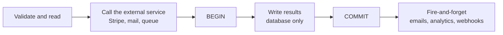

# Transactions — Part 1: Using Them Correctly

A transaction is a promise the database makes: *either all of these statements
happen, or none of them do.* Transfer money between two accounts and the debit
and the credit are one event; the machine can lose power between them and the
promise still holds.

Understanding that promise is one job. Getting it right from application code is
a different job, and it is the one that produces bugs — the database keeps its
promise perfectly while your code hands it the wrong connection, swallows an
error, or holds the transaction open for four seconds waiting on Stripe.

Part 1 is the mechanics: opening a transaction from TypeScript, the three
mistakes that actually happen, and how the handle travels through your layers.
Part 2 is transactions under pressure.

> **📌 In one line:** open the transaction as late as possible, do only database
> work inside it, make sure every query in the block uses the handle, and let a
> thrown error be the rollback.

> **🔍 Scope: the engine side lives in `databases/`.** What ACID guarantees, how
> isolation levels differ, how MVCC produces snapshots, which lock each
> statement takes and how deadlocks form are all covered in
> [databases/transactions-and-concurrency/](../../databases/transactions-and-concurrency/)
> — start with
> [01-transactions-and-acid-part-1.md](../../databases/transactions-and-concurrency/01-transactions-and-acid-part-1.md).
> **This file does not re-teach any of it.** It is about the code on top.

## Table of Contents

1. [The Two Writes That Must Not Split](#the-two-writes-that-must-not-split)
2. [The Callback Style](#the-callback-style)
3. [Why the Callback Style Is Safer](#why-the-callback-style-is-safer)
4. [BROKEN vs FIXED: The Query That Escaped](#broken-vs-fixed-the-query-that-escaped)
5. [BROKEN vs FIXED: The Swallowed Error](#broken-vs-fixed-the-swallowed-error)
6. [BROKEN vs FIXED: The Early Return](#broken-vs-fixed-the-early-return)
7. [Keep Transactions Short](#keep-transactions-short)
8. [Passing the Handle Through Your Layers](#passing-the-handle-through-your-layers)
9. [Common Mistakes](#common-mistakes)
10. [Questions to Test Yourself](#questions-to-test-yourself)
11. [Related](#related)

---

## The Two Writes That Must Not Split

Marking an invoice as paid means two writes:

```ts
await db.from('invoices').where('id', invoiceId).update({ status: 'paid' })
await db.table('payments').insert({ invoiceId, amountCents, provider: 'stripe' })
```

Without a transaction, four things can land between those lines: the process is
killed mid-deploy, the connection drops, the second statement violates a
constraint, or it times out waiting for a lock. In every case the invoice is
`paid` with no payment record — your revenue report and your invoice list
disagree and nothing will ever notice. A transaction removes the gap: `BEGIN`,
both statements, `COMMIT`, and the rows appear together or not at all.

> **📌 The test for "does this need a transaction?"** — if another request could
> read the data *between* your writes and see something that should never exist,
> you need one.

---

## The Callback Style

Every serious Node database library offers the same shape: you pass a function,
the library gives you a transaction handle, and it commits or rolls back
depending on whether your function threw.

```ts
// AdonisJS Lucid. Knex, Prisma, TypeORM and Sequelize expose the same idea.
import db from '@adonisjs/lucid/services/db'

async function payInvoice(invoiceId: string, amountCents: number) {
  return db.transaction(async (trx) => {
    const invoice = await trx.from('invoices').where('id', invoiceId)
      .forUpdate()                       // lock the row for the transaction
      .first()

    if (!invoice) throw new NotFoundError('Invoice not found')
    if (invoice.status === 'paid') throw new ConflictError('Already paid')

    await trx.from('invoices').where('id', invoiceId).update({ status: 'paid' })

    const [payment] = await trx.table('payments')
      .insert({ invoice_id: invoiceId, amount_cents: amountCents })
      .returning('*')

    return payment              // the return value comes back after COMMIT
  })
}
```

Three things happen automatically. The library issues `BEGIN` before your
function runs; if the function returns normally it issues `COMMIT` and resolves
with your return value; if the function throws — *anywhere*, including inside a
library you did not write — it issues `ROLLBACK` and re-throws.

That last point is the whole design. **You never write `rollback()`.** Throwing
is how you roll back, so the paths you did not think about are handled too.

---

## Why the Callback Style Is Safer

The alternative is managing it yourself:

```ts
// ⚠️ Manual style. Correct as written — and every edit can break it.
const trx = await db.transaction()
try {
  await trx.from('invoices').where('id', invoiceId).update({ status: 'paid' })
  await trx.table('payments').insert({ invoice_id: invoiceId })
  await trx.commit()
} catch (error) {
  await trx.rollback()
  throw error
}
```

| | Manual `begin`/`commit`/`rollback` | Callback style |
|---|---|---|
| Forgetting to commit | Silent: connection held, work lost on timeout | Impossible — the library commits |
| Forgetting to roll back | Connection stuck `idle in transaction` forever | Impossible — a throw rolls back |
| An early `return` | Skips the commit and leaks the connection | Commits and returns your value |
| An error from a nested helper | Only caught if you wrapped it | Always caught by the wrapper |
| Reviewer has to check | Every exit path of the function | That the handle is used everywhere |

The manual form is not *wrong*. It is correct until someone adds a guard clause
six months later and returns early — and then the failure is a leaked connection
rather than an exception, so nothing in your error tracker fires. Prefer the
callback style; reach for manual control only when the transaction genuinely has
to outlive one function, knowing you have taken on the bookkeeping.

---

## BROKEN vs FIXED: The Query That Escaped

This is the single most common transaction bug, and the most dangerous, because
the code looks correct and the tests pass.

```ts
// ❌ BROKEN — one query uses `db` instead of `trx`.
async function closeProject(projectId: string) {
  return db.transaction(async (trx) => {
    await trx.from('projects').where('id', projectId).update({ status: 'closed' })

    // Look closely: `db`, not `trx`.
    await db.from('tasks').where('project_id', projectId).update({ status: 'cancelled' })

    await trx.table('audit_log').insert({ action: 'project.closed', projectId })
  })
}
```

The middle statement runs on **a different connection**, outside the
transaction, and commits by itself immediately:

```text
  connection A:  BEGIN → UPDATE projects → INSERT audit_log → ROLLBACK
  connection B:               UPDATE tasks ... COMMIT   ← permanent

  Result: the project is still open. All of its tasks are cancelled. Forever.
```

It gets worse: connection A holds a row lock on the project while connection B
wants its own locks, so a busy table can produce a **deadlock between two
connections used by the same request** — self-inflicted, and very confusing in
a log.

```ts
// ✅ FIXED — every query inside the block takes the handle.
async function closeProject(projectId: string) {
  return db.transaction(async (trx) => {
    await trx.from('projects').where('id', projectId).update({ status: 'closed' })
    await trx.from('tasks').where('project_id', projectId).update({ status: 'cancelled' })
    await trx.table('audit_log').insert({ action: 'project.closed', projectId })
  })
}
```

The one-character difference is why this bug survives code review. Three
defences work better than care: **shadow the name**, so
`db.transaction(async (db) => { ... })` makes the outer connection unreachable;
**never let repositories reach for the global connection**
([section 8](#passing-the-handle-through-your-layers)); and **assert it in a
test** that rolls the transaction back and checks `tasks` is unchanged.

---

## BROKEN vs FIXED: The Swallowed Error

The second mistake is a `try/catch` *inside* the transaction block.

```ts
// ❌ BROKEN — the catch stops the rollback from ever happening.
await db.transaction(async (trx) => {
  await trx.from('invoices').where('id', id).update({ status: 'paid' })

  try {
    await trx.table('payments').insert({ invoice_id: id, amount_cents: amount })
  } catch (error) {
    logger.error({ error }, 'could not record payment')   // and then... nothing
  }
})
```

The intent was reasonable: "the payment record is secondary, do not fail the
whole request over it." The effect is not. The callback returns normally, the
library commits, and the invoice is marked paid with no payment row — the exact
bug the transaction existed to prevent, now with a log line describing it.

> **⚠️ Warning:** on PostgreSQL it is worse than it looks. After a statement
> error the transaction is **aborted**, so every following statement fails with
> `current transaction is aborted, commands ignored until end of transaction
> block` — a cascade of unrelated errors whose real cause is the line you logged
> and discarded.

```ts
// ✅ FIXED — either it matters (let it throw) or it does not (move it out).
const payment = await db.transaction(async (trx) => {
  await trx.from('invoices').where('id', id).update({ status: 'paid' })
  const [row] = await trx.table('payments')
    .insert({ invoice_id: id, amount_cents: amount }).returning('*')
  return row
})

// Genuinely optional work goes after the commit, where failing is harmless.
try {
  await analytics.track('invoice.paid', { invoiceId: id })
} catch (error) {
  logger.warn({ error }, 'analytics failed; invoice is still paid')
}
```

The rule: **inside a transaction block, catch an error only if you will re-throw
it or a translated version of it.** Truly optional work does not belong in the
transaction.

---

## BROKEN vs FIXED: The Early Return

The third mistake belongs to the manual style, and is the best argument against it.

```ts
// ❌ BROKEN — a guard clause added later skips both commit and rollback.
async function archiveProject(projectId: string) {
  const trx = await db.transaction()

  const project = await trx.from('projects').where('id', projectId).first()
  if (!project) return null      // no commit, no rollback, no release

  await trx.from('projects').where('id', projectId).update({ archived: true })
  await trx.commit()
  return project
}
```

Nothing throws, nothing is logged, the request returns `404` and looks fine. But
the connection is never given back to the pool: PostgreSQL shows it as `idle in
transaction`, holding its snapshot, blocking vacuum and occupying a pool slot.
Do it a few hundred times and every request times out — see
[04-connection-pooling.md](04-connection-pooling.md).

```ts
// ✅ FIXED — the callback form makes an early return harmless.
async function archiveProject(projectId: string) {
  return db.transaction(async (trx) => {
    const project = await trx.from('projects').where('id', projectId).first()
    if (!project) return null      // the library still commits and releases

    await trx.from('projects').where('id', projectId).update({ archived: true })
    return project
  })
}
```

If you must use the manual style, the `try`/`catch`/`commit`/`rollback` skeleton
from [section 3](#why-the-callback-style-is-safer) is not optional — and every
`return` inside it has to be checked by hand, forever.

---

## Keep Transactions Short

A transaction holds locks and pins a connection for its entire lifetime. Both
are shared resources, so the cost of a transaction is not what it does — it is
**how long it lasts**.

```ts
// ❌ BROKEN — a network call inside the transaction.
await db.transaction(async (trx) => {
  const invoice = await trx.from('invoices').where('id', id).forUpdate().first()

  // 200 ms on a good day. 30 seconds when Stripe is having an incident.
  const charge = await stripe.charges.create({ amount: invoice.total_cents })

  await trx.from('invoices').where('id', id).update({ status: 'paid' })
  await trx.table('payments').insert({ provider_ref: charge.id })
})
```

Two separate problems, and the second has no fix.

**Locks and connections are held for the whole call.** The invoice row is locked
for 30 seconds and the connection cannot serve anyone else. Under load, every
such request holds a pool slot while doing nothing and the pool empties — an
outage caused by a *slow* dependency rather than a failing one.

**A side effect cannot be rolled back.** If the `INSERT` fails after the charge
succeeds, the transaction rolls back cleanly and the card is still charged.
`ROLLBACK` has no authority over Stripe, the mail server, or a queue.



```ts
// ✅ FIXED — external call first, then a short transaction, then notifications.
const invoice = await invoices.findById(id)
assertPayable(invoice)

const charge = await stripe.charges.create({
  amount: invoice.totalCents,
  idempotency_key: `invoice-${invoice.id}-${invoice.version}`,
})

await db.transaction(async (trx) => {           // milliseconds
  await trx.from('invoices').where('id', id).update({ status: 'paid' })
  await trx.table('payments').insert({ invoice_id: id, provider_ref: charge.id })
})
await mailer.send(receiptFor(invoice))          // after COMMIT, never inside
```

The charge now happens before the transaction, so a database failure leaves a
charge with no payment row — a *reconcilable* problem, because the idempotency
key lets you retry or refund. Which order is right depends on which
inconsistency you can detect and repair; what is never right is holding the
transaction open across the network.

| Never inside a transaction | Why | Where it goes |
|---|---|---|
| HTTP call to a third party | Unbounded latency; cannot roll back | Before `BEGIN`, or after `COMMIT` |
| Sending an email | Cannot be un-sent; `ROLLBACK` has no authority over it | After `COMMIT` |
| Publishing to a queue | Consumer may act on uncommitted data | The outbox — Part 2 |
| `await sleep()`, retry loops, image processing | Holds locks while idle | Outside |
| Waiting for user input | Minutes-long transaction | Never |

> **📌 Remember:** the order is *decide → do the outside world → `BEGIN` →
> write → `COMMIT` → tell people*, and the
> [service layer](../09-application-architecture/02-service-layer-part-1.md)
> is where it is expressed.

---

## Passing the Handle Through Your Layers

Here is the practical problem. A service orchestrates several repositories and
they must all join the *same* transaction. How does the handle get from the
service into a repository method without turning every signature into plumbing?

**Approach A — the explicit handle parameter.** Every repository method takes an
optional executor and falls back to the global connection.

```ts
// A tiny alias: the pool or a transaction — both run queries the same way.
type Executor = typeof db | TransactionClientContract

export class InvoiceRepository {
  async findById(id: string, ex: Executor = db) {
    return ex.from('invoices').where('id', id).first()
  }
  async markPaid(id: string, ex: Executor = db) {
    return ex.from('invoices').where('id', id).update({ status: 'paid' })
  }
}

// The service decides the boundary and passes it down.
async payInvoice(id: string, amountCents: number) {
  return db.transaction(async (trx) => {
    await this.invoices.markPaid(id, trx)
    return this.payments.record(id, amountCents, trx)
  })
}
```

It is obvious and greppable, and forgetting the argument is a real bug — the
default silently runs outside the transaction. If your team keeps forgetting it,
make the parameter **required** and let the compiler do the review.

**Approach B — a unit of work carried in context.** The handle lives in
request-scoped `AsyncLocalStorage` and repositories read it, so it never appears
in a signature.

```ts
const uow = new AsyncLocalStorage<TransactionClientContract>()

export async function withTransaction<T>(fn: () => Promise<T>): Promise<T> {
  return db.transaction((trx) => uow.run(trx, fn))
}

// Repositories ask for "the current executor" instead of receiving one.
const executor = () => uow.getStore() ?? db

export class InvoiceRepository {
  async findById(id: string) {
    return executor().from('invoices').where('id', id).first()
  }
}

// The service now reads as if there were no transaction at all.
async payInvoice(id: string, amountCents: number) {
  return withTransaction(async () => {
    await this.invoices.markPaid(id)
    return this.payments.record(id, amountCents)
  })
}
```

| | A — explicit handle | B — unit of work in context |
|---|---|---|
| Signatures | Every data method carries an executor | Clean, domain-only |
| Is it obvious which queries are in the transaction? | Yes, visible at the call site | No — you must know the caller |
| Forgetting the handle | Query silently escapes | Cannot happen |
| Testability | Trivial: pass a fake | Needs the context set up |
| Queue jobs and CLI commands | Work unchanged | Only if they enter the context |
| Cost | Noise in many signatures | Hidden control flow; one more mechanism |

**Which to choose.** For a team of two to six on one Node service, start with
**A** — the noise is the honest price of seeing where the boundary is, and its
failure mode is a bug you can find by reading. Move to **B** when the handle has
become genuinely unreadable (many repositories per operation, deep call chains)
*and* you already use `AsyncLocalStorage` for the request id, so the mechanism
is not new. Either way, **only the service layer opens transactions**: a
repository that starts one stops its caller composing two operations atomically.
See [03-repository-layer-part-1.md](../09-application-architecture/03-repository-layer-part-1.md).

---

## Common Mistakes

| Mistake | Why it is wrong | Do this instead |
|---|---|---|
| One query uses `db` instead of `trx` | It runs and commits outside the transaction | Shadow the name; pass the executor everywhere |
| A repository opens its own transaction | Callers cannot compose two operations | Only services open transactions |
| `try/catch` inside the block that does not re-throw | The library commits partial work | Re-throw, or move the optional work out |
| Manual `begin` with an early `return` | Connection stuck `idle in transaction` | Callback style |
| Calling Stripe or sending mail inside the block | Locks held across the network; cannot roll back | Before `BEGIN` or after `COMMIT` |
| Default `Executor = db` and then forgetting it | Silent escape, exactly like `db` vs `trx` | Make the parameter required |
| Doing the whole request in one transaction | One slow step blocks every lock it holds | Wrap only the writes that must be atomic |

---

## Questions to Test Yourself

1. Give the one-sentence test for whether an operation needs a transaction.
2. Name three failure modes the callback style makes impossible.
3. A block uses `trx` twice and `db` once. Draw the timeline of what commits and
   what rolls back, and name the worst outcome.
4. Why can a single request deadlock against itself in that situation?
5. A teammate catches an error inside a transaction and logs it. Say what
   commits, and why the *next* statement fails on PostgreSQL.
6. Manual style with an early `return` throws nothing and logs nothing. Why is
   it still one of the worst bugs in this file?
7. An HTTP call sits inside a transaction. Name the two problems, and say which
   one cannot be fixed by making the call faster.
8. Charging the card before the transaction leaves its own inconsistency.
   Describe it, and say why it beats the alternative.
9. Compare the two handle-passing approaches on two axes: what happens when a
   developer forgets, and what a reviewer must check. Then say why a repository
   should never open a transaction.

---

> **➡️ Continued in [Part 2](03-transactions-part-2.md)** — savepoints and
> nesting, retrying deadlocks and serialization failures, idempotency, isolation
> levels, pool exhaustion, testing with rollback, and the outbox pattern.

## Related

- [Part 2](03-transactions-part-2.md) — transactions under pressure.
- [01-transactions-and-acid-part-1.md](../../databases/transactions-and-concurrency/01-transactions-and-acid-part-1.md)
  — what the database actually guarantees, and what `COMMIT` does.
- [04-locks-part-1.md](../../databases/transactions-and-concurrency/04-locks-part-1.md)
  — what `SELECT ... FOR UPDATE` locks and for how long.
- [02-service-layer-part-1.md](../09-application-architecture/02-service-layer-part-1.md)
  — the layer that owns the boundary and the ordering of side effects.
- [03-repository-layer-part-1.md](../09-application-architecture/03-repository-layer-part-1.md)
  — the methods that receive the handle.
- [04-connection-pooling.md](04-connection-pooling.md) — why a long transaction
  is a pool problem before it is a locking problem.
- [01-orm-vs-query-builder.md](01-orm-vs-query-builder.md) — optimistic locking
  as an alternative to `FOR UPDATE`.
