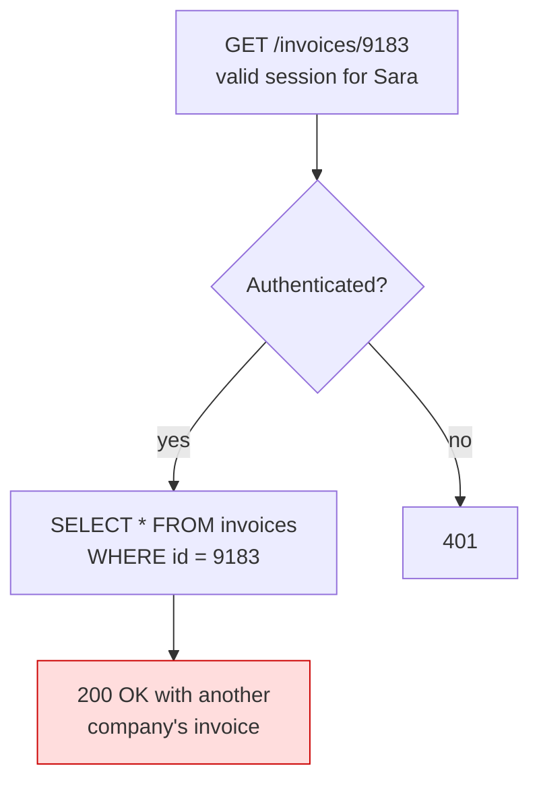
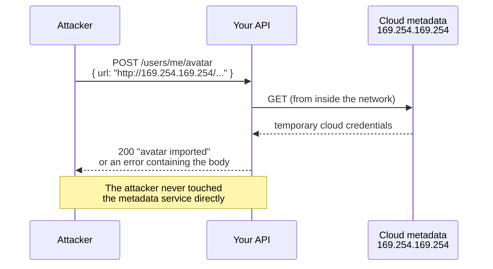

# OWASP Top 10 for APIs

Imagine a fire safety inspector walking through a building. He does not check
everything that could possibly go wrong. He carries a short list of the things
that actually cause fires: blocked exits, bad wiring, no extinguisher. The list
is short on purpose, because a short list gets used.

The **OWASP API Security Top 10** is that list for APIs. It is ten risks,
ordered by how often they show up in real breaches. It is not a complete map of
security. It is the list you run against your own API before you ship.

This file walks through all ten in plain words, with an example from the SaaS
domain we use everywhere in this track — users, companies, projects, tasks,
invoices — and the defence for each one.

> **📌 In one line:** almost every real API breach is a missing permission check
> or a bad configuration, not broken cryptography, and the Top 10 is the checklist
> that catches those.

## Table of Contents

1. [What OWASP Is](#what-owasp-is)
2. [Why APIs Got Their Own List](#why-apis-got-their-own-list)
3. [The Whole List at a Glance](#the-whole-list-at-a-glance)
4. [API1 — Broken Object Level Authorization](#api1--broken-object-level-authorization)
5. [API2 — Broken Authentication](#api2--broken-authentication)
6. [API3 — Broken Object Property Level Authorization](#api3--broken-object-property-level-authorization)
7. [API4 — Unrestricted Resource Consumption](#api4--unrestricted-resource-consumption)
8. [API5 — Broken Function Level Authorization](#api5--broken-function-level-authorization)
9. [API6 — Unrestricted Access to Sensitive Business Flows](#api6--unrestricted-access-to-sensitive-business-flows)
10. [API7 — Server-Side Request Forgery](#api7--server-side-request-forgery)
11. [API8 — Security Misconfiguration](#api8--security-misconfiguration)
12. [API9 — Improper Inventory Management](#api9--improper-inventory-management)
13. [API10 — Unsafe Consumption of Third-Party APIs](#api10--unsafe-consumption-of-third-party-apis)
14. [Your Security Checklist](#your-security-checklist)
15. [The Honest Framing](#the-honest-framing)
16. [Common Mistakes](#common-mistakes)
17. [Questions to Test Yourself](#questions-to-test-yourself)
18. [Related](#related)

---

## What OWASP Is

**OWASP** stands for **Open Worldwide Application Security Project**. It is a
non-profit community that publishes free security material: guides, tools,
testing methods, and lists.

Its most famous output is a "Top 10" — a ranked list of the most common and most
damaging security problems in a category. The lists come from real incident
data and from surveys of security professionals, and they are updated every few
years.

Two things matter about a Top 10 list:

- It is **not a standard you certify against**. Nobody passes an OWASP audit.
- It is a **prioritised starting point**. If you fix only ten classes of bug,
  fix these ten.

> **💡 Tip:** treat the list as a review checklist, not as reading. Open your own
> code next to it and go item by item.

---

## Why APIs Got Their Own List

There is an older, better-known list called the OWASP Top 10 for web
applications. It is aimed at traditional server-rendered websites. An API is a
different shape of software, and the risks shift.

A classic website renders HTML on the server. The browser is the only real
client. An API has no UI of its own. Its clients are a React app, a mobile app,
another company's server, and a script somebody wrote at 2 AM.

That changes what goes wrong:

| Website assumption | Why it fails for an API |
|---|---|
| The UI hides what the user may not do | There is no UI. The caller sends any request they like. |
| Pages are few and reviewed | Endpoints are many, generated, and versioned |
| Output is HTML for a human | Output is JSON, so extra fields are invisible to a human but visible to an attacker |
| Requests come from a browser | Requests come from scripts, at any rate, in any order |

So OWASP maintains a separate **API Security Top 10**. This file covers the
2023 edition, which is the current one.

---

## The Whole List at a Glance

Read this table first. Then read the expanded sections for the ones you are not
already confident about.

| # | Risk | SaaS example | Primary defence | Covered in depth |
|---|---|---|---|---|
| API1 | Broken Object Level Authorization | `GET /invoices/9182` returns another company's invoice | Check ownership on every object, inside the query | [authn-vs-authz](../06-authorization/01-authn-vs-authz.md) |
| API2 | Broken Authentication | Login has no rate limit, so passwords can be guessed | Strong login flow, throttling, safe tokens | [authentication-basics](../05-authentication/01-authentication-basics.md) |
| API3 | Broken Object Property Level Authorization | `PATCH /users/me` with `{"role":"owner"}` promotes the caller | Explicit allow-list of input fields and output fields | [dtos-and-serialization](../09-application-architecture/04-dtos-and-serialization-part-1.md) |
| API4 | Unrestricted Resource Consumption | `GET /tasks?limit=1000000` melts the database | Limits, quotas, pagination caps, timeouts | [rate-limiting](../../system-design/foundational/rate-limiting.md) |
| API5 | Broken Function Level Authorization | A normal member calls `DELETE /admin/companies/12` | Deny by default, check role per route | [rbac](../06-authorization/02-rbac.md) |
| API6 | Unrestricted Access to Sensitive Business Flows | A script signs up 10,000 trial accounts | Flow-level limits, proof of humanity, anomaly detection | this file |
| API7 | Server-Side Request Forgery | "Import avatar from URL" fetches `http://169.254.169.254/` | Allow-list schemes and hosts, block private ranges | this file |
| API8 | Security Misconfiguration | Debug mode on in production, stack traces in responses | Hardened defaults, security headers, reviewed config | [security-headers](04-security-headers-part-1.md) |
| API9 | Improper Inventory Management | `/v1/users` from two years ago still answers | An endpoint inventory, real deprecation, kill old versions | this file |
| API10 | Unsafe Consumption of Third-Party APIs | You trust a partner's JSON and store it unvalidated | Validate every external response like user input | [why-validation-matters](../04-validation-and-input/01-why-validation-matters.md) |

---

## API1 — Broken Object Level Authorization

**In one sentence:** the endpoint checks that you are logged in, but not that the
record you asked for belongs to you.

This is number one on the list because it is number one in reality. It is also
called **IDOR** (Insecure Direct Object Reference) and **BOLA** (Broken Object
Level Authorization) — same bug, different names.

**Example.** Sara at Acme Ltd opens invoice 9182. The front end calls
`GET /api/invoices/9182`. The server checks her session, finds the invoice, and
returns it. Sara changes the URL to `9183`. That invoice belongs to a different
company. The server returns it anyway.



**The defence:** scope the lookup to the caller. Do not fetch the row and then
ask a question about it — make the query itself unable to return a row the
caller may not see.

```ts
// ❌ BROKEN — authentication is checked, ownership is not
const invoice = await Invoice.find(params.id)
return response.ok(invoice)

// ✅ FIXED — the company scope is part of the query, so a wrong id returns nothing
const invoice = await Invoice.query()
  .where('id', params.id)
  .where('company_id', auth.user.companyId) // caller can only ever see their own
  .first()
if (!invoice) return response.notFound({ error: 'Invoice not found' })
```

> **⚠️ Warning:** replacing sequential IDs with UUIDs is *not* a fix. It only
> makes guessing harder. The ID still leaks in exports, emails, and shared links.

Full treatment: [authn-vs-authz](../06-authorization/01-authn-vs-authz.md).

---

## API2 — Broken Authentication

**In one sentence:** the mechanism that proves who the caller is can be bypassed,
guessed, or stolen.

This covers a family of problems: no rate limit on login, weak password rules,
tokens that never expire, tokens you cannot revoke, password reset links that do
not expire, and JWTs whose signature is not actually verified.

**Example.** Your `POST /api/auth/login` has no throttling. An attacker takes a
list of leaked email/password pairs from another breach and tries 200 per second
against your API. Some of your users reused their password. The attacker is in.

**The defence:**

- Throttle authentication endpoints per IP *and* per account.
- Hash passwords with bcrypt, scrypt, or Argon2 — never a plain hash.
- Give tokens a short life and a way to revoke them.
- Verify the signature **and** the claims (`exp`, `iss`, `aud`) on every JWT.
- Treat password reset, email change, and MFA enrolment as authentication too —
  they are the endpoints attackers actually target.

Full treatment: [authentication-basics](../05-authentication/01-authentication-basics.md)
and [passwords-and-hashing](../05-authentication/02-passwords-and-hashing.md).

---

## API3 — Broken Object Property Level Authorization

**In one sentence:** the caller may access the object, but not every *field* of
it — in either direction.

This one merges two older risks, and the two directions are worth naming
separately.

### Direction 1 — Excessive data exposure (output)

You return the whole database row and let the front end decide what to display.
The JSON contains `passwordHash`, `stripeCustomerId`, `internalNotes`, and
`isFlaggedForFraud`. The UI shows none of them. The API returned all of them.

```ts
// ❌ BROKEN — the model goes straight to JSON, including every column
return response.ok(user)

// ✅ FIXED — an explicit output shape; new columns are invisible by default
return response.ok({
  id: user.id,
  fullName: user.fullName,
  email: user.email,
  role: user.role,
})
```

The important property of the fixed version is **allow-list, not deny-list**. If
someone adds a `taxId` column next month, the broken version leaks it
automatically. The fixed version ignores it automatically.

See [dtos-and-serialization](../09-application-architecture/04-dtos-and-serialization-part-1.md).

### Direction 2 — Mass assignment (input)

The reverse problem. You take the whole request body and hand it to the model.

```ts
// ❌ BROKEN — every key in the body becomes a column update
await user.merge(request.body()).save()
// attacker sends: { "fullName": "Sara", "role": "owner", "companyId": 1 }

// ✅ FIXED — only the fields a user may change are read from the body
const data = await request.validateUsing(updateProfileValidator) // name, email only
await user.merge(data).save()
```

Validation is the defence: a schema that lists permitted fields and strips
everything else. See
[why-validation-matters](../04-validation-and-input/01-why-validation-matters.md).

> **📌 Remember:** allow-list what comes in, allow-list what goes out. Never
> `request.body()` into a model, never a model straight into a response.

---

## API4 — Unrestricted Resource Consumption

**In one sentence:** a single caller can make your API do expensive work without
limit, until it stops working for everybody.

Resources here are wider than CPU. They include database connections, memory,
disk, outbound bandwidth, and — the expensive one — third-party services you pay
per call, such as SMS or email.

**Example.** `GET /api/projects/44/tasks?limit=1000000`. You pass `limit`
straight to the query. One request loads a million rows into memory and
serialises them to JSON. Two concurrent requests take the process down.

Second example that costs actual money: `POST /api/auth/forgot-password` in a
loop, sending thousands of emails and burning your sending reputation.

**The defence:**

| Limit | Typical value |
|---|---|
| Page size | Cap at 100, default 20, reject larger values |
| Request body size | 1 MB for JSON, separate limit for uploads |
| Request timeout | A few seconds for normal endpoints |
| Concurrent DB connections | Bounded pool, so one endpoint cannot starve the rest |
| Rate limit | Per IP, per user, per API key |
| Cost-based quota | Expensive endpoints cost more tokens from the same bucket |

Full treatment: [rate-limiting](../../system-design/foundational/rate-limiting.md).

---

## API5 — Broken Function Level Authorization

**In one sentence:** the caller reaches an *operation* they should not be allowed
to perform at all — usually an admin one.

API1 is about the wrong *record*. API5 is about the wrong *action*. A member of a
company calling `DELETE /api/admin/companies/12` is API5. A member reading
another company's invoice is API1.

**Example.** Your front end hides the "Delete project" button for the `viewer`
role. The route itself has no role check. A viewer sends the `DELETE` directly
and it works, because the only thing protecting it was a hidden button.

**The defence: deny by default.**

```ts
// ❌ BROKEN — the route is protected only by "is logged in"
Route.delete('/projects/:id', 'ProjectsController.destroy').middleware('auth')

// ✅ FIXED — an explicit permission is required, checked on the server
Route.delete('/projects/:id', 'ProjectsController.destroy')
  .middleware(['auth', 'can:project.delete'])
```

Write the check so that a new route with no declared permission is *rejected*,
not allowed. A missing rule must fail closed. Also make sure administrative
routes are grouped, so it is easy to see them all in one place during review.

Full treatment: [rbac](../06-authorization/02-rbac.md).

---

## API6 — Unrestricted Access to Sensitive Business Flows

**In one sentence:** every individual request is legal, but doing the whole flow
thousands of times harms the business.

This risk is not about a broken check. Nothing here is a bug in the classic
sense. The flow works exactly as designed, and that is the problem.

**Examples in a SaaS:**

- A script creates 10,000 free trial companies to farm the free tier.
- A competitor calls your public project search endpoint all day and rebuilds
  your data.
- Somebody automates the "invite teammate" flow to send spam from your domain.
- An attacker enumerates `POST /api/auth/forgot-password` with a list of emails
  to learn which addresses have accounts.

**The defence** is different from a plain rate limit, because the attacker may
stay under any per-request limit:

- Identify which flows are business-sensitive: signup, invite, purchase,
  password reset, data export.
- Limit at the **flow** level: number of trials per credit card, invites per
  company per day, exports per user per week.
- Add friction where it is worth it: email verification before the trial
  starts, a CAPTCHA on signup, a delay on the first export.
- Watch for patterns, not single requests: many signups from one IP range, many
  accounts with `+` aliases on one mailbox, activity with no human timing.
- Make responses identical whether or not an account exists, so the flow cannot
  be used to harvest information.

> **💡 Tip:** ask of every flow, "what if someone ran this ten thousand times?"
> If the answer costs money or leaks data, it needs a flow-level limit.

---

## API7 — Server-Side Request Forgery

This one deserves the most space, because it is the least familiar and the
consequences are the largest.

**In one sentence:** the caller gives you a URL, your server fetches it, and your
server can reach places the caller cannot.

### Why your server is a dangerous fetcher

Your API runs inside a private network. From there it can reach the database, an
internal admin service, a Redis instance, and — on every major cloud — a
**metadata endpoint** at a fixed private address that hands out temporary
credentials for the machine's role.

An attacker on the internet cannot reach any of that. But your server can. So
the attacker looks for a feature where *you* fetch a URL for them.

Common features that do this:

- "Import your avatar from a URL"
- Webhook targets the customer configures
- A link preview or an OpenGraph unfurler
- PDF generation from a user-supplied page
- An "import from Google Sheet / CSV URL" feature



Even when you do not return the body, the attacker learns things from the
difference between a fast error and a slow timeout. That is enough to map your
internal network port by port.

### The defence

No single rule is enough. Layer these.

**1. Prefer not fetching at all.** The safest avatar import is a direct upload
from the browser. If the feature can be removed, remove it.

**2. Allow-list the scheme.** Only `https:` (and maybe `http:`). Reject
`file:`, `gopher:`, `ftp:`, `data:` and everything else — these are the schemes
used to read local files or talk to internal protocols.

**3. Allow-list the host where possible.** If the feature is "import from
Dropbox", only Dropbox hostnames are valid. An allow-list of hosts defeats this
entire class of attack in one line.

**4. Block private and special address ranges.** When an allow-list of hosts is
impossible, deny by address:

| Range | Why it is dangerous |
|---|---|
| `127.0.0.0/8`, `::1` | Your own machine — admin ports bound to localhost |
| `10/8`, `172.16/12`, `192.168/16` | Private network — databases, internal services |
| `169.254.0.0/16`, `fd00::/8` | Link-local — cloud metadata lives at `169.254.169.254` |
| `0.0.0.0`, `::` | Shorthand that often resolves to localhost |
| Anything not global unicast | Multicast, reserved, documentation ranges |

**5. Resolve DNS yourself, then check the address, then connect to that address.**
This closes the "DNS rebinding" hole, where a hostname resolves to a safe public
address during your check and to `127.0.0.1` a moment later when the HTTP client
resolves it again.

```ts
import { lookup } from 'node:dns/promises'
import { isPrivateAddress } from './net-guards.js' // your range checks

async function assertSafeUrl(raw: string): Promise<URL> {
  const url = new URL(raw)
  if (url.protocol !== 'https:') throw new Error('Only https URLs are allowed')

  // Resolve once, and validate the address we will actually connect to.
  const { address } = await lookup(url.hostname)
  if (isPrivateAddress(address)) throw new Error('Address range not allowed')
  return url
}
```

**6. Re-check after every redirect.** A public URL may answer `302` and point at
`http://169.254.169.254/`. Either disable redirects, or follow them manually and
run the same check on each hop.

```ts
const res = await fetch(await assertSafeUrl(input), {
  redirect: 'manual',        // never follow blindly
  signal: AbortSignal.timeout(5000),
})
// on a 3xx, read Location, run assertSafeUrl again, and cap the number of hops
```

**7. Cap the response.** Set a timeout, a maximum size, and an allowed
content type. An SSRF target can be a 10 GB stream.

**8. Use a dedicated egress path.** Send all user-triggered outbound fetches
through one forward proxy or one network path whose firewall rules only allow
public internet destinations. Then a mistake in application code is still
blocked by the network. This is the control that survives a developer forgetting
one of the rules above.

> **⚠️ Warning:** never return the fetched body or the raw error to the caller.
> "Could not import image" is enough. Anything more is a free scanner.

---

## API8 — Security Misconfiguration

**In one sentence:** the code is fine, but a setting somewhere is wrong.

This is the widest item on the list, and together with API1 it accounts for most
real incidents.

**Examples:**

- Debug mode left on in production, so errors return stack traces and file
  paths.
- `Access-Control-Allow-Origin: *` on an API that uses cookies.
- Default credentials on a database, a queue, or an admin dashboard.
- A cloud storage bucket that is public because it was easier during
  development.
- Missing security headers, so the browser applies no protections.
- An outdated dependency with a known vulnerability.
- Verbose error messages that name the ORM, the database version, and the table.

**The defence:**

- One hardened configuration, applied by code and not by hand.
- The same deployment process for every environment, with only values differing.
- Error responses that never contain internals — see
  [error-taxonomy](../07-error-handling/01-error-taxonomy.md).
- Security headers set in one place — see
  [security-headers](04-security-headers-part-1.md).
- Automated dependency scanning in CI, so an old package fails the build.
- A review step for every infrastructure change, because this category is
  created by humans in a hurry.

---

## API9 — Improper Inventory Management

**In one sentence:** you cannot secure the endpoints you have forgotten about.

Every API grows old endpoints. The hard part is that you fix the current
version and leave the old one running.

**Examples:**

- `/api/v1/users` still returns every column, while `/api/v2/users` was fixed
  six months ago.
- A `staging.api.yourapp.com` host with production data and no rate limits.
- A debugging route `/api/internal/dump-config` added during an incident and
  never deleted.
- A mobile-only endpoint nobody on the web team knows exists.

**The defence:**

- Keep a real inventory: every host, every version, every endpoint, who owns
  it, and whether it is public.
- Generate it from the code (OpenAPI or your router) rather than maintaining a
  document by hand, so it cannot drift.
- Deprecate on a schedule: announce, add a `Deprecation` response header,
  measure the remaining traffic, then **turn it off**. An old version that is
  never switched off is not deprecated.
- Never give non-production environments real customer data.
- Log unknown-route 404s. A spike is either a scanner or a forgotten client.

---

## API10 — Unsafe Consumption of Third-Party APIs

**In one sentence:** you validate what users send you, then trust whatever a
partner's API sends you.

Developers apply "never trust input" to end users and forget that a third-party
response is also input. It arrives over the network, from a system you do not
control, which may itself be compromised.

**Example.** You enrich each new company with data from a partner service and
store the returned `websiteUrl` and `description`. The partner is breached. Its
responses now contain a `description` field with a script tag in it, and a
`websiteUrl` pointing at an internal address. You store both.

**The defence:**

- Validate third-party responses against a schema, exactly as you validate a
  request body.
- Set timeouts on every outbound call, and a circuit breaker so a slow partner
  does not take you down — see
  [circuit-breakers-and-retries](../../system-design/reliability/circuit-breakers-and-retries.md).
- Do not blindly follow redirects to a partner's URL (this is API7 again).
- Never pass a partner's data into a query, a shell command, or HTML without
  the same escaping you would use for user input.
- Keep secrets for each integration separate, so one leak is one integration.

---

## Your Security Checklist

Run this against one endpoint at a time. Be honest about the "No" answers.

| # | Check | Yes / No |
|---|---|---|
| 1 | Does every object lookup filter by the caller's company or ownership? | |
| 2 | Does a wrong ID return 404, with no hint that the record exists? | |
| 3 | Is the request body validated by a schema that strips unknown fields? | |
| 4 | Is the response built from an explicit field list, not from a model? | |
| 5 | Does every route declare a required permission, and is missing = denied? | |
| 6 | Are login, reset, and invite endpoints rate limited per IP and per account? | |
| 7 | Is `limit` capped, and is the body size capped? | |
| 8 | Do business-sensitive flows have a per-day quota? | |
| 9 | Is every user-supplied URL checked against an allow-list before fetching? | |
| 10 | Are errors generic in production, with details only in logs? | |
| 11 | Are security headers set centrally and verified? | |
| 12 | Do you have a generated list of every live endpoint and version? | |
| 13 | Are old API versions actually switched off, not just undocumented? | |
| 14 | Are third-party responses validated before use or storage? | |
| 15 | Are secrets outside the repository, and rotatable without a deploy? | |

> **💡 Tip:** do this review when you *add* an endpoint, not in a quarterly
> sweep. Fifteen questions take five minutes. Finding number 1 in production
> takes a week.

---

## The Honest Framing

Security has a glamorous image: cryptography, zero-days, clever exploits. That
image is mostly wrong for people building normal products.

Look at the list again. Item 1 is a forgotten `WHERE` clause. Item 3 is
returning the whole row. Item 5 is a route without a role check. Item 8 is a
setting. Item 9 is an old version nobody switched off.

None of that is exotic. All of it is ordinary engineering discipline applied to
a security question. The teams that avoid breaches are not the ones with the
deepest cryptography knowledge. They are the ones who consistently scope queries
to the caller, validate input, shape output, and keep configuration boring.

> **📌 Remember:** you will almost certainly never be attacked by someone
> breaking AES. You will very likely be attacked by someone changing an ID in a
> URL.

---

## Common Mistakes

| Mistake | Why it is wrong | Do this instead |
|---|---|---|
| Switching IDs to UUIDs to "fix" IDOR | It only makes guessing harder; the ID still leaks | Scope every query by owner |
| Hiding a button for a role | The API is the security boundary, not the UI | Enforce the permission server-side |
| `return response.ok(model)` | Every future column is exposed automatically | Build an explicit response object |
| `model.merge(request.body())` | Any field, including `role`, can be set | Validate and allow-list input fields |
| Treating rate limiting as only anti-DDoS | It is also the defence for API4 and API6 | Limit per user and per flow, not just per IP |
| Blocking only `127.0.0.1` in an SSRF check | `169.254.169.254`, `0.0.0.0`, and DNS tricks all bypass it | Allow-list hosts; block all private ranges; re-check after redirects |
| Marking an API version "deprecated" in docs | Undocumented is not the same as off | Measure traffic, then switch it off |
| Trusting a partner API's JSON | It is input from a system you do not control | Validate it against a schema |

---

## Questions to Test Yourself

1. What is the exact difference between API1 (object level) and API5 (function
   level) authorization? Give an example of each from an invoicing feature.
2. Why is changing sequential IDs to UUIDs not a fix for broken object level
   authorization?
3. Mass assignment and excessive data exposure are two directions of the same
   risk. What is the shared principle that fixes both?
4. Your server fetches a URL a user supplied. You block `127.0.0.1`. Name three
   ways an attacker still reaches something internal.
5. Why is it not enough to validate a URL once, before calling `fetch` with
   redirects enabled?
6. API6 says every individual request is legal. If nothing is technically
   broken, what exactly are you defending against, and how?
7. You deploy `/api/v2/invoices` with a fixed authorization check. Why is the
   system still vulnerable, and what must you do?
8. A partner API you call is breached. List three ways their compromised
   responses could damage your system.

---

## Related

- [Authentication vs Authorization](../06-authorization/01-authn-vs-authz.md) —
  the defence for API1, the top risk on this list.
- [RBAC](../06-authorization/02-rbac.md) — role checks per route, the defence
  for API5.
- [Authentication Basics](../05-authentication/01-authentication-basics.md) —
  the defence for API2.
- [DTOs and Serialization](../09-application-architecture/04-dtos-and-serialization-part-1.md)
  — shaping output so API3 cannot happen.
- [Why Validation Matters](../04-validation-and-input/01-why-validation-matters.md)
  — the defence for mass assignment and for API10.
- [Rate Limiting](../../system-design/foundational/rate-limiting.md) — the
  defence for API4 and part of API6.
- [Injection Attacks](02-injection-attacks-part-1.md) — the risk class that used to top
  this list and still hits real systems.
- [Security Headers](04-security-headers-part-1.md) — a large slice of API8.
- [Secrets and Configuration](05-secrets-and-configuration-part-1.md) — the other large
  slice of API8.
