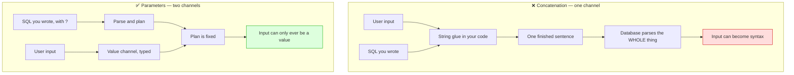

# Injection Attacks — Part 1

You phone an assistant and dictate a letter. You say: "Dear Sam, thanks for the
invoice, new paragraph, we will pay on Friday." The assistant types the words
and treats "new paragraph" as an instruction, because that is what it sounds
like.

Now imagine the letter genuinely needs to contain the words *new paragraph*. You
say them. The assistant does the wrong thing — and it is not their fault. In a
single stream of spoken words there is nothing that separates the message from
the commands about the message.

That is every injection bug ever written. Data and instructions travel down one
channel, and something at the far end decides which is which.

> **➡️ Continued in [Part 2](02-injection-attacks-part-2.md).**

> **📌 In one line:** injection happens when untrusted input reaches something
> that *interprets* text — SQL, a shell, a file path, HTML, a template — and
> every real fix has the same shape: send structure and data down separate
> channels, or make the data provably inert before it arrives.

## Table of Contents

1. [The One Idea Behind Every Injection Bug](#the-one-idea-behind-every-injection-bug)
2. [SQL Injection: How a String Becomes Syntax](#sql-injection-how-a-string-becomes-syntax)
3. [Parameterised Queries, and Why They Work](#parameterised-queries-and-why-they-work)
4. [What Parameterisation Cannot Cover](#what-parameterisation-cannot-cover)
5. [ORMs and Query Builders: Safe Until You Reach for Raw](#orms-and-query-builders-safe-until-you-reach-for-raw)
6. [Least Privilege for the Database User](#least-privilege-for-the-database-user)
7. [NoSQL Injection: An Object Where a String Was Expected](#nosql-injection-an-object-where-a-string-was-expected)
8. [Common Mistakes](#common-mistakes)
9. [Questions to Test Yourself](#questions-to-test-yourself)
10. [Related](#related)

---

## The One Idea Behind Every Injection Bug

Learn this section properly and the rest of both files is revision. Every
injection bug — SQL, shell, path, HTML, XML, template, log, spreadsheet — is
built from exactly three ingredients.

1. **Untrusted data.** Anything you did not write yourself: a request body, a
   query string, a header, an uploaded file's name, a webhook payload, a
   third-party API's JSON. "Untrusted" is not an accusation. It only means *you
   do not control its contents*.
2. **An interpreter.** Something that reads text and decides what it *means*: a
   SQL engine, a shell, a browser's HTML parser, an XML parser, a template
   renderer, a spreadsheet application.
3. **String building.** Your code glues 1 into the text that 2 will read.

Remove any one ingredient and the bug cannot exist. You cannot remove untrusted
data — that is the product. You usually cannot remove the interpreter — that is
the database. So the whole discipline of injection defence is **removing the
third ingredient**.

| Where the data lands | The interpreter | What it reads your input as |
|---|---|---|
| A SQL query | The database engine | Keywords, operators, string delimiters |
| A shell command | `/bin/sh` | Argument separators, pipes, `;`, backticks |
| A file path | The operating system | `..` and `/` as navigation |
| An HTML page | The browser | Tags and `<script>` |
| An XML document | The XML parser | Entities that fetch external files |
| A template string | The template engine | Expressions it should evaluate |
| A log line | Your log reader, a human, a SIEM | A new, forged log entry |
| A CSV cell | Excel or Sheets | A formula to execute |

> **📌 Remember:** you are not trying to "strip bad characters". Blocklists of
> dangerous characters are a losing game — encodings, unicode variants and new
> syntax keep arriving. You are trying to make it *structurally impossible* for
> input to be read as syntax, no matter what it contains.

---

## SQL Injection: How a String Becomes Syntax

Here is the shortest version of the bug that still shows the mechanism.

```ts
// ❌ BROKEN — the input is pasted into the middle of a sentence
const email = request.input('email')
const rows = await db.rawQuery(
  `SELECT id, email, role FROM users WHERE email = '${email}'`
)
```

With a normal input, `sara@acme.test`, the database receives:

```sql
SELECT id, email, role FROM users WHERE email = 'sara@acme.test'
```

Fine. Now think about what the single quotes are actually doing. They are not
decoration — they are the marks that tell the parser "the value starts here and
ends here". The input sits *between* them, so anything the input contains is
read with that in mind.

Send an email value that itself contains a quote, such as `x' OR 1=1 --`, and
the text handed to the database becomes:

```sql
SELECT id, email, role FROM users WHERE email = 'x' OR 1=1 --'
```

Read it as the parser reads it. The value ended at the second quote. What
follows is no longer data — it is a genuine `OR` condition that is always true,
and a comment that swallows the rest of the line. The query now means "every
user". Nothing was hacked. The parser did exactly its job on the sentence your
code built.

Once input can change the meaning of a statement, the consequences are not
limited to reading one extra row. The same mechanism can attach a second
statement, target a different table, or turn a `SELECT` into something that
changes data. That is why this class of bug is rated so highly: the *ceiling*
is "whatever the database user is allowed to do".

> **⚠️ Warning:** the input does not have to arrive in an obvious field. Sort
> parameters, header values, cookie contents, a filename, and a JSON field five
> levels deep are all input. If it reaches a query, it is in scope.

---

## Parameterised Queries, and Why They Work

The fix is one line, and the reason it works is worth understanding properly
rather than memorising.

```ts
// ✅ FIXED — the value travels separately from the statement
const rows = await db.rawQuery(
  'SELECT id, email, role FROM users WHERE email = ?',
  [email]
)
```

A **parameterised** (or **prepared**) query splits one message into two. Your
driver first sends the SQL *text*, with a placeholder where the value goes. The
database parses that text, checks it, and builds an execution plan — all before
it has seen any user data at all. Only then does the driver send the values, in
a separate message, as typed data.

By the time the value arrives, parsing is finished. There is no second parse in
which a quote could mean anything. The value is stored into a slot in an
already-built plan. A string containing `OR 1=1 --` is compared, literally, to
the `email` column, finds nothing, and returns zero rows.



That is the whole idea, and it is why parameterisation beats escaping. Escaping
functions do exist, and a good one is not useless, but it puts you back in the
business of correctly transforming every value, in every code path, under every
character set. Parameterisation removes the question instead of answering it.

**A detail worth knowing.** Parameterising a `LIKE` search stops injection but
does not stop a user's `%` from acting as a wildcard:

```ts
// Safe from injection. The user's own % still matters for matching.
.whereRaw('title LIKE ?', [`%${term}%`])
```

That is a correctness and performance question rather than a security one, but
it is the kind of thing people mistake for a security hole. If you need a
literal `%`, escape it in the value with the dialect's `ESCAPE` clause.

---

## What Parameterisation Cannot Cover

A placeholder stands in for a **value**. It cannot stand in for the *name of a
thing*. These are all structure, not data:

- table names
- column names
- the column in `ORDER BY`
- the direction `ASC` / `DESC`
- schema names, and things like `SELECT *` vs an explicit list

Try `ORDER BY ?` and the database will either reject it or sort every row by a
constant string, which silently does nothing. So dynamic sorting is the place
where a developer who "always uses parameters" writes their one concatenation.

```ts
// ❌ BROKEN — the sort field is pasted straight into the statement
const sort = request.input('sort', 'created_at')
const dir = request.input('dir', 'asc')
const tasks = await db.rawQuery(
  `SELECT * FROM tasks WHERE company_id = ? ORDER BY ${sort} ${dir}`,
  [companyId]
)
```

The fix is an **allow-list**, and the important part is subtle: the user's
string is never used in the query. It is used to *look up* a string that you
wrote.

```ts
// ✅ FIXED — input selects from a map; it never reaches the SQL
const SORTABLE = {
  createdAt: 'tasks.created_at',
  dueDate: 'tasks.due_date',
  title: 'tasks.title',
} as const

const DIRECTIONS = { asc: 'ASC', desc: 'DESC' } as const

function resolveSort(sortInput: unknown, dirInput: unknown) {
  const column = SORTABLE[String(sortInput) as keyof typeof SORTABLE]
  const direction = DIRECTIONS[String(dirInput) as keyof typeof DIRECTIONS]

  if (!column) {
    throw new BadRequestError(
      `Unknown sort field. Allowed: ${Object.keys(SORTABLE).join(', ')}`
    )
  }
  return { column, direction: direction ?? 'ASC' }
}

const { column, direction } = resolveSort(request.input('sort'), request.input('dir'))
const tasks = await db.rawQuery(
  `SELECT * FROM tasks WHERE company_id = ? ORDER BY ${column} ${direction}`,
  [companyId]
)
```

Three things this buys you beyond safety: the API's sort keys (`createdAt`) are
decoupled from your column names (`tasks.created_at`), so renaming a column does
not break clients; an unsupported sort field gets a helpful 400 instead of a
500; and you can only sort by columns you chose to index.

> **💡 Tip:** the same allow-list pattern covers filterable fields, includable
> relations, and exportable columns. Build the map once per resource and reuse
> it — see
> [pagination, filtering and sorting](../02-rest-api-design/03-pagination-filtering-sorting.md).

---

## ORMs and Query Builders: Safe Until You Reach for Raw

Good news first. An ORM or query builder is **parameterised by default**. When
you write this:

```ts
await Task.query().where('title', title).where('company_id', companyId)
```

the builder emits `WHERE title = ? AND company_id = ?` and sends your two values
down the value channel. You get the right behaviour without thinking about it,
which is most of the reason people reach for these tools.

The risk is the escape hatches. Every ORM has them, because sooner or later you
need SQL the builder cannot express. They are not bugs — they are doors, and
they are only dangerous when you walk through them carrying a template literal.

| Escape hatch | Typical name | Safe form |
|---|---|---|
| Raw WHERE fragment | `whereRaw`, `havingRaw` | Pass bindings as a second argument |
| Raw ORDER BY | `orderByRaw` | Allow-list the column, then interpolate |
| Raw query | `db.raw`, `sequelize.query` | Use `?` / `:named` placeholders |
| Tagged-template raw | `$queryRaw` (Prisma) | Already parameterised — safe |
| String raw | `$queryRawUnsafe` | Avoid; the name is the warning |
| Raw insert of a JSON blob | `merge`, `fill` | A different bug — see mass assignment |

```ts
// ❌ BROKEN — a raw fragment built with a template literal
const tasks = await Task.query()
  .where('company_id', auth.user.companyId)
  .whereRaw(`title ILIKE '%${request.input('q')}%'`)

// ✅ FIXED — the fragment is fixed text; the value is a binding
const tasks = await Task.query()
  .where('company_id', auth.user.companyId)
  .whereRaw('title ILIKE ?', [`%${request.input('q')}%`])
```

Note the one genuinely confusing case. In Prisma, `$queryRaw` used as a *tagged
template* is safe, because the library intercepts the interpolations and turns
them into bindings:

```ts
await prisma.$queryRaw`SELECT id FROM users WHERE email = ${email}`   // ✅ safe
await prisma.$queryRawUnsafe(`SELECT id FROM users WHERE email = '${email}'`) // ❌
```

The two lines look almost identical and behave completely differently. This is
exactly why raw usage deserves a deliberate review step.

> **💡 Tip:** a five-second audit of your own repository —
> `grep -rn "Raw\|\.raw(" src/` — finds every place in the codebase where you
> took responsibility back from the library. There should not be many, and each
> one should be obviously parameterised.

More on the trade-offs of each tool:
[ORM vs query builder vs raw SQL](../10-database-integration/01-orm-vs-query-builder.md).

---

## Least Privilege for the Database User

Parameterisation stops the bug. Least privilege decides how bad the day is if
one slips through anyway — in a script, a migration, a reporting job, or a
dependency.

Most applications connect as the database superuser because that is what the
tutorial's connection string said. Think about what that means: the ceiling on
any injection is no longer "read the tasks table". It is "read every database on
this server, drop tables, create extensions, and on some engines read and write
files on the host".

The application does not need any of that. Give it exactly what it uses.

| Database user | Needs | Must not have |
|---|---|---|
| Application runtime | `SELECT`, `INSERT`, `UPDATE`, `DELETE` on app tables | `DROP`, `CREATE`, `ALTER`, superuser |
| Migrations | DDL on the app schema, run at deploy time | To be the same credential as the runtime |
| Reporting / analytics | `SELECT` only, ideally on a read replica | Any write at all |
| Backups | Whatever the backup tool needs | Application network reachability |

```sql
-- A starting shape for the runtime user, not a copy-paste answer
CREATE ROLE app_runtime LOGIN PASSWORD 'from-your-secret-manager';
GRANT CONNECT ON DATABASE saas TO app_runtime;
GRANT USAGE ON SCHEMA public TO app_runtime;
GRANT SELECT, INSERT, UPDATE, DELETE ON ALL TABLES IN SCHEMA public TO app_runtime;
-- deliberately no DDL, no superuser, no access to other databases
```

Two habits that pay for themselves: run migrations with a **separate**
credential that only CI holds, and point read-heavy background jobs at a
read-only user. If a reporting query is ever injectable, the worst case is that
someone reads data the job could already read.

> **⚠️ Warning:** least privilege is a blast-radius control, not a fix. It never
> replaces parameterisation — it only means one mistake is not a company-ending
> mistake.

---

## NoSQL Injection: An Object Where a String Was Expected

People often assume NoSQL databases are immune because there is no SQL string to
break. The interpreter is different, but the shape of the bug is identical.

MongoDB queries are objects, and certain keys in those objects are **operators**
rather than values. Now recall that a JSON request body can contain an object
anywhere a string could be.

```ts
// ❌ BROKEN — the request body is trusted to be strings
const user = await db.collection('users').findOne({
  email: req.body.email,
  resetToken: req.body.resetToken,
})
```

If the body arrives as `{"email": "sara@acme.test", "resetToken": {"$ne": null}}`
then the query your driver builds is "find the user with this email whose reset
token is *anything at all*". The check passes without knowing the token. No
string was escaped or unescaped; a value slot simply received an object, and the
driver faithfully treated its key as an operator.

The fix is not a special NoSQL feature. It is **validating types before the
value reaches the query**:

```ts
// ✅ FIXED — the schema guarantees strings, so no operator can arrive
const schema = z.object({
  email: z.string().email(),
  resetToken: z.string().length(64),
})

const { email, resetToken } = schema.parse(req.body) // throws on an object
const user = await db.collection('users').findOne({ email, resetToken })
```

Three supporting habits:

- Reject unknown keys in the schema, so a client cannot smuggle extra fields.
- Never compare a secret inside the query. Look the record up by a public
  identifier, then compare the hashed secret in code with a constant-time
  compare.
- Treat "spread the query string into a filter object" —
  `find({ ...req.query })` — as the same bug in both SQL and NoSQL. It hands the
  caller the query structure.

Full treatment of the schema layer:
[schema validation](../04-validation-and-input/02-schema-validation.md).

---

## Common Mistakes

| Mistake | Why it is wrong | Do this instead |
|---|---|---|
| Escaping quotes by hand | One missed path, one charset edge case, and it is back | Parameterise every value |
| A blocklist of "dangerous words" like `DROP` | Encodings, casing and comments walk around it | Allow-list, or do not build strings at all |
| "It is an internal admin endpoint" | Internal input is still input, and admins get phished | Same rules everywhere |
| Parameterising values but interpolating `ORDER BY` | Placeholders cannot carry identifiers | Map the input to a column name you wrote |
| `whereRaw` with a template literal | The builder's protection ends at the raw fragment | Pass bindings as the second argument |
| `$queryRawUnsafe` "just for this one query" | The word Unsafe is the documentation | Use the tagged-template form |
| Connecting as the database superuser | Turns a row leak into a server compromise | A runtime role with CRUD only |
| Assuming NoSQL cannot be injected | Operators arrive as objects in JSON | Validate types; reject unknown keys |
| Validating only at the edge of one route | The unvalidated path is the one that breaks | Validate at every boundary, including webhooks |
| Trusting a third-party API's JSON | It is input from a system you do not control | Same schema, same parameters |

---

## Questions to Test Yourself

1. State the three ingredients of an injection bug, and say which one your code
   is actually able to remove.
2. Explain, without using the phrase "escapes the input", *why* a parameterised
   query cannot be injected. Your answer should mention when parsing happens.
3. Why is a blocklist of dangerous characters a weaker defence than a parameter?
4. Name four things a placeholder cannot stand in for, and the pattern that
   handles all four.
5. Your ORM is parameterised by default. Write down the three method names in
   your own stack that opt out of that, and check how they are used.
6. `$queryRaw` and `$queryRawUnsafe` differ by one word. Explain the actual
   mechanical difference.
7. Your application connects as the database superuser. Describe how the impact
   of a single injectable query changes if you fix that.
8. A login handler passes `req.body.password` into a Mongo query. Explain what
   goes wrong, and give two independent fixes.
9. `LIKE ?` with `%term%` is safe from injection. What can a user still do with
   a `%` in their search term, and is that a security problem?
10. Someone proposes an escaping function used everywhere instead of parameters.
    Give the strongest argument against it in two sentences.

---

## Related

- [Injection Attacks — Part 2](02-injection-attacks-part-2.md) — command
  injection, path traversal, XSS from the backend's side, XXE, template and log
  injection, CSV formulas, and prototype pollution.
- [Schema Validation](../04-validation-and-input/02-schema-validation.md) — the
  layer that guarantees a string is a string before it reaches a query.
- [Why Validation Matters](../04-validation-and-input/01-why-validation-matters.md)
  — the reasoning under all of this.
- [Sanitization and Normalization](../04-validation-and-input/03-sanitization-and-normalization.md)
  — why escaping belongs at the destination, not at the front door.
- [Pagination, Filtering and Sorting](../02-rest-api-design/03-pagination-filtering-sorting.md)
  — the allow-list map for sortable and filterable fields, in its natural home.
- [ORM vs Query Builder vs Raw SQL](../10-database-integration/01-orm-vs-query-builder.md)
  — what each tool does for you, and where its protection stops.
- [SQL Basics — CRUD, Part 1](../../databases/fundamentals/03-sql-basics-crud-part-1.md)
  — the statements an injection is rewriting.
- [OWASP Top 10 for APIs](01-owasp-top-10-for-apis.md) — where injection sits in
  the wider risk list.
