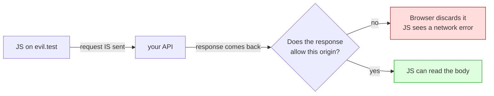
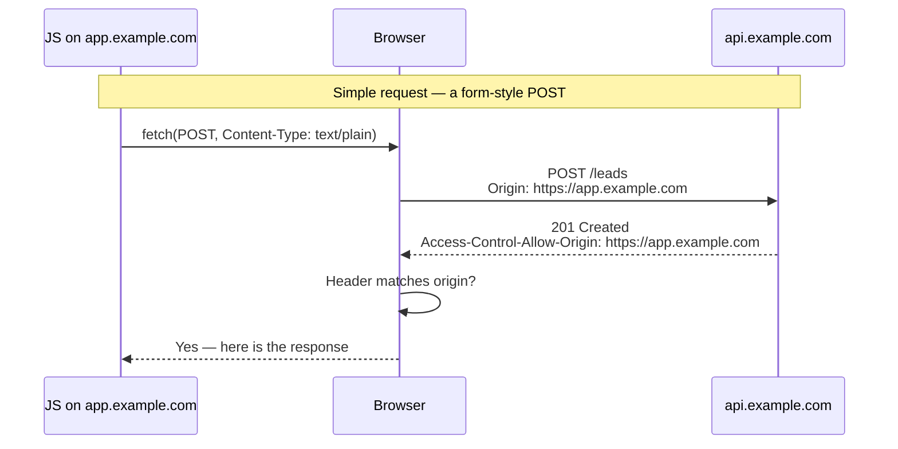
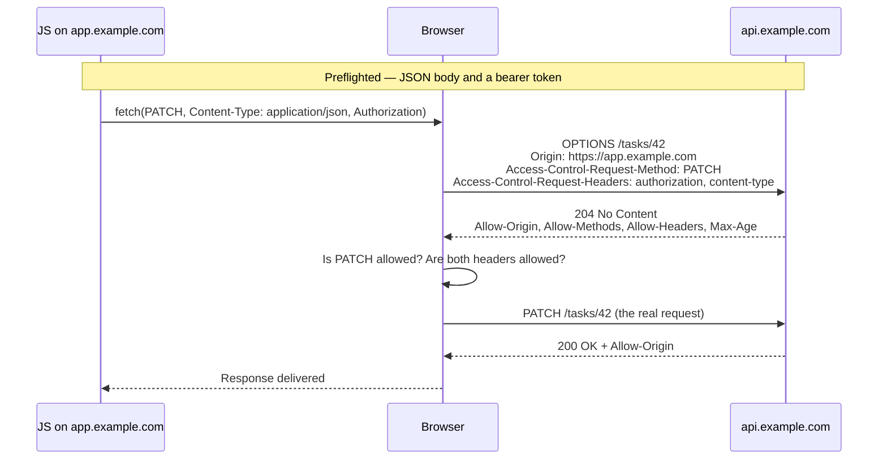

# CORS

Let us start with the sentence that saves the most time:

> **CORS is a rule your users' browsers follow. It is not a defence your server
> provides.**

CORS stops a *web page* running on one site from reading a response from
another. It does not stop `curl`, Postman, a Python script, a mobile app, or
another company's server. Those clients do not implement the rule, so there is
nothing for them to obey.

Most developers meet CORS as a red console error, fix it with `origin: '*'`,
and believe they loosened a security control. They did not — they changed a
browser instruction, and may have quietly broken their cookie auth doing it.

> **📌 In one line:** the same-origin policy stops one site's JavaScript from
> *reading* another site's response; CORS is the mechanism by which the second
> site says "actually, this origin may read me" — and neither one has any effect
> on a non-browser client.

## Table of Contents

1. [The Same-Origin Policy From Zero](#the-same-origin-policy-from-zero)
2. [Why the Policy Exists](#why-the-policy-exists)
3. [Simple Requests vs Preflighted Requests](#simple-requests-vs-preflighted-requests)
4. [Every CORS Header](#every-cors-header)
5. [The Credentials Rule](#the-credentials-rule)
6. [BROKEN vs FIXED: Reflecting the Origin](#broken-vs-fixed-reflecting-the-origin)
7. [Configuring CORS Properly](#configuring-cors-properly)
8. [Reading a CORS Error](#reading-a-cors-error)
9. [CORS and Cookies](#cors-and-cookies)
10. [CORS Does Not Prevent CSRF](#cors-does-not-prevent-csrf)
11. [Advanced: Public APIs and the Gateway](#advanced-public-apis-and-the-gateway)
12. [Common Mistakes](#common-mistakes)
13. [Questions to Test Yourself](#questions-to-test-yourself)
14. [Related](#related)

---

## The Same-Origin Policy From Zero

An **origin** is exactly three things joined together:

```
scheme  ://  host  :  port
https   ://  app.example.com  :  443
```

Two URLs are **same-origin** only if all three match. The path, the query string
and the fragment are irrelevant.

| URL A | URL B | Same origin? | Why |
|---|---|---|---|
| `https://app.example.com/dashboard` | `https://app.example.com/settings` | ✅ Yes | Path is not part of an origin |
| `https://app.example.com` | `https://app.example.com:443` | ✅ Yes | 443 is the default port for https |
| `https://app.example.com` | `http://app.example.com` | ❌ No | Different scheme |
| `https://app.example.com` | `https://api.example.com` | ❌ No | Different host — a subdomain is a different host |
| `https://app.example.com` | `https://example.com` | ❌ No | Different host, again |
| `https://app.example.com` | `https://app.example.com:8443` | ❌ No | Different port |
| `http://localhost:3000` | `http://localhost:5173` | ❌ No | Different port — this is your dev setup |

The last row is why you meet CORS on day one of any project with a separate
frontend.

**Now the part that is almost always misunderstood.** The same-origin policy
does not stop the request from being sent. In the default case the browser
sends the request, your server processes it, your database is written to, and
the response comes back — and *then* the browser refuses to hand the response
body to the calling JavaScript.



Hold on to that diagram. It explains the credentials rule, it explains why CORS
does not prevent CSRF, and it explains why the error message you see says
nothing about your server rejecting anything.

---

## Why the Policy Exists

Imagine the policy did not exist.

You are logged into your webmail at `https://mail.example.com`, so its session
cookie sits in your browser. You then visit `https://cat-pictures.test`, and its
JavaScript runs one line: fetch `https://mail.example.com/api/messages`.

The browser attaches your webmail cookies, because cookies are attached by
destination, not by who asked. The webmail server sees a valid, authenticated
request and returns your inbox. The cat-pictures page reads it and keeps it.

The same-origin policy is the rule that stops that. It is one of the load-bearing
guarantees of the web: **a page may cause a request to another site, but it may
not read the answer.**

CORS — **Cross-Origin Resource Sharing** — is the controlled exception. It is
how a server says "this specific other origin is allowed to read me", which is
exactly what your own frontend on a different port needs.

---

## Simple Requests vs Preflighted Requests

The browser has two modes, and knowing which one you are in explains most
confusing behaviour.

A request is **simple** (sent straight away, no preflight) only if *all* of these
hold:

- The method is `GET`, `HEAD` or `POST`.
- The only headers set by your code are on a small safelist: `Accept`,
  `Accept-Language`, `Content-Language`, `Content-Type`, `Range`.
- If `Content-Type` is set, it is one of `application/x-www-form-urlencoded`,
  `multipart/form-data`, or `text/plain`.

Read that list again and note what it means in practice: **`Content-Type:
application/json` is not simple, and an `Authorization` header is not simple.**
So essentially every request your API actually receives from a browser is
preflighted. The simple category exists mainly to keep HTML forms — which
predate CORS — working.





The preflight is an `OPTIONS` request the browser sends **on its own**, before
yours. It asks permission using two headers:

- `Access-Control-Request-Method` — the method the real request will use.
- `Access-Control-Request-Headers` — the non-safelisted headers it will send.

Your server answers with what it permits. If the answer does not cover the
request, the browser never sends the real one — which is why a preflight failure
shows up as "the request never reached my server" in your logs.

> **💡 Tip:** a preflight carries **no cookies and no `Authorization` header**.
> It is an anonymous request. Any authentication middleware that runs before
> your CORS handling will reject it, and every cross-origin call in your app
> will fail for a reason that has nothing to do with CORS configuration.

---

## Every CORS Header

| Header | Sent by | What it does | Example |
|---|---|---|---|
| `Origin` | Browser | States the calling page's origin. You cannot trust it from a non-browser, but a browser always sets it honestly. | `https://app.example.com` |
| `Access-Control-Request-Method` | Browser (preflight) | The method the real request will use | `PATCH` |
| `Access-Control-Request-Headers` | Browser (preflight) | The non-safelisted headers it intends to send | `authorization, content-type` |
| `Access-Control-Allow-Origin` | Server | The one origin allowed to read this response, or `*` | `https://app.example.com` |
| `Access-Control-Allow-Methods` | Server (preflight) | Methods permitted for this path | `GET, POST, PATCH, DELETE` |
| `Access-Control-Allow-Headers` | Server (preflight) | Request headers the client may send | `Authorization, Content-Type` |
| `Access-Control-Allow-Credentials` | Server | `true` means cookies and `Authorization` may be used | `true` |
| `Access-Control-Expose-Headers` | Server | Response headers JS is allowed to *read* | `X-Request-Id, X-RateLimit-Remaining` |
| `Access-Control-Max-Age` | Server (preflight) | Seconds the browser may cache this preflight result | `86400` |
| `Vary: Origin` | Server | Tells every cache that the response depends on `Origin` | `Origin` |

Two of these are routinely forgotten:

**`Access-Control-Expose-Headers`.** By default JavaScript can read only a
handful of response headers. Your `X-Request-Id`, your rate-limit headers, your
`Location` on a 201 are invisible until listed here. A client team reporting
"the header is missing" while you see it in `curl` is this, every time.

**`Vary: Origin`.** As soon as you echo an allowed origin, the response varies
by origin, and every shared cache must know it. Without this header a CDN can
cache origin A's response and serve it to origin B.

---

## The Credentials Rule

This is the rule people hit hardest, so learn the *reason* rather than the
symptom.

> `Access-Control-Allow-Origin: *` **cannot** be combined with
> `Access-Control-Allow-Credentials: true`. The browser rejects the response.

Why the browser refuses: `*` means "any origin on the internet may read this
response". `Allow-Credentials: true` means "and send the user's cookies with the
request". Together they say "any website may make authenticated requests as the
logged-in user and read the results", which is precisely the webmail scenario
the same-origin policy exists to stop. The browser does not let a server opt into
that combination even by accident.

The fix is to echo **one specific origin**, chosen from a list you control:

```ts
// ✅ credentials work because the origin is a single, validated value
res.setHeader('Access-Control-Allow-Origin', 'https://app.example.com')
res.setHeader('Access-Control-Allow-Credentials', 'true')
res.setHeader('Vary', 'Origin')
```

Two smaller rules travel with this one: when credentials are enabled, `*` is
also forbidden in `Access-Control-Allow-Headers`, `-Allow-Methods` and
`-Expose-Headers`. Each must be an explicit list. And on the client side, the
request must opt in too — `fetch(url, { credentials: 'include' })` — or no
cookies are sent regardless of what the server says.

---

## BROKEN vs FIXED: Reflecting the Origin

The quickest way to make the error go away is to echo back whatever origin
asked. It works instantly, and it means **every website on the internet** is
allowed to read authenticated responses from your API.

```ts
// ❌ BROKEN — this is "allow all origins", written in a way that hides it
app.use((req, res, next) => {
  res.setHeader('Access-Control-Allow-Origin', req.headers.origin ?? '*')
  res.setHeader('Access-Control-Allow-Credentials', 'true')
  next()
})
```

Note that this is *worse* than `*`, because the credentials rule no longer
protects you: the browser only forbids the wildcard, and a reflected origin is
not a wildcard.

The half-fix people reach for next has a bug that is easy to miss:

```ts
// ❌ ALSO BROKEN — three different ways to match too much
if (origin.startsWith('https://myapp.com')) ok()   // https://myapp.com.evil.test ✅ passes
if (origin.endsWith('myapp.com')) ok()             // https://notmyapp.com        ✅ passes
if (/myapp.com/.test(origin)) ok()                 // unescaped dot: myappXcom    ✅ passes
```

`https://myapp.com.evil.test` is a domain an attacker can register. It starts
with your domain and is entirely theirs.

```ts
// ✅ FIXED — exact membership of a list, and Vary so caches behave
const ALLOWED_ORIGINS = new Set(config.cors.allowedOrigins) // exact strings

app.use((req, res, next) => {
  const origin = req.headers.origin
  res.setHeader('Vary', 'Origin')

  if (origin && ALLOWED_ORIGINS.has(origin)) {
    res.setHeader('Access-Control-Allow-Origin', origin)
    res.setHeader('Access-Control-Allow-Credentials', 'true')
  }
  // no match: send no CORS headers at all, and let the browser refuse
  next()
})
```

Exact string equality on the full origin — scheme, host and port — is the only
comparison with no edge cases. To allow every subdomain, parse with
`new URL(origin)` and compare `url.hostname` to a suffix *including the dot*.

> **⚠️ Warning:** when the origin is not allowed, send **no** CORS headers.
> Do not return 403 from the preflight — the browser's error will then point at
> the status code rather than the policy, and you will debug the wrong thing.

---

## Configuring CORS Properly

```ts
// config/cors.ts — one place, driven by environment
export const corsConfig = {
  allowedOrigins: env.CORS_ORIGINS.split(','), // validated at startup
  allowedMethods: ['GET', 'POST', 'PATCH', 'DELETE', 'OPTIONS'],
  allowedHeaders: ['Authorization', 'Content-Type', 'X-Request-Id'],
  exposedHeaders: ['X-Request-Id', 'X-RateLimit-Remaining', 'Retry-After'],
  credentials: true,
  maxAge: 86_400, // 24h — one preflight per day per method/header combination
}
```

| Environment | `CORS_ORIGINS` |
|---|---|
| Local | `http://localhost:3000,http://localhost:5173` |
| Staging | `https://staging.myapp.com` |
| Production | `https://myapp.com,https://www.myapp.com` |

Three notes on that config:

- **`maxAge`** removes a round trip from every cross-origin call: without it the
  browser preflights constantly. Browsers cap the value (Chrome 2 hours, Firefox
  24), so a larger number is a request, not a promise.
- **`exposedHeaders`** lets a frontend log your `X-Request-Id` beside its own
  error — the most useful thing you can hand a client team.
- **The origin list is configuration, not code**, so it belongs in validated
  config — see [secrets and configuration — Part 1](05-secrets-and-configuration-part-1.md).

Use a maintained library (`cors` for Express, or your framework's equivalent)
rather than hand-writing the headers; this file exists so its options make sense.

---

## Reading a CORS Error

This is the section you will come back to. A browser CORS error is almost never
a browser problem and almost never a frontend problem — it is a description of
something your server did or failed to do.

| Console message | What it really means | Fix |
|---|---|---|
| "No `Access-Control-Allow-Origin` header is present" | Your server sent no CORS header at all for this response | Origin not in the allow-list, or the CORS middleware is registered *after* the route, or the route threw before reaching it |
| "...must not be the wildcard `*` when the request's credentials mode is `include`" | The credentials rule | Echo one validated origin instead of `*` |
| "Response to preflight request doesn't pass access control check" | The `OPTIONS` response was not a success with the right headers | Usually auth middleware returning 401 on the preflight — preflights are anonymous, so exempt `OPTIONS` |
| "Method PATCH is not allowed by `Access-Control-Allow-Methods`" | You listed methods and forgot this one | Add it to the list |
| "Request header field `authorization` is not allowed by `Access-Control-Allow-Headers`" | The client sends a header you did not permit | Add it; remember custom headers like `X-Request-Id` |
| "Redirect is not allowed for a preflight request" | The `OPTIONS` hit a redirect — http→https, or a trailing-slash rule | Call the final URL; do not redirect `OPTIONS` |
| "...has been blocked by CORS policy" on a 500 response | Your error handler bypasses the CORS middleware | Set CORS headers before routing, and on the error path too |
| Works in Postman, fails in the browser | CORS is a browser rule; Postman does not implement it | Not a server outage — read the console message properly |
| JS cannot read a header you can see in `curl` | Not exposed | Add it to `Access-Control-Expose-Headers` |
| Works for one origin, breaks for another at random | A shared cache stored an origin-specific response | Send `Vary: Origin` |

> **💡 Tip:** reproduce a preflight yourself before changing any code:
> `curl -i -X OPTIONS https://api.myapp.com/tasks -H 'Origin: https://myapp.com' -H 'Access-Control-Request-Method: PATCH'`.
> If those response headers are wrong, the browser is simply telling the truth.

---

## CORS and Cookies

Cookie-based authentication across origins needs **three** things to line up,
and missing any one gives the same silent failure: the request arrives without a
session.

1. The client sends `credentials: 'include'`.
2. The server sends `Allow-Credentials: true` and a specific `Allow-Origin`.
3. The cookie itself is allowed to travel on a cross-**site** request.

Point 3 is the `SameSite` attribute, and it is a different axis from origin.
"Same-site" compares registrable domains, so `app.example.com` and
`api.example.com` are *same-site* but *cross-origin*.

| Your setup | Same-site? | Cookie needs |
|---|---|---|
| `app.example.com` → `api.example.com` | Yes | `SameSite=Lax` is fine; CORS still applies |
| `myapp.com` → `api.myapp.io` | No — different registrable domain | `SameSite=None; Secure` |
| `localhost:5173` → `localhost:3000` | Yes (same host) | `SameSite=Lax` works locally |
| An embedded widget on a customer's site | No | `SameSite=None; Secure`, and accept the third-party cookie restrictions |

Browsers now default a cookie with no `SameSite` attribute to `Lax`, which is
why a setup that worked years ago stops working with no code change. And
`SameSite=None` is only accepted together with `Secure`, so it cannot be tested
over plain http.

The practical lesson: if you can put your API and your frontend on the same
registrable domain, do it. It removes a whole class of cookie problems, and the
cross-origin part is then only CORS. Detail on the attributes:
[cookies and sessions — Part 1](../05-authentication/03-cookies-and-sessions-part-1.md).

---

## CORS Does Not Prevent CSRF

Make this explicit, because the two are constantly conflated.

Go back to the first diagram. The browser blocks the *reading* of the response.
The request was still **sent**, and your server still **executed** it.

For a state-changing endpoint, reading the response is not the point. If
`evil.test` can cause `POST /api/transfers` to run with your user's cookies
attached, the money has moved. The attacker never needs to see the 200.

And the classic CSRF vector is an HTML form, which produces a *simple* request:
`POST` with `Content-Type: application/x-www-form-urlencoded`. No preflight is
sent, so there is no moment at which your CORS configuration is consulted.

| | CORS | CSRF defence |
|---|---|---|
| Protects | Reading a cross-origin response | Executing an unintended state change |
| Enforced by | The browser, on the response | Your server, on the request |
| Stops a cross-site `POST` | ❌ No | ✅ Yes |

The real defences are `SameSite` cookies, a CSRF token, and requiring
`application/json` plus a custom header on state-changing routes — a header your
JS sets forces a preflight, and an HTML form cannot set one.

---

## Advanced: Public APIs and the Gateway

**A genuinely public, read-only API** is the one case where
`Access-Control-Allow-Origin: *` is correct rather than lazy. If the data needs
no authentication and is the same for everyone, letting any page read it costs
nothing. The rule to hold is: `*` and credentials never go together, so such an
endpoint must not depend on cookies. If it needs identification, take an API key
in a header — which makes every request preflighted, so set a healthy `Max-Age`.

**Where to configure CORS.** In a single-service app, middleware is fine. As
soon as you have several services behind one hostname, the gateway or reverse
proxy is the better home:

| At the gateway | In each service |
|---|---|
| One origin list, one place to change it | Drifts between services |
| Preflights answered before they reach any app | Every service reimplements `OPTIONS` |
| Consistent behaviour on error responses | Easy to miss the error path |

A common compromise: the gateway owns the origin list and answers preflights,
and services stay CORS-unaware. See
[api-gateway](../../system-design/foundational/api-gateway.md) and
[nginx/reverse-proxy-config](../../cloud-devops/nginx/reverse-proxy-config.md).

---

## Common Mistakes

| Mistake | Why it is wrong | Do this instead |
|---|---|---|
| Believing CORS protects the API | It is a browser rule; `curl` ignores it | Authenticate and authorise every request |
| `origin: '*'` to make the error stop | Breaks cookie auth, and hides the real cause | An explicit origin list per environment |
| Reflecting `req.headers.origin` | Allows every site, credentials included | Exact match against an allow-list |
| `startsWith` / loose regex on the origin | `myapp.com.evil.test` passes | Exact string equality on the full origin |
| Auth middleware in front of CORS | Preflights are anonymous and get a 401 | Handle `OPTIONS` before authentication |
| Forgetting `Vary: Origin` | A cache serves one origin's response to another | Always send it when echoing an origin |
| Not exposing custom headers | The client "cannot see" `X-Request-Id` | `Access-Control-Expose-Headers` |
| Returning 403 for a disallowed origin | Confuses the diagnosis | Send no CORS headers and let the browser refuse |
| Treating CORS as CSRF protection | The request is still sent and executed | `SameSite`, CSRF tokens, JSON-only writes |
| CORS headers missing on 5xx responses | Errors become "CORS errors" and hide the bug | Set headers before routing and in the error handler |

---

## Questions to Test Yourself

1. A colleague says "our API is safe because CORS only allows our frontend".
   Write the two-sentence correction, and name a client that ignores CORS.
2. What exactly does the same-origin policy block — the request, the response,
   or the reading of the response? Why does the answer matter for CSRF?
3. List the conditions that make a request "simple", then explain why almost no
   request to a JSON API qualifies.
4. Which two headers does the browser add to a preflight, and what does each one
   ask?
5. Why does a preflight carry no cookies, and what bug does that cause in a
   typical middleware stack?
6. Explain why the browser forbids `Allow-Origin: *` together with
   `Allow-Credentials: true`. Answer with the attack it prevents.
7. Why is reflecting the `Origin` header more dangerous than sending `*`?
8. `origin.startsWith('https://myapp.com')` passes for which attacker-registrable
   domain?
9. Your frontend cannot read `X-Request-Id`, but `curl` shows it. Name the
   header you are missing.
10. Your API is on `api.myapp.io` and your app on `myapp.com`. Cookie auth
    fails silently. Name the three settings that must line up.
11. A browser shows "blocked by CORS policy" on a request that returns 500.
    What is actually wrong, and where do you fix it?

---

## Related

- [Cookies and Sessions — Part 1](../05-authentication/03-cookies-and-sessions-part-1.md)
  — `SameSite`, `Secure` and `HttpOnly`, the other half of cross-origin auth.
- [Cookies and Sessions — Part 2](../05-authentication/03-cookies-and-sessions-part-2.md)
  — CSRF tokens, the defence CORS does not provide.
- [Security Headers — Part 1](04-security-headers-part-1.md) — the response
  headers that *are* a server-side control, including `frame-ancestors`.
- [Headers](../01-http-foundations/05-headers.md) — how request and response
  headers, including the `OPTIONS` preflight, work underneath all of this.
- [Secrets and Configuration — Part 1](05-secrets-and-configuration-part-1.md)
  — keeping the origin list in validated, per-environment configuration.
- [api-gateway](../../system-design/foundational/api-gateway.md) — configuring
  CORS once for many services.
- [nginx/reverse-proxy-config](../../cloud-devops/nginx/reverse-proxy-config.md)
  — the same job at the proxy layer.
- [OWASP Top 10 for APIs](01-owasp-top-10-for-apis.md) — CORS misconfiguration
  as part of API8.
