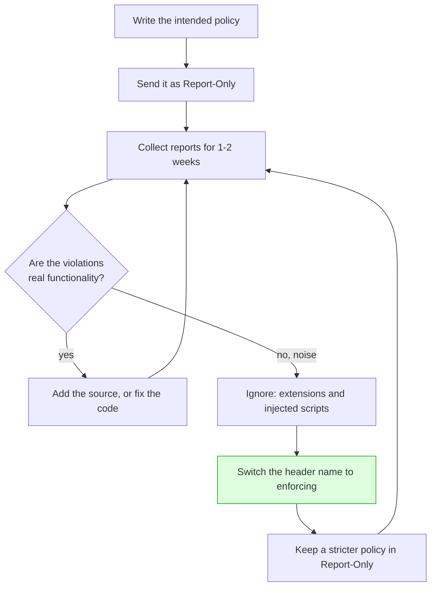

# Security Headers — Part 1

A parcel travels with instructions printed on the outside: *this way up*,
*fragile*, *do not stack*. The courier decides nothing. It reads the label and
behaves accordingly, and a parcel with no label gets handled however the courier
finds convenient.

Security headers are that label. They are lines your server adds to a response
telling the browser how to treat what is inside: which scripts may run, whether
the page may be framed, whether to guess at the content type, how much of the
URL to leak on the way out. The browser already has these protections built in —
your header is the only thing that switches them on.

That makes them the cheapest defence you will ever add. No code changes, no
refactor, no new dependency: a few lines of configuration that turn a real bug
into a blocked one.

> **➡️ Continued in [Part 2](04-security-headers-part-2.md).**

> **📌 In one line:** security headers cost almost nothing and are entirely
> opt-in, so a response without them is not neutral — it is a response that told
> the browser to use its most permissive defaults.

## Table of Contents

1. [What a Security Header Is](#what-a-security-header-is)
2. [The Reference Table](#the-reference-table)
3. [Content-Security-Policy: The Idea](#content-security-policy-the-idea)
4. [The Directives That Matter](#the-directives-that-matter)
5. [Why `unsafe-inline` Undoes Most of It](#why-unsafe-inline-undoes-most-of-it)
6. [Nonces and Hashes](#nonces-and-hashes)
7. [A Realistic Starting Policy](#a-realistic-starting-policy)
8. [Rolling Out CSP Without Breaking the Site](#rolling-out-csp-without-breaking-the-site)
9. [Common Mistakes](#common-mistakes)
10. [Questions to Test Yourself](#questions-to-test-yourself)
11. [Related](#related)

---

## What a Security Header Is

A security header is a response header that a browser treats as an
**instruction about its own behaviour**, not as data for the page.

Three properties are worth stating clearly, because each one shapes how you use
them:

- **They are opt-in.** The browser's default is the permissive behaviour that
  keeps 1998 websites working. Nothing is enforced until you ask for it.
- **They only affect browsers.** A header does not stop `curl`, a script, or a
  server-to-server call. Like CORS, this is a client-side control — it protects
  *your users*, not your database.
- **They are defence in depth.** No header on this list fixes a bug. Each one
  reduces what a bug can do. A Content-Security-Policy does not remove your XSS
  hole; it stops the injected script from running or from sending data anywhere.

That last point decides how to think about them. Headers are the layer you add
*as well as*, never *instead of*, parameterised queries, output escaping and
authorization checks.

> **⚠️ Warning:** several of these headers only do anything for a page a browser
> renders. A pure JSON API needs a much shorter list than a site serving HTML —
> Part 2 gives the exact set, and it is not the set most blog posts recommend.

---

## The Reference Table

The whole map in one place. Each header is expanded later, here or in Part 2.

| Header | What it does | Sensible value | Risk of omitting it |
|---|---|---|---|
| `Content-Security-Policy` | Declares which sources of script, style, images and connections the page may use | See the starting policy below | An injected script runs with full privileges |
| `Strict-Transport-Security` | Forces every future visit to use HTTPS | `max-age=31536000; includeSubDomains` | A first request over http can be intercepted or downgraded |
| `X-Content-Type-Options` | Stops the browser guessing a response's type | `nosniff` | An uploaded file or JSON response gets executed as HTML or script |
| `X-Frame-Options` | Legacy control on being framed | `DENY` | Clickjacking in older browsers |
| `Content-Security-Policy: frame-ancestors` | The modern control on who may frame you | `frame-ancestors 'none'` | Clickjacking |
| `Referrer-Policy` | How much URL is sent to the next site | `strict-origin-when-cross-origin` | Internal paths and query-string tokens leak to third parties |
| `Permissions-Policy` | Switches off browser features you do not use | `camera=(), microphone=(), geolocation=()` | An injected script, or an embedded frame, can request them |
| `Cross-Origin-Opener-Policy` | Isolates your page from windows that opened it | `same-origin` | Cross-window attacks on a page that opens popups |
| `Cross-Origin-Resource-Policy` | Stops other sites embedding your responses | `same-site` | Your resources are loaded and measured by other origins |
| `Cache-Control` | Whether a response may be stored | `no-store` on anything authenticated | A shared cache serves one user's data to another |

Two entries deserve a note now. `X-Frame-Options` and CSP's `frame-ancestors`
do the same job; you send both because old browsers only understand the first.
And `Cache-Control` is not usually filed under security at all, which is exactly
why the incident in Part 2 keeps happening.

---

## Content-Security-Policy: The Idea

CSP is the most powerful header on the list and the most often configured into
uselessness, so it gets the rest of this part.

Here is the problem it solves. When a browser renders your page it has no way to
tell the difference between a `<script>` you wrote and a `<script>` an attacker
managed to get into the page through an unescaped field. Both are just script
elements in a document. The browser runs both, with identical privileges: your
cookies, your session, your origin.

CSP gives the browser a way to tell them apart. It is a policy, sent as a
header, that says *where legitimate content may come from*. Anything outside the
policy is refused before it executes.

```
Content-Security-Policy: default-src 'self'; script-src 'self' https://cdn.example.com
```

Read as English: "load things only from my own origin; run scripts only from my
own origin or that CDN." An injected `<script src="https://evil.test/x.js">` now
fails at the browser, with a console error and no execution. The bug that let it
into the page is still there — but it did nothing.

The second half of CSP is just as valuable and less discussed: `connect-src`
constrains where the page may **send** data. Even a script that does run cannot
exfiltrate to an address you did not list.

---

## The Directives That Matter

A policy is a list of directives separated by `;`. Each names a resource type
and the sources allowed for it.

| Directive | Controls | Typical value |
|---|---|---|
| `default-src` | The fallback for any `*-src` you did not set | `'self'` |
| `script-src` | JavaScript: files, inline blocks, `eval` | `'self'` plus a nonce |
| `style-src` | Stylesheets and inline styles | `'self'` |
| `img-src` | Images, favicons | `'self' data: https:` |
| `connect-src` | `fetch`, XHR, WebSocket, `sendBeacon` — where data can go | `'self' https://api.myapp.com` |
| `font-src` | Web fonts | `'self' https://fonts.gstatic.com` |
| `frame-src` | What *you* may embed | `'none'` unless you embed something |
| `frame-ancestors` | Who may embed *you* | `'none'` |
| `object-src` | `<object>`, `<embed>` — legacy plugins | `'none'`, always |
| `base-uri` | What `<base href>` may be set to | `'self'` |
| `form-action` | Where a form may submit | `'self'` |
| `report-to` / `report-uri` | Where violation reports are sent | Your endpoint |

The source values you will use:

| Source | Meaning |
|---|---|
| `'self'` | The page's own origin — scheme, host and port |
| `'none'` | Nothing at all is allowed |
| `https://cdn.example.com` | That exact origin |
| `data:` | `data:` URLs — convenient for images, dangerous for scripts |
| `'unsafe-inline'` | Any inline block runs. See the next section |
| `'unsafe-eval'` | `eval` and `new Function` are allowed |
| `'nonce-<random>'` | Only elements carrying this exact nonce |
| `'sha256-<hash>'` | Only content whose hash matches |

Three of these are punching well above their weight:

- **`object-src 'none'`** costs nothing on a modern site and removes an entire
  family of plugin-based bypasses.
- **`base-uri 'self'`** stops an injected `<base>` tag silently repointing every
  relative script URL on the page to another server.
- **`form-action 'self'`** stops an injected form posting your user's credentials
  somewhere else.

> **💡 Tip:** `default-src` does **not** cover everything. `frame-ancestors`,
> `base-uri`, `form-action` and `report-to` have no fallback, so a policy of
> `default-src 'self'` alone leaves all four unset.

---

## Why `unsafe-inline` Undoes Most of It

You will deploy a policy, the site will break, a search will suggest adding
`'unsafe-inline'` to `script-src`, and the site will work again. Understand what
that trade actually is.

CSP's entire value against XSS rests on the browser being able to distinguish
your scripts from injected ones. The distinguishing feature for an *external*
script is its URL, which the policy lists. An **inline** script has no URL. It
is a block of code sitting in the document.

`'unsafe-inline'` says: run every inline block in this page. An injected XSS
payload is an inline block in the page. So the directive says, precisely, "run
the injected script too".

```
script-src 'self' 'unsafe-inline'      ❌ XSS protection is essentially off
script-src 'self' 'nonce-r4nd0m'       ✅ only blocks you marked will run
```

The same argument applies to `'unsafe-eval'`, one step weaker: it does not admit
injected markup, but it lets any string become code, which many exploitation
paths rely on.

This is why a CSP audit starts with one question: *does `script-src` contain
`'unsafe-inline'`?* If it does, most of the policy is decoration. The remaining
directives — `frame-ancestors`, `form-action`, `connect-src`, `object-src` —
still work, which is why the header is not worthless, but the headline benefit
is gone.

---

## Nonces and Hashes

So how do you keep inline scripts and still have a policy? You give the browser
a way to recognise *yours*.

**A nonce** ("number used once") is a random value your server generates **per
response**. It goes in the header and on each script tag you approve.

```ts
// ✅ generate per request, never reuse, never derive from anything predictable
const nonce = crypto.randomBytes(16).toString('base64')

res.setHeader(
  'Content-Security-Policy',
  `script-src 'self' 'nonce-${nonce}'; object-src 'none'; base-uri 'self'`
)
```

```html
<script nonce="{{ nonce }}">initApp()</script>   <!-- runs -->
<script>stealCookies()</script>                   <!-- no nonce: blocked -->
```

An attacker who injects markup cannot know the nonce, because it changed on this
response and is not in any resource they can read. Two rules make or break this:

1. **New random value per response.** A nonce reused across responses, or
   derived from a session id, is guessable and therefore not a nonce.
2. **The HTML must not be cached by a shared cache**, or every visitor receives
   a page whose nonce no longer matches the header they got.

**A hash** is the alternative for a small, fixed set of inline scripts. You take
the SHA-256 of the exact script contents and list it:

```
script-src 'self' 'sha256-B2yPHKaXnvFWtRChIbabYmUBFZdVfKKXHbWtWidDVF8='
```

No per-request work, cache-friendly, but the hash changes with every character
of the script — including whitespace — so it suits build-time-generated
snippets, not hand-edited ones.

> **💡 Tip:** `'strict-dynamic'` alongside a nonce lets a script you trusted load
> further scripts without listing every CDN. It is the modern recommendation for
> complex apps, and it makes host allow-lists in `script-src` redundant.

---

## A Realistic Starting Policy

Not a maximal policy — a starting one, for a typical SaaS frontend that talks to
its own API and loads an analytics script.

```
Content-Security-Policy:
  default-src 'self';
  script-src 'self' 'nonce-{{RANDOM}}' https://cdn.analytics.example;
  style-src 'self' 'unsafe-inline';
  img-src 'self' data: https:;
  font-src 'self' https://fonts.gstatic.com;
  connect-src 'self' https://api.myapp.com https://cdn.analytics.example;
  frame-ancestors 'none';
  object-src 'none';
  base-uri 'self';
  form-action 'self';
  report-to csp-endpoint
```

Two honest notes on it. `style-src 'unsafe-inline'` is a compromise many teams
start with, because CSS-in-JS libraries generate inline styles; the risk from
injected CSS is real but far smaller than injected script, so it is a reasonable
first step and a good second-phase tightening. And `img-src https:` is loose on
purpose — user-supplied avatar URLs break otherwise, and an image is not code.

For a **pure JSON API** the whole thing collapses to one line, because there is
no page: `Content-Security-Policy: default-src 'none'; frame-ancestors 'none'`.
Part 2 explains why that is the right answer rather than a lazy one.

---

## Rolling Out CSP Without Breaking the Site

This is the part that decides whether you ever ship a CSP. Deploying a policy
straight to enforcement on a real app breaks something within minutes — an
analytics tag, a support widget, a font, a payment iframe — and the rollback
teaches the team that CSP is not worth it.

The browser gives you a rehearsal mode. `Content-Security-Policy-Report-Only`
uses exactly the same syntax, blocks **nothing**, and reports every violation
that *would* have happened.



The steps in words:

1. **Send it report-only.** One header name change, zero user impact.
2. **Collect.** A violation report is a small JSON POST to your `report-to`
   endpoint. Store them with a count per directive and blocked URL.
3. **Triage.** Expect a large amount of noise from browser extensions injecting
   their own scripts into your page — these are not your bugs and cannot be
   fixed by you. Filter on the blocked URL.
4. **Fix the real ones.** Either add a legitimate source to the policy, or move
   an inline script into a file and give it a nonce.
5. **Enforce.** Rename the header. Keep it under the same monitoring — a spike
   in violations after a deploy is a genuine signal.
6. **Keep the loop running.** Put the *next*, tighter policy back into
   report-only. Teams that end up with a strict CSP got there in steps.

> **⚠️ Warning:** you can send both headers at once — an enforced policy and a
> stricter report-only one. That is the safe way to test a tightening on real
> traffic without risking the site.

---

## Common Mistakes

| Mistake | Why it is wrong | Do this instead |
|---|---|---|
| Adding `'unsafe-inline'` to make the site work | Removes the main protection CSP offers | Nonces or hashes for the inline blocks you need |
| `'unsafe-eval'` "because a library needs it" | Turns strings into code again | Check whether a newer version of the library dropped it |
| Only setting `default-src` | Four directives have no fallback | Set `frame-ancestors`, `base-uri`, `form-action` explicitly |
| A nonce reused across responses | A guessable nonce is not a nonce | Fresh random bytes per response |
| A nonce plus a cached HTML page | Header and page disagree, everything breaks | Do not shared-cache nonce pages |
| Enforcing a new policy straight away | Something breaks and CSP gets abandoned | Report-only first, for weeks |
| Chasing every violation report | Browser extensions generate huge noise | Triage by blocked URL before acting |
| Treating CSP as an XSS fix | It limits the damage; it does not escape output | Fix the injection too — see file 02 |
| Copying a policy from a blog post | It fits their site, not yours | Start from `default-src 'self'` and widen with evidence |
| Omitting `object-src 'none'` | Cheap directive, whole class of bypasses | Include it in every policy |

---

## Questions to Test Yourself

1. Why are security headers described as opt-in, and what does that mean for a
   response that has none?
2. A header stops an attack in a browser. Explain why that does not make it a
   server-side security control.
3. What problem does CSP solve that output escaping does not?
4. Explain `connect-src` and give an attack it limits even after a script has
   run.
5. Why does `'unsafe-inline'` in `script-src` remove most of CSP's value? Answer
   in terms of what the browser can distinguish.
6. Which parts of a policy still work when `'unsafe-inline'` is present?
7. How does a nonce let the browser tell your inline script from an injected
   one, and what two rules must you follow for it to hold?
8. When is a hash a better choice than a nonce?
9. Name the four directives that `default-src` does not cover.
10. Describe the report-only rollout in five steps, and say what the biggest
    source of noise in the reports will be.
11. Why might you deliberately send an enforced policy and a report-only policy
    at the same time?

---

## Related

- [Security Headers — Part 2](04-security-headers-part-2.md) — HSTS, `nosniff`,
  clickjacking, `Referrer-Policy`, what to remove, the JSON-API set, caching,
  and how to verify a deployment.
- [Injection Attacks — Part 2](02-injection-attacks-part-2.md) — the XSS that
  CSP is containing, and the fixes that come first.
- [Sanitization and Normalization](../04-validation-and-input/03-sanitization-and-normalization.md)
  — escaping at the destination, the layer under CSP.
- [CORS](03-cors.md) — the other browser-enforced rule, and how it differs from
  these headers.
- [Headers](../01-http-foundations/05-headers.md) — how response headers work at
  the HTTP level.
- [OWASP Top 10 for APIs](01-owasp-top-10-for-apis.md) — missing headers as part
  of API8, Security Misconfiguration.
