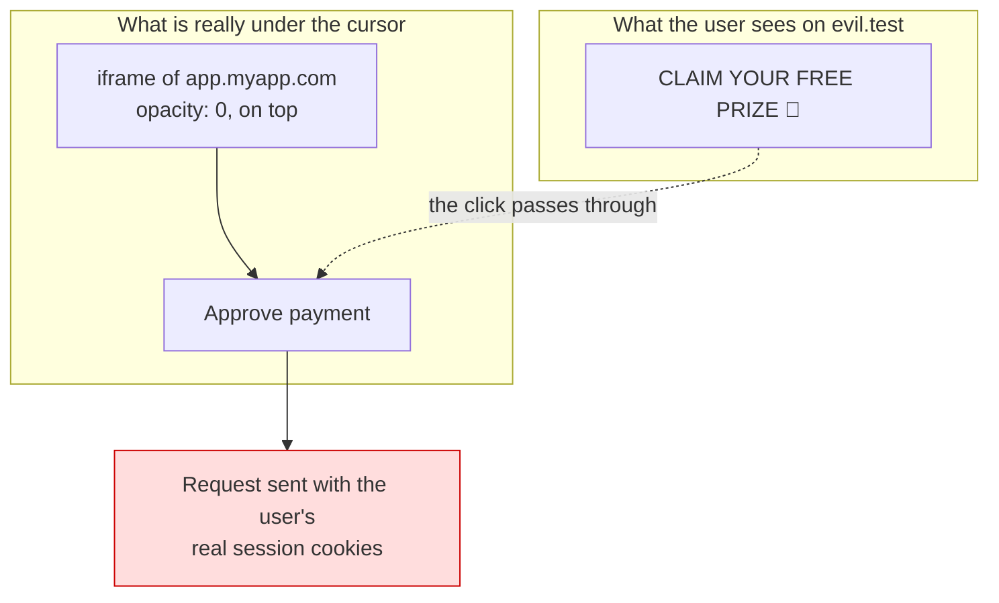

# Security Headers — Part 2

Part 1 spent its length on one header, because Content-Security-Policy earns it.
This part covers the rest of the list — each one smaller, each one a single
decision you make once and forget.

It then answers the question that actually matters for the API you are building:
**which of these do you need at all?** Several only affect a page a browser
renders, and a JSON API that copies a website's header set ends up with lines
that do nothing while missing the two that would have mattered.

> **⬅️ This continues [Part 1](04-security-headers-part-1.md).**

> **📌 In one line:** the remaining headers are one-line decisions — with one
> genuine trap (`Strict-Transport-Security` is hard to undo) and one header
> nobody files under security until the incident happens (`Cache-Control`).

## Table of Contents

1. [Strict-Transport-Security](#strict-transport-security)
2. [X-Content-Type-Options and MIME Sniffing](#x-content-type-options-and-mime-sniffing)
3. [Clickjacking: X-Frame-Options and frame-ancestors](#clickjacking-x-frame-options-and-frame-ancestors)
4. [Referrer-Policy](#referrer-policy)
5. [Permissions-Policy](#permissions-policy)
6. [Headers to Remove](#headers-to-remove)
7. [What a Pure JSON API Actually Needs](#what-a-pure-json-api-actually-needs)
8. [Cache Headers Are a Security Concern](#cache-headers-are-a-security-concern)
9. [Where to Set Headers](#where-to-set-headers)
10. [Verifying Your Own Deployment](#verifying-your-own-deployment)
11. [Common Mistakes](#common-mistakes)
12. [Questions to Test Yourself](#questions-to-test-yourself)
13. [Related](#related)

---

## Strict-Transport-Security

```
Strict-Transport-Security: max-age=31536000; includeSubDomains; preload
```

**What it fixes.** You already redirect http to https, so this looks redundant.
It is not, and the reason is the *first* request. A user types `myapp.com` into
the address bar. The browser has no reason to prefer https, so it sends a plain
http request. Your 301 comes back — but the request already travelled in the
clear, and on a hostile network it can be answered by somebody else before it
ever reaches you.

HSTS removes that first request. Once a browser has seen the header, it upgrades
every future URL for that host to https **before sending anything**. The
insecure request stops existing.

| Part | Meaning | Note |
|---|---|---|
| `max-age=31536000` | Remember for one year, in seconds | Refreshed on every visit |
| `includeSubDomains` | Applies to every subdomain too | Breaks any subdomain still on http |
| `preload` | Requests inclusion in the browsers' built-in list | Protects even the very first visit ever |

**The warning that matters: this is hard to undo.** The browser obeys its stored
value, not your current configuration. Ship `max-age=31536000; includeSubDomains`
while one internal subdomain is http-only, and that subdomain is unreachable for
your users for up to a year, and you cannot fix it from the server. Preloading
is worse: the list ships inside browser binaries, so removal takes months of
release cycles.

So roll it out in steps, and only widen when nothing broke:

```
max-age=300                                  # a few days of testing
max-age=86400                                # a week
max-age=31536000                             # once you are confident
max-age=31536000; includeSubDomains          # once EVERY subdomain is https
max-age=31536000; includeSubDomains; preload # only if you are certain
```

Browsers ignore the header when it arrives over plain http, which is correct —
an attacker on the path could otherwise set it for you. Background:
[https-and-tls](../01-http-foundations/06-https-and-tls.md).

---

## X-Content-Type-Options and MIME Sniffing

```
X-Content-Type-Options: nosniff
```

Browsers historically guessed a response's real type by looking at its bytes,
because so many servers declared the wrong one. That guess is called **MIME
sniffing**, and it means your `Content-Type` header is a suggestion.

Here is the concrete scenario, and it is an upload one.

Your SaaS lets users attach files to a task. A user uploads `notes.txt` whose
contents are actually HTML with a `<script>` block inside. Your download
endpoint serves it from `https://app.myapp.com/uploads/8412` with a generic
`Content-Type: application/octet-stream`, or with none at all. Another user
clicks the attachment. The browser sniffs, sees markup, decides it is HTML,
renders it — and the script now runs **on your origin**, with that user's
session cookies.

`nosniff` ends the guessing. The browser honours what you declared, and a
response declared as text or as a binary download is never executed as HTML or
as script. It also stops a response declared as JSON being treated as script,
which is the other half of why it belongs on an API.

Three things go together here:

1. Send `X-Content-Type-Options: nosniff` on every response.
2. Serve user-uploaded files with `Content-Disposition: attachment` and a type
   you determined yourself, not one the client supplied.
3. Serve user content from a **separate origin** (`usercontent-myapp.com`), so
   even a successful render has no access to your session.

More on the upload path: [file uploads](../12-files-and-integrations/01-file-uploads-part-2.md).

---

## Clickjacking: X-Frame-Options and frame-ancestors

**Clickjacking** is the attack where a user clicks something they can see, and
the click lands on something they cannot.

An attacker builds a page with an appealing button. On top of that button they
place an invisible iframe containing *your* application — `opacity: 0`, sized
and positioned so that your "Delete workspace" or "Approve payment" control sits
exactly under the cursor. The user is logged into your app, so the iframe is a
real, authenticated session. They click the bait, and the click is delivered to
your app.



Nothing is forged. The request is genuine, authenticated, and consented to by a
user who was looking at a different page.

The defence is to refuse to be framed:

```
Content-Security-Policy: frame-ancestors 'none'
X-Frame-Options: DENY
```

`frame-ancestors` is the modern, CSP-based control and takes an origin list.
`X-Frame-Options` is the older header with only `DENY` and `SAMEORIGIN`; send
both, because some older clients only understand the second. If your product is
legitimately embedded by customers, list them explicitly:
`frame-ancestors https://partner.example.com` — and note that `X-Frame-Options`
cannot express that, so a modern CSP is the one doing the work.

---

## Referrer-Policy

When a browser follows a link, or loads an image, script or font, it sends a
`Referer` header naming the page it came from. That page is a URL of yours, and
URLs carry more than you think.

Two ways this leaks:

**Internal structure.** `https://app.myapp.com/admin/companies/412/invoices/9182`
tells a third-party analytics script your URL scheme, your internal IDs, and the
fact that an admin area exists. That is reconnaissance handed over for free.

**Tokens in query strings.** This is the serious one. A password reset link like
`/reset?token=abc123`, an invite link, or a signed download URL is a credential
sitting in the URL. Every third-party resource loaded by that page — a font, an
analytics pixel, an error reporter — receives the full URL, token included, in
the `Referer` header.

```
Referrer-Policy: strict-origin-when-cross-origin
```

| Value | Sends |
|---|---|
| `no-referrer` | Nothing, ever. Right for pages that carry tokens |
| `same-origin` | Full URL to your own origin, nothing cross-origin |
| `strict-origin-when-cross-origin` | Full URL same-origin; only the origin cross-origin; nothing when downgrading to http |
| `unsafe-url` | Everything, always. Never use it |

`strict-origin-when-cross-origin` is the modern browser default and a sensible
explicit value. But note the real fix: **do not put credentials in query
strings.** A header or a POST body does not end up in a `Referer`, in browser
history, or in your own access logs.

---

## Permissions-Policy

```
Permissions-Policy: camera=(), microphone=(), geolocation=(), payment=(), usb=()
```

This switches off browser features for your page and anything it embeds. An
empty list `()` means "nobody, not even me".

It is a small win, but free: if your app never uses the camera, a script that
gets injected into your page cannot prompt for it either, and an embedded iframe
cannot inherit the permission. Set it to deny everything you do not use, and add
`self` to the one or two features you do.

---

## Headers to Remove

Some headers are worth deleting rather than adding.

| Header / behaviour | What it tells a stranger |
|---|---|
| `X-Powered-By: Express` | Your framework, so which vulnerability lists apply |
| `Server: nginx/1.18.0` | An exact version with published advisories |
| `X-AspNet-Version` | The same, for another stack |
| Stack traces in responses | File paths, library versions, your directory layout |
| Directory listings | Every file you did not mean to publish |
| Source maps in production | Your original source, readable |

None of these is a vulnerability by itself. They are **targeting information**.
An automated scanner matches a version banner to a list of known issues and
decides whether you are worth a second look. Removing them does not make you
secure; it makes you uninteresting, which is a real and cheap benefit.

```ts
app.disable('x-powered-by')   // Express
```

```nginx
server_tokens off;            # nginx: drops the version from Server and errors
```

Verbose errors are the same category and are covered properly in
[client-facing error responses — Part 1](../07-error-handling/03-client-facing-error-responses-part-1.md):
generic message to the client, full detail in the log, correlated by a request
id.

---

## What a Pure JSON API Actually Needs

Here is the distinction most header guides skip. A header that instructs a
browser about *rendering a page* does nothing for a response that is never
rendered as a page.

| Header | HTML site | Pure JSON API | Why |
|---|---|---|---|
| `Content-Security-Policy` | Critical, complex | One line | Nothing is rendered — but a locked-down policy still protects the sniffed-as-HTML case |
| `Strict-Transport-Security` | Yes | **Yes** | Transport, not rendering |
| `X-Content-Type-Options` | Yes | **Yes** | Stops JSON being sniffed as HTML or script |
| `X-Frame-Options` / `frame-ancestors` | Yes | Yes, free | A JSON response is not useful framed, but it costs nothing |
| `Referrer-Policy` | Yes | Minor | Affects redirects and any error page |
| `Permissions-Policy` | Yes | No | There is no document to govern |
| `Cross-Origin-Opener-Policy` | Yes | No | Applies to browsing contexts |
| `Cache-Control: no-store` | On authenticated pages | **Critical** | Almost every API response is user-specific |
| CORS headers | Sometimes | **Critical** | This is the one your clients depend on |

The recommended set for a pure JSON API is short:

```
Strict-Transport-Security: max-age=31536000; includeSubDomains
X-Content-Type-Options: nosniff
Content-Security-Policy: default-src 'none'; frame-ancestors 'none'
Referrer-Policy: no-referrer
X-Frame-Options: DENY
Cache-Control: no-store
```

Six lines, and the two doing the heavy lifting are `nosniff` and `no-store`.
Everything else on the long list is aimed at documents.

---

## Cache Headers Are a Security Concern

Nobody files `Cache-Control` under security, which is exactly why this incident
keeps recurring. The shape is always the same.

1. `GET /api/me` returns the logged-in user's profile.
2. The response has no cache headers, or a default `public, max-age=60` applied
   by a CDN rule matching a path prefix.
3. A shared cache — your CDN, a corporate proxy, a reverse proxy — stores it,
   keyed on the URL.
4. The URL is identical for every user. The next request from **anyone** gets
   the first user's profile.

There is no attacker in that story. It is a configuration default meeting an
endpoint whose response depends on a header rather than on the URL.

```
Cache-Control: no-store
```

Know the difference, because the wrong one is a common near-miss:

| Value | Meaning |
|---|---|
| `no-store` | Never write this to any cache, anywhere. What you want for authenticated data |
| `no-cache` | You may store it, but revalidate before reuse. **Not** "do not cache" |
| `private` | Browser cache only; shared caches must not store it. Better than nothing |
| `public, max-age=N` | Anyone may store and reuse for N seconds |

Three supporting rules:

- Put `no-store` on every authenticated response by default, and opt *out*
  deliberately for things that are genuinely public.
- If a response varies by credential, send `Vary: Authorization` (and `Cookie`
  where relevant) so a cache that does store it keys correctly.
- Configure the CDN itself to bypass the cache whenever an `Authorization`
  header or a session cookie is present. Never rely on the origin's headers
  alone — see
  [cdn-and-edge-caching](../../system-design/scale-patterns/cdn-and-edge-caching.md).

---

## Where to Set Headers

Set them **once**, centrally. The failure mode of per-route headers is one route
that forgot.

| | Application middleware | Reverse proxy / gateway |
|---|---|---|
| Lives with | Your code, versioned and reviewed | Infrastructure config |
| Works in local dev | Yes | Usually not |
| Per-route control | Natural — nonces, `no-store` per endpoint | Awkward |
| Covers static files | No | Yes |
| Covers responses the app never produced (502, timeouts) | No | Yes |
| Travels if you change hosting | Yes | No |
| One place for many services | No | Yes |

The trade-off is real, and the common answer is to split by who needs context:

- **The app** sets headers that depend on the request: the CSP nonce,
  `Cache-Control` per endpoint, CORS.
- **The proxy** sets the static globals: HSTS, `nosniff`, `Referrer-Policy`,
  `X-Frame-Options`, and strips `Server` banners.

Whatever you choose, write down which layer owns which header. When both set the
same one you can end up with two values in the response, and browsers do not
agree on which wins. Configuration examples:
[nginx/reverse-proxy-config](../../cloud-devops/nginx/reverse-proxy-config.md)
and [api-gateway](../../system-design/foundational/api-gateway.md).

---

## Verifying Your Own Deployment

Reading your config is not verification. Read the response.

```bash
# every response header, from the outside
curl -sI https://api.myapp.com/api/health

# check the authenticated path separately — it is the one that matters
curl -sI https://api.myapp.com/api/me -H 'Authorization: Bearer <token>' \
  | grep -iE 'cache-control|content-type|strict-transport|x-content-type'

# a preflight, which often misses headers the real response has
curl -sI -X OPTIONS https://api.myapp.com/api/tasks \
  -H 'Origin: https://app.myapp.com' -H 'Access-Control-Request-Method: PATCH'
```

Check three response types, not one: a success, an **error** (error handlers
frequently bypass the middleware that sets headers), and a **static** or
not-found response served by the proxy rather than the app.

Free scanners will grade a public hostname and explain each finding:
`securityheaders.com` and Mozilla Observatory for headers, `testssl.sh` for the
TLS configuration underneath. Treat the grade as a checklist, not a target — a
JSON API legitimately scores lower than a website because half the checks do not
apply to it.

> **💡 Tip:** the durable version of this is a test. One integration test that
> asserts the expected headers on a real response fails in CI the day somebody
> reorders the middleware — see
> [Part 13 — Testing & Quality](../13-testing-and-quality/).

---

## Common Mistakes

| Mistake | Why it is wrong | Do this instead |
|---|---|---|
| `max-age=31536000; includeSubDomains` on day one | A year-long lockout you cannot fix server-side | Ramp the value; widen only when every subdomain is https |
| Preloading before you are certain | Removal takes months of browser releases | Preload last, or not at all |
| Relying on an http→https redirect alone | The first request already went out in the clear | HSTS |
| Skipping `nosniff` because "we set Content-Type" | Your type is a suggestion without it | Send both |
| Serving user uploads from your app origin | A sniffed HTML file runs in your session | Separate origin, `attachment`, `nosniff` |
| Only `X-Frame-Options` | Cannot express an allow-list of embedders | Send `frame-ancestors` too |
| Tokens in query strings | They leak via `Referer`, history and logs | Headers or POST bodies |
| `no-cache` where you meant `no-store` | It permits storing the response | `no-store` on authenticated data |
| Trusting origin cache headers alone | A CDN rule can override or ignore them | Configure bypass on Authorization/Cookie at the CDN |
| Copying a website's header set onto a JSON API | Lines that do nothing, and two that matter missing | Use the six-line API set |
| Setting headers in the app *and* the proxy | Duplicated or conflicting values | Decide ownership per header and document it |
| Checking only a 200 response | Error and static paths often miss them | Verify success, error and 404 |

---

## Questions to Test Yourself

1. You already redirect http to https. Explain precisely what HSTS adds.
2. Why is `Strict-Transport-Security` described as hard to undo, and what is the
   safe rollout order?
3. Why do browsers ignore HSTS sent over plain http?
4. Describe the upload scenario in which a missing `nosniff` becomes script
   execution on your origin. Name two other fixes for the same scenario.
5. Explain clickjacking to someone non-technical in three sentences.
6. `X-Frame-Options` and `frame-ancestors` overlap. Why send both, and which one
   can express "only our partner may embed us"?
7. Name two distinct things a `Referer` header can leak, and say which one is
   the more serious.
8. What is the actual fix for tokens leaking through referrers, beyond the
   header?
9. List the six headers you would set on a pure JSON API, and name the two doing
   most of the work.
10. Describe the incident shape in which a CDN serves one user's data to
    another. Where exactly is the bug?
11. What is the difference between `no-cache` and `no-store`?
12. Give one header that belongs in application middleware and one that belongs
    at the reverse proxy, with the reason for each.
13. Which three response types must you check when verifying headers, and why is
    a 200 not enough?

---

## Related

- [Security Headers — Part 1](04-security-headers-part-1.md) — what these
  headers are, the full reference table, and Content-Security-Policy in depth.
- [HTTPS and TLS](../01-http-foundations/06-https-and-tls.md) — the transport
  layer HSTS is protecting.
- [File Uploads](../12-files-and-integrations/01-file-uploads-part-2.md) — serving user
  content safely, the other half of the `nosniff` story.
- [Client-Facing Error Responses — Part 1](../07-error-handling/03-client-facing-error-responses-part-1.md)
  — not leaking stack traces and versions in errors.
- [CORS](03-cors.md) — the browser rule that sits beside these headers.
- [cdn-and-edge-caching](../../system-design/scale-patterns/cdn-and-edge-caching.md)
  — how a shared cache decides what to store, and how to make it bypass.
- [nginx/reverse-proxy-config](../../cloud-devops/nginx/reverse-proxy-config.md)
  — setting headers and hiding version banners at the proxy.
- [api-gateway](../../system-design/foundational/api-gateway.md) — the same job
  for many services at once.
- [OWASP Top 10 for APIs](01-owasp-top-10-for-apis.md) — API8, Security
  Misconfiguration, which this file is most of.
