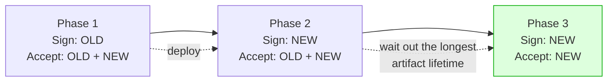

# Secrets and Configuration — Part 2

Part 1 got the secrets out of the repository and into one validated module. That
is the whole of the problem for a small application, and it is where most
projects should stop.

This part is what comes next: the point where environment variables stop being
enough, how to change a key that thousands of live tokens depend on without
logging everyone out, what encrypting data in your own database actually buys
you, and how to stop the next leak before it is ever committed.

> **⬅️ This continues [Part 1](05-secrets-and-configuration-part-1.md).**

> **📌 In one line:** a secret you cannot rotate without downtime is a secret you
> will never rotate — so the real skill is designing every secret to have a
> window where both the old and the new value are accepted.

## Table of Contents

1. [When Environment Variables Stop Being Enough](#when-environment-variables-stop-being-enough)
2. [Secret Managers Compared](#secret-managers-compared)
3. [Rotating a Secret Without Downtime](#rotating-a-secret-without-downtime)
4. [Encrypting Sensitive Data at Rest](#encrypting-sensitive-data-at-rest)
5. [Configuration in Containers and CI/CD](#configuration-in-containers-and-cicd)
6. [Preventing Leaks Proactively](#preventing-leaks-proactively)
7. [Feature Flags Are Not Secrets](#feature-flags-are-not-secrets)
8. [Common Mistakes](#common-mistakes)
9. [Questions to Test Yourself](#questions-to-test-yourself)
10. [Related](#related)

---

## When Environment Variables Stop Being Enough

Environment variables are the right answer for one application and a handful of
values. Four things break as you grow, and each one is a reason a secret manager
exists.

| Limit | What it means in practice |
|---|---|
| **Changing one needs a redeploy** | The environment is read at boot. Rotating a key means a deployment, so rotation gets postponed |
| **No audit trail** | Nobody can answer "who read the production database password, and when" |
| **No versioning** | There is no concept of a current and a previous value, so no overlap window |
| **All-or-nothing access** | Anyone who can open the deployment settings sees every secret at once |

There is a fifth, less obvious problem: environment variables **leak sideways**.
They are inherited by every child process you spawn, they appear in a crash dump,
error reporters attach them by default, and one debug endpoint that prints
`process.env` publishes everything at once.

> **💡 Tip:** you do not need a secret manager on day one. You need it the day
> you have more than one service, more than a couple of people with production
> access, or a compliance requirement to show who accessed what.

---

## Secret Managers Compared

| | Environment variables | Cloud parameter store | AWS Secrets Manager | HashiCorp Vault |
|---|---|---|---|---|
| Example | Platform dashboard | AWS SSM, GCP Secret Manager | AWS Secrets Manager | Self-hosted or HCP |
| Encrypted at rest | Depends on the platform | Yes, via KMS | Yes, via KMS | Yes |
| Rotation | Manual, plus a redeploy | Manual, but versioned | **Scheduled and automated** | **Dynamic, short-lived credentials** |
| Audit logging | None | Cloud audit log | Cloud audit log | Detailed audit device |
| Access control | Whoever sees the deploy config | IAM, per parameter path | IAM, per secret | Policies and short-lived tokens |
| Cost | Free | Cheap, often free | Per secret, per month | You run and secure it |
| Good fit | One small app | Most teams, first step up | Managed database credential rotation | Many services, strict compliance |

Vault's **dynamic secrets** are the idea worth knowing even if you never run
Vault: instead of one long-lived database password shared by every process, the
manager issues a unique credential valid for an hour to each process that asks.
A leaked credential then expires by itself, and the audit log says exactly which
process held it.

The integration pattern is the same whichever you choose, and it keeps Part 1's
structure intact:

1. At boot, fetch the secrets your service needs.
2. Merge them with the plain environment variables and run the **same validation
   schema** over the result.
3. Cache in memory. Never write them to disk, and never into a `.env` file.
4. Refresh on a timer, or when an API call fails authentication, so a rotation
   does not need a deploy.

---

## Rotating a Secret Without Downtime

The naive rotation is: change the value, restart. That works for a database
password (one connection pool, one restart) and fails completely for anything
that signs artifacts living longer than the restart — tokens, cookies, webhook
signatures, download URLs.

The general shape has three phases, and the middle one is the whole trick:
**there must be a window where both values are accepted.**



### Worked example: a JWT signing key

A JWT carries a `kid` ("key id") in its header precisely for this. The `kid`
tells the verifier *which* key to check against — it selects a key, it never
authorises anything.

```ts
// Two keys live side by side; only one is active for signing.
const KEYS: Record<string, string> = {
  '2026-09': env.JWT_KEY_2026_09, // new: sign and verify
  '2026-06': env.JWT_KEY_2026_06, // previous: verify only
}
const ACTIVE_KID = '2026-09'

function sign(payload: object) {
  return jwt.sign(payload, KEYS[ACTIVE_KID], {
    algorithm: 'HS256',
    keyid: ACTIVE_KID,
    expiresIn: '15m',
  })
}

function verify(token: string) {
  const decoded = jwt.decode(token, { complete: true })
  const key = KEYS[decoded?.header?.kid ?? '']       // a lookup in OUR map
  if (!key) throw new UnauthorizedError('Unknown key id')
  return jwt.verify(token, key, { algorithms: ['HS256'] })
}
```

The rollout: deploy with both keys and `ACTIVE_KID` still on the old one; deploy
again switching `ACTIVE_KID`; then wait. How long you wait is decided by the
longest-lived token signed with the old key — with a 15-minute access token, an
hour is generous. Only then remove the old key.

> **⚠️ Warning:** `kid` comes from the token, so it is attacker-controlled. Use
> it **only** as a key into a map you built. Never as a file path, a URL, or a
> database query — that turns a rotation feature into an injection point.

### Worked example: a webhook signing secret

The same idea on the verifying side. Accept a signature made with either the
current or the previous secret, in constant time, over the **raw** body:

```ts
function verifyWebhook(rawBody: Buffer, signatureHeader: string): boolean {
  const provided = Buffer.from(signatureHeader, 'hex')

  return [env.WEBHOOK_SECRET_CURRENT, env.WEBHOOK_SECRET_PREVIOUS]
    .filter(Boolean)
    .some((secret) => {
      const expected = crypto.createHmac('sha256', secret!).update(rawBody).digest()
      return (
        expected.length === provided.length &&
        crypto.timingSafeEqual(expected, provided)
      )
    })
}
```

When you are the one *sending* webhooks, do the mirror image: during the overlap
window, send two signatures in the header — one per secret — so a customer who
has rotated and a customer who has not both verify successfully. This is exactly
why real providers' signature headers are a list rather than a single value.

Two details that are security bugs if you get them wrong: verify against the raw
body *before* JSON parsing (re-serialising changes the bytes), and always use a
constant-time comparison. More in
[Part 12 — Files & Integrations](../12-files-and-integrations/).

---

## Encrypting Sensitive Data at Rest

**What to encrypt.** Not everything. Your database volume is probably already
encrypted, which protects against exactly one threat: someone stealing the
physical disk. Application-level encryption protects against a leaked backup, an
over-broad query, and a compromised read replica — which are the things that
actually happen.

| Encrypt | Do not encrypt |
|---|---|
| Customers' third-party OAuth tokens you store | Primary keys and foreign keys |
| API keys you hold on behalf of customers | Anything you filter, sort or join on |
| Bank, tax and government identifiers | Passwords — **hash** them instead |
| Identity documents, health data | Data that is already public |
| 2FA seeds and recovery codes | Timestamps and status columns |

The second column matters: an encrypted column cannot be indexed usefully, so
encrypting a field you search on quietly turns a query into a full scan.

**Envelope encryption**, in plain words. You do not encrypt your data with the
master key. You generate a fresh **data key** for each record, encrypt the record
with it, then encrypt that small data key with the master key and store it
beside the ciphertext.

The analogy: each item goes in its own locked box, and all the small box keys go
into one safe. To read one item you take its small key out of the safe and unlock
just that box.

Three reasons it is done this way:

- **Rotating the master key re-encrypts only the small keys**, not terabytes of
  records.
- **The master key never leaves the KMS.** Your application sends the encrypted
  data key and gets a plaintext data key back; it never holds the master.
- **One compromised data key exposes one record**, not the whole table.

**And now the problem that makes naive encryption pointless.** If
`ENCRYPTION_KEY` sits in the same environment, next to `DATABASE_URL`, then
anyone who reached your database almost certainly reached your application too —
and they have both. You have added CPU cost and a migration risk, and moved the
secret rather than protected it.

Encryption at rest only earns its keep when the key lives somewhere with its own
access control and audit log — a KMS or HSM — where the application can *ask for
a decryption* but cannot export the key, and every such request is logged. That
logging is often the real benefit: you can tell that 40,000 records were
decrypted last Tuesday.

---

## Configuration in Containers and CI/CD

The distinction that decides everything here:

| | Build time | Run time |
|---|---|---|
| Happens | Once, when the image is built | Every time a container starts |
| Baked into the image | Yes | No |
| Who can see it | Anyone who can pull the image | The running process, and the platform |
| Right for | Base image, dependencies, compiled assets | URLs, hostnames, feature flags, **all secrets** |

**Baking a secret into an image is a leak that travels with the image.** Every
`ARG` and `ENV` value is recorded in the layer metadata and shown by
`docker history`. A file copied in one layer and deleted in a later one is still
present in the earlier layer. The image is then pushed to a registry that far
more people and systems can read than your secret store, and pulled onto every
machine that runs it.

```dockerfile
# ❌ BROKEN — in the layers and in docker history, forever
ARG STRIPE_SECRET_KEY
ENV STRIPE_SECRET_KEY=$STRIPE_SECRET_KEY

# ✅ FIXED — nothing secret at build time; the platform injects at run time
ENV NODE_ENV=production
```

The positive framing: **one image, many environments.** The exact artifact that
passed staging is the one that goes to production, and only the injected
configuration differs. Baking config in breaks that guarantee and forces a
rebuild per environment. See
[image vs container](../../cloud-devops/docker/image-vs-container.md).

If a build genuinely needs a credential — a private package registry — use the
build system's secret mount (`RUN --mount=type=secret` in BuildKit), which makes
the value available during one step without writing it to a layer.

**In CI**, use the platform's own secret mechanism rather than anything you
invent:

- Store values as encrypted secrets and reference them as environment variables
  in the step that needs them, not globally.
- Log masking helps but is not a control: it replaces **exact** matches, so a
  base64-encoded, partially printed or JSON-escaped secret is not masked. Never
  `echo` a secret to see if it is set — check its length instead.
- Do not expose production secrets to workflows triggered by pull requests from
  forks. That is a common path from "anyone can open a PR" to "anyone has the
  key".
- Prefer short-lived credentials from OIDC federation over long-lived cloud
  access keys, so there is no standing secret to leak.

Details: [github-actions](../../cloud-devops/ci-cd/github-actions.md).

---

## Preventing Leaks Proactively

Four layers, cheapest first. Each one catches what the previous one missed.

**1. Scan before the commit exists.** A pre-commit hook running `gitleaks` or
`trufflehog` blocks the commit that contains a key. This is the only layer that
prevents the problem rather than reporting it.

**2. Scan again in CI.** Hooks are local and optional — a new laptop, a
`--no-verify`, a colleague who never installed them. The same scanner as a CI
job on every push is the backstop.

**3. Turn on the provider's secret scanning.** GitHub and GitLab scan pushes for
known credential formats, notify the issuing provider (who can auto-revoke), and
with **push protection** enabled will reject the push outright. It costs one
setting.

**4. Make your own keys scannable.** This is why real API keys look like
`sk_live_…`, `ghp_…` or `AKIA…`: a distinctive prefix plus a checksum lets a
scanner find them in a haystack with almost no false positives. When you issue
keys from your own API, give them a prefix (`myapp_live_`), a checksum, and a
visible identifier — see
[api keys and machine auth — Part 1](../05-authentication/06-api-keys-and-machine-auth-part-1.md).

**And redact at the output.** Secrets escape through logs and error reports far
more often than through git:

```ts
const logger = pino({
  redact: {
    paths: [
      'req.headers.authorization',
      'req.headers.cookie',
      '*.password', '*.token', '*.secret', '*.apiKey',
      'config', 'env',
    ],
    censor: '[redacted]',
  },
})
```

Do the same in your error reporter's `beforeSend` hook, which by default attaches
request headers and sometimes the environment. And never log a whole request
object, a whole config object, or a third-party response body without filtering.
See [logging basics](../08-logging-and-observability/01-logging-basics.md).

---

## Feature Flags Are Not Secrets

Feature flags get mentioned in the same breath as configuration, so be clear
about the difference.

| | Secret | Feature flag |
|---|---|---|
| Changes | Rarely, on rotation | Often, sometimes hourly |
| Needs a restart | Usually yes | No — that is the point |
| Who may read it | As few as possible | Anyone; the UI often knows |
| Lives in | Secret manager or environment | A flag service or a database table |
| Per-user values | No | Yes — that is the main use |

Putting flags in environment variables means a deploy to flip one, which defeats
the purpose. Putting them in a secret manager adds cost and audit noise for
values that are not sensitive.

One security note: **a feature flag is not an access control.** Hiding a feature
behind a flag hides the button, not the endpoint. The authorization check is what
stops the request — see [Part 6 — Authorization](../06-authorization/).

---

## Common Mistakes

| Mistake | Why it is wrong | Do this instead |
|---|---|---|
| Rotating by swapping the value and restarting | Everything signed with the old key breaks at once | Accept both during an overlap window |
| Removing the old key immediately after the switch | Tokens signed a minute earlier are now invalid | Wait out the longest artifact lifetime |
| Using `kid` as a path or URL | Attacker-controlled input reaching the file system | Use it only as a key into your own map |
| Comparing signatures with `===` | Leaks information through timing | `crypto.timingSafeEqual` on equal-length buffers |
| Verifying a webhook after JSON parsing | Re-serialising changes the bytes | Verify the raw body |
| Encrypting a column you filter on | The index is gone; queries become full scans | Encrypt only what you never query by |
| Encrypting with a key stored next to the data | Whoever has one usually has both | KMS-held key, application cannot export it |
| Encrypting passwords | Encryption is reversible; that is the flaw | Hash with bcrypt, scrypt or Argon2 |
| `ARG`/`ENV` secrets in a Dockerfile | Recorded in layers and `docker history` | Inject at run time |
| Rebuilding the image per environment | The tested artifact is not the shipped one | One image, injected config |
| `echo $SECRET` in CI to check it is set | Masking misses transformed values | Check the length, never the value |
| Production secrets in fork PR workflows | Anyone who can open a PR can read them | Restrict, or use OIDC |
| Relying on the pre-commit hook alone | Hooks are local, optional, skippable | Hook plus CI scan plus push protection |
| Feature flags in environment variables | A deploy to flip a switch | A flag service or a table |

---

## Questions to Test Yourself

1. Name four things environment variables cannot do that a secret manager can,
   and say which one usually forces the move.
2. What are dynamic secrets, and what property makes a leaked one much less
   serious?
3. Describe the three phases of a zero-downtime rotation and say which phase is
   the one people skip.
4. What is a `kid` for, and what is the one thing you must never do with it?
5. You sign access tokens with a 15-minute lifetime. How long must the old key
   stay accepted after you switch, and what changes that answer?
6. Why must a webhook signature be verified against the raw body, and why with a
   constant-time comparison?
7. You are sending webhooks and rotating your signing secret. What do you do so
   that customers who have not yet rotated keep working?
8. Explain envelope encryption to a colleague in three sentences, then give two
   reasons it beats encrypting everything with one key.
9. Your `ENCRYPTION_KEY` is an environment variable next to `DATABASE_URL`.
   Explain precisely why the encryption adds little, and what would change that.
10. Why is a secret in a Dockerfile `ARG` still exposed after you delete the file
    that used it?
11. What does "one image, many environments" mean, and which practice breaks it?
12. Log masking in CI exists, yet secrets still leak from logs. Give two ways it
    fails.
13. Give three differences between a feature flag and a secret, and say why a
    flag is not an access control.

---

## Related

- [Secrets and Configuration — Part 1](05-secrets-and-configuration-part-1.md) —
  the rules, what counts as a secret, the response to a committed one, `.env`
  discipline, and startup validation.
- [JWT — Part 1](../05-authentication/04-jwt-part-1.md) — what `kid` is, the
  header it lives in, and how verification uses it.
- [JWT — Part 2](../05-authentication/04-jwt-part-2.md) — token lifetimes, which
  decide your rotation overlap window.
- [API Keys and Machine Auth — Part 1](../05-authentication/06-api-keys-and-machine-auth-part-1.md)
  — issuing prefixed, scannable keys of your own.
- [Logging Basics](../08-logging-and-observability/01-logging-basics.md) —
  redaction, and what must never reach a log line.
- [image vs container](../../cloud-devops/docker/image-vs-container.md) — why a
  layer keeps what you deleted.
- [github-actions](../../cloud-devops/ci-cd/github-actions.md) — encrypted
  secrets, masking, and OIDC federation in CI.
- [Part 12 — Files & Integrations](../12-files-and-integrations/) — webhook
  verification in its natural home.
- [Part 6 — Authorization](../06-authorization/) — the control a feature flag is
  not.
