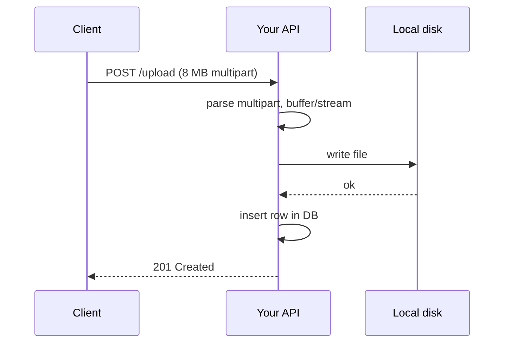
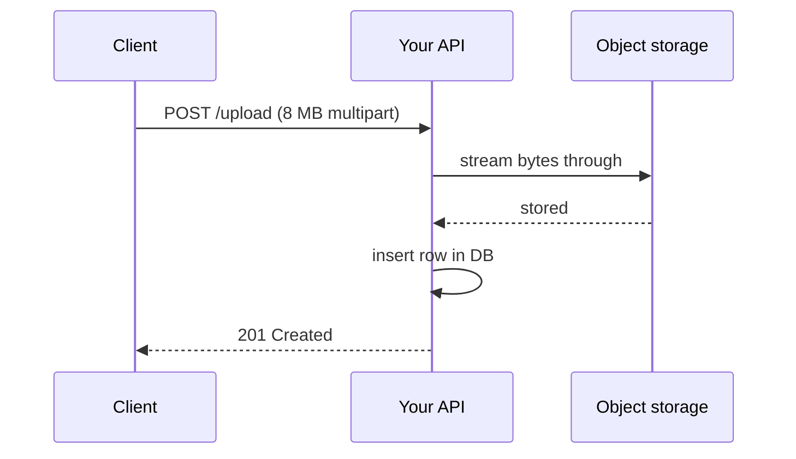
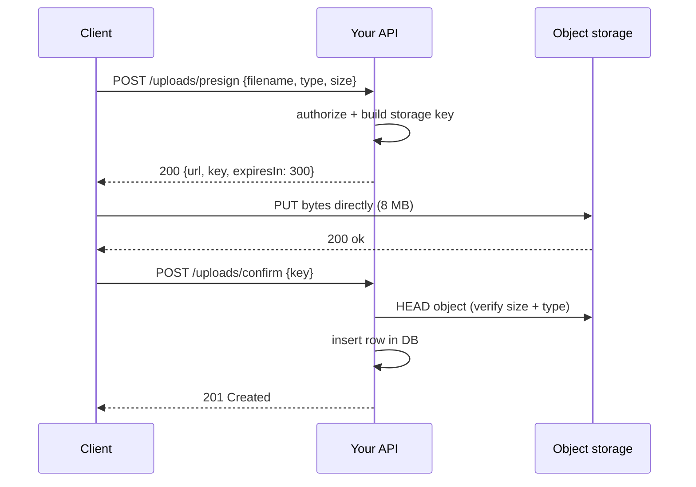

# File Uploads — Part 1

Sending JSON to your API is like posting a letter. It is small, it is text, and
the post office can read the address on the front.

A file upload is like posting a parcel. Nobody knows what is inside. It might be
a book, it might be a brick, it might be something that should never have been
accepted. It is heavy, it takes time to move, and if you let people post parcels
of any size to your office, you will eventually run out of floor space.

This file is about accepting parcels safely: what the browser actually sends,
where the bytes should go, and the long list of things a user can hide inside a
file that looks harmless.

> **📌 In one line:** treat an upload as untrusted bytes of unknown size — never
> hold it all in memory, never trust its name or its declared type, and prefer
> an architecture where your server never touches the bytes at all.

## Table of Contents

1. [Why an Upload Is Not a Normal Request](#why-an-upload-is-not-a-normal-request)
2. [multipart/form-data From Zero](#multipartform-data-from-zero)
3. [The Three Upload Architectures](#the-three-upload-architectures)
4. [Presigned Uploads in Detail](#presigned-uploads-in-detail)
5. [Streaming vs Buffering](#streaming-vs-buffering)
6. [Common Mistakes](#common-mistakes)
7. [Questions to Test Yourself](#questions-to-test-yourself)
8. [Related](#related)

---

## Why an Upload Is Not a Normal Request

A normal `POST /api/tasks` request has three comfortable properties:

1. **The body is text.** You can read it, log it, and validate it field by field.
2. **The body is small.** A few kilobytes. Holding it in memory costs nothing.
3. **The body has a known shape.** A schema says `title` is a string under 200
   characters, and anything else is rejected.

An upload breaks all three.

| | JSON request | File upload |
|---|---|---|
| Body | Text, readable | Binary, often meaningless to read |
| Size | Kilobytes | Kilobytes to gigabytes |
| Shape | Fixed schema | Anything at all |
| Validation | Field by field | Bytes, magic numbers, size, and scanning |
| Memory cost | Safe to buffer | Buffering can kill the process |
| Time | Milliseconds | Seconds to minutes on a slow connection |
| Risk | Bad data | Bad data, stored XSS, malware, disk exhaustion |

There is a fourth difference that people forget. A JSON request finishes fast,
so the connection is free again immediately. An upload from a phone on a weak
mobile network can hold one of your server's connections open for two minutes.
Fifty of those and your server has no capacity left for anything else — and it
is not even doing work, it is just waiting for bytes.

> **⚠️ Warning:** the slowest upload in your system decides how many concurrent
> users your server can hold. That single fact is the strongest argument for the
> third architecture below.

---

## multipart/form-data From Zero

### The problem it solves

HTTP gives a request exactly one body. A form that uploads a project logo needs
to send two things at once: the file bytes, and the `projectId` they belong to.

`multipart/form-data` is the rule for packing several values, some of them
binary, into one body. Think of it as putting several labelled envelopes inside
one big envelope.

### What the browser actually sends

Here is a real request body. The client is attaching a logo to project 42.

```text
POST /api/projects/42/logo HTTP/1.1
Host: api.example.com
Content-Type: multipart/form-data; boundary=----Boundary7MA4YWxkTrZu0gW
Content-Length: 8419

------Boundary7MA4YWxkTrZu0gW
Content-Disposition: form-data; name="projectId"

42
------Boundary7MA4YWxkTrZu0gW
Content-Disposition: form-data; name="file"; filename="logo.png"
Content-Type: image/png

<8300 bytes of raw PNG data, exactly as they exist on disk>
------Boundary7MA4YWxkTrZu0gW--
```

Read it slowly. Three things are happening.

**The boundary.** The `Content-Type` header declares a random string:
`----Boundary7MA4YWxkTrZu0gW`. That string separates the parts. The browser
picks something long and random so it cannot appear by accident inside the file
bytes. The final boundary has two extra dashes at the end to mark "no more
parts".

**Each part has its own tiny headers.** `Content-Disposition` carries the field
name, and for files also the original `filename`. A file part may also carry its
own `Content-Type`.

**The bytes are raw.** Not encoded, not escaped. A PNG's bytes sit in the body
exactly as they sit on disk.

### Compared with the alternatives

```text
┌────────────────────────┬──────────────┬────────────────────────────────┐
│ Format                 │ Size on wire │ Notes                          │
├────────────────────────┼──────────────┼────────────────────────────────┤
│ multipart/form-data    │ 100%         │ Raw bytes + small overhead     │
│ base64 inside JSON     │ ~133%        │ 3 bytes become 4 characters    │
│ raw body (PUT file)    │ 100%         │ One file only, no extra fields │
└────────────────────────┴──────────────┴────────────────────────────────┘
```

**Why base64 costs 33% extra.** JSON is text, so binary must be re-encoded as
safe characters. Base64 takes every 3 bytes and writes them as 4 characters. A
9 MB image becomes a ~12 MB string. You pay that 33% in upload time, in memory
on both sides, in bandwidth cost, and again if you store it that way.

Worse, a base64 body cannot be streamed easily — your JSON parser normally
builds the entire string in memory before your code sees it. That is the exact
failure described in [Streaming vs Buffering](#streaming-vs-buffering).

> **💡 Tip:** base64-in-JSON is acceptable for genuinely tiny files (a 20 KB
> signature image, an avatar crop) where one simple request is worth more than
> 33%. For anything else, use multipart or presigned uploads.

---

## The Three Upload Architectures

### Architecture A — through your server, onto its disk



Simple, and wrong for almost every real deployment. The disk belongs to one
container. A second instance cannot see the file, and a restart deletes it. File
2 covers why in detail.

### Architecture B — through your server, streaming to object storage



Now the file survives restarts and is visible to every instance. But your server
is still a pipe: every byte enters and leaves it. Your bandwidth, your memory,
your request time, your connection held open.

### Architecture C — direct to storage with a presigned URL



Your API handles two tiny JSON requests. The 8 MB never touches it.

### Comparison

| | A: disk | B: stream through | C: presigned direct |
|---|---|---|---|
| Survives restart | No | Yes | Yes |
| Works with many instances | No | Yes | Yes |
| Server memory per upload | Medium/High | Low if streamed | ~Zero |
| Server bandwidth used | 1x | 2x (in + out) | 0 |
| Request held open | Whole upload | Whole upload | Milliseconds |
| Slow client blocks a worker | Yes | Yes | No |
| Client complexity | Lowest | Lowest | Higher (3 steps) |
| Can inspect bytes inline | Yes | Yes | No — inspect after |
| Good for | Local dev, prototypes | Small files, must-inspect flows | Everything non-trivial |

**Why C is the standard answer.** Your API's job is decisions, not transport.
Object storage is built by a cloud provider to absorb bytes at any scale, from
any number of clients, with their bandwidth and their hardware. Letting your
Node process act as a relay means paying for the bytes twice and blocking the
event loop's attention on work that adds no value.

> **📌 Remember:** the question is not "how do I upload a file to my server". It
> is "how do I avoid my server being in the path of the bytes at all".

---

## Presigned Uploads in Detail

### What a presigned URL is

A presigned URL is a normal storage URL with a signature attached in the query
string. The signature is produced by your server using its storage credentials,
and it encodes: **which operation, which key, and until when**.

```text
https://storage.example.com/app-uploads/
  tenant_7/projects/42/01HQ3M8WZ4XK2.png
  ?X-Amz-Algorithm=AWS4-HMAC-SHA256
  &X-Amz-Credential=...
  &X-Amz-Date=20260913T101500Z
  &X-Amz-Expires=300          <-- valid for 5 minutes
  &X-Amz-SignedHeaders=host;content-type
  &X-Amz-Signature=9f2c...    <-- proves your server approved this
```

The storage service checks the signature itself. Your credentials are never sent
to the client, and the client can do exactly one thing with the URL.

### Issuing one with constraints

```ts
// POST /api/uploads/presign
export async function presignUpload(ctx: RequestContext) {
  const { filename, contentType, sizeBytes } = uploadRequestSchema.parse(ctx.body)

  // 1. Authorize FIRST. May this user add files to this project?
  await authorize(ctx.user, 'project.upload', { projectId: ctx.params.projectId })

  // 2. Allow-list the type. Never a deny-list.
  if (!ALLOWED_UPLOAD_TYPES.has(contentType)) {
    throw new ValidationError('unsupported_file_type')
  }
  if (sizeBytes > MAX_UPLOAD_BYTES) {
    throw new ValidationError('file_too_large')
  }
  // ... continues below
}
```

The key point is that **you** build the storage key, never the client:

```ts
  // 3. We generate the key. The client's filename never becomes a path.
  const extension = EXTENSION_FOR_TYPE[contentType]          // 'png', not from user
  const key = `tenant_${ctx.user.tenantId}/projects/${ctx.params.projectId}` +
              `/${ulid()}.${extension}`

  // 4. Sign with constraints the storage service will enforce.
  const url = await storage.presignPut({
    key,
    expiresInSeconds: 300,
    contentType,                     // storage rejects a different type
    contentLengthRange: [1, MAX_UPLOAD_BYTES],
  })

  // 5. Record the intent so we can clean up if confirmation never comes.
  await pendingUploads.create({ key, userId: ctx.user.id, expectedType: contentType })

  return { url, key, expiresIn: 300 }
```

Four constraints are baked into the signature: the exact key, the expiry, the
content type, and a maximum size. A client cannot upload a 4 GB file, cannot
overwrite another tenant's key, and cannot use the URL tomorrow.

> **⚠️ Warning:** a presigned URL is a **bearer credential**. Anyone who obtains
> it can use it until it expires. Keep expiry short (minutes, not hours) and
> never write one into logs.

### The confirmation step and orphaned objects

After the `PUT` succeeds, the client calls `POST /api/uploads/confirm` and your
server records the real file row. The storage service does not tell your
database anything, so **the confirm call is what makes the file real to your
application**.

```ts
export async function confirmUpload(ctx: RequestContext) {
  const { key } = confirmSchema.parse(ctx.body)
  const pending = await pendingUploads.findOwnedBy(key, ctx.user.id)
  if (!pending) throw new NotFoundError()

  // Trust the storage service, not the client, for size and type.
  const head = await storage.head(key)
  if (head.contentLength > MAX_UPLOAD_BYTES) {
    await storage.delete(key)
    throw new ValidationError('file_too_large')
  }

  const file = await files.create({
    tenantId: ctx.user.tenantId, projectId: pending.projectId,
    storageKey: key, sizeBytes: head.contentLength,
    contentType: head.contentType, checksum: head.etag, uploadedBy: ctx.user.id,
  })
  await pendingUploads.delete(key)
  return { file }
}
```

**The failure case that always happens:** the client uploads successfully, then
the browser tab closes, the network drops, or the app crashes. The object exists
in storage. No row exists in your database. That object is an **orphan** — you
pay to store it forever and nobody can ever see it.

Two defences, use both:

1. **A storage lifecycle rule.** Put all unconfirmed uploads under a prefix such
   as `staging/`, and set a rule that deletes anything in `staging/` older than
   24 hours. Confirmation copies or moves the object to its permanent prefix.
2. **A reconciliation job.** A scheduled job lists objects older than a day,
   checks each key against the `files` table, and deletes the ones with no row.
   File 2 covers the same problem in the other direction.

---

## Streaming vs Buffering

### What goes wrong

**Buffering** means: read all the bytes into memory first, then act.
**Streaming** means: read a chunk, handle it, forget it, read the next chunk.

A Node process typically has a heap of a few hundred megabytes to ~1.5 GB. A
2 GB buffered file cannot fit. Before it fails, the process slows to a crawl
because the garbage collector is fighting for room, and **every other request on
that instance gets slower** — a single upload becomes an outage.

```ts
// ❌ BROKEN — the whole file lives in RAM before anything happens.
const buffer = await readEntireBody(request)      // 2 GB in the heap
await storage.put(key, buffer)
```

```ts
// ✅ FIXED — bytes flow through in small chunks; memory stays flat.
import { pipeline } from 'node:stream/promises'

await pipeline(
  request,                                // readable: incoming bytes
  limitSize(MAX_UPLOAD_BYTES),            // transform: abort if too large
  storage.createWriteStream(key),         // writable: out to storage
)
```

Memory used by the fixed version is roughly one chunk at a time (tens of
kilobytes), no matter whether the file is 2 MB or 2 GB.

### Why `pipeline` and not manual `.pipe()`

`pipeline` propagates errors and destroys every stream in the chain when one
fails. Manual `.pipe()` chains leak open handles and half-written objects when
the client disconnects mid-upload — which clients do constantly.

Streams are asynchronous back-pressure in practice: the writable side tells the
readable side "slow down, I am not ready". For the underlying mechanics see
[`../../typescript-fundamentals/async-await-promise/advanced.md`](../../typescript-fundamentals/async-await-promise/advanced.md).

> **💡 Tip:** with architecture C you get streaming for free — the client streams
> straight to storage and your code never sees a byte.

---

---

## Common Mistakes

| Mistake | Why it is wrong | Do this instead |
|---|---|---|
| Sending files as base64 inside JSON | ~33% more bytes, and the whole payload must be parsed into memory | `multipart/form-data`, or a presigned direct upload |
| Buffering the whole file | Memory spike takes down the instance | Stream with `pipeline`, or use presigned direct upload |
| Storing files on the container's disk | Lost on restart, invisible to other instances | Object storage (file 2) |
| No confirm step after presigned upload | Nothing records the file | Confirm endpoint + lifecycle rule + reconciliation |

---

## Questions to Test Yourself

1. Why does base64-in-JSON cost about 33% more bytes, and why is that only the
   second-worst problem with it?
2. Draw the presigned upload flow. What exactly does the signature constrain,
   and what happens if the client changes the key before uploading?
3. A user uploads, then closes the tab before confirmation. What state is the
   system in, and what two mechanisms clean it up?
4. Your API holds steady at 200 MB of memory until someone uploads a 2 GB
   video, and the process dies. Explain what happened in terms of streams, and
   what the fixed code does differently.
5. Of the three upload architectures, which one means your server never sees
   the bytes at all — and what do you give up by choosing it?

> **➡️ Continued in [Part 2](./01-file-uploads-part-2.md)** — the security
> checklist, recording metadata, and resumable uploads.

---

## Related

- [`01-file-uploads-part-2.md`](01-file-uploads-part-2.md) — the security
  checklist every upload path needs, and the `files` table behind it.
- [`02-object-storage-and-serving-files.md`](02-object-storage-and-serving-files.md)
  — where the bytes live afterwards, and how to give them back safely.
- [`../../typescript-fundamentals/async-await-promise/advanced.md`](../../typescript-fundamentals/async-await-promise/advanced.md)
  — streams, back-pressure, and async iteration in Node.
- [`../../cloud-devops/nginx/reverse-proxy-config.md`](../../cloud-devops/nginx/reverse-proxy-config.md)
  — `client_max_body_size` and proxy buffering for uploads.
- [`../../system-design/foundational/rate-limiting.md`](../../system-design/foundational/rate-limiting.md)
  — capping uploads per user before they cap your storage budget.
