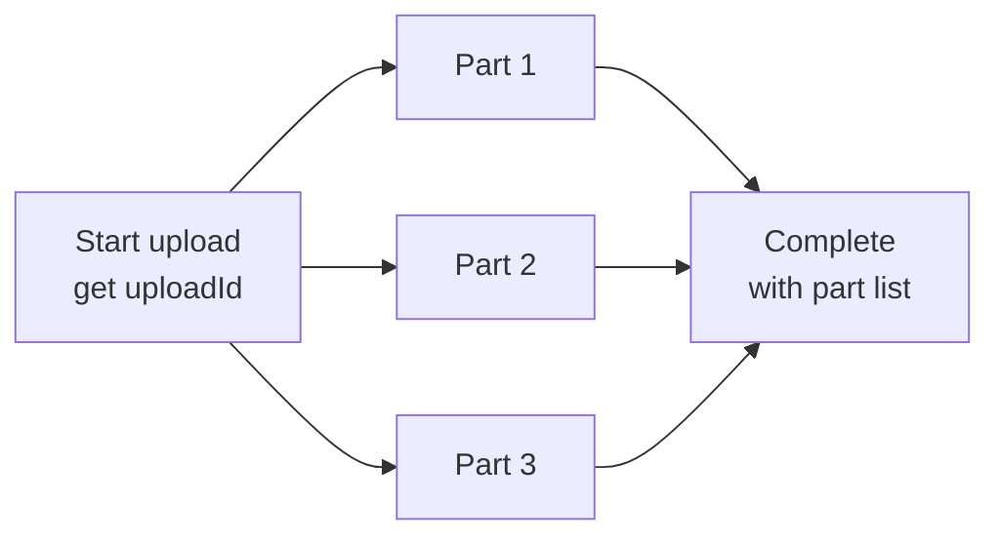

# File Uploads — Part 2

Part 1 got the bytes from the browser to storage safely and without filling
memory. That was the easy half. This part is about everything the parcel might
be hiding: a filename that escapes its directory, a declared type that is a
lie, an image that expands to ten gigabytes, and an SVG that runs JavaScript on
your own domain.

> **⬅️ This continues [Part 1](./01-file-uploads-part-1.md).**

> **📌 In one line:** never trust a filename, a declared type, or a single size
> limit — and keep the database, not the bucket, as the record of what exists.

## Table of Contents

1. [Security: The Checklist That Matters](#security-the-checklist-that-matters)
2. [Recording File Metadata in Your Database](#recording-file-metadata-in-your-database)
3. [Resumable and Chunked Uploads](#resumable-and-chunked-uploads)
4. [BROKEN vs FIXED](#broken-vs-fixed)
5. [Common Mistakes](#common-mistakes)
6. [Questions to Test Yourself](#questions-to-test-yourself)
7. [Related](#related)

---

## Security: The Checklist That Matters

Everything below assumes one sentence: **the file came from a stranger.**

### 1. Enforce size limits at three layers

| Layer | What it does | Bypassed by |
|---|---|---|
| Reverse proxy (nginx `client_max_body_size`) | Rejects before your app wakes up | Requests that skip the proxy (internal calls, a misconfigured route) |
| Framework / body parser (`limits.fileSize`) | Stops your process buffering | A route that forgot to configure it |
| Storage policy (`contentLengthRange` in the presigned URL) | The provider refuses the bytes | Nothing — it is enforced by the provider |

Each single layer can be bypassed, so use all three. A proxy limit does not help
if some traffic reaches the app directly. A framework limit does not help in
architecture C, where the app never sees the bytes. A storage limit does not
help in architecture B.

See [`../../cloud-devops/nginx/reverse-proxy-config.md`](../../cloud-devops/nginx/reverse-proxy-config.md)
for the proxy side.

### 2. Never trust the client's filename

The `filename` in a multipart part is a string the client chose. It is not a
name — it is an attack surface.

| Trick | Example | What it does |
|---|---|---|
| Path traversal | `../../etc/cron.d/backdoor` | Writes outside your upload folder |
| Absolute path | `/var/www/html/shell.php` | Writes anywhere the process can write |
| Null byte | `avatar.png\0.php` | Old parsers truncate; the file lands as `.php` |
| Unicode look-alike | `invoice‮gnp.exe` | Right-to-left override makes it display as `exe.png` |
| Double extension | `report.pdf.html` | A naive extension check sees `.pdf` |
| Very long name | 5000 characters | Breaks the filesystem or a database column |
| Reserved name | `CON`, `NUL`, `.htaccess` | Special meaning to the OS or web server |

The fix is not sanitising. Sanitising is a game you lose slowly.

```ts
// ✅ Generate your own key. Keep the original name only as a label.
const storageKey = `tenant_${tenantId}/files/${ulid()}.${extensionFor(detectedType)}`
const displayName = originalName.slice(0, 255)   // stored as data, never as a path
```

The original filename is fine to store in a column and to show in the UI (HTML-
escaped) and to put in a `Content-Disposition` header when downloading. It must
never become part of a filesystem path or a storage key.

### 3. Never trust the client's `Content-Type` — check magic bytes

The `Content-Type` in the multipart part is also just a string the client typed.
A PHP script uploaded as `image/png` is still a PHP script.

Real files start with a signature, called **magic bytes** — a few fixed bytes at
the start that identify the format.

```text
PNG   89 50 4E 47 0D 0A 1A 0A      (\x89PNG....)
JPEG  FF D8 FF
PDF   25 50 44 46 2D               (%PDF-)
GIF   47 49 46 38                  (GIF8)
ZIP   50 4B 03 04                  (PK..)   <-- also .docx, .xlsx, .jar
```

```ts
import { fileTypeFromBuffer } from 'file-type'

const head = buffer.subarray(0, 4100)            // signatures live at the start
const detected = await fileTypeFromBuffer(head)

// Allow-list: only these may pass. Anything unknown is rejected.
const ALLOWED = new Set(['image/png', 'image/jpeg', 'application/pdf'])
if (!detected || !ALLOWED.has(detected.mime)) {
  throw new ValidationError('unsupported_file_type')
}
```

**Allow-list, never deny-list.** A deny-list of "dangerous" types is a list of
the attacks you have already heard of. Tomorrow there is one more, and your list
does not have it. An allow-list of three MIME types cannot be surprised.

> **⚠️ Warning:** magic bytes prove the format, not safety. A real PDF can still
> contain JavaScript, and a ZIP-based `.docx` can contain macros. Magic bytes
> stop the "it is actually a script" class of attack, not every attack.

### 4. Never store or serve uploads from your web root or your own origin

Two separate rules, both important.

**Do not store uploads inside the directory your web server serves.** If an
attacker gets a `.php` or `.jsp` file into a folder the web server executes,
they have remote code execution on your box. Object storage removes this problem
entirely, which is another reason to use it.

**Do not serve user files from your application's domain.** This one is subtler
and catches good teams. Suppose a user uploads `notes.html` containing
`<script>fetch('/api/me').then(...)</script>`, and you serve it from
`https://app.example.com/files/notes.html`.

The browser treats that page as part of `app.example.com`. The script runs with
your origin's cookies, your `localStorage`, and your session. That is **stored
cross-site scripting (XSS)**: the attacker uploaded a script once, and it runs in
the browser of every colleague who opens the file.

SVG is the usual surprise. An `.svg` is XML and may contain `<script>`. It looks
like an image everywhere in your UI and behaves like an HTML page when opened
directly.

Three defences, use all of them:

| Defence | How it works |
|---|---|
| Separate domain | Serve from `usercontent-example.net`. A script there is in a different origin and cannot touch `app.example.com` cookies or data. |
| `Content-Disposition: attachment` | Tells the browser to download, not render. A downloaded HTML file does not execute in your origin. |
| `X-Content-Type-Options: nosniff` | Stops the browser guessing a type different from the one you declared, which is how a "text file" becomes an HTML page. |

Headers are covered fully in
[`../11-api-security/04-security-headers-part-1.md`](../11-api-security/04-security-headers-part-1.md).

### 5. Image processing is an attack surface

Resizing an image means handing untrusted bytes to a large C library
(ImageMagick, libvips, libpng). These libraries have a long history of parser
vulnerabilities, and some of them have allowed code execution from a crafted
image.

There is also the **decompression bomb**: a 4 KB PNG that declares itself as
50000 x 50000 pixels. Decoding it allocates around 10 GB of RAM. The file passed
your size check easily — 4 KB.

```ts
// ✅ Refuse absurd dimensions before decoding the full image.
const meta = await sharp(inputPath).metadata()
const pixels = (meta.width ?? 0) * (meta.height ?? 0)
if (pixels > 50_000_000) throw new ValidationError('image_dimensions_too_large')
```

Because of both risks, **do image processing outside the request path**, in a
separate worker process with its own memory limit and timeout, so a crash or a
memory spike takes down a job, not your API. The job goes through a queue — see
[`../../system-design/foundational/message-queues/overview.md`](../../system-design/foundational/message-queues/overview.md)
for how that infrastructure works.

### 6. Malware scanning and per-user rate limits

If users share files with each other, you are a file distribution service, and
you should scan. Run a scanner (ClamAV or a provider API) in the same background
worker, and keep the file in a quarantine prefix with status `pending_scan`
until it passes. Do not serve it before then.

Rate limit uploads per user and per tenant, by count and by total bytes per
hour. Without it, one account can fill your storage bill overnight. See
[`../../system-design/foundational/rate-limiting.md`](../../system-design/foundational/rate-limiting.md).

---

## Recording File Metadata in Your Database

The bucket holds bytes. Your database holds meaning. Keep them separate and let
the database be the source of truth.

```sql
CREATE TABLE files (
  id            uuid PRIMARY KEY,
  tenant_id     uuid NOT NULL,
  project_id    uuid,
  uploaded_by   uuid NOT NULL REFERENCES users(id),
  storage_key   text NOT NULL UNIQUE,   -- where the bytes live
  display_name  text NOT NULL,          -- original filename, as data only
  content_type  text NOT NULL,          -- the DETECTED type, not the claimed one
  size_bytes    bigint NOT NULL,
  checksum      text NOT NULL,          -- integrity + duplicate detection
  scan_status   text NOT NULL DEFAULT 'pending',
  created_at    timestamptz NOT NULL DEFAULT now(),
  deleted_at    timestamptz
);
CREATE INDEX ON files (tenant_id, project_id, created_at DESC);
```

**Why the database and not the bucket listing?**

- Listing a bucket is slow and paginated. A `SELECT` with an index is instant.
- A bucket key has no owner, no tenant, and no permissions. A row does.
- You cannot join a bucket listing to `projects` or `users`.
- Soft deletes, scan status, and audit history need columns.

Every read path must filter by `tenant_id`, exactly like any other resource. A
file is not special —
[`../06-authorization/03-ownership-abac-and-multi-tenancy-part-1.md`](../06-authorization/03-ownership-abac-and-multi-tenancy-part-1.md)
applies unchanged.

> **📌 Remember:** the bucket is storage. The table is truth. If they disagree,
> the table wins and a reconciliation job fixes the bucket.

---

## Resumable and Chunked Uploads

For files above roughly 100 MB, a single `PUT` becomes fragile. One dropped
connection at 95% means starting again.

**Chunked / multipart upload** splits the file into parts (commonly 5–100 MB
each), uploads them independently, and then tells storage to assemble them.



What it buys you: parts upload in parallel (faster), a failed part retries alone
(resilient), and a paused upload can resume by asking which parts already
exist (resumable).

What it costs: more state to track, and incomplete multipart uploads that are
never completed still consume storage and money. Set a lifecycle rule to abort
them after a few days.

For browser clients, `tus` is a common resumable protocol. For large
server-to-server transfers, the storage provider's own multipart API is usually
enough. File 2 covers the storage side.

---

## BROKEN vs FIXED

The single most common upload bug, in full.

```ts
// ❌ BROKEN — three separate holes in six lines.
app.post('/upload', async (req, res) => {
  const file = req.files.document                       // no size limit anywhere
  const dest = path.join('./public/uploads', file.name) // client-chosen path
  await fs.writeFile(dest, file.data)                   // whole file in memory
  res.json({ url: `/uploads/${file.name}` })            // served from our origin
})
```

What an attacker does with it:

1. Uploads a 5 GB file and the process dies (no size limit, full buffering).
2. Names the file `../../app/config/database.js` and overwrites your code.
3. Uploads `payroll.html` with a script inside and sends the link to a colleague
   — the script runs on your domain with their session.

```ts
// ✅ FIXED — size limited, type verified, our key, private storage.
app.post('/upload', uploadLimit({ maxBytes: 10 * 1024 * 1024 }), async (req, res) => {
  const part = await readFilePart(req)                  // streamed, capped
  const detected = await fileTypeFromBuffer(part.head)
  if (!detected || !ALLOWED.has(detected.mime)) {
    return res.status(415).json({ error: 'unsupported_file_type' })
  }

  const key = `tenant_${req.user.tenantId}/files/${ulid()}.${extFor(detected.mime)}`
  await pipeline(part.stream, storage.createWriteStream(key))  // never our disk

  const file = await files.create({
    tenantId: req.user.tenantId, storageKey: key,
    displayName: sanitizeLabel(part.filename), contentType: detected.mime,
  })
  res.status(201).json({ id: file.id })                 // an id, not a public URL
})
```

Five changes: a size cap before parsing, detection by magic bytes against an
allow-list, a server-generated key, streaming to private object storage, and a
response that returns an id instead of a public path. Downloads then go through
the authorized flow in file 2.

---

---

## Common Mistakes

| Mistake | Why it is wrong | Do this instead |
|---|---|---|
| Using the client's filename as a path | Path traversal, null bytes, overwrites | Generate a key with a ULID/UUID; keep the name as a label |
| Trusting the client's `Content-Type` | It is a string the client typed | Detect via magic bytes, allow-list the result |
| Deny-listing dangerous extensions | Only blocks attacks you already know | Allow-list the few types you accept |
| Size limit in only one place | Any single layer can be bypassed | Proxy + framework + storage policy |
| Serving user files from your app origin | Stored XSS with your cookies and session | Separate domain + `attachment` + `nosniff` |
| Resizing images inside the request | Bombs and library bugs take the API down | Isolated worker, dimension checks, via a queue |
| Listing the bucket to show a user's files | Slow, unscoped, no ownership | Query the `files` table filtered by tenant |

---

## Questions to Test Yourself

1. A colleague says "we validate `Content-Type`, so only images get through".
   Explain precisely why that is false, and what you check instead.
2. Why is a size limit at nginx not enough on its own? Give a concrete case
   where it does nothing.
3. A user uploads a 4 KB PNG and your resize worker uses 10 GB of RAM. What
   happened, and what check prevents it?
4. Why does serving a user-uploaded SVG from `app.example.com` matter more than
   serving it from `usercontent.example.net`? Name the attack.
5. Why is the `files` table the source of truth rather than the bucket listing?
   Give three reasons that are not about speed.
6. A filename arrives as `../../etc/passwd`. Which single decision in the
   checklist makes this harmless before any sanitising code runs?

---

## Related

- [`01-file-uploads-part-1.md`](01-file-uploads-part-1.md) — how the bytes
  arrive, the three architectures, and streaming.
- [`02-object-storage-and-serving-files.md`](02-object-storage-and-serving-files.md)
  — where the bytes live afterwards, and how to give them back safely.
- [`../11-api-security/04-security-headers-part-1.md`](../11-api-security/04-security-headers-part-1.md)
  — `nosniff`, CSP, and the headers that make a downloaded file harmless.
- [`../11-api-security/02-injection-attacks-part-1.md`](../11-api-security/02-injection-attacks-part-1.md)
  — stored XSS and path traversal in the wider family of injection bugs.
- [`../06-authorization/03-ownership-abac-and-multi-tenancy-part-1.md`](../06-authorization/03-ownership-abac-and-multi-tenancy-part-1.md)
  — a file is a resource with an owner and a tenant like any other.
- [`../../system-design/foundational/message-queues/overview.md`](../../system-design/foundational/message-queues/overview.md)
  — the queue that moves scanning and image processing out of the request.
