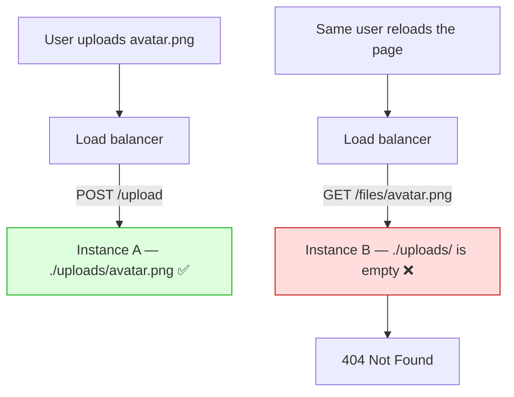
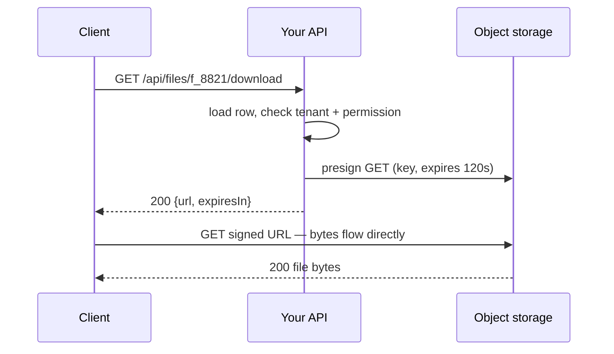

# Object Storage and Serving Files

A theatre cloakroom takes your coat and gives you a numbered ticket. The coat is
in a room built for holding coats, and the ticket is the entire security model:
the attendant hands the coat to whoever presents it, and asks nothing else.

File 1 got the parcel through the door. This file is about the room it goes
into, the ticket you write for it, and the question that is harder than the
upload itself — **how do you hand the bytes back to exactly the right person?**

> **📌 In one line:** user files belong in object storage under an opaque,
> tenant-scoped key you generate, and the default way to serve a private one is
> a short-lived presigned URL issued only after your API has authorized it.

## Table of Contents

1. [Why the Local Filesystem Is the Wrong Place](#why-the-local-filesystem-is-the-wrong-place)
2. [What Object Storage Actually Is](#what-object-storage-actually-is)
3. [Designing a Storage Key](#designing-a-storage-key)
4. [Serving Files Back: The Three Options](#serving-files-back-the-three-options)
5. [Authorization for File Access](#authorization-for-file-access)
6. [Caching: Headers and the CDN](#caching-headers-and-the-cdn)
7. [Lifecycle, Orphans, and Reconciliation](#lifecycle-orphans-and-reconciliation)
8. [Derived Files: Thumbnails and Renders](#derived-files-thumbnails-and-renders)
9. [Integrity, Durability, and Backups](#integrity-durability-and-backups)
10. [Advanced: Multipart, Egress, and Quotas](#advanced-multipart-egress-and-quotas)
11. [Common Mistakes](#common-mistakes)
12. [Questions to Test Yourself](#questions-to-test-yourself)
13. [Related](#related)

---

## Why the Local Filesystem Is the Wrong Place

`fs.writeFile('./uploads/' + name, bytes)` works on your laptop and on the first
deploy, which is why the problem is usually found in production by a user.
**Containers are ephemeral**: a container's filesystem lives and dies with the
container, so after a redeploy, a rescheduling or a crash the disk is new and
empty. Tuesday's avatar is gone on Wednesday with no error logged, because
nothing failed — the file was never meant to last.

**Multiple instances do not share a disk.** This shows up within seconds.



The upload succeeded, the download 404s, and a refresh fixes it whenever the
load balancer picks instance A again — an intermittent 404 that depends on which
machine answered.

**Backups, capacity and durability become yours.** Providers replicate objects
across facilities and publish durability figures with many nines; a container
disk has none of that. Snapshots, free space, the volume filling at 3 a.m. and
"can we restore last month's deletion?" all become your problem. A shared
network volume (NFS, EFS) fixes the "two instances" problem and none of these,
so reach for it only when something legacy cannot speak an object-storage API.

---

## What Object Storage Actually Is

Strip away the product names and there are four nouns. A **bucket** is a named
container for objects — one per environment is a fine start. A **key** is an
object's full name inside it, one string such as
`tenant_7/projects/42/01HQ3M8WZ4XK2QF.png`. An **object** is the bytes plus a
content type, a size and an entity tag, and **metadata** is a few key/value
pairs beside them. What it is *not* is where the surprises live.

| | Filesystem | Object storage |
|---|---|---|
| Structure | Real nested directories | Flat namespace of keys |
| `/` in a name | A directory separator | An ordinary character |
| Rename a folder | Instant metadata change | Copy every object, delete each |
| Edit 10 bytes in the middle | Seek and write | Upload the whole object again |
| Listing | Read a directory | Paginated scan by key prefix |

**There are no directories.** A console shows folders because it groups keys by
the text before each `/`. `tenant_7/` is not a folder that exists — it is a
*prefix* — so "delete the folder" means "list every key starting with
`tenant_7/` and delete them one at a time". That is a job, not a call.

**There are no partial writes.** An object is replaced atomically or not at all:
no patching one field of a stored JSON document, no appending to a stored log.
If your data changes in small pieces, it is database data, not object data.

> **💡 Tip:** the flat namespace also makes listing the wrong tool for "show this
> user's files" — prefix listings are paginated and carry no ownership. Query
> the `files` table; use the bucket only to fetch bytes by key.

---

## Designing a Storage Key

The key is the one part of this design you choose, and you choose it once:
changing the scheme later means copying every object in the bucket.

```text
  tenant_7 / projects / 42 / originals / 01HQ3M8WZ4XK2QF9 . pdf
  └──┬───┘   └───┬───────┘   └───┬────┘   └──────┬───────┘  └┬┘
     │           │               │               │           │
 tenant scope  owning resource  purpose      opaque id   extension
```

**The identifier is opaque, not the original filename.** A user's
`Q3 payroll (final) v2.pdf` carries spaces, slashes, unicode tricks and
sometimes another person's name. Generate a ULID or UUID and keep the original
in a `display_name` column, as file 1 does; two users uploading `invoice.pdf`
then never collide.

**And it is not sequential.** If keys were `.../invoice-1041.pdf`, anyone
holding one URL can guess the next thousand, turning a single leaked link into
an enumeration of the whole bucket. A ULID keeps rough time ordering — useful
for lifecycle rules — without being guessable.

**The tenant id comes first.** A prefix is the only handle object storage gives
you for bulk work, so whatever you will one day do in bulk belongs at the front.
With `tenant_7/` leading every key you can apply a lifecycle rule to one tenant,
bill one tenant's storage, delete a departing customer's data with a single
prefix scan, and grant a per-tenant IAM policy. Buried mid-key, none of that
works.

**The purpose segment separates lifecycles**, so `staging/` can expire after 24
hours while `originals/` moves to cold storage after 90 days.

> **⚠️ Warning:** never build a key from unvalidated client input. A
> client-chosen key lets one tenant write into another tenant's prefix, and a
> `../` that is harmless as a literal key becomes a real traversal as soon as
> something syncs the bucket to a disk.

---

## Serving Files Back: The Three Options

This is the decision that matters most here, and the one most often made by
accident.

| | Public object | Presigned URL | Proxy through your app |
|---|---|---|---|
| Who authorizes | Nobody | Your API, when issuing | Your API, on every byte |
| Audit of the actual fetch | No | No — only the issue | Yes |
| Revoke instantly | No | Only by outliving it | Yes |
| Right for | Logos, marketing assets | Almost all private files | Audited or transformed access |

**Public objects.** The bucket policy allows anonymous `GET`, so the URL *is*
the permission. Correct for a site logo, wrong for everything else. "The key is
unguessable, so it is private enough" is security by obscurity: URLs leak through
browser history, referrers, chat logs, tickets and screenshots — and a leaked
public URL never expires.

**Presigned download URLs — the usual answer.** Your API checks permissions,
then asks storage for a URL valid for two minutes.



```ts
export async function downloadUrl(ctx: RequestContext) {
  const file = await files.findByIdForTenant(ctx.params.id, ctx.user.tenantId)
  if (!file) throw new NotFoundError()
  await authorize(ctx.user, 'file.read', file)      // authorize FIRST
  const url = await storage.presignGet({            // only then sign
    key: file.storageKey, expiresInSeconds: 120,
    // puts "Q3 payroll.pdf" in the download folder although the key is a ULID
    responseContentDisposition: attachment(file.displayName),
  })
  return { url, expiresIn: 120 }
}
```

> **⚠️ Warning:** a presigned URL is a **bearer credential**. It carries its own
> proof of authorization in the query string, so *anyone* who obtains it can
> fetch the object until it expires — no login, no cookie, no tenant check.
> Treat it like a password: expiry in minutes, never written to a log or an
> error message. Once issued it cannot be revoked, only outlived.

**Proxying through your application.** The bytes take a detour:

```text
  client ──▶ your API ──▶ storage ──stream──▶ your API ──stream──▶ client
                 └─ authorize · audit · transform, on every byte
```

Justified when you need something a signature cannot express: **fine-grained or
fast-changing authorization**, where access can be revoked mid-download or the
rule depends on request context; **audit logging of the fetch itself**, where
"who actually opened this document" must be recorded rather than who asked for a
link; and **on-the-fly transformation**, such as watermarking a PDF with the
viewer's name. The price is egress paid twice, a worker held for the whole
download, and an obligation to stream — `pipeline(storageStream, res)` — since
buffering a 500 MB download is a 500 MB heap spike. Start with presigned URLs.

---

## Authorization for File Access

**The permission check belongs in your API, at the moment you issue the URL.**
There is no later opportunity: object storage serves anyone holding a valid
signature and knows nothing about your tenants. The bug that catches good teams:

```text
GET /api/files/f_8821                                    → 403 unless you own it  ✅
GET https://bucket.example/tenant_7/projects/42/01HQ.pdf → 200 for anyone         ❌
```

The endpoint returning the file's name and size is properly authorized. The
object itself sits in a bucket with public read, because somebody needed a demo
to work eighteen months ago. Every file in the product is one leaked URL from
disclosure, and since no request reaches your API, nothing in your logs will
ever show it happened. Three rules close it:

1. **Buckets holding user data are private by default** — no anonymous read, no
   "any authenticated cloud user" grant. Assert the public-access block in CI.
2. **The API never returns a raw storage URL in a payload.** Return the file id;
   the client asks for a download URL when the user actually clicks.
3. **The same ownership rules apply as to any other resource.** A file row has a
   `tenant_id` and an owner, and the query loading it is scoped exactly like a
   task or an invoice — see
   [Ownership, ABAC and Multi-Tenancy — Part 1](../06-authorization/03-ownership-abac-and-multi-tenancy-part-1.md)
   and [RBAC](../06-authorization/02-rbac.md).

One more trap: **a shared link is a feature, not an accident.** If the product
needs "anyone with the link can view", build it — a `share_tokens` row with an
expiry and a revocation flag, and a share endpoint that issues a short presigned
URL after checking the token. Never implement sharing by making the object
public, because you can never undo that for one recipient.

---

## Caching: Headers and the CDN

Files split into two categories, and almost every caching mistake is a category
error.

**Immutable content.** The key contains a content hash or a ULID and the bytes
at that key will never change; a new version gets a new key. Cache forever:

```http
Cache-Control: public, max-age=31536000, immutable
ETag: "9f2c4a1b8e7d"
```

`immutable` stops the browser even revalidating on reload. It is yours only
because the key changes with the content, so prefer making content immutable
over tuning `max-age`.

**Mutable content.** A key like `tenant_7/users/88/avatar.png` overwritten in
place must not be cached long — `Cache-Control: public, max-age=60,
must-revalidate` plus an `ETag`, which lets the browser send `If-None-Match` and
get a cheap `304 Not Modified`. Storage sets the `ETag` from a checksum.

**The private-data mistake.** `Cache-Control: public` on an authenticated
response tells every shared cache between you and the user — a CDN, a corporate
proxy, an edge — that it may store the bytes and serve them to somebody else:
a data leak performed by infrastructure you do not own.

```http
Cache-Control: public, max-age=3600           # ❌ a shared cache may store it
Cache-Control: private, max-age=0, no-store   # ✅ this browser only
```

Use `private` when the browser may cache but no shared cache may, `no-store` for
genuinely sensitive documents, and add `Vary: Authorization` whenever a response
differs by caller ([Security Headers — Part 1](../11-api-security/04-security-headers-part-1.md)).

**Putting a CDN in front.** Latency for a distant user drops from hundreds of
milliseconds to tens, CDN egress is usually cheaper than storage egress, and the
origin sees one request per object per edge per cache lifetime, not one per user
([CDN and Edge Caching](../../system-design/scale-patterns/cdn-and-edge-caching.md)).

Two interactions catch people out. **Invalidation is neither free nor instant** —
purge APIs are rate-limited, sometimes billed, and take seconds to minutes, so
change the key when the content changes and keep purging as an emergency tool.
And **signed URLs fight caching**: every presigned URL has a different signature,
so a CDN that includes the query string in its cache key misses on every request
and is just an extra hop, while one configured to *ignore* it caches the object
and serves it to anyone asking for that path, silently deleting your access
control. For private files, skip the CDN or use its own signed URLs and cookies,
which the edge validates itself and can therefore both authorize and cache.

---

## Lifecycle, Orphans, and Reconciliation

Storage is cheap per gigabyte and expensive when nothing is deleted. Lifecycle
rules keyed on age and prefix move objects between **storage classes** that
trade retrieval speed against price.

| Class | Typical use | Trade-off |
|---|---|---|
| Standard | Active files served to users | Highest storage price |
| Infrequent access | Files older than 30–90 days | Cheaper storage, retrieval fee |
| Archive / cold | Compliance retention, old backups | Very cheap; slow to restore |

**Expire temporary uploads.** Anything under `staging/` older than 24 hours is
an upload that was never confirmed, and a rule removes it with no code on your
side. Add the rule that aborts incomplete multipart uploads.

**Delete objects when the owning row is deleted** — and here is the problem that
never goes away. The bucket and the database have no shared transaction, so a
crash between the steps leaves them disagreeing:

```text
  Delete row, then object  → crash between →  object with no row  (you pay for ghosts)
  Delete object, then row  → crash between →  row with no object  (users see broken links)
```

Neither ordering is safe alone, so stop trying to make one atomic. Soft-delete
the row first (`deleted_at`), which instantly hides the file from every
user-facing query — the state the product cares about. Then enqueue a deletion
job: failures retry, and deleting an already-missing key is a no-op, so the job
is naturally idempotent
([queues](../../system-design/foundational/message-queues/overview.md)). Then
reconcile whatever still drifted.

```ts
// Scheduled nightly. Repairs drift in both directions.
export async function reconcileStorage(tenantId: string) {
  for await (const obj of storage.listPrefix(`tenant_${tenantId}/`)) {
    if (obj.lastModified > hoursAgo(24)) continue   // too new; may be mid-upload
    if (!(await files.existsByKey(obj.key))) {
      await storage.delete(obj.key)                 // object with no row: safe
    }
  }
  for await (const row of files.iterateActive(tenantId)) {
    if (!(await storage.exists(row.storageKey))) {
      await files.markMissing(row.id)               // row with no object: flag
      metrics.increment('storage.missing_object')   // and alert on this
    }
  }
}
```

The asymmetry matters. An object with no row is safe to delete, because nothing
can reference it. A row with no object is a **symptom** and deleting it destroys
the evidence — flag, alert, investigate: a non-zero count usually means a bug in
a deletion path.

> **⚠️ Warning:** never sweep keys newer than your longest upload window. An
> object uploaded ten seconds ago has no row yet *by design*, and a naive sweep
> deletes files out from under users.

---

## Derived Files: Thumbnails and Renders

Most uploads spawn secondary files: a 200px thumbnail, a web-friendly transcode,
a PDF preview, an extracted text layer for search. **Generate them
asynchronously**, never in the request that confirmed the upload: rendering a
PDF or transcoding a video takes seconds to minutes, runs a large parser over
untrusted bytes, and can crash, so it belongs behind a queue in an isolated
worker — the reasons file 1 gives about image processing.

**Store them under a predictable derived key** rather than a separate lookup row:

```text
original   tenant_7/projects/42/originals/01HQ3M8WZ4XK2QF9.pdf
thumbnail  tenant_7/projects/42/derived/01HQ3M8WZ4XK2QF9/thumb_200.webp
```

Because the derived prefix contains the original's id, three things follow free:
deleting the original is deleting one prefix, a lifecycle rule can expire
derivatives you can rebuild, and any process can compute a thumbnail's key
without a database round trip.

**Regenerate on demand.** Derivatives are a cache, not data. If one is missing
when a request asks for it, enqueue the job and serve a placeholder or a
`202 Accepted` rather than an error. That property is what lets you change the
thumbnail size next year: delete the `derived/` prefix and let it rebuild
lazily, instead of migrating every file you own.

---

## Integrity, Durability, and Backups

**Checksums.** Record a checksum on the row at confirm time and send it with the
upload so the provider verifies it on arrival. It proves the bytes that arrived
are the bytes that were sent, gives duplicate detection, and lets you verify
objects after a restore.

**Versioning.** With bucket versioning on, an overwrite or delete keeps the
previous version and adds a delete marker — the cheapest insurance against "a
bug overwrote every avatar with the same image", and it turns an accidental
delete into a one-command restore. It bills for every version, so pair it with a
rule expiring non-current versions after 30 days. **Soft deletes** complement
it: keep `deleted_at` on the row and delay the object deletion job by whatever
window the product promises, because undelete requests arrive weekly.

**Backups — and the sentence to remember.** Providers replicate objects across
facilities, and that replication is where the durability figure comes from. It
is **not a backup**, because replication is faithful: it replicates corruption
and it replicates deletes. Three seconds after a bad migration removes 40,000
objects, every replica agrees they are gone.

| Threat | Replication helps? | What actually helps |
|---|---|---|
| A disk or whole facility fails | Yes | — |
| A bug deletes objects | No | Versioning, soft delete, separate backup |
| Stolen credentials used to delete | No | A backup account the app cannot write to |
| Ransomware encrypts objects | No | Immutable / object-lock backups |

A real backup is a copy in a different account or provider, written by a
credential your application does not hold — and, once a year, a restore you
performed rather than assumed.

---

## Advanced: Multipart, Egress, and Quotas

**Multipart uploads.** Above roughly 100 MB a single `PUT` is fragile, and above
5 GB most providers refuse it. Multipart splits the object into parts uploaded
independently then assembled, buying parallelism, per-part retries and
resumability. File 1 covers the client side; your obligation here is the
lifecycle rule that aborts incomplete uploads, because un-assembled parts occupy
billed storage invisibly. More than one team has discovered terabytes of them.

**Egress is a real budget line.** Storing a gigabyte costs cents per month;
serving it a thousand times costs far more, and egress is usually the biggest
surprise on a storage bill. Three levers: a CDN in front of frequently read
objects, serving derivatives instead of originals (a 40 KB thumbnail rather than
a 6 MB photo), and never proxying bytes through your app without a reason.

**Per-tenant quotas.** Without a limit, one customer can make your storage bill
their problem. Keep a per-tenant byte counter updated on confirm and delete and
check it before issuing an upload URL. Return an error carrying current usage
and the plan's limit, and alert at 80% so success stays distinguishable from
abuse — with [rate limiting](../../system-design/foundational/rate-limiting.md)
on the URLs.

---

## Common Mistakes

| Mistake | Why it is wrong | Do this instead |
|---|---|---|
| Storing uploads on the container's disk | Vanishes on redeploy; invisible to other instances | Object storage, keyed and tenant-scoped |
| Making the bucket public, or protecting only the metadata endpoint | The URL becomes the permission, forever | Private bucket + presigned URLs, authorized at issue time |
| Tenant id absent from the prefix | No bulk delete, billing, or scoped policy | Put `tenant_{id}/` first |
| Presigned URLs valid for a day, or written to a log | A bearer credential you cannot revoke | Minutes of expiry; log the file id only |
| `Cache-Control: public` on a private file | A shared cache serves it to someone else | `private` or `no-store`, plus `Vary` |
| Assuming the object died with the row | Orphans accumulate silently both ways | Soft delete + job + reconciliation |
| Treating replication as a backup | It replicates deletes and corruption faithfully | Versioning plus a separate backup account |
| Generating thumbnails in the request | Slow, crash-prone, blocks the user | Queue, worker, derived key, lazy rebuild |

---

## Questions to Test Yourself

1. A user uploads an avatar, sees it once, gets a 404 — and the next refresh
   works. What is the architecture, and why does the result vary?
2. Object storage has no directories. Name two concrete consequences for code
   you would otherwise write without thinking.
3. Write a storage key for a tenant's invoice PDF and justify each segment. What
   becomes impossible if the tenant id sits mid-key instead of at the front?
4. Why is a presigned URL a bearer credential, and where must you never put one?
5. Name three requirements that justify proxying bytes through your API, and the
   two costs you accept in exchange.
6. A CDN fronts your bucket and you serve private files with presigned URLs.
   What breaks if it ignores the query string in its cache key, and if it does
   not?
7. When is `Cache-Control: public, max-age=31536000, immutable` safe for a user
   file, and which property of the key makes it safe?
8. You delete a file row and crash before deleting the object. Describe that
   state, the opposite ordering's failure, and why reconciliation treats the two
   differently.
9. Your provider promises eleven nines of durability. Explain why you still
   need backups, naming a threat that replication makes worse.

---

## Related

- [File Uploads](01-file-uploads-part-1.md) — how the bytes arrive, presigned upload
  URLs, and the `files` table this file assumes.
- [Webhooks — Part 1](03-webhooks-part-1.md) — the other untrusted caller.
- [Ownership, ABAC and Multi-Tenancy — Part 1](../06-authorization/03-ownership-abac-and-multi-tenancy-part-1.md)
  — a file is a tenant-scoped resource like any other.
- [CDN and Edge Caching](../../system-design/scale-patterns/cdn-and-edge-caching.md)
  — how edges cache, and what invalidation really costs.
- [Security Headers — Part 1](../11-api-security/04-security-headers-part-1.md)
  — `nosniff`, `Content-Disposition`, and caching directives in detail.
- [message-queues/overview](../../system-design/foundational/message-queues/overview.md)
  — the infrastructure behind deletion, thumbnail, and reconciliation jobs.
