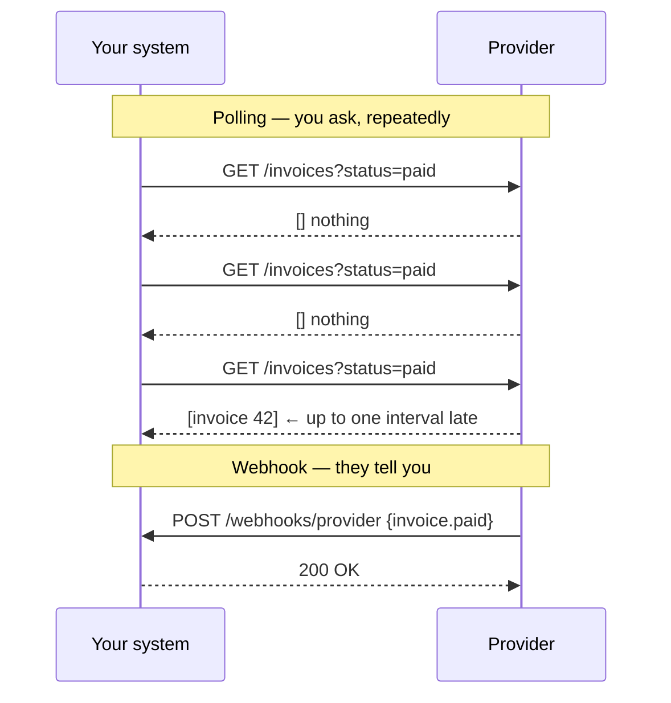

# Webhooks — Part 1

Imagine waiting for a parcel. You could phone the depot every ten minutes and
ask "has it arrived?" — ninety-five calls, ninety-four of them wasted, and the
one useful answer arrives up to ten minutes late. Or you could give the depot
your number and let them ring you when it lands.

The first is **polling**. The second is a **webhook**: you publish a URL, and
another system makes an HTTP request to it when something happens.

That inversion is the whole idea, and it changes who is responsible for what.
You are no longer a client choosing when to ask; you are a *server* being called
by a stranger, on their schedule, possibly more than once, possibly out of
order, and possibly by someone pretending to be them.

> **📌 In one line:** verify the signature on the **raw** body before anything
> else, return 2xx in milliseconds and do the work in a queue, and make every
> handler idempotent on the provider's event id — because delivery is
> at-least-once and always will be.

## Table of Contents

1. [Polling vs Webhooks](#polling-vs-webhooks)
2. [Receiving: Verify the Signature on the Raw Body](#receiving-verify-the-signature-on-the-raw-body)
3. [Receiving: Respond Fast, Work Later](#receiving-respond-fast-work-later)
4. [Receiving: Assume At-Least-Once Delivery](#receiving-assume-at-least-once-delivery)
5. [Receiving: Out-of-Order Events and Honest Status Codes](#receiving-out-of-order-events-and-honest-status-codes)
6. [Common Mistakes](#common-mistakes)
7. [Questions to Test Yourself](#questions-to-test-yourself)
8. [Related](#related)

---

## Polling vs Webhooks



| | Polling | Webhooks |
|---|---|---|
| Latency | Half the poll interval on average | Seconds |
| Requests when nothing happens | Every interval, forever | Zero |
| Who pays for the traffic | You, on every empty poll | The provider, only on real events |
| Who must be available | The provider | **You** |
| Missed events | Impossible — you re-read state | Possible — needs retries and replay |
| Security surface | An outbound call you authenticate | A public endpoint strangers can reach |
| Complexity | Low: a loop and a cursor | Higher: signatures, idempotency, ordering |
| Debugging | Run the request again | "Did it arrive?" needs a delivery log |

Webhooks are not strictly better. They trade a simple, boring, expensive loop
for low latency and a pile of distributed-systems problems that are now yours.
The rest of this file is that pile, split into the two sides you will meet:
**receiving** webhooks from providers like Stripe or GitHub, and **sending**
them to your own customers.

---

## Receiving: Verify the Signature on the Raw Body

Your webhook endpoint is a public URL. Anyone can find it, and anyone can POST
to it. If you process what arrives without proof of origin, you have built an
API that lets strangers mark invoices as paid.

Providers solve this by signing each request: they compute an HMAC of the exact
body bytes using a shared secret and put it in a header, usually alongside a
timestamp.

```http
POST /webhooks/stripe HTTP/1.1
Content-Type: application/json
Stripe-Signature: t=1758790800,v1=5f2a1c...

{"id":"evt_1NXa","type":"invoice.paid","data":{...}}
```

### The bug that costs everyone a day

The verification itself is three lines. The thing that goes wrong is **which
bytes you hash**, and the failure is spectacularly confusing because the code
looks correct.

```ts
// ❌ BROKEN — verification will fail, or worse, pass on the wrong bytes.
app.use(express.json())                        // ← the whole problem

app.post('/webhooks/stripe', (req, res) => {
  const signature = req.headers['stripe-signature']
  const payload = JSON.stringify(req.body)     // ← re-serialised, NOT the original
  if (!verify(payload, signature, SECRET)) return res.status(400).end()
  handle(req.body)
  res.status(200).end()
})
```

`express.json()` parsed the body into a JavaScript object and threw the original
bytes away. `JSON.stringify` then produces *a* JSON document — but not
necessarily *the* JSON document that was signed. Key order can differ, the
provider's whitespace is gone, a unicode escape may be re-encoded, a float like
`1.0` may come back as `1`, and a large integer may have lost precision.

An HMAC over bytes that differ by one character produces a completely different
value. So every request fails verification, on production only, while your unit
tests — which sign the same re-serialised string — pass perfectly.

The fix is to keep the **raw bytes** alongside the parsed object.

```ts
// ✅ FIXED — capture the exact bytes the provider signed.
app.use(express.json({
  verify: (req, _res, buf) => { (req as any).rawBody = buf },   // Buffer, untouched
}))

app.post('/webhooks/stripe', (req, res) => {
  const raw = (req as any).rawBody as Buffer          // the signed bytes
  const header = req.headers['stripe-signature'] as string
  if (!verifySignature(raw, header, process.env.STRIPE_WEBHOOK_SECRET!)) {
    return res.status(400).json({ error: 'invalid_signature' })
  }
  // Only now is it safe to trust req.body.
  ...
})
```

> **⚠️ Warning:** the same trap appears wherever a layer rewrites the body — a
> proxy that re-compresses, a framework that normalises line endings, a logger
> that pretty-prints and re-emits, a body-parser with `strict: false`. If
> verification fails only in one environment, compare byte lengths before
> suspecting the secret.

### Timing-safe comparison and a timestamp window

Two more rules complete the check, and both are one line.

```ts
import { createHmac, timingSafeEqual } from 'node:crypto'

function verifySignature(raw: Buffer, header: string, secret: string) {
  const { t, v1 } = parseSignatureHeader(header)

  // 1. Replay window: reject anything older than five minutes.
  const ageSeconds = Math.abs(Date.now() / 1000 - Number(t))
  if (!Number.isFinite(ageSeconds) || ageSeconds > 300) return false

  // 2. The timestamp is part of the signed payload, so it cannot be edited.
  const signed = Buffer.from(`${t}.`, 'utf8')
  const expected = createHmac('sha256', secret)
    .update(Buffer.concat([signed, raw]))
    .digest()

  const received = Buffer.from(v1, 'hex')
  // 3. Constant-time compare: never ===, never a.localeCompare(b).
  return received.length === expected.length && timingSafeEqual(received, expected)
}
```

**Why timing-safe.** A normal string comparison returns as soon as two bytes
differ, so the time it takes leaks how many leading bytes were correct. Given
enough attempts an attacker recovers a valid signature one byte at a time.
`timingSafeEqual` always looks at every byte.

**Why the timestamp.** Without it, a captured request stays valid forever.
Anyone who records one `invoice.paid` delivery — from a log, a proxy, a
screenshot of a debug page — can replay it a thousand times. The timestamp is
signed *with* the body, so an attacker cannot update it to look fresh. The same
reasoning, in more depth:
[API Keys and Machine Auth — Part 1](../05-authentication/06-api-keys-and-machine-auth-part-1.md).

---

## Receiving: Respond Fast, Work Later

Providers give your endpoint a short timeout — commonly 5 to 30 seconds — and
treat anything slower as a failure worth retrying.

```ts
// ❌ BROKEN — the provider times out and retries; you process twice.
app.post('/webhooks/stripe', async (req, res) => {
  const event = verifyAndParse(req)
  await provisionAccount(event)      // 4s
  await sendWelcomeEmail(event)      // 3s
  await syncToCrm(event)             // 12s, and the CRM is slow today
  res.status(200).end()              // 19s later — nobody is listening
})
```

At around ten seconds the provider gives up, records a failure, and redelivers.
Your first execution keeps running to completion anyway, so the account is
provisioned twice and the customer gets two welcome emails. Retries make it
worse rather than better, and a provider that sees repeated failures eventually
disables the endpoint.

```ts
// ✅ FIXED — verify, record, acknowledge. Do the work elsewhere.
app.post('/webhooks/stripe', async (req, res) => {
  const event = verifyAndParse(req)              // signature only, no I/O
  const stored = await webhookEvents.insertIfNew(event)   // one fast INSERT
  if (stored) await queue.publish('webhook.process', { eventId: event.id })
  res.status(200).end()                          // ~15ms
})
```

The handler now does two cheap things: prove the request is genuine, and make it
durable. Everything slow — provisioning, email, third-party calls — happens in a
worker that can retry on its own terms without the provider watching the clock.
That is exactly what a queue is for; the infrastructure itself is covered in
[message-queues/overview](../../system-design/foundational/message-queues/overview.md).

> **📌 Remember:** your 200 means "I have safely written this down", not "I have
> finished acting on it". Those are different promises, and only the first one
> can be kept in milliseconds.

---

## Receiving: Assume At-Least-Once Delivery

Every serious provider delivers **at least once**, never exactly once. The
reason is a hole no protocol can close: your 200 can be lost in transit. The
provider then cannot tell "the handler never ran" from "the handler ran and the
acknowledgement vanished", and the only safe choice is to send it again.

```text
  Provider ──POST──▶ You: processed ✅ ──200──✗ (network drops the response)
  Provider: "no ack, must retry"  ──POST──▶ You: the same event, again
```

So duplicates are normal traffic, not an incident. The obligation is on you:
**make handlers idempotent, keyed on the provider's event id.** That id is
stable across redeliveries — that is its purpose — so it is the natural dedup
key.

```sql
CREATE TABLE webhook_events (
  provider      text        NOT NULL,
  event_id      text        NOT NULL,      -- the PROVIDER's id, e.g. evt_1NXa
  event_type    text        NOT NULL,
  payload       jsonb       NOT NULL,
  received_at   timestamptz NOT NULL DEFAULT now(),
  processed_at  timestamptz,
  PRIMARY KEY (provider, event_id)         -- the dedup key, enforced by the DB
);
```

The technique that matters is **letting the database decide**, in one statement,
rather than checking and then inserting:

```ts
// ✅ The unique constraint is the lock. No race window.
async function insertIfNew(event: WebhookEvent): Promise<boolean> {
  const result = await db.query(
    `INSERT INTO webhook_events (provider, event_id, event_type, payload)
     VALUES ($1, $2, $3, $4)
     ON CONFLICT (provider, event_id) DO NOTHING
     RETURNING event_id`,
    [event.provider, event.id, event.type, event.payload],
  )
  return result.rowCount === 1      // true = new, false = already seen
}
```

A `SELECT` followed by an `INSERT` looks equivalent and is not. Two concurrent
redeliveries can both read "not present" before either writes, and both proceed.
The unique index makes the check and the claim a single atomic act, so exactly
one caller gets `true`.

> **💡 Tip:** dedup at the edge is necessary but not sufficient. The worker
> should also be idempotent in its own right — `UPDATE ... WHERE status <>
> 'paid'` rather than an unconditional insert — because the job itself can be
> retried after a crash. The general treatment:
> [idempotency](../../system-design/reliability/idempotency.md).

---

## Receiving: Out-of-Order Events and Honest Status Codes

**Order is not guaranteed.** Providers fan deliveries out across workers, and a
retried event arrives after events that were created later. So
`subscription.updated` genuinely can land before `subscription.created`, and a
`deleted` can arrive before an `updated` that describes a state now gone.

Two defences, used together:

1. **Compare timestamps or versions before writing.** Every event carries a
   `created_at`, and most resources carry a version or `updated_at`. Ignore an
   event that is older than the state you already hold.
2. **Re-fetch the object instead of trusting the payload.** On
   `subscription.updated`, call the provider's API for the current subscription.
   That turns "apply this delta" into "converge to the truth", which is
   order-independent by construction.

```ts
// ✅ Stale events are dropped rather than applied backwards.
const local = await subscriptions.findByProviderId(event.data.id)
if (local && local.providerUpdatedAt >= event.data.updated_at) {
  return markProcessed(event, 'stale')       // a newer event already won
}
const fresh = await stripe.subscriptions.retrieve(event.data.id)   // converge
await subscriptions.upsertFromProvider(fresh)
```

**Status codes decide whether the provider retries**, so returning the wrong one
is how events are silently lost or endlessly repeated.

| Situation | Return | Why |
|---|---|---|
| Stored successfully (or a known duplicate) | `200` | Stop retrying; nothing is pending |
| Signature invalid or malformed body | `400` | Retrying identical bytes cannot help |
| Event type you do not care about | `200` | It is not a failure; do not make them retry |
| Your database or queue is down | `500` / `503` | Retrying later *will* work |
| Slow dependency you cannot wait for | `200` after enqueueing | Never hold the connection |

> **⚠️ Warning:** never return `200` for an event you failed to process. The
> provider marks it delivered and never sends it again — the event is gone, and
> the only trace is a line in your logs that nobody is reading. If you cannot
> store it, say `500` and let the retry save you.

---

## Common Mistakes

| Mistake | Why it is wrong | Do this instead |
|---|---|---|
| Verifying against a re-serialised body | The bytes differ from what was signed | Capture the raw buffer before parsing |
| `signature === expected` | Comparison time leaks the correct prefix | `timingSafeEqual` on equal-length buffers |
| No timestamp check | A captured request replays forever | Reject outside a ±5 minute window |
| Doing the work before responding | Provider times out and redelivers | Verify, store, enqueue, 200 |
| Trusting delivery to be exactly-once | Duplicates are normal, not incidents | Dedup on the provider's event id |
| `SELECT` then `INSERT` for dedup | Two concurrent deliveries both pass | `INSERT ... ON CONFLICT DO NOTHING` |
| Assuming events arrive in order | Retries reorder everything | Compare versions, or re-fetch the object |
| Returning 200 for a failed event | The provider never sends it again | 500, and let the retry work |
| Returning 500 for an unknown type | Retries forever on something you ignore | 200 — it is not a failure |

---

## Questions to Test Yourself

1. Explain the polling/webhook trade-off to a product manager in three
   sentences, covering latency, cost, and who must stay available.
2. A teammate's signature verification works locally and fails in production.
   Name the most likely cause and the exact fix.
3. Why is `JSON.stringify(req.body)` not equivalent to the body that was signed?
   Give three concrete ways the bytes can differ.
4. Why must the signature comparison be constant-time? Describe the attack that
   a fast comparison enables.
5. What does the timestamp in the signature header prevent, and why can an
   attacker not simply update it?
6. Your handler takes 19 seconds. Describe everything that goes wrong, in order.
7. Why can no provider offer exactly-once delivery? Draw the message flow where
   a successfully processed event is redelivered.
8. Why is `INSERT ... ON CONFLICT DO NOTHING` safer than checking first?
9. You receive `subscription.updated` before `subscription.created`. Give two
   independent strategies that make the handler correct anyway.
10. For each: signature invalid, unknown event type, database down — give the
    status code and say what the provider does next.

---

> **➡️ Continued in [Part 2](./03-webhooks-part-2.md)** — designing the event
> payload you send, signing and secret rotation, delivery workers and backoff,
> endpoint health and replay, SSRF, testing, and a polling fallback.

## Related

- [Webhooks — Part 2](./03-webhooks-part-2.md) — the other side of the topic:
  sending webhooks to your own customers.
- [Idempotency](../../system-design/reliability/idempotency.md) — processing the
  same event twice with no extra side effects.
- [message-queues/overview](../../system-design/foundational/message-queues/overview.md)
  — the queue behind fast acknowledgement.
- [API Keys and Machine Auth — Part 1](../05-authentication/06-api-keys-and-machine-auth-part-1.md)
  — HMAC signing, shared secrets, and replay windows in general.
- [Correlation IDs and Tracing](../08-logging-and-observability/03-correlation-ids-and-tracing.md)
  — stitching an inbound delivery to the background job it spawned.
- [OWASP Top 10 for APIs](../11-api-security/01-owasp-top-10-for-apis.md) — the
  risks a public callback endpoint adds to your surface.
- [Object Storage and Serving Files](02-object-storage-and-serving-files.md) —
  the other untrusted caller, handled with the same queue patterns.
- [Sending Email and Notifications — Part 1](04-sending-email-and-notifications-part-1.md)
  — bounce and complaint handling arrives as a webhook you receive.
