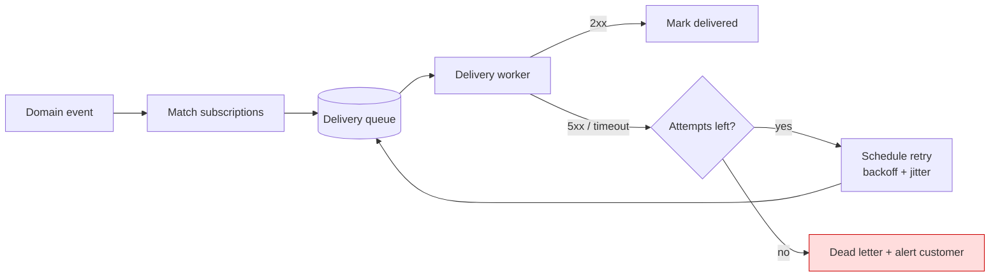

# Webhooks — Part 2

Part 1 put you on the receiving end: a stranger calls your URL and you must
prove who they are, answer in milliseconds, and survive the same event arriving
three times. Now the roles swap. Your customers register URLs with you, and
every problem you just solved becomes a problem you are *causing* for somebody
else — which means the quality of your delivery machinery is now part of your
product.

> **⬅️ This continues [Part 1](./03-webhooks-part-1.md).**

> **📌 In one line:** an outbound webhook is a public API contract plus a
> delivery system — sign it, never send it inline, retry with backoff and
> jitter, show the customer a delivery log they can replay from, and treat every
> customer-supplied URL as an SSRF attempt until it is validated.

## Table of Contents

1. [Sending: Designing the Event Payload](#sending-designing-the-event-payload)
2. [Sending: Signing and Secret Rotation](#sending-signing-and-secret-rotation)
3. [Sending: Delivery Infrastructure](#sending-delivery-infrastructure)
4. [Sending: Endpoint Health, Logs, and Replay](#sending-endpoint-health-logs-and-replay)
5. [Sending: SSRF When the Customer Chooses the URL](#sending-ssrf-when-the-customer-chooses-the-url)
6. [Testing and Debugging](#testing-and-debugging)
7. [Advanced: Ordering, Fan-Out, and a Polling Fallback](#advanced-ordering-fan-out-and-a-polling-fallback)
8. [Common Mistakes](#common-mistakes)
9. [Questions to Test Yourself](#questions-to-test-yourself)
10. [Related](#related)

---

## Sending: Designing the Event Payload

Now the roles swap: your customers register URLs and you deliver to them. The
payload becomes a public API contract that you cannot change casually.

```json
{
  "id": "evt_01HQ3M8WZ4XK2QF9",
  "type": "task.completed",
  "created_at": "2026-09-25T10:15:00Z",
  "api_version": "2026-01-15",
  "data": { "id": "task_8821", "project_id": "proj_42", "status": "completed" }
}
```

Four fields do the heavy lifting. **`id`** is what receivers dedup on, so it
must be stable across your retries of the same event. **`type`** is a stable,
namespaced string — `task.completed`, never a renamed `taskDone`. **`created_at`**
is when the event happened, which is what lets receivers order and discard.
**`api_version`** lets you evolve the shape without breaking existing
subscribers ([API versioning](../02-rest-api-design/04-api-versioning.md)).

**Thin or fat?** A *fat* event embeds the full object; a *thin* event carries
only identifiers and expects the receiver to call your API.

| | Thin (`{id, type, resource_id}`) | Fat (full object embedded) |
|---|---|---|
| Receiver work | Must call your API | Everything is present |
| Staleness | Always reads current state | Can be stale on arrival |
| Your API load | Higher | Lower |
| Payload size | Tiny | Grows with the resource |
| **Security** | Nothing leaks; the fetch is authorized | Data sits in their logs forever |

The security argument is the one that decides most cases. A fat event ships
customer data to a URL that may be misconfigured, logged by a proxy, or later
handed to a third party — and once delivered you cannot recall it. A thin event
forces the receiver to authenticate, which re-checks permissions *at read time*,
so revoking access actually revokes it. Send fat events for low-sensitivity,
high-volume data; send thin events for anything personal or financial.

---

## Sending: Signing and Secret Rotation

Your customers need the same proof you demanded from providers. Generate a
secret per endpoint, sign the timestamp and body together, and document the
scheme precisely enough that someone can implement it without your SDK.

```ts
function signPayload(body: string, secret: string, timestamp: number) {
  const signed = `${timestamp}.${body}`          // timestamp INSIDE the HMAC
  const mac = createHmac('sha256', secret).update(signed).digest('hex')
  return { 'X-Acme-Timestamp': String(timestamp), 'X-Acme-Signature': `v1=${mac}` }
}
```

Publish, in your docs: the exact string that is hashed (`timestamp + "." +
raw body`), the algorithm and encoding, the header names, the version prefix,
the tolerance window you recommend, and a worked example with a known secret and
expected output. Ambiguity here produces support tickets forever.

**Rotation needs two active secrets.** If a secret can only be replaced
instantly, every rotation breaks deliveries for whoever has not redeployed yet —
so nobody ever rotates. Instead, allow two and send both signatures:

```http
X-Acme-Signature: v1=5f2a1c...,v1=9b3e77...
```

The receiver accepts if *either* matches. The lifecycle is: customer generates a
second secret, both are sent, they deploy support for the new one, they delete
the old one. Nothing breaks at any step, and a leaked secret can be revoked the
same day rather than scheduled for a quarterly maintenance window.

> **💡 Tip:** a signature proves origin, not authorization. Also scope each
> endpoint to the tenant that registered it, and never send one customer's
> events to another's URL because a subscription row was joined wrongly.

---

## Sending: Delivery Infrastructure

A customer's endpoint will be down, slow, or behind a firewall that drops
packets silently. None of that may affect the request that produced the event,
so **delivery never happens inline**.



Four properties make this work in production:

- **Exponential backoff with jitter.** Doubling delays — 10s, 20s, 40s, 2m, 8m,
  30m, 2h — gives a recovering endpoint room. *Jitter* is the part people skip:
  without a random offset, every event queued during an outage retries at the
  same instant and knocks the endpoint over again the moment it recovers.
- **A maximum attempt count**, commonly 8 to 15 over 24–72 hours, after which
  the delivery is dead-lettered rather than retried forever.
- **A dead-letter destination** that is visible to the customer, not a log line
  in your infrastructure. An undeliverable event they cannot see is an event
  they will call support about.
- **Short timeouts.** Connect in 2–5 seconds, total 10. Without a timeout, one
  customer whose endpoint accepts connections and never responds will hold your
  workers until the pool is exhausted — and then *every* customer stops
  receiving events. Isolate further by sharding workers per destination or
  capping in-flight deliveries per endpoint.

Retry policy, backoff shapes, and when to stop trying:
[circuit breakers and retries](../../system-design/reliability/circuit-breakers-and-retries.md).

---

## Sending: Endpoint Health, Logs, and Replay

This section is the difference between a webhook product people trust and one
they complain about.

**Disable endpoints that fail persistently.** An endpoint returning 404 for two
days is not coming back; continuing to hammer it wastes your capacity and
theirs. A workable policy: after N consecutive failures mark the endpoint
`degraded` and slow the rate, after a longer streak (say 3 days) mark it
`disabled`, stop delivering, and **email the account owner** — silently
disabling is worse than the failure itself, because the customer discovers it
weeks later through missing data.

**Give customers a delivery log.** For every attempt, record and expose the
event id and type, the destination, the attempt number, the response status,
the response body (truncated), the latency, and the next scheduled retry. The
first question anyone asks is "did it arrive?", and a good answer ends the
investigation in thirty seconds instead of a support thread.

**Let them replay.** A "resend" button for a single event, and a bulk replay for
a time range, together turn a bad deploy on their side from a data-loss incident
into a five-minute fix. This one feature removes most webhook support load.

Keep a retention window (30–90 days) on payload bodies, redact secrets before
storing them, and ensure a delivery log entry carries the correlation id of the
request that produced the event —
[correlation ids and tracing](../08-logging-and-observability/03-correlation-ids-and-tracing.md).

---

## Sending: SSRF When the Customer Chooses the URL

Your customer supplies a URL and your server fetches it. That is the textbook
setup for **server-side request forgery**: a request that appears to come from
inside your network, aimed wherever the attacker likes.

The classic payload is the cloud metadata endpoint. A "webhook URL" of
`http://169.254.169.254/latest/meta-data/iam/security-credentials/` asks your
own infrastructure for its credentials, and if the response body is shown back
in the delivery log, you have handed over your production role.

```ts
// ✅ Validate before every attempt, and again after every redirect.
const ALLOWED = new Set(['https:'])

async function assertSafeDestination(rawUrl: string) {
  const url = new URL(rawUrl)
  if (!ALLOWED.has(url.protocol)) throw new ValidationError('https_required')
  if (url.port && !['', '443'].includes(url.port)) throw new ValidationError('bad_port')

  // Resolve DNS ourselves and inspect every address it returns.
  const addresses = await dns.lookup(url.hostname, { all: true })
  for (const { address } of addresses) {
    if (isPrivate(address)) throw new ValidationError('destination_not_public')
  }
  return addresses
}

// isPrivate covers: 127.0.0.0/8, 10/8, 172.16/12, 192.168/16, 169.254/16,
// 0.0.0.0/8, 100.64/10 (CGNAT), ::1, fc00::/7, fe80::/10, and IPv4-mapped IPv6.
```

Three traps make naive checks useless:

- **Redirects.** A public URL can 302 to `http://127.0.0.1:6379/`. Follow
  redirects manually, or disable them, and re-run the check on every hop.
- **DNS rebinding.** A hostname can resolve to a public address during
  validation and a private one during the request. Resolve once, validate the
  addresses, then **connect to the validated address** rather than the hostname.
- **Encodings.** `0x7f.0.0.1`, `2130706433`, `[::ffff:127.0.0.1]` and
  `localtest.me` all reach loopback. Parse to a real address and inspect that,
  never the string.

Additional layers worth having: send deliveries from an egress proxy or a subnet
with no route to internal services, never expose raw response bodies from
unvalidated hosts, and require the customer to prove control of the endpoint
once (a challenge request they must echo) before it is enabled. Wider context:
[OWASP Top 10 for APIs](../11-api-security/01-owasp-top-10-for-apis.md).

---

## Testing and Debugging

**Locally**, your machine has no public URL, so use a tunnel — `ngrok`, `cloudflared`,
or a provider's own CLI forwarder — to expose `localhost:3000` and register that
address as the endpoint. Provider CLIs additionally let you trigger a realistic
event on demand, which beats waiting for a real payment to land.

**In tests**, do not tunnel. Capture one real payload with its headers, commit
it as a fixture, and assert three behaviours directly: a valid signature is
accepted, a tampered body is rejected, and the same event delivered twice
produces one row and one side effect. That last test is the one that catches
regressions in production.

**In production**, the question is always "did it arrive?" — so log every
delivery at entry, before any processing, with the provider, event id, event
type, signature-valid flag, and the correlation id you attach to the resulting
job. Then a customer question is a single query. Do not log the raw body of
sensitive events, and never log the signing secret.
[Correlation ids and tracing](../08-logging-and-observability/03-correlation-ids-and-tracing.md)
covers stitching the HTTP request to the background job it spawned.

---

## Advanced: Ordering, Fan-Out, and a Polling Fallback

**Ordering guarantees.** Almost no provider offers them, and the reason is
structural: ordered delivery requires a single-threaded stream per destination,
so one slow receiver stalls everything behind it. Providers choose throughput
instead, and push the problem to you — which is why every payload carries a
timestamp or version. If you *must* offer ordering, do it per resource key, cap
the queue depth, and document what happens when it fills.

**Fan-out.** One domain event may match many subscriptions. Keep the event and
the delivery as separate records: one `events` row, N `deliveries` rows each
with its own attempt count and status. Sharing state across destinations means
one broken customer degrades everyone else's delivery.

**Offer a polling fallback.** A `GET /v1/events?after=evt_123&limit=100` endpoint
costs little and solves the problems webhooks cannot: a customer behind a
corporate firewall with no public endpoint, a receiver recovering from an outage
that needs yesterday's events, and anyone reconciling after a bug. Webhooks are
an optimisation over polling, not a replacement for being able to read state.

---

## Common Mistakes

| Mistake | Why it is wrong | Do this instead |
|---|---|---|
| Sending webhooks inline in a request | One slow customer slows your API | Queue, workers, timeouts |
| Retrying without jitter | Every retry stampedes at the same instant | Exponential backoff + randomness |
| Disabling an endpoint silently | Customer finds out weeks later | Email the owner; expose the status |
| Fetching a customer URL unchecked | SSRF into metadata and internal services | Validate scheme and resolved IP, re-check redirects |
| No delivery log or replay | Every question becomes a support thread | Per-attempt log plus a resend button |

---

## Questions to Test Yourself

1. Argue for thin events over fat ones using only the security reason.
2. Why does secret rotation require two active secrets at once, and what happens
   in practice to a provider that only supports one?
3. Your customer's endpoint has been down for an hour and comes back. Explain
   what happens without jitter, and what a missing request timeout does to
   customers who are *not* that one.
4. A customer registers `http://169.254.169.254/latest/meta-data/`. What is the
   attack, and which three checks stop it?

---

## Related

- [Webhooks — Part 1](./03-webhooks-part-1.md) — the receiving side: raw-body
  signature verification, fast acknowledgement, idempotency, and status codes.
- [Circuit Breakers and Retries](../../system-design/reliability/circuit-breakers-and-retries.md)
  — backoff, jitter, attempt budgets, and giving up.
- [message-queues/overview](../../system-design/foundational/message-queues/overview.md)
  — the queue behind outbound delivery and its retries.
- [OWASP Top 10 for APIs](../11-api-security/01-owasp-top-10-for-apis.md) — SSRF
  in its wider context, alongside the other API risks.
- [API Versioning](../02-rest-api-design/04-api-versioning.md) — evolving an
  event payload that customers already parse.
- [Correlation IDs and Tracing](../08-logging-and-observability/03-correlation-ids-and-tracing.md)
  — answering "did it arrive, and what did it do?".
- [Idempotency](../../system-design/reliability/idempotency.md) — the guarantee
  you are asking your receivers to provide, and owe them a stable event id for.
- [Sending Email and Notifications — Part 1](04-sending-email-and-notifications-part-1.md)
  — the same delivery problem with a much older protocol.
