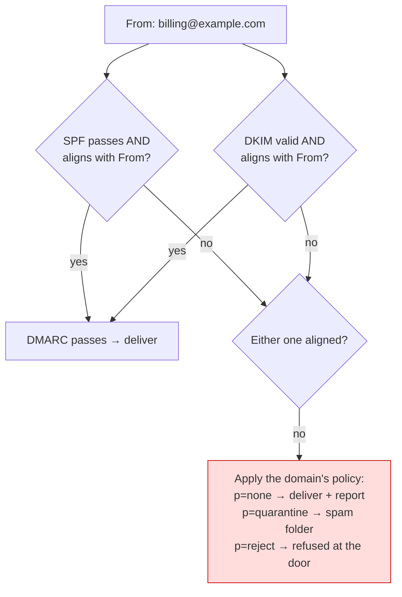

# Sending Email and Notifications — Part 1

Every other integration in this part ends with a status code. You POST, you get
`200`, and you know where you stand. Email has no such thing. Your mail server
can accept a message, hand it on politely, log a success — and the message can
still land in a spam folder, or be dropped in silence, and nothing in your
system will ever know.

The reason is that an inbox has a bouncer. Before a message reaches a human, a
receiving provider decides whether to let it in, and it decides almost entirely
on **who is sending**, not on what the message says. That is a judgement about
your history and your identity, and it is not something you can fix in code.

This is why email is the one integration in this book where the advice is *do
not build it*. Use a transactional email provider and spend your effort on the
part that is genuinely yours: what to send, from where in your code, and never
twice.

> **📌 In one line:** deliverability is reputation, not code — so send through a
> provider, prove your identity with SPF, DKIM and DMARC, suppress every address
> that hard-bounces, and dispatch from a background job rather than from inside
> a request or a database transaction.

## Table of Contents

1. [Why Deliverability Is Not a Code Problem](#why-deliverability-is-not-a-code-problem)
2. [Transactional vs Marketing Email](#transactional-vs-marketing-email)
3. [SPF, DKIM and DMARC in Plain Words](#spf-dkim-and-dmarc-in-plain-words)
4. [Sending Identity: IPs, Domains and Warm-Up](#sending-identity-ips-domains-and-warm-up)
5. [Bounces, Complaints and the Suppression List](#bounces-complaints-and-the-suppression-list)
6. [Never Send Inside the Request, Never Inside a Transaction](#never-send-inside-the-request-never-inside-a-transaction)
7. [Idempotency: The Invoice Sent Four Times](#idempotency-the-invoice-sent-four-times)
8. [Common Mistakes](#common-mistakes)
9. [Questions to Test Yourself](#questions-to-test-yourself)
10. [Related](#related)

---

## Why Deliverability Is Not a Code Problem

Running a mail server is easy. `sendmail` is one command and an SMTP library is
twenty lines: the mail leaves your machine, the protocol succeeds, and you have
built something that does not work. **Deliverability** is the separate question
of whether the message reaches the inbox, and it is decided by the receiving
provider — Gmail, Outlook, a corporate filter — on signals you mostly do not
control:

- **The sending IP's reputation.** A fresh cloud IP has no history, and much of
  the cloud's address space is pre-emptively distrusted because that is where
  spam comes from. Some ranges are blocked permanently and cannot be appealed.
- **The sending domain's reputation**, built slowly from consistent volume and
  from how recipients react to you.
- **Authentication records.** SPF, DKIM and DMARC, below. Missing them is now
  close to automatic rejection at the large providers.
- **Recipient engagement.** Opens, replies and "not spam" clicks help; deletes
  without reading, and especially "report spam", hurt badly.
- **Bounce and complaint rates.** Sustained hard bounces above roughly 2%, or
  complaints above 0.1%, read as a list you are not managing — and your
  reputation falls for *every* message you send.

None of these are things you can write. They are earned over months, monitored
continuously, and repaired slowly if damaged. A transactional email provider
exists to hold that reputation on your behalf: they own warmed IP pools, they
negotiate with the large receivers, they watch the feedback loops, and they will
suspend a customer whose sending damages the pool. You are renting a reputation.

> **📌 Remember:** the SMTP `250 OK` your code receives means "the next server
> accepted this message". It says nothing about inboxing, and nothing about
> whether a human will ever see it. Treat it as a handoff receipt, not delivery.

You also get, free, what you would otherwise build badly: retries on temporary
failures, bounce and complaint webhooks, per-message delivery logs, and a human
to call when a large receiver starts rejecting you. Self-hosting pays only in
the tens of millions of messages a month — and there you hire a specialist.

---

## Transactional vs Marketing Email

The law, the receiving providers and your own architecture all treat these two
categories differently. Confusing them is how a password reset ends up carrying
an unsubscribe link, or how a promotion reaches people who never agreed to hear
from you.

| | Transactional | Marketing / bulk |
|---|---|---|
| Trigger | One user's action or account state | Your decision to send a campaign |
| Examples | Password reset, receipt, alert, 2FA code | Newsletter, promotion, re-engagement |
| Consent needed | Implied by the relationship | **Explicit opt-in**, recorded |
| Unsubscribe | Not required, and usually wrong to offer | **Legally required**, honoured promptly |
| Expected latency | Seconds | Minutes to hours |
| Volume shape | Steady, follows user activity | Spiky — a million at once |
| Reputation risk | Low: people asked for these | High: complaints arrive here |
| Where it belongs | Your application | A marketing platform, usually |

The practical rules that follow from the table:

- **Never put an unsubscribe link on a transactional email.** If people could
  unsubscribe from password resets, they could lock themselves out. CAN-SPAM,
  GDPR and CASL all carve out messages that facilitate a transaction the
  recipient already entered into — that carve-out *is* "transactional".
- **Never smuggle marketing into a transactional message.** A receipt with a
  promotion at the bottom stops being transactional to a regulator, and now
  needs consent and an unsubscribe link like any other campaign.
- **Record consent as data**, not as a checkbox that vanished: who agreed, to
  what, when, from which IP and by which wording — "they ticked a box in 2023"
  is not an answer when an abuse desk asks. Then **honour an unsubscribe
  everywhere, immediately**, from one suppression list applied before the next
  send rather than on a nightly job.

---

## SPF, DKIM and DMARC in Plain Words

These three are treated as arcane DNS trivia, and they are not. They answer one
question — *is this sender allowed to use this domain?* — from three angles.

| | What it proves | Where it lives | Breaks when |
|---|---|---|---|
| **SPF** | This IP is authorised to send for this domain | A DNS `TXT` record on the domain | Mail is forwarded; the new hop's IP is not listed |
| **DKIM** | This message was signed by the domain's key and was not altered | A public key in DNS; a signature header on the message | A mailing list rewrites the subject or body |
| **DMARC** | SPF or DKIM passed **for the domain the user sees**, and says what to do if not | A DNS `TXT` record at `_dmarc.<domain>` | Neither of the other two aligns with the `From:` |

**SPF** is a published guest list: you put your senders' addresses in DNS and
the receiver checks the connecting IP against it.

```dns
example.com.  TXT  "v=spf1 include:_spf.provider.com include:_spf.google.com -all"
```

`include:` delegates to the provider's own list. `-all` means "anything else is
a forgery, reject it"; `~all` means "treat it as suspicious", the safer setting
while you are still finding senders you forgot about. SPF has a hard limit of
**10 DNS lookups** — exceed it and the record silently fails for everyone, a
classic cause of an outage nobody can explain.

**DKIM** is a wax seal. Your provider signs the headers and body with a private
key; the receiver fetches the matching public key from your DNS and checks it.

```dns
s1._domainkey.example.com.  TXT  "v=DKIM1; k=rsa; p=MIGfMA0GCSq..."
```

Because the signature covers the content, DKIM also proves the message was not
modified in transit, and unlike SPF it survives forwarding — which is why it is
the stronger of the two.

**DMARC** ties them to the address the human actually reads. SPF and DKIM each
validate a domain the recipient never sees; DMARC requires one of them to pass
*and align with the `From:` header*, then says what to do when neither does.

```dns
_dmarc.example.com.  TXT  "v=DMARC1; p=none; rua=mailto:dmarc@example.com; pct=100"
```



**The consequence of getting it wrong** depends on which way you get it wrong,
and the two failure modes are not symmetrical:

- **Too lax** (`p=none`, or no DMARC at all): anyone can send mail that appears
  to come from your domain — the ordinary mechanism of a phishing attack against
  your own customers, with your domain's name on it.
- **Too strict, too early** (`p=reject` before you have found every legitimate
  sender): your invoicing tool, CRM, helpdesk and recruiting system are all
  quietly refused, and because the rejection happens at the receiver, *your
  application logs show nothing at all*.

So the rollout is deliberately slow: publish `p=none` with a `rua=` reporting
address, read the aggregate reports until you recognise every sender, move to
`p=quarantine` with a small `pct=`, raise it, and only then `p=reject`. A change
that takes a month is the correct speed here.

---

## Sending Identity: IPs, Domains and Warm-Up

**Shared vs dedicated IPs.** A shared pool sends your mail from addresses used
by many of the provider's customers, so you inherit a warm reputation
immediately — and the pool's bad days with it. A dedicated IP is yours alone:
full control, full isolation, and a reputation of exactly zero on day one. The
rule of thumb is volume. Below roughly 100,000 messages a month a dedicated IP
cannot generate enough traffic to build or even hold a reputation; above that it
starts to pay.

**Warm-up** applies to any new dedicated IP or sending domain. Fifty thousand
messages on day one from an address with no history looks exactly like a
compromised host, so receivers throttle or block you. Ramp over two to six weeks
— a few hundred on day one, roughly doubling, holding whenever complaint rates
rise — and send your *best* traffic first: resets and receipts, which people
open and never report.

**Subdomains separate your reputations**, so one bad campaign cannot damage your
password resets: `mail.example.com` for transactional, `news.example.com` for
marketing, `notify.example.com` for product notifications, with the root domain
kept clean. DMARC covers subdomains by default; `sp=` gives them their own policy.

---

## Bounces, Complaints and the Suppression List

A **bounce** is the receiver refusing the message. The distinction that matters
is permanent versus temporary, because the correct reaction is opposite.

| | Hard bounce (permanent) | Soft bounce (temporary) |
|---|---|---|
| SMTP class | `5xx` | `4xx` |
| Means | This address does not exist, or refuses you permanently | Mailbox full, server down, greylisted, rate-limited |
| Examples | `550 No such user`, `550 Relaying denied` | `452 Mailbox full`, `421 Try again later` |
| Correct response | **Stop sending to it, permanently** | Retry with backoff for 24–72 hours |
| If you ignore it | Your reputation falls for every recipient | You lose a message that would have arrived |

A **complaint** is worse: the recipient pressed "report spam". The message
arrived, was read as unwanted, and the receiver told your provider through a
feedback loop. Complaints are weighted heavily, and a rate above roughly 0.1% —
one in a thousand — will get your sending throttled.

**Why a hard bounce must never be retried.** Receivers read repeated attempts to
addresses that do not exist as the signature of a purchased or scraped list,
because that is what it is a signature of. The damage is not confined to the
dead address: it lowers the reputation applied to *every* message from your
domain, so real customers miss receipts because you kept mailing
`jdoe@oldcompany.com` for eight months. Receivers also recycle dead addresses
into **spam traps** built to catch exactly this.

The defence is a **suppression list** — addresses you will never send to again,
checked before every send.

```sql
CREATE TABLE email_suppressions (
  email        citext      PRIMARY KEY,   -- case-insensitive
  reason       text        NOT NULL,      -- hard_bounce | complaint | unsubscribe | manual
  detail       text,                      -- the provider's SMTP response
  suppressed_at timestamptz NOT NULL DEFAULT now()
);
```

It is populated by the provider's webhooks — precisely the receiving problem
from earlier in this part, and every rule there applies: verify the signature on
the raw body, acknowledge fast, dedup on the event id.

```ts
// ✅ A bounce webhook handler. Verification and dedup are in the webhooks file.
async function onProviderEvent(event: ProviderEvent) {
  switch (event.type) {
    case 'bounce':
      if (event.bounceType === 'permanent') {                 // 5xx only
        await suppressions.upsert(event.email, 'hard_bounce', event.diagnostic)
      }
      break                                                    // soft: provider retries
    case 'complaint':                                          // "report spam"
    case 'unsubscribe':
      await suppressions.upsert(event.email, event.type, null)
      break
  }
}

// ✅ And the check that makes the list worth keeping — before every send.
async function sendEmail(to: string, template: string, data: object) {
  if (await suppressions.has(normalise(to))) return { skipped: 'suppressed' }
  return provider.send({ to, template, data })
}
```

Three details are easy to miss. **Suppress by normalised address**, or
`User@Example.com` slips past a list holding `user@example.com`. **Never delete
the account** on a bounce — mark the address unverified and say so in-app, since
a bounce can be a full mailbox at a real address. And **let support un-suppress,
with a reason and an audit trail**: a customer whose mail server broke for a day
is a legitimate case.

> **💡 Tip:** keep your own list even though the provider keeps an account-wide
> one: yours survives changing provider, answers support's "why did this
> customer get nothing?", and can hold your own rules.

Full treatment of the receiving side is in
[Webhooks — Part 1](03-webhooks-part-1.md); if you are the one *emitting*
delivery events to your own customers, that is
[Webhooks — Part 2](03-webhooks-part-2.md).

---

## Never Send Inside the Request, Never Inside a Transaction

Two rules, and the second one causes a bug that is genuinely hard to see.

**Sending inside the request** makes your API's latency a third party's
property: an API round-trip is 200ms on a good day and thirty seconds during
their incident, with the user watching a spinner for a side effect they never
asked about. And when the provider fails you must either fail the whole request
— refusing a signup over a welcome email — or swallow the error and lose it.

**Sending inside a database transaction** is the subtler one: an email cannot be
rolled back, and once the provider has accepted it, it is gone.

```ts
// ❌ BROKEN — the mail is irreversible; the transaction is not.
await db.transaction(async (tx) => {
  const order = await tx.orders.insert({ userId, total })
  await tx.inventory.decrement(items)              // ← can throw: out of stock
  await mailer.send('order-confirmed', user.email, { order })  // ← already gone
  await tx.payments.capture(order.id)              // ← can throw: card declined
})
// Transaction rolls back. No order exists. The customer has a confirmation
// email for it, with an order number that will 404 when they click it.
```

The window is small and the failure rare, which is exactly why it reaches
production: support receives a confirmation for an order the database has never
heard of, and nobody can reproduce it. The fix is to put the *intent to send*
inside the transaction and the send itself after the commit succeeds.

```ts
// ✅ FIXED — enqueue inside the transaction, send outside it.
await db.transaction(async (tx) => {
  const order = await tx.orders.insert({ userId, total })
  await tx.inventory.decrement(items)
  await tx.payments.capture(order.id)
  await tx.outbox.insert({                          // a row, not a network call
    type: 'email.order_confirmed',
    dedupeKey: `order_confirmed:${order.id}`,
    payload: { orderId: order.id, to: user.email },
  })
})
// The commit is the only thing that makes the job real: a rollback takes the
// outbox row with it, so no email can exist for an order that does not. A relay
// then polls the outbox onto the queue, and a worker performs the send.
```

This is the **transactional outbox**: the row and the business data commit or
fail together. Enqueueing to an external queue inside the transaction does *not*
achieve this — the queue commits immediately while the database may still roll
back, which is the same bug with more moving parts. Without an outbox, the cheap
version is to collect sends in memory and dispatch after `commit()` returns,
risking a lost mail if the process dies in that gap — a smaller, honester
failure.

Where this belongs in your code is the service layer: the service owns the
transaction boundary and decides what side effects it schedules —
[Service Layer — Part 1](../09-application-architecture/02-service-layer-part-1.md),
and the transaction mechanics themselves in
[Transactions — Part 1](../10-database-integration/03-transactions-part-1.md).

> **⚠️ Warning:** the rule covers every irreversible side effect, not just mail.
> Charging a card, posting to Slack, calling a partner's API, sending a webhook
> — none of them roll back. If it leaves your process, it does not belong inside
> a transaction.

**Why a queue and not a thread.** A job gives you durability across a deploy,
retries with backoff, a rate limit that respects the provider's quota, visible
pending work, and isolation so a mail outage cannot take down your API; a
`setTimeout` gives you none of that and loses everything in flight on the next
restart. The infrastructure itself — brokers, delivery semantics, dead-letter
queues — is in
[message-queues/overview](../../system-design/foundational/message-queues/overview.md).

---

## Idempotency: The Invoice Sent Four Times

Your job queue delivers at least once. A worker that sends the mail and then
crashes before acknowledging will be handed the same job again — as will a job
that timed out, or one retried after a deploy killed the pod mid-flight.

```text
  Job: send invoice #8821
  attempt 1 → mail sent ✅ → worker killed before ack ✗
  attempt 2 → mail sent ✅ → redelivered after the visibility timeout
  attempt 3 → mail sent ✅ → transient error on an UNRELATED later step
  attempt 4 → mail sent ✅ → customer emails support
```

Four identical invoices, and every individual step behaved correctly. The
mistake is treating "the job ran" as the unit of work rather than "this
notification was sent". The fix is a stable **idempotency key** derived from the
event and not the attempt, plus a unique index letting the database decide.

```sql
CREATE TABLE sent_notifications (
  idempotency_key text        PRIMARY KEY,  -- e.g. invoice_sent:inv_8821:user_42
  channel         text        NOT NULL,
  provider_msg_id text,
  sent_at         timestamptz NOT NULL DEFAULT now()
);
```

```ts
// ✅ Claim the right to send BEFORE sending. The unique index is the lock.
async function sendOnce(key: string, channel: string, send: () => Promise<string>) {
  const claimed = await db.query(
    `INSERT INTO sent_notifications (idempotency_key, channel)
     VALUES ($1, $2) ON CONFLICT DO NOTHING RETURNING idempotency_key`,
    [key, channel],
  )
  if (claimed.rowCount === 0) return { skipped: 'already_sent' }   // a retry

  try {
    const messageId = await send()
    await db.query(`UPDATE sent_notifications SET provider_msg_id = $2
                    WHERE idempotency_key = $1`, [messageId, key])
  } catch (err) {
    await db.query(`DELETE FROM sent_notifications WHERE idempotency_key = $1`, [key])
    throw err                                  // release the claim so a retry can work
  }
}

// Called with a key that is stable across retries — never a job id or a uuid().
await sendOnce(`invoice_sent:${invoice.id}:${user.id}`, 'email', () => mailer.send(...))
```

Two things make this correct. The key is **derived from the business event**, so
every retry computes the same one — a random uuid or the queue's job id changes
per attempt and defeats the mechanism entirely. And the claim is **released on
failure**, so a genuine provider error can still be retried instead of being
permanently recorded as sent.

A narrow window remains: the provider accepts the message and the process dies
before the `UPDATE`. The retry finds a claimed row and skips, so you have sent
exactly once and merely lost the message id — which is the right way round, and
you should always prefer losing a record to sending a second invoice. Most
providers also accept an idempotency key of their own; pass yours and that
window closes too. General treatment:
[Idempotency](../../system-design/reliability/idempotency.md).

---

## Common Mistakes

| Mistake | Why it is wrong | Do this instead |
|---|---|---|
| Running your own SMTP server to save money | Reputation, not code, decides inboxing | A provider; rent their reputation |
| No SPF, DKIM or DMARC | Increasingly an automatic rejection | Publish all three; align with the `From:` |
| Jumping straight to `p=reject` | Silently kills senders you forgot | `p=none` → read reports → quarantine → reject |
| Exceeding SPF's 10 DNS lookups | The record fails for everyone, silently | Flatten includes; audit after adding a vendor |
| A dedicated IP below ~100k/month | Not enough traffic to build a reputation | Use the provider's shared pool |
| Blasting a new IP or domain at full volume | Looks like a compromised host | Warm up over weeks, best traffic first |
| Retrying a hard bounce | Damages reputation for every recipient | Suppress permanently on any `5xx` |
| Sending inside the request | Your latency is now the provider's | Enqueue; respond immediately |
| Sending inside a transaction | The mail survives the rollback | Outbox row inside; send after commit |
| A job id as the idempotency key | It changes on every retry | Derive the key from the business event |

---

## Questions to Test Yourself

1. Your mail server logs `250 OK` for every message and customers say nothing
   arrives. Explain what `250 OK` promises, and where the mail went.
2. Explain SPF, DKIM and DMARC to a teammate in three sentences — one each —
   naming what each one proves.
3. Why does DKIM survive mail forwarding when SPF does not, and what does DMARC
   add that neither of them can provide alone?
4. A team publishes `p=reject` on Monday. On Friday, recruiting says candidates
   stopped replying. Explain the failure, and why nothing appeared in any log.
5. Give the rule for choosing shared vs dedicated IPs, and say why a dedicated
   IP is the *worse* choice at 20,000 messages a month.
6. Distinguish a hard bounce from a soft bounce, and describe the damage done by
   sending to a hard-bounced address for six months.
7. Walk through the bug where a customer receives a confirmation for an order
   that does not exist. Name the ordering error and the fix.
8. Why does enqueueing to an external queue *inside* a transaction fail to solve
   the problem an outbox row solves?
9. A retried job sends the same invoice four times. Give the key you would use,
   say why a job id would not work, and explain why the claim must be released
   when the provider call throws.

---

> **➡️ Continued in [Part 2](04-sending-email-and-notifications-part-2.md)** —
> templates and escaping, header injection, testing without emailing real
> customers, the other channels, and designing a notification system properly.

## Related

- [Sending Email and Notifications — Part 2](04-sending-email-and-notifications-part-2.md)
  — templates, header injection, safe testing, and multi-channel notifications.
- [Webhooks — Part 1](03-webhooks-part-1.md) — receiving the bounce and
  complaint webhooks that keep the suppression list current, and
  [Webhooks — Part 2](03-webhooks-part-2.md) — the same delivery problem from
  the sender's side, with retries and a delivery log.
- [Idempotency](../../system-design/reliability/idempotency.md) — the general
  rule behind sending exactly one invoice, once.
- [message-queues/overview](../../system-design/foundational/message-queues/overview.md)
  — the queue every send belongs on; a thread is not a substitute.
- [Service Layer — Part 1](../09-application-architecture/02-service-layer-part-1.md)
  — the layer that owns the transaction and schedules the side effect, and
  [Transactions — Part 1](../10-database-integration/03-transactions-part-1.md)
  — what a rollback does, and what it cannot undo.
- [Secrets and Configuration — Part 1](../11-api-security/05-secrets-and-configuration-part-1.md)
  — where the provider API key lives, and where it must not.
