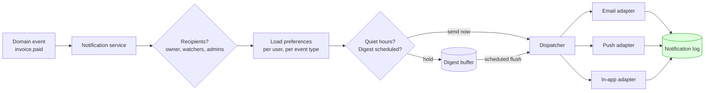

# Sending Email and Notifications — Part 2

Part 1 was about getting a message out of your system and into an inbox: who is
allowed to send as you, which addresses you must stop sending to, and where in
your code the send belongs. This part is about the message itself and everything
that surrounds it — how it is built, how a user-supplied name can turn into a
header you never wrote, how you test all of this without mailing real customers,
and what to do once email stops being the only channel you have.

> **⬅️ This continues [Part 1](04-sending-email-and-notifications-part-1.md).**

> **📌 In one line:** keep content out of code and escape it at the destination,
> strip CR and LF from anything a user supplies into a header, make it
> physically impossible for staging to reach a real customer, and route every
> notification through one dispatcher that consults preferences and writes a log.

## Table of Contents

1. [Templates: Content Out of Code](#templates-content-out-of-code)
2. [Header Injection Through a Name or a Subject](#header-injection-through-a-name-or-a-subject)
3. [Testing Without Emailing Real Customers](#testing-without-emailing-real-customers)
4. [Beyond Email: Choosing a Channel](#beyond-email-choosing-a-channel)
5. [Designing a Notification System](#designing-a-notification-system)
6. [Advanced: Tenant Domains, Quotas, and Tracking](#advanced-tenant-domains-quotas-and-tracking)
7. [Common Mistakes](#common-mistakes)
8. [Questions to Test Yourself](#questions-to-test-yourself)
9. [Related](#related)

---

## Templates: Content Out of Code

An email assembled with string concatenation in a service method is the same
mistake as HTML assembled in a controller. The copy changes weekly, it is
written by someone who does not deploy, it needs a second language next quarter,
and every edit currently requires a release.

So templates live as files (or in the provider's template store), the code
passes a flat bag of variables, and rendering is the last step before sending.

```ts
// ❌ BROKEN — copy in code, and user data pasted straight into markup.
const html = `<p>Hi ${user.name}, ${actor.name} shared "${doc.title}" with you.</p>`
await mailer.send({ to: user.email, subject: `${actor.name} shared a document`, html })

// ✅ FIXED — a named template, a data object, an auto-escaping renderer.
await mailer.send({
  to: user.email,
  template: 'document-shared',
  locale: user.locale ?? 'en',
  data: { recipientName: user.name, actorName: actor.name, docTitle: doc.title },
})
```

**Escaping is the security part, and it is not optional.** `user.name` and
`doc.title` are attacker-controlled strings. A document titled
`` becomes live markup in the broken version above.
Email clients are inconsistent about what they execute, but many recipients read
mail in a browser tab on *your* webmail-adjacent domain, and a rendered
`<a href="javascript:...">` or a spoofed "click here to reset your password"
block inside your own branded template is a credible phishing vector regardless.

The rule is the same one from the injection file: **escape at the destination,
for that destination.** HTML-escape into HTML bodies, URL-encode into links,
and never trust that a value was cleaned on the way in.

```hbs
{{! ✅ auto-escaped — &lt;img src=x&gt; renders as text }}
<p>Hi {{recipientName}}, {{actorName}} shared "{{docTitle}}" with you.</p>
<a href="{{docUrl}}">Open the document</a>

{{! ❌ triple-stache disables escaping. Only ever for markup YOU generated. }}
<p>{{{docTitle}}}</p>
```

Watch three specific holes: a template engine used with auto-escaping off,
interpolation inside an `href` or `style` attribute (where HTML-escaping alone
does not stop `javascript:`), and any "rich text" a user wrote, which needs an
allow-list sanitiser rather than escaping. Details in
[Injection Attacks — Part 2](../11-api-security/02-injection-attacks-part-2.md)
and [Sanitization and Normalization](../04-validation-and-input/03-sanitization-and-normalization.md).

**Localisation** is cheap if you plan for it and expensive if you retrofit.
Store a locale on the user, keep one template per locale keyed by name, and fall
back along a chain (`pt-BR` → `pt` → `en`) rather than failing. Two details
catch people out: dates, times, currencies and numbers must be formatted in the
recipient's locale *and time zone* — "your meeting starts at 14:00" is wrong for
most of your users — and languages do not share English's sentence structure, so
never build a sentence by concatenating translated fragments.

**Always send a plain-text alternative.** A `multipart/alternative` message
carries both, and the client picks. HTML-only mail scores worse with spam
filters (it is a long-standing spammer signature), is unreadable on watches,
terminal clients and screen readers, and gives you nothing to show when images
are blocked — which is the default in most corporate mail. Write the text part
deliberately: a rendering of your HTML stripped of tags is usually unreadable.

---

## Header Injection Through a Name or a Subject

This one is genuinely missed, including by teams that are careful elsewhere.

An email is headers, a blank line, then the body — and **headers are separated
by CRLF**. If a user-controlled string reaches a header without being checked,
the user can end that header and start writing their own.

```text
  Subject: Password reset for Alice
  From: no-reply@example.com
  To: alice@example.com
                        ← blank line: everything after this is body
  Click here to reset…
```

Now suppose the display name comes from a profile field and you build the header
yourself:

```ts
// ❌ BROKEN — user.displayName is pasted into a raw header.
const raw =
  `From: "${user.displayName}" <no-reply@example.com>\r\n` +
  `Subject: ${subject}\r\n` +
  `To: ${to}\r\n\r\n${body}`
await smtp.sendRaw(raw)
```

A user who sets their display name to:

```text
Alice" <no-reply@example.com>
Bcc: everyone@competitor.com
X-Priority: 1
```

has added a `Bcc` to a message sent from your domain, signed with your DKIM key
and carrying your reputation. The same trick against a `Subject` field taken
from a "contact us" form turns your transactional sender into an open relay for
spam, and against a `Reply-To` it redirects replies to the attacker.

```ts
// ✅ FIXED — reject control characters, and let a library build the headers.
const HEADER_UNSAFE = /[\r\n\u0000

]/       // CR, LF, NUL, LS, PS

function assertHeaderSafe(value: string, field: string) {
  if (HEADER_UNSAFE.test(value)) throw new ValidationError(`invalid_${field}`)
  if (value.length > 200) throw new ValidationError(`${field}_too_long`)
  return value
}

await mailer.send({                       // nodemailer/SES/etc. encode for you
  from: { name: assertHeaderSafe(user.displayName, 'name'), address: SENDER },
  to,                                     // an address parsed and validated, not a string
  subject: assertHeaderSafe(subject, 'subject'),
  text, html,
})
```

Four rules cover it. **Never concatenate raw headers** — use the library's
structured fields, which encode non-ASCII names per RFC 2047 and refuse control
characters. **Reject rather than strip**: silently removing a newline hides an
attack you would rather see in your logs, and `assertHeaderSafe` throwing gives
you a signal. **Validate the recipient as an address**, not as a string, so
`a@b.com, attacker@evil.com` cannot become two recipients. And **cap the length**,
because a 40 KB display name is its own problem.

> **⚠️ Warning:** the risk is not only the header. Any form that lets a stranger
> choose the recipient *and* part of the content — "email this article to a
> friend", "invite a teammate" — is a spam-sending endpoint with your reputation
> attached. Rate-limit it per account, require authentication, and keep the
> user-supplied portion to a short, escaped, clearly-quoted block.

---

## Testing Without Emailing Real Customers

Three environments, three different answers, and one rule that is absolute.

**Locally, catch the mail.** Run a mail-catcher — Mailpit, MailHog, Maildev — and
point your `SMTP_HOST` at it. It accepts everything, delivers nothing, and gives
you a web inbox showing the rendered HTML, the text alternative, the headers and
the raw source. You see exactly what the user would see, in a second, with no
provider account and no risk.

```bash
docker run -p 1025:1025 -p 8025:8025 axllent/mailpit
# app:  SMTP_HOST=localhost SMTP_PORT=1025
# you:  http://localhost:8025
```

**In automated tests, do not send at all.** Assert on the call: the template
name, the recipient, the variables, and that exactly one send happened for two
identical jobs. Separately, render each template against fixture data and snapshot
it, so a broken variable or an unescaped value fails a test rather than a
customer. See [Unit Testing — Part 1](../13-testing-and-quality/02-unit-testing-part-1.md).

**In staging, use the provider's sandbox.** Sandbox mode accepts the API call,
validates it, returns a message id, and delivers nothing. You exercise the real
credentials, the real template store and the real webhook plumbing — most
providers can deliver simulated bounce and complaint events to your suppression
handler — without a single message reaching a person.

> **⚠️ The rule teams learn exactly once:** a non-production environment must be
> *incapable* of emailing a real customer. Not "configured not to" — incapable.
> The classic incident is a production database restored into staging for a
> realistic test, a job queue draining on startup, and eleven thousand customers
> receiving a three-month-old order confirmation at 02:00.

There are two standard safeguards, and the good setups use both:

```ts
// ✅ A single choke point every send passes through.
function resolveRecipient(to: string): string | null {
  if (config.env === 'production') return to

  // 1. Global redirect: everything goes to one inbox you own.
  if (config.mail.redirectAll) return config.mail.redirectAll   // qa@yourcompany.com

  // 2. Allow-list: only addresses on your own domains may be delivered to.
  const domain = to.split('@')[1]?.toLowerCase()
  return config.mail.allowedDomains.includes(domain) ? to : null   // null = drop
}
```

Make it structural rather than a matter of discipline. The non-production
environments should hold **sandbox API keys that physically cannot deliver**;
the allow-list should default to empty and deny on a missing config rather than
falling open; any restored database dump should have its email column rewritten
during the restore; and the original recipient belongs in a header like
`X-Original-To` so a redirected message is still debuggable. Where these values
live: [Secrets and Configuration — Part 1](../11-api-security/05-secrets-and-configuration-part-1.md).

---

## Beyond Email: Choosing a Channel

Email is the default because it is universal and free-ish. It is also slow,
ignorable, and frequently unread. Once a product matters to people, "notify the
user" stops meaning "send an email".

| Channel | Cost | Latency | Reliability | Best for |
|---|---|---|---|---|
| **Email** | ~$0.0001 | Seconds–minutes | Medium — spam folders, bounces | Receipts, records, anything the user may want to keep or search |
| **SMS** | ~$0.01–0.10 | Seconds | High — but no rich content, per-country rules | 2FA codes, time-critical alerts, delivery windows |
| **Push** (mobile/web) | ~free | Sub-second | Low — revoked permissions, stale tokens, silent drops | Re-engagement, chat, things that can be missed |
| **In-app** | Free | Instant when open | High *while they are in the app*; zero otherwise | Activity feeds, non-urgent status, the durable record |
| **Chat / webhook** (Slack, Teams) | Free | Seconds | High — but per-workspace rate limits | Team-facing alerts, ops, integrations |

The practical decisions that fall out of the table:

- **Cost changes the design.** SMS is one to three orders of magnitude more
  expensive than email, so it is reserved for messages that are worth cents each
  and is a real fraud target — "SMS pumping" abuses a signup form to generate
  premium-rate traffic, so rate-limit per number, per IP and per country.
- **Push is not delivery.** A push token can be revoked, expired, or throttled
  by the OS, and you may never be told. Never make push the only place a piece
  of information exists.
- **In-app is the reliable one**, because you control it end to end. Treat the
  in-app feed as the durable record and the other channels as *notifications
  about* it — which also makes "resend" trivially safe.
- **Chat is a webhook**, and everything in
  [Webhooks — Part 2](03-webhooks-part-2.md) applies: signing, retries with
  jitter, and a delivery log.
- **Match urgency to channel.** A password reset is email. A fraud alert is SMS
  *and* email *and* in-app. A weekly summary is email only, and probably a
  digest — see below.

---

## Designing a Notification System

The failure mode is not any one channel. It is that after two years there are
forty places in the codebase calling `mailer.send()` directly, none of them
checks preferences, and nobody can answer "why did this customer get four
emails about one thing?"

The fix is that **nothing sends directly**. An event is emitted; a dispatcher
decides who cares, on which channels, and when.



**Per-user preferences** are a matrix of event type against channel, not a
single "emails on/off" switch — the latter forces a choice between forty daily
mentions and missing a billing failure, and users resolve it by unsubscribing
from everything.

```sql
CREATE TABLE notification_preferences (
  user_id    uuid    NOT NULL,
  event_type text    NOT NULL,       -- 'invoice.paid', 'comment.mention', ...
  channel    text    NOT NULL,       -- 'email' | 'push' | 'in_app' | 'sms'
  enabled    boolean NOT NULL,
  frequency  text    NOT NULL DEFAULT 'immediate',  -- immediate | daily | weekly
  PRIMARY KEY (user_id, event_type, channel)
);
```

Ship sensible defaults so a new user with no rows still gets their receipts, and
treat a few categories as **non-optional**: security alerts, billing failures
and legally required notices are not preferences. Every other email carries a
one-click path to the preference page, and honouring it must be immediate.

**Digests and batching exist to prevent notification fatigue**, which is the
real risk to your whole channel. A user who receives thirty mentions during a
busy afternoon does not read thirty emails — they mute the sender, and then miss
the billing failure too. Two mechanisms:

- **Debounce** a burst: hold an event for a few minutes and collapse the ones
  that arrive behind it. "Sam and 4 others commented on your document" is one
  message instead of five.
- **Digest** on a schedule: buffer low-priority events and flush daily or
  weekly. A digest that finds an empty buffer sends nothing — a "you have no
  notifications" email is worse than silence.

**Quiet hours and time zones** need the user's zone, not the server's. Store an
IANA identifier (`Europe/Lisbon`), never a UTC offset, because offsets change
twice a year and a stored `+01:00` is wrong for half of it. Then compute send
windows in their local time — "deliver the daily digest at 08:00 local" — and
decide per category what a quiet-hours hit means: defer a marketing nudge, defer
a digest, but deliver a fraud alert immediately. Overriding quiet hours for
genuinely urgent messages is correct; overriding them for a product announcement
is how you get reported as spam.

**A notification log answers "was it sent?"**, which is the only question
support ever asks.

```sql
CREATE TABLE notification_log (
  id              uuid        PRIMARY KEY,
  user_id         uuid        NOT NULL,
  event_type      text        NOT NULL,
  channel         text        NOT NULL,
  idempotency_key text        UNIQUE,          -- the Part 1 dedup key
  status          text        NOT NULL,        -- queued|sent|delivered|bounced|suppressed|skipped
  skip_reason     text,                        -- 'preference_off' | 'quiet_hours' | 'suppressed'
  provider_msg_id text,
  correlation_id  text,                        -- back to the request that caused it
  created_at      timestamptz NOT NULL DEFAULT now()
);
```

Recording **skips** matters as much as recording sends: "we did not send it,
because you turned that off in March" is an answer, while an empty table is not.
Update the row from the provider's delivery and bounce webhooks so the status
reflects reality rather than intent, and carry the correlation id through so a
notification can be traced back to the request that produced it —
[Correlation IDs and Tracing](../08-logging-and-observability/03-correlation-ids-and-tracing.md).

---

## Advanced: Tenant Domains, Quotas, and Tracking

**Per-tenant sending domains.** B2B customers want mail to come from
`billing@their-company.com`, not from yours. That means they must publish DNS
records — a DKIM key you generate per tenant, and usually a CNAME for return-path
alignment — and you must verify those records before enabling the domain and
re-check them periodically, because someone will eventually delete one. The
upside is real isolation: each tenant's reputation is their own, so one
customer's bad list cannot affect another's. The cost is an onboarding flow with
a verification state machine, a support burden when DNS is wrong, and per-tenant
deliverability you are now expected to explain. Scope every send by tenant the
same way you scope everything else —
[Ownership, ABAC and Multi-Tenancy — Part 1](../06-authorization/03-ownership-abac-and-multi-tenancy-part-1.md).

**Quotas and failover.** Every provider imposes a rate limit and a daily cap,
and hitting one returns `429` for every subsequent send. Your worker must
respect the published rate rather than discovering it — a token bucket sized
just under the limit — and must treat a `429` as a retryable back-off, never as
a permanent failure that drops the message. Provider outages are the harder
case. A second provider gives you somewhere to fail over, but it only works if
you planned for it: templates duplicated or kept in your own repository rather
than in one provider's store, both sending domains authenticated in DNS, and
the failover exercised occasionally so you find the missing DKIM record in a
drill rather than during an incident. Keep the switch deliberate — a circuit
breaker that trips on sustained failure, not a per-message race
([Circuit Breakers and Retries](../../system-design/reliability/circuit-breakers-and-retries.md)).

**Open and click tracking, and what it costs you.** An open is tracked with a
1×1 transparent image; a click is tracked by rewriting every link to route
through the provider's redirector. Both are useful — engagement is a genuine
deliverability signal, and a click log helps support — and both have
consequences worth stating plainly:

- **Open tracking barely works any more.** Apple Mail Privacy Protection and
  similar proxies pre-fetch images for everyone, so opens are inflated by
  recipients who never looked. Do not make product decisions on the number.
- **Link rewriting hurts trust and deliverability.** Recipients see a URL that
  is not your domain, which is exactly what a phishing email looks like, and a
  shared redirector domain can be blocklisted because of someone else's
  campaign. Use a CNAME'd tracking domain of your own if you track at all.
- **It is personal data.** An open records that a specific person read a
  specific message at a specific time from a specific IP. Under GDPR that needs
  a lawful basis, retention limits and a place in your privacy notice, and
  under several regimes it needs consent.
- **Never track transactional mail.** A password reset does not need engagement
  analytics, and the tracking pixel adds a request, a privacy question and a
  render failure for no benefit.

---

## Common Mistakes

| Mistake | Why it is wrong | Do this instead |
|---|---|---|
| Building email bodies in service code | Copy changes need a deploy; no i18n | Named templates plus a data object |
| Interpolating user data unescaped | Attacker markup renders in the client | Auto-escaping renderer; escape per destination |
| A triple-stache for user content | Disables the only defence you had | Escape; sanitise rich text with an allow-list |
| HTML-only messages | Worse spam scoring; unreadable in many clients | Always a `multipart/alternative` text part |
| A UTC offset as the user's time zone | Wrong for half the year | Store an IANA zone like `Europe/Lisbon` |
| Concatenating raw headers | CRLF in a name injects `Bcc` and more | Library fields; reject CR/LF; validate addresses |
| Stripping newlines silently | Hides an attack you should see | Reject and log the attempt |
| Real SMTP credentials in staging | One restored dump mails every customer | Sandbox keys, allow-list, global redirect |
| An allow-list that fails open | A missing config mails the world | Default empty; deny on missing config |
| One "emails on/off" switch | Users turn off everything, then miss billing | Preferences per event type per channel |
| Letting users opt out of security alerts | They will not know their account was taken | Mark those categories non-optional |
| Sending every event immediately | Fatigue; the user mutes you entirely | Debounce bursts; digest low-priority events |
| No record of skipped notifications | "Was it sent?" has no answer | Log skips with a reason, not just sends |
| Treating a `429` as a failed send | You drop mail the provider would have taken | Token bucket under the cap; back off and retry |
| Tracking opens on a password reset | Privacy cost, zero benefit | Track marketing only, on your own domain |

---

## Questions to Test Yourself

1. A document title is rendered into an HTML email body. Give the attack, the
   defence, and why "we validated it on the way in" is not the defence.
2. Why is a `multipart/alternative` plain-text part worth writing by hand rather
   than generating by stripping tags?
3. A user sets their display name to a string containing `\r\nBcc: ...`.
   Describe what the recipient's mail server receives, and why your DKIM
   signature makes this worse rather than better.
4. Why reject a header value containing a newline rather than stripping it?
5. You have a mail-catcher locally and sandbox keys in staging. A restored
   production dump still mails 11,000 customers. What was missing, and name the
   two safeguards that would have stopped it.
6. Give one message that must go by SMS, one that must go by email, and one that
   belongs in-app only — and justify each from the cost/latency/reliability
   table.
7. Why is push notification never an acceptable sole delivery channel?
8. A user gets thirty mention emails in an afternoon and mutes your domain. Which
   two mechanisms prevent this, and how do they differ?
9. Why must a user's time zone be stored as `Europe/Lisbon` rather than `+01:00`,
   and what does that have to do with quiet hours?
10. Support asks why a customer received nothing. Your notification log is empty
    for that user. Name the design flaw and what the row should have said.
11. What does per-tenant sending domain support buy you, and name two ongoing
    operational costs it creates.
12. Your open rate jumped from 20% to 65% with no change to your mail. Explain,
    and say what you should conclude from the number.

---

## Related

- [Sending Email and Notifications — Part 1](04-sending-email-and-notifications-part-1.md)
  — deliverability, SPF/DKIM/DMARC, bounces and suppression, and why a send
  belongs in a background job.
- [Injection Attacks — Part 2](../11-api-security/02-injection-attacks-part-2.md)
  — escaping at the destination, of which HTML email is one destination.
- [Sanitization and Normalization](../04-validation-and-input/03-sanitization-and-normalization.md)
  — why user "rich text" needs an allow-list sanitiser, not escaping.
- [Webhooks — Part 2](03-webhooks-part-2.md) — chat notifications are webhooks,
  and delivery logs and replay are the same feature described here.
- [message-queues/overview](../../system-design/foundational/message-queues/overview.md)
  — the infrastructure behind digests, scheduled flushes and per-channel workers.
- [Idempotency](../../system-design/reliability/idempotency.md) — the key stored
  on every `notification_log` row.
- [Circuit Breakers and Retries](../../system-design/reliability/circuit-breakers-and-retries.md)
  — respecting a quota, backing off a `429`, and failing over to a second
  provider.
- [Correlation IDs and Tracing](../08-logging-and-observability/03-correlation-ids-and-tracing.md)
  — tracing a notification back to the request that caused it.
- [Ownership, ABAC and Multi-Tenancy — Part 1](../06-authorization/03-ownership-abac-and-multi-tenancy-part-1.md)
  — scoping sends, templates and domains to a tenant.
- [Unit Testing — Part 1](../13-testing-and-quality/02-unit-testing-part-1.md) —
  asserting on the send instead of performing it.
