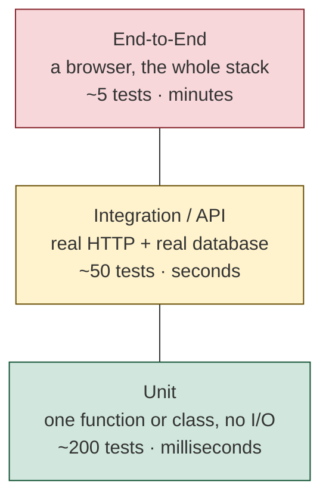
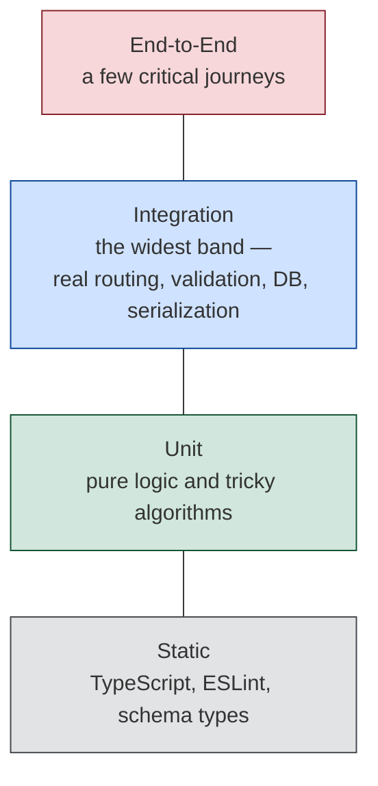

# The Testing Pyramid — Part 1

You built the invoice feature. You opened the browser, created a project, added
three lines, clicked **Send**, and the email arrived. It works. You know it
works, because you watched it work.

Two weeks later you add a discount field. You click through the invoice flow
again. It still works. But you did not click through the *project archive*
flow, or the *credit note* flow, or the *export to CSV* flow — and one of those
reads the same total. You will find out on Tuesday, from a customer.

That is the whole argument. You can click through one feature. You cannot click
through **every** feature on **every** deploy, forever, without mistakes. A
test suite can, in twenty seconds.

Part 1 makes the case and gives you the vocabulary: what a test actually is,
the same feature tested at four different levels, and the two competing shapes
people recommend for a test suite. Part 2 is about judgement — what is worth
testing, why a coverage percentage lies, and how to start from zero.

> **📌 In one line:** tests are not paperwork — they are the only thing that
> lets you change code you wrote six months ago without opening a browser and
> praying.

## Table of Contents

1. [The Honest Question: Why Not Just Click Through It?](#the-honest-question-why-not-just-click-through-it)
2. [What a Test Actually Is](#what-a-test-actually-is)
3. [One Feature, Four Levels](#one-feature-four-levels)
4. [Contract Tests, Briefly](#contract-tests-briefly)
5. [The Pyramid](#the-pyramid)
6. [The Levels Compared](#the-levels-compared)
7. [The Testing Trophy: the Modern Counter-Argument](#the-testing-trophy-the-modern-counter-argument)
8. [Both Views, Judged Fairly](#both-views-judged-fairly)
9. [A Practical Recommendation for a Small SaaS Backend](#a-practical-recommendation-for-a-small-saas-backend)
10. [Common Mistakes](#common-mistakes)
11. [Questions to Test Yourself](#questions-to-test-yourself)
12. [Related](#related)

---

## The Honest Question: Why Not Just Click Through It?

This deserves a straight answer rather than a lecture, because manual checking
is not stupid. It is how you verified everything you have ever built, and it
worked.

Here is what it cannot do.

| What you need | Clicking through | A test suite |
|---|---|---|
| Check the feature you just wrote | Works well | Works well |
| Check the other 40 features you did not touch | Not realistically | 20 seconds |
| Check the same thing at 11pm on a Friday deploy | You will skip it | It runs anyway |
| Check an error path (payment declined, DB down) | You cannot easily produce it | Trivial to produce |
| Check a condition that takes 7 days to occur | Impossible | Set the clock |
| Check that two simultaneous requests behave | Impossible by hand | Two promises |
| Check the exact JSON field names a mobile app depends on | You look at the screen, not the payload | Assert the body |
| Prove a bug is fixed and stays fixed | You remember for a month | Forever |
| Let a new teammate change your code safely | They must ask you | The suite answers |

The last two rows are where the value really lives.

**A test is a bug you only have to fix once.** Without a suite, every bug you
fix is a bug that can come back — silently, in a refactor, a year later. With a
suite, the test you wrote while fixing it stands guard permanently. That is a
one-line investment with an unlimited payoff.

**A test is permission to change things.** The real cost of untested code is
not the bugs. It is that you stop touching it. You see the 200-line invoice
function, you know it needs splitting up, and you leave it alone because you
cannot prove you would not break anything. Code you are afraid of rots, and
rotting code slows every future feature. Tests are how you buy the right to
refactor.

> **💡 Tip:** if you have ever said "I do not want to touch that file", you have
> already felt the cost of no tests. Tests are the cure for that feeling.

The honest counter-point is that tests are not free: they take time to write,
they must be maintained, and a bad suite is a genuine tax. That is real, and
this part is largely about spending that budget where it pays — which is why
Part 2 spends a whole section on what *not* to test.

---

## What a Test Actually Is

Strip away the tooling and a test is three lines of ordinary code: call your
code, look at what came back, complain if it is wrong.

Here is a complete, real test. Nothing is hidden.

```ts
// src/billing/money.ts
export function applyDiscount(amountCents: number, percent: number): number {
  return Math.round(amountCents * (1 - percent / 100))
}
```

```ts
// src/billing/money.test.ts
import { test, expect } from 'vitest'
import { applyDiscount } from './money'

test('applies a 10 percent discount', () => {
  expect(applyDiscount(10_000, 10)).toBe(9_000)
})
```

That is it. `test()` registers a function with a name. `expect(...).toBe(...)`
throws if the two values differ. The runner executes every registered function,
catches the throws, and prints a list.

There is no magic and no framework mystery. If you deleted the test runner you
could write the same thing by hand:

```ts
const actual = applyDiscount(10_000, 10)
if (actual !== 9_000) throw new Error(`expected 9000, got ${actual}`)
```

The runner only adds three conveniences: it finds your test files, it keeps
going after a failure so you see all of them, and it prints a readable report.
Everything else in this part is about *which* assertions are worth writing.

> **📌 Remember:** a test is code that runs your code and asserts the result.
> If an assertion could never fail, you have written a program, not a test.

---

## One Feature, Four Levels

"Unit", "integration" and "end-to-end" sound like abstract categories until you
see the same feature tested at each level. So here is one rule from a SaaS
product, tested four ways.

**The rule:** you may not create an invoice for a project that has been
archived. The API should answer `409 Conflict`.

The code in question spans three layers:

```ts
// src/billing/invoice-service.ts
export class InvoiceService {
  constructor(
    private projects: ProjectRepository,
    private invoices: InvoiceRepository,
  ) {}

  async createInvoice(input: CreateInvoiceInput): Promise<Invoice> {
    const project = await this.projects.findByIdForCompany(
      input.projectId, input.companyId,
    )
    if (!project) throw new NotFoundError('Project', input.projectId)
    if (project.status === 'archived') {
      throw new ConflictError(
        'Cannot invoice an archived project', 'PROJECT_ARCHIVED',
      )
    }
    return this.invoices.create({ ...input, status: 'draft' })
  }
}
```

### Level 1 — the unit test

Construct the service with fake repositories. No HTTP, no database. Runs in
about one millisecond.

```ts
test('rejects an invoice when the project is archived', async () => {
  const projects = new InMemoryProjectRepository([
    { id: 'p_1', companyId: 'c_1', status: 'archived' },
  ])
  const service = new InvoiceService(projects, new InMemoryInvoiceRepository())

  await expect(
    service.createInvoice({ projectId: 'p_1', companyId: 'c_1', lines: [] }),
  ).rejects.toMatchObject({ code: 'PROJECT_ARCHIVED' })
})
```

**What it proves:** the business rule is implemented correctly.
**What it cannot prove:** that the route exists, that the request ever reaches
this method, that `status` is really the column name, or that a 409 is returned.

### Level 2 — the integration test

A real HTTP request into the real app, through real routing, real middleware,
real validation, real service, and a **real database**.

```ts
test('POST /invoices returns 409 for an archived project', async () => {
  const company = await makeCompany()
  const user = await makeUser({ companyId: company.id })
  const project = await makeProject({ companyId: company.id, status: 'archived' })

  const res = await api.as(user).post('/invoices').send({
    projectId: project.id,
    lines: [{ description: 'Design', amountCents: 5_000 }],
  })

  expect(res.status).toBe(409)
  expect(res.body.error.code).toBe('PROJECT_ARCHIVED')
  expect(await countInvoicesFor(project.id)).toBe(0)
})
```

**What it proves:** the whole vertical slice works — URL, auth, validation
schema, service, SQL, error mapping, response shape, and that no row was
written.
**What it cannot prove:** that the frontend sends `projectId` under that name,
or that the button is wired up.

This is the test most likely to catch a real bug in a CRUD-heavy backend, which
is why it gets a whole file:
[03-integration-and-api-testing-part-1.md](03-integration-and-api-testing-part-1.md).

### Level 3 — the end-to-end test

A real browser, driving the real UI, against a running stack.

```ts
test('user cannot invoice an archived project', async ({ page }) => {
  await login(page, 'owner@acme.test')
  await page.goto('/projects/archived-redesign')
  await page.getByRole('button', { name: 'New invoice' }).click()
  await expect(page.getByText('This project is archived')).toBeVisible()
})
```

**What it proves:** a human can actually hit this path and sees a sensible
message. It covers the frontend, the network, the session cookie, and the
deployment wiring.
**What it cannot prove:** much per minute of runtime. It is slow, it needs the
whole system up, and when it fails it tells you "something, somewhere, broke".

### The same failure, three different reports

This is the part that matters, and it is the real reason to care about levels.
Suppose someone renames the `status` column to `state` and forgets the service.

| Level | What the failure looks like |
|---|---|
| Unit | Does not fail at all — the fake repository still has `status` |
| Integration | `POST /invoices returns 409 for an archived project` fails with 201, and you know the rule broke |
| E2E | "Timed out waiting for text 'This project is archived'" — could be anything |

A test that fails is only useful if it points at the cause. That single
property — **diagnostic precision** — is what the pyramid is really about.

---

## Contract Tests, Briefly

There is a fourth kind, worth knowing by name even if you do not write one this
year.

A **contract test** checks that two separately deployed things still agree on
the shape of their conversation. The consumer (say, the mobile app) records
what it expects — "`GET /invoices/:id` returns `total_cents` as a number" — and
the provider (your API) runs those expectations against itself in CI.

It solves one specific problem: you cannot run the other team's system in your
test suite, and they cannot run yours, so neither of you notices when one side
changes a field name. It matters when you have multiple services or multiple
clients built by different people. If you have one API and one frontend in one
repository, a good integration test asserting the response body already gives
you most of this, and you should not add the tooling yet.

The same idea returns later for third-party APIs you fake in tests:
[03-integration-and-api-testing-part-2.md](03-integration-and-api-testing-part-2.md).

---

## The Pyramid

The classic advice: have many fast, narrow tests at the bottom and very few
slow, wide ones at the top.



The reasoning is economic rather than aesthetic. As you go up, each test costs
more to write, costs more to maintain, runs slower, and tells you less about
*where* the problem is. As you go down, each test is cheap and precise but
covers less of what the user actually experiences.

The pyramid says: buy most of your confidence where it is cheapest, and buy a
small amount of the expensive kind because the cheap kind cannot prove the
system is actually wired together.

---

## The Levels Compared

| | Unit | Integration / API | End-to-End |
|---|---|---|---|
| **What it covers** | One function or class in isolation | One HTTP endpoint through the real stack and database | One user journey through the real UI |
| **Real database?** | No | Yes | Yes |
| **Real network?** | No | Loopback only | Yes |
| **Typical speed** | 1–5 ms | 20–200 ms | 5–60 s |
| **Cost to write** | Low — construct and call | Medium — needs a test DB and fixtures | High — selectors, waits, environment |
| **Cost to maintain** | Low, unless it mocks too much | Low — it asserts behaviour, not structure | High — breaks when the UI moves |
| **Points at the bug** | Precisely — this function, this branch | Well — this endpoint, this layer | Poorly — "something failed" |
| **Catches wiring bugs** | Never | Yes — routing, DI, SQL, serialization | Yes, plus frontend wiring |
| **Flakiness risk** | Very low | Low | High |
| **How many to have** | Hundreds — one per meaningful branch | Dozens — a few per endpoint | A handful — critical journeys only |

Two rows deserve a comment.

**"Cost to maintain: low, unless it mocks too much."** A unit test that asserts
"the service called `save()` with exactly these arguments" breaks every time you
refactor, even when nothing is broken. That is a self-inflicted wound, covered
in [04-test-data-and-mocking-part-2.md](04-test-data-and-mocking-part-2.md).

**"Catches wiring bugs: never."** This is the unit test's structural blind spot,
and it is the reason the next section exists.

---

## The Testing Trophy: the Modern Counter-Argument

The pyramid was formulated when "integration test" meant something genuinely
expensive: a shared staging database, a 40-minute suite, a team of QA engineers
maintaining it. That world is gone. Starting a throwaway PostgreSQL container
takes two seconds, and a well-written API test runs in 30 milliseconds.

So a newer shape is proposed — the **testing trophy** — which keeps a base of
static analysis, a moderate number of unit tests, a **fat middle of integration
tests**, and a tiny cap of end-to-end tests.



The argument, stated fairly:

1. **In a typical backend, most bugs live in the wiring, not the logic.** Wrong
   column name, missing `await`, a validation rule that rejects valid input, a
   migration that never ran, a serializer that drops a field, a transaction that
   never commits. Unit tests cannot see any of these by construction.
2. **A test should resemble how the software is used.** Nothing calls
   `InvoiceService.createInvoice` in production; something sends
   `POST /invoices`. A test at that boundary keeps passing through a refactor
   that reshapes the classes underneath, because it asserts the thing that
   actually has to keep working.
3. **Static typing already did the cheapest layer.** A large share of what unit
   tests used to catch — wrong argument order, a null that should not be there,
   a typo'd property — the compiler now catches for free. That erodes the bottom
   of the pyramid. See
   [unknown-any.md](../../typescript-fundamentals/unknown-any/unknown-any.md)
   for where that guarantee stops.

The counter-arguments are also real: integration tests are slower, so a
thousand of them hurts; they need infrastructure, so a new developer has more to
set up; and when one fails it tells you the endpoint is broken, not which of the
five layers did it.

---

## Both Views, Judged Fairly

| Question | Pyramid answer | Trophy answer | Who is right |
|---|---|---|---|
| Where do most bugs come from? | Logic errors in units | Wiring between units | Trophy, for CRUD-heavy web backends; pyramid, for algorithm-heavy code |
| What is an integration test worth? | Expensive, keep few | Best value per test | Trophy — containers made them cheap |
| Do unit tests still matter? | They are the foundation | Yes, for real logic | Both — the disagreement is about *how many*, not *whether* |
| What breaks under refactoring? | Not addressed | Over-mocked unit tests | Trophy raises a genuine problem |
| Will the suite stay fast? | Yes by construction | Only with care | Pyramid — this risk is real |
| Does it point at the bug? | Precisely | Approximately | Pyramid |

Notice that they do not actually contradict each other about the top or the
bottom. Everyone agrees end-to-end tests should be few. Everyone agrees pure
logic deserves unit tests. The whole argument is about the middle band, and the
honest answer is that it depends on what your code is made of.

**A rule of thumb that dissolves the argument:** count how much of your code is
*decisions* and how much is *plumbing*.

- A pricing engine, a permission evaluator, a recurrence-rule calculator, a
  CSV parser — mostly decisions. Unit tests dominate.
- A CRUD endpoint that validates input, checks ownership, writes a row and
  serializes a response — mostly plumbing. Integration tests dominate.

Most SaaS backends are 80% plumbing with a few dense pockets of decisions.

---

## A Practical Recommendation for a Small SaaS Backend

Here is a concrete target, not a philosophy.

| Test type | Rough share | What it covers |
|---|---|---|
| **Integration / API** | ~60% | Every endpoint: happy path, the main validation failure, the authorization failure. This is your backbone. |
| **Unit** | ~35% | Pricing, quotas, permission rules, date and recurrence logic, parsers, anything with more than two branches. |
| **End-to-End** | ~5% (literally 3–6 tests) | Sign up, log in, the one workflow that makes you money. |
| **Contract** | 0 for now | Add when a second service or a second team's client appears. |

And three rules that matter more than the ratio:

1. **Every endpoint gets an authorization test.** A user from company A asking
   for company B's record must be refused. This is the single highest-value
   test in a multi-tenant product, and it cannot be written as a unit test
   because the leak usually lives in the SQL. See
   [03-ownership-abac-and-multi-tenancy-part-1.md](../06-authorization/03-ownership-abac-and-multi-tenancy-part-1.md).
2. **Every bug you fix gets a test first.** Not a policy imposed on you — the
   cheapest possible way to stop the same bug returning.
3. **The suite must stay fast enough that you run it without thinking.** Under
   about 60 seconds locally. Past that, people stop running it, and a suite
   nobody runs is worth nothing.

> **⚠️ Warning:** do not spend your first week arguing about pyramid versus
> trophy. You have zero tests. Any of these shapes beats zero by an enormous
> margin, and you can rebalance later with better information.

---

## Common Mistakes

| Mistake | Why it is wrong | Do this instead |
|---|---|---|
| "I will add tests once the feature is finished" | Finished code is the hardest to make testable | Write one test while the design is still soft |
| Starting with end-to-end tests because they feel most real | Slowest, flakiest, worst diagnostics — you will abandon them | Start with one API test on your most critical endpoint |
| Treating the pyramid as a law | It was advice about cost, and costs changed | Pick the mix from what your code is made of |
| Writing unit tests for CRUD controllers | There is no logic there to test | Test that slice with one API test |
| Assuming a passing suite means the feature works | It means the assertions you wrote hold | Ask what the test would have to see to fail |
| Adding a test type because a blog post said so | Contract tests with one client are pure cost | Add a type when it solves a problem you have |
| Counting tests as a measure of quality | 400 assertion-free tests prove nothing | Count bugs the suite caught |
| Skipping tests for "simple" code | Money rounding is simple and wrong everywhere | Simple plus important still gets a test |

---

## Questions to Test Yourself

1. Give three things a test suite checks on every deploy that you could not
   realistically check by clicking through. Do not say "it is faster".
2. Write the smallest possible complete test, from memory, without a framework.
   What is the runner adding?
3. The same rule — "no invoicing an archived project" — is tested at unit,
   integration and E2E level. Someone renames a database column. Which of the
   three fails, and which one names the cause?
4. What can an integration test prove that a unit test structurally cannot?
   Give two examples that are not "it uses the database".
5. State the testing trophy argument in two sentences, then give the strongest
   objection to it.
6. Your codebase is a recurrence-rule engine for scheduling. Does the pyramid or
   the trophy fit better, and why?
7. Why is "points at the bug" a column in the comparison table at all? What does
   a test that fails vaguely cost you in practice?
8. Your team has 6 end-to-end tests and 0 API tests. Name the two problems you
   predict within a month.

---

> **➡️ Continued in [Part 2](01-testing-pyramid-part-2.md)** — what is worth
> testing and what is not, why code coverage lies, the structure and naming of a
> good test, flaky tests and their causes, tests in CI, and a concrete starting
> plan for someone with zero tests today.

## Related

- [Part 2](01-testing-pyramid-part-2.md) — judgement: what to test, coverage,
  test structure, flakiness, and where to begin.
- [02-unit-testing-part-1.md](02-unit-testing-part-1.md) — the cheapest test,
  written properly.
- [03-integration-and-api-testing-part-1.md](03-integration-and-api-testing-part-1.md)
  — the test that finds the most bugs per hour in a backend.
- [04-test-data-and-mocking-part-1.md](04-test-data-and-mocking-part-1.md) —
  factories, fixtures and keeping setup readable.
- [02-service-layer-part-1.md](../09-application-architecture/02-service-layer-part-1.md)
  — the signature rule that made the unit test above possible.
- [01-error-taxonomy.md](../07-error-handling/01-error-taxonomy.md) — the
  `ConflictError` and error codes the tests asserted on.
- [03-ownership-abac-and-multi-tenancy-part-1.md](../06-authorization/03-ownership-abac-and-multi-tenancy-part-1.md)
  — the cross-tenant leak every endpoint test should rule out.
- [overview.md](../../cloud-devops/ci-cd/overview.md) — where the suite runs as
  a deploy gate.
- [unknown-any.md](../../typescript-fundamentals/unknown-any/unknown-any.md) —
  where the compiler's guarantees stop and tests must take over.
