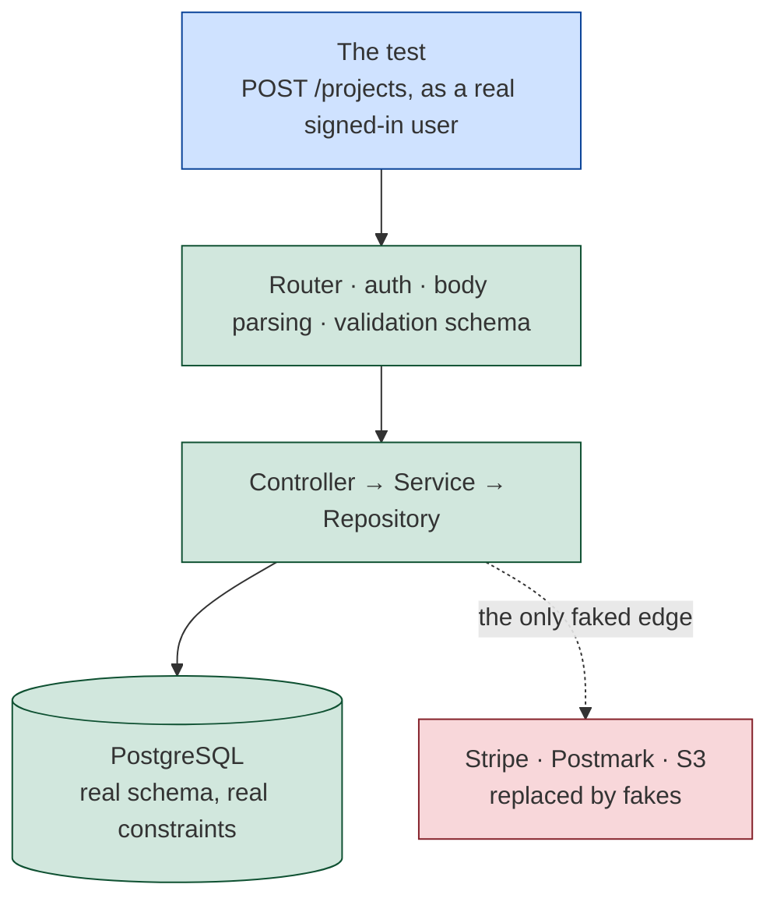

# Integration & API Testing — Part 1

You finish the "archive a project" feature. You have unit tests, and they are
good ones: the policy test proves an archived project cannot be invoiced, the
service test proves the right error code comes out, the date helper test proves
the timestamp format. Forty-one tests, green, in 0.9 seconds. You deploy, and
the endpoint returns `500` on the first click.

Nothing in the suite was wrong. Every unit did exactly what its test said. The
feature was broken anyway, because the repository wrote to a column called
`archived_at` and the migration had created `archivedAt` — and the only thing
that could ever have noticed is a test that talked to a real database.

That is the gap this file fills. An integration test sends a real HTTP request
into your real application, through real routing, middleware, validation, a
real service, a real repository and a **real database**, then asserts both what
came back and what is now in the table. In a CRUD-heavy backend it is the
highest-value test you can write, by a wide margin. Part 1 is the foundation;
Part 2 is the catalogue of tests that catch real bugs and the short list of
things you should still fake.

> **📌 In one line:** the bugs that reach production live in the wiring between
> your units, and the only test that can see the wiring is one that uses all of
> it, including the database.

## Table of Contents

1. [The Gap Unit Tests Leave](#the-gap-unit-tests-leave)
2. [What an Integration Test Actually Covers](#what-an-integration-test-actually-covers)
3. [Why the Database Must Be Real](#why-the-database-must-be-real)
4. [A Real Database, Cheaply](#a-real-database-cheaply)
5. [Test Isolation in Practice](#test-isolation-in-practice)
6. [Your First API Test, End to End](#your-first-api-test-end-to-end)
7. [Then the Negative Cases](#then-the-negative-cases)
8. [Common Mistakes](#common-mistakes)
9. [Questions to Test Yourself](#questions-to-test-yourself)
10. [Related](#related)

---

## The Gap Unit Tests Leave

Take the archive feature apart — four pieces, three of which have a passing
unit test.

```ts
router.patch('/projects/:id/archive', requireAuth, archiveProject)   // 1 route
const ArchiveSchema = z.object({ reason: z.string().min(1).max(200) }) // 2 schema
// 3. the service — unit tested against an InMemoryProjectRepository, green
async archive(id: string, companyId: string, reason: string) {
  const project = await this.projects.findByIdForCompany(id, companyId)
  if (!project) throw new NotFoundError('Project', id)
  if (project.status === 'archived') throw new ConflictError('ALREADY_ARCHIVED')
  return this.projects.archive(id, reason, this.clock.now())
}

// 4. the repository — untested, because there is nothing left to fake
async archive(id: string, reason: string, at: Date) {
  return this.db('projects').where({ id })
    .update({ status: 'archived', archived_at: at, archive_reason: reason })
    .returning('*')
}
```

The service test passes because it was handed a fake repository whose
`archive()` is four lines of JavaScript setting a property on an object — a
correct fake, completely disconnected from the SQL that runs in production. So
every one of these ships green:

| The bug | Where it hides | What the unit test saw |
|---|---|---|
| Column is `archivedAt`, not `archived_at` | The migration | A JavaScript object property |
| The route is registered as `/project/:id/archive` | The router | The service, called directly |
| `reason` is `NOT NULL` but the schema allows it absent | Migration vs schema | A string it was handed |
| `archive_reason` is `varchar(100)`, the schema allows 200 | Migration vs schema | No length limit at all |
| `findByIdForCompany` forgets the `company_id` filter | One line of SQL | A fake that filtered correctly |
| The response leaks `archive_reason` and `owner_id` | The serializer | Nothing — it built no response |

None of those is a logic error. They are all **wiring**: two things that had to
agree and did not. Unit tests cannot see wiring by construction, because a unit
test replaces everything the unit is wired to.

> **📌 Remember:** a unit test proves a component is correct *given* that its
> collaborators behave as you imagined. An integration test is the only thing
> that checks whether you imagined right.

---

## What an Integration Test Actually Covers

The useful definition: **it drives your application through its real entry
point and asserts on real persisted state** — HTTP request in, response and
database row out.



| Layer | Real or faked | Why |
|---|---|---|
| Routing, middleware, validation schemas | **Real** | A URL, an auth guard or a schema that disagrees with the database is invisible otherwise |
| Controllers, services, repositories, SQL | **Real** | This is the code you wrote, and half the bugs live in the SQL |
| The database, and your own queue drained in process | **Real** | The subject of the next section; and you want to assert on what the job did |
| Payment provider, mailer, SMS, object storage | **Faked** | Slow, costly, unreliable, and they act on the real world |
| The clock, when the test cares about time | **Faked** | Otherwise the test bets on what hour it runs |

The line is not "internal versus external". It is **do you own it and can you
run it in a container**. You own the database, so it is real; you do not own
Stripe, so it is faked, with the danger that creates covered in
[Part 2](03-integration-and-api-testing-part-2.md). One more property: an
integration test survives refactoring. Delete the service layer, rename every
class, switch query builders, and `POST /projects returns 201 and creates one
row` keeps passing, because it asserts what has to keep working. Over-mocked
unit tests do the opposite, which is why people say tests make refactoring
harder.

---

## Why the Database Must Be Real

This is the most important argument in the file. A mocked database is not a
database — it is a dictionary of answers you wrote down yourself. The test does
not check your code against reality; it checks it against **your own beliefs
about reality**, which is exactly where the bug was. Here is the archive
feature with a mocked repository. It passes. The code is broken.

```ts
// ❌ BROKEN — a green test over a feature that returns 500 in production
test('archives a project', async () => {
  const projects = {
    findByIdForCompany: vi.fn().mockResolvedValue({ id: 'p_1', status: 'active' }),
    archive: vi.fn().mockResolvedValue({ id: 'p_1', status: 'archived' }),
  }
  const service = new ProjectService(projects, clock)

  const result = await service.archive('p_1', 'c_1', 'client left')
  expect(result.status).toBe('archived')
  expect(projects.archive).toHaveBeenCalledWith('p_1', 'client left', NOW)
})
```

Count what that proved: *if* `projects.archive` returns an object with
`status: 'archived'`, *then* `service.archive` returns one too. A statement
about the mock, not about the software. The real `archive()` throws
`42703 column "archived_at" does not exist` on its first line, and this test has
no opinion about that. The second assertion makes it worse: it pins down the
arguments passed to a method, so it fails when you refactor and passes straight
through when you break the SQL — the failure modes exactly backwards.

```ts
// ✅ FIXED — real HTTP, real service, real SQL, real database
test('PATCH /projects/:id/archive archives the project', async () => {
  const { user, company } = await signedInUser()
  const project = await createProject({ companyId: company.id })

  const res = await api.as(user).patch(`/projects/${project.id}/archive`)
    .send({ reason: 'client left' })

  expect(res.status).toBe(200)
  expect(res.body.status).toBe('archived')

  const row = await db('projects').where({ id: project.id }).first()
  expect(row.status).toBe('archived')
  expect(row.archived_at).not.toBeNull()
})
```

This version fails loudly on the column name, a missing route, a `NOT NULL`
violation, a schema that rejects a valid `reason`, and a serializer that drops
`status`. Same feature, same effort, a completely different amount of truth.

> **⚠️ Warning:** the argument for mocking the database is almost always
> "speed". A real PostgreSQL insert over a local socket is well under a
> millisecond. You are trading a correctness guarantee for a saving you cannot
> measure.

### Six bugs a mocked database cannot see

| Bug | What happens in production | Why the mock is blind |
|---|---|---|
| **A wrong column or table name** | `42703 column "archived_at" does not exist` | The mock never parses SQL — any string is fine |
| **A migration that never ran** | The column is missing, or `NOT NULL` where the code assumes nullable | The mock has no schema at all |
| **A constraint violation** | Duplicate key on a `UNIQUE` index, a foreign key with no parent, a `CHECK` rejecting a negative amount | The mock accepts every object you hand it |
| **A transaction that never commits** | The response says `201`, the row is not there, nobody finds out for a week | The mock has no transactions, so every write "succeeds" |
| **Rows in the wrong order** | A list query with no `ORDER BY` reorders under load; page 2 repeats a row from page 1 | The mock returns the array in the order you wrote it |
| **A cross-tenant leak in the SQL** | `WHERE id = $1` instead of `WHERE id = $1 AND company_id = $2` | The fake filtered correctly, because you wrote the fake |

The last one deserves emphasis. In a multi-tenant product a missing
`company_id` predicate is the most expensive bug you can ship, and it lives in
exactly one place: the SQL. A mocked repository is *guaranteed* to hide it,
because whoever wrote the fake was whoever understood the rule. See
[03-ownership-abac-and-multi-tenancy-part-1.md](../06-authorization/03-ownership-abac-and-multi-tenancy-part-1.md).

> **📌 Remember:** test against the database you deploy, at the same major
> version — not a mock, not an in-memory imitation, and not SQLite, whose
> different types, constraints, concurrency and `NULL` ordering would leave you
> passing against a database you do not run.

---

## A Real Database, Cheaply

The historical objection was infrastructure: a shared test database, a queue of
developers waiting for it, a nightly reset. Containers removed it — a
disposable PostgreSQL is two seconds and one file.

```yaml
# docker-compose.test.yml
services:
  db:
    image: postgres:16-alpine          # the version you deploy
    environment: { POSTGRES_USER: app, POSTGRES_PASSWORD: test,
                   POSTGRES_DB: app_test }
    ports: ['55432:5432']              # not 5432 — see the next section
    tmpfs: ['/var/lib/postgresql/data']         # the data lives in RAM
    command: >
      postgres -c fsync=off -c synchronous_commit=off -c full_page_writes=off
```

Two things there matter. The **`tmpfs` mount** puts the data directory in
memory, so the container starts clean every time. The **durability flags** turn
off the guarantees that exist to survive a power cut — catastrophic in
production, entirely correct here, because losing this database is the intended
outcome. Together they usually more than halve write time. Container mechanics
are in [overview.md](../../cloud-devops/docker/overview.md).

**Run migrations once per run, not once per test** — migrating is seconds, and
multiplied by 300 the suite is unusable.

```ts
export async function setup() {            // tests/global-setup.ts — runs once
  await migrateLatest(db)                  // the same files production runs
  await seedReferenceData(db)              // roles, plans, countries
}
```

Use the **real migration files**, not a `schema.sql` snapshot and not the ORM's
`sync()`. If the suite builds its schema by a different route from production
you have stopped testing your migrations, and a migration failing on deploy is
a bad way to find that out —
[02-migrations-part-1.md](../10-database-integration/02-migrations-part-1.md).

> **💡 Tip:** if the migration run annoys you, migrate one template database and
> clone it per worker with `CREATE DATABASE app_test_2 TEMPLATE app_test_tpl` —
> a ~100 ms copy instead of a full migration.

### Never the development database

A rule, not a preference. The suite truncates tables and creates hundreds of
throwaway rows; run it against your development database and you lose the demo
company you spent an afternoon building — and that is the *harmless* version.
Make it structurally impossible rather than remembering to be careful:

```ts
// tests/setup.ts — the first thing that runs, before any connection opens
const url = process.env.DATABASE_URL ?? ''
if (!/_test(_\d+)?(\?|$)/.test(url)) {
  throw new Error(`refusing to run tests against ${url} — name it *_test`)
}
if (process.env.NODE_ENV === 'production') {
  throw new Error('refusing to run tests with NODE_ENV=production')
}
```

Three habits complete it: keep the test connection string in `.env.test`, which
only the test command loads; give the test database a different **port** as
well as a different name, so a stale environment variable fails to connect
rather than connecting somewhere unexpected; and grant the test user no
permission on any other database on that server.

> **⚠️ Warning:** a `TRUNCATE` against the wrong database is instant and has no
> undo — and the same misconfiguration on a machine holding a production
> connection string is the version that ends careers.

---

## Test Isolation in Practice

Two tests share one database. The first creates a project and asserts the list
endpoint returns one. The second creates a project. Now the first fails — but
only sometimes, depending on file order, which changes when someone renames a
file. That is not a flaky test; it is a missing property. **Isolation** means
every test starts from the same known state whatever ran before it, and two
mechanisms are practical.

| | **Transaction + rollback** | **Truncation** |
|---|---|---|
| Mechanism | `BEGIN` before, `ROLLBACK` after | `TRUNCATE ... RESTART IDENTITY CASCADE` |
| Cost per test | ~1 ms | ~10–50 ms |
| Over 600 tests | under a second | 6–30 s of pure cleanup |
| Reference data | Seeded once, survives every rollback | Exclude from the list, or re-seed |
| Sequences | Keep climbing — ids are never 1 | Reset, so ids are predictable |
| Parallel-safe | Yes, each worker holds its own transaction | Only with a database per worker |
| Fails when | The code commits, or runs in another process | Essentially never |
| Use for | 90–95% of tests | The rest |

Rollback is the default because the arithmetic is decisive: 600 tests at 40 ms
of truncation burn 24 seconds deleting rows they are about to recreate. **The
one case where it does not work** is code that commits, or code that runs
somewhere your transaction cannot reach:

- The service opens its own connection instead of receiving yours, so its
  transaction cannot see your uncommitted rows and it finds no data.
- Something runs `AFTER COMMIT` — a trigger, a `LISTEN/NOTIFY` consumer, an
  outbox flush. Nothing commits, so nothing fires, and the assertion fails on
  correct code.
- The test drives a real HTTP server in a **separate process**, which has its
  own pool and cannot see your transaction. Calling the app object in process,
  as every example here does, is fine.
- The test is *about* commit behaviour — a deadlock retry, a real isolation
  level — so rolling everything back removes its subject.

Mark those tests and truncate instead; a healthy suite is mostly rollback with
a small, labelled group on truncation. The mechanics — the hooks, why the
repository must *receive* its connection, savepoints, and a database per
parallel worker — are in
[05-seeding-and-test-data-part-2.md](../10-database-integration/05-seeding-and-test-data-part-2.md).

---

## Your First API Test, End to End

Nothing hidden. This is the week-one test, and writing it is mostly about
building the two helpers every later test reuses.

```ts
test('POST /projects creates a project and returns it', async () => {
  // Arrange — a company, a user in it, a session
  const company = await createCompany({ name: 'Acme Ltd' })
  const user = await createUser({ companyId: company.id, role: 'admin' })
  const token = await signIn(user)

  // Act — a real request through the real stack
  const res = await api.post('/projects')
    .set('Authorization', `Bearer ${token}`)
    .send({ name: 'Website redesign', clientName: 'Globex' })

  // Assert 1 — the status code
  expect(res.status).toBe(201)

  // Assert 2 — the response body, field by field
  expect(res.body).toMatchObject({ id: expect.any(String), status: 'active',
    name: 'Website redesign', clientName: 'Globex' })
  expect(res.body).not.toHaveProperty('companyId')   // internal field
  expect(res.body).not.toHaveProperty('deletedAt')   // internal field

  // Assert 3 — the row that is actually in the table
  const row = await db('projects').where({ id: res.body.id }).first()
  expect(row.name).toBe('Website redesign')
  expect(row.company_id).toBe(company.id)            // the tenant is right
  expect(row.status).toBe('active')
})
```

Three assertions, three different guarantees, and you want all of them. **The
status code** is the contract every client branches on — `201` for a create,
not `200`, not `204`. **The response body** is what a mobile app
parses: asserting `name` catches a renamed field, asserting the *absence* of
`companyId` catches the day someone returns the raw row, and `toMatchObject`
ignores fields you did not name so it survives additions.

**The database row** is the assertion people forget, and it is what separates
this from a unit test. It proves the write happened, that it was committed, and
that `company_id` — which the client never sent — came from the session rather
than being left null. A body can be right while the row is wrong: the precise
failure mode of a transaction that never commits.

Note what is *not* in the arrange block: eleven columns of user data, a
password hash, a timezone. `createUser({ companyId, role })` names the two
facts this test depends on — mechanics in
[05-seeding-and-test-data-part-1.md](../10-database-integration/05-seeding-and-test-data-part-1.md),
strategy in
[04-test-data-and-mocking-part-1.md](04-test-data-and-mocking-part-1.md).

---

## Then the Negative Cases

The happy path is one test. The next three are where the bugs are, and they
cost minutes each now that the setup exists. (Validation failures get their own
treatment in [Part 2](03-integration-and-api-testing-part-2.md).)

```ts
const post = (token: string, body: object) => api.post('/projects')
  .set('Authorization', `Bearer ${token}`).send(body)

test('returns 401 without a token', async () => {
  const res = await api.post('/projects').send({ name: 'Website redesign' })
  expect(res.status).toBe(401)
  expect(res.body.error.code).toBe('UNAUTHENTICATED')
  expect(await db('projects').count()).toEqual([{ count: '0' }])  // no row
})

test('refuses a duplicate project name within the same company', async () => {
  const { company, token } = await signedInUser()
  await createProject({ companyId: company.id, name: 'Website redesign' })

  const res = await post(token, { name: 'Website redesign' })
  expect(res.status).toBe(409)               // not a raw 500 from Postgres
  expect(res.body.error.code).toBe('PROJECT_NAME_TAKEN')
})

test('allows the same project name in a different company', async () => {
  const other = await createCompany()
  await createProject({ companyId: other.id, name: 'Website redesign' })
  const { token } = await signedInUser()

  const res = await post(token, { name: 'Website redesign' })
  expect(res.status).toBe(201)               // the UNIQUE index is scoped
})
```

The last two are a pair, and the pair is the point. The first of them proves
the constraint exists *and* that the error handler turns a PostgreSQL `23505`
into a `409` with a usable code rather than a `500` with a stack trace —
[03-client-facing-error-responses-part-1.md](../07-error-handling/03-client-facing-error-responses-part-1.md).
The second proves the constraint is scoped to the tenant, which is the bug you
actually ship: `UNIQUE (name)` instead of `UNIQUE (company_id, name)` means the
first customer to create "Website redesign" blocks every other customer in the
world. No unit test can reach that fact. Notice also the `401` test asserting
that **no row was written** — asserting what did *not* happen is the other half
of an integration test, and it catches a handler that writes before the
middleware rejects it.

---

## Common Mistakes

| Mistake | Why it is wrong | Do this instead |
|---|---|---|
| Mocking the repository, or swapping in SQLite, in an "integration" test | Removes the only thing the test exists to check; another engine has different types, constraints and `NULL` ordering | The real repository, and the engine and major version you deploy |
| Pointing the suite at the development database | It truncates; you lose your data, and the same error scales badly | `.env.test`, a `*_test` name check, a different port |
| Building the schema with `sync()` or a SQL dump, or migrating in `beforeEach` | Your migrations are never exercised; or seconds per test make the suite unrunnable | Run the real migration files, once per run in global setup |
| Asserting only the body, or only the row | A committed-looking response can leave no row; a right row can be serialized wrongly | Assert status, body **and** row |
| Testing only the happy path | 401, 403, 422 and 409 are where the bugs are | At least three negative tests per endpoint |
| No isolation between tests, or expecting `AFTER COMMIT` work inside a rolled-back one | Order-dependent failures; nothing commits, so nothing fires | Rollback by default, truncation where it cannot work |
| Asserting a literal id, or list order with no `ORDER BY` | Sequences keep climbing; unordered rows reorder under load | Assert the id you were handed; add the `ORDER BY` |

---

## Questions to Test Yourself

1. Every unit test for the archive feature passes and the endpoint returns
   `500`. Name three distinct causes from the first table, and say why each is
   invisible to a unit test.
2. A colleague mocks the repository and asserts
   `expect(repo.archive).toHaveBeenCalledWith('p_1', 'client left')`. Name one
   harmless refactor that breaks it and one real bug it cannot catch.
3. List the six bug classes a mocked database cannot see. Which is most
   expensive in a multi-tenant product, and why is the mock guaranteed to hide
   it?
4. Why is "SQLite in tests because it is faster" the same mistake as mocking,
   and why must the suite build its schema from the real migration files?
5. What do `fsync=off` and a `tmpfs` data directory buy you, and why would both
   be gross negligence in production?
6. Write the guard that stops the suite running against a non-test database,
   and name two other things that make the mistake structurally harder.
7. Compare rollback and truncation across four dimensions, then give three
   situations where rollback cannot be used.
8. The first API test makes three groups of assertion. Say what each proves
   that the other two do not. Why are the two duplicate-name tests a pair?

---

> **➡️ Continued in [Part 2](03-integration-and-api-testing-part-2.md)** — the
> tests that catch real bugs on every endpoint, authenticating without the full
> login flow, what should still be faked and how, fake drift and contract
> testing, end-to-end tests, keeping the suite fast, and testing background
> jobs, webhooks and scheduled tasks.

## Related

- [Part 2](03-integration-and-api-testing-part-2.md) — authorization,
  pagination and concurrency tests, faking third parties, and suite speed.
- [01-testing-pyramid-part-1.md](01-testing-pyramid-part-1.md) — where this
  level sits in the suite.
- [02-unit-testing-part-1.md](02-unit-testing-part-1.md) and
  [04-test-data-and-mocking-part-1.md](04-test-data-and-mocking-part-1.md) —
  the logic tests this file leaves out, and a readable arrange block.
- [05-seeding-and-test-data-part-1.md](../10-database-integration/05-seeding-and-test-data-part-1.md)
  and [Part 2](../10-database-integration/05-seeding-and-test-data-part-2.md) —
  factories, rollback isolation and a database per parallel worker.
- [02-migrations-part-1.md](../10-database-integration/02-migrations-part-1.md)
  and [overview.md](../../cloud-devops/docker/overview.md) — the migrations the
  suite must run, and the disposable PostgreSQL container.
- [03-ownership-abac-and-multi-tenancy-part-1.md](../06-authorization/03-ownership-abac-and-multi-tenancy-part-1.md)
  — the cross-tenant leak that lives in SQL and nowhere else.
- [03-client-facing-error-responses-part-1.md](../07-error-handling/03-client-facing-error-responses-part-1.md)
  — turning a `23505` into a `409` with a code worth asserting on.
