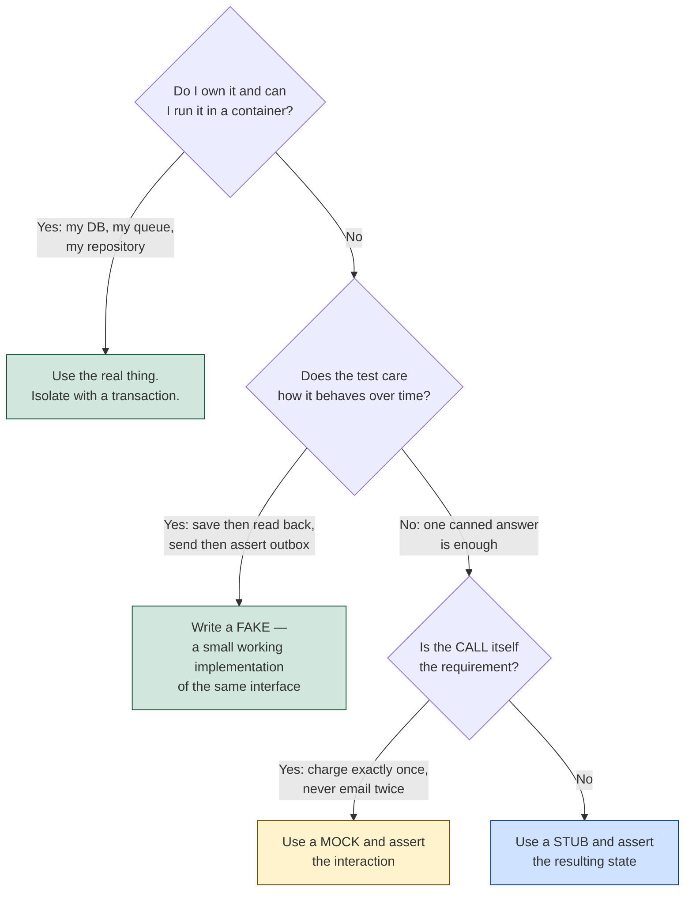

# Test Data & Mocking — Part 2

Part 1 was about data you can read. This part is about the second thing that
quietly ruins a suite: replacing too much of your own software with things you
told what to return.

The vocabulary here is used loosely everywhere — people say "mock" for any
object that is not the real one — and the looseness is not harmless. "Stub the
clock" and "mock the repository" are different decisions with different
consequences, and a team that calls both "mocking" cannot have the argument
about which is appropriate. So this part defines the five terms precisely, then
spends the rest of its length on the decision they exist to support: *what may
I replace, and with what?*

> **⬅️ This continues [Part 1](04-test-data-and-mocking-part-1.md).**

> **📌 In one line:** replace only what you do not own, prefer a working fake
> over an object told what to return, and assert the outcome rather than the
> call that produced it.

## Table of Contents

1. [The Five Test Doubles](#the-five-test-doubles)
2. [State Verification vs Behaviour Verification](#state-verification-vs-behaviour-verification)
3. [When Mocking Is Right](#when-mocking-is-right)
4. [When Mocking Is Wrong](#when-mocking-is-wrong)
5. [Should I Mock This Dependency?](#should-i-mock-this-dependency)
6. [Fakes: the Better Default](#fakes-the-better-default)
7. [Keeping Fakes Honest](#keeping-fakes-honest)
8. [Snapshot Testing](#snapshot-testing)
9. [A Checklist for Any Test](#a-checklist-for-any-test)
10. [Common Mistakes](#common-mistakes)
11. [Questions to Test Yourself](#questions-to-test-yourself)
12. [Related](#related)

---

## The Five Test Doubles

A **test double** is anything you pass in place of a real collaborator. There
are five kinds, and the distinctions are about *how much behaviour they have*
and *whether the test asserts on them*.

| Double | What it is | Concrete example | Use it when |
|---|---|---|---|
| **Dummy** | A value passed only to satisfy a signature; never used | `new Invoice(id, name, null as unknown as Logger)` | A parameter is required but irrelevant to this test |
| **Stub** | Returns canned answers; no logic, no assertions | `{ now: () => new Date('2026-03-01') }` | The code needs *an* answer and you choose which |
| **Spy** | A real or stubbed object that records how it was called | `vi.fn()` wrapping the real function | You need to observe a call you cannot otherwise see |
| **Mock** | Pre-programmed with expectations; **the assertion is on it** | `expect(gateway.charge).toHaveBeenCalledWith(2_000)` | The call itself is the requirement |
| **Fake** | A real, working, simplified implementation | `InMemoryProjectRepository`, `InMemoryMailer` | You must replace a collaborator but still want it to behave |

Two distinctions are worth stating in words, because the table compresses them.

**A stub is not a mock.** A stub gives the code something to work with and then
gets out of the way; the assertion is on the result. A mock *is* the assertion
— the test passes or fails on how the double was called. Same object type in
most frameworks, opposite roles in the test.

**A fake is not a stub either.** A stub says "when asked, return this". A fake
says "I am a repository; I will store what you save and return it when you
query, in order, filtered correctly". It has behaviour, so it can be *wrong* in
the same ways real code is wrong, which means it can catch real bugs.

```ts
// Stub — one canned answer, no behaviour
const rates = { get: async () => 0.85 }

// Spy — the real function, plus a record of the calls
const send = vi.fn(realMailer.send)

// Mock — the assertion is about the interaction
expect(gateway.refund).toHaveBeenCalledTimes(1)

// Fake — a small working implementation
class InMemoryProjectRepository implements ProjectRepository {
  constructor(private rows: Project[] = []) {}
  async findByIdForCompany(id: string, companyId: string) {
    return this.rows.find(p => p.id === id && p.companyId === companyId) ?? null
  }
  async save(p: Project) { this.rows.push(p); return p }
}
```

Note the `companyId` check in the fake. A stub could never contain that
condition, and so could never fail when the caller forgets to pass a tenant.

---

## State Verification vs Behaviour Verification

Every assertion in a test is one of two kinds, and choosing well is most of the
difference between a suite that helps you refactor and one that fights you.

**State verification** asks *what is true now?* — the return value, the row in
the table, the mailbox contents. **Behaviour verification** asks *what calls
were made?* — this method, with these arguments, this many times.

| | State verification | Behaviour verification |
|---|---|---|
| The assertion | `expect(stored.passwordHash).not.toBe(plain)` | `expect(hasher.hash).toHaveBeenCalledWith(plain)` |
| Survives a rename of an internal method | Yes | No |
| Survives adding a field to the call | Yes | No |
| Survives reordering two internal steps | Yes | No |
| Notices the result was never persisted | Yes | No |
| Reads like a requirement | Yes | Rarely |
| Right when | Almost always | The call *is* the observable effect |

**Prefer state.** Not as a style preference — because behaviour assertions have
their failure modes backwards. They fail on harmless refactors (the false
alarms that make people distrust tests) and pass through real breakage (the
silence that makes tests worthless).

```ts
// ❌ BROKEN — three assertions, all about how, none about what
await service.registerUser({ email: 'a@acme.test', password: 'secret123' })
expect(hasher.hash).toHaveBeenCalledWith('secret123')
expect(repo.create).toHaveBeenCalledWith({
  email: 'a@acme.test', passwordHash: 'hashed', status: 'pending',
})
expect(mailer.send).toHaveBeenCalled()
```

Normalise the email to lowercase and it fails, although that is an improvement.
Add a `createdAt` field and it fails. Meanwhile `repo.create` was a mock, so no
user exists anywhere — the test cannot notice that nothing was stored, or that
the hash was the plain text.

```ts
// ✅ FIXED — the same coverage, stated as outcomes
await service.registerUser({ email: 'A@Acme.test', password: 'secret123' })

const stored = await users.findByEmail('a@acme.test')     // normalised
expect(stored!.status).toBe('pending')
expect(await verify('secret123', stored!.passwordHash)).toBe(true)
expect(mailer.sent.map(m => m.to)).toEqual(['a@acme.test'])
```

The fixed version survives every refactor above, and it fails for real reasons
— including one the broken version structurally could not see: that the stored
hash actually verifies against the password.

The legitimate exception is when **the call is the observable effect**. "Charges
the card exactly once even if the webhook is delivered twice" is a statement
about an interaction with a system you cannot inspect. There, counting calls is
not a proxy for the requirement; it *is* the requirement.

---

## When Mocking Is Right

The boundary is ownership, and the list is short.

| Replace | Why |
|---|---|
| **Payment providers** | A real charge costs real money and needs reversing |
| **Email and SMS** | Sends to real people; costs per message; nothing to assert against |
| **Third-party APIs** | Their downtime and rate limits become your red build |
| **Object storage and external file systems** | Slow, needs credentials, leaves artefacts behind |
| **The clock** | Otherwise "expires in 7 days" is a bet on what hour the test runs |
| **Randomness and id generation** | Otherwise you cannot aim at the one-in-a-million branch |

Every row has the same shape: **something outside your process whose real
behaviour you cannot produce on demand, and whose real invocation has a cost or
a side effect on the world.** That is the whole criterion. Note that the clock
and the random source qualify — they are not remote, but you do not control
them, and that is what matters.

---

## When Mocking Is Wrong

The mirror image, and the list is just as short.

**Your own database.** Covered at length in
[03-integration-and-api-testing-part-1.md](03-integration-and-api-testing-part-1.md):
a mock cannot see a wrong column, a missing migration, a constraint violation,
a transaction that never commits, or a missing tenant filter. You own it, and
it runs in a container in two seconds.

**Your own repository in an integration test.** The repository *is* what the
integration test exists to check. Replacing it turns an integration test into a
slower unit test with a misleading name.

**Internal code via module-level mocking.** This is the one that looks clever
and costs the most.

```ts
// ❌ BROKEN — the test now depends on a file path
vi.mock('../../src/repositories/project-repository', () => ({
  projectRepository: {
    findByIdForCompany: vi.fn().mockResolvedValue({ id: 'p_1', status: 'active' }),
  },
}))

test('archives a project', async () => {
  const result = await archiveProject('p_1', 'c_1')
  expect(result.status).toBe('archived')
})
```

Three things are now true. The test breaks if you **move the file**, although
nothing about the behaviour changed. The mock's shape is a guess — add a method
to the real repository and the mock silently lacks it, so the test exercises a
narrower object than production uses. And the real SQL is not merely untested
here; it is untestable from this test, permanently.

```ts
// ✅ FIXED — the dependency comes in through the constructor
const projects = new InMemoryProjectRepository([
  { id: 'p_1', companyId: 'c_1', status: 'active' },
])
const service = new ProjectService(projects, clock)

test('archives an active project', async () => {
  await service.archive('p_1', 'c_1', 'client left')

  const stored = await projects.findByIdForCompany('p_1', 'c_1')
  expect(stored!.status).toBe('archived')      // state, not a call
})
```

Nothing references a path. The fake implements the same interface, so the
compiler enforces that it stays in step. And the real repository is still
tested — against a real database, in an integration test. Injection *relocates*
that test rather than removing it.

The general disease is **over-mocking**, and it has two costs worth naming
separately. First, the suite passes while production breaks, because every
seam was replaced by your own assumptions and the assumptions were never
checked against anything. Second, refactoring becomes painful: tests coupled to
call sequences and module paths fail whenever the structure moves, so the suite
that was supposed to make change safe is the main reason change is expensive.

> **⚠️ Warning:** the tell-tale symptom is a test that needs updating in every
> pull request that touches the file, without ever having caught a bug. That is
> not a test; it is a duplicate of the implementation written in a second
> notation.

---

## Should I Mock This Dependency?



Most dependencies in a typical backend land on the left branch, which is the
point of the diagram: the honest answer to "should I mock this?" is usually
"no, you own it".

---

## Fakes: the Better Default

When you *must* replace something, write a fake rather than a stub. A stub is
told what to return; a fake **behaves**. The difference shows up the moment a
test does two things in sequence.

```ts
// A working in-memory repository — filters, orders, and enforces the tenant
export class InMemoryProjectRepository implements ProjectRepository {
  constructor(private rows: Project[] = []) {}

  async findByIdForCompany(id: string, companyId: string) {
    return this.rows.find(p => p.id === id && p.companyId === companyId) ?? null
  }
  async listForCompany(companyId: string) {
    return this.rows
      .filter(p => p.companyId === companyId && !p.deletedAt)
      .sort((a, b) => b.createdAt.getTime() - a.createdAt.getTime())
  }
  async save(project: Project) {
    const i = this.rows.findIndex(p => p.id === project.id)
    i === -1 ? this.rows.push(project) : (this.rows[i] = project)
    return project
  }
}

// A working in-memory mailer — records instead of sending
export class InMemoryMailer implements Mailer {
  readonly sent: SentMail[] = []
  async send(mail: SentMail) { this.sent.push(mail) }
  lastTo(address: string) { return this.sent.filter(m => m.to === address).at(-1) }
}
```

Now a test can save and then read back, and the assertion is about state:

```ts
test('archiving removes the project from the active list', async () => {
  const projects = new InMemoryProjectRepository([active('p_1'), active('p_2')])
  const service = new ProjectService(projects, clock)

  await service.archive('p_1', 'c_1', 'client left')

  const visible = await projects.listForCompany('c_1')
  expect(visible.map(p => p.id)).toEqual(['p_2'])
})
```

A stubbed `listForCompany` could not fail that test, because it would return
whatever you decided in advance. The fake can, because it actually filters.

**What makes this possible is the interface.** `ProjectService` accepts a
`ProjectRepository` — a type, not a class — so any object satisfying that
contract is acceptable, and the compiler checks the fake stays in step when the
interface changes. That is the whole payoff of programming to an interface, and
it is worth reading alongside
[interfaces.md](../../typescript-fundamentals/interfaces/interfaces.md),
[03-repository-layer-part-1.md](../09-application-architecture/03-repository-layer-part-1.md)
and
[05-dependency-injection-in-practice.md](../09-application-architecture/05-dependency-injection-in-practice.md).

> **💡 Tip:** keep fakes small and obviously correct. The moment your in-memory
> repository needs joins, transactions or an `ORDER BY` with three keys, you
> have started reimplementing PostgreSQL badly — that test belongs against a
> real database instead.

---

## Keeping Fakes Honest

A fake is code you wrote about a system you do not control, so it can drift
from the truth — the same problem as
[03-integration-and-api-testing-part-2.md](03-integration-and-api-testing-part-2.md),
in a smaller form. Two kinds of drift, two answers.

**Drift from a third party.** Your `FakeStripeGateway` returns what Stripe
returned in March. Stripe has since renamed a field. Every test passes and
production is broken. The answer is a small, separately scheduled suite of five
to ten real sandbox calls, allowed to fail loudly, never in the merge gate.

**Drift from your own database.** Your `InMemoryProjectRepository` filters
`deletedAt` and the real SQL forgot to. Here the answer is cheaper: the real
repository has its own integration tests against a real database, testing the
same behaviours. If both suites assert "archived projects do not appear in the
list", the fake cannot drift far without one of them going red.

That pairing is the rule worth taking away: **every fake needs at least one
real test of the thing it stands in for.** A fake with no real counterpart is
an assumption with a test suite wrapped around it.

---

## Snapshot Testing

A snapshot test serialises a value, writes it to a file the first time, and
compares against that file thereafter. It genuinely helps in a few places.

**Where it earns its place:** a large generated artefact where writing
assertions by hand would be absurd and any change is worth reviewing — a
rendered email template, a generated SQL migration, a formatted CLI report, or
the full error-response body for a complex validation failure. The value is
that a diff appears in code review when the output changes.

**Its failure mode is social, not technical.** The test fails, the developer
runs the update command, the snapshot is rewritten, CI goes green, and nobody
read the diff. Do that twice and the snapshot has stopped asserting anything —
it now records whatever the code currently does, which is not a test, it is a
log.

Three habits keep them useful. **Keep them small**, because a 400-line snapshot
will never be read; snapshot the part that matters, not the whole response.
**Treat the file as source code** in review — a changed snapshot deserves the
same scrutiny as changed logic, and an unexplained one is a question, not an
approval. And **never snapshot anything non-deterministic**: ids, timestamps
and durations must be normalised first, or the churn trains everyone to
regenerate without looking.

> **⚠️ Warning:** a snapshot never states intent. `expect(total).toBe(9_000)`
> says a human decided the answer; a snapshot says "this is what it did". For
> anything you have an opinion about, write the assertion.

---

## A Checklist for Any Test

Six questions. If a test fails one, it is usually clear which line to change.

1. **Does the name say the behaviour and the condition?** `returns 404 for
   another company's project`, not `test project 3`.
2. **Is it about one behaviour?** One reason to fail, so the name can stay
   accurate and a failure tells you something.
3. **Is every fact it depends on visible in the body?** If the name says
   "archived", the word appears in the test.
4. **Are the things you own real?** Real database, real repository, real
   routing — fakes only at the edges you do not control.
5. **Does it assert an outcome rather than a call?** State first; interaction
   assertions only where the call is the requirement.
6. **Would it actually fail if the feature broke?** Break the code on purpose
   and watch it go red. A test that has never failed has never been verified.

The last one is the one people skip, and it is the only question that matters
if you only ask one. A test you have never seen fail is a hypothesis.

---

## Common Mistakes

| Mistake | Why it is wrong | Do this instead |
|---|---|---|
| Calling every double a "mock" | The team cannot discuss whether a stub or a fake is right | Use the five names precisely |
| Asserting `toHaveBeenCalledWith` by default | Fails on harmless refactors, passes through real breakage | Assert the resulting state |
| Mocking your own database or repository | Hides wrong columns, constraints, uncommitted transactions and tenant leaks | Use the real one; isolate with a transaction |
| Module-level mocking of internal code | Couples the test to a file path and to a guessed shape | Inject the dependency through the constructor |
| Replacing a collaborator with a stub when the test reads back | A stub returns what you decided, so it cannot fail | A fake that actually stores and filters |
| A fake that grows joins and transactions | You are reimplementing the database, badly | Move that test to a real database |
| A fake with no real counterpart test | An assumption with a suite wrapped around it | At least one real test of what it stands in for |
| Trusting a third-party fake indefinitely | Their API changed and your suite cannot notice | A small sandbox suite, separately scheduled |
| Updating a snapshot without reading the diff | The snapshot records behaviour instead of asserting it | Review it like source; keep it small |
| Snapshotting ids, timestamps or durations | Constant churn trains everyone to regenerate blindly | Normalise them first |
| A test that changes in every PR but never caught a bug | It is a second copy of the implementation | Delete it, or rewrite it as an outcome assertion |

---

## Questions to Test Yourself

1. Define dummy, stub, spy, mock and fake in one sentence each, with an example
   of each from a billing application.
2. What can a fake repository catch that a stubbed one structurally cannot?
   Give a concrete bug.
3. Why do behaviour assertions have their failure modes "backwards"? Name the
   two consequences.
4. Give the one situation where asserting a method call is correct, and say
   what makes it different.
5. What is the single criterion that decides whether a dependency may be
   replaced? Apply it to the clock and to your own repository.
6. Name three concrete costs of `vi.mock('../../src/repositories/...')` over
   constructor injection.
7. Explain how over-mocking makes refactoring more expensive, given that tests
   are supposed to make it cheaper.
8. Walk the decision flowchart for: Stripe, the system clock, your own project
   repository, and a currency-rate API you call once.
9. When does an in-memory fake stop being a good idea, and what is the signal?
10. State the rule that keeps fakes honest. What is a fake with no real
    counterpart test actually testing?
11. Describe the failure mode of snapshot testing and the three habits that
    prevent it.
12. Of the six checklist questions, which one would you keep if you could keep
    only one, and why?

---

> **⬅️ This continues [Part 1](04-test-data-and-mocking-part-1.md)** — factories,
> making the relevant data explicit, the giant shared fixture, and why
> test-order dependence is a bug.

## Related

- [Part 1](04-test-data-and-mocking-part-1.md) — readable setup, factories and
  shared state.
- [02-unit-testing-part-2.md](02-unit-testing-part-2.md) — dependency injection,
  the clock, and asserting behaviour rather than implementation.
- [03-integration-and-api-testing-part-1.md](03-integration-and-api-testing-part-1.md)
  — the full case for a real database, and what a mocked one cannot see.
- [03-integration-and-api-testing-part-2.md](03-integration-and-api-testing-part-2.md)
  — fake drift at the third-party boundary, and contract testing.
- [interfaces.md](../../typescript-fundamentals/interfaces/interfaces.md) — the
  contract that makes an in-memory implementation swappable and type-checked.
- [03-repository-layer-part-1.md](../09-application-architecture/03-repository-layer-part-1.md)
  — the interface `InMemoryProjectRepository` implements.
- [05-dependency-injection-in-practice.md](../09-application-architecture/05-dependency-injection-in-practice.md)
  — wiring the real implementations at startup and the fakes in tests.
- [05-seeding-and-test-data-part-1.md](../10-database-integration/05-seeding-and-test-data-part-1.md)
  — factory mechanics, for the data these doubles operate on.
