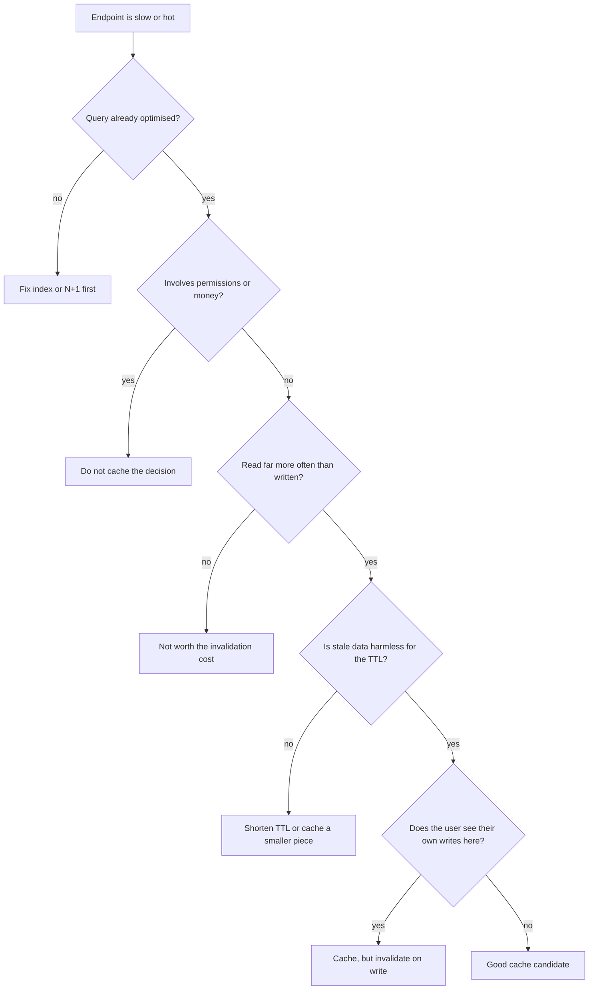
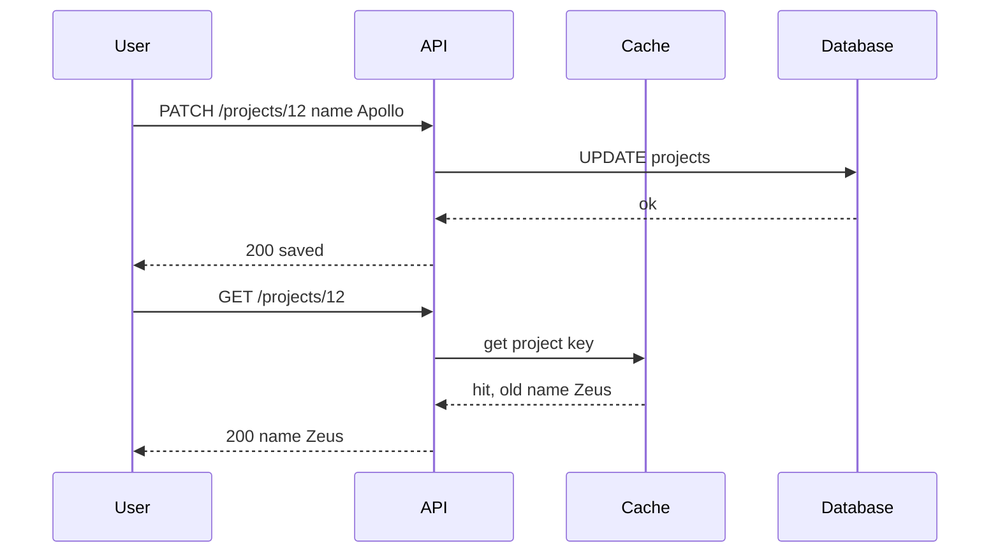

# When to Cache

The endpoint that lists a company's projects takes 2.4 seconds. The first
suggestion in the team chat is always the same: *put Redis in front of it*.
Sometimes that is the right answer. Very often it hides a bug that comes back
later, bigger, and at a worse hour.

This file is about the decision that comes before any code: **should this thing
be cached at all?** Getting this wrong is not a performance problem. It is a
correctness problem, and occasionally a security problem.

> **📌 In one line:** a cache is a deliberate trade of freshness for speed, so
> only make the trade when you know what you are giving up and who would notice.

## Table of Contents

1. [Caching Is Not the First Answer to "It Is Slow"](#caching-is-not-the-first-answer-to-it-is-slow)
2. [What a Cache Actually Is](#what-a-cache-actually-is)
3. [Measure Before You Cache](#measure-before-you-cache)
4. [A Decision Framework](#a-decision-framework)
5. [Walking the SaaS Domain Through It](#walking-the-saas-domain-through-it)
6. [What You Must Not Cache](#what-you-must-not-cache)
7. [Read Your Own Writes](#read-your-own-writes)
8. [Where a Cache Can Live](#where-a-cache-can-live)
9. [Cache Hit Ratio and What It Hides](#cache-hit-ratio-and-what-it-hides)
10. [Advanced: The Cache That Hid a Missing Index](#advanced-the-cache-that-hid-a-missing-index)
11. [Common Mistakes](#common-mistakes)
12. [Questions to Test Yourself](#questions-to-test-yourself)
13. [Related](#related)

---

## Caching Is Not the First Answer to "It Is Slow"

A cache does not make your query faster. It makes your query **run less often**.
The query is exactly as slow as it was. You have only moved it out of most
requests.

That distinction matters, because the two most common causes of a slow endpoint
are not fixed by running the query less often:

- **A missing index.** The database is scanning the whole table. Adding the
  right index can turn 2.4 seconds into 3 milliseconds, permanently, for every
  request, with no staleness at all.
- **An N+1 query.** You run one query for the list and then one more query per
  row. Thirty projects become thirty-one round trips. Fixing this is a code
  change, not an infrastructure change.

Both of those are **free wins**. A cache is never free — it costs you memory, a
new piece of infrastructure that can fail, and a permanent obligation to keep
the copy correct.

> **📌 Remember:** fix the query first, cache second. A cache placed over a
> broken query is a bug with a timer on it.

Start here:

- [../../databases/query-optimization/slow-query-fixes.md](../../databases/query-optimization/slow-query-fixes.md)
  — reading a query plan and finding the missing index.
- [../../databases/query-optimization/n-plus-one-queries.md](../../databases/query-optimization/n-plus-one-queries.md)
  — the loop that quietly makes thirty-one queries.

Only after the query is as fast as it reasonably can be does the caching
question become interesting. At that point you are no longer hiding anything —
you are buying speed you cannot get any other way.

---

## What a Cache Actually Is

A cache is **a copy of an answer, kept somewhere closer and faster than the
place the answer came from.**

Think about your desk. The archive room is two floors down and holds every
document the company has ever produced. It is the truth. But when you are
working on one client all week, you do not walk down two floors every time you
need their address. You write it on a note and keep it on your desk.

That note is a cache. It has all the properties of one:

- It is **faster** to read than the archive.
- It is **not the truth**. The archive is.
- It can become **wrong** — the client moves and nobody tells your note.
- If you lose it, nothing is destroyed. You walk down two floors and write a
  new one.

That last point is the most important one in this whole folder. **A cache must
be disposable.** If deleting your entire cache would lose data or break the
application, what you built is not a cache. It is a database with no backups.

Two words you will see constantly:

- **Hit** — the answer was in the cache. You did not touch the database.
- **Miss** — it was not there. You did the real work and usually stored the
  result for next time.

---

## Measure Before You Cache

The instinct is to cache the slowest endpoint. That is usually wrong. What
actually matters is total work removed:

```text
   value of caching  ≈  calls per minute  ×  cost per call
```

Two real examples from the same application:

| Endpoint | Cost per call | Calls per minute | Total work per minute |
|---|---|---|---|
| `GET /reports/annual-revenue` | 4,000 ms | 2 | 8 seconds |
| `GET /companies/:id/plan-limits` | 6 ms | 100,000 | 600 seconds |

The annual revenue report *feels* like the problem. It is the one people
complain about. But the plan-limits lookup is doing **seventy-five times more
work**, because every single API request checks it before doing anything else.

Caching the 6 ms query is the bigger win by a wide margin, and it is also the
safer one — plan limits change roughly never.

> **💡 Tip:** the best caching candidates are usually boring, small, fast
> queries that happen on *every* request. Look at your middleware before you
> look at your reports.

To find these, you need numbers, not opinions:

- `pg_stat_statements` ranks queries by **total** time, not average time. That
  ordering is exactly the `calls × cost` product above. See
  [../../databases/operations/05-monitoring-and-troubleshooting-part-1.md](../../databases/operations/05-monitoring-and-troubleshooting-part-1.md).
- Your application metrics should give you request count and duration per
  route. See
  [../../backend-fundamentals/08-logging-and-observability/04-metrics-and-health-checks-part-1.md](../../backend-fundamentals/08-logging-and-observability/04-metrics-and-health-checks-part-1.md).

---

## A Decision Framework

Four questions decide it. Answer them in order.

| Question | Cache is a good idea when | Cache is a bad idea when |
|---|---|---|
| How often is it **read**? | Many times per minute | Rarely, or once per user per day |
| How often does it **change**? | Hourly, daily, or never | Every few seconds |
| How bad is **stale data**? | Nobody notices or cares | Someone is misled, billed wrong, or gains access |
| How expensive is a **miss**? | Genuinely expensive after optimisation | Already 2 ms on an indexed primary key |

The ratio that matters most is **reads per change**. Data read 10,000 times
between changes is close to ideal. Data read twice between changes is not worth
caching — you will spend more effort keeping the copy correct than you save.



Notice that the flow never ends at "cache everything". Most branches end at a
smaller, more careful answer: cache a *part* of the response, or cache with a
short time to live, or do not cache at all.

---

## Walking the SaaS Domain Through It

Concrete beats abstract. Here is the same application, endpoint by endpoint.

| Data | Reads per change | Staleness harm | Verdict |
|---|---|---|---|
| Company plan limits (seat count, storage cap) | Enormous | Low for minutes | **Great.** Cache it. |
| Invoice PDF for a closed invoice | High | None — it is immutable | **Great.** Cache it, effectively forever. |
| Country and currency reference list | Enormous | None | **Great.** Cache in process. |
| A user's task list for a project | Moderate | The user notices instantly | **Tricky.** Cache with invalidation on write. |
| Project list for a company | High | Noticeable but minor | **Tricky.** Short time to live. |
| Unread notification count | High | The user stares at this number | **Bad.** Do not cache, or use a counter. |
| Whether this user may delete this project | Enormous | A revoked permission still works | **Dangerous.** Never cache the decision. |
| Current account balance before a charge | High | You charge the wrong amount | **Dangerous.** Read the truth. |

Three of these deserve a sentence more.

**The invoice PDF is the perfect cache.** Once an invoice is finalised it never
changes again. Generating the PDF is slow and expensive. There is no
invalidation problem at all, because there is no second version. When you find
data like this, cache it aggressively and stop worrying.

**The task list is the honest middle.** It changes often enough that time-to-live
alone is not good enough, and users act on it immediately, so they will notice
staleness. This one needs explicit invalidation on every write path, which is
the subject of file 03.

**The unread count is the classic mistake.** It looks cacheable — it is a tiny
integer read constantly. But it changes on every incoming notification, and the
user is looking directly at it. A cache here gives you all of the invalidation
work and none of the benefit. If the count query is slow, the answer is a
maintained counter column in the database, not a cache.

---

## What You Must Not Cache

Some things are not a judgement call. They are rules.

**1. Authorization decisions.**

Caching "user 88 may edit project 12" means that when an admin removes that
user from the project, the removal does not take effect until the entry
expires. You have built a security hole with a timer on it. During an incident
— someone is removed *because* they should not have access any more — this is
the worst possible behaviour.

Cache the *inputs* if you must (the role list, the membership row) with a very
short time to live, and always evaluate the decision fresh. Better still, do
not cache the inputs either until you have proven the lookup is a real
bottleneck. See
[../../backend-fundamentals/06-authorization/01-authn-vs-authz.md](../../backend-fundamentals/06-authorization/01-authn-vs-authz.md).

**2. Per-user data under a shared key.**

```ts
// ❌ BROKEN - the key does not mention who asked, so user B gets user A's data
const key = 'dashboard:summary'
const cached = await redis.get(key)
if (cached) return JSON.parse(cached) as DashboardSummary
```

The first user to load the dashboard fills the cache. Every other user in every
other company then receives that user's numbers. This is a data leak, not a
bug, and it is depressingly easy to write. Key design gets a full section in
file 02 for exactly this reason.

```ts
// ✅ FIXED - the key names every input the answer depends on
const key = `app:v1:dashboard:company:${companyId}:user:${userId}`
const cached = await redis.get(key)
if (cached) return JSON.parse(cached) as DashboardSummary
```

**3. Anything the user would notice immediately after their own write.**

If a user edits a project name and the next screen still shows the old name,
they do not think "cache". They think the save failed. Then they save again.

That is the next section.

---

## Read Your Own Writes

This is the failure mode users report most, and the one developers explain away
most often.



The write succeeded. The database is correct. The user still sees the old value,
because nobody told the cache. From the user's side this is indistinguishable
from a broken save.

**This is the same shape as replication lag.** When you write to a primary
database and immediately read from a replica that has not caught up, you get
exactly this picture with a different box in the middle. The problem is
identical: a copy that is behind the truth, read right after the truth changed.
The solutions rhyme too — invalidate or bypass the copy for that user, for a
short window after their write.

See
[../../databases/operations/04-read-replicas-and-replication-lag.md](../../databases/operations/04-read-replicas-and-replication-lag.md),
which works through four fixes for the replica version. File 03 in this folder
works through the cache version.

> **⚠️ Warning:** "it is only stale for 60 seconds" is a statement about your
> system. The user's statement is "my change did not save". Those are not the
> same sentence, and only one of them ends up in a support ticket.

---

## Where a Cache Can Live

"Add a cache" is not one decision. There are four common places, and they solve
different problems.

| Where | Shared between instances | Survives restart | Typical use | Main risk |
|---|---|---|---|---|
| In-process memory | No | No | Tiny, static reference data | Different answers per instance |
| Redis | Yes | Yes, if configured | The general-purpose default | One more thing that can fail |
| HTTP or CDN | Yes, at the edge | Yes | Public, cacheable GET responses | Very hard to invalidate |
| Materialized view | Yes | Yes | Heavy aggregate reporting queries | Refresh cost and lock behaviour |

```text
   Browser ──► CDN ──► Load balancer ──► API instance ──► Redis ──► Postgres
               │                          │                │         │
          edge cache              in-process cache    shared cache  truth
```

Each layer that answers removes load from everything behind it. A CDN hit never
reaches your API at all.

- CDN and HTTP caching:
  [../../system-design/scale-patterns/cdn-and-edge-caching.md](../../system-design/scale-patterns/cdn-and-edge-caching.md)
- Materialized views as a database-side cache:
  [../../databases/operations/03-materialized-views.md](../../databases/operations/03-materialized-views.md)

**Why in-process memory is a trap.** A `Map` in your Node process is the
fastest cache that exists. No network call, no serialization, nanoseconds. It
is very tempting.

It breaks the moment you run two instances. Instance A caches the project name.
A write arrives at instance B. Instance B clears *its* copy and returns
success. Instance A still holds the old value and has no idea anything
happened. Now the user's browser gets the new name or the old name depending on
which instance the load balancer picked. The bug appears and disappears on
refresh, which makes it very hard to report and very hard to reproduce.

Use in-process memory only for data that is **the same for every instance and
effectively never changes**: currency lists, country codes, compiled
configuration, a loaded JSON schema. For anything tenant-specific or
user-specific, use Redis.

---

## Cache Hit Ratio and What It Hides

**Hit ratio** is the share of cache reads that found something:

```text
   hit ratio = hits / (hits + misses)
```

A hit ratio of 0.94 means 94 of every 100 lookups avoided the database.

What a **low** ratio tells you, depending on the shape:

| Symptom | Likely cause |
|---|---|
| Low on every key | Time to live is far too short, or keys are being evicted |
| Low on one key family | Key includes something that varies too much, like a timestamp |
| High then suddenly zero | Redis restarted, or a deploy changed the key format |
| Slowly falling over weeks | Data grew past `maxmemory`, eviction is now constant |

And now the trap. **A high hit ratio proves nothing on its own.**

Imagine you cache every project detail page for 24 hours. Most projects are
opened once and never touched again. Those entries sit in memory unused until
they expire. Meanwhile one plan-limits key is read 100,000 times per minute.

Your hit ratio can look excellent while you are storing megabytes of data
nobody asked for twice — and evicting the one key that mattered to make room
for it.

The number to watch beside the ratio is **database load removed**: queries per
second before and after. That is the number you were actually buying.

> **💡 Tip:** report hit ratio *per key family*, never as one global number. One
> global number averages your best cache and your worst one into a figure that
> describes neither.

---

## Advanced: The Cache That Hid a Missing Index

This is the failure that makes the whole first section of this file worth
reading.

The task list endpoint is slow. Nobody checks why. A cache goes in front of it
with a one-hour time to live. The endpoint is now fast, the graph goes flat,
the ticket is closed.

```ts
// ❌ BROKEN - caching a query that is slow for a fixable reason
async function listTasks(projectId: number): Promise<Task[]> {
  const key = `app:v1:tasks:project:${projectId}`
  const cached = await redis.get(key)
  if (cached) return JSON.parse(cached) as Task[]

  // 1,900 ms: sequential scan over 12 million rows, no index on project_id
  const tasks = await Task.query().where('project_id', projectId)
  await redis.setex(key, 3600, JSON.stringify(tasks))
  return tasks
}
```

Nine months later Redis is restarted during a routine upgrade at 02:00. Every
key is gone at the same instant. Morning traffic arrives to a completely cold
cache. Every request now runs the 1,900 ms sequential scan. The connection pool
fills, requests queue, and the API is down — not because Redis failed, but
because the application had quietly become unable to serve its own traffic
without it.

```ts
// ✅ FIXED - index first, so a cold cache is survivable
// migration: CREATE INDEX CONCURRENTLY idx_tasks_project_id ON tasks (project_id)
// the same query is now 4 ms, and the cache is an optimisation, not life support
async function listTasks(projectId: number): Promise<Task[]> {
  const key = `app:v1:tasks:project:${projectId}`
  const cached = await redis.get(key)
  if (cached) return JSON.parse(cached) as Task[]

  const tasks = await Task.query().where('project_id', projectId)
  await redis.setex(key, 300, JSON.stringify(tasks))
  return tasks
}
```

The test to apply before shipping any cache:

> **📌 Remember:** ask "what happens if this cache is empty during peak
> traffic?" If the honest answer is "we fall over", you do not have a cache.
> You have a dependency you have not admitted to yet.

File 04 covers exactly this scenario — cold caches, stampedes, and what to do
when Redis is unavailable.

---

## Common Mistakes

| Mistake | Why it is wrong | Do this instead |
|---|---|---|
| Caching before profiling the query | Hides a missing index or an N+1 until the cache goes cold | Fix the query, measure again, then decide |
| Caching the slowest endpoint first | Rarely the biggest total load | Rank by calls × cost, not by cost |
| Caching an authorization decision | A revoked permission keeps working until expiry | Evaluate permissions fresh on every request |
| A shared key for per-user data | One user's data is served to everyone | Put every varying input in the key |
| In-process cache for tenant data | Instances disagree, bug appears at random | Use Redis for anything not globally identical |
| Judging success by hit ratio alone | You can cache useless data very efficiently | Track database load removed per key family |
| Assuming stale is fine because it is short | The user who just saved notices immediately | Invalidate on write for user-visible data |
| Treating the cache as durable storage | A restart loses everything, by design | Keep the source of truth authoritative |

---

## Questions to Test Yourself

1. An endpoint takes 2 seconds and is called twice a day. Another takes 5 ms
   and is called 50,000 times a minute. Which do you cache, and why?
2. Why does caching an authorization decision create a security problem rather
   than just a staleness problem?
3. A user updates a project and the next page load shows the old name. Which
   two different systems could be causing this, and how would you tell them
   apart?
4. Why does an in-process `Map` cache produce bugs that appear and disappear
   when the user refreshes?
5. Your cache hit ratio is 99%. Name two ways the cache could still be doing
   almost nothing useful.
6. What question do you ask about a cache before you ship it, to find out
   whether it is actually a hidden dependency?
7. Give an example from your own project of data that is effectively immutable
   once created. Why is that the easiest possible cache?
8. Why is "reads per change" a better guide than "reads per minute"?

---

## Related

- [../../system-design/foundational/caching-strategies.md](../../system-design/foundational/caching-strategies.md)
  — the patterns themselves: cache-aside, write-through, write-behind,
  read-through, eviction and stampede as concepts.
- [02-implementing-cache-aside-part-1.md](02-implementing-cache-aside-part-1.md)
  — once you have decided to cache, this is how to build it.
- [../../databases/query-optimization/slow-query-fixes.md](../../databases/query-optimization/slow-query-fixes.md)
  — the step that comes before caching.
- [../../databases/query-optimization/n-plus-one-queries.md](../../databases/query-optimization/n-plus-one-queries.md)
  — the other thing that is usually the real cause.
- [../../databases/operations/03-materialized-views.md](../../databases/operations/03-materialized-views.md)
  — caching inside the database, for heavy aggregates.
- [../../databases/operations/04-read-replicas-and-replication-lag.md](../../databases/operations/04-read-replicas-and-replication-lag.md)
  — the same read-your-own-writes problem, one layer down.
- [../../backend-fundamentals/06-authorization/01-authn-vs-authz.md](../../backend-fundamentals/06-authorization/01-authn-vs-authz.md)
  — why permission checks belong on the fresh path.
- [../../system-design/scale-patterns/cdn-and-edge-caching.md](../../system-design/scale-patterns/cdn-and-edge-caching.md)
  — the cache layer in front of your API.
