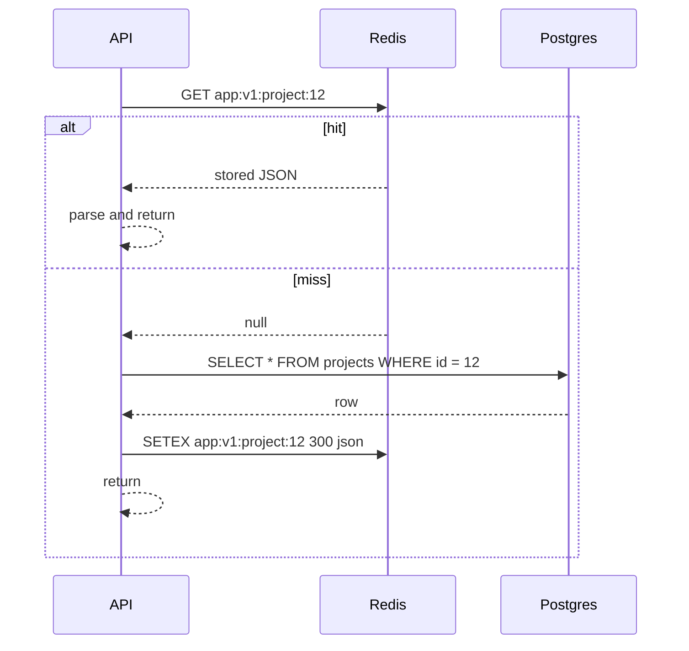

# Implementing Cache-Aside — Part 1

You have decided an endpoint is worth caching. Now you have to write it. This
part builds a real, typed cache-aside helper in TypeScript, and then spends the
rest of its length on **key design** — because the helper is twenty lines and
the keys are where production incidents actually come from.

> **📌 In one line:** the cache-aside code is easy; the key is the part that
> leaks data between tenants, so design the key like an API contract.

## Table of Contents

1. [The Pattern, Briefly](#the-pattern-briefly)
2. [A First Version, and Why It Is Not Enough](#a-first-version-and-why-it-is-not-enough)
3. [A Typed, Generic Cache-Aside Helper](#a-typed-generic-cache-aside-helper)
4. [Key Design Is the Real Work](#key-design-is-the-real-work)
5. [A Key Naming Convention](#a-key-naming-convention)
6. [The Version Segment](#the-version-segment)
7. [The Tenant Id Belongs in Every Key](#the-tenant-id-belongs-in-every-key)
8. [Everything the Answer Varies By](#everything-the-answer-varies-by)
9. [Key Length and Unbounded Cardinality](#key-length-and-unbounded-cardinality)
10. [Common Mistakes](#common-mistakes)
11. [Questions to Test Yourself](#questions-to-test-yourself)
12. [Related](#related)

---

## The Pattern, Briefly

**Cache-aside** means the application sits in the middle. It asks the cache
first. On a miss it loads from the database itself, stores the result, and
returns it. The cache never talks to the database. It is the safe default for
read-heavy data because a cache failure simply means every request is a miss.

That is the whole pattern. For how it compares with write-through,
write-behind and read-through — and when you would choose those instead — read
[../../system-design/foundational/caching-strategies.md](../../system-design/foundational/caching-strategies.md).
This file does not repeat that comparison. It builds the thing.



Three properties to keep in mind while reading the code below:

- The **first** request for any key always misses and pays full cost.
- Nothing is ever written to the cache by the write path in plain cache-aside.
  Writes only *remove* keys. File 03 covers that.
- A cache read failure must behave like a miss, never like an error. File 04
  covers that.

---

## A First Version, and Why It Is Not Enough

Almost everyone writes this first:

```ts
import redis from '#services/redis'
import Project from '#models/project'

async function getProject(projectId: number): Promise<Project | null> {
  const cached = await redis.get(`project:${projectId}`)
  if (cached) return JSON.parse(cached)

  const project = await Project.find(projectId)
  if (project) await redis.setex(`project:${projectId}`, 300, JSON.stringify(project))
  return project
}
```

It works. It is also wrong in five ways that will each cost you a day:

| Problem | What happens in production |
|---|---|
| Key has no tenant id | Two companies with overlapping ids see each other's data |
| Key has no version | You cannot change the stored shape without a manual flush |
| `JSON.parse` returns an untyped value | You claim it is a `Project` and it is a plain object |
| A `null` result is never cached | Every lookup of a missing id hits the database forever |
| A Redis error throws | The whole request fails because an *optimisation* failed |

The rest of part 1 fixes the key problems. Part 2 fixes the parsing, the null
handling and the measurement. File 04 fixes the failure behaviour.

---

## A Typed, Generic Cache-Aside Helper

Write the pattern once, in one place. Every call site that repeats
`get → parse → miss → load → set` by hand is a place where somebody will forget
a step.

Start with the shape of what a caller provides: a key, a time to live, and a
function that produces the value when the cache does not have it.

```ts
// app/services/cache/types.ts

/** Produces the real value when the cache cannot answer. */
export type Loader<T> = () => Promise<T>

export interface CacheOptions<T> {
  key: string
  /** Seconds. Chosen deliberately per key family — see part 2. */
  ttlSeconds: number
  /** Turns the parsed JSON back into a real T. Never trust the stored shape. */
  revive: (raw: unknown) => T
}
```

The `revive` function is the part people leave out, and it is the reason the
helper is worth writing at all. `JSON.parse` gives you `unknown`. Pretending it
is already a `T` is how a `Date` silently becomes a `string` for the next
reader. Part 2 goes into this properly, and
[../../typescript-fundamentals/unknown-any/unknown-any.md](../../typescript-fundamentals/unknown-any/unknown-any.md)
explains why `unknown` is the correct starting type here.

Now the helper itself:

```ts
// app/services/cache/remember.ts
import redis from '#services/redis'
import type { CacheOptions, Loader } from './types.js'

export async function remember<T>(
  options: CacheOptions<T>,
  load: Loader<T>,
): Promise<T> {
  const { key, ttlSeconds, revive } = options

  const cached = await redis.get(key)
  if (cached !== null) {
    // A stored value that no longer parses is treated as a miss, not a crash.
    try {
      return revive(JSON.parse(cached))
    } catch {
      await redis.del(key)
    }
  }

  const fresh = await load()
  await redis.setex(key, ttlSeconds, JSON.stringify(fresh))
  return fresh
}
```

Two decisions worth naming:

- **`cached !== null`, not `if (cached)`.** An empty string and the string
  `"0"` are both falsy in JavaScript and both are legitimate stored values. The
  truthy check turns a valid hit into a miss, silently, only for those values.
- **A parse failure deletes the key.** After a deploy changes a stored shape,
  the old entries are garbage. Deleting them self-heals in one request instead
  of throwing until the time to live expires.

A call site now reads like this:

```ts
// app/services/project_service.ts
const project = await remember(
  {
    key: projectKey(companyId, projectId),
    ttlSeconds: 300,
    revive: reviveProject,
  },
  () => Project.query().where('company_id', companyId).where('id', projectId).firstOrFail(),
)
```

> **💡 Tip:** in Express the shape is identical — only the model call changes.
> Keep the helper free of framework imports so it is testable without a server.

The helper is still missing failure tolerance, negative caching and metrics.
Those arrive in part 2 and file 04. Do not ship this version as-is.

---

## Key Design Is the Real Work

Here is the mental model that prevents most caching bugs:

> **📌 Remember:** a cache key is a **promise** that says *"every request that
> produces this key deserves exactly this answer."* If two requests that should
> get different answers produce the same key, you have a bug — and it is a data
> leak, not a performance issue.

Read that twice. Almost every serious caching incident is a broken version of
that promise. The rest of this file is a checklist for keeping it.

---

## A Key Naming Convention

Pick one format and use it everywhere:

```text
   app:v1:project:4102:detail
    │   │    │     │     │
    │   │    │     │     └── which view of the entity
    │   │    │     └──────── the identifier
    │   │    └────────────── the entity type
    │   └─────────────────── schema version of the stored value
    └─────────────────────── application namespace
```

| Segment | Why it is there |
|---|---|
| `app` | Lets several applications share one Redis without colliding |
| `v1` | Lets you change the stored shape without a manual flush |
| `project` | Makes `SCAN app:v1:project:*` meaningful during debugging |
| `4102` | The identifier |
| `detail` | Distinguishes the full record from a summary or a count |

Rules that pay for themselves:

- **Lowercase, colon-separated, no spaces.** Colons are the Redis convention and
  most tooling groups keys by them.
- **Build every key from a function, never from a template literal at the call
  site.** One typo in one controller creates a second key family nobody knows
  about, which then never gets invalidated.

```ts
// app/services/cache/keys.ts
export const cacheKeys = {
  projectDetail: (companyId: number, projectId: number) =>
    `app:v1:company:${companyId}:project:${projectId}:detail`,

  projectTaskList: (companyId: number, projectId: number) =>
    `app:v1:company:${companyId}:project:${projectId}:tasks`,

  companyPlanLimits: (companyId: number) =>
    `app:v1:company:${companyId}:plan-limits`,
} as const
```

The payoff is that **one file now lists every key your application can
produce.** When you write the invalidation logic in file 03, that list is what
you work from. Without it you are grepping for string literals and hoping.

---

## The Version Segment

The `v1` is the cheapest invalidation tool you will ever have.

Consider what happens without it. You ship a change that adds `archivedAt` to
the cached project shape. Every Redis entry written before the deploy has the
old shape. For the next hour, half your requests get objects with a missing
field, and your code does not know which half.

Your options at that point are all bad: flush the whole database (losing every
unrelated cache at once), write a migration script, or wait it out.

With a version segment, the fix is a one-character diff:

```ts
// ❌ BROKEN - the shape changed but old entries still match the key
projectDetail: (companyId: number, projectId: number) =>
  `app:v1:company:${companyId}:project:${projectId}:detail`,

// ✅ FIXED - new shape, new key space; old entries are unreachable and expire on their own
projectDetail: (companyId: number, projectId: number) =>
  `app:v2:company:${companyId}:project:${projectId}:detail`,
```

The moment that line deploys, every read misses, repopulates with the new
shape, and the `v1` entries expire quietly in the background. No flush, no
script, no downtime. You pay one cold period.

> **⚠️ Warning:** bump the version whenever the **stored shape** changes —
> a field added, removed, renamed, or its type changed. Not when the data
> changes. That is invalidation, which is file 03.

Version per key family, not globally. Bumping one family should not cost you
the hit ratio of every other one.

---

## The Tenant Id Belongs in Every Key

This is the bug with the worst consequences in this entire folder.

In a business-to-business SaaS, almost every row belongs to a company. If a key
identifies a row without identifying the company, two things can go wrong, and
the second one is severe.

```ts
// ❌ BROKEN - the key names the resource but not the tenant
const key = `app:v1:invoice:${invoiceNumber}:pdf`
```

Invoice numbers are often **per company**: Acme Ltd has invoice 1001 and
Globex Inc also has invoice 1001. The first request stores Acme's PDF. The
next request from Globex hits that key and is served **another company's
invoice**, with their client names and amounts on it.

That is not a stale-data bug. That is a cross-tenant data disclosure. It is the
kind of thing that ends up in a breach notification.

```ts
// ✅ FIXED - the tenant is part of the key, so the key spaces can never overlap
const key = `app:v1:company:${companyId}:invoice:${invoiceNumber}:pdf`
```

Two habits that make this systematic rather than a thing you remember:

1. **Put the tenant segment immediately after the version**, always in the same
   position. A key without `company:` after `v1:` is then visibly wrong in code
   review and in `redis-cli` output.
2. **Make the key builder require it.** If `projectDetail` cannot be called
   without a `companyId` argument, the compiler enforces the rule for you. That
   is the whole reason the builders in `keys.ts` take `companyId` first even
   when the project id alone would be unique.

The same reasoning — that tenant scoping must be structural, not remembered —
is worked through for database queries in
[../../backend-fundamentals/06-authorization/03-ownership-abac-and-multi-tenancy-part-2.md](../../backend-fundamentals/06-authorization/03-ownership-abac-and-multi-tenancy-part-2.md).
A cache key is a second place the same tenant boundary has to hold, and it is
the place people forget.

> **📌 Remember:** every tenant-scoped query in your code has a matching cache
> key. If the query has a `WHERE company_id = ?` and the key does not have a
> `company:` segment, the cache has a hole the query does not.

---

## Everything the Answer Varies By

The tenant is the most dangerous varying input, but it is not the only one. The
rule generalises: **if changing an input changes the answer, that input must
appear in the key.**

Common ones that get forgotten:

| Varies by | What leaks when you forget it |
|---|---|
| Locale | A German user is served the English strings, or the reverse |
| Role | A viewer receives the admin version of a response, including fields they may not see |
| Feature flag | Half your users see the new layout at random, depending who warmed the key |
| Currency | Amounts shown in the wrong currency with the right number |
| Time zone | A "today" list that is yesterday's for half the world |
| API version | A v2 client parses a v1 body |

The role case is the serious one, because it is another disclosure:

```ts
// ❌ BROKEN - admins get extra fields, but the key does not say so
export function projectDetailKey(companyId: number, projectId: number) {
  return `app:v1:company:${companyId}:project:${projectId}:detail`
}

// the serialiser includes budget and margin only for admins
const body = serializeProject(project, { role: user.role })
```

An admin loads the page first. Their response — including `budgetCents` and
`marginPercent` — is stored under that key. The next viewer on the team reads
the same key and receives the financial fields. Your authorization logic ran
correctly. The cache handed the result to the wrong person afterwards.

```ts
// ✅ FIXED - the role is part of the key, so each audience has its own entry
export function projectDetailKey(
  companyId: number,
  projectId: number,
  role: 'owner' | 'admin' | 'member' | 'viewer',
) {
  return `app:v1:company:${companyId}:project:${projectId}:detail:role:${role}`
}
```

There is a better answer available here, and it is worth naming. **Cache the
data, not the rendered response.** If you cache the raw project and apply the
role-based serialisation after the cache read, the role never needs to be in
the key at all — there is one entry, and the filtering happens fresh every
time. That also keeps the authorization decision on the uncached path, which
file 01 insisted on.

Use the role-in-key version only when the expensive part is the serialisation
itself, which is rare.

---

## Key Length and Unbounded Cardinality

**Cardinality** means how many distinct keys a key family can produce. A key
family with unbounded cardinality is a slow memory leak.

```ts
// ❌ BROKEN - every distinct search string becomes a permanent key
const key = `app:v1:company:${companyId}:search:${req.input('q')}`
```

Search queries are effectively infinite. Users type `apollo`, `Apollo `,
`apollo project`, and a thousand variations that each occur once. Every one of
them creates a key that is never read again and sits in memory until it
expires. Meanwhile the keys that *are* read repeatedly get evicted to make
room for them.

You get the worst of both: memory full, hit ratio falling, database load
unchanged.

```ts
// ✅ FIXED - normalise, bound, and hash; and only cache popular searches at all
import { createHash } from 'node:crypto'

function searchKey(companyId: number, rawQuery: string): string {
  const normalized = rawQuery.trim().toLowerCase().slice(0, 100)
  const digest = createHash('sha256').update(normalized).digest('hex').slice(0, 16)
  return `app:v1:company:${companyId}:search:${digest}`
}
```

Three separate things happened there:

- **Normalising** collapses `Apollo `, `apollo` and `APOLLO` into one key, which
  raises the hit ratio for free.
- **Truncating** bounds the key length. Redis allows very long keys, but a key
  is stored in memory too — a 2 KB key holding a 200-byte value is absurd.
- **Hashing** gives every key a fixed, predictable size and keeps user input out
  of your key space, which also means a user cannot craft a query containing
  `:` and collide with another key family.

> **⚠️ Warning:** hashing makes keys unreadable in `redis-cli`. That is a real
> debugging cost. Hash only where cardinality genuinely demands it, and keep a
> readable prefix like `search:` so you can still find the family.

The deeper judgement: a search endpoint usually should not be cached per query
at all. A short in-process cache for the top few queries, or no cache plus a
proper index, is almost always better. Check the cardinality of a key family
*before* you build it, not after your Redis memory alert fires.

> **➡️ Continued in [Part 2](./02-implementing-cache-aside-part-2.md)** —
> serialization traps, caching negative results, choosing a time to live,
> measuring hits and misses, and which layer the cache belongs in.

---

## Common Mistakes

| Mistake | Why it is wrong | Do this instead |
|---|---|---|
| `if (cached)` instead of `if (cached !== null)` | Empty string and `"0"` are valid values and become false misses | Compare against `null` explicitly |
| Key built inline at the call site | Typos create an invisible second key family nobody invalidates | One `keys.ts` with builder functions |
| No version segment | A shape change needs a full flush or a migration script | Put `v1` in every key and bump per family |
| No tenant segment | Cross-tenant disclosure when ids are per company | Tenant id right after the version, always |
| Role or locale missing from the key | The first caller's variant is served to everyone | Cache raw data and serialise after the read |
| Unbounded key inputs like a search string | Memory fills with keys read once, evicting useful ones | Normalise, truncate, hash — or do not cache it |
| Casting `JSON.parse` straight to a model type | The stored shape is `unknown` and may be from an old deploy | A `revive` step per key family |

---

## Questions to Test Yourself

1. Why does `if (cached)` introduce a bug that `if (cached !== null)` does not?
2. What exactly does the version segment in a key let you do that a flush does
   not?
3. Two companies both have an invoice numbered 1001. Walk through what happens
   with the key `app:v1:invoice:1001:pdf`.
4. Why is "cache the data, not the rendered response" usually better than
   putting the role in the key?
5. A key family includes the user's raw search text. Name two separate problems
   this causes, and say which one you notice first.
6. Why should a parse failure delete the key rather than throw?
7. What is the one-sentence promise that a cache key makes? Give an example of
   breaking it.
8. Your key builders take `companyId` even where `projectId` is globally
   unique. What is the argument for keeping it?

---

## Related

- [02-implementing-cache-aside-part-2.md](02-implementing-cache-aside-part-2.md)
  — the second half: serialization, negative caching, time to live, metrics.
- [01-when-to-cache.md](01-when-to-cache.md) — the decision that comes first.
- [03-invalidation-in-practice-part-1.md](03-invalidation-in-practice-part-1.md)
  — how the keys built here get removed when data changes.
- [../../system-design/foundational/caching-strategies.md](../../system-design/foundational/caching-strategies.md)
  — cache-aside compared with the other patterns.
- [../../backend-fundamentals/06-authorization/03-ownership-abac-and-multi-tenancy-part-2.md](../../backend-fundamentals/06-authorization/03-ownership-abac-and-multi-tenancy-part-2.md)
  — the tenant boundary the cache key has to respect too.
- [../../typescript-fundamentals/unknown-any/unknown-any.md](../../typescript-fundamentals/unknown-any/unknown-any.md)
  — why `JSON.parse` should be treated as `unknown`.
