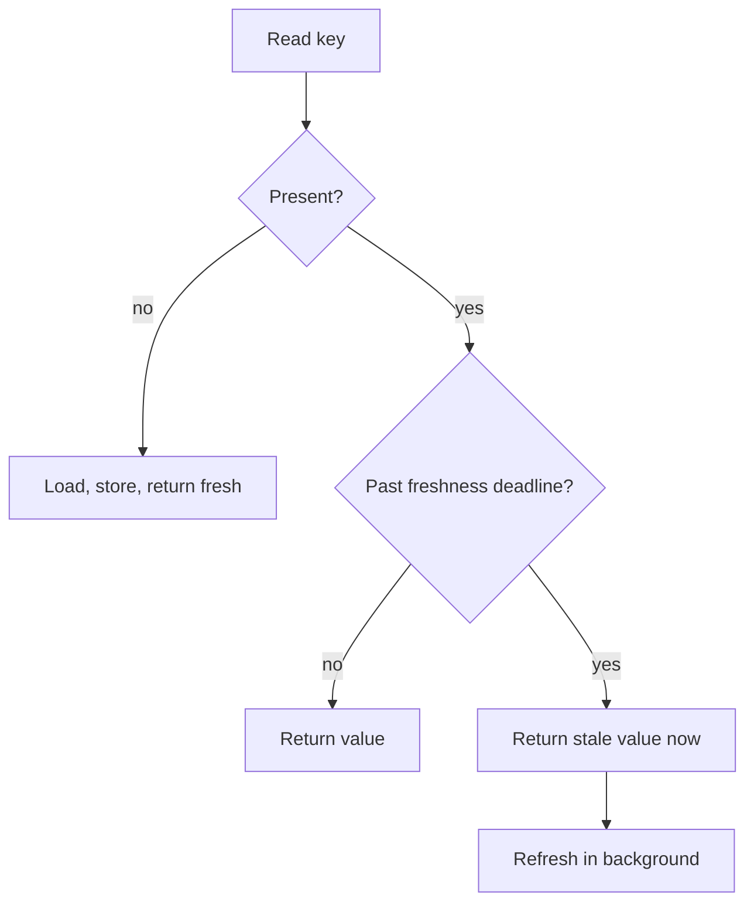

# Implementing Cache-Aside — Part 2

Part 1 built the helper and designed the keys. This part covers what happens to
your data on the way into Redis and back out, the miss that never becomes a
hit, how to pick a time to live without guessing, and how to tell whether any
of it is working.

> **⬅️ This continues [Part 1](./02-implementing-cache-aside-part-1.md).**

> **📌 In one line:** Redis stores strings, so every value you cache goes
> through a lossy conversion — treat coming back out as parsing untrusted
> input, not as reading your own object.

## Table of Contents

1. [Redis Stores Strings, Not Objects](#redis-stores-strings-not-objects)
2. [What JSON Quietly Destroys](#what-json-quietly-destroys)
3. [A Typed Revive Step](#a-typed-revive-step)
4. [Caching Negative Results](#caching-negative-results)
5. [Choosing a Time to Live Deliberately](#choosing-a-time-to-live-deliberately)
6. [Measuring Hits and Misses](#measuring-hits-and-misses)
7. [Advanced: Stale While Revalidate](#advanced-stale-while-revalidate)
8. [Advanced: Which Layer Does the Cache Belong In](#advanced-which-layer-does-the-cache-belong-in)
9. [Common Mistakes](#common-mistakes)
10. [Questions to Test Yourself](#questions-to-test-yourself)
11. [Related](#related)

---

## Redis Stores Strings, Not Objects

Redis has no idea what a `Project` is. Every value you store is bytes. So
between your object and Redis there is always a conversion in each direction:

```text
   Project instance  ──serialize──►  "{"id":12,...}"  ──► Redis
   Project?          ◄──revive────   unknown          ◄── Redis
```

The right-hand arrow is the one people get wrong. They write this:

```ts
// ❌ BROKEN - a cast, not a check; TypeScript now believes a lie
const project = JSON.parse(cached) as Project
```

`JSON.parse` returns `any` in the standard library types, which means the cast
is not checked at all. Whatever shape is actually in Redis — written by a
previous deploy, by a different service, or by a colleague testing in
`redis-cli` — is now typed as a `Project`. The error appears three function
calls later, somewhere unrelated.

```ts
// ✅ FIXED - start from unknown, then prove the shape
const parsed: unknown = JSON.parse(cached)
const project = reviveProject(parsed) // throws or returns a real Project
```

This is precisely the distinction between `any` and `unknown`:
[../../typescript-fundamentals/unknown-any/unknown-any.md](../../typescript-fundamentals/unknown-any/unknown-any.md).
A cache boundary is a system boundary. Treat it like one.

---

## What JSON Quietly Destroys

`JSON.stringify` is not a round trip. Several JavaScript values do not survive
it, and none of them raise an error.

| Value going in | Value coming back | Consequence |
|---|---|---|
| `Date` | `string` such as `"2026-09-27T10:00:00.000Z"` | `.getTime()` throws, comparisons compare text |
| `undefined` (object property) | property is **gone** | `'archivedAt' in project` becomes false |
| `undefined` (array element) | `null` | Array holes change type |
| `Map` / `Set` | `{}` | Silently empty |
| `BigInt` | throws `TypeError` | Crash, at least this one is loud |
| `NaN` / `Infinity` | `null` | A number becomes null |
| `class` instance | plain object | Methods and getters are gone |

The `Date` case is the one that bites most often in a Node and PostgreSQL
application, because dates are everywhere:

```ts
const project = await Project.findOrFail(12)
project.createdAt instanceof Date        // true

await redis.setex(key, 300, JSON.stringify(project))
const back = JSON.parse((await redis.get(key))!)
back.createdAt instanceof Date           // false — it is a string now
back.createdAt.getTime()                 // TypeError: not a function
```

And the failure is **intermittent by design**. On a cache miss you have a real
`Date` and everything works. On a hit you have a string and it crashes. So the
bug only appears after the first request, only within the time-to-live window,
and never in a unit test that does not use Redis.

The `undefined` case is subtler. A project with `archivedAt: undefined` becomes
a stored object with no `archivedAt` key at all. If any code distinguishes
"absent" from "explicitly undefined", that distinction is destroyed. Use `null`
for "known to be empty" in anything you cache — `null` survives JSON, and
PostgreSQL gives you `null` anyway.

> **⚠️ Warning:** the class-instance row is why caching an ORM model object
> directly is a bad habit. You store a `Project` and you get back a plain
> object that looks like one until somebody calls a method on it.

---

## A Typed Revive Step

The fix is one small function per cached shape. It does three jobs: restore the
types JSON lost, reject data that does not match, and give you one place to
look when a shape changes.

```ts
// app/services/cache/revivers.ts
import { DateTime } from 'luxon'

export interface CachedProject {
  id: number
  companyId: number
  name: string
  archivedAt: DateTime | null
  createdAt: DateTime
}

export function reviveProject(raw: unknown): CachedProject {
  if (typeof raw !== 'object' || raw === null) {
    throw new Error('cached project is not an object')
  }
  const o = raw as Record<string, unknown>

  if (typeof o.id !== 'number' || typeof o.name !== 'string') {
    throw new Error('cached project is missing required fields')
  }

  return {
    id: o.id,
    companyId: Number(o.companyId),
    name: o.name,
    // strings become real dates again, which is the whole point
    archivedAt: typeof o.archivedAt === 'string' ? DateTime.fromISO(o.archivedAt) : null,
    createdAt: DateTime.fromISO(String(o.createdAt)),
  }
}
```

Part 1's `remember` helper already turns a thrown reviver error into a cache
miss and deletes the key, so a shape mismatch self-heals in one request.

If you already use a validation library — Zod, Valibot, VineJS — use it here
instead of hand-written checks. The schema you use to validate request input
does the same job on cache output, and you get better error messages. See
[../../backend-fundamentals/04-validation-and-input/](../../backend-fundamentals/04-validation-and-input/).

> **💡 Tip:** define a dedicated `CachedProject` type rather than reusing the
> ORM model type. It documents honestly that what comes out of the cache is a
> plain data shape, not a live model with methods and relations.

Alternatives to JSON exist — MessagePack is smaller and faster, and it keeps
binary data compact. Use them only when you have measured that serialization
cost or memory size is actually your problem. JSON is readable in `redis-cli`,
and during an incident at 3 AM that readability is worth more than ten percent
of memory.

---

## Caching Negative Results

Here is a miss that never becomes a hit.

A client integration polls `GET /projects/99999`. That project was deleted last
year. Every request:

1. Reads the cache. Nothing there.
2. Queries the database. No row.
3. Returns 404 — and stores **nothing**, because there is nothing to store.

So the cache never helps. Every one of those requests reaches PostgreSQL. A
broken integration retrying in a loop, or a crawler walking sequential ids, can
generate thousands of uncached database queries per minute against an endpoint
you believed was cached.

This pattern has a name when it is hostile: **cache penetration**. Someone
requests ids that will never exist, specifically because those requests always
reach your database.

The fix is to cache the absence:

```ts
// A sentinel that cannot collide with a real serialized value.
const MISSING = '\u0000missing'

export async function rememberNullable<T>(
  options: CacheOptions<T>,
  load: () => Promise<T | null>,
): Promise<T | null> {
  const cached = await redis.get(options.key)

  if (cached === MISSING) return null // a cached "no such thing"
  if (cached !== null) {
    try {
      return options.revive(JSON.parse(cached))
    } catch {
      await redis.del(options.key)
    }
  }

  const fresh = await load()
  if (fresh === null) {
    // much shorter than a normal entry: the row may be created any moment
    await redis.setex(options.key, 30, MISSING)
    return null
  }

  await redis.setex(options.key, options.ttlSeconds, JSON.stringify(fresh))
  return fresh
}
```

Three things make this safe:

- **The sentinel is not valid JSON output.** If you use the string `"null"`,
  you cannot tell a cached absence from a cached `null` value.
- **The time to live is much shorter.** A record that does not exist may be
  created in the next second, and then you owe the creator a correct answer.
  Thirty seconds of "not found" after a create is a real complaint; ten minutes
  of it is a bug report.
- **The create path must invalidate the negative key too.** This is the danger
  people miss. If `POST /projects` does not delete the negative entry for the
  id it just created, the creator gets a 404 for their own brand-new project.

> **⚠️ Warning:** never cache a negative result for an authorization check. "You
> may not access this" cached for thirty seconds means a user who was just
> granted access is still told no. That is the file 01 rule in a new costume.

---

## Choosing a Time to Live Deliberately

The wrong question is "what is a good time to live?" The right question is:

> **How stale can this be before a real person is misled, blocked, or harmed?**

Then pick a number below that. Round numbers like 3600 are a sign nobody asked
the question.

| Data | Recommended TTL | Reasoning |
|---|---|---|
| Country and currency list | 24 hours | Changes about once a decade |
| Finalised invoice PDF | 7 days | Immutable once issued; only memory limits it |
| Company plan limits | 10 minutes | An upgrade should take effect while the user is still on the page |
| Project detail | 5 minutes | Plus explicit invalidation on write, which is the real mechanism |
| Task list for a project | 60 seconds | Changes often and the user is watching it |
| Dashboard aggregate counts | 5 minutes | Expensive, and nobody makes a decision on a 3-minute-old count |
| Team member list | 2 minutes | Used for display; the permission check itself stays uncached |
| Unread notification count | Do not cache | The user is looking directly at it |
| Any permission decision | Do not cache | See file 01 |

Two rules that matter more than the numbers:

**A time to live is a backstop, not a strategy.** For anything users edit, the
real mechanism is explicit invalidation on write (file 03). The TTL exists to
limit the damage when an invalidation is missed — and one eventually will be.
Five minutes of wrongness is recoverable. Twenty-four hours is a support
ticket.

**Add jitter to anything written in bulk.** If a deploy or a warm-up loop writes
five thousand keys with `ttl = 300`, all five thousand expire in the same
second, five minutes later. You have scheduled your own stampede.

```ts
// spread expiry over a window so related keys do not die together
function jittered(baseSeconds: number): number {
  return baseSeconds + Math.floor(Math.random() * baseSeconds * 0.2)
}
await redis.setex(key, jittered(300), payload) // 300 to 360 seconds
```

File 04 covers what happens when you skip this.

---

## Measuring Hits and Misses

Do not log a line per cache read. At ten thousand requests a minute that is a
log bill and nothing else — you cannot compute a ratio from log lines without
a query per question.

Emit a **counter metric** with the key family as a label:

```ts
import { cacheLookups } from '#services/metrics'

export async function remember<T>(
  options: CacheOptions<T>,
  load: Loader<T>,
): Promise<T> {
  const cached = await redis.get(options.key)
  if (cached !== null) {
    cacheLookups.inc({ family: options.family, result: 'hit' })
    return options.revive(JSON.parse(cached))
  }

  cacheLookups.inc({ family: options.family, result: 'miss' })
  const fresh = await load()
  await redis.setex(options.key, options.ttlSeconds, JSON.stringify(fresh))
  return fresh
}
```

The label is `family` — `project-detail`, `plan-limits` — never the full key.
A label whose value is unbounded creates one time series per project id and
will take down your metrics backend faster than the cache ever helped.

Four things worth graphing:

| Metric | What a bad value means |
|---|---|
| Hit ratio per family | Low: time to live too short, or key varies too much |
| Cache read latency, 99th percentile | Rising: Redis is saturated or the network is degraded |
| Loader duration on miss | This is your real exposure when the cache is cold |
| Database queries per second | The number you were actually buying — did it drop? |

See
[../../backend-fundamentals/08-logging-and-observability/04-metrics-and-health-checks-part-1.md](../../backend-fundamentals/08-logging-and-observability/04-metrics-and-health-checks-part-1.md)
for counters versus gauges versus histograms, and for the cardinality rule.

> **📌 Remember:** measure database load removed, not just hit ratio. A perfect
> hit ratio on data nobody needed twice removed nothing.

---

## Advanced: Stale While Revalidate

Plain cache-aside makes the unlucky request pay the full loader cost. If
loading takes two seconds, one user every five minutes waits two seconds.

**Stale-while-revalidate** removes that wait. You store the value with a
*logical* freshness deadline earlier than its Redis expiry. On a read:

- Fresh — return it.
- Stale but not expired — **return it immediately**, and start a background
  refresh.
- Expired or absent — load it the normal way and wait.



Nobody ever waits for a refresh except on a genuine cold start. The cost is
that some users see data slightly older than the nominal time to live, so do
not use it where that matters.

Two cautions. If the background refresh is not guarded, every stale read starts
its own refresh and you have traded a stampede on the database for a stampede
of refreshes. And in a Node process, "in the background" means an un-awaited
promise, which needs its own `catch` or it becomes an unhandled rejection.

Both of those, plus **request coalescing** — making concurrent misses for the
same key share one loader call — are implemented properly in
[04-stampede-and-failure-modes-part-1.md](04-stampede-and-failure-modes-part-1.md).

---

## Advanced: Which Layer Does the Cache Belong In

There are two defensible places, and it is worth choosing on purpose.

```text
   Controller  →  Service (business rules)  →  Repository (data access)  →  DB
                        │                            │
                   cache here                   or cache here
```

| | Repository layer | Service layer |
|---|---|---|
| Caches | One entity or query result | A composed, business-level answer |
| Hit removes | One query | Several queries plus the logic between them |
| Invalidation | Next to the write that causes it — easy to keep correct | Depends on many tables — easy to miss one |
| Risk | Little; the service still runs its rules | Permission or tenant logic can be skipped on a hit |
| Testing | Service tests stay cache-free | Service tests now need Redis or a fake |

**Default to the repository layer.** The cached thing is a single entity, so
"which keys does this write invalidate?" has a small, obvious answer, and the
service layer keeps running its rules on every request — including the
authorization checks that must not be cached.

Cache at the service layer only when the expensive part is genuinely the
composition: a dashboard that runs six queries and joins them in memory.
Caching each of those six separately saves little, because the six round trips
were the cost.

> **⚠️ Warning:** if you cache at the service layer, check what you skip on a
> hit. If the uncached path performs a permission check and the cached path
> returns before reaching it, your cache has become an authorization bypass.

The layer boundaries themselves are covered in
[../../backend-fundamentals/09-application-architecture/03-repository-layer-part-1.md](../../backend-fundamentals/09-application-architecture/03-repository-layer-part-1.md).
Whichever you pick, **the controller is never the right place** — a cache there
is invisible to every other caller of the same service, and the second entry
point added later will silently bypass it.

---

## Common Mistakes

| Mistake | Why it is wrong | Do this instead |
|---|---|---|
| `JSON.parse(x) as Project` | An unchecked cast over data from another deploy | Parse to `unknown`, then a reviver or schema |
| Caching an ORM model instance | Methods, getters and relations do not survive JSON | Cache a plain data shape with its own type |
| Assuming a `Date` survives | It returns as a string and crashes only on hits | Restore dates explicitly in the reviver |
| Never caching "not found" | Missing ids hit the database on every request forever | Short negative entry with a distinct sentinel |
| Forgetting to clear the negative entry on create | The creator gets a 404 for their own new record | Invalidate the negative key in the create path |
| Round-number TTLs by habit | Nobody asked how stale is acceptable | Derive the number from user-visible harm |
| Same TTL on bulk-written keys | They all expire in the same second | Add jitter of 10 to 20 percent |
| Logging every hit and miss | Expensive and still no ratio | A counter metric labelled by key family |
| Full cache key as a metric label | One time series per id; metrics backend falls over | Label by family only |
| Caching in the controller | Other callers of the same service bypass it | Repository layer by default |

---

## Questions to Test Yourself

1. Why does a `Date` bug from caching only appear *after* the first request,
   and why does it disappear again later?
2. What is the difference between `any` and `unknown` at a cache boundary, and
   why does it matter here specifically?
3. Explain cache penetration. Why does an ordinary cache-aside implementation
   do nothing to stop it?
4. Why must the sentinel for a negative entry be a value that `JSON.stringify`
   can never produce?
5. A negative entry has a 30-second TTL. Which write path must still delete it
   explicitly, and what does the user see if it does not?
6. Five thousand keys are written during warm-up with the same TTL. What
   happens five minutes later, and what one change prevents it?
7. Why is the key family the right metric label and the full key the wrong one?
8. Give one case where caching at the service layer is right, and one way it
   can become an authorization bypass.
9. What does stale-while-revalidate cost you, and what new stampede can it
   create?

---

## Related

- [02-implementing-cache-aside-part-1.md](02-implementing-cache-aside-part-1.md)
  — the helper and the key design this part builds on.
- [03-invalidation-in-practice-part-1.md](03-invalidation-in-practice-part-1.md)
  — the mechanism a time to live is only a backstop for.
- [04-stampede-and-failure-modes-part-1.md](04-stampede-and-failure-modes-part-1.md)
  — request coalescing and stale-while-revalidate, implemented.
- [../../typescript-fundamentals/unknown-any/unknown-any.md](../../typescript-fundamentals/unknown-any/unknown-any.md)
  — why the value out of Redis starts as `unknown`.
- [../../backend-fundamentals/08-logging-and-observability/04-metrics-and-health-checks-part-1.md](../../backend-fundamentals/08-logging-and-observability/04-metrics-and-health-checks-part-1.md)
  — counters, labels and cardinality.
- [../../backend-fundamentals/09-application-architecture/03-repository-layer-part-1.md](../../backend-fundamentals/09-application-architecture/03-repository-layer-part-1.md)
  — the layer the cache usually belongs in.
- [../../system-design/foundational/caching-strategies.md](../../system-design/foundational/caching-strategies.md)
  — time to live and eviction as concepts.
