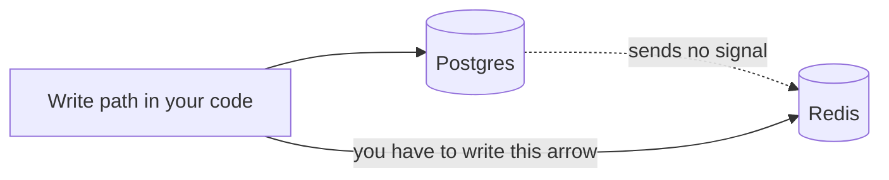

# Invalidation in Practice — Part 1

There is a famous line, usually credited to Phil Karlton: *there are only two
hard things in computer science, cache invalidation and naming things.* It gets
quoted as a joke. It is not a joke. This part is about why invalidation is
genuinely hard, the three strategies you can choose between, and the race
condition that leaves a wrong value cached forever.

> **📌 In one line:** the cache cannot know the database changed, so every write
> path in your application is now responsible for telling it — and the one that
> forgets is the one added six months from now.

## Table of Contents

1. [Why It Is Actually Hard](#why-it-is-actually-hard)
2. [The Three Strategies](#the-three-strategies)
3. [Strategy 1: Time to Live Only](#strategy-1-time-to-live-only)
4. [Strategy 2: Explicit Deletion on Write](#strategy-2-explicit-deletion-on-write)
5. [Making Explicit Invalidation Survive Six Months](#making-explicit-invalidation-survive-six-months)
6. [Strategy 3: Versioned Keys](#strategy-3-versioned-keys)
7. [The Write-Then-Invalidate Race](#the-write-then-invalidate-race)
8. [Delete, Do Not Update](#delete-do-not-update)
9. [Never Invalidate Inside a Transaction](#never-invalidate-inside-a-transaction)
10. [Common Mistakes](#common-mistakes)
11. [Questions to Test Yourself](#questions-to-test-yourself)
12. [Related](#related)

---

## Why It Is Actually Hard

The difficulty is not the code. `redis.del(key)` is one line. The difficulty is
structural, and it comes from one fact:

> **📌 Remember:** the cache has no connection to the database. When a row
> changes, nothing tells Redis. The copy just silently becomes wrong.



Compare that with a database index. When you update a row, PostgreSQL updates
the index in the same transaction, automatically, and it is impossible for you
to forget. The index cannot drift from the table.

A cache has none of that. It is a copy maintained **by hand**, by code you
wrote, spread across every place that writes. That means three hard problems
arrive together:

1. **Completeness.** Every write path must know every key it affects. Updating
   a task name may invalidate the task, the project's task list, the project's
   task count, a dashboard summary, and a search result.
2. **Timing.** The delete and the database write happen at different moments.
   Concurrent requests can interleave between them.
3. **Discovery.** A missing invalidation produces no error, no log line, and no
   failed test. It produces a user saying "it still shows the old name", days
   later, and you cannot reproduce it.

The third one is why this file is long. A bug you cannot see is worse than a
bug that crashes.

---

## The Three Strategies

| | Time to live only | Explicit deletion | Versioned keys |
|---|---|---|---|
| How it works | Entries expire on their own | Write paths delete affected keys | Writes bump a version in the key |
| Staleness window | Up to the full TTL | Milliseconds | Effectively zero |
| Code in write paths | None | Must be complete and correct | One counter increment |
| Cost of forgetting | Bounded by the TTL | Stale until the TTL saves you | Cannot forget a single key |
| Old data | Expires | Deleted | Orphaned until it expires |
| Memory | Lowest | Lowest | Higher, old versions linger |
| Best for | Data nobody edits directly | Single entities with clear owners | Collections and lists |

These are not exclusive. A healthy system uses all three: versioned keys for
lists, explicit deletion for entities, and a time to live under everything as a
backstop.

---

## Strategy 1: Time to Live Only

You set an expiry and write no invalidation code at all. The data is stale for
up to that long, and then it is correct again.

```ts
await redis.setex(cacheKeys.currencyList(), 86_400, JSON.stringify(currencies))
```

This is not a lazy option. It is the **right** option whenever staleness is
genuinely harmless for that window:

- Reference data — currencies, countries, time zones.
- Data changed only by a nightly import, where a stale hour means nothing.
- Aggregates nobody makes a decision on: "projects created this month".

It is the wrong option for anything a user edits, for one reason: the user who
made the edit is the person most likely to look immediately, and they will read
their own stale data. That is the read-your-own-writes problem from
[01-when-to-cache.md](01-when-to-cache.md).

> **💡 Tip:** if you can honestly answer "nothing bad happens if this is ten
> minutes old", stop here. You have just avoided every problem in the rest of
> this file.

---

## Strategy 2: Explicit Deletion on Write

The write path removes the keys it made wrong. The next read repopulates.

```ts
// app/services/project_service.ts
async function renameProject(companyId: number, projectId: number, name: string) {
  const project = await Project.query()
    .where('company_id', companyId)
    .where('id', projectId)
    .firstOrFail()

  project.name = name
  await project.save()

  await redis.del(cacheKeys.projectDetail(companyId, projectId))
}
```

Simple, and correct for this one path. The problem is not this code. The
problem is that this code is a **promise the whole codebase has to keep**.

Today three paths write to `projects`: the rename endpoint, the archive
endpoint, and the admin bulk-import. Each remembers to delete. In four months
someone adds a fourth — a webhook handler that syncs project names from a
customer's system — and it does not, because nobody told them the rule and
nothing enforces it.

Now project names are wrong for exactly the customers who use that integration,
and the bug survives every code review because the new code looks fine on its
own.

---

## Making Explicit Invalidation Survive Six Months

Three mitigations, in increasing order of how much they actually help.

**1. One function owns the full key list.**

Never call `redis.del` at a call site. Write one invalidation function per
entity, next to the key builders, and make it the only thing anybody calls.

```ts
// app/services/cache/invalidate.ts
import redis from '#services/redis'
import { cacheKeys } from './keys.js'

/** Everything that becomes wrong when a project row changes. */
export async function invalidateProject(companyId: number, projectId: number) {
  await redis.del(
    cacheKeys.projectDetail(companyId, projectId),
    cacheKeys.projectTaskList(companyId, projectId),
    cacheKeys.projectTaskCount(companyId, projectId),
    cacheKeys.companyProjectList(companyId),
    cacheKeys.companyDashboard(companyId),
  )
}
```

Now when a sixth key is added to the project family, one edit fixes every write
path at once. Without this, adding a key means auditing the whole codebase and
hoping — and `keys.ts` from
[02-implementing-cache-aside-part-1.md](02-implementing-cache-aside-part-1.md)
is what makes the list knowable in the first place.

**2. Put the call below the controller.**

A controller is the worst place for invalidation, because there is always more
than one controller eventually: a REST endpoint, an admin action, a queue
worker, a seeder, a CLI command. Each is a separate chance to forget.

Put it in the service or repository layer — the same argument as "which layer
does the cache belong in" in
[02-implementing-cache-aside-part-2.md](02-implementing-cache-aside-part-2.md).
If the only way to save a project is through `ProjectRepository.save()`, then
invalidation inside that method covers every caller that will ever exist.

```ts
// app/repositories/project_repository.ts
async save(project: Project): Promise<Project> {
  await project.save()
  await invalidateProject(project.companyId, project.id)
  return project
}
```

**3. Accept that you will still miss one, and keep the time to live short.**

This is the honest mitigation. Explicit invalidation is best-effort no matter
how disciplined you are. A five-minute TTL under it means a missed invalidation
is five minutes of wrongness that heals itself, instead of a permanent one that
becomes a support ticket.

> **⚠️ Warning:** an invalidation strategy with no TTL backstop assumes your
> code is complete and always will be. No codebase is.

---

## Strategy 3: Versioned Keys

The trick: never delete anything. Change what the key *is*.

Keep a version number in Redis. Read it, put it in the key, and bump it on
write. Every old key becomes unreachable in one operation, no matter how many
there were.

```ts
// app/services/cache/versioned.ts
import redis from '#services/redis'

function versionKey(companyId: number, projectId: number) {
  return `app:v1:company:${companyId}:project:${projectId}:ver`
}

async function currentVersion(companyId: number, projectId: number): Promise<number> {
  const v = await redis.get(versionKey(companyId, projectId))
  return v === null ? 1 : Number(v)
}

/** One increment invalidates every key derived from this version. */
export async function bumpProjectVersion(companyId: number, projectId: number) {
  await redis.incr(versionKey(companyId, projectId))
}

export async function projectTaskListKey(companyId: number, projectId: number) {
  const ver = await currentVersion(companyId, projectId)
  return `app:v1:company:${companyId}:project:${projectId}:g${ver}:tasks`
}
```

After `bumpProjectVersion`, every key containing `g7` is orphaned — no code can
produce that key any more — and every read builds `g8` and misses. The orphans
cost memory until their own TTL removes them, which is why versioned keys still
need a TTL.

| Trade-off | Detail |
|---|---|
| Cannot forget a key | Any key built from the version is covered automatically |
| Costs an extra read | One `GET` before every cached read; pipeline it |
| Coarse | Bumping invalidates *everything* for that project, including parts that did not change |
| Leaves garbage | Old versions sit in memory until they expire |
| Version is not durable | If Redis restarts and the counter is gone, it restarts at 1 and may match orphaned keys — give the counter a long TTL or persist it |

Versioned keys shine for **collections**, where you cannot enumerate the keys to
delete. Part 2 works through that case.

---

## The Write-Then-Invalidate Race

Here is the failure that leaves a wrong value cached until its TTL expires, with
no bug in any single line of code.

Two requests run at the same time. Request A reads a project that is not
cached. Request B renames it.

| Time | Request A (read) | Request B (rename) |
|---|---|---|
| T1 | `GET project:12` → miss | |
| T2 | `SELECT ...` → name `"Zeus"` | |
| T3 | | `UPDATE projects SET name='Apollo'` |
| T4 | | `COMMIT` |
| T5 | | `DEL project:12` → nothing there yet |
| T6 | `SETEX project:12 300 {"name":"Zeus"}` | |
| T7 | cache now holds `"Zeus"` for 5 minutes, database holds `"Apollo"` | |

Read that again, because the ordering is the whole point. B's delete ran
**before** A's write. There was nothing to delete at T5. Then A stored a value
it read at T2 — already stale by the time it was written.

Every line is correct. The interleaving is the bug. And it is completely
invisible: no error, no log, and the user who renamed the project sees the old
name for five minutes and concludes the save failed.

Three defences, and you want all three:

**Delete after the transaction commits, not before.** Covered in its own section
below. This shrinks the window but does not close it.

**Delete again, shortly after.** A second delete a few hundred milliseconds
later catches the value A wrote at T6. This is sometimes called delayed double
delete. It is not elegant, and it is not a guarantee — but it turns a
five-minute problem into a half-second one.

```ts
export async function invalidateProject(companyId: number, projectId: number) {
  const keys = projectKeysFor(companyId, projectId)
  await redis.del(...keys)

  // Catches a concurrent reader that repopulated with a pre-write snapshot.
  setTimeout(() => {
    redis.del(...keys).catch((err) => logger.warn({ err }, 'delayed invalidation failed'))
  }, 500).unref()
}
```

The `.catch` is mandatory — an un-awaited rejection in Node crashes the process
by default in recent versions. The `.unref()` stops the timer holding the
process open during shutdown.

**A short time to live.** The backstop, again. Five minutes of a lost race is
survivable. An hour is not.

> **⚠️ Warning:** a `setTimeout` lives in one process. If that instance is
> restarted or the deploy rolls in the next half second, the second delete never
> happens. It reduces the probability; it does not remove it. For data where
> being wrong is unacceptable, do not cache it.

---

## Delete, Do Not Update

When a write happens, you have two options: delete the key, or write the new
value into it. Writing the new value looks better — the next reader gets a hit
instead of paying for a miss.

It is more dangerous, and the timeline shows why.

```ts
// ❌ BROKEN - writing the new value makes a lost update permanent
await project.save()
await redis.setex(key, 300, JSON.stringify(project))
```

| Time | Request A (set name) | Request B (set name) |
|---|---|---|
| T1 | `UPDATE name='Apollo'` commits | |
| T2 | | `UPDATE name='Hermes'` commits |
| T3 | | `SETEX key {"name":"Hermes"}` |
| T4 | `SETEX key {"name":"Apollo"}` | |
| T5 | cache says `"Apollo"`, database says `"Hermes"` | |

The database resolved the conflict correctly: last writer wins, and the answer
is `"Hermes"`. The cache then resolved it in the **opposite order**, because
network timing put A's Redis write after B's. The cache is now confidently
wrong, and nothing will correct it until the TTL expires.

```ts
// ✅ FIXED - delete, and let the next read load whatever the database actually says
await project.save()
await redis.del(key)
```

With delete, both requests delete. The worst outcome of any interleaving is an
extra cache miss. The next reader asks the database, which is the only component
that knows the truth.

> **📌 Remember:** **a delete is idempotent and self-healing; a write is an
> opinion about what the value should be.** Only the database is entitled to an
> opinion.

This is the same conclusion as the concept note in
[../../system-design/foundational/caching-strategies.md](../../system-design/foundational/caching-strategies.md),
now with the timeline that explains it. Write-through — where the cache write is
part of a single controlled path — is a different design and does not have this
problem in the same way; plain cache-aside plus "update the cache too" does.

---

## Never Invalidate Inside a Transaction

This one produces the most confusing symptom of all: a cache entry that does not
match any value that has ever existed in the database.

```ts
// ❌ BROKEN - the cache is cleared before the write is real
await db.transaction(async (trx) => {
  await project.useTransaction(trx).save()
  await redis.del(cacheKeys.projectDetail(companyId, projectId)) // too early

  await auditLog.useTransaction(trx).create({ ... })             // this throws
  // transaction rolls back — the project was never renamed
})
```

Two things go wrong, and the second is worse.

**The rollback case.** The transaction fails after the delete. The database
still holds the old name. You deleted the cache for nothing — harmless, just a
wasted miss.

**The repopulation case.** This is the real damage. Between your `DEL` and the
rollback, a concurrent request misses, reads the row **inside its own
snapshot**, and caches it. Depending on isolation level and timing, what it
reads is the pre-transaction value — which is then cached as though it were
current, at the exact moment you had just invalidated it. You have carefully
replaced a correct cache entry with a stale one.

And there is a third, quieter cost: Redis is not transactional with PostgreSQL.
Holding a transaction open while you make a network call to Redis means you are
holding row locks during that call. A Redis slowdown becomes database lock
contention. See
[../../databases/transactions-and-concurrency/01-transactions-and-acid-part-2.md](../../databases/transactions-and-concurrency/01-transactions-and-acid-part-2.md)
for what a transaction holds and for how long.

```ts
// ✅ FIXED - commit first; invalidate only once the write is durable and visible
await db.transaction(async (trx) => {
  await project.useTransaction(trx).save()
  await auditLog.useTransaction(trx).create({ ... })
})
// the transaction has committed here, so any reader now sees the new row
await invalidateProject(companyId, projectId)
```

> **📌 Remember:** the order is always **commit, then invalidate.** Anything
> outside the database — cache deletes, queue jobs, emails, webhooks — happens
> after the commit, never inside it.

The remaining gap is honest and worth naming: if the process crashes between the
commit and the delete, the stale entry survives until its TTL. There is no way
to make a PostgreSQL commit and a Redis delete atomic. For most data the TTL
backstop is the accepted answer. Where it is not, the pattern is to record the
invalidation as part of the transaction itself and let a worker perform it —
the transactional outbox, which belongs with background jobs in
[../03-background-jobs/](../03-background-jobs/).

> **➡️ Continued in [Part 2](./03-invalidation-in-practice-part-2.md)** —
> invalidating collections and lists, cross-service invalidation with events,
> pattern deletion and why `KEYS` is dangerous, a debugging checklist, and
> two-level caching.

---

## Common Mistakes

| Mistake | Why it is wrong | Do this instead |
|---|---|---|
| `redis.del` called at the call site | The next write path added will not know the rule | One `invalidateProject` function owning the key list |
| Invalidating in the controller | Workers, CLI commands and other controllers bypass it | Put it in the service or repository layer |
| Explicit invalidation with no TTL | One missed path means permanent wrongness | Keep a short TTL as a backstop |
| Writing the new value instead of deleting | Concurrent writes can land in the cache out of order | Delete the key and let the next read reload |
| Invalidating before the commit | A rollback or a concurrent read leaves a stale entry | Commit first, then invalidate |
| Redis calls inside a transaction | Row locks are held across a network call | Do all non-database work after the commit |
| Assuming a single delete wins every race | A concurrent reader can repopulate right after it | Delayed second delete plus a short TTL |
| Versioned keys with no TTL | Orphaned old versions accumulate forever | Always set a TTL, even on versioned keys |

---

## Questions to Test Yourself

1. Why can a database index never drift from its table, while a cache always
   can? What does that tell you about whose job invalidation is?
2. Walk through the write-then-invalidate race from memory. At which step does
   the stale value get written, and why is no single line wrong?
3. Explain why deleting a key is safer than setting it to the new value, using
   two concurrent writers.
4. A transaction deletes a cache key and then rolls back. Describe the harmless
   outcome and the harmful one.
5. Why does holding a Redis call inside a database transaction create a
   *database* problem, not just a cache one?
6. What does a version bump invalidate that a list of `del` calls cannot?
7. Your team has a rule that every write must invalidate. Name two structural
   changes that make the rule hold without anyone remembering it.
8. If a process crashes between commit and invalidate, what saves you? What is
   the alternative when that is not good enough?

---

## Related

- [03-invalidation-in-practice-part-2.md](03-invalidation-in-practice-part-2.md)
  — collections, events, pattern deletion, and debugging stale reads.
- [02-implementing-cache-aside-part-1.md](02-implementing-cache-aside-part-1.md)
  — the key builders that make a complete invalidation list possible.
- [01-when-to-cache.md](01-when-to-cache.md) — the read-your-own-writes problem
  that explicit invalidation exists to solve.
- [../../databases/transactions-and-concurrency/01-transactions-and-acid-part-2.md](../../databases/transactions-and-concurrency/01-transactions-and-acid-part-2.md)
  — commit, rollback, and what a transaction holds while it is open.
- [../../databases/transactions-and-concurrency/06-optimistic-vs-pessimistic-locking-part-1.md](../../databases/transactions-and-concurrency/06-optimistic-vs-pessimistic-locking-part-1.md)
  — the same interleaving timelines, one layer down.
- [../../system-design/foundational/caching-strategies.md](../../system-design/foundational/caching-strategies.md)
  — invalidation approaches as concepts, and why delete beats update.
