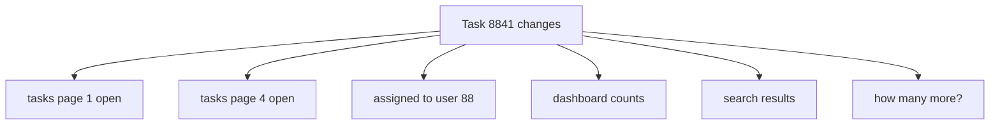
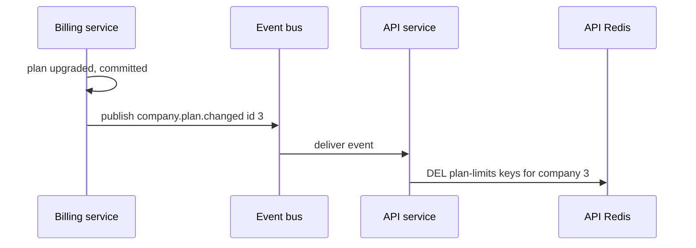

# Invalidation in Practice — Part 2

Part 1 handled a single entity: one row changes, you delete one key. Real
applications cache **lists**, and lists are much harder — when one task changes,
you often cannot even enumerate which cached lists are now wrong. This part
covers collections, invalidation across services, pattern deletion and the
command that will take your production Redis down, and how to debug a user who
says they see old data.

> **⬅️ This continues [Part 1](./03-invalidation-in-practice-part-1.md).**

> **📌 In one line:** you can delete a key you can name, so when you cannot name
> the keys, stop deleting and start changing what the keys are.

## Table of Contents

1. [Why Collections Are Harder](#why-collections-are-harder)
2. [Approach A: Version the Collection](#approach-a-version-the-collection)
3. [Approach B: Tags](#approach-b-tags)
4. [Choosing Between Them](#choosing-between-them)
5. [Cross-Service Invalidation](#cross-service-invalidation)
6. [Deleting by Pattern, and Why KEYS Is Dangerous](#deleting-by-pattern-and-why-keys-is-dangerous)
7. [Debugging: A User Says They See Old Data](#debugging-a-user-says-they-see-old-data)
8. [Advanced: Two-Level Caching](#advanced-two-level-caching)
9. [Common Mistakes](#common-mistakes)
10. [Questions to Test Yourself](#questions-to-test-yourself)
11. [Related](#related)

---

## Why Collections Are Harder

A single entity has one obvious key. One task changes, you delete
`task:8841`. Done.

Now the same task changes and you ask which **lists** are wrong:

```text
   app:v1:company:3:project:12:tasks:page:1:status:open:sort:due
   app:v1:company:3:project:12:tasks:page:1:status:all:sort:created
   app:v1:company:3:project:12:tasks:page:4:status:open:sort:due
   app:v1:company:3:user:88:assigned-tasks:page:1
   app:v1:company:3:dashboard:task-counts
   app:v1:company:3:search:a3f9e21b4c7d8e05
```

The honest answer to "which of these are wrong?" is **you do not know**. You
would have to know which page the task landed on, whether its status matches
each filter, which sort order moves it, who it is assigned to, and which search
queries would match its new name. Several of those depend on rows you did not
load.



So the strategy has to change. Instead of naming the keys to delete, you make
**all of them unreachable at once**.

---

## Approach A: Version the Collection

Part 1 introduced versioned keys. This is where they earn their place.

Keep one counter per collection. Every key in that collection embeds the
counter's current value. A write increments the counter, and every key built
from the old value becomes unreachable in a single operation — however many
there were.

```ts
// app/services/cache/collections.ts
import redis from '#services/redis'

function taskListVersionKey(companyId: number, projectId: number) {
  return `app:v1:company:${companyId}:project:${projectId}:tasks:ver`
}

export async function taskListKey(
  companyId: number,
  projectId: number,
  filters: { page: number; status: string; sort: string },
): Promise<string> {
  const raw = await redis.get(taskListVersionKey(companyId, projectId))
  const ver = raw === null ? 1 : Number(raw)

  return [
    `app:v1:company:${companyId}:project:${projectId}`,
    `tasks:g${ver}`,
    `page:${filters.page}:status:${filters.status}:sort:${filters.sort}`,
  ].join(':')
}

/** Any task create, update, delete or move calls this. One line, total coverage. */
export async function bumpTaskList(companyId: number, projectId: number) {
  await redis.incr(taskListVersionKey(companyId, projectId))
}
```

After a bump from `g7` to `g8`, every page, every filter, every sort order is
invalidated at once. You did not have to know they existed.

Three practical notes:

- **`INCR` is atomic.** Two concurrent writers both bumping is fine; the
  counter simply advances twice.
- **Give the counter a long TTL, or none.** If the counter disappears it resets
  to 1, and keys from an old `g1` generation may still be in memory and would
  be treated as current. A counter with no expiry, or one far longer than any
  value TTL, avoids this.
- **The orphans still cost memory** until their own TTL removes them. Always set
  a TTL on the values themselves.

> **⚠️ Warning:** versioning is coarse on purpose. Adding one task invalidates
> every cached list for that project, including pages the task cannot possibly
> appear on. That is the trade: you pay hit ratio to buy correctness you do not
> have to think about.

---

## Approach B: Tags

Tagging inverts the lookup. Each cached value records which entities it depends
on, in a Redis set. Invalidating an entity reads its set and deletes exactly
those keys.

```ts
// app/services/cache/tags.ts
import redis from '#services/redis'

function tagKey(tag: string) {
  return `app:v1:tag:${tag}`
}

/** Store a value and record which tags it depends on. */
export async function setTagged(
  key: string,
  value: string,
  ttlSeconds: number,
  tags: string[],
): Promise<void> {
  const pipeline = redis.multi()
  pipeline.setex(key, ttlSeconds, value)

  for (const tag of tags) {
    pipeline.sadd(tagKey(tag), key)
    // The tag set must outlive every value it points at, or you lose members.
    pipeline.expire(tagKey(tag), ttlSeconds * 2)
  }
  await pipeline.exec()
}

/** Delete every key that declared a dependency on this tag. */
export async function invalidateTag(tag: string): Promise<void> {
  const members = await redis.smembers(tagKey(tag))
  if (members.length > 0) await redis.del(...members)
  await redis.del(tagKey(tag))
}
```

A cached task list declares its dependencies when it is written:

```ts
await setTagged(key, JSON.stringify(tasks), 300, [
  `project:${projectId}`,
  ...tasks.map((t) => `task:${t.id}`),
])
```

Then a single task changing invalidates precisely the lists that contained it:

```ts
await invalidateTag(`task:${taskId}`)
```

That is much more precise than a version bump. A list that did not contain the
task keeps its cached entry.

The costs are real:

| Cost | Detail |
|---|---|
| Extra writes | One `SADD` per tag on every cache write |
| Tag sets grow | Keys expire; their membership in the tag set does not |
| Needs its own cleanup | Stale members mean `DEL` on keys that no longer exist — harmless but wasteful |
| More moving parts | Two data structures to reason about instead of one |
| Still incomplete | A task that *would now match* a filter it did not match before is not tagged by any cached list |

That last row is the subtle one. Tags invalidate lists that **contained** the
entity. A task whose status changes from `done` to `open` should now appear in
the `status:open` list — but that list never contained it, so it never tagged
it, so it is not invalidated. Tagging handles updates and deletes well; it
handles "this row now belongs to a set it did not belong to" poorly.

---

## Choosing Between Them

| | Version the collection | Tags |
|---|---|---|
| Correctness | Coarse but complete | Precise, with a real gap on set membership changes |
| Read cost | One extra `GET` per read | None |
| Write cost | One `INCR` | One `SADD` per tag per write |
| Hit ratio after a write | Drops to zero for that collection | Mostly preserved |
| Complexity | Low | Medium, plus cleanup |
| Fails by | Caching less than it could | Missing an invalidation |

> **📌 Remember:** when the two failure modes are "too many misses" and "serves
> stale data", pick too many misses. Start with versioned collections. Move to
> tags only when you have measured that the version bumps are actually costing
> you, and when you have thought carefully about membership changes.

---

## Cross-Service Invalidation

So far one application owns both the write and the cache. Once there are two
services, the picture changes: the billing service updates a company's plan,
and the API service is holding a cached copy of that plan's limits.

The API service has no idea anything happened.

The naive fix is for billing to call `redis.del` on the API's keys directly.
Do not do this. It means billing must know the API's key format, both services
must share one Redis, and every key format change becomes a coordinated
deploy. You have coupled two services through a string.

The usual answer is **events**. The service that owns the data publishes a fact.
Anyone caching a copy subscribes and invalidates their own keys, in their own
format.



```ts
// app/listeners/company_plan_changed.ts
export default class CompanyPlanChangedListener {
  async handle(event: { companyId: number }) {
    // This service owns its own key format. Billing never learns it.
    await redis.del(cacheKeys.companyPlanLimits(event.companyId))
  }
}
```

Two properties worth naming honestly:

- **Invalidation becomes asynchronous.** There is a window — usually
  milliseconds, sometimes seconds under load — where the API serves the old
  plan. A TTL is still your backstop.
- **Delivery is usually at-least-once.** The same event may arrive twice. For
  invalidation that is harmless, because a delete is idempotent. This is one of
  the few places where at-least-once delivery costs you nothing.

The mechanics of events, delivery guarantees and consumer design are in
[../../system-design/scale-patterns/event-driven-architecture.md](../../system-design/scale-patterns/event-driven-architecture.md)
and
[../../system-design/foundational/message-queues/overview.md](../../system-design/foundational/message-queues/overview.md).
Running the consumers is the subject of [../03-background-jobs/](../03-background-jobs/).

---

## Deleting by Pattern, and Why KEYS Is Dangerous

Sooner or later you want "delete everything for company 3". The obvious command
is the wrong one.

```ts
// ❌ BROKEN - KEYS scans the entire keyspace and blocks Redis while it does
const keys = await redis.keys(`app:v1:company:${companyId}:*`)
if (keys.length > 0) await redis.del(...keys)
```

Redis executes commands **one at a time, on a single thread**. `KEYS` walks
every key in the database before it returns. With ten million keys that is
hundreds of milliseconds to several seconds during which Redis answers
**nothing** — not your cache reads, not your session lookups, not your rate
limiter.

Every request that touches Redis in that window stalls. If your cache client
has a short timeout, they all fail at once. Running `KEYS` on a busy production
Redis is one of the most reliable ways to cause an outage with a single line.

```ts
// ✅ FIXED - SCAN returns a cursor and a small batch, letting other commands through
async function deleteByPattern(pattern: string): Promise<number> {
  let cursor = '0'
  let deleted = 0

  do {
    const [next, batch] = await redis.scan(cursor, 'MATCH', pattern, 'COUNT', 100)
    cursor = next
    if (batch.length > 0) {
      await redis.unlink(...batch) // UNLINK frees memory in a background thread
      deleted += batch.length
    }
  } while (cursor !== '0')

  return deleted
}
```

`SCAN` is safe but not free, and it has two properties that surprise people:
it may return the same key more than once, and it guarantees only that keys
present for the whole scan are returned at least once. It is a maintenance
tool, not a request-path tool.

> **⚠️ Warning:** if you find yourself reaching for pattern deletion inside a
> web request, the design is wrong. Use a version bump instead — it is one
> atomic `INCR` and it is instant regardless of how many keys exist.

`SCAN`, `UNLINK`, pipelining and the other single-threaded consequences get full
treatment in [../02-redis-in-practice/](../02-redis-in-practice/).

---

## Debugging: A User Says They See Old Data

Work in this order. Each step eliminates a whole layer, and skipping ahead is
how people spend an afternoon on the wrong one.

**1. Confirm the database is correct.**

```sql
SELECT id, name, updated_at FROM projects WHERE id = 12;
```

If the database has the old value, this is not a cache problem at all. The write
failed, or it went to a different tenant's row. Stop here.

**2. Read the key directly.**

```bash
redis-cli GET "app:v1:company:3:project:12:detail"
redis-cli TTL "app:v1:company:3:project:12:detail"
```

A value with a long remaining TTL and stale content confirms a missed or lost
invalidation.

**3. Check whether the key the reader builds is the key the writer deletes.**

This is the most common cause and the easiest to miss. Log both, from the real
code paths, and compare them character by character. A different locale, a
different role segment, a stale version number, a `companyId` of `"3"` versus
`3` — any of these produce two key spaces where you expected one.

**4. Identify which write path ran.**

Was it the REST endpoint, an admin action, a queue worker, a webhook, a CSV
import, a database migration, or a manual `UPDATE` someone ran in psql? Direct
SQL and migrations bypass application code entirely and therefore bypass
invalidation. This alone explains a large share of stale-data reports.

**5. Check for a lost race.**

If the value was correct and then became stale again shortly after the write,
suspect the write-then-invalidate race from part 1. Correlate timestamps of the
write and of concurrent reads for the same key.

**6. Check the layers above Redis.**

If Redis holds the correct value but the browser still shows the old one, the
staleness is in front of your API — a CDN, a proxy, `Cache-Control` headers, or
the client's own store. See
[../../system-design/scale-patterns/cdn-and-edge-caching.md](../../system-design/scale-patterns/cdn-and-edge-caching.md).

**7. Check for an in-process cache.**

If one instance is correct and another is not, something is cached inside a Node
process. Hitting the endpoint ten times and getting two different answers is the
signature.

> **💡 Tip:** make every cached response carry a header like
> `X-Cache: hit` plus the key family in non-production environments. Step 2 then
> takes seconds instead of an hour of grepping.

---

## Advanced: Two-Level Caching

A two-level cache puts a small in-process cache in front of Redis. Level 1 is a
`Map` or an LRU in Node — nanoseconds, no network. Level 2 is Redis — about a
millisecond. Level 3 is the database.

```text
   Request ──► L1 in-process (ns) ──miss──► L2 Redis (~1 ms) ──miss──► Postgres (~5 ms)
```

For a key read thousands of times per second, removing the Redis round trip is a
genuine saving, and it protects Redis from hot keys.

It also creates a problem you did not have. **Invalidating L1 across instances
is a distributed systems problem.** With eight API instances there are eight
independent L1 caches. Deleting the Redis key clears L2 for everyone and clears
L1 for nobody. Seven instances keep serving stale data, and which answer a user
gets depends on which instance the load balancer chose — so the bug appears and
disappears on refresh.

The standard fix is a Redis pub/sub channel that every instance subscribes to;
each invalidation publishes the key, and every instance drops it from its own
L1. That works, and it adds: a subscriber connection per instance, a message
per invalidation, a window where an instance has not processed the message yet,
and a failure mode where an instance misses messages after a reconnect and
serves stale data until restart.

| | Level 1 in-process | Level 2 Redis |
|---|---|---|
| Latency | Nanoseconds | About a millisecond |
| Shared between instances | No | Yes |
| Survives restart | No | Yes |
| Invalidation | Hard — needs pub/sub and still races | One `DEL` |
| Safe TTL | Seconds | Minutes |

> **📌 Remember:** two-level caching is a real technique with a real cost, and
> almost nobody at 1.5 years of backend experience has the problem it solves. A
> Redis round trip inside the same network is about a millisecond. You need a
> specific, measured reason to add a whole class of cross-instance bugs to save
> it.

If you do it anyway, keep L1 TTLs to **a few seconds**. A short TTL means the
worst stale window is short even when pub/sub fails, which turns a correctness
problem into a latency problem. That trade — prefer bounded staleness over
perfect invalidation you cannot guarantee — is the theme of this whole file.

---

## Common Mistakes

| Mistake | Why it is wrong | Do this instead |
|---|---|---|
| `KEYS` in production | Blocks single-threaded Redis for the whole scan | `SCAN` with a cursor, and only offline |
| Pattern deletion in a request path | Slow and unbounded, however you do it | Version bump: one atomic `INCR` |
| Deleting list keys one by one | You cannot enumerate every page, filter and sort | Version the collection |
| Tag sets with no expiry | They grow forever with dead members | Expire tag sets longer than their values |
| Assuming tags catch everything | A row joining a filter it did not match is untagged | Prefer versioning where membership changes |
| One service deleting another's keys | Couples services through a key format string | Publish an event; each service clears its own |
| Debugging by guessing | The cause is usually the key, not the logic | Follow the ordered checklist |
| Forgetting direct SQL bypasses invalidation | Migrations and manual updates skip your code | Treat manual writes as requiring a manual flush |
| Adding L1 before measuring | Buys a millisecond, costs cross-instance staleness | Use one Redis until you have proof |

---

## Questions to Test Yourself

1. One task changes. Name four cached list keys that might now be wrong, and
   explain why you cannot compute that set reliably.
2. How does a version bump invalidate keys you never knew existed? What does it
   cost?
3. What happens if the version counter disappears from Redis while old
   generation keys are still in memory?
4. Describe the membership-change gap in tag-based invalidation with a concrete
   task example.
5. Why does `KEYS` take down a production Redis when `SCAN` does not? What
   property of Redis makes this true?
6. Why is at-least-once delivery harmless for invalidation events specifically?
7. A user reports stale data. What is step 1 of your checklist and why must it
   come first?
8. Two API instances give different answers to the same request. What does that
   tell you immediately?
9. What exactly does a two-level cache buy, and what new class of bug does it
   introduce?

---

## Related

- [03-invalidation-in-practice-part-1.md](03-invalidation-in-practice-part-1.md)
  — the three strategies, the race, and transaction ordering.
- [02-implementing-cache-aside-part-1.md](02-implementing-cache-aside-part-1.md)
  — the key builders these approaches operate on.
- [04-stampede-and-failure-modes-part-1.md](04-stampede-and-failure-modes-part-1.md)
  — what happens to the database right after a large invalidation.
- [../02-redis-in-practice/](../02-redis-in-practice/) — `SCAN`, `UNLINK`,
  pipelines, pub/sub, and why Redis is single-threaded.
- [../03-background-jobs/](../03-background-jobs/) — running event consumers and
  the transactional outbox.
- [../../system-design/scale-patterns/event-driven-architecture.md](../../system-design/scale-patterns/event-driven-architecture.md)
  — publishing facts instead of calling other services' caches.
- [../../system-design/scale-patterns/cdn-and-edge-caching.md](../../system-design/scale-patterns/cdn-and-edge-caching.md)
  — the cache layer in front of your API, for step 6 of the checklist.
