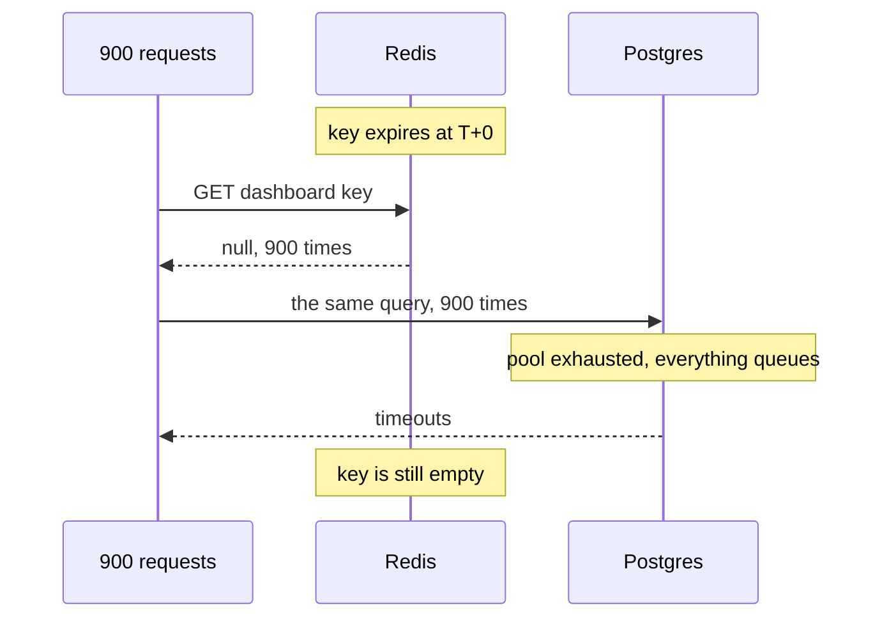

# Stampede and Failure Modes — Part 1

Everything so far assumed the cache works. This part is about the moment it
stops — specifically the one where a single key expiring takes your database
down, and the cache you added to protect it makes the outage **worse** than if
you had never cached at all.

> **📌 In one line:** a cache miss is cheap; ten thousand simultaneous misses on
> the same key is an attack you launched against yourself.

## Table of Contents

1. [What a Stampede Is](#what-a-stampede-is)
2. [Why It Is Worse Than No Cache](#why-it-is-worse-than-no-cache)
3. [Fix 1: In-Process Request Coalescing](#fix-1-in-process-request-coalescing)
4. [Fix 2: A Distributed Lock Per Key](#fix-2-a-distributed-lock-per-key)
5. [Fix 3: Probabilistic Early Expiry](#fix-3-probabilistic-early-expiry)
6. [Fix 4: Stale While Revalidate](#fix-4-stale-while-revalidate)
7. [Comparing the Four](#comparing-the-four)
8. [Common Mistakes](#common-mistakes)
9. [Questions to Test Yourself](#questions-to-test-yourself)
10. [Related](#related)

---

## What a Stampede Is

The dashboard summary for a large company is cached with a five-minute time to
live. Computing it takes 1,800 milliseconds. Three thousand people have that
dashboard open, polling every thirty seconds.

For four minutes and fifty-nine seconds everything is perfect. Every request is
a hit. The database is idle.

Then the key expires.

```text
   T+0.000s   key expires
   T+0.001s   request 1 arrives  → miss → starts the 1,800 ms query
   T+0.002s   request 2 arrives  → miss → starts the 1,800 ms query
   T+0.003s   request 3 arrives  → miss → starts the 1,800 ms query
   ...
   T+1.799s   request 900 arrives → miss → starts the 1,800 ms query
   T+1.800s   request 1 finally finishes and writes the key
```

For the entire 1,800 milliseconds the key is empty, **every** arriving request
misses, and every one of them starts the same expensive query. Nine hundred
identical queries run concurrently to produce one identical result.

This is a **cache stampede**, also called a thundering herd or a dogpile.



The window is not a coincidence. It is **exactly as long as the loader takes**.
A slow loader is a wide window, which means more concurrent misses, which means
the loader gets slower under the load, which widens the window further.

---

## Why It Is Worse Than No Cache

This is the part worth internalising.

Without a cache, those 3,000 requests would have been spread evenly across the
five minutes — about ten queries per second. The database handles that. It is
not fast, but it is steady, and it never falls over.

With a cache, the same total work is **compressed into one 1,800-millisecond
window**, once every five minutes. Nine hundred concurrent queries against a
pool of twenty connections means 880 requests waiting for a connection, each
holding a socket and a request context. See
[../../databases/operations/01-connection-pooling-part-1.md](../../databases/operations/01-connection-pooling-part-1.md)
for what pool exhaustion looks like from the application side.

Then it gets worse in three ways at once:

- The queries are slower than usual, because 900 of them are competing for the
  same CPU and buffer cache.
- Slower queries mean a longer empty window, which means more requests join the
  herd.
- Requests that time out are retried by the client, adding more load.

The cache turned a smooth ten queries per second into a periodic spike that
takes the database down. **The outage happens because you added a cache.**

> **⚠️ Warning:** a stampede is most likely on exactly the keys you were proudest
> to cache — the hottest ones, with the most expensive loaders. The better the
> cache looked on the dashboard, the harder this hits.

The concept note in
[../../system-design/foundational/caching-strategies.md](../../system-design/foundational/caching-strategies.md)
introduces stampede and names locking, jittered TTLs and refresh-ahead. The rest
of this file implements them properly, including the parts that are easy to get
subtly wrong.

---

## Fix 1: In-Process Request Coalescing

Start with the cheapest fix, because it removes most of the problem for free.

Within **one Node process**, if twenty requests miss the same key at the same
moment, there is no reason to run twenty loaders. Keep a map of promises that
are currently in flight. The first caller starts the work; the other nineteen
wait on the same promise.

```ts
// app/services/cache/coalesce.ts
const inFlight = new Map<string, Promise<unknown>>()

export function coalesce<T>(key: string, load: () => Promise<T>): Promise<T> {
  const existing = inFlight.get(key)
  if (existing) return existing as Promise<T>

  const promise = load().finally(() => {
    // Remove it whether it resolved or rejected, or one failure poisons the key.
    inFlight.delete(key)
  })

  inFlight.set(key, promise)
  return promise
}
```

Wire it into the `remember` helper from
[02-implementing-cache-aside-part-1.md](02-implementing-cache-aside-part-1.md):

```ts
export async function remember<T>(options: CacheOptions<T>, load: Loader<T>): Promise<T> {
  const cached = await redis.get(options.key)
  if (cached !== null) return options.revive(JSON.parse(cached))

  return coalesce(options.key, async () => {
    // Re-check: another coalesced call may have populated it while we queued.
    const again = await redis.get(options.key)
    if (again !== null) return options.revive(JSON.parse(again))

    const fresh = await load()
    await redis.setex(options.key, options.ttlSeconds, JSON.stringify(fresh))
    return fresh
  })
}
```

One detail decides whether this helps or hurts, and it is one word:

```ts
// ❌ BROKEN - cleared only on success, so one failure is served forever
const promise = load().then((value) => {
  inFlight.delete(key)
  return value
})
```

If the loader rejects — a database timeout, a deadlock, anything transient —
the rejected promise stays in the map. Every later caller is handed that same
rejection. The key is now permanently broken, in memory, until the process
restarts. A five-second database blip becomes an outage that outlives it.

```ts
// ✅ FIXED - cleared whichever way it settles, so the next caller retries
const promise = load().finally(() => {
  inFlight.delete(key)
})
```

The other detail: **re-check inside the coalesced function.** Without it, a
request that waited behind a completed loader may still go on to run its own.

What this does **not** do: it only coalesces within one process. With eight API
instances you go from 900 concurrent queries to 8. That is usually the
difference between an outage and a small blip — an eight-times reduction for
about fifteen lines and no new infrastructure.

> **💡 Tip:** if you take one thing from this file, take this. Coalescing is
> cheap, has no failure mode worse than "the loader runs twice", and removes the
> large majority of stampede load.

---

## Fix 2: A Distributed Lock Per Key

To get from eight loaders to one, the coordination must live in Redis.

The idea: before loading, try to claim a lock key with `SET NX` — set only if it
does not exist. Exactly one process wins. The losers wait briefly and re-read
the cache.

```ts
// app/services/cache/lock.ts
import { randomUUID } from 'node:crypto'
import redis from '#services/redis'

const sleep = (ms: number) => new Promise((r) => setTimeout(r, ms))

export async function loadWithLock<T>(
  key: string,
  ttlSeconds: number,
  load: () => Promise<T>,
): Promise<T> {
  const lockKey = `${key}:lock`
  const token = randomUUID() // proves we still own the lock when we release it

  // Lock TTL must exceed the slowest expected load, or two loaders overlap.
  const won = await redis.set(lockKey, token, 'EX', 10, 'NX')

  if (won) {
    try {
      const fresh = await load()
      await redis.setex(key, ttlSeconds, JSON.stringify(fresh))
      return fresh
    } finally {
      await releaseIfOwned(lockKey, token)
    }
  }

  // We lost. Wait for the winner, then re-read.
  for (let attempt = 0; attempt < 10; attempt++) {
    await sleep(50)
    const cached = await redis.get(key)
    if (cached !== null) return JSON.parse(cached) as T
  }

  // The winner died or is slow. Load anyway rather than fail the request.
  return load()
}
```

Releasing the lock needs care. If you simply `DEL` it, you may delete a lock
that has already expired and been claimed by someone else. Compare the token
first, atomically:

```ts
const RELEASE = `
  if redis.call("get", KEYS[1]) == ARGV[1] then
    return redis.call("del", KEYS[1])
  else
    return 0
  end`

function releaseIfOwned(lockKey: string, token: string) {
  return redis.eval(RELEASE, 1, lockKey, token)
}
```

Now be honest about what you have built. This is a distributed lock, and
distributed locks have well-known sharp edges:

| Risk | What happens | Mitigation |
|---|---|---|
| Lock TTL shorter than the load | Two processes load at once | Set the TTL well above your 99th percentile load time |
| Winner crashes mid-load | Losers spin until the lock expires | Bounded retries, then load anyway |
| Losers sleep too long | Every request gets slower, even on a fast load | Keep the poll interval to tens of milliseconds |
| Redis fails over | The lock is not safe across a failover | Accept it: a duplicate load is not a correctness bug |

That last row is the one that makes this acceptable. **A cache-population lock
does not need to be perfect.** If it fails and two loaders run, you did an extra
query. Compare that with a lock protecting a payment, where failure means
charging twice.

> **📌 Remember:** use a lock only for genuinely expensive loaders — seconds, not
> milliseconds. For a 5 ms query, the lock round trips cost more than the
> stampede.

---

## Fix 3: Probabilistic Early Expiry

Locking reacts to a stampede. This prevents one from forming, by making the key
**never actually expire under load**.

The idea in plain words: as a value gets closer to its expiry, each individual
reader has a small, growing chance of deciding "I will refresh this now, even
though it is still valid". Because the decision is random and per-request, one
unlucky reader refreshes early while everyone else keeps getting hits. The key
is replaced before it can expire, so the empty window never happens.

Store two extra fields with the value: when it expires, and how long the loader
took.

```ts
interface Envelope<T> {
  value: T
  expiresAtMs: number
  loadDurationMs: number
}

/** True when this reader should refresh early. Rare when fresh, common when near expiry. */
function shouldRefreshEarly(env: Envelope<unknown>, beta = 1): boolean {
  const now = Date.now()
  // -ln(random) is usually near 1, occasionally much larger.
  const gap = env.loadDurationMs * beta * -Math.log(Math.random())
  return now + gap >= env.expiresAtMs
}
```

The formula is:

```text
   now  +  loadDuration × beta × (−ln(random))  ≥  expiresAt
```

Each term is doing a job:

- **`loadDuration`** — expensive values start refreshing earlier. A 2-second
  loader needs more warning than a 20-millisecond one, because its empty window
  would be a hundred times wider.
- **`−ln(random())`** — usually around 1, sometimes 3 or 4. This is what spreads
  the decision out. Far from expiry, almost nobody triggers. Close to expiry,
  the chance rises smoothly toward certainty.
- **`beta`** — your tuning knob. Above 1 refreshes earlier and more often
  (fresher data, more load); below 1 refreshes later.

The result is that a hot key is refreshed by **one** reader slightly early,
while every other reader still gets a hit. No lock, no waiting, no coordination.

The critical caveat: this only works for keys read **often relative to their
time to live**. A key read once a minute with a five-minute TTL will usually
just expire normally, because no reader arrived during the window where the
probability was high. Probabilistic early expiry protects hot keys, which is
exactly where stampedes happen — so that limitation is acceptable.

> **💡 Tip:** jittered TTLs solve a different problem. Jitter stops many
> *different* keys expiring in the same second (see
> [02-implementing-cache-aside-part-2.md](02-implementing-cache-aside-part-2.md)).
> Early expiry stops **one** hot key stampeding. Use both.

---

## Fix 4: Stale While Revalidate

The gentlest option: keep serving the old value while the new one is computed.

Store the value with a Redis TTL well beyond its logical freshness — say, a
5-minute freshness deadline inside a 30-minute physical expiry.

```ts
export async function rememberSwr<T>(
  key: string,
  freshSeconds: number,
  load: () => Promise<T>,
): Promise<T> {
  const raw = await redis.get(key)

  if (raw !== null) {
    const env = JSON.parse(raw) as Envelope<T>

    if (Date.now() < env.expiresAtMs) return env.value // fresh

    // Stale but usable: return immediately, refresh behind the response.
    void coalesce(key, () => refreshInBackground(key, freshSeconds, load))
    return env.value
  }

  return coalesce(key, () => refreshInBackground(key, freshSeconds, load))
}

async function refreshInBackground<T>(key: string, freshSeconds: number, load: () => Promise<T>) {
  const started = Date.now()
  const value = await load()
  const env: Envelope<T> = {
    value,
    expiresAtMs: Date.now() + freshSeconds * 1000,
    loadDurationMs: Date.now() - started,
  }
  // Physical TTL is much longer than the freshness window.
  await redis.setex(key, freshSeconds * 6, JSON.stringify(env))
  return value
}
```

Nobody ever waits for a refresh except on a genuine cold start. The costs:

- **Users can see data older than the nominal freshness window.** Do not use
  this where a user is reading back their own write.
- **The background refresh must be coalesced**, or every stale read starts its
  own refresh and you have simply moved the stampede.
- **`void` on the promise is deliberate but needs a `catch` inside
  `coalesce`** — an unhandled rejection terminates a Node process in recent
  versions.

---

## Comparing the Four

| Technique | Reduces load to | Complexity | Extra infrastructure | Use when |
|---|---|---|---|---|
| In-process coalescing | One loader per instance | Low | None | Always. Start here. |
| Distributed lock | One loader total | Medium | Redis only | Loader takes seconds |
| Probabilistic early expiry | Refreshes never collide | Medium | None | One very hot key with a wide window |
| Stale while revalidate | Nobody waits at all | Medium to high | None | Latency matters, staleness does not |

A practical progression rather than a choice:

1. **Add coalescing to your cache helper today.** It is fifteen lines and it
   covers most of the risk.
2. **Add jitter to bulk-written TTLs.** One line, prevents mass expiry.
3. **Add a lock only for loaders measured in seconds.** Below that it costs more
   than it saves.
4. **Reach for early expiry or stale-while-revalidate for one or two specific
   keys** you have identified as hot, not as a default everywhere.

> **⚠️ Warning:** do not apply all four to every key. Each adds a code path that
> can be wrong, and a subtle bug in a cache helper is harder to find than the
> stampede it prevents. Fix the keys that actually stampede.

> **➡️ Continued in [Part 2](./04-stampede-and-failure-modes-part-2.md)** — what
> happens when Redis is down, cold caches after a deploy, hot keys, memory
> pressure and eviction, and a runbook.

---

## Common Mistakes

| Mistake | Why it is wrong | Do this instead |
|---|---|---|
| Assuming a cache only ever reduces load | It concentrates load into the moment a key expires | Plan for the expiry window on every hot key |
| Clearing the in-flight map on success only | A rejected promise is served to every later caller | Use `.finally` |
| No re-check inside the coalesced loader | The waiter runs the query the winner already ran | Re-read the cache before loading |
| Lock TTL shorter than the load time | Two loaders run and the lock is pointless | Set it above the 99th percentile load time |
| `DEL` to release a lock | You may delete a lock someone else now owns | Compare a token in a Lua script |
| Locking a 5 ms loader | Lock round trips cost more than the stampede | Locks are for multi-second loaders |
| Confusing jitter with early expiry | They solve different problems | Jitter for many keys, early expiry for one hot key |
| Un-awaited background refresh with no catch | Unhandled rejection can terminate the process | Always attach a `catch` |
| Uncoalesced stale-while-revalidate | Every stale read starts a refresh | Coalesce the refresh |

---

## Questions to Test Yourself

1. A loader takes 1,800 ms. Why is the stampede window exactly that long, and
   what makes it grow?
2. Explain why the same total query volume can be fine without a cache and fatal
   with one.
3. Why must the in-flight map be cleared in `finally` rather than after success?
4. With eight instances, what does in-process coalescing reduce 900 concurrent
   loaders to? Why is that usually enough?
5. Why is it acceptable for a cache-population lock to occasionally fail, when a
   payment lock failing is not?
6. In the early-expiry formula, what job does each of `loadDuration`,
   `−ln(random())` and `beta` do?
7. Why does probabilistic early expiry do nothing for a rarely-read key, and why
   is that acceptable?
8. What is the difference between a jittered TTL and probabilistic early expiry?
9. Name the two costs of stale-while-revalidate and the one case where you must
   not use it.

---

## Related

- [04-stampede-and-failure-modes-part-2.md](04-stampede-and-failure-modes-part-2.md)
  — Redis being down, cold caches, hot keys, eviction, and the runbook.
- [02-implementing-cache-aside-part-1.md](02-implementing-cache-aside-part-1.md)
  — the `remember` helper these fixes are wired into.
- [02-implementing-cache-aside-part-2.md](02-implementing-cache-aside-part-2.md)
  — TTL jitter and the stale-while-revalidate concept.
- [../../system-design/foundational/caching-strategies.md](../../system-design/foundational/caching-strategies.md)
  — stampede, locking and refresh-ahead as concepts.
- [../../databases/operations/01-connection-pooling-part-1.md](../../databases/operations/01-connection-pooling-part-1.md)
  — what pool exhaustion looks like when the herd arrives.
- [../02-redis-in-practice/](../02-redis-in-practice/) — `SET NX`, Lua scripts
  and atomic operations in detail.
