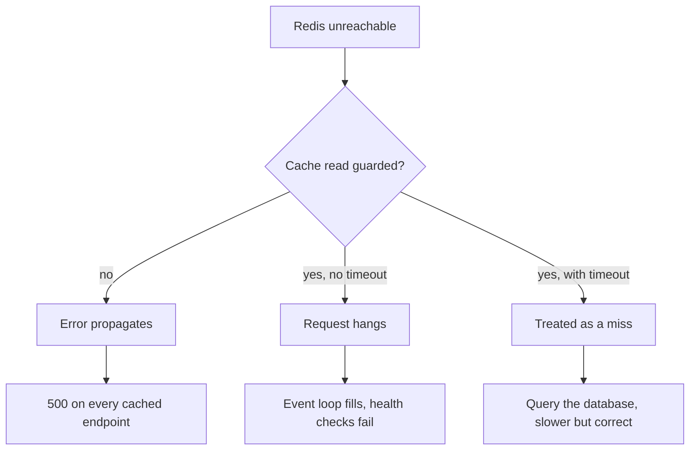

# Stampede and Failure Modes — Part 2

Part 1 was about the cache working too well and then expiring. This part is
about the cache being **gone**: Redis is unreachable, or it just restarted, or
it filled up and started throwing your keys away. The question that decides
whether you have an incident or a bad afternoon is: does your API get slower,
or does it stop?

> **⬅️ This continues [Part 1](./04-stampede-and-failure-modes-part-1.md).**

> **📌 In one line:** a cache is an optimisation, so a cache failure must
> degrade you to slower — and if it cannot, the cache was never an optimisation
> and you should say so out loud.

## Table of Contents

1. [What Happens When Redis Is Down](#what-happens-when-redis-is-down)
2. [Failing Open, Properly](#failing-open-properly)
3. [The Counter-Case: When Failing Open Is Wrong](#the-counter-case-when-failing-open-is-wrong)
4. [Cold Cache After a Deploy or a Restart](#cold-cache-after-a-deploy-or-a-restart)
5. [Hot Keys](#hot-keys)
6. [Memory Pressure and Eviction](#memory-pressure-and-eviction)
7. [Never Share One Redis Between a Cache and a Queue](#never-share-one-redis-between-a-cache-and-a-queue)
8. [Runbook: The Cache Is Behaving Strangely](#runbook-the-cache-is-behaving-strangely)
9. [Common Mistakes](#common-mistakes)
10. [Questions to Test Yourself](#questions-to-test-yourself)
11. [Related](#related)

---

## What Happens When Redis Is Down

Answer this about your own application before reading on. Most people are
confident the answer is "it gets slower". Most people are wrong, because of one
line they never thought about.

```ts
// ❌ BROKEN - a cache failure becomes a request failure
export async function remember<T>(options: CacheOptions<T>, load: Loader<T>): Promise<T> {
  const cached = await redis.get(options.key) // Redis is down: this throws or hangs
  if (cached !== null) return options.revive(JSON.parse(cached))

  const fresh = await load()
  await redis.setex(options.key, options.ttlSeconds, JSON.stringify(fresh))
  return fresh
}
```

There is no `try`. When Redis is unreachable, `redis.get` rejects, the rejection
propagates out of `remember`, out of the service, out of the controller, and
your error handler returns a 500.

**Every endpoint that touches the cache is now down.** Not slow — down. The
database is completely healthy and idle. Your API is returning 500s because an
optional component is unavailable.

The hanging version is worse than the throwing version. Many clients default to
no command timeout or a very long one. Redis does not refuse the connection; it
accepts it and never answers. Each request holds its socket, its request
context and its memory, waiting. Your event loop fills with pending promises,
the process runs out of handles, health checks time out, and the orchestrator
restarts a container that was never broken — into the same situation.



---

## Failing Open, Properly

Three things are needed together. Any one alone is not enough.

```ts
// ✅ FIXED - short timeout, errors are misses, writes are best-effort
import { setTimeout as delay } from 'node:timers/promises'

/** Rejects if the operation takes longer than the budget. */
async function withTimeout<T>(op: Promise<T>, ms: number): Promise<T> {
  const ac = new AbortController()
  const timer = delay(ms, 'timeout', { signal: ac.signal }).then(() => {
    throw new Error('cache timeout')
  })
  try {
    return await Promise.race([op, timer])
  } finally {
    ac.abort() // stop the timer from keeping the process alive
  }
}

export async function remember<T>(options: CacheOptions<T>, load: Loader<T>): Promise<T> {
  let cached: string | null = null
  try {
    cached = await withTimeout(redis.get(options.key), 50)
  } catch (err) {
    // A cache failure is a miss. It is never a request failure.
    cacheErrors.inc({ family: options.family, op: 'get' })
    logger.warn({ err, family: options.family }, 'cache read failed, falling through')
  }

  if (cached !== null) {
    try {
      return options.revive(JSON.parse(cached))
    } catch {
      /* fall through to the loader */
    }
  }

  const fresh = await load()

  // Best effort. If we cannot store it, the request still succeeded.
  withTimeout(redis.setex(options.key, options.ttlSeconds, JSON.stringify(fresh)), 50)
    .catch((err) => {
      cacheErrors.inc({ family: options.family, op: 'set' })
      logger.warn({ err }, 'cache write failed')
    })

  return fresh
}
```

The three parts, and why each one is load-bearing:

| Part | Without it |
|---|---|
| A short timeout (tens of ms) | Requests hang instead of failing, which is worse |
| `try`/`catch` around every cache call | One unreachable Redis returns 500s everywhere |
| A best-effort, un-awaited write | You wait for a write whose only purpose is future speed |

Details that matter:

- **The timeout must be much shorter than your request budget.** Redis inside
  the same network answers in about a millisecond. Fifty is already very
  generous. A 5-second timeout means a broken Redis adds 5 seconds to every
  request, which is functionally an outage.
- **Log at `warn`, and rate-limit it.** During an outage this fires on every
  request. An unbounded warn log becomes its own incident.
- **Count the errors as a metric.** "Cache error rate" is the signal that tells
  you a degradation is a cache problem and not a database problem. See
  [../../backend-fundamentals/08-logging-and-observability/04-metrics-and-health-checks-part-1.md](../../backend-fundamentals/08-logging-and-observability/04-metrics-and-health-checks-part-1.md).
- **Do not let this pattern leak everywhere.** Swallowing errors is correct
  *here*, at a well-defined optional boundary, and wrong almost everywhere else.
  Your centralised handler should still see every error that is not a cache
  miss:
  [../../backend-fundamentals/07-error-handling/02-centralized-error-handling-part-1.md](../../backend-fundamentals/07-error-handling/02-centralized-error-handling-part-1.md).

> **📌 Remember:** one guarded helper is how this stays true. If cache calls are
> scattered across twenty services, twenty places have to remember the `try`.
> This is the same argument as one `keys.ts` and one `invalidateProject`.

---

## The Counter-Case: When Failing Open Is Wrong

Failing open is the right default. It is not always right, and pretending
otherwise is how people get surprised.

If the database genuinely cannot serve full traffic uncached — the cache is
absorbing 95% of reads and the remaining 5% is already most of what PostgreSQL
can handle — then failing open does not save you. Every request falls through,
the database is hit with twenty times its normal load, and it collapses. You
have moved the outage from Redis to PostgreSQL, and a collapsed database is a
much harder thing to recover.

Two honest responses.

**First, admit what you have built.** If the database cannot serve traffic
uncached, Redis is not an optimisation. It is a **load-bearing dependency**, and
it must be treated like one: replication, failover, monitoring, capacity
planning, and inclusion in your availability calculations. What is dangerous is
believing it is optional when it is not. Test this deliberately — turn the cache
off in staging under production-like load and watch.

**Second, protect the thing behind it.** Instead of an unlimited fall-through:

- **Circuit breaker.** After enough consecutive failures, stop calling the
  failing component for a while and return a fast, degraded answer. This stops
  a pile-up of requests all waiting for something known to be broken.
- **Load shedding.** Serve what you can and reject the rest **immediately** with
  a 503 and a `Retry-After`. A fast rejection for 80% of traffic is a far better
  outcome than every request timing out after 30 seconds, because a timeout
  costs the same resources as success and delivers nothing.
- **Concurrency limit on the loader.** Cap how many uncached loads may run at
  once. Beyond the cap, fail fast instead of queueing. This is the stampede lock
  from part 1 used as a safety valve.

Both mechanisms are covered in
[../../system-design/reliability/circuit-breakers-and-retries.md](../../system-design/reliability/circuit-breakers-and-retries.md).

> **⚠️ Warning:** be very careful with retries during a cache outage. A retry on
> a request that is slow *because the cache is down* adds load to the exact
> component that is already struggling. Retries and fallbacks together are how a
> degradation becomes a collapse.

---

## Cold Cache After a Deploy or a Restart

A cold cache is a stampede on every key at once.

It happens more often than Redis failing, and from ordinary events: a Redis
restart during maintenance, a failover to an empty replica, a `FLUSHDB` someone
ran while debugging, an instance scaling event, or a key-format change that
orphans everything at once.

The dangerous property is **correlation**. Normally your misses are spread
across time. After a restart, every key misses simultaneously, and morning
traffic arrives against a database that has not served this volume in months —
with its own buffer cache cold too, so every query is slower than its normal
slow. That is the scenario from
[01-when-to-cache.md](01-when-to-cache.md), where a cache hid a missing index
until the day it was empty.

Defences, in order of value:

**1. Know your uncached capacity.** The most useful number you can have. Run a
load test with the cache disabled. If the answer is "we fall over at 30% of
traffic", that is a finding, and it is better discovered on a Tuesday afternoon
than during a failover.

**2. Warm the important keys deliberately.** Not everything — the small number
of keys that every request touches.

```ts
// A startup or post-deploy task. Keep it small and bounded.
export async function warmPlanLimits() {
  const companies = await Company.query().where('status', 'active').select('id')

  for (const company of companies) {
    await remember(
      { key: cacheKeys.companyPlanLimits(company.id), ttlSeconds: jittered(600), family: 'plan-limits' },
      () => loadPlanLimits(company.id),
    )
  }
}
```

Two rules for warming: **use jittered TTLs**, or you have scheduled every warmed
key to expire in the same second; and **never block readiness on it**, or a slow
warm-up delays every deploy and a failing one blocks it entirely.

**3. Ramp traffic after a restart.** If your platform supports it, bring an
instance to full traffic over a minute rather than instantly.

**4. Keep the loaders survivable.** This is the real fix. If the uncached query
is 4 ms because it is properly indexed, a cold cache is a blip. If it is 1,900
ms, no amount of warming saves you.

---

## Hot Keys

A **hot key** is one key receiving a disproportionate share of traffic — a
global feature-flag document, the largest customer's plan limits, a shared
configuration blob.

Redis handles one key being read a lot surprisingly well, but there are limits,
and the failures are specific:

- All traffic for one key lands on **one shard** in a clustered setup. You can
  add nodes forever and that key never gets faster.
- One key's traffic saturates **one connection or one client instance** long
  before Redis itself is the bottleneck.
- A hot key with an expensive loader is the most likely stampede in your system.

How to detect one:

```bash
# Sample live commands. Do not leave this running.
redis-cli --hotkeys

# Watch a fraction of traffic for a few seconds.
redis-cli MONITOR | head -2000
```

> **⚠️ Warning:** `MONITOR` streams every command through the server and costs
> real throughput. Use it for seconds, on purpose, and never leave it attached.

Mitigations, in order:

| Mitigation | How it works | Cost |
|---|---|---|
| In-process cache for that one key | Most reads never reach Redis | Cross-instance staleness — keep the TTL to seconds |
| Split the key into N copies | Read `config:shard:{0..9}` at random | Invalidation must update all N |
| Make the value smaller | Less bandwidth per read | Restructuring |
| Read replicas | Spread reads across nodes | Replica lag, more infrastructure |

The first is usually right, and it is the one legitimate use of a local cache
from [01-when-to-cache.md](01-when-to-cache.md): **one identified key**, with a
TTL of a few seconds, chosen because you measured it — not a general-purpose
local cache layer.

---

## Memory Pressure and Eviction

Redis holds data in memory. When it reaches `maxmemory`, the `maxmemory-policy`
setting decides what happens, and the default is the one that breaks things.

| Policy | Behaviour when full | Suitable for |
|---|---|---|
| `noeviction` | **Writes return an error** | Never for a cache |
| `allkeys-lru` | Evicts least recently used, any key | A pure cache |
| `allkeys-lfu` | Evicts least frequently used, any key | A cache with a stable hot set |
| `volatile-lru` | Evicts only keys that have a TTL | Mixed cache and durable data |

Redis defaults to `noeviction`. On a cache instance that means: memory fills,
every `SET` starts returning an error, and your reads still work — so the cache
slowly becomes read-only, filled with stale entries that were written before it
filled up, and the hit ratio decays as they expire. If your cache writes are
not guarded, it means 500s instead.

Set `allkeys-lru` explicitly on any instance whose job is caching.

Even with a sensible policy, memory pressure is a failure mode:

- **Eviction is invisible from the application.** A `GET` that returns nothing
  looks exactly like an expired key. Your hit ratio drops and nothing says why.
- **Eviction ignores importance.** The plan-limits key read 100,000 times a
  minute can be evicted to make room for a one-off search result written
  seconds ago.
- **Everything gets slower before it gets better.** More misses means more
  loader calls means more database load, at the moment Redis is already busy
  evicting.

What to watch: `used_memory` against `maxmemory`, `evicted_keys` per second (any
sustained non-zero value is a signal), and hit ratio per key family. Run
`INFO memory` and `INFO stats` to see them.

> **💡 Tip:** `evicted_keys` climbing while hit ratio falls is the clearest
> "your cache is too small or storing the wrong things" signal there is. Look at
> key cardinality first — an unbounded key family
> ([02-implementing-cache-aside-part-1.md](02-implementing-cache-aside-part-1.md))
> is the usual cause.

---

## Never Share One Redis Between a Cache and a Queue

This follows directly, and it is worth stating as a rule.

A cache wants `allkeys-lru`: throw anything away under pressure, because
everything is reconstructible. A queue wants the opposite: **a job is not
reconstructible**. If Redis evicts a job, that work is gone silently — no
error, no dead letter, no log line. An email is never sent, an invoice is never
generated, and nobody finds out until a customer asks.

You cannot satisfy both policies on one instance. `allkeys-lru` will eventually
eat jobs; `noeviction` will make your cache writes fail. A separate database
number on the same instance does **not** help, because `maxmemory` and
`maxmemory-policy` are per instance, not per database.

There are other reasons too:

- A cache stampede saturating Redis delays job processing.
- A queue backlog consuming memory triggers eviction of cache keys.
- Blocking commands like `BRPOP` hold connections that the cache also needs.
- They want different persistence settings: a cache needs none, a queue does.

Two instances. Different memory limits, different eviction policies, different
persistence, and separate dashboards so you can tell which one is unhappy.

Redis memory, persistence and configuration are covered in
[../02-redis-in-practice/](../02-redis-in-practice/); job durability and what a
lost job costs you are covered in [../03-background-jobs/](../03-background-jobs/).

---

## Runbook: The Cache Is Behaving Strangely

In order. Each step rules out a layer.

**1. Is Redis up and answering?**

```bash
redis-cli PING              # expect PONG
redis-cli --latency         # expect sub-millisecond
```

**2. Is it full?**

```bash
redis-cli INFO memory  | grep -E 'used_memory_human|maxmemory_human|maxmemory_policy'
redis-cli INFO stats   | grep -E 'evicted_keys|expired_keys|keyspace_hits|keyspace_misses'
```

Rising `evicted_keys` means it is too small or holding the wrong things. A
`maxmemory_policy` of `noeviction` on a cache instance is a misconfiguration.

**3. Is it slow, and why?**

```bash
redis-cli SLOWLOG GET 10
redis-cli INFO clients | grep -E 'connected_clients|blocked_clients'
```

A `KEYS` or a large `SMEMBERS` in the slow log explains a stall instantly
([03-invalidation-in-practice-part-2.md](03-invalidation-in-practice-part-2.md)).

**4. Is the application even reaching it?**

Check your cache error-rate metric. If it is non-zero, the problem is the
connection or the timeout, not Redis logic. Confirm the client is not silently
reconnecting in a loop.

**5. Hit ratio per key family, not globally.**

One family at zero while the rest are fine means a key-format change shipped —
someone bumped a version, or added a segment to the reader and not the writer.
Correlate with your last deploy.

**6. Wrong data rather than missing data?**

Switch to the invalidation checklist in
[03-invalidation-in-practice-part-2.md](03-invalidation-in-practice-part-2.md).
Missing data and wrong data are different problems with different causes.

**7. Only some requests affected?**

Suspect an in-process cache, or one bad instance. Hit the endpoint repeatedly
and see whether the answer alternates.

**8. Before you flush, think.**

`FLUSHDB` is the tempting button. It turns a staleness problem into a cold-cache
problem — see the section above for why that can be worse. If you must, flush
**one key family** with `SCAN` and `UNLINK`, or bump that family's version
segment, which is instant and costs nothing.

---

## Common Mistakes

| Mistake | Why it is wrong | Do this instead |
|---|---|---|
| No `try`/`catch` around cache calls | An optional dependency returns 500s everywhere | Treat every cache error as a miss |
| No command timeout | Requests hang, which is worse than failing | Tens of milliseconds, well under the request budget |
| Awaiting the cache write | You wait for something that only helps later requests | Fire and forget, with a `catch` |
| Assuming failing open is always safe | It moves the outage to the database | Know your uncached capacity; shed load |
| Retrying during a cache outage | Adds load to the struggling component | Circuit breaker and fast rejection |
| Leaving `maxmemory-policy` at `noeviction` | Cache writes start failing when full | Set `allkeys-lru` on cache instances |
| One Redis for cache and queue | Eviction silently deletes jobs | Two instances, different policies |
| Blocking readiness on cache warming | A slow warm-up blocks every deploy | Warm in the background, never gate on it |
| `FLUSHDB` as a first response | Converts staleness into a cold-cache stampede | Bump a version segment for one family |
| Leaving `MONITOR` running | Costs real throughput on the server | Sample for seconds only |

---

## Questions to Test Yourself

1. Redis becomes unreachable. Walk through what your current code does, line by
   line. Where exactly does the error surface?
2. Why is a hanging cache call worse than a throwing one?
3. Why must the cache write be un-awaited, and what must you still attach to it?
4. Give the specific condition under which failing open makes an outage worse.
5. Your cache absorbs 95% of reads. What does that tell you about whether Redis
   is optional, and what should change as a result?
6. Why is a cold cache more dangerous than a steadily missing one?
7. Why does sharding a hot key across ten copies help, and what does it cost?
8. `evicted_keys` is rising and hit ratio is falling. Name two possible causes
   and how you would tell them apart.
9. Explain precisely what goes wrong when a queue and a cache share one Redis
   with `allkeys-lru`.
10. During an incident, why is bumping a version segment usually better than
    `FLUSHDB`?

---

## Related

- [04-stampede-and-failure-modes-part-1.md](04-stampede-and-failure-modes-part-1.md)
  — stampedes and the four ways to prevent them.
- [01-when-to-cache.md](01-when-to-cache.md) — the cold-cache test to apply
  before shipping any cache.
- [03-invalidation-in-practice-part-2.md](03-invalidation-in-practice-part-2.md)
  — the checklist for wrong data rather than missing data.
- [../../backend-fundamentals/07-error-handling/02-centralized-error-handling-part-1.md](../../backend-fundamentals/07-error-handling/02-centralized-error-handling-part-1.md)
  — where errors normally go, and why the cache is a deliberate exception.
- [../../system-design/reliability/circuit-breakers-and-retries.md](../../system-design/reliability/circuit-breakers-and-retries.md)
  — protecting the database when the cache cannot.
- [../../backend-fundamentals/08-logging-and-observability/04-metrics-and-health-checks-part-1.md](../../backend-fundamentals/08-logging-and-observability/04-metrics-and-health-checks-part-1.md)
  — the metrics this runbook reads.
- [../02-redis-in-practice/](../02-redis-in-practice/) — memory, persistence,
  clients and configuration.
- [../03-background-jobs/](../03-background-jobs/) — why a job must never live on
  an instance that evicts.
